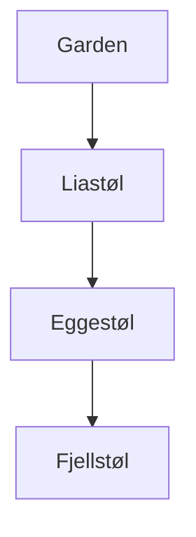

# NOU 1974: 30 - B Hardangervidda. Natur – kulturhistorie – samfunnsliv

NOU 1974: 30 B HARDANGERVIDDA natur - kulturhistorie - samfunnsliv

HARDANGERVIDDA I NORGE

BY AVSTAND FRA BY EUROPAVEG 76 JERNBANE OSLO-BERGEN PLANLEGGINGSOMRÅDET

BERGEN 150 km fra Bergen 150km fra Oslo

HAUGESUND STAVANGER 150 km fra Skien OSLO SKIEN 150 km fra Stavanger 150km fra Haugesund

KRISTIANSAND

Hardangervidda er det største fjellplatået i Europa. Planområdet dekker ca. 3% av det totale landarealet i Norge. Hardangervidda ligger sentralt i Sør-Norge. Luftlinjeavstanden fra Oslo, Skien, Stavanger, Haugesund og Bergen er mindre enn 150 km. Kommunikasjonene til Hardangervidda er gode. Europaveg 76 tangerer sørsida og jernbanen Oslo-Bergen nordsida.

NORGES OFFENTLIGE UTREDNINGER NOU 1974: 30 B HARDANGERVIDDA natur - kulturhistorie - samfunnsliv

Fra et utvalg oppnevnt ved kongelig resolusjon 20. august 1971. Utredningen avgitt 21. juni 1974.

1974 nr 30UNIVERSITETSFORLAGET OSLO – BERGEN – TROMSØ

ISBN 82-00-70149-2 Grøndahl & Søns Boktrykkeri 1974

Forord

Utvalgets mandatområde omfatter det som fra gammelt av har vært kalt Hardangviddo, Hardingviddi, Almannviddi eller bare Viddi. Dertil er de tilgrensende bygdelag tatt med. Selve høgfjellsplatået er avgrenset av Ustevassdraget og Hardangerjøkulen i nord, Eidfjord, Sørfjorden og Osafjorden i vest, Røldal, Vinje-dalføret, Totak og Møsvatn i sør og Tinnsdalene, Uvdal, Dagali og Skurdalen i øst. Mot nordvest og sørvest fortsetter høgfjellet. Nordafor har vi Hallingskarvet og Hemsedalsfjella og sønnafor Setesdal og Ryfylkeheiene. På østsida skjærer ei lang rekke daler seg innover i fjellet. Mellom dalene strekker fjellformasjonene seg østafor mandatets grense. Skurdalsåsen i det nordøstlige hjørne går via skogledde høgdedrag over i Norefjell. Dagalifjellet mellom Dagali og Uvdal har en naturlig grense mot Tunnhovdfjorden. Uvdalsfjellet mellom Tessungdalen og Uvdal går over i Blefjell. Fjella på begge sider av Møsvatn har en naturlig fortsettelse mot Hjartdal og Seljord. Avgrensninga av mandatområdet er vist på kart nr. 2. Naturen innen dette arealet er ikke ensartet. Selve høgfjellsplatået som overveiende ligger i 1100-1300 m.o.h. (se kart. nr. 5.) har arktisk karakter. Både plantelivet og dyrelivet viser dette. Vi finner sørgrensa for en lang rekke arter.

Hardangervidda er dertil Europas største høgfjellsplatå. Denne kombinasjonen av størrelse og karakter gjør det berettiget å si at Hardangervidda er enestående. Fra fjellet har vi en mer eller mindre gradvis overgang til lågland. Denne overgangssona er viktig på mer enn en måte. Planter som står nær grensa for sin utbredelse kan ofte ikke utvikle modent frø. Formeringa kan da skje ved at modent frø ved hjelp av dyr eller vind fraktes oppover. Tilsvarende er dyrelivet på fjellslettene til tider avhengig av å komme nedover i skogkledde strøk for å overleve. Menneskene har oftest funnet vilkår for bosetting så langt opp som skogen rekker, samtidig som en stor del av næringsgrunnlaget er høstet i fjellet. Skoggrensestrøket er dermed en funksjonell del av fjellet, både for planter, dyr og mennesker. De enkelte komponentene er behandlet senere i rapporter om landskap, geologi, klima, planteliv og dyreliv, kulturhistorie og samfunnsliv. Mellom og innen komponentene har vi et samspill. Å belyse dette totale samspill i alle avskygninger er en umulig oppgave. I denne framstillinga vil vi begrense oss til enkelte trekk som ut fra vår viten i dag har særlig betydning for de beslutninger Utvalget skal treffe.

I denne framstillinga vil vi begrense oss til enkelte trekk som ut fra vår viten i dag har særlig betydning for de beslutninger Utvalget skal treffe.

For Utvalget. Sverre Oustedal formann

Jon Godal sekretær

INNHOLD

Side

**FORORD**

**Kap. 1 OM UTVALGET FOR SAMORDNET
PLANLEGGING AV HARDANGERVIDDA**
1.1 Forarbeidene
1.2. Utvalget
1.3. Faglige rapporter
1.4. Innstillinga

**Kap. 2 NATUREN**
2.1. Kartsituasjonen
2.2. Landskapet på Hardangervidda og de
tilgrensende daler..
2.2.0. Hovedpunkt om landskapet
2.2.1. Hva er landskap?
2.2.2. Landskapsrom
2.2.3. Landemerker, bevegelseslinjer og kanter
2.2.4. Fosser
2.2.5. Kulturlandskap og symbolverdier
2.2.6. Oppleving av motstand
2.2.7. Litteratur
2.3. Hardangerviddas klima
2.3.0. Hovedpunkt i klimarapporten
2.3.1. Innledning
2.3.2. Generell klimaoversikt
2.3.3. Lokale klimavariasjoner
2.3.4. De aktuelle klimaforhold i funksjonell
samfunnsplansammenheng
2.4. Hardangerviddas geologi m.v....
2.4.0. Hovedpunkt om geologi m. v.
2.4.1. Hardangerviddas berggrunn
2.4.2. Hardangerviddas kvartærgeologi
2.4.3. Hardangerviddas breer
2.4.4. Limnologien på Hardangervidda
2.5. Plantelivet på Hardangervidda...
2.5.0. Hovedpunkt om plantelivet på Hardangervidda
2.5.1. Plantelivet på Hardangervidda
2.5.2. Nærmere om vegetasjonskartlegging
2.5.3. Tilveksten av enkelte myrer på Hardangervidda
2.6. Dyrelivet på Hardangervidda
2.6.0. Hovedpunkt om dyrelivet
2.6.1. Allment
2.6.2. Vilt
2.6.. Fisk og fisket

**Kap. 3 HARDANGERVIDDAS KULTURHISTORIE..**
3.0. Hovedpunkt om Hardangerviddas kulturhistorie

Side

3.1. Innleiing 3.1.0. Føreord 3.1.1. Historikk 3.1.2. Naturgrunnlaget 3.1.3. Kjeldegrunnlaget 3.2. Bruken av naturgrunnlaget 3.2.1. Byttedyra 3.2.2. Beitebruk 3.2.3. Råstoffbruk 3.3. Busetjingsformer og bruksmåtar 3.3.1. Om tilpassningsformer 3.3.2. Tilpassing på Vidda.. 3.3.3. Produksjon av mat som livbergingsmåte 3.3.4. Stadnamn 3.4. Vurdering og vidare gransking 3.4.1. Kva for område er undersøkte? 3.4.2. Kva vitskapleg og pedagogisk verd har dei område vi kjenner? 3.4.3. Trong til nærare granskingar

**Kap. 4 BEITEBRUK OG DYRKINGSVERDIER.**
4.0. Hovedpunkt om beitebruk og dyrkingsverdier
4.1. Innledning
4.1.0. Føreord
4.1.1. Generelt
4.1.2. Historisk oversikt
4.2. Beiteforholda på Hardangervidda
4.2.1. Oversikt
4.2.2. Avkastning på beite
4.2.3. Seterbruket
4.3. Dyrkingsjord og grasproduksjon
4.7. Vurdering av jordbruksmessig utnytting av ressursene
4.4. Jordbruksinteressene i konflikt med
andre interesser
4.5. Generell litteratur om beite og jorddyrking

**Kap. 5 OPPSUMMERING AV LANDSKAPSVERDIER**
5.0. Hovedpunkt i oppsummering av landskapsverdier

4.5. Generell litteratur om beite og jorddyrking
**Kap. 5 OPPSUMMERING AV LANDSKAPSVERDIER**
5.0. Hovedpunkt i oppsummering av landskapsverdier
5.1. Innledning
5.2. Oppsummering av landbruksverdier
5.3. Oppsummering av vitenskapelige og
pedagogiske verdier

NOU 1974: 30 B VIII Hardangervidda, natur - kulturhistorie - samfunnsliv.

Side 5.4. Oppsummering av landskapsestetiske verdier 5.5. Oppsummering av opplevingsverdier. Kap. 6 EIENDOMSFORHOLD PÅ HARDANGERVIDDA 6.0. Hovedpunkt i rapporten om eiendomsforhold 6.1. Innledning 6.2. Historisk oversikt 6.2.1. Alminnelig bruk av Vidda 6.2.2. Ferdselen over Vidda 6.2.3. Jakt og fiske 6.2.4. Støler 6.2.5. Felægre 6.2.6. Tamreinholdet 6.3. Lovbestemmelser 6.4. Fortegnelse over statsalmenninger på Hardangervidda 6.5. Bygdealmenning 6.6. Eiendomsforholdene på Hardangervidda. Kommunevis beskrivelse 6.6.1. Innledning 6.6.2. Vinje kommune 6.6.3. Tinn kommune 6.6.4. Nore og Uvdal kommune 6.6.5. Hol kommune 6.6.6. Ullensvang kommune 6.7. Eiendomsforhold på Hardangervidda. Samlet oversikt 6.7.1. Arealer 6.2.7. Antall eiendommer 6.8. Litteraturliste 6.9. Innholdsomtale av noe av den litteratur som er brukt 6.9.1. O. Olafsen: De viktigste støler og Fælægre paa Hardangerviddens nord- og vestside 6.9.2. O. Olafsen: Om eiendomsretten til Hardangervidden 6.9.3. HTK Undersøkelser på Hardangervidda 1969 6.9.4. Oversikt over jordskiftekart som finnes på Hardangervidda

Kap. 7 HARDANGERVIDDA I DAG 7.0. Innledning 7.1. Administrasjon og forvaltning 7.1.0. Hovedpunkt om administrasjon og forvaltning 7.1.1. Utgangspunkt 7.1.2. Arealdisponering 7.1.3. Saker som gjelder eiendomsrett 7.1.4. Byggetiltak og andre landskapsinngrep som ikke kommer inn under bygningsmyndighetene 7.1.5. Utnytting av biologisk produksjon 7.1.6. Ferdsel 7.1.7. Vitenskap og undervisning m. v. 7.2. Militære øvingsområder 7.2.0. Hovedpunkt om militære øvingsområder 7.2.1. Watnebrynutvalgets innstilling. Forsvarets behov for øvingsområder

Side

7.2.2. Manøvrer 7.2.3. Lavflyging 7.3. Trafikk 7.3.0. Hovedpunkt om trafikk 7.3.1. Fotgjengere 7.3.2. Bilister 7.4. Kommunene rundt Vidda 7.4.0. Hovedpunkt om kommunene 7.4.1. Almen karakteristikk 7.4.2. En del statistiske data 7.5. Plansituasjonen 7.5.0. Hovedpunkt i planer 7.5.1. Områdevern 7.5.2. Veger 7.5.3. Kort sammendrag av prinsipper som er lagt til grunn for region- og generalplaner med særlig omtale av den turistmessige utbygginga 7.5.4. Sammendrag av plansituasjonen ... 7.5.5. Gjeldende vedtekter 1973 for arealbruken utenom tettstedene i de 7 kommunene 7.6. Grunneiernes ønsker, behov og planer m. v. 7.6.0. Hovedpunkt om grunneiernes ønsker og planer 7.6.1. Forord 7.6.2. Innledning 7.6.3. Oversikt over grunneierlag og større sameier 7.6.4. Grunneiernes syn på utnyttelsen av Hardangervidda 7.6.5. Grunneiernes antatte inntekter av forskjellige utnyttelsesformer 7.6.6. Avgrensningen av Hardangervidda 7.6.7. Samarbeidsordningens planer for, og forslag til organisasjonsplan for Hardangervidda 7.7. Noen brukerkategoriers tilknytning til Hardangervidda 7.7.0. Hovedpunkt i tre intervjuundersøkelser 7.7.1. Sammendrag av en landsomfattende undersøkelse 7.7.2. Sammendrag av en intervjuundersøkelse blant folk som bor i bygdene rundt Hardangervidda 7.7.3. Sammendrag av en intervjuundersøkelse blant folk som ferierer på og ved Hardangervidda 7.8. Turisme 7.8.0. Hovedpunkt om turisme 7.8.1. Innledning 7.8.2. Samspill med andre næringer 7.8.3. Økonomi og sysselsetting 7.8.4. Sysselsetting i kommunene 7.8.5. Turistbedrifter 7.8.6. Kommunikasjoner 7.8.7. Former for turistbygging og rekrasjon 7.8.8. Turistmessig utbyggingspotensiale, sannsynlig utbyggingspress og konfliktmuligheter 7.8.9. Et prinsippopplegg for fotrutenettet 7.8.10. Litteratur 7.9. Sosialturisme 7.9.0. Hovedpunkt om sosialturisme 7.9.1. Forord 7.9.2. Om utredningen 7.9.3. Hva er sosialturisme? 7.9.4. Etterspørselsforhold

7.9. Sosialturisme 7.9.0. Hovedpunkt om sosialturisme 7.9.1. Forord 7.9.2. Om utredningen 7.9.3. Hva er sosialturisme? 7.9.4. Etterspørselsforhold

NOU 1974: 30 B Hardangervidda, natur - kulturhistorie - samfunnsliv. IX

Side 7.9.5. Realisering av miljøbytte

7.9.6. Krav til tilbudet - lokaliseringskriterier 319 7.9.7. Vurdering av tilbud og virkemidler 320 7.9.8. Videre analysebehov

7.9.9. Litteraturliste

7.10. Søppel, skrot og andre synlige spor etter menneskenes bruk i dag

7.10.0. Hovedpunkt om søppel

7.10.1. Oppdraget

7.10.2. Metodikk

7.10.3. Resultater

7.10.4. Diskusjon

Kap. 8 OMRÅDEVERN.

8.0. Hovedpunkt om områdevern

8.1. Hva er områdevern?

8.2. Motiver for områdevern

Side 8.3. Typer av objekter

8.4. Oppsummeringer

8.5. Lovverket

8.5.1. Naturvernloven av 19. juni 1970

8.5.2. Annen spesiallovgivning

8.5.3. Oreigningsloven av 23. oktober 1959 331 8.5.4. Bygningsloven av 18. juni 1965

8.5.5. Strand og fjellplanloven

8.6. Alminnelige bestemmelser for nasjonalparker

8.7. Litteratur

Kap. 9 LITTERATUROVERSIKT

9.1. Litteratur om natur

9.2. Litteratur om kulturhistorie

9.3. Bibliografier

D CHARITA..................................... B

ULVIK Poo ہے

ULLENSVANG

HORDALAND ODDA P P TEGNFORKLARING ...................

سلامی MANDATGRENSE FYLKESGRENSE KOMMUNEGRENSE GRENSE MOT PLANOMRÅDE FOR AGDER OG ROGALAND

VINJE D HOL

♡ BUSKERUD NORE-UVDAL G TELEMARK

B TINN ♡ N ............. C 5 10 15 20 25km

Planområdet er totalt ca. 9800 km². (Vann- og sjøareal inkludert.) Det fordeler seg slik på kommunene: Hol 600 km² Nore-Uvdal

Tinn

Vinje

Odda

Ullensvang

*
Ulvik

ålestokk ca 1: 700 000 LUSTRASJON NR.002

SAMORDNET PLAN HARDANGERVIDDA FREMLAGT AV UTVALGET FOR SAMORDNET PLANLEGGING AV HARDANGERVIDDA OPPRETTET VED KONGELIG RESOLUSJON 20 AUGUST 1971 PLANOMRÅDET Buskerud har altså 1900 km² Telemark og Hordaland

innen det området som blir planlagt av Utvalget. (Tallene er fremkommet ved bruk av planimeter i M. 1:250 000).

DISPOSISJON FOR PRESENTASJON AV UTREDNINGSMATERIALE BOK B HARDANGERVIDDA, NATUR, KULTURHISTORIE, OG SAMFUNNSLIV Grunnlagsmateriale for utvalgets innstilling (Bok A) REGISTRERING AV NATUR, MENNESKEVERK OG AKTIVITET TOLKING OG SAMMENFATTING AV REGISTRERINGSMATERIALET KAP

OM UTVALGET 1 Hardangervidda i Norge 2 Mandatområdet KAP 2 NATUR 3 Kartsituasjonen 4 Landskapskarakter 5 Høgdelag 6 Frie topper 7 Vakre landskap 8 Villmarksområder 9 Klima 10 Bergarter 11 Løsavleiringer 12 Vassdrag 13 Planteliv 14 Dyreliv 15 Liv i vann ه ه ه KAP 3 KULTURHISTORIE KAP 16 Kulturminner 4 JORDBRUK 17 Jordbruk KAP 5 OPPSUMMERING 17 Landbruksverdier 18 Vit. og ped. verdier 19 Estetiske verdier KAP 6 EIENDOMSFORHOLD 21 Eiendomsforhold 20 Opplevingsverdier KAP 7 VÅR TID 22 Vår tids spor

18 Vit. og ped. verdier 19 Estetiske verdier KAP 6 EIENDOMSFORHOLD 21 Eiendomsforhold 20 Opplevingsverdier KAP 7 VÅR TID 22 Vår tids spor

25 Nedlagte veger 26 Lavflyging 27 Trafikk 28 Folketall

" 30 Tidl. forslag til nasj.park 31 Eksisterende planer 32 Grunneierlag 33 Turistm. utbygging 37 Søppelinventering 34 Verneverdi 36 Konflikter 35 Utbyggingspress KAP 8 OMRÅDEVERN KAP 9 LITTERATUR

.... Disposisjon av tekst Oppbygging av kartmaterialet Kobling av kartinnhold BOK A Tilråding om BRUKEN AV HARDANGERVIDDA (Utvalgets innstilling) VURDERING KAP

PRINSIPPDRØFTING........ KAP 5 OMRÅDEVERN KAP

KONKLUSJON 38 Klassifisering 39 Prinsippskisse 40 Områdevern REISELIVSNÆRING OG REKREASJON 41 Sonedeling KAP

LANDBRUK KAP

VEDTEKTER TIL BYGNINGSLOVEN KAP

OM OVERFØRING AV EIENDOMSRETT KAP

FORVALTNING KAP

DIVERSE FORSLAG 42 Hovedplan fotruter 43 Vedtekter 44 Overføring 45 Lavflyging

ULVIK 1316 "

D வய ULVIK HOL 1516 " AL

GOL 1616" MYRDAL HARDANGERJØKULEN HALLINGSKARVET

HARDANGERVIDDA TURISTKART

HARDANGER- HALLINGJØKULEN SKARVET ♡ ULLENSVANG

EIDFJORD 1415 IV BJOREIO

ULLENSVANG NN ♡ B RINGE DALSVAT NET DAAREGEN 1315"

ODDA RØLDALA

SULDALSVATN 3/4

P

P

HAUKELISETER

NORDMANNSLAGEN 1415"

DAGALI N TUNNHOVD HEIN 1515 IV SKURDALEN

UVDAL

SKJØNNE

BUSKERUD LÅGAROS

NORE-UVDAL G

KALHOVD 1545" MÅR AUSTBYGDI

ODDA NORE NORE1615" No.31,32-15 THAN FRØYSTUE

RJUKAN

TINNSJO 1614'

RJUKAN TINNSJØ SONGEVATN

VINJE SAUDA No.32-1 B BITDALSVATN 1514 IN TELEMAR RAULAND

BREIVER

SÆSVATN

JE EGNFORKLARING KARTSERIE 1501 1:250 000 TOPOGRAFISKE KART 1:100000 TURISTKART 1: 200 000 KARTSERIE 711 1:50 000 ØKONOMISK KART 1:5000, FERDIG ELLER UNDER ARBEID SKIEN AMOTSDAL 514" No.32-2

0 5 10 15 20 25km

SAMORDNET PLAN lestokk ca 1: 700 000 LUSTRASJON R.003

HARDANGERVIDDA FREMLAGT AV UTVALGET FOR SAMORDNET PLANLEGGING AV HARDANGERVIDDA OPPRETTET VED KONGELIG RESOLUSJON 20 AUGUST 1971 - KARTSITUASJONEN Planområdet er fullstendig dekket av kart i vanlige topografiske målestoker 1:250 000, 1:100 000 og 1:50 000. Kartet viser den gjeldende bladinndeling. Den økonomiske kartlegging i M = 1:5000 har bare kommet i gang i Hordaland og i Vinje i Telemark. (Kilde NGO).

NOU 1974:30 В Hardangervidda, natur kulturhistorie samfunnsliv.

ΚΑΡΙΤΤEL 1. Om utvalget for samordnet planlegging av Hardangervidda 1.1. FORARBEIDENE Fylkesmannen tok i 1968 initiativ til en samordnet planlegging av Hardangervidda. Saka var blandt annet drøftet i Fylkesfriluftsnemnda, som rådde til: at bruksrett og eiendomsrett på Hardangervidda skulle forbeholdes aktive gard. brukere i fjellbygdene. at fjellbeitene måtte utnyttes bedre. at jakt og fiske ble utnyttet bedre. at almenheten måtte få bedre adgang til friluftsliv og rekreasjon. at Hardangervidda vurderes overført til staten for å sikre en slik utnytting som nevnt ovafor. Saka ble tatt opp i møte i Kommunal- og arbeidsdepartementet den 25. mars 1969. Til stede på møtet var fylkesmennene m.fl. fra Hordaland, Buskerud og Telemark, representanter fra Norges Bondelag og fra Industridepartementet, Landbruksdepartementet og Kommunaldepartementet. Representanten Gunnar Hvashovd framsatte i Stortinget den 7. april 1970 følgende forslag: <<<Det henstilles til Regjeringen snarest mulig å oppnevne et eget utvalg for Hardangervidda, med mandat å lede og koordinere arbeidet med en rammeplan for arealdisponering og utnytting av hele Vidda.>>> Forslaget ble oversendt Regjeringen. I brev fra fylkesmennene i Telemark, Hordaland og Buskerud av henholdsvis 20. februar, 3. mars og 3. september 1970 ble det tatt initiativ til en felles planlegging av Hardangervidda. Utvalget for samordnet planlegging av Hardangervidda ble oppnevnt ved Kongelig Resolusjon 20. august 1971 og fikk følgende mandat: <<<Planen skal omfatte målsetting og hovedretningslinjer for en samordnet grunnutnytting og konkret peke på tiltak som er nødvendige for å sette planen ut i livet. Planen forutsettes å bli rettledende for region, general og reguleringsplaner i området og bør kunne nyttes som delgeneralplan for vedkommende kommuner. Planen skal ikke være mer detaljert enn nødvendig for å klarlegge og fremme løsningen av de spørsmål som har betydning i landssammenheng, herunder landbruk, naturvern, vitenskap og friluftsliv. Så vidt angår spørsmålet om utbygging, ikke utbygging av vassdrag på Hardangervidda, forutsettes dette vurdert og avgjort på sentralt hold bl.a. i forbindelse med behandlingen av Sperstadutvalgets rapport om vern av vassdrag. Hvis det blir vedtatt utbygging av enkelte vassdrag, finner en det naturlig at planleggingutvalget vurderer sider ved det eller de prosjekter som gjennomføres.>>>

vedtatt utbygging av enkelte vassdrag, finner en det naturlig at planleggingutvalget vurderer sider ved det eller de prosjekter som gjennomføres.>>>

NOU 1974: 30 B

1.2. UTVALGET Hardangervidda, natur kulturhistorie Følgende ble oppnevnt som medlemmer og varamedlemmer: 1. Professor Sverre Øvstedal (formann) 2. Ordfører Knut Brekke (varamedlem gardbruker Julius Deinboll) 3. Regionplanlegger Petter Flatland (varamedlem regionplanlegger Poul Heegaard) 4. Professor Anders Hagen (varamedlem konservator Bjørn Myhre) 5. Byråsjef Kjell Hauge (Varamedlem konsulent Arne R. Skage) 6. Fabrikkarbeider Ragnvald Henriksen (varamedlem banksjef Severin Syversen) 7. Fylkesbyggesjef Arne Kjos (varamedlem gardbruker Alf Medhus) 8. Inspektør Aud Mork Knutsen (varamedlem konsulent Jon Ødegård) 9. Kommuneingeniør Torstein Møen (varamedlem planteskolebestyrer Ragnvald Fleten) 10. Lærer Olav Nystog (varamedlem gardbruker Knut Bjåen) 11. Overbetjent Hartvig Berg Olsen (varamedlem gardbruker Knut O. Røysland) 12. Fylkesreguleringsarkitekt Johan Jervell Pettersen 13. Herredsagronom Hans Solberg (varamedlem ekspedisjonssjef Helge Christensen) 14. Byråsjef Ole Swang (varamedlem konsulent Kjell Haagensen) 15. Gardbruker Jakob Sæbø (varamedlem banksjef Johs. H. Helleland) 16. Herrelsagronom Kåre Aasen (varamedlem lærer Syver Endrestøl) samfunnsliv. Rep. for: Nore og Uvdal kommune Buskerud fylke Kirke- og undervisningsdepartementet Miljøverndepartementet Telemark fylke Odda kommune Samferdselsdepartementet Ulvik kommune Vinje kommune Tinn kommune Hordaland fylke Landbruksdepartementet Industridepartementet Ullensvang kommune Hol kommune Regionplanlegger Petter Flatland trådte ut av utvalget pr. 28. februar 1973. Regionplanlegger Poul Heegaard har fra denne dato og til utvalget avsluttet sitt arbeide, vært Buskeruds representant. Som varamedlem for Heegaard er oppnevnt generalplanlegger Dag Ørjansen. Fylkesbyggesjef Arne Kjos trådte ut av utvalget 19. juli 1973. Gardbruker Alf Medhus ble fra samme tidspunkt oppnevnt som medlem. Gardbruker Jon Digranes ble oppnevnt som ny varamedlem etter Alf Medhus. Til å forestå de daglige gjøremål valgte utvalget på sitt første møte et arbeidsutvalg. Dette har hatt denne sammensetningen: Formannen, professor Sverre Øvstedal Fylkesrepresentantene: Regionplanlegger Petter Flatland i tida 21. august 1971 til 28. februar 1973 og regionplanlegger Poul Heegaard etter 1. mars 1973 fra Buskerud. Fabrikkarbeider Ragnvald Henriksen fra Telemark og fylkesreguleringsarkitekt Johan Jervell Pettersen fra Hordaland. Miljøverndepartementets representant, byråsjef Kjell Hauge. En representant for kommunene, gardbruker Jakob Sæbø. Den 11. juli 1973 sendte utvalget ut noe som ble kalt en prøveplan (prøveplanen følger som utrykt vedlegg til instillinga). Den var en foreløpig presentasjon av grunnlagsmateriale og en kort drøfting av noen sentrale problemstillinger. Prøveplanen var utarbeidet av sekretariatet og arbeidsutvalget godkjente utsendinga uten at medlemmene ved dette hadde bundet seg til innholdet. Den ble sendt til de instansene som hadde

og arbeidsutvalget godkjente utsendinga uten at medlemmene ved dette hadde bundet seg til innholdet. Den ble sendt til de instansene som hadde

NOU 1974: 30 B Hardangervidda, natur tatt del i planprosessen, kommuner, fylker, departement og faginstanser. Utvalget hadde i august 1973 møter med formannskapene om prøveplanen. Utvalget delte seg nå i problemgrupper som tok for seg og drøftet nærmere særlige delproblemer. Problemgruppene var sammensatt slik: Gruppe for områdevern: Fylkesreguleringsarkitekt Johan Jervell Pettersen (form.) Byråsjef Kjell Hauge Professor Andres Hagen Gardbruker Jakob Sæbø Lærer Olav Nystog Byråsjef Ole Swang (sekr.) Gruppe for landbruk: Ordfører Knut Brekke (form.) Herredsagronom Hans Solberg Politioverbetjent Hartvig Berg Olsen Gardbruker Alf Medhus Herredsagronom Kåre Aasen (sekr.) Gruppe for reiselivsnæring og rekreasjon: Inspektør Aud Mork Knutsen (form.) Fabrikkarbeider Ragnvald Henriksen Kommuneingeniør Torstein Møen Regionplanlegger Poul Heegaard (sekr.) Sekretær for utvalget har vært førstkandidat Jon Bojer Godal. Han har vært tilsatt fra 15. februar 1972 til 15. april 1974 Arbeidsdokumenter, ekspedisjon og tegninger er gjort ved Institutt for jordskifte og eiendomsutforming, Norges landbrukshøgskole. 1.3. FAGLIGE RAPPORTER Utvalget har på grunn av tidsramma for arbeidet (2 år) i begrenset utstrekning iverksatt egne inventeringer. Vurderingene bygger i hovedsak på viten som er ervervet i andre sammenhenger. Utvalget har forsøkt å samle og ordne denne kunnskapsmengda. Den kan tjene til: alminnelig orientering om hva Hardangervidda er, grunnlag for beslutninger og disponeringer. grunnlag for beslutninger om nærmere gransking. Disponeringa av Hardangervidda må sees under et langsiktig perspektiv. Drøfting og verdiavveining er derfor gjort både i forhold til en behovsdekning på lang sikt og i forhold til de konkrete interessene som gjør seg gjeldende i dag. Dette virket på materialeinnsamlinga. Utvalget har prøvd å avdekke konflikter som foreligger i samband med en utnytting av de forskjellige ressursene. Den kulturhistorie samfunnslıv.

største selvstendige inventeringa utvalget har gjort er derfor nettopp «interesseinventeringa» en intervjuundersøkelse blant Viddas forskjellige brukerkategorier. Utvalget har fått faglige rapporter fra følgende personer/institusjoner: Kartsituasjonen: Utvalgets sekretær. Landskap: Utvalgets sekretær. Klima: Stipendiat Arne K. Sterten, Arkitekthøgskolen, Oslo. Geologi: Cand. real. Tore O. Vorren, Hardangervidda tverrvitenskapelige kulturforskningsprosjekt, Historisk Museum, Bergen og stipendiat Arild Andersen, Geologisk Museum, Oslo. Planteliv: Vit.ass. Kåre Lye Botanisk institutt, NLH og Jorddirektoratet, avdeling for jordregistrering, Ås. Dyreliv: Direktoratet for jakt, viltstell og ferskvannfiske, Trondheim. Kulturhistorie: Hardangervidda tverrvitenskapelige kulturforskningsprosjekt, Historisk Museum, Bergen. Landbruk og seterdrift: Jorddirektoratet, avdeling for jordregistrering, Ås. Oppsummering av landskapsverdier: Utvalgets sekretær. Eiendomsforhold: Jordskiftekontoret, Landbruksdepartementet. Samfunnsliv og næringsliv i kommunene: Utbyggingsavdelingene i de tre fylker. Grunneiernes planer og ønsker: Samarbeidsordningen for jakt, fiske og bygdeturistnæring, Oslo.

i kommunene: Utbyggingsavdelingene i de tre fylker. Grunneiernes planer og ønsker: Samarbeidsordningen for jakt, fiske og bygdeturistnæring, Oslo.

NOU 1974: 30 B

Hardangervidda, natur Viddabrukeres bruk og holdning (intervjuundersøkelser): Cand. mag. Jon Teigland og medarbeidere, Oslo. Utredning om forsøpling: Institutt for skogtaksering, Ås NLH. Turisme: Utvalgets medlem Poul Heegaard og utvalgets sekretær. Utredning om sosialturisme: Utvalg for reiselivsforskning, TØI Slemdal, Oslo 3. Områdevern: Utvalgets medlem Ole Swang og utvalgets sekretær. Dessuten har utvalget mottatt en del henvendelser og utredninger fra interesseorganisasjoner og enkeltpersoner. De viktigste er: Vedrørende fotturisme: Den Norske Turistforening, Oslo. Vedrørende litteratur om Hardangervidda og områder av særlig interesse for forskning: Den høgfjellsbiologiske forskningsstasjon, Finse og Hardangervidda tverrvitenskapelige kulturforskningsprosjekt, Bergen. Utvalget har også mottatt vesentlig informasjon ved møter i kommunene. 1.4. INNSTILLINGA Utvalget for samordnet planlegging av Hardangervidda leverer sitt materiale i tre hoved deler. kulturhistorie samfunnsliv. 1) Utvalgets instilling heter BRUKEN AV HARDANGERVIDDA (bok A). Den inneholder utvalgets vurderinger og konklusjoner i tillegg til et kort sammendrag av utvalgets grunnlagsmateriale. Kart som viser utvalgets prinsippdrøftninger og forslag er nummerert og heftet inn i den boka. De er nummerert fra nr. 38-45. 2) Denne boka gjengir utvalgets faglige grunnlagsmateriale og heter HARDANGERVIDDA natur, kulturhistorie og samfunnsliv, (Bok B). Den behandler Hardangerviddas natur og kulturhistorie og gir en framstilling av samfunnslivet på og ved Hardangervidda i dag. Den er et vedlegg til selve instillinga. Bok B inneholder kartillustrasjoner nummerert fra 1-37. 3) Mesteparten av kartmaterialet er grovt orienterende og i målestokk 1:700 000 og 1:500 000. Noen tema hadde såpass detaljerte opplysninger at disse målestokkene ble for små. For disse temaene er det laget to kart, ett sammendrag som er tatt inn i bøkene og ett i målestokk 1: 250 000 som ligger i egen konvolutt. Dette gjelder kartnr. 11, 14, 15, 16, 17 og 40. Kart nr. 46, som er en oppsummering av planforslag er bare gjengitt i 1: 250 000. Utvalget håper dokumentasjonen har interesse i flere sammenhenger. De organene som skal fatte beslutninger om planen vil ha nytte av en mer detaljert faglig innføring. Brukere av Vidda har trolig interesse av en bredere innføring i områdets naturmessige og kulturhistoriske egenart. Skolene i de 7 tilgrensende kommuner kan antagelig bruke noe av materialet til heimstadlære.

i områdets naturmessige og kulturhistoriske egenart. Skolene i de 7 tilgrensende kommuner kan antagelig bruke noe av materialet til heimstadlære.

NOU 1974: 30 B Hardangervidda, natur — kulturhistorie — samfunnsliv.

KAPITTEL 2. Naturen

2.1. KARTSITUASJONEN Avsnittet er laget av utvalgets sekretær.

Innen mandatområdet er terrenget gjengitt i forskjellige karttyper. De viktigste er

| kartbetegnelse               | målestokk                        | utgiver                                         |
| :--------------------------- | :------------------------------- | :---------------------------------------------- |
| Geografiske                  | 1:250 000 og mindre              | NGO og private utgivere                         |
| Topografiske                 | 1:250 000 — 1:100 000 og 1:50 000 | NGO (Norges Geografiske oppmåling)             |
| Geologiske                   | 1:250 000 — 1:100 000 og 1:50 000 | NGU (Norges Geo-logiske undersøkelse           |
| Tekniske, topografiske og geografiske | 1:100 000 — 1:1 mill.            | Norges Vassdrags og elektrisitetsvesen (hovedsakelig til eget bruk) |
| Tekniske                     | 1:5 000 og større                | Statens vegvesen (hovedsakelig til eget bruk)   |
| Tekniske og økonomiske       | 1:1 000 — 1:10 000               | Jordskifteverket (vesentlig til jordskiftesaker) |
| Temakart for jordbruksverdier og planteliv | 1:250 000, 1:100 000 etterhvert også 1:20 000 | Jorddirektoratet avdeling for jordregistrering   |
| Økonomisk kartverk           | 1:5 000 og 1:20 000              | Fylkene i samarbeid med NGO, jordskifteverket og jorddirektoratet m.fl. |
| Tekniske                     | 1:1 000 — 1:5 000                | Kommunene (hovedsakelig til eget bruk)           |

En nærmere definisjon og oversikt over de forskjellige karttypene er gitt i «Innstilling om beskyttelse av kart» avgitt 11.1.1971 til Samferdselsdepartementet.

En oversikt over kartdekningen av Hardan-gervidda for noen av de mest brukte og al-ment tilgjengelige karttypene er gjengitt på kartillustrasjon nr. 3. NOU 1974:30 B Hardangervidda, natur — kulturhistorie — samfunnsliv.

2.2. LANDSKAPET PÅ HARDANGERVIDDA OG I DE TILGRENSENDE DALER

Rapporten er laget av utvalgets sekretær. Stedsnavn er tilrettelagt av stedsnavnsforsker Botolv Helleland.

2.2.0. Hovedpunkt om landskapet. 1. Med landskapet forstår vi det vi opplever av miljøet rundt oss gjennom sansene. (Synsinntrykk, lukt, osv). Det er ikke noe ensidig visuelt. 2. Landskapsbeskrivelsen er dermed innfløkt. To hovedmåter er fulgt. Den ene går ut på å måle visse forhold som bratthet, høydelag, variasjon og tidsavstand (kartill. nr. 4, 5, 6 og 7). Den andre går ut på en mer subjektiv bedømmelse av hva som er vakkert og særmerkt (kartill. nr. 4 og 7). 3. Hardangervidda har slettekarakter på den nordlige delen sør for riksveg 7. Subalpin heislette finner vi ved østenden av Møsvatnet. Særlig monumentale landskap finner vi på vestsida og i Tinn. Særlig kupert er den sørvestlige delen. 4. De eldste navna antas å ha en særlig landskapsbeskrivende betydning ettersom det er naturlig å sette navn på de største for-masjonene først. Elvene har overveiende de eldste navna. Dernest kommer særlig markerte fjell. Vann er ofte navnsatt i forhold til fjell eller elv. (Se kartill. nr. 4). 5. De flotteste fosselandskapene er Måbødalen med Vøringen, Hjølmodalen med Valurfossen, Kinsodalen med Søtefossen, Reinsnosdalføret med Låtefoss. Særlig preget av roligere vannrike elver er Kvenndalen og Dagali-dalføret. 6. Kulturlandskap og landskap med stor symbolverdi har vi i Eidfjord, Reinsnos-dalføret, Røldal, Rauland, Tinn, Dagali og på sentralvidda (se kartill. nr. 7). Det er behov for en nærmere registrering av buer og slep som kan restaureres (skånsomt). 7. Området er delt inn i tidssoner på kart nr. 7. På sentralvidda finner vi 400 km² med kvalifisert villmark».

slep som kan restaureres (skånsomt). 7. Området er delt inn i tidssoner på kart nr. 7. På sentralvidda finner vi 400 km² med kvalifisert villmark».

2.2.1. Hva er landskap? Ordet betyr landform og har dermed nesten samme innhold som topografi (stedsbeskrivelse). I dag legger vi gjerne noe mer i landskapsbegrepet enn i ordet topografi. Vi oppfatter det helst som sansenes oppfatFig. 2.2.1. Foto K. Bitustøyl Her er det «golvet» i landskapet som dominerer (Vombsflatana sør for Langevatn). NOU 1974:30 B Hardangervidda, natur — kulturhistorie — samfunnsliv.

ning av naturen. Å beskrive et landskap vil dermed si å fortelle hvordan vi sanser og opplever miljøet rundt oss direkte uten hjelp av abstraksjoner som f.eks. topografiske kart. Det problemet som man dermed strir med, er å utvikle et språk som kan formidle opplevelsen (se f.eks. Feste og Oterholm 1973). I prinsippet kan man følge to veier. Den ene er å innføre nye måleenheter og lage abstrakte kart på grunnlag av disse. Et eksempel kan være variasjon. Mange oppfatter variasjon som en verdifull egenskap. Variasjon kan måles på forskjellig vis. I denne framstillingen har vi målt den som antall frie topper (se kartillustrasjon nr. 6). Andre måter kan f.eks. være å måle lengden av randsoner pr. km². Variasjonen kan uttrykkes ved et isokart der isokotene går gjennom steder med like stor variasjon. (Oterholm og Myhrstad 1973). Styrken ved metoden er den samme som ved topografisk kartlegging. Vi innfører måleenheter som er eksakte. Svakheten er at vi måler enheter og ikke det vi er ute etter, nemlig opplevelse. Kokeboka beskriver eksakt sammensetning og tilbereding av den enkelte rett, men ikke gleden ved å spise. Den andre måten går derfor ut på å spørre folk hvor godt de liker landskapet, eller hva de synes det er som karakteriserer det. (Lynch) Fordelen med metoden er at vi får spontant uttrykk for opplevelset opplevelse som spenner over alle sanser — synsinntrykk, lukt, bevegelse, osv. Ulempen er at måleinstrumentet er mennesket selv. Vi må ha mange i terrenget for å finne regelmessige størrelser. Dessuten vil beskrivelsen kunne bli utilstrekkelig for dem som vil gjøre en selvstendig bedømmelse av hvordan landskapet egentlig er. (Ut fra beskrivelse av hvordan maten smaker, er det vanskelig å lage oppskrift). Nå viser enkelte forsøk at det kan være stor likhet mellom forskjellige personers subjektive bedømmelse av landskapskvalitet. Forsåvidt vil få personers bedømmelse kunne være relativt allmenngyldige. (Pers. medd. A.I. Oterholm, Inst. for hagekunst. NLH). De to nevnte metodene er brukt i framstillingen her. De supplerer hverandre og forteller begge noe vesentlig. Landskapet er beskrevet ved skyggelegging (kartill. nr. 4) ved variasjon (antall frie topper kartill. nr. 6), ved høydelag (kartill. 5) og ved tidsavstanden fra vei og kollektiv befordring (kartill. nr. 7), som alle kan sies å være relativt eksakte beskrivningsmåter. Dertil har vi fått inn tidenes bedømmelse av hva som er viktige landskapskomponenter ved å se på alder og betydning av navn (kartill. nr. 4).

Dertil har vi fått inn tidenes bedømmelse av hva som er viktige landskapskomponenter ved å se på alder og betydning av navn (kartill. nr. 4).

Fig. 2.2.2. Foto K. Bitustøyl Heislette ved østenden av Møsvatn. Gaustatoppen i bakgrunnen er et godt landemerke. NOU 1974:30 B Hardangervidda, natur — kulturhistorie — samfunnsliv.

På planleggerens skjønn er spesielt vakre eller karakteristiske landskap avmerket (kartill. nr. 7). Ved dette har vi ikke oppnådd en uttømmende beskrivelse. Vi håper imidlertid at de forskjellige beskrivningsmåtene supplerer hverandre og kan tjene til en viss orientering både som grunnlag for beslutninger og som orientering for ukjente.

2.2.2. Landskapsrom.

Når vi er i naturen, har vi følelsen av å være i noe romlig. Landskapsrommene kan imidlertid ha svært ulik størrelse og karakter. Ved å betrakte kartene 4, 5 og 6 ser vi at Hardangervidda er preget av store landskapsrom på den nordlige sentralvidda og mot sydøst. Her oppå fjellet er høgdeforskjellene stort sett små. Særlig velutviklet slettekarakter finner vi på sentralvidda nordover fra Nordmannslågen og Bjornesfjorden. Høgslette av subalpin karakter (altså i bjørkeskogbeltet) finner vi ved østenden av Møsvatnet. Gulvet dominerer i landskapsrommet. Særlig mot vest og øst, men også tildels på sørsida, er det svært få frie topper, men høydeforskjellene er store. Landskapet har en monumental karakter med store rom, der «veggene» er mer dominerende enn «gulvet». Særlig opplevingsrike typer er her Osa, Eidfjord og oppstigningene fra Kinsarvik og Lofthus. Fossene bidrar her sterkt til å skape dramatikk og spenning. Ikke fullt så monumental, men likevel storslagen, er Reinsnos-dalføret og Røldal. Røldal har dertil et kulturlandskap som er svært velutviklet. Steingarder, beiteland og gardsbruk er dominerende trekk. På sørsida gir Haukelifjellet et prektig panorama for bilturister. Mot øst peker Tinnbygdene seg ut på grunn av sin spesielt renskårne karakter og bygdene i Tinn velmøblerte kulturlandskap. Dagali har et landskap som i første rekke er langstrakt, rolig og preget av kultur. Uvdal markerer seg som en mellomting mellom Tinns-dalene og Dagali. Langs hele nordsida har vi et dramatisk møte mellom relativt rolig fjellslette og det steile Hallingskarvet. Lenger mot vest reiser Jøkulen seg som en hvit hette. Mellom Jøkulen og Skarvet får vi et høyfjellspreget og monumentalt landskap ved Finse. De store landskapsrommene har ofte sterk apell. Vi opplever dem intenst. Samtidig er de sårbare. Tekniske inngrep blir svært synlige. Dyra skremmes på stor avstand. Ved plassering av turistanlegg og turveier må vi på slike steder være særlig påpasselige. Spesielt små rom får vi der landskapet er

på stor avstand. Ved plassering av turistanlegg og turveier må vi på slike steder være særlig påpasselige. Spesielt små rom får vi der landskapet er

Fig. 2.2.3. Foto R. Frislid. Her dominerer veggene i landskapsrommet (Måbødalen mot Fossli).

Fig. 2.2.4. Foto R. Frislid Fossene skaper dramatikk og spenning (Nykkjesøyfoss i Husedalen). NOU 1974:30 B Hardangervidda, natur — kulturhistorie — samfunnsliv.

kupert og der høgdeforskjellene er små. Ved å holde sammen kart 5 og 6 får vi inntrykk av at Vestvidda mellom Kinso-dalføret og sørover mot Valldalen er særlig sterkt kupert. Dette kuperte området fortsetter sørøstover mot Haukelifjell og Vågslid. Langs Kjelavassdraget er landskapet tildels roligere, men slår igjen opp i mange topper nedover mot Bykleheiene. Mer isolerte områder som har mange frie topper og dermed mange rom finner vi øst for Hårteigen, mellom Nordmannslågen og Kvenna (Kringlesjånutane) nord for Møsvatn i Gryttjørnhøgdene mellom Sandsetdalen og Vikstul og sist sør for Seterdalen i Dagali. De småkuperte områdene har stor kapasitet til å ta opp mennesker og menneskeverk uten at disse vil virke dominerende. Vil man oppsøke ro, er det grunn til å finne fram områder med mange frie topper, ifølge kart nr. 6. Av biotopkartet går det fram at reinens hovedkalvingsområde nettopp er de kuperte høydene rundt øvre Veig, som samtidig har godt beite. Lignende forhold har vi ved Songa, som også har vært kalvingsområde (før reguleringa). De østlige og kuperte områdene er sannsynligvis særlig viktige for reinens vinterbeite. De gir mulighet for ro og har samtidig mange avblåste rabber. Dermed peker det sørveslige hjørnet seg ut som svært lagelig for fotturisme. Området vil kunne motta mange mennesker uten å virke overbelastet. Samtidig er konflikten til vilt og beitedyr liten (se kart 14 og 17. Et problem vil kunne være at disse områdene faktisk er for kupert. Det er vanskelig å ta seg fram.

2.2.3. Landemerker, bevegelseslinjer og kanter.

De merker seg ut ved at de er lett synlige og virker dermed orienterende. Kantene setter naturlige grenser. Landemerkene hever seg opp og virker som veivisere. Bevegelseslinjer kan være bevegelige komponenter (elver) eller være den linjen vi selv beveger oss langs — elver, daler, strender, rygger, veier. Dersom vi har vært på tur uten kart og etterpå skal beskrive hvor vi har gått, vil vi i stor utstrekning referere til landskapskomponenter av ovennevnte typer. Vi må tro at de som i tidligere tider levde av og i fjellet i særlig grad hadde et skarpt syn i så måte. Med dette for øye har stedsnavngransker Botolv Helleland gått inn i navnetilfanget på vidda for å se hva våre fedre har lagt mest vekt på. Han går ut fra at de eldste navnene markerer særlig viktige landskapstrekk.

i navnetilfanget på vidda for å se hva våre fedre har lagt mest vekt på. Han går ut fra at de eldste navnene markerer særlig viktige landskapstrekk.

Fig. 2.2.5. Hårteigen — den grå vegvisaren. Foto G. Lid NOU 1974:30 B Hardangervidda, natur — kulturhistorie — samfunnsliv.

Det viser seg da at elvene har et svært gammelt navnetilfang. Ofte har innsjøene fått navn etter elvene, f.eks. Mår — Mårvatn («vassmengd hav») Kvenna — Kvennsjøen (av kvann) Opo — Opesjo (som renner baklengs) Dernest har de markerte fjellformasjonene, landemerkene, ofte selvstendig betydning og har tildels av gammelt opphav. Fremst blant disse står selvsagt Hårteigen som så og si betyr landemerke. Tilsvarende: Einseten (som sit aleine) Algarden (svært høg) Argehovd (hovd — (hode) som er reist på ende) Synhovd, Syningen (som peiker seg ut) Jøkulen (isbreen) Skarvet (nakent berg) Grananutane (høye nutene?) Nup (som stikk fram) Landemerker, elver og rygger med gamle navn er avmerket på kart nr. 4 sammen med betydningen av navnet. Vi har her latt forfedrene gi en karakteristikk av fjell og lende. Namneliste med tydingar. Namnelista med tydingane er utarbeidd av Botolv Helleland, Norsk Stadnamnarkiv. Sjå elles kartillustrasjon nr. 4.

Mjølfjell Ulvik, Hordaland Mjøl og fjell, mjøl går her helst på den lyse fargen i fjellet, eller på samlingar av lys stein. «Det mjøla fjellet, dvs. av lysvoren stein.

Broksfjellet Aurland, Sogn og Fjordane Truleg laga av brok «bukse» og fjell; men det er noko uvisst p.g.a. s-komposisjonen. «Fjellet som har noko likskap med ei brok».

Vassfjøro Ulvik, Hordaland Genitivsform av vatn, og fjøre 'nedflødd strandline'; uvisst korleis ein skal tolka namnet, men det er mogeleg nuten er tenkt som ei «fjøre» på nordsida av Skrulsvatnet. Det er elles uvanleg med hokjønnsform i fjellnamn. «Fjøra over vatnet».

Ulvik Ulvik, Hordaland Ulv og vik, eigenleg namn på prestegarden. «Vika der det har vore (sett) ulv».

Krossfjellet Ulvik, Hordaland Kross og fjell, to fenner i kross. «Fjellet der to fenner ligg i kross».

Onen Eidfjord, Hordaland Kan koma av eit eldre ord one som heng saman med verbet una eller vona; Onen har vore brukt som vermerke. «Nuten som varslar (noko godt)». Uvisst.

Finse Ulvik, Hordaland Kanskje laga til firn 'fjern' og sær 'innsjø'; Finsevatnet er eit nyare namn. «Sjøen som ligg langt borte».

Jøkulen el. Juklen Eidfjord, Hordaland Istapp el. isbre; Hardangerjøkulen har opphav i språkbruk på austsida og er truleg sekundært i høve til den usamansatte forma. «Istappen eller isbreen».

Luranuten Eidfjord, Hordaland Lur 'uthola stokk' her kanskje i samanliknande bruk, og nut. «Nuten som liknar ein uthola trestokk».

Luranuten Eidfjord, Hordaland Lur 'uthola stokk' her kanskje i samanliknande bruk, og nut. «Nuten som liknar ein uthola trestokk».

Rembesdalsskåki Eidfjord, Hordaland Rembesdalen og skåk 'brearm' fyrstelekken i Rembesdalen heng mogeleg saman med remba subst. 'spent mage' og remben, 'trong', og kan ha vore brukt om Rembesdalsvatnet. «Brearmen i Rembesdalen»; Rembesdalen er «den tronge dalen».

Hisskrednuten Eidfjord, Hordaland Hisskred og nut; His i fyrstelekken heng kanskje saman med eit gamalt ord som tyder 'farge', 'skin' og må i så fall gå på den lyse léten i skredlaupet. «Nuten over den lyse skreda».

Simadolo Eidfjord, Hordaland Den som renn gjennom Simadalen'; fyrstelekken tyder truleg 'den beine' og viser til elvelaupet. Truleg har det gamle elvenamnet vore Simo. «Elva som renn gjennom den beine dalen»; opphaveleg vel «den beine elva».

Svolnos Eidfjord, Hordaland Kan vera av sval adj., svoli hokj.; sistelekken er nos 'framstikkande fjellparti'. «Den svale eller kalde framstikkande fjellformasjonen». Uvisst.

Helveteshorgi Eidfjord, Hordaland Helvete og horg 'jamnt avrunda fjellformasjon; uframkomeleg lende der. NOU 1974:30 B Hardangervidda, natur — kulturhistorie — samfunnsliv.

«Den stygge, uframkomelege runde fjellfor-masjonen».

Finsbergvatnet Eidfjord, Hordaland Finsberg og vatn; fyrstelekken inneheld anten mannsnamnet Finn, eller det er same namnet som Finse lenger nord. «Vatnet under Finsberget».

Dragøyfjorden Eidfjord, Hordaland Dragøy og fjord; fyrstelekken er helst drageid, 'stad der dyra dreg over', eller 'stad der dei dreg båt over'. «Fjorden eller innsjøen der det er eit eid dyra dreg over».

Sysenvatnet Eidfjord, Hordaland Sysen og vatn; fyrstelekken er kanskje eit gamalt elvenamn som heng saman med susa. «Vatnet som den susande (dvs. elva) renn frå». Noko uvisst.

Grytehorgi Eidfjord, Hordaland Gryte 'stein' og horg 'rund fjellforma-sjon'. «Den steinute, runde fjellformasjonen».

Vøringen Eidfjord, Hordaland Truleg 'den agelege', av gno. virðingr, jfr. nyno. vøra. «Den vyrdelege, agelege fossen».

Øyktanuten Eidfjord, Hordaland Øykt/økt 'arbeidsbolk' og nut; brukt som dagsmerke. «Nuten som merkjer ut ei økt, dvs. når sola står over».

Storeflåtten Kinsarvik, Hordaland Stor og flott, 'flate'; her om ein høg og flat fjellprofil. «Fjellet som synest flatt oppå».

Kinso Kinsarvik, Hordaland Truleg avleidd av kinn, her brukt om bratt fjellside. «Elva som kjem ned mellom dei bratte fjell-sidene.»

Rjuven Kinsarvik, Hordaland Rjuv 'naken, spiss fjelltopp'. «Den nakne fjelltoppen».

Opo Ullensvang, Hordaland Heng mogleg saman med verbet (h)opa 'gå baklengs. Opedal og Opesjo er laga av dette elvenamnet. «Elva som går attlengs».

Opo Ullensvang, Hordaland Heng mogleg saman med verbet (h)opa 'gå baklengs. Opedal og Opesjo er laga av dette elvenamnet. «Elva som går attlengs».

Opesjo Ullensvang, Hordaland Laga av elvenamnet Opo, (sjå dette). Namn på stølen ved Opesjovatnet. «Innsjøen som elva Opo kjem frå».

Ullensvang Ullensvang, Hordaland Guden Ullin og vang 'grasslette, særleg omkring kyrkja. «Engsletta til guden Ullin».

Veivatn Eidfjord, Hordaland Truleg av gno. veig f. 'væske, sterk drykk', og vatn. «Det vassrike vatnet».

Ruklenuten Ullensvang, Hordaland Rukle 'fald' og nut. «Den ruklute nuten».

Veig Eidfjord, Hordaland Veig f. 'væske, sterk drykk'. «Den vassrike elva».

Rjoto Eidfjord, Hordaland Til verbet rjota 'fara snøgt fram' eller 'laga høg lyd'. «Den sjoande elva».

Granutane Eidfjord, Hordaland Gran, kanskje her i grunntydinga 'noko høgt og spist' og nut. «Nutane som ragar opp» Noko uvisst.

Vivo Eidfjord, Hordaland Avleidd av same rot som verbet veiva, snu, bukta seg'. «Elva som går i ein stor sving».

Oaldsnuten Eidfjord, Hordaland Oald og nut; fyrstelekken er noko tvilsam. Den kan visa til eit mannsnamn Oald, eller den kan innehalda eit ord som tyder 'mild, varm', eller den kan vera eit gamalt høgdenemne med avleiinga - all (ald) med tyding 'noko høgt'. Somme hevdar at namnelekken kan vera eit godnamn, dvs. at det ligg ein slags kultus i namnet. Vanskelig å finna nokon eintydig populær definisjon av dette namnet. NOU 1974:30 B Hardangervidda, natur — kulturhistorie — samfunnsliv.

Hjølmo Eidfjord, Hordaland Helst dat. flt. av gno. hjalmr m. 'hjelm'. «Garden under dei hjelmforma fjella».

Berakupen Eidfjord, Hordaland Truleg laga av bera f. 'hobjørn' og kup 'rundvoren fjellformasjon'; fyrstelekken kan ha vore eit gamalt elvenamn. «Fjellet over elva Bera, 'hobjørnelva'» eller «Fjellet der det har vore hobjørn».

Algarden Eidfjord, Hordaland Al(1) i tydinga 'svært stor' o.l. og gard i tydinga 'fjellgard, fjellrekkje'. «Det store fjellpartiet» «Fjellet som ragar opp».

Bjoreio Eidfjord, Hordaland Bjor 'bever' og eid. «Elva som renn gjennom Bjoreidet» (ukjent) eller «Den delen av Eio der det er bjor».

Skiftesjøen Eidfjord, Hordaland Skifte 'dele' og sjø, «innsjø». «Innsjøen som ligg i delet», dvs. anten der to partar møtest, eller der vasskilet er.

Skaupsjøen Nore-Uvd., Buskerud Skaup, anten i tydinga 'rundt trekjerald' eller 'spott' 'gjøn', og sjø 'innsjø'. «Innsjøen som liknar eit skaup». Noko uvisst. Elva frå Skaupsjøen heiter Skaupa, og der er vel rimeleg at dette namnet er det primære, kanskje med tyding 'skvetta' dersom den nemnde tydinga for skaup ligg føre (trekjerald).

og der er vel rimeleg at dette namnet er det primære, kanskje med tyding 'skvetta' dersom den nemnde tydinga for skaup ligg føre (trekjerald).

Høgahæ Eidfjord, Hordaland Høg og hæ, 'vidstrekt fjellparti'. «Den høge fjellheia».

Eitro Eidfjord, Hordaland Truleg til eiter, her i tydinga iskald, eitrande kald. «Den eiterkalde elva».

Tinnhølen Eidfjord, Hordaland Tinn og høl, helst har vel namnet opphav i bygdenamnet Tinn, Tel. Norske Gårdnavne meiner namnet (Tinn) kan vera ei avleiing av same rot som tjørn, men dette er uvisst. Altså mogeleg hølen (vatnet) der det har vore folk frå Tinn».

Nordmannslågen Eidfjord, Hordaland Nordmann, dvs. 'vestlending' og låg, same som hovudvassdraget nedetter. «Lågen til nordmennene» dvs. til hardingane her».

Valgardane Ullensvang, Hordaland Val, her helst i tydinga 'falk' og gard, 'fjellgard, fjellrekkje'. «Dei høge falkefjella».

Kvennsjøen Ullensvang, Hordaland Kvenna (elvenamnet) og sjø 'innsjø'. Namnet sekundært i høvet til namnet på elva. «Sjøen til Kvenna».

Låven Ullensvang. Hordaland Låve, uthus, her nytta om fjell som er stort og vidt som ein låve. «Fjellet som liknar ein låve».

Holken Ullensvang, Hordaland Fjellformasjon som liknar ein holk, dvs. eit rundt smalt kar til å ha smør o.l. i; her nytta i samanlikn. funksjon. «Fjellet som liknar ein (smør-) holk».

Sledalsrusti Ullensvang, Hordaland Sledalen og rust 'slak fjellrand' stundom med småskog på; fyrstelekken i Sledalen er helst sle, slæ 'fuktig, glatt eller skrått berg', kan henda same ordet vi har i slede. Truleg: «Fjellranda over den fuktige, glatte dalen».

Hårteigen Ullensvang, Hordaland Samansett av gno. adjektiv hárr 'grå', 'gråhærd', og gno. teigr. m. 'avgrensa stykke', her kanskje 'den som målar ut eit stykke, merke. Den grå vegvisaren» kan vera ei brukande tolking, men det er ikkje full semje om dette.

Solnuten Ullensvang, Hordaland Sol og nut, namnet har vel opphav i at sola kjem tidleg på denne nuten, som stikk nokså høgt opp; nuten er synleg frå stølane Viersdalen og Fljåni. Eit slikt namn må ha opphav i periodevis fast busetjing, dvs. i stølinga. «Nuten som tidleg får sol».

Einseten Ullensvang, Hordaland Ein i tydinga 'eine, åleine', og sete 'den som sit. «Nuten eller fjellet som står åleine». NOU 1974:30 B Hardangervidda, natur — kulturhistorie — samfunnsliv.

Tysso Odda, Hordaland Namn på elva frå Tyssevatni ned til Tyssedal; elvenamnet er det primære i desse namna og tyder truleg 'den tvi-delte' etter fossen Tyssestrengene, som no er regulert av Tyssefaldene). Namnet har og vore tolka av tuss i tydinga 'noko mørkt'. «Den tvidelte elva (eller fossen)».

Tyssestrengene, som no er regulert av Tyssefaldene). Namnet har og vore tolka av tuss i tydinga 'noko mørkt'. «Den tvidelte elva (eller fossen)».

Herrevarden Ullensvang, Hordaland Herre-(hære-) kanskje komparativ til gno. hárr 'høg' altså 'den høgare', og varde; dette er noko uvisst. Ein kunne kanskje tenkja på herre i tydinga 'mektig mann' jfr. t.d. merkepunkt som Fruo, Hovmannen, Prestkono, Kongen o.fl. Herrevarden er høgste punktet på fjellvegen til Sekse, så båe tydingane kunne høva. «Den høgste varden» eller «den herreliknande varden».

Tresfonn Ullensvang, Hordaland Namnet kan hanga saman med træ (de), altså stad der det er eller har vore ei slags innhegning, tillaga eller naturleg, eller det kan hanga saman med træsa 'gå kvilelaust fram og attende'. Vi kunne jamføra med Tresfjord i Romsdal, men dette namnet er heller ikkje fullgodt tolka. Kanskje «fonna som dreg seg kvilelaust fram og attende», eller «Fonna ovanfor Trædet».

Vendevatnet Ullensvang, Hordaland Elvenamnet Vendo, 'den som vender eller går i stor krok', og vatn. «Vatnet til elva som vender eller går i krok».

Storenuten Odda, Hordaland Stor og nut, her vel nytta om den største nuten i omkrinsen. Stor har i namn som oftast ei relativ tyding, dvs. ut frå eit visst avgrensa synspunkt. «Den store nuten».

Odda Odda, Hordaland Dativ av odde 'landtunge, spiss', opphaveleg brukt om prestegarden på den vesle tangen der kyrkja ligg. «Odden eller tangen».

Rossnos Odda, Hordaland Ross, eldre ord for hest, og nos i tydinga framstikkande fjellformasjon. Truleg: «Fjellet som liknar ein hestemule».

Smyttet Odda, Hordaland Smytte n. 'smalt smette, passasje', innsnevring som regel på stader der det er stig. «Den smale passasjen».

Store Koll Odda, Hordaland Stor og koll 'rund fjellformasjon'. «Det store runde fjellet».

Blånuten Odda, Hordaland Blå og nut, blå kan ha tydinga 'fjern' i namn. «Den blå nuten».

Svartenuten Eidfjord, Hordaland Svart og nut, fyrstelekken viser her sikkert til den mørke skiferaktige fargen. «Den svarte nuten».

Reinsnosi Odda, Hordaland Rein (sdyr) og nos 'framstikkande formasjon', jfr. Rossnos lenger nordvest. «Fjellet som liknar ei reinsnos».

Kvitenuten Odda, Hordaland Kvit og nut; farge ofte nytta for å skilja ut ein formasjon; jfr. Blikhalsen ved Belebotn. «Den kvite nuten».

Håra Eidfjord, Hordaland Etter Norske Gardnavne av O. Rygh kjem namnet av Hordvin 'den harde engsletta'. Vinnamna er frå folkevandringstid og tidlegare. «Den harde engsletta».

Røldal Røldal, Hordaland Fyrsteleken kan vera eit opphavleg Reyrgu som ved dissimilasjon kan ha vorte til mellomforma Rølgu- og vidare til Røl-. Det er mogleg namnelekken går attende på eit gamalt elve-namn med tydinga 'steindunge', jfr. gno. reyrr m. Dette ordet kan i eldre målet også tyda 'siv'. Altså mogeleg: «Dalen med steindungar», eller «dalen med siv».

'steindunge', jfr. gno. reyrr m. Dette ordet kan i eldre målet også tyda 'siv'. Altså mogeleg: «Dalen med steindungar», eller «dalen med siv».

Klentenuten Røldal, Hordaland Klent og nut, eg er noko usikker kva fyrste lekken tyder her; det er mogeleg at ei uassimilert form av klett ligg til grunn, jamvel om dette er heller uvanleg på Vestlandet. I så fall tyder klent- 'rundvoren, noko framstikkande formasjon'. Denne nuten er heller stor og ligg noko fråskilt fjellet elles. Mogeleg: «Den avrunda fjellformasjonen». NOU 1974:30 B Hardangervidda, natur — kulturhistorie — samfunnsliv.

Svandalsflona Eidfjord, Hordaland Svandal (en) og flona; flo tyder 'lag eller sjikt, her vel nærast flate. Fyrstelekken i Svandalen er helst eit gamalt elvenamn Svana, som anten heng saman med verbet svana 'krypa i saman, minka' eller med svane (fugl).

Rekingsnutane Eidfjord, Hordaland Reking 'dyr som rek, trekkjer, og nut. «Nutane der dyra trekkjer, eller rek framom».

Valldalen Eidfjord, Hordaland Vall og dal; fyrstelekken er noko uklår, men kan koma av eldre genitiv av voll. O. Rygh i Norske elvenavne har notert ein eldre uttale 'vadd' ledalen', men gjev ikkje noko sikker forklaring på namnet. Det er mogeleg det ligg eit gamalt elvenamn til grunn for Valldalen.

Trossovdalen Røldal, Hordaland Trossov og dal. Fyrstelekken er helst eit mannsnamn Trossov (Trossolv), jfr. Trettolv, men ein kan ikkje sjå bort frå at det og kan vera eit eldre elvenamn jfr. trosa «knusa» og tros n. 'ras, rask'.

Nupsfonn Røldal, Hordaland Nup og fonn. «Fonna som ligg innunder Nup (Store nup).»

Store Nup Vinje, Telemark Stor fjelltopp med bratt framside. «Det store fjellet med bratt framside».

Ulevå Vinje, Telemark Ule og vå; sistelekken er rimeligvis fleirtal av vad 'vadestad'. Fyrstelekken er derimot meir uviss. Hadde namnet vore i eit område der dei har tjukk 1 av eldre rd, kunne det ha vore av urd. Det høver ikkje her. Ei tolking kan vera å setja namnelekken til ugle eller ulv, men dette er uvisst. Andre ord ein kunne tenkja på, er verbet 'ula' (hyla) og 'ula' (kjenna kvalme), vidare 'ul' adj. 'morken' o.l.

Sveigen Røldal, Hordaland Heng helst saman med sveig (en) 'bøyeleg, sveigd'. Sveig kan også tyde fuktig, sveitt. «Fjellet som lagar ein sveig, sving eller krok eller fjellet som er fuktig».

Kistenuten Røldal, Hordaland Kiste, nytta i samanliknande funksjon, og nut. «Fjellet som liknar ei kiste».

Borddalen Vinje, Telemark Elvenamnet Borda og dal; elvenamnet meiner Rygh heng saman med bord n. 'fjøl', her helst i tydinga 'kant, rand'. «Dalen som elva Borda renn gjennom».

Gluggvardeeggi Vinje, Telemark Gluggvarde, dvs. ein varde som er bygd med gluggar i, vel for å identifisera varden, og egg 'langstrekt spiss fjellrygg'. «Den kvasse fjellryggen med gluggevarde på».

ein varde som er bygd med gluggar i, vel for å identifisera varden, og egg 'langstrekt spiss fjellrygg'. «Den kvasse fjellryggen med gluggevarde på».

Borda Vinje, Telemark Elvenamn som truleg inneheld bord n. 'fjøl' o.l. her helst i tydinga 'rand, kant'. «Elva som renn langs ei rand eller ein kant», eller «elva som dannar ei rand eller kant»? Det har vore nemnt at namnet inneheld ei opphaveleg tyding av bord- nemleg 'den som skjer' eller 'som har skore', og då i tydinga ned i lendet.

Kjela Vinje, Telemark Elvenamn som kan vera laga av kjel (til å koka i, her då nytta i ein samanliknande funksjon) Etter uttalen er det vel knapt kjøla som ligg føre. «Elva som renn gjennom eit kjelliknande lende»? Uvisst. Det har og vore gissa på at namnet heng saman med kjøl, noko langstrek høgdedrag; nordaust for Trysil ofte nytta om myrlende.

Songa Vinje, Telemark Elvenamn avleidd av verbet syngja. «Den som syng, susar».

Boshovd Vinje, Telemark Boss, truleg assimilert genitivform av botn, og hovd, 'noko avrunda fjellformasjon'. Truleg: «Hovde ovanfor ein botn».

Rauland Vinje, Telemark Rau (d) eller raude i tydinga 'myrmalm', og land. Namn på land høyrer til vikingtida og bolken like før. «Gardpart eller bustad / gard med raudvoren grunn / myrmalm».

Totak Vinje, Telemark Truleg laga av eit eldre adj. potagr (ikkje kjent i litteraturen), til eit eldre og ukjent ord pot, som finst i somme målføre i forma tot, susing, brusing. Elvenamnet Tokke trur

NOU 1974: 30 B Hardangervidda, natur – kulturhistorie – samfunnsliv.

ein kan vera avleidd av namnet på innsjøen, men båe er svært gamle. Kanskje: «Sjøen som susar».

Bossnut Vinje, Telemark Boss, genitiv av botn, og nut. Her nuten over Bossbøen, garden i botnen av Møsvatn. «Nuten over Botnen, eller over Bossbøen».

Gryteflott Tinn, Telemark Gryte, 'steinut lende', jfr. grjot, og flott, 'vide' myr- og beitestrekningar. «Den steinute fjellvidda (flaten)».

Møsstrond Vinje, Telemark Møs, truleg av eldre Mernis-, og då avleidd av elvenamnet Marna, no Måne, som atter heng saman med ein gamal stomn mar, i slekt med lat. mare 'hav'. Ei populær tolking kan då vera «Strendene ved den vassrike sjøen».

Kvamsfjell Vinje, Telemark Av kvam 'rund botn' og fjell. «Fjellet ved den runde botnen».

Bogafjell Tinn, Telemark Boga, helst genitiv av boge, her då nytta i samanliknande funksjon, altså noko jamt bøygt. «Det bogeliknande fjellet».

Vinikyrkja Vinje, Telemark Kan vera ven og kyrkje i samanliknande funksjon? «Kyrkjefjellet – det vene».

Kol(l) snut Vinje, Telemark Vel helst koll og nut, koll er nytta om runde formasjonar. «Den runde nuten».

Kol(l) snut Vinje, Telemark Vel helst koll og nut, koll er nytta om runde formasjonar. «Den runde nuten».

Kol(l)snutgryslene Vinje, Telemark Kol (1) snut og gryslene, kanskje med tydinga 'steinut vasslende' eller liknande. Sjå elles Grislehovda nr. 105.

Vonskin Vinje, Telemark Von og skin; fyrstelekken kan hanga saman med von, 'stad der ein ventar å finna noko', altså noko positivt, jfr. Onen nr. 6. Lekken har i minsto eit positivt innhald. Sistelekken er anten skin, 'noko lysande', eller det heng saman med skjena slik kyrne gjer når det er varmt. Verbet skina vert og brukt om mark som svir i solvarmen.

Stokkholmen Vinje, Telemark Stokk og holme; fyrstelekken er det vanlege ordet stokk 'avskore trestamme' av og til brukt som fjellnamn, og då helst i samanliknande funksjon. Holme er vel her tenkt som 'noko som stikk opp or lendet (holme er brukt om formasjonar på land og). Namnet er som fleire andre her nokså uvanleg. Altså kanskje: «Den stokkliknande fjellformasjonen som er ut som ein holme».

Vinje Vinje, Telemark Fleirtal av vin f. 'engslette'. «Engslettene».

Saltpytt Vinje, Telemark Salt, kanskje for di dei har bytt salt der, og pytt. På Vestvidda finst og Saltpytt. Saltpytt er ein gammal marknadsplass.

Sterra Vinje, Telemark Det finst eit ord stera, sterra som tyder 'streva, anstrenga seg' o.l. Jfr. at det i Eidfjord finst eit namn Streite og Streitesdalen 'tung motbakke' heng vel saman med streta. Ei avleiing av storr 'grasart' skulle også gje kort vokal og lang el. dob. konsonant. Tydinga er mugeleg «Elva som renn gjennom storr-lende».

Setenuten Vinje, Telemark Sete 'den som sit' eller eit 'sete' i dalsida her helst den som står åleine, jfr. Einseten sør for Veivatnet. Sistelekken er nut og kan vera tillagd seinare.

Saurflott Vinje, Telemark Saur, gno, saurr m. 'skit, søle', og flott 'fjellvidd, særleg med myr- og beitestrekningar'. «Den myrute, blaute vidda».

Belganuten Røldal, Hordaland Belg 'heilflådd skinn', her helst av reinsdyr, nytta i samanliknande tyding, og nut. «Nuten som liknar ein skinnbelg».

Kvenna Vinje, Telemark Elvenamn avleidd av kvann (jol) på eit eldre språksteg. «Elva der det veks kvann (jol)».

Kringlesjånuten Vinje, Telemark Kringlesjå og nut; fyrstelekken er samansett av kringle, helst brukt i saNOU 1974: 30 B Hardangervidda, natur – kulturhistorie – samfunnsliv.

manliknande tyding om noko rundt og innringa, og sjå 'innsjø'. «Nuten ved den avrunda og omslutta innsjøen».

Blyvarden Ullensv. Hordaland Bly, her helst nytta om den mørke fargen på fjellet der varden står, (jfr. Blyberg vest for Viveli som er namn på eit berg med blyfarga side); sistelekken er varde. P.A. Munch peikar på at varden er viktig grensemerke og viser til ein gamal tradisjon om at det har vore ein blykross i denne varden. Rimelegvis: «Varden som står på det blyfarga fjellet».

grensemerke og viser til ein gamal tradisjon om at det har vore ein blykross i denne varden. Rimelegvis: «Varden som står på det blyfarga fjellet».

Mjågevatnet Vinje, Telemark Mjåg 'smal' og vatn. «Det smale vatnet» jfr. her dei mange namna på Lang- om vatn.

Grislehovda Vinje, Telemark Grisle og hovda; fyrstelekken kan hanga saman med verbet grisla 'utbreia tynt' eller 'sysla med noko'. Elles er eg uviss her som ved Kol(1)snutgryslene (92). Eg kunne ha lyst å setja båe namna i samband med noko steinut, altså til gryte- men det vert vanskeleg å få dette til av språklege grunnar. Tryggast vert vel her å visa til Grisledal i Søndre Undal, Aust-Agder, der Rygh (NG 9, s. 166) set Grisle- til grisa f. 'stad der noko står tunt eller spreidd».

Argehovd Vinje, Telemark Arge og hovd; fyrstelekken svarar truleg til gno. orðigr 'reist på ende'. Truleg: «Det runde fjellet som står på ende».

Kallungsjå Vinje, Telemark Kallung og sjå 'innsjø'. Fyrstelekken kan vera ei avleiing av kald, altså «den kalde sjøen» men eg er noko uviss her. Dersom namnet har -ung som avleiingsending, skulle ein ha venta u-omlyd og såleis fått Kollung e.l.

Falkesåta Tinn, Telemark Falk og såte 'rundvoren formasjon'. «Høgda som det har vore falk på», eventuelt fanga falk på, jfr. Falkafangarnuten i Eidfjord, aust for Bjoreidalen.

Vråsjå Tinn, Telemark Vrå f., same som rå eller ro 'krå, krok', noko avsidesliggjande, og sjå 'innsjø'. «Innsjøen med ein krok i», eller «som ligg avsides».

Reksjå Tinn, Telemark Rek, heng vel saman med reka 'driva', og sjå 'innsjø'. Det er noko vanskeleg å avgjera om namnelekken går på at det driv på vatnet, eller om det er ei elv som har hatt dette namnet, eller endeleg om det heng saman med dyr som rek framom dette vatnet.

Mårsnos Tinn, Telemark Mår, namnet på innsjøen, og nos 'framstikkande fjellformasjon'. «Fjellet ved vatnet Mår».

Mårsbrotet Tinn, Telemark Mår (vatnet) og brot 'bratt helling'.

Kalhovd Vinje, Telemark Kal og hovd 'rund formasjon'; fyrstelekken er ikkje heilt grei, den kan vera av kalv, men utt. med lang a gjer det mindre rimeleg. Det finst eit ord Kal(e) med tyding 'tauverk' men det er mest brukt på Vestlandet. Vidare kan me tenkja på kale 'kulde, frost' og adj. kalen frosen.

Tinn Tinn, Telemark Ikkje fulltolka Bygdenamn (heradsnamn) og truleg opphaveleg namn på Tinnsjøen. Det er sett fram fleire tolkingar av namnet a) avleidd av same rot som tjørn 'mindre vassamling, eventuelt samling av vatn b) avleidd av tind 'topp' c) avleidd av ei eldre rot tis ('den lysande')

Gøyst Elv frå Gøystvatnet. Avleidd av gøysa 'setja i sterk fart, gøysa, strauma'. «Den fossande elva».

Gøyst Elv frå Gøystvatnet. Avleidd av gøysa 'setja i sterk fart, gøysa, strauma'. «Den fossande elva».

Mår Tinn, Telemark 1. Namn på Mårvatnet (hankjønn) 2. Namn på elva ned i Tinnsjøen Norske elvenavne av Rygh meiner namnet kjem av morðr 'mår', men no meineer ein helst namnet er avleidd av same rot som Møsvatn og Måne, nemleg mar- jfr. lat. mare 'hav'.

Tessung Tinn, Telemark Etter forma er det rimeleg å tru at namnet gjeld Tessungsjå, men dette vatnet er så pass lite at det er meir grunn til å rekna med at det har vore opphaveleg namn på Tessungelvi. Namnet kan mogeleg tolkast som avleidd av gno. þistill 'tistel' eller av gno. þisl f. vognstong'.

NOU 1974: 30 B Hardangervidda, natur – kulturhistorie – samfunnsliv.

Lufsjoren Nore-Uvdal, Buskerud Har ikkje funne noka tolking på namnet.

Gråvårandane Nore-Uvdal, Buskerud Gråvå heng rimelegvis saman med grava, 'noko som er utgrave' e.l.; Rande eller rante tyder langstrekt haug i snaufjellet. d.v.s. «Randane det er grave i frå naturen si side».

Sedalsbrotet Nore-Uvdal, Buskerud Sedal og brot; fyrstelekken kan vera samansett av se, gno. sær m. 'sjø' og dal, men eg er ikkje heilt viss her.

Gavlen Nore-Uvdal, Buskerud Gavl 'tverrvegg', her brukt om fjell. «Fjellet som vender mot» (som ein gavl).

Salhovd Nore-Uvdal, Buskerud Sal, 'ridesal el. kløvsal', her nytta i samanlikn. tyding, og hovd 'rund fjellformasjon'. «Det salliknande fjellet».

Johovda Nore-Uvdal, Buskerud Mannsnamnet Jo (Jon) og hovde 'rund formasjon'. «Det runde fjellet som har namn etter Jo».

Nordnut Nore-Uvdal, Buskerud Nord og nut, her tenkt om den nuten som ligg mot 'nord', dvs. her vest for hovuddalføret.

Synhovd Nore-Uvdal, Buskerud Syn, 'det å sjå', og hovd, 'rund formasjon'. «Høgda som synest godt».

Jønndalen Nore-Uvdal, Buskerud Jønn, her truleg opphavleg namn på elva, avleidd av jern, og dal. «Dalen der den jernhaldige elva renn el. der det har vore funne jern».

Beltenut Nore-Uvdal, Buskerud Belte, her truleg brukt om ein noko langstrekt formasjon, i samlikn. tyding, og nut «Det belteliknande fjellet» (på shetlandsk vert belti brukt om 'landstrime').

Skarvsvatnet Nore-Uvdal, Buskerud Skarv og vatn; her er det opphavlege namnet Skarvet 'nake, steinut berg'. «Vatnet ved det nakne fjellet».

Høljabrotet Nore-Uvdal, Buskerud Genitiv av høl m. gno. hylr m. og brot 'bratt hall'. «Brotet ved hølen eller hølane».

Skrykkjen Nore-Uvdal, Buskerud Avleidd av skrukk 'noko samanstuva' og til rota av skrokken adj. 'skrokke'. Vatnet knip seg i hop til eit smalt sund ein stad. «Den som knip seg i hop».

Nore Nore-Uvdal, Buskerud Gards og eldre heradsnamn i dativ av gno. norn. 'trongt sund'. Opphavleg nytta om prestegarden ved den tronge delen av Norefjorden.

Buskerud Gards og eldre heradsnamn i dativ av gno. norn. 'trongt sund'. Opphavleg nytta om prestegarden ved den tronge delen av Norefjorden.

Uvdal Nore-Uvdal, Buskerud Heradsnamn. Eldre Uppdalr/Oppdal, «dalen høgt oppe».

Kosadalen Nore-Uvdal, Buskerud Kosadalen; fyrstelekken i namnet på dalen kosa, er eg ikkje heilt sikker på tydinga av. Utt. er vel med ø, og då kan det vera kos f. 'hop, dunge av samanlagde ting, 'samling av felte tre', 'brent jordstykke som såleis er rydda'.

Hettehovet Nore-Uvdal, Buskerud Hette, avleidd av hatt, og hove, om lag som hovd. «Den runde formasjonen som ser ut til å ha hette».

Lågaros (Lagaros) Nore-Uvdal, Buskerud Eldre genitiv av gno. logr m. 'log, væske' og os. «Osen der Lågen renn ut, dvs. her or Bjornesfjorden».

Elsjå Nore-Uvdal, Buskerud Fyrstelekken El- er helst elg, (dyret finst også på Vidda), etterlekken er sjå 'innsjø'. Mogeleg: «Vatnet der det har vore (sett) elg».

Bjornesfjorden Nore-Uvdal, Buskerud Bjornes og fjord. Fyrstelekken i Bjornes er helst bjor 'kile' o.l. eller mindre rimeleg, 'bever'. A. Kjær i Norske vassdrag meiner Bjornesfjorden kan ha heitt Austmannslogen, i motsetn. til Nordmannslogen vest. Men dette har me ikkje belegg for.

NOU 1974:30 B Hardangervidda, natur – kulturhistorie – samfunnsliv.

Fig. 2.2.6. Foto R. Frislid Valurfossen i Hjølmodalen er høyere enn Vøringsfossen, men ikke så kjent for de fleste.

Skrovet Nore-Uvdal, Buskerud Skrov n. 'buk, særleg om drøvtyggjarar'. «Nuten som er rund som ein dyrebuk».

Skrekken Nore-Uvdal, Buskerud Skrekk, heng kanskje saman med adj. skrøkk, som skrøkk kverv bort, jfr. innsjønamnet Skrykkjen. Kanskje: «Fjellet som er langt borte, skrøkk saman».

Nappen Nore-Uvdal, Buskerud Napp 'fjellknatt'.

Djupa Nore-Uvdal Elvenamn avleidd av adj. djup «Den djupe».

Skaupa Nore-Uvdal, Buskerud Elvenamn, jfr. Skaupsjøen (nr. 39).

Hein Nore-Uvdal, Buskerud Truleg av eldre Heiðir 'heisjøen', altså avleidd av hei.

Lågliberget Nore-Uvdal, Buskerud Vel helst ov Låg(en) pluss li pluss berg. Kanskje: «Berget ved Låglia».

Reppehølåsen Nore-Uvdal, Buskerud Reppehøl og ås. Fyrstelekken i Reppehøl er eg ikkje viss på, men stølen Reppane finst vest for Vievatnet. I det eldre målet tyder repp 'krins, bygdelag'. Namnelekken Reppkan og gå attende på eit elvenamn laga av adj. rapp 'snar'. Det finst og eit verb reppa 'hopa saman', men det høver knapt her.

Synsnuten Nore-Uvdal, Buskerud (syn og nut, «Den synberre nuten»)

Ryltestein Nore-Uvdal, Buskerud Rimeleg av rylten adj. 'vaklande', heng vel saman med rulta 'gå rundt', og stein. «Den vaklevorne steinen, kanskje steinen som står på tipp».

Rimeleg av rylten adj. 'vaklande', heng vel saman med rulta 'gå rundt', og stein. «Den vaklevorne steinen, kanskje steinen som står på tipp».

Hårånatten Nore-Uvdal, Buskerud Jamningsform av hare, og natt 'fjellpynt'. «Hareknaten».

Halnefjorden Nore-Uvdal, Buskerud Halne, er det opphavelege namnet på fjorden, etterlekken har vorte tillagd seinare. Halne er truleg laga av eit eldre ord halvning ei.l. 'halvdel', her visseleg i tydinga som merkjer ut halve vegen, helst mellom Hol og Eidfjord.

Krækkja Nore-Uvdal, Buskerud Namn på vatnet, kan vera laga av same rot som gno. krakkr 'bogen, bøygd'. Altså mogeleg «Det bøygde vatnet» «som slår krok på seg».

Ørteren Nore-Uvdal, Buskerud Namn på vatnet, truleg laga av gno. Ølptr. f. 'hosvane'. «Svanevatnet» (kanskje etter samanlikn. med fargen).

Ustevatn Hol, Buskerud Namn på vatnet, det opphavlege namnet er visseleg usamansett, Usta, og då nytta om elva. Namnet vert sett i samband med eldre unst 'godvilje, kjærleik' og namnet kan då kanskje tyda «Den som gjev (t.d. fisk)». Knapt sikkert.

Dagali Hol, Buskerud Daga og li. Tolkinga er noko uviss, men det har vore gjort framlegg om personnamnet Dag, og

NOU 1974:30 B Hardangervidda, natur – kulturhistorie – samfunnsliv.

Fig. 2.2.7. Foss inst i Ljosavatnet Reinsnosdalføret. Foto Hauge og Grønsdal

dessuten om at det kan liggja eit gamalt elvenamn Daga til grunn, i så fall namn på den øvre delen av Lågen. «Dagelva, kanskje om den lyse»?

Raggen Hol, Buskerud Namn på tjørn under fjellet Raggen eller Raggefj. NG (Rygh) meiner namnet har kome fram ved at siv har vorte samanlikna med geiteragg. Dette treng ikkje vera heilt sikkert. Vel så rimeleg er det at fjellet har vorte samanlikna med ragg, jfr. Geiteryggen.

Hol Hol, Buskerud Gards- og heradsnamn, laga av gno. hóll m. 'isolert høgd', opphavleg ved Hol i Hallingdal.

Gausta Tinn, Telemark Gardsnamn i Tinn, no ofte brukt om Gaustatoppen, som er sekundærnamn i høve til gardsnamnet. NG (Rygh) tolkar namnet som gaut f. 'overflauming' stad som vert overfløymt, og sto f., gno. stoð 'stad der ein har sto eller stø (båtstø). Garden ligg på flatt lende ned mot Tinnsjøen der elva Måne kjem ned. «Støa som vert overfløymt».

2.2.4. Fosser. Fossene har en sterk tiltrekkingskraft. De skaper liv og dramatikk i landskapet. Ettersom mesteparten av de østrennende vassdragene er regulert (se kartillustrasjon nr. 12) er det særlig på vestsida vi finner de flotteste fosselandskapene. Mest monumentale er Vøringsfossen og Valurfossen. I Husedalen lager Kinso et fosselandskap av helt enestående karakter. Den kaster seg utover i tre markerte fosser, Søtefossen Nykkjesøyfossen og Tveitafossen. Opo lager Rjukandefossen. Reinsnosdal-føret er særdeles vannrikt og har mange fine fosser. Fremst blandt disse er Låtefoss som faller ned i Odda-dalen fra Låtevatn. På østsida er det bare Kvenndalen og Dagali-dalføret som har større elver av uregulert karakter. De er ikke spesielt dramatiske, men vannrike og går gjennom mange vatn og stryk. Dalene de går gjennom, er sterkt dominert av det liv som vannet skaper.

er ikke spesielt dramatiske, men vannrike og går gjennom mange vatn og stryk. Dalene de går gjennom, er sterkt dominert av det liv som vannet skaper.

2.2.5. Kulturlandskap og symbolverdier. Med kulturlandskap forstår vi områder der menneskene har satt spor gjennom lengre tid ved intensiv utnytting av det biologiske produksjonsgrunnlaget. I våre bygder har vi også utviklet en byggeskikk som er karakteristisk for de enkelte dalfører. På mange måter kan vi da si at hele Hardangervidda er et kulturlandskap. Den har vært brukt i mange tusen år. Jakt, fiske, beitebruk, handel og jordbruk

NOU 1974:30 B Hardangervidda, natur – kulturhistorie – samfunnsliv.

Fig. 2.2.8. Bratte oppmurte åkrer på Reinsnos. Foto Hauge og Grønsdal

har satt spor. Vi må helt ovenfor vegetasjonsgrensen for å komme i egentlig uberørte områder. Kart nr. 16 s. gir et levende inntrykk av dette. Det vil være viktig å få til et skånsomt vedlikehold av buer og sleper over hele vidda. Å beskrive alle de områdene som er aktuelle, vil føre for langt. En nærmere registrering er dessuten nødvendig. I bygdene rundt vidda har vi ofte svært karakterfaste kulturlandskap med fast bosetting, aktivt jordbruk og mange spor og bygningsformer som peker bakover i tida. Særlig interessante synes Øvre og Nedre Eidfjord med vanningsanlegg, bygdeborg, gravfelt og særmerkt bygningsmiljø å være. I Odda peker grendene Tveit, Låte og Reinsnos med tilhørende setergrender seg ut. Her har vi terrassebygde jorder, bygdeborg m.v. Røldal har særlig preg av intens bruk av beitene i dalsidene. Bjørkeskogen har parkpreg, og steingardene går like til fjells. Ned mot vatnet ligger Røldal Stavkirke og vitner om gammel bosetting. Vinje har mange velbygde grender. Byggeskikken har vært sterkt utviklet og karakterfast. Innen mandatområdet peker Austbø og Hadland seg ut. Her finner vi også helleristinger fra bronsealderen. Austbygdi i Tinn har et svært velmøblert kulturlandskap. På østsida er det ellers naturlig å framheve Dagali og Seterdalen som

særlig velutviklete kulturlandskap. Her finner vi den største konsentrasjonen av setre innen mandatområdet. Det står en sterkere dåm i folks bevissthet fra enkelte områder enn andre. Årsaken kan være at bare «heltene» fra gammelt nådde inn dit, at sentrale skikkelser i historien er knyttet til dem, at fantasien har laget særlig mange sagn om stedet eller lignende. Et slikt område har det landskapsarkitektene kaller symbolverdier. På Hardangervidda vil vi tro at særlig sentralvidda i øvre Kvenne, øvre Veig og områdene rundt Nordmannslågen har slik symbolverdi. I de mer bygdenære strøk vil det nok være mange steder det er knyttet slike spesielle forestillinger til. De er imidlertid helst knyttet til mer avgrensede steder og ikke til større områder. I vår målestokk kan de vanskeligere komme med.

til. De er imidlertid helst knyttet til mer avgrensede steder og ikke til større områder. I vår målestokk kan de vanskeligere komme med.

2.2.6. Oppleving av motstand. Når vi går på tur, er det for å være mer aktive og å møte et mer komplett sansebilde av landskapet enn når vi f.eks. kjører eller ser på film. Dette å overvinne den terrengmessige motstand har verdi. Til vanskeligere det er å nå til et sted, til større blir nytelsen ved å komme dit. Forutsetningen må selvsagt være at vanskelighetene ikke overstiger vår

NOU 1974:30 B Hardangervidda, natur – kulturhistorie – samfunnsliv.

Fig. 2.2.9. Gamle stølshus på Nasastølen øst for Reinsnos. Foto Hauge og Grønsdal

prestasjonsevne. Vi ser likevel at praktisk talt ubestigelige topper i dag blir hegnet om. Ubestigeligheten ansees verdifull. En slik grad av «motstandsnyting» er forbeholdt de meget få. Langt flere kan imidlertid ha gleden av å måtte gå for å komme fram. Områder som det krever flere timers gange å nå inn til, begynner å bli sjeldne. I Norge er Hardangervidda det eneste området sør for Bodø der det fortsatt fins arealer av noen størrelse som det tar mer enn fire timers rask gange å nå inn til (se kartill. nr. 8). Vi har delt vidda inn i tidssoner. Som forutsetning er satt at 7,5 km tilbakelegges på to timers rask gange i rimelig lende. Der det er særlig bratt, er avstanden for to timers gange kortet inn. De fleste som går på dagstur, holder seg innenfor denne grensen. Vi har derfor kalt den dagsturområde. For kortere overnattingsturer over en helg vil de fleste gå lenger inn. De vil likevel neppe gå mer enn fire timer effektiv gange (15 km) i hver retning. Sonen fra to til fire timer har vi kalt turområde. Vi antar at de fleste som går fra hytte til hytte, vil føle seg vel tilfreds med oppholdet her. De støter ikke på andre enn slike som er ute i samme ærend. Enda lenger inn vil man bare kunne nå om tiden som står til rådevelde, er mer enn to dager. Sonen innafor firetimers grensen har vi kalt langturområde.

De mest ekstreme ødemarksgjengere vil i tillegg til tidsavstanden også gjennoppleve områder uten organisert tilrettelegging for fotturisme ved det er nyddet* ruter eller bygget overnattingssteder. Områder innen langtur-området men og som ligger utenfor dagstursonen fra nærmeste turisthytte, har vi kalt kvalifisert villmark, ca. 400 km² da. (Disse definisjonene er noenlunde i samsvar med retningslinjer trukket opp i SOU 75, 1971.)

2.2.7. Litteratur. Feste og Oterholm 1973 «Landskapskarakter NLH. Lynch 1960 «The Image at the city» MIT press London. Oterholm og Myrstad 1973 «Klassifisering av arealegenskaper. Kart og Plan nr. 2 1973. Civildepartementet SOU 75 1971 «Hushållning med marck och vatten».

og Myrstad 1973 «Klassifisering av arealegenskaper. Kart og Plan nr. 2 1973. Civildepartementet SOU 75 1971 «Hushållning med marck och vatten».

\* Nydde av null, nulling eller nyddung som betyr liten rund stein lagt oppå en annen. Vanligvis blir nyddingene kalt varder, men en varde er bygget opp av mange steiner til en helst rund og over 12 m høg steinsøyle. De gamle ferdselsveiene var merket med nyddunger der veien var lett og med varder på kritiske punkt over skard, høyder og fenner.

---
**Map Text Transcription (from pages 8, 9, 10):**

**Top Left (Page 8):**
1 MJØLFJELL
«Det mjøla fjellet»

4 ULVIK «Ulvevika»

5 KROSSFJELL «Fjellet der to fenner ligg i kross»

155 FINSE «Sjøen som ligg langt borte»

HOL «Isolert høgd»

20 ØYKTANUTEN «Nuten som merkjer ut ei økt»

8 JØKULEN - JUKLE «Istappen eller isbreen»

HELVETESHORGI «Det tygge runde fjellet»

16 GRYTEHORGI «Det steinute runde fjellet»

19 VØRINGEN «Den væro Verdelege fossen»

154 RAGGEN «Fjellet som ser ut som det har ragg»

KRÆKKJA «Det bøygde vatnet»

152 USTE vatn «Vatnet som knip seg i hop»

26 AL garden

22 KINSO «Elva mellom dei bratte fjellsidene»

23 RJUVEN Den nakne fjelltoppen

OPO «Elva som renn attfengs»

ULLENSVANG «Engsletta til guden Ullin» «Fjellet som ragar opp»

31 SKIFTESJØEN

149 HALNE «Sjøen som ligg på halvvegen»

143 HEIN «Heisjøen» «Sjøen som ligg i delet»

40 HØGAHÆ «Den høge vidstrakte fjellheia»

29 RJOTO «Den sjoande elva» «Den vassrike elva»

28 GRANA nutane «Nutane som ragar opp»

44 VALGARDANE «Dei høge falkefjell»

140 NAPPEN «Fjellknatten»

51 RUKLENUTEN «Den ruklute nuten»

53 HERREVARDEN «Den høgste eller hetreliknande varden»

52 TYSSO «Den tvidette elva»

HORTAND EINSETEN «Nuten som står åleine»

50 VEIG

49 HARTEIGEN «Den grå vegvisaren»

**Mid-Right (Page 8):**
BUSKERUD

HOVDA «Bygda»

138 SKROVET «Nuten som er rund som ein dyrebuk»

134 HETTEHOVET «Det runde fjellet som ma ha hette på seg»

100 BELGANUTEN «Nuten som liknar ein skinnbelg»

SKOLKEN

58 ROSS nos «Fjellet som liknar ein hestemule»

59 SMYTTET «Den smale passasjen»

160 Store KOLL «Det store runde fjellet»

BLYVARDEN «Varden som står på det blyfarga fjellet»

**Bottom-Left (Page 8):**
64 LAVEN
«Fjellet som liknar ein låve»

SKARE

65 HARA

67 KLENTENUTEN «Det avrunda fjellet»

ODDA

REKINGSNUTANE «Nutane der det rek du»

66 RØLDAL «Dalen med steindungar» eller «Dalen med siv»

75 Store NUP «Det store fjellet med bratt framside»

SVEIGJEN «Fjellet som lagar ein sving» eller «Fjellet som er fuktig»

76 KISTENUTEN «Fjellet som ser ut som ei kiste»

BØRA

101 KVENNA «Elva der det veks kvann»

106 ARGEHOVD «Det runde fjellet som står på ende»

76 KISTENUTEN «Fjellet som ser ut som ei kiste»
BØRA
101 KVENNA «Elva der det veks kvann»
106 ARGEHOVD «Det runde fjellet som står på ende»

91 KOLSNUT «Den runde nuten»

92 KOLSNUTGRYSLENE «Det steinute vasslende ved Kølsnut»

81 FUSEGGI SONGA «Elva som syng» «Elva som renn langs ein kant»

82 BOSHOVD «Hovdet ovanfor botnen»

83 KVAMSFJELL «Fjellet ved den runde botnen»

87 MOSSTRAND «Strendene ved mykje vatn»

78 KJELA «Elva som renn i eit kjetliknande lende»

80 RAULAND «Garden med myrmalm»

84 TOTAK «Sjøen som susar»

VINJE «Engslettene»

**Page 9 (Part of the same map):**
N arrow

147 RYLTESTEIN «Den vaklevorne steinen»

146 SYNSNUTEN «Den synberre nuten»

128 SKARVUSVATNET «Vatnet ved det nakne fjellet»

125 SYNHØVD «Høgda som synst godt»

132 UVDAL «Dalen høgt oppe»

116 MÅR «Det store vatnet»

111 MÅRSNOS «Fjellet ved vatnet Mår»

121 GAVLEN «Fjellet som vender mot»

115 GØYST «Den fossande elva»

114 TINN «Bygda sjøen ved tinden» eller «Den lysande sjøen»

89 BOGAFJELL «Det bogaliknande fjellet»

86 GRYTEFLOTT «Den steinute fjellsflata»

85 BOSSNUT «Nuten over botnen»

117 TESSUNG dalen «Tisteldalen» eller «Dalen som er som ei vognstang»

131 NORE «Trongt sund»

De eldste navnene er satt i kursiv. Nyere navn har loddrette bokstaver. Landskapskarakteren er her forsøkt fremhevet ved å legge inn tydninger av navn (svart skrift). Navnetydningene er bearbeidet av Botolv Helleland, Norsk Stadnamnarkiv, se nærmere om dette i tekst (kap. 2).

Målestokk 1:500 000 ILLUSTRASJON NR.004

SAMORDNET PLAN HARDANGERVIDDA FREMLAGT AV UTVALGET FOR SAMORDNET PLANLEGGING AV HARDANGERVIDDA. OPPRETTET VED KONGELIG RESOLUSJON 20. AUGUST 1971. LANDSKAPSKARAKTER

**Page 10 (Part of the same map, more detail):**
Skille Rong
M6 RAUNON
Arnildenu
ULVIK
CALEN
Ofur
Gereftus
FORDANE Ne
RANVIN 52
Hause
Langarathe
HARDANGERJÖKULEN
Skjernafjellet 1508
Nordre 1000m
DDA

Austdar sende Skardstje 01245 toyting 1543 Fludab Besital tath Gravdalse ellals ainet gatnet Smythehe NOREIDA Dycanut jelistes ULLENSVANG Berakopen Stehstbien da Toisthytte HORDALAND ODDA Haugther 1488 stenuten and Varmes

10 Breulafathy Som ddal Widdalsrush uristspasion Kort rderatnet Vassdalseggi thelleratnel Bidengruten Sacriloegg alldalsarter Venema ingitutane Svandals Hons 1285 86bergruten Mid Sveigjen Stachy Kaklavalnet Rooidkram NESEVATEN Bleskestad Hongsholef Strauten Svinstolen eskestadioen Vassdabegg ELMARK 1271 Mannievtimet Groneggi Leftdokkhy Sakrisbu Vassdalsegg 114 Bordatswathet Prestegard Hovden 1345 R Barkad روح Curestolsfjellet Sudndals harder Forefunga HOL 1347 reksackja Sk Bjoremlashytta Turiythytte Irondibunuten 1394 Hogahæ 1431 Heinebu Tinnholen 2 atn Setenuten Vieregg B DALAND Bearden Sandcatnet Halnefjorden Overead Mogitube Store Grand D Oboe Hen Usteratn BUSKERUD Skyftarbudalen Djupa 11092 Holjalir 1204 Langes Skrekken Geitcalnet NOR Bjornostjorden Brisketa Flanuten Skipafjell 1440 Haugedalank Beratyorna daler 428 devomet Mainsrafaret Apichon Shigytteggi Etsja 4 Mjager afne LBzargs Steint jorn Satenutans Dyranul Mofjell Mostaratnet TELE HAMREFJELLE GMOSVAT ostreitealhul Fangefiell Berpeuten VINUE SONGEVATINE Stokholmen Valasjodalen RAULAND FLISEGET Goddakkegs Sundratnat Gluggvardeeggi 1320 Flatasto Fugituva -Lokiestol ygarden Arabygdi Heldakralnet MOSSTR Kram Bdu RAULAND Raulands frell Fla (906) Rauland Abstielish RAULAND Haukelife Hyl Tveidegtend janvten Forst abrep GRUNGEDAL Langes Grammerfowl VINJE Frenpontnet Grunge Soinosi ertmer utmer Lungantrefnet Kifing 687 Grungebrui D fassenuten Sodratepp Grönhond Lun

GRUNGEDAL Langes Grammerfowl VINJE Frenpontnet Grunge Soinosi ertmer utmer Lungantrefnet Kifing 687 Grungebrui D fassenuten Sodratepp Grönhond Lun

```markdown a Mo Olast Tithdulsratnet

ngen N Palsturtea

Lind viki DAGA

Bel Urdhavd Staupe nhox DAL

Sre Kalhonderden Kaprad Turisthyfte kilstunden Hor Bastuatnet Soll stjornan evatne Store Santralme Bebasta Preshlitt (7367 Dy Gronhi Magne fon Klep

TUNNNOUDEJORDE (Steinperfette)

UVDAL Pausk oljell Sedakbroja A

ufsja S bernaug Dalenut Vindsist Bygand TEGNFORKLARING UNDER 600 m 600 800m 800 looom looo 12oom 1200 1400m OVER 1400m Hovda Ragtend BUSKERUD rasgr Mælsåsen

Häkäne

Ferje T GAUSTA Sinerg Rudsored iken

gre orevatne Gavidaler deary Shinstatat Toskjær

Smo atyarmar

Vassenden List Kieldda

Målestokk 1:500 000 ILLUSTRASJON NR.005 SAMORDNET PLAN HARDANGERVIDDA FREMLAGT AV UTVALGET FOR SAMORDNET PLANLEGGING AV HARDANGERVIDDA. OPPRETTET VED KONGELIG RESOLUSJON 20. AUGUST 1971.

HØYDELAG

HOL NSVANG BUSKER

AN

N TEGNFORKLARING <1 FRIE TOPPER PR KM² 1-2 FRIE TOPPER PR. KM² 2-4 FRIE TOPPER PR. KM² >4 FRIE TOPPER PR. KM²

TUNNHORDFJORDEN VA Organ Antall frie topper er definert som det antall topper med sluttet høgdekurve som fremkommer i målestokk 1:100 000. Også topper som på kartet arter seg som innsnevrede nes er medregnet: regnes ikke regnes som om to topper regnes som topp Vi ser at særlig den sørvestlige delen av Vidda er sterkt småkupert etter denne definisjonen. Vi finner områder med over 10 frie topper pr. km². Ellers ligger det kuperte område som en brem rundt Vidda. De bratte dalsidene har få frie topper. Nordvidda syd for riksveg 7 og områdene rundt Møsvatn har relativt store områder med rolig landskap. Målestokk 1:500 000 ILLUSTRASJON NR.006

SAMORDNET PLAN HARDANGERVIDDA FREMLAGT AV UTVALGET FOR SAMORDNET PLANLEGGING AV HARDANGERVIDDA. OPPRETTET VED KONGELIG RESOLUSJON 20. AUGUST 1971. ANTALL FRIE TOPPER

ப............... B + ULYIK O

OLLENSVANG HORDALAND لله ODDA P

P

TEGNFORKLARING H BILVEG JERNBANE RUTEBÅT TURISTHYTTE TURISTOMRÅDE KVALIFISERT VILLMARK LANGTUROMRÅDE مسلم VINJE

HOL

BUSKERUD

NORE-UVDAL ♡ FELEMARK

TINN ♡♡ .......... N 5 10 15 20 25 km ہے TUROMRÅDE OMRÅDE SOM KAN BLI LANGTUROMRÅDE/KVALIFISERT VILLMARK OMRÅDE SOM KAN BLI TUROMRÅDE VAKRE ELLER KARAKTERISTISKE LANDSKAP Målestokk ca 1:700 000 LLUSTRASJON SAMORDNET PLAN NR.007 HARDANGERVIDDA

FREMLAGT AV UTVALGET FOR SAMORDNET PLANLEGGING AV HARDANGERVIDDA OPPRETTET VED KONGELIG RESOLUSJON 20 AUGUST 1971 TIDSAVSTANDER OG VAKRE LANDSKAP Vakre og karakteristiske landskap er gitt en omtrentlig avgrensning. Kvalifiseringen bygger på planleggerens skjønn. Opplevelse av skjønnhet er noe dypt personlig som ikke kan måles. Imidlertid kan flere personer gruppere landskapets kvalitet. På den måten vil gjennomsnittstall kunne oppnås. En slik omstendelig målemetode for landskapskvalitet er ikke utført på Hardangervidda. Der slike målemetoder er prøvet viser det seg imidlertid ofte en stor likhet mellom forskjellige personer i kvalitetsvurderingen. Tidsavstander fra bilveg, jernbanestasjon og rutebåt er gitt positiv verdi. Dette bygger på forestillingen om at friluftsfolk oppsøker motstand. Til vanskeligere tilgjengelig et tereng e dess større er da nytelsen ved å komme dit. Her er det operert med følgende avstandsklasser: Kvalifisert villmark ligger mer enn 4 t. rask gang (i bratt lende) eller 15 km luftlinje (i mer moderat lende) fra veg, jernbanestasjon eller rutebåt, samtidig som avstanden til nærmeste turisthytte er mer enn 2 t. rask gange (7,5 km luftlinje). Langturområde ligger mer enn 4 t. rask gange (i bratt lende) eller 15 km luftlinje (i mer moderat lende) fra veg, jernbanestasjon eller rutebåt. Turområde ligger mer enn 2 timer raske gange (i bratt lende) eller 7,5 km luftlinje (i mer moderat lende) fra veg, jernbanestasjon eller rutebåt.

Turområde ligger mer enn 2 timer raske gange (i bratt lende) eller 7,5 km luftlinje (i mer moderat lende) fra veg, jernbanestasjon eller rutebåt.

JSTRASJON R.008

SAMORDNET PLAN HARDANGERVIDDA FREMLAGT AV UTVALGET FOR SAMORDNET PLAN LEGGING AV HARDANGERVIDDA OPPRETTET VED KONGELIG RESOL USJON 20 AUGUST 1971 LLMARKSOMRÅDER I SKANDINAVIA RIKSGRENSE VILLMARKSOMRÅDER I NORGE OG SVERIGE Villmarksområde er definert som områder lenger fra bilvei og jernbane enn 15 km (4 t) og der det ikke er merkede løyper eller overnattingsmuligheter (turisthytter). Det fins bare ett slikt område i Sør-Norge, nemlig den sentrale delen av Hardangervidda. Arealet er bare ca. 400 km². Etter svensk klassifikasjon skal et slikt område dekke minst 1000 km² for å kunne kalles kvalifisert villmark. I Norge fins for øvrig slike områder bare i Finnmark. Ser vi oss i sammenheng med Sverige, har vi to svensk-norske villmarksområder nord for Bodø. Kilde SOU 75 1971 Fysisk Riksplanering». og norske kart.

Exxerand

RANNIN

NESSTEN Svinstolen

ULVIK HORLA LAND .... Ryaldkenm Bigskestadragen

HOL H SVA BUSK

TELE SONGEVATNE M uland Möglig AULAND

N TEGNFORKLARING KLIMALOKALITETSGRENSER KALDLUFTSTRØMMER svak normal sterk oppstuving

VÆRSTASJONER LOKALKLIMA-DOMINERTE OMRÅDER TUNNNOUDFJORDEN OMRÅDER MED SÆRLIG INTERESSANT LOKALKLIMA ................ ISOHYDRATKURVE DAL TINN Kartet er laget av stipendiat Arne K. Sterten, Arkitekthøgskolen, Oslo, på grunnlag av kartstudier og observasjoner i marken i 1972. Det viser at de høyereliggende områder er værlagsdominert. De lavereliggende har mer selvstendig lokalklima. Grensene mellom værlagsdominans og lokalklima er ikke fast. Den flytter seg med værtype og årstid. Bjørkeskogen er ofte en overgangssone som om vinteren domineres av værlaget og om sommeren av lokalklimatiske forhold. Særlig gunstig lokalklima finner vi i Uvdal, Tinn og Ullensvang. Særlige typeområder for samvirke mellom fjell og dalklima har vi i Dagali-dalføret og i Veigdalen. Isohydratkurvene viser gjennomsnittlig avrenning i I. pr. km² pr. sek. (Kilde NVE). Målestokk 1:500 000 ILLUSTRASJON NR.009

SAMORDNET PLAN HARDANGERVIDDA FREMLAGT AV UTVALGET FOR SAMORDNET PLANLEGGING AV HARDANGERVIDDA. OPPRETTET VED KONGELIG RESOLUSJON 20. AUGUST 1971. KLIMA

NOU 1974:30 B Hardangervidda, natur – kulturhistorie – samfunnsliv.

**2.3. HARDANGERVIDDAS KLIMA**
Rapporten er laget av Arne K. Sterten,
Biofysisk miljøforskning Arkitekthøgskolen
i Oslo, for Utvalget for samordnet planlegging
av Hardangervidda 1973.

**2.3.0. Hovedpunkt i klimarapporten.**
a. Hardangervidda har sitt hovedklima (værlag) dominert av at den ligger på overgangen mellom kystklima og innlandsklima. Mest påvirket av havklima (maritim karakter) er områdene i sørvest. Mot

dominert av at den ligger på overgangen mellom kystklima og innlandsklima. Mest påvirket av havklima (maritim karakter) er områdene i sørvest. Mot
nordøst er det mest innlandspreget. Mot
sørøst og nordvest har vi overgangstyper.
Dette gjør seg utslag både i temperaturforløp og nedbør.
b. Nedbøren er størst i det sydvestlige hjørne
og over Hardangerjøkulen. Den er minst
i Dagali, Skurdalen og Ustedalen.
c. Tempertursvingningene er størst i nordøst
og minst i sydvest.
d. En kartmessig (illustrasjon nr. 009) framstilling viser hvilke områder som er dominert av værlag og hvilke som har et mer
selvstendig lokalklima. Grensene mellom
værlag og lokalklima-dominansen er ikke
skarp og den varierer med årstid. Ofte
ligger den i bjørkebeltet.
e. Noen daldrag er sterkt preget av kontakten med fjellet. Disse er i første rekke
Ustedalen, Dagali-dalføret og Veigdalen.
Av disse peker i første rekke Dagali og
dernest Veigdalen seg ut som typeområde.
f. Noen områder har et spesielt lokalklima:
Skurdalen, Uvdal, Tinn Austbygd, og deler
av Ullensvang. Her er det grunn til å
foreta nærmere undersøkelser for å finne
lokaliteter som tilfredsstiller kravene til
medisinsk turisme.

**2.3.1. Innledning.**
Erkjennelsen av at det eksisterer en overordnet, funksjonell sammenheng, ikke bare i
naturlandskapet, men også i det menneskedominerte landskap, fører til at vi ikke er tilfredse med bare å studere atmosfæren på ren
strukturell eller dynamisk basis. Atmosfæren
er en absolutt unnværlig faktor for alt liv
på vår klode og blir dermed en miljøkomponent i den totaløkologiske sammenheng med
vidttrekkende funksjonelle oppgaver såvel for
livsprosessens intensitet som for det levende
intensiteten i livsprosessene som for det levende livs blotte eksistens.

I og med at denne utredningen skal være et bidrag i en konkret samfunnsplan-oppgave, vil en prøve å behandle stoffet med tanke på klimaet som naturressurs og som del av miljøet i oversiktsplanleggingen. Utredningens generelle klimaoversikt bygger på observasjonsmateriale fra de meteorologiske stasjoner Svandalsflona, 50°51'N og 06°57'Ø Gr, 1048 m.o.h. (til og med 1964). Møsstrand, 59°51'N og 08°04'Ø Gr, 948 m.o.h. (fra og med 1964), Dagali, 60°25'N og 08°27'Ø Gr., 870 m.o.h. og Haugastøl, 60°31'N og 07°52'Ø Gr., 988 m.o.h. og er hentet fra Norsk Meteorologisk Årbok for perioden 1961 til 1971. Behandlingen av de lokale klimavariasjoner bygger på kunnskaper om det lovmessige termiske og mekaniske samspill mellom jordoverflaten og atmosfærens bunnskikt (topoklimatologi – lokalklimatologi) og på studier av viddas terreng- og naturforhold på kartet og i terrenget. Klimautredningens assosiasjon til oversiktsplanleggingen bygger på erfaringer fra samme saksbehandling for undervisningsformål for den høyere utdannelse av planleggere, spesielt ved Arkitekthøgskolen i Oslo, og også fra oppdragsarbeide for den offentlige oversiktsplanlegging.

for den høyere utdannelse av planleggere, spesielt ved Arkitekthøgskolen i Oslo, og også fra oppdragsarbeide for den offentlige oversiktsplanlegging.

**2.3.2. Generell klimaoversikt.**
Hardangerviddas geografiske beliggenhet
mellom kyst og innland gir oss grunn til å
vente en påtvunget maritim atmosfærekarakter fra sør og vest og en mere kontinental påvirkning fra nord og øst. Som regel
blir det topografien som så får bestemme
grensene mellom den maritime og den kontinentale klimadominans.
For Hardangerviddas vedkommende er den
maritime innvirkning fra sør og vest klar og
gjenspeiles såvel i lufttemperatur som i nedbør og skyforhold. Noen markert kontinental
klimapåvirkning fra nord og øst har en imidlertid ikke kunnet påvise. Dette kan ha en
naturlig årsak i at fjernvirkningene fra de
nordenforliggende fjellmassiv stort sett dreneres mot sørøst inn i selve Østlands-bekkenes
og derfra mot sør. Noen klar stasjonær frontalsone mellom maritime og kontinentale klima-påvirkninger vil derfor sjelden oppstå
over Hardangervidda. Dette forhold forsterkes ytterligere av viddas nokså avdempede
topografi, og resultatet blir mer flytende
overganger med gradvis svekking av det maritime klimapreg fra vestsiden og østover.
Nå er heller ikke denne maritime innvirkning enhetlig fordelt over hele viddas vestflanke, og den er ikke like dominerende til alle

NOU 1974: 30 B Hardangervidda, natur – kulturhistorie – samfunnsliv.

årstider. Sjøklimakarakteren gjør seg lettest gjeldende fra sørvest med innfallsport over Ryfylke. Lengre nord ligger imidlertid Folgefonni som en effektiv barriere for angrep fra vest mens Hardangerfjorden-Eidfjorden danner en ny innfallsport mot viddas nordvestre deler. Årstidsvariasjonene viser at sjøklimakarakteren med fuktig, skyet værlag er klart svakest representert i mars måned, mens det ikke er så klart når den maksimale innvirkning inntreffer. Observasjonene synes mest å gå i retning av juli-august, men det er atskillig svingninger. Disse topografiske og årstidsbestemte variasjonsårsaker gir oss grunn til å regne med den mest markante maritime klimapåvirkning over viddas sørvestlige områder og den svakeste i de øst til nordøstlig, og overalt generelt den svakeste i mars måned. Følgende sammenstilling av årsnedbør, snødekkets varighet og antall tåkedager for årene 1961, 1962 og 1963 for Svandalsflona og Dagali illustrerer dette forhold:

**Tabell 2.3.1.**
Tåke.
Nedbørsum Snødekke dager

|            |          |         |         |
| :--------- | :------- | :------ | :------ |
| 1961 Svandalsflona | 1430 mm  | hele mai | 12      |
| Dagali     | 639 mm   | til 23/4 | 1       |

| :--------- | :------- | :------ | :------ |
| 1961 Svandalsflona | 1430 mm  | hele mai | 12      |
| Dagali     | 639 mm   | til 23/4 | 1       |
| 1962 Svandalsflona | 1262 mm  | hele juni | 11      |
| Dagali     | 478 mm   | til 7/5 | 3       |
| 1963 Svandalsflona | 1028 mm  | hele mai | 10      |
| Dagali     | 580 mm   | hele april | 0       |

**Tabell 2.3.2.**
Temperatur – månedsmiddel oversikt

|               | I      | II     | III    | IV     | V      | VI     | VII    | VIII   | IX     | X      | XI     | XII    |
| :------------ | :----- | :----- | :----- | :----- | :----- | :----- | :----- | :----- | :----- | :----- | :----- | :----- |
| **1961**      |        |        |        |        |        |        |        |        |        |        |        |        |
| Svandalsflona | -7,0   | -2,7   | -2,6   | -1,5   | 3,1    | 6,2    | 8,4    | 7,1    | 6,9    | 3,5    | -2,0   | -6,9   |
| Dagali        | -10,4  | -3,2   | -1,7   | -1,1   | 4,4    | 8,9    | 10,2   | 8,5    | 7,7    | 4,2    | -2,0   | -7,8   |
| **1962**      |        |        |        |        |        |        |        |        |        |        |        |        |
| Svandalsflona | -4,8   | -6,1   | -9,2   | -1,9   | 1,5    | 4,0    | 8,2    | 5,5    | 3,7    | 2,4    | -4,3   | -7,1   |
| Dagali        | -5,3   | -5,7   | -10,4  | -1,4   | 2,6    | 6,7    | 9,7    | 7,2    | 5,0    | 3,5    | -5,3   | -9,0   |
| **1963**      |        |        |        |        |        |        |        |        |        |        |        |        |
| Svandalsflona | -9,0   | -9,5   | -4,9   | -0,8   | 3,3    | 9,6    | 8,6    | 8,8    | 5,2    | 1,4    | -2,5   | -5,6   |
| Dagali        | -11,6  | -12,7  | -5,9   | -0,4   | 5,2    | 10,7   | 10,3   | 9,8    | 6,1    | 2,4    | -4,3   | -6,7   |

**Tabell 2.3.3.**
Væroversikter for Hardangervidda 1964

|               | I   | II  | III | IV  | V   | VI  | VII | VIII | IX  | X   | XI  | XII |
| :------------ | :-- | :-- | :-- | :-- | :-- | :-- | :-- | :--- | :-- | :-- | :-- | :-- |
| **[Nedbør i mm]** |     |     |     |     |     |     |     |      |     |     |     |     |
| Svandalsflona | 82  | 86  | 4   | 85  | 96  | 209 | 214 | 157  | 169 | 105 | 203 | 111 |
| Møsstrand     | 9   | 53  | 9   | 49  | 51  | 96  | 129 | 136  | 66  | 128 | 38  | 46  |
| Dagali        | 5   | 20  | 3   | 35  | 40  | 86  | 68  | 67   | 53  | 135 | 19  | 28  |
| Haugastøl     | 22  | 58  | 2   | 40  | 47  | 81  | 74  | 72   | 76  | 76  | 53  | 44  |
| **[Skyforhold – antall dager klart/overskyet]** |     |     |     |     |     |     |     |      |     |     |     |     |

| **[Skyforhold – antall dager klart/overskyet]** |     |     |     |     |     |     |     |      |     |     |     |     |
| Svandalsflona | 5/9 | 4/11| 11/2| 4/17| 3/12| 0/26| 1/20| 0/14 | 3/13| 8/13| 4/19| 6/13|
| Møsstrand     | 9/9 | 2/16| 7/4 | 3/11| 2/11| 1/12| 0/14| 0/11 | 2/8 | 8/13| 2/15| 3/15|
| Dagali        | 17/4| 10/11| 18/6| 6/13| 3/9 | 0/17| 3/17| 6/7  | 6/10| 10/13| 6/5 | 12/7|
| Haugastøl     | 9/8 | 3/11| 15/6| 5/15| 3/9 | 0/12| 2/15| 1/9  | 2/6 | 7/14| 3/11| 4/6 |
| **[Snødekkets varighet i dager]** |     |     |     |     |     |     |     |      |     |     |     |     |
| Svandalsflona | 31  | 29  | 31  | 30  | 26  | 4   | 0   | 0    | 3   | 18  | 29  | 31  |
| Møsstrand     | 31  | 29  | 31  | 30  | 7   | 0   | 0   | 0    | 2   | 9   | 30  | 31  |
| Dagali        | 31  | 29  | 31  | 19  | 2   | 2   | 0   | 0    | 2   | 18  | 30  | 31  |
| Haugastøl     | 31  | 29  | 31  | 30  | 8   | 1   | 0   | 0    | 1   | 13  | 19  | 31  |

NOU 1974:30 B Hardangervidda, natur – kulturhistorie – samfunnsliv.

Denne sammenstilling viser at det i alle disse tre årene er omkring dobbelt så store nedbørsmengder, omtrent en måned senere bar mark og langt større tåkehyppighet på Svandalsflona i sørvest enn på Dagali i nordøstre del av vidda. Sjøklimakarakteren vil også kunne gjenkjennes i lufttemperaturforholdene med spesielt mindre døgnvariasjon, men også merkbart mindre variasjon på årstidsbasis. Døgnvariasjonene forsvinner i de vanlige middeltallsberegninger, men månedsmiddeloversiktene i tabell 2.3.2. gir likevel et bilde av variasjonene fra måned til måned på vidda i sørvest og nordøst. Tabellen viser nokså markert større årstidsgang i lufttemperaturen i Dagaliområdet enn i sørvest og understøtter dermed inntrykket fra tabell 2.3.1. av en avtakende maritim påvirkning fra sørvest mot nordøst. Det eneste år som har helårsobservasjonsrekke fra alle de fire forannevnte meteorologiske stasjoner i Hardangerviddaområdet, er 1964. I tabell 2.3.3. er dataene for nedbør, skyforhold og snødekke samlet månedsvis. Væroversikten for 1964 i tabell 2.3.3. viser stor overvekt i nedbør for Svandalsflona unntatt for mars. Denne måned er klart den nedbørsfattigste over hele vidda, men ellers viser det seg at de største nedbørsmengder faller i sommer- og høstmånedene. Årsnedbøren for Svandalsflona blir 1516 mm, Møsstrand 810, Dagali 559 og for Haugastøl 645 mm. Dagali ligger desidert lavest i vinternedbør, men har også en årsnedbør som dette året ligger langt under halvparten av det som er målt på Svandalsflona, og de to stasjonene har et totalt antall nedbørsdager i året på henholdsvis 135 og 229 – det er altså både oftere og sterkere nedbør i sydvest enn i nordøst. Samme tendens viser også skyforholdene. Dagali har det største antall klarværsdager i alle måneder unntatt juni, og med sterk overvekt i vintermånedene. Til tabellavsnittet om skyforhold er ellers å bemerke at tallene angår dager med klart og med overskyet vær i månedene. De resterende antall dager må da ha hatt skiftende skydekke. Sammenholdes antall dager med overskyet vær med antall nedbørsdager viser det seg at det er langt flere dager med nedbør enn det er overskyete dager på Svandalsflona, mens det for Dagali går omtrent opp i opp. Dette indikerer at Svandalsflona har atskillig av bygenedbør i dager med ellers skiftende skydekke. Snødekkeobservasjonene viser at over 1000 m-nivået må en regne med snødekke fra tidlig i oktober til inn i første halvdel av juni. Under dette nivå vil avsmeltingen komme

viser at over 1000 m-nivået må en regne med snødekke fra tidlig i oktober til inn i første halvdel av juni. Under dette nivå vil avsmeltingen komme

tidligere og tidligst der snømengdene er mindre som f.eks. i Dagaliområdet. Som en konklusjon på viddas generelle klimakarakter må en si at den maritime innvirkning er sterkest i sydvest og gjør seg gjeldende gjennom større nedbørsmengde, mer skyet vær og flere tåkedager. Disse karaktertrekk svekkes gradvis mot øst og er på det nærmeste forsvunnet i områdets nordøstre deler.

**2.3.3. Lokale klimavariasjoner.**
Lokale variasjoner i den aktuelle klimakarakter vil alltid forekomme og kan enten
være dominert av værlagsskiftingene og mer
temporær eller av topografi og naturforhold
og meget stabil. De værlagsdominerte variasjoner preges i høy grad av de varierende
vindforhold i den frie atmosfære – høydevinden. I plansammenheng er det viktig å
vite hvor disse værlagsklimadominerte områder finnes og deres geografiske begrensning. Likeens er det viktig å vite hvor topografi og naturforhold har skapt stabile lokalklimaområder og også deres begrensning og
egenart. Overgangen fra værlagsdominans til
lokalklimadominans vil sjelden være skarp og
vil også i noen grad være årstidsbestemt.
Det kan derfor være nødvendig å definere
en overgangsklimasone som i noen grad er
årstidsbestemt, spesielt fordi vegetasjonen og
den aktuelle jordoverflate skifter karakter
med årstiden. Det som særpreger denne overgangsklimasone er at de terrengbundne variasjoner ikke er sterke nok til til enhver tid
å dominere over de som har sin årsak i skiftende værforhold.
For Hardangerviddas vedkommende er det
ikke foretatt noen nøyaktig grensegang, men
en har søkt å finne hvor de stabile lokalklimatyper finnes og deres begrensning mot en
ovenforliggende overgangsklimasone. Disse
lokalklimadominerte områder er markert med
fargetone på klimakartet. Hvor bred overgangsklimasonen kan være, vil som nevnt
være avhengig av den aktuelle topografi, men
over 1200 m-nivået ser det ut til at det er
kreftene i den frie atmosfære som dominerer.
Opp til 900 m-nivået kan en på østsiden
finne lokalklimaets karaktertrekk velutviklet
– dvs. på dette nivå er kreftene i den frie
atmosfære dempet såpass sterkt ned av topografien at jordoverflatens klimamodifiserende
krefter slår igjennom. På vestsiden synes
denne grenselinje å ligge noe lavere, og den
vil generelt ligge lavere der terrengvariasjonene er svake.
Som en noe grovmasket veiledning kan man
derfor si at opp til 800–900 m.o.h. vil en
```

NOU 1974: 30 B Hardangervidda, natur – kulturhistorie – samfunnsliv.

rundt hele vidda finne daldrag og terrenglommer med klar lokalklimakarakter. Nærmest over dette nivå vil de lokale klimavariasjoner være betinget av værtype og årstid og vil forsvinne når høydevinden er markert og også når løvskogen står bar eller marken er snødekket. For det levende liv generelt og for den menneskelige trivsel og aktivitet i særdeleshet, vil viddas grenseland med mer eller mindre velutviklet lokalklima være av særlig interesse. Dette er kjennsgjerninger som gjenspeiles i artsrikdom og yppighet hos det stedbundne organiske liv. På den annen side vil områder med slike naturrikdommer også være velegnet for liv og livsfunksjoner som ikke nødvendigvis er stedbundet. På denne bakgrunn kan det ha sin interesse å gi en nærmere omtale av de områder som har lokalklimadominans og deres egenart og karaktertrekk. Oversikt over temperaturvariasjonene fra måned til måned i 1964 uttrykt ved de høyeste og laveste observasjoner i hver måned, ved de meteorologiske stasjonene på Møsstrand, Svandalsflona, Dagali og Haugastøl. I nordøst har en først Ustedalen som er en sidelokalitet (småprikket begrensning) til Hallingdal som i lokalklimasammenheng kan betraktes som en storlokalitet (storprikket begrensning). Denne lokalitet er sterkt preget av sitt høyfjellsnaboskap og vil ha en markert gjennomstrømming av kaldluft. DetFig. 2.3.1.

begrensning). Denne lokalitet er sterkt preget av sitt høyfjellsnaboskap og vil ha en markert gjennomstrømming av kaldluft. DetFig. 2.3.1.

te vil spesielt prege klimakarakteren i dalbunnen og gi nokså stor døgnvariasjon i lufttemperatur der kaldluftavløpet vanskeliggjøres av terrenget (se bølgepilen ved Haugastøl). Kurven for Haugastøl i figur 1 viser også særlig lave minimumstemperaturer i vintertiden, mens maksimum ligger nokså likt med de øvrige stasjoner. Nabolokaliteten mot sør er Skurdalen som blir en sidelokalitet til Dagaliområdet, men i lokalklimasammenheng uavhengig av dette på grunn av effektiv terrengskjerming. Skurdalslokalitetens klimakarakter blir der- for i høy grad bestemt av dens egne klimamodifiserende krefter og geografiske utstrekning. Når lokaliteten er så liten og uten gjennomløp, blir kaldluftstrømmen relativt liten og den kalde dalbunnsone tynn. Ned mot Pålsbufjorden må dette imidlertid bli noe kaldluftoppstuving, spesielt fra Dagaliutløpet, men store deler av Skurdalen vil ha en lun og behagelig klimakarakter – noe bedre enn naboskapet til høyfjellet og høyden over havet skulle tilsi. Resten av Dagalilokaliteten er imidlertid samvirkende fra fjell til fjord med mer «flytende» klimaoverganger med de gradvis skiftende karaktertrekk som vekselspillet med vidda tilsier. Den laveste del mot Pålsbufjorden danner avløpsavsnitt for et enormt høyereliggende kaldluftproduksjonsområde og får derved sin lokale klimakarakter preget av dette. Som det vil fremgå av figur 2.3.1. er det store svingninger mellom minimum og maksiHØGESTE OG LAVESTE TEMPERATUR I MÅNEDENE 1964 20° 10° 0° -10° -20° I II III IV V VI VII VIII IX X XI XII Møsstrand • Svandalsflona + Dagali x Haugastøl o

NOU 1974: 30 B Hardangervidda, natur – kulturhistorie – samfunnsliv.

mumstemperaturene. Dette har sammenheng med den hyppige forekomst av klarvær og de gunstige forhold som de termiske prosesser får til å prege den atmosfæriske egenart. Der- ved vil også det termiske vindsystem få full utviklingsmulighet og utløse et egenartet samspill i hele lokaliteten. Vi vil dermed få en massiv dalbunnsone med nokså varierende temperatur og vindforhold, en noe tynn men markert lunere og varmere lisone som spesielt mot Skurdalssiden går ganske høyt og så en åssone østligst har bedre klima enn hva høyden skulle tilsi, men som gradvis vestover normaliseres til høyfjellskarakter med værlagsklimadominans. Videre mot sør kommer så en ny interessant storlokalitet – Uvdalsområdet – men nokså forskjellig fra naboområdet mot nord. Uvdalsområdet har nemlig lite av vidda innen- for sine grenselinjer og disse danner dessuten en effektiv skjerming mot klimatiske naboskapsvirkninger fra vest. Det klimatologiske vekselspill mellom dalsone og vidde som er typisk for Dagaliområdet vil en ikke finne i Uvdalsområdet som derved får en klimakarakter som er mindre preget av gjennomstrømmende kaldluft og sterkere dominert av mindre lokale variasjoner. Det er derfor god grunn til å vente å finne mindre lokaliteter med meget høy klimakvalitet i dalsidesonen – kvalifikasjoner gode nok for krevende helsepleieformål. Nabolokaliteten mot sør – SandsetdalenTessungdalen – har på det aller nærmeste samme forhold til vidda og samme lokalklimaforhold som Uvdalsområdet. Også her er lokalitetsgrensen mot vidda en vernende skjerm og lokaliteten får i høy grad selv bestemme sitt lokale klimamønster som spesielt på nordøstsiden har høy kvalitet. Nordre del av Tinnsjø vil nok forårsake en del oppstuving av kaldluft, men dette får innvirkning bare i den laveste del av dalen. Det er mulig denne lokalitet – Tinn Austbygd – er den som har den beste klimakvalitet av alle de lokalklimadominerte områder på viddas østflanke. Videre mot sør kommer så igjen et lokalklimadominert område som har uhindret sammenheng med høgfjellsområdet vestenfor og som derfor også har et lokalklima som preges av viddas naboskap. Denne storlokaliteten omfatter nedslagsfeltet til Mår, Kalhovdfjorden og Gøystvatnet med dalsystemene videre ned mot Tinnsjø. Kaldluftavløpet fra vest er etter all sannsynlighet mer splittet opp og fordelt mellom Breisetdalen, Gjerdalen og Nysetdalen enn det som framgår av klimakartet. Under alle omstendigheter vil lokale kaldluftdrag i tildels markert omfang prege den aktuelle lokalklimakarakter. En del av disse særpreg har sin årsak i vassdragsreguleringene, og området har derfor ikke i dag det primært naturgitte lokalklima som kvalifiserer det til betegnelsen typeområde slik som Dagalilokaliteten. Det finnes forøvrig også innenfor denne storlokalitet noen klimatiske – områder, men de har langt mindre omfang enn det Austbygdi representerer. Så kommer den storlokalitet som vel aller sterkest bærer viddas klimapreg og hvor viddas naboskap også dominerer i den egentlige lokalklimasone i avløpet mot øst, nemlig Kvinna-Møsvatn-Vestfjorddalen. Dimensjonene er så voldsomme både i kaldluftproduksjonsområdet i vest og i avløpsavsnittet i øst at der er vanskelig å vurdere sonekarakteren og sonebegrensninger. Det en imidlertid kan si er at det innenfor lokalitetens dalavsnitt mot øst er meget store lokalklimavariasjoner fra dalbunn til åsparti og sannsynligvis med et – kanskje noe opprevet – mildt, behagelig belte i øvre del av nordre dalside. Fra Møsvatnavsnittet må en forøvrig vente en del «overløp» av kaldluft mot sør inn i Raulandstraktene (se ellers kurvene for Møsstrand på fig. 2.3.1.). På viddas sørflanke er de lokale klimavariasjonene atskillig svakere enn på østsiden. Dette kommer delvis av at området rent generelt ligger nokså høgt, dels av at topografien også er avdempet. Over åssonen dominerer værlagsklimaet, og dalsidesonen får for svak skjerming til at en varm lisone kan komme til utvikling. Dalbunnsonen vil nok ha noe av sitt karakteristiske preg med omfattende kaldluftgjennomstrømming, men denne er også unormal i sin utvikling fordi dalbunnsonen på mange strategiske steder har fått sin aktuelle topografi forandret gjennom vassdragsreguleringene. Alt dette gjør at spesielt de klimatiske – soner har vanskelig for å markere seg og det må mer detaljerte undersøkelser til for å kartlegge dem. Mot sørvest danner Røldal og Seljestad/ Reinsnosvatnlokalitetene tilsammen et meget interessant område som i klimakarakter har mye fra det maritime naboskap, men som også har noe fra vidda i nordøst, spesielt da øvre Røldal, (se kurvene for Svandalsflona på fig. 2.3.1.). De lokale klimavariasjoner vil vel i denne sydvestre flanke av vidda ha mer mekaniske samspillsårsaker med klarere markering i variasjonene i selve vindregimet. I forbindelsemed de menneskelige behov og reaksjoner vil dette gjøre områdene etterspurt og egnet for rekreative formål fordi klimakarakteren og dens variasjonsspekter ligger i det man betegner som «treningsklima» i middels til hard klasse i klimatherapeutisk terminologi.

klimakarakteren og dens variasjonsspekter ligger i det man betegner som «treningsklima» i middels til hard klasse i klimatherapeutisk terminologi.

NOU 1974: 30 B Hardangervidda, natur – kulturhistorie – samfunnsliv.

Videre nordover får vestflanken av vidda sitt karakteristiske preg med bratte, krasse overganger fra høgfjell til dal. Dette gir lite spillerum for en regulær lokalklimadannelse. Åssonen forsvinner mange steder, lisonen blir meget steil og dalbunnssonen får et lokalklima som preges av dette kontrastrike landskap – ofte med et uberegnelig vindregime. Resultatet blir et lokalklimamønster med store variasjoner over relativt små arealer. Dette nødvendiggjør nokså detaljerte analyser for å kunne oppnå en dekkende beskrivelse.

Et område som allikevel i denne sammenheng fortjener nærmere omtale er lokalitetene i åssonen fra Lofthus og nord- og østover mot Eidfjord og Veig-dalføret. Her har åssonen over 900 m.o.h. en meget varierende topografi, slik at det er reelt grunnlag for å snakke om en overgangsklimasone. Både det termiske og mekaniske samspill mellom atmosfære og jordoverflate vil her kunne prege de lokale klimavariasjonene. Disse vil i de områder som grenser mot Lofthus-KinsarvikErdal ikke preges av kaldlufttilstrømming fra vidda fordi Veig-dalføret ligger østenfor og fanger opp. Den vestlige del vil derfor være rik på lokalklimavarianter som har sine egne særpreg, mens Veig-dalføret som storlokalitet har et så nært samspill med vidda at det i sin naturlige form må betegnes som et typeekte område. Disse særtrekk finnes også i noen grad i områdene nord for Eidfjord og da spesielt i den delen som er minst påvirket av naboskapet med Hardangerjøkulen.

Sammenfattet kan en si at viddas flankeområder mot øst gir en mere stormønstret lokalklimavariasjon som dels er preget av viddas naboskap og klimatologisk typisk for sin beliggenhet, som f.eks. Dagalilokaliteten, dels av at viddas naboskapsvirkninger er utestengt og at den lokale klimakarakter er bedre enn beliggenheten skulle tilsi, f. eks. Uvdalsområdet og Tinn Austbygd. Sørflankens topografi gir svakt grunnlag for stabile lokalklimarariasjoner og får dermed mere karakter av overgangsklimasone. Mot sydvest kommer så påny de lokale variasjoner sterkere til uttrykk, men nå med tyngden i mekaniske modifikasjoner fordi sterkere høydevind og mere skyet værlag preger storklimaet i dette avsnitt. Vestflankens topografi med meget brå overgang fra høyfjell til li og dal vil gi store lokalklimavariasjoner over små områder, men mest bundet til dalsonen. Mellom Lofthus og Eidfjord er imidlertid viddas overgang til lisonen sterkere oppsplittet og gir en åssone

små områder, men mest bundet til dalsonen. Mellom Lofthus og Eidfjord er imidlertid viddas overgang til lisonen sterkere oppsplittet og gir en åssone

med et meget interessant lokalklimamønster. Innenfor ligger så Veig-dalføret og danner en karakteristisk forbindelse med vidda. 2.3.4. De aktuelle klimaforhold i funksjonell samfunnsplansammenheng. Det er to forhold som i denne sammenheng har spesiell interesse, nemlig på den ene side de områder som i klimasammenheng har karaktertrekk som er typiske for vidda og dens overgangsone mot dal og fjord, og på den annen side de områder som fra menneskelige behovssynspunkt har en bedre klimakarakter enn det som beliggenhet og naboskap skulle tilsi. Den første kategori har spesiell aktualitet i natur- og landskapssammenheng fordi det klimatologiske bidrag i naturmiljøet har karakterer som nøye samsvarer med landskapet og gir kontinuerlige overganger og naturlig sammenheng i det stedbundne organiske liv. I beskrivelsen av de lokale variasjoner er spesielt Dagaliområdet og Veigområdet framhevet som typeområder med et karakteristisk klimasamspill mellom vidde og dal. Dette gir områdene aktualitet som modellområder for naturvitenskapelig aktivitet med spesiell totaløkologisk målsetting. Den annen kategori har særlig interesse for lokalsamfunnene og deres næringsliv fordi klimakarakteren i disse områder er bedre enn hva naboskapet til høyfjellet skulle tilsi, det vil si at områdene har positivt utbytte av det gunstige strålingsklima som beliggenhet og høyde over havet tilsier, mens de er avskjermet fra negative naboskapsvirkninger i selve strålingsenergiomsetningen. Resultatet blir framfor alt en varmere, lunere klimakarakter. I beskrivelsen er spesielt Uvdalsområdet, Tinn Austbygd, en del av Seljestad-Reinsnosvatnområdet og åsområdet nordøst for Lofthus-Kinsarvik framhevet som klimatiske – områder. Disse kan ha gunstige tilbud til naturnæringene og bør være gunstige matproduksjonsområder. Det kan imidlertid være av interesse for de lokalsamfunn som baserer sin eksistens på naturnæringene å vite hvilke støttenæringsmuligheter de har i sine respektive områder. Et felt som da fortjener oppmerksomhet er visse deler av forebyggende og rehabiliterende helsepleie som kur- og rekreasjonstjeneste, medisinsk og sosial turisme, fordi disse forutsetter lokaliteter som gir muligheter for planmessig bruk av naturmiljøet i behandlingsopplegget. Det skilles her mellom verneklima og treningsklima. Verneklima (schonklima) er en luftmiljøkarakter så mild og avdempet i sin egenart at den virker vernende på svake og svekkede mennesker. Treningsklima (reizklima)

er en luftmiljøkarakter så mild og avdempet i sin egenart at den virker vernende på svake og svekkede mennesker. Treningsklima (reizklima)

NOU 1974: 30 B Hardangervidda, natur – kulturhistorie – samfunnsliv.

er et luftmiljø med skarpere karakter og markerte variasjoner som den menneskelige organisme kan eksponere seg for og hvor styrkegraden kan reguleres. En del av de beste – områder, spesielt på viddas østflanke har smålokaliteter med verneklimakarakter og noen har også i tillegg kort veg opp til treningsklimadominerte soner. Disse naturtilbud til helsesektoren kunne danne grunnlag for en støttenæring for lokalsamfunnene og bli en berikende faktor også i deres sosiale miljø. Det er derfor grunn til å framheve mulighetene for de kommunale og regionale planleggingsmyndigheter. Det er derfor å håpe at denne oversiktsbehandling av klimafaktoren i Hardangervidda-området blir fulgt opp av mer detaljerte behandlinger i de tilgrensende generalplaner.

2.4. HARDANGERVIDDAS GEOLOGI M.V. Til dette kapitlet har følgende bidratt: Cand. real. Arild Andresen, Geologisk Museum Oslo, cand. real Tore O. Vorren HTK, byråsjef Jan Abrahamsen, Miljøverndepartementet. De to første har laget rapporter for Utvalget for Samordnet planlegging av Hardangervidda 1973. Jan Abrahamsen har skrevet om Hardangerviddas limnologi i forbindelse med en komité oppnevnt i 1969 som skulle vurdere naturvern og friluftslivinteresser i forbindelse med kraftutbygging på Hardangervidda. (K. og A. deptet.).

2.4.0. Hovedpunkt om geologi m.v. Om bergartsgeologi. Underlagsrapporten er laget av Arild Andresen. a. Vi har tre hovedgrupper av bergarter på Hardangervidda. De er grunnfjellsbergarter, kambro-siluriske skifre og overskjøvne eruptiver. Grunnfjellet dominerer på hele den sydøstlige halvdelen. Bergartene er stort sett sure og harde. De kambro-siluriske skifrene er stort sett løsere og rike på plantenæringsstoff. På den vestlige delen av sentralvidda er lag av kalkstein vanlig. De overskjøvne eruptivene finnes bare på de høyeste toppene mot nord og vest. Eruptivene kan være lyse og sure (næringsfattige) eller mørke og næringsrike. De er relativt harde.

b. Det er laget et kart som viser fordelingen av de forskjellige bergartene (kartill. nr. 10). c. De mest interessante områdene fra en bergarts-geologisk vurdering vil være de stedene som særlig kan belyse den geologiske historien. Dette vil være områdene fra Osafjorden til Hardangerjøkulen og strekningen Kinsarvik-Hårteigen-Hellevassbu. Om kvartærgeologi. a. Løsavleiringene på Hardangervidda er preget av bergartene og av topografien. Mot vest har vi små avleiringer. Mot øst er det flatere og her er det tildels løsmasser av betydelig mektighet. b. I hovedsak er det morenemateriale som dominerer. Enkelte steder er det utviklet store rygger av grus (eskere) fra smeltevannsløp i isen (ved Nordmannslågen). Sedimeter fra bredemte sjøer er det særlig mye av i Sildabudalen på den nordlige delen av sentralvidda. c. Særlig interessante kvartærgeologiske forekomster finnes på følgende steder på Hardangervidda: Fruo – Store Algarden (morene) Sørfjordingsrindane (eskere) – Sildabudalen (esker og bresjøsedimeter). Områdene mellom Kallungsjå og Hettefjorden (morenerygger såkalt crag and tails) Hellegjevberget (breelverosjon). d. Det er laget et kvartærgeologisk kart (kartill. nr. 11). Om breer. Underlagsrapporten er laget av Tore O. Vorren. a. Breene på Hardangervidda er stort sett lokalisert til de vestlige områdene. Vi finner der både platåbreer og botnbreer. Breenes størrelse har variert i takt med klimaet i tida etter siste istid. På det varmeste kan de ha vært helt borte. b. Et spesielt fenomen er Demmevatn som er en bredemt sjø. Om limnologi. Underlagsrapporten er laget av Jan Abrahamsen. a. Sjøene på vidda er sterkt eksponert for vind og temperatursvingninger. De kan ha fullsirkulasjon flere ganger i løpet av sommeren. b. Siktedypet er meget stort. Vannmassene har nøytral eller svakt sur realssjon.

De kan ha fullsirkulasjon flere ganger i løpet av sommeren. b. Siktedypet er meget stort. Vannmassene har nøytral eller svakt sur realssjon.

NOU 1974: 30 B Hardangervidda, natur – kulturhistorie – samfunnsliv.

2.4.1. Hardangerviddas berggrunn. Ved cand. real Arild Andresen.

Fram til omkring 1970 var vår kunnskap om Hardangerviddas (geologi) berggrunnsgeologi basert på geologiske undersøkelser og geologiske kart utført i slutten av forrige og i begynnelsen av dette århundrede. Det sier seg selv at med det kartgrunnlag (topografiske karter) man dengang hadde tilfredsstiller de geologiske karter pålangt nær det man i dag ønsker seg. I og med de nye 1:50 000 kartene over Vidda, samt oppføring av moderne turisthytter har området igjen fanget geologenes interesse, og for tiden har amanuensis J. Naterstad ved Institutt for geologi, Universitetet i Oslo et større NAVF finansiert prosjekt gående på Hardangervidda. Kartleggingen har foregått i 5 år nå og flere studenter tar eller har tatt sine hovedfagsoppgaver på den sørvestlige del av Hardangervidda. Det er data fra dette prosjekt, hvor undertegnede selv er ansatt, som har dannet grunnlaget for størstedelen av det vedlagte geologiske kart. Fra den sørlige del av Hardangervidda vil trykte geologiske kart i målestokk 1:50 000 snart foreligge, med N.G.U. (Norges Geologiske Undersøkelse) som utgiver. Undersøkelse) som utgiver. På den nordlige og østlige del av Vidda er vedlagte kart hovedsaklig basert på feltkarter stillet til disposisjon av Numedalsprosjektet, v/Brit Løberg (Inst. for geol. Univ. i Oslo) samt univ.lektor Tore Vorren, Tromsø Univ. Geologien i grunnfjellet på østsiden av Sørfjorden er tatt fra publiserte arbeider av prof. Anders Kvale (se litteraturliste) mens publiserte karter av 1. konservator J. Dons (Mineralogisk-Geologisk Museum, Oslo) har dannet grunnlaget for Møsvatn-Tinnsjø området. I løpet av de nærmeste 2 år vil også den nordlige og østlige del av Hardangervidda bli kartlagt i mer detalj av Naterstads forskningsgruppe, og karter vil bli publisert i samarbeid med N.G.U. I figur 2.4.1. er det gitt en skjematisk fremstilling av den geologiske oppbygning av Hardangervidda. Som det fremgår av figuren kan bergartene deles inn i 3 naturlige hovedenheter: 1) prekambrisk grunnfjell, 2) kambrosilurisk sedimenter (bergarter som er avsatt i vann) og 3) oversjøvne bergarter. På vedlagte geologiske kart er de enkelte bergarters utbredelse inntegnet. Det prekambriske grunnfjellet består av bergarter som er ca. 850 millioner år eller eldre, og på Hardangervidda skiller man vanligvis mellom to hovedtyper av bergarter. Den ene typen består av omvandlete (metamorfe) sedimenter og vulkanske bergarter, blant annet lava, som er avsatt på jordens overflate. Da disse bergarter har sin hovedutbredelse i Telemark heter de i fagspråket Telemark suprakrustaler. På det geologiske kartet ser man at de strekker seg inn på den østlige del av Hardangervidda, fra Møsvatn til Ustaoset. Denne samme type bergarter finnes også i Valldalen og langs Sørfjorden, fra

seg inn på den østlige del av Hardangervidda, fra Møsvatn til Ustaoset. Denne samme type bergarter finnes også i Valldalen og langs Sørfjorden, fra

Fig. 2.4.1 OVERSKJØVNE BERGARTER KAMBRO-SILUR SEDIMENTER TELEMARK SUPRAKRUSTALER GNEISSER GRANITT

[Image 6: Geological map of Hardangervidda. The map shows different geological formations in various colors across the Hardangervidda region, indicating areas of Hordaland, Buskerud, and Telemark counties. Prominent features like Hardangerjøkulen are marked. The yellowish area dominates the eastern and central parts, while red areas are visible in the western part (Hordaland). Various contour lines and labels indicate topography and place names. Rivers and lakes are also shown. The map appears to be without a specific legend on this page, but covers a wide area with different geological units. Based on the previous page's text, the yellowish area likely represents gneiss and granite, while the red areas in the west represent overthrust eruptive rocks. The text on the following page will provide the legend.]

TEGNFORKLARING VVVVVV VVVVVV VVVVVV OVERSKJØVNE BERGARTER KAMBRO-SILUR SEDIMENTER KVARTSITT KVARTSSKIFER KONGLOMERAT METABASALT OG METAGABBRO METADACIT METARHYOLIT TUFF GLIMMERSKIFER DAGALIGNEIS GNEISSER OG GRANITTER FORKASTNING (SPREKK)

Kartet er laget av can. real Arild Andresen, Geologisk Museum, Oslo, på basis av egne registreringer og tilgjengelige kilder. Vi ser at de kambriosiluriske og næringsrike bergartene bare forekommer på den nordvestlige halvdelen mens det næringsfattige grunnfjellet er helt dominerende mot sydøst. Grunnfjellet kommer også frem på vestsida der det kambriosiluriske laget er gjennomskåret. Mot nord og vest og særlig i sørvest finner vi oppå de kambriosiluriske lagene overskjøvne eruptiver. Hårteigen viser overskyvningen spesielt tydelig.

Målestokk 1:500 000 ILLUSTRASJON NR.010

SAMORDNET PLAN HARDANGERVIDDA FREMLAGT AV UTVALGET FOR SAMORDNET PLANLEGGING AV HARDANGERVIDDA. OPPRETTET VED KONGELIG RESOLUSJON 20. AUGUST 1971. BERGARTER

[Image 8: Map showing loose deposits in Hardangervidda. The map displays the same geographical area as the geological map, with county boundaries for Hordaland, Buskerud, and Telemark. Different patterns and colors represent various types of loose deposits. A large dotted area in Hordaland indicates "Morene materiale" (moraine material), while solid grey areas indicate "Bart fjell" (bare rock). Other patterns represent "Glacifluvialt materiale" (glaciofluvial material) and "Områder med særlig interessant geologi" (areas of particularly interesting geology). Rivers and lakes are also visible. A scale bar and a north arrow are included.]

interessant geologi" (areas of particularly interesting geology). Rivers and lakes are also visible. A scale bar and a north arrow are included.]

TEGNFORKLARING .......... MORENE MATERIALE –––––––– BART FJELL .......... GLACIFLUVIALT MATERIALE –––––––– OMRÅDER MED SÆRLIG INTERESSANT GEOLOGI

Målestokk ca 1:700 000 ILLUSTRASJON NR.011a

SAMORDNET PLAN HARDANGERVIDDA FREMLAGT AV UTVALGET FOR SAMORDNET PLANLEGGING AV HARDANGERVIDDA OPPRETTET VED KONGELIG RESOLUSJON 20 AUGUST 1971 LØSAVLEIRINGER

Før århundreskiftet hadde vassdragsreguleringene ikke begynt. Veiene var få og smale, turismen hadde såvidt begynt å få fotfeste. Vidda lå i hovedsak slik som den var tilrettelagt fra begynnelsen av. Kartet bygger på opplysninger fra gamle amtskart og diverse kilder.

NOU 1974: 30 B Hardangervidda, natur – kulturhistorie – samfunnsliv.

Odda til Kinsarvik. I Telemark suprakrustalene som er ca. 1400–1000 mill. år gamle kan man enkelte steder finne bølgeslagsmerker, regndråpeavtrykk og tørkesprekker. De viser at avsetningene foregikk omtrent i havnivå (tidevanns-sonen). Lavaene forteller om vulkanisme i denne tidsperiode. Den andre hovedtype bergarter innen det prekambriske grunnfjellet fra perioden før kambriumtiden for ca. 600 mill. år siden består av gneisser og granitter. Noen av disse har sannsynligvis vært underlaget for Telemark suprakrustalene da disse ble avsatt. Andre bergarter, granitter, er derimot klart yngre enn Telemark suprakrustalene, idet granitten har trengt inn som smeltemasser i sprekker og svakhetssoner i suprakrustalene og størknet. Dette kan blant annet observeres ved Ulevåvatn, innerst i Valldalen og ved vestenden av Ringedalsvatnet. Omtrent samtidig med at granittene trengte inn i Telemark suprakrustalene ble disse foldet sammen til en fjellkjede, for ca. 1000– 850 mill. år siden. Etter at denne fjellkjeden var dannet ble den utsatt for erosjon og nedbrytning fram til begynnelsen av kambro-silur tiden (ca. 600 mill. år siden). På denne tiden var fjellkjeden slitt helt ned til havnivået, slik at store deler av det som i dag er syd-Norge var en eneste stor slette (det sub-kambriske peneplan). På denne flaten fikk man først avsatt strandgrus, som i dag kan sees som konglomerater (ihopkittet grus og stein), før havet trengte inn og de kambro-siluriske sedimentene ble avsatt. Spor etter det sub-kambriske peneplanet finnes mange steder som en horisontal hylle i landskapet på grensen mellom prekambrisk grunnfjell og de overliggende kambro-siluriske sedimentene. Denne hylla i landskapet skyldes at grunnfjellets gneisser og granitter har større motstands-evne mot erosjon enn de overliggende kambriske skifre. Dette markerte trekk i landskapsbildet er ikke bare av geologisk interesse, men har også en viss praktisk betydning idet mange av stiene både på Hardangervidda og i Ryfylkeheiene følger disse hyllene. I kambro-silur den (for 600–400 mill. år siden) var som nevnt det meste av syd-Norge dekket av hav slik at man fikk avsetning av de forskjellige typer kambro-silur sedimenter. Først konglomerat og dernest leirsedimenter rike på organisk materiale (alunskifre). Alunskifrene har en karakteristisk svart farge som sverter fingrene når man tar på den. Dette skyldes at det organiske materiale i bergarten er blitt omdannet til kullstoff. Bergarten forvitrer meget lett og danner derfor svarte urer like over grunnfjellet. Øverst i alunskiferen

bergarten er blitt omdannet til kullstoff. Bergarten forvitrer meget lett og danner derfor svarte urer like over grunnfjellet. Øverst i alunskiferen

er det funnet forsteinete dyr (fossiler) som viser noe av det dyrelivet som fantes i havet på den tida. I de sentrale deler av Hardangervidda, omkring Hellevassbu og Litlos finner man over alunskiferen en sandstein. Den opprinnelige tykkelsen av sandsteinen har vært ca. 40– 50 m, men på grunn av folding kan den flere steder vise mektigheter på opptil et par hundre meter. Sandsteinen er blålig og dette har gitt den navnet «blåkvarts» i den geologiske litteraturen. Bergarten er ofte rik på sprekker fylt med hvit kvarts (hydrothermal-kvarts). Der den kambro-siluriske lagrekken er lite forstyrret, som for eksempel langs turist-stien fra Hårteigen til Hadlaskard, finnes et 4– 5 m tykt kalksteinlag over blåkvartsen. Over kalksteinen kommer grønnbrune skifre, rike på kvartslinser, og med enkelte kalksteinslag. De antatt yngste sedimenter er grålige skifre. Disse er også rike på kvartslinser. Kalksteinen forekommer enkelte steder som en grov marmor. Den har en gul-brun forvitringsfarge og forvitrer og oppløses lett. Dette har ført til at småbekker like nordvest for Øvre Omkjelsvatn har gravet ca. 20–30 m lange og ca. 2–3 m høye tunneler og gjel i den. Den kambro-siluriske lagrekken som er beskrevet her og skjematisk fremstilt i Fig. 2.4.2. antas å ha dekket det meste av Hardangervidda. En observant fotturist som går langs et profil tversover de overskjøvne bergarter og ned til grunnfjellet vil imidlertid oppdage at store deler av lagrekken mangler. Dette skyldes den kalendonske fjellkjede-foldning som fant sted på overgangen mellom tidsperiodene silur og devon for ca. 450–400 mill. år siden. Denne fjellkjededannelsen førte til at den opprinnelige lagrekken på Hardangervidda ble presset sammen (foldet) og sterkt forstyrret. Derfor finnes de underste lagene (de eldste) alunskifer, blåkvarts, kalksteinene og de grønne skifre bare innen et område nordøst for en linje fra Sandfloeggi til Kinsarvik. I området sydvest for denne linja dominerer den grålige skifer, og man finner bare små lokale rester av blåkvartsen og de andre sedimentene. Den kaledonske fjellkjededannelsen førte ikke bare til at lagene ble foldet, men tykkelsen av lagene ble også sterkt forandret. Enkelte steder kan man oppleve at alunskiferen som opprinnelig hadde en mektighet på ca. 40 m kan variere fra en mektighet på et par meter til ca. 100 m innenfor korte avstander. Det samme er tilfelle med blåkvartsen. Enkelte steder mangler den helt, mens den andre steder står opp som 150– 200 m høye rygger. Gode eksempler på dette ser man i området omkring Hellevassbu og Litlos, hvor nakne blåkvartsrygger som HolNOU 1974: 30 B Hardangervidda, natur – kulturhistorie – samfunnsliv.

man i området omkring Hellevassbu og Litlos, hvor nakne blåkvartsrygger som HolNOU 1974: 30 B Hardangervidda, natur – kulturhistorie – samfunnsliv.

Fig. 2.4.2. GRÅLIG SKIFER (FYLLITT) GRØNN SKIFER M/KALKSTENSSONER KALKSTEN BLÅKVARTS SORT SKIFER KONGLOMERAT PREKAMBRISK GRUNNFJELL

ken, Osten m.fl. rager opp over de frodige lett forvitrende skifer og kalksteinlagene. Fordelingen av de forskjellige bergartene har ikke bare innvirkning på topografien og vegetasjonen, men er også av stor betydning for næringsverdien og ikke minst surhetsgraden i fiskevannene på Vidda. I områder med kalkrike bergarter vil vi få nøytralisert den sure nedbøren. I de oppragende partier på den nordlige og vestlige del av Hardangervidda som Hallingskarvet, Hardangerjøkulen, Hårteigen og høydepartiene videre sydover til Haukelisæter og Røldal finner man den tredje hovedtype av bergarter som er overskjøvet. Disse er skjøvet inn på Hardangervidda fra nordvest. Hvordan henger nå dette sammen? Under den kaledonske fjellkjedefoldning ble jordskorpen langs kysten av vest-Norge utsatt for kraftige sammenpresninger. Dette førte bl.a. til at store deler av det prekambriske grunnfjellet i vest ble skåret løs og skjøvet sydøstover, over de kambro-siluriske sedimentene på Hardangervidda. Det var under fremskyvningen av disse såkalte skyvedekkene at kambrosilur sedimentene ble så sterkt forstyrret. Har man noen indisier for en slik teori eller er det bare fri fantasi? Radiometriske aldersbestemmelser viser at de oversjøvne bergarter er eldre enn 1000 mill. år i motsetning til de underliggende kambro-siluriske sedimentene som «bare» er 400–600 mill. år. Et annet indisium er de metamorfe (omdannede) mineralene man finner i de overskjøvne bergartene. Disse viser at de overskjøvne bergarter opprinnelig ble dannet på meget store dyp i jordskorpa, i motsetning til de metamorfe mineraler i de underliggende kambrosilur sedimenter som leiret seg i et grundt havområde. Den enkleste forklaringen er da at de metamorfe mineralene i de overskjøvne bergartene er dannet på store dyp i prekambrisk tid og at de under den kaledonske fjellkjede-foldning ble skjøvet inn på Hardangervidda. At en slik overskyvning har funnet sted vises tydelig i mikroskop langs grensen mellom kambro-silur sedimentene og de overskjøvne bergartene. Bergartene viser en utpreget knusning (mylonitisering). Som en sen fase under fjellkjede-dannelsen fikk man utviklet nordøst-sydvest gående forkastninger («jordskjelvsprekker») som også deformerte det sub-kambriske peneplan og det prekambriske grunnfjell. Valldalen er et resultat av denne sene jordskorpe-bevegelse. I forbindelse med disse jordskorpebevegelsene ble det også dannet sprekker i de overliggende bergarter og i disse sprekkene kan man ofte finne pene krystaller av kvarts (bergkrystaller). Enkelte steder på Hardangervidda har faktisk fått navn etter slike forekomster, som for eksempel Dvergasteinsnuten (dvergasteinbergkrystall) og Dvergsminutene.

på Hardangervidda har faktisk fått navn etter slike forekomster, som for eksempel Dvergasteinsnuten (dvergasteinbergkrystall) og Dvergsminutene.

NOU 1974:30 B Hardangervidda, natur — kulturhistorie — samfunnsliv.

Fig. 2.4.3. Foto K. Bitustøyl Hårteigen er skjøvet på plass.

2.4.2. Hardangerviddas kvartærgeologi. Ved Tore O. Vorren.

Innledning. Kvartærtiden er den periode av vår klodes historie som vi lever i idag. Når dens begynnelse skal settes er det delte meninger om, men de siste resultater peker på at kvartærtiden tok til for mellom 2 og 3 millioner år siden. Det som i første rekke karakteriserer kvartærtiden er store svingninger i klimaet og de dermed forbundne istider. Det har vært 6 eller 7 kalde tider, istider, adskilt av varmere mellomistider, de såkalte interglacialtider, hvor klimaet har vært som idag eller bedre. Innen hver istid har der imidlertid vært perioder med gunstigere klima, likevel ikke så gunstig at de fortjener betegnelsen interstadialtider. De kalles derfor interstadialtider. Fig. 2.4.4. viser en klimakurve over siste istid, Weichselistiden, fra Nederland. Som man ser er en istid ikke en sammenhengende lang Fimbulvinter, men en tid med flere vekslinger i klimaet. Gjennomgående var det likevel alltid kaldere enn idag.

Sedimenter eldre enn siste nedisning. Få avsetninger fra tida før siste nedisning er funnet i Norge. Dette skyldes dels at disse eldre avsetningene er ført vekk med breen og dels at de er dekket med morene fra den siste nedisningen. På Hardangervidda er det til nå funnet fem lokaliteter med sedimenter (avleiringer avsatt

Fig. 2.4.4.

| ÅR FØR NÅTID | JULI-MIDDEL- TEMPERATURES 5 10 15°C | INTER- STADIALER | ISTID/ MELLOMISTID |
|---------------|----------------------------------|----------------|--------------------|
| 10000-        |                                  |                |                    |
|               | ↑                                |                |                    |
| -20000-       |                                  |                |                    |
|               | ↑                                |                |                    |
| -30000-       |                                  |                | SISTE              |
|               | ↑                                |                | ISTID              |
| -40000-       |                                  |                | (WEICHSEL)         |
|               | ↓                                |                |                    |
| -50000-       |                                  |                |                    |

| -50000-       |                                  |                |                    |
|               |                                  |                |                    |
| >70 000       |                                  |                | SISTE              |
|               |                                  |                | MELLOM-            |
|               |                                  |                | ISTID              |
|               |                                  |                | (EEM)              |

NOU 1974:30 B Hardangervidda, natur — kulturhistorie — samfunnsliv.

Fig. 2.4.5. Foto T. O. Vorren Submorene sedimenter ved Trengsle, Møsvatn. Sedimentene er forstyrret og foldet av breer fra siste nedisning.

i vann) under morene; nemlig ved Mårvatn, Gøystdalsvassåi, Songa, Møsvatn (Fig. 2.4.5) og i Kvennavassdraget sør for Hansbunutane. Mange flere forekomster finnes sikkert, særlig på den østlige delen av Vidda, men for å få lokalisert disse er det nødvendig med boringer. Alderen på de funne sedimenter er ennå ikke bestemt, men sannsynligvis er de enten fra siste mellomistid eller fra en interstadial tidlig under siste istid. Lignende funn fra Sverige og Østlandsdalførene kan tyde på det siste.

Isbevegelsene under siste nedisning. Her skal vi ta for oss breenes bevegelsesretninger over Hardangervidda under siste nedisning. Hvorvidt siste nedisning representerer hele siste istid, eller om Hardangervidda under noen perioder av denne har vært isfri vil vi få svar på når alderen av de ovenfor omtalte sedimenter er funnet. Hvordan dette enn forholder seg har vi likevel en klar relativ kronologi i brebevegelsesmønsteret hvis siste fase markerer slutten på siste istid. Tallrike vitnesbyrd om innlandsisens bevegelser finnes på vidda. Disse er bl.a. skuringsstriper (Fig. 2.4.6) som er fine striper risset inn i berggrunnen av steiner som breen fraktet med seg i de undre deler. Det kan være halvmåneformige brudd i berggrunnen som dannes på tvers av bevegelsesretningen. Det kan være større former som rundsva (hvalskrottlignende fjellformasjoner), eller det kan være drumliner og crag & tails (Fig. 2.4.7.). De siste ligner på et skjeblad som ligger opp ned med den butte enden vendt mot isbevegelsen. De kan bli to-tre hundre meter lange og er hovedsakelig dannet av morenemateriale. Ved hjelp av disse og andre retningselementer kan vi rekonstruere innlandsisens bevegelse under forskjellige faser, og dermed også dens relieff. Forholdet er nemlig slik at isen beveger seg fra de høyere mot de lavere partier på breoverflaten uavhengig av undergrunnens helning. De høyeste partiene, på breoverflaten, breryggene eller mønene, kalles derfor breskiller. Mønene ligger imidlertid ikke alltid like høyt, og de høyeste partiene av mønene kalles brekulminasjoner. Flere forslag har vært fremkastet om innlandsisens bevegelsesfaser på Hardangervidda. Meningene er delte. For å rekonstruere bevegelsene kreves det mange observasjoner i terrenget. Den følgende fremstilling baserer seg på over tusen observasjoner spredt over hele vidda og kan heller ikke sies å være endelig. Hovedtrekkene synes imidlertid å være klare. Fase 1. Ved innledningen av siste nedisning har breene vokst ut fra høydeområdene i vest og fra Hardangerjøkulområdet. Etter hvert har breene spredd seg lengere og lengere mot øst og sydøst og fortsatt ned gjennom dalførene på Østlandet. Fra de vestlige områdene har samtidig breene vokst vestover, og sammen med brestrømmer fra Folgefonna fylt opp Sørfjorden. I nord har breer fra Hardangerjøkulområdet og fjelltraktene syd

breene vokst vestover, og sammen med brestrømmer fra Folgefonna fylt opp Sørfjorden. I nord har breer fra Hardangerjøkulområdet og fjelltraktene syd

NOU 1974:30 B Hardangervidda, natur — kulturhistorie — samfunnsliv.

Fig. 2.4.6. Foto T. O. Vorren Skuringsstriper i fyllitt ved Håsteinen øst for Stigstuvdalen. Fyrstikkene markerer to retninger. Fyrstikken t.h. markerer striper som er eldre og ligger i le for stripene som dominerer flaten, markert ved fyrstikken t.v.

for Hardangerfjorden fylt opp Hardangerfjorden. Da brebevegelsene over Hardangervidda var som vist på Fig. 2.4.8 var trolig det meste av landet dekket av is. De mest utpregete spor av denne brebevegelsesfasen har vi i de store crag & tails-feltene mellom Lågaros og Mårvatn (Fig. 2.4.7). Fase II. Etter hvert har høydeområdet på innlandsisen forskjøvet seg til en mer østlig posisjon, og et breskille strakk seg fra Skurdalen i en bue nedover mot de øvre deler av Songavassdraget. De laveste partiene på dette breskillet lå litt vest for Mårvatn. Høyden på mønet økte både mot NØ og mot SV. Det har vært en brekulminasjon over Nupsfonnområdet. Fra denne kulminasjonen strakk et annet breskille seg både nord og sydover (Fig. 2.4.9). Terrengformer som viser denne bevegelsen, finnes særlig godt utviklet på den nordlige delen av Hardangervidda. Her er det utformet større og mindre rundsva både i den relativt bløte fyllitten og i den hårdere granitten. Fase III. Mot slutten av siste istid på Hardangervidda har breskillet på den østlige delen av vidda opphørt, og kulminasjonsområdet i nordøst har flyttet tilbake til traktene omkring Hardangerjøkulen. De sydvestlige deler av dette breskillet har imidlertid fortsatt å eksistere, men det har flyttet seg noe sydover. I de vestlige strøkene har breskillet flyttet seg noe vestover. Dette bevegelsesmønster er skissert på Fig. 2.4.10 og er den siste regionale bevegelsen i den sammenhengende innlandsisen. Den varte til utgangen av det såkalte Eidfjorden—Osa-stadiet (se nedenfor).

[](This page contains only a map and text description of it, no header or footer with page number is visible, but assumed to be 48 based on sequence.)

TEGNFORKLARING VASSDRAG SOM IKKE ER VEDTATT REGULERT VASSDRAG SOM ER VARIG VERNET ETTER VERNEPLAN FOR VASSDRAG VASSDRAG SOM ER VERNET I 10 ÅR ETTER VERNEPLAN FOR VASSDRAG VERNEVERDI RANGERT ETTER 1–5 VASSDRAGETS HORISONTALE OG VERTIKALE STØRRELSE VASSDRAG SOM ER UNDER PLANLEGGING FOR VASSDRAGSREGULERING Målestokk ca 1:700 000 ILLUSTRASJON NR 012

SAMORDNET PLAN HARDANGERVIDDA FREMLAGT AV UTVALGET FOR SAMORDNET PLANLEGGING AV HARDANGERVIDDA OPPRETTET VED KONGELIG RESOLUSJON 20 AUGUST 1971 UREGULERTE VASSDRAG

HARDANGERVIDDA FREMLAGT AV UTVALGET FOR SAMORDNET PLANLEGGING AV HARDANGERVIDDA OPPRETTET VED KONGELIG RESOLUSJON 20 AUGUST 1971 UREGULERTE VASSDRAG

0 5 10 15 20 25km

Verneverdige vassdrag er først og fremst vassdrag som enda ikke er regulert eller vedtatt regulert. Slike blir etterhvert i mindretall i landet vårt. Ved rangeringen mellom de forskjellige, er det tatt hensyn til nedslagsfeltets størrelse og vassdragets høgde. Det er ikke tatt hensyn til «fosselandskapet». Vurderinger av dette kommer inn under de almene landskapsvurderingene. (Se kart nr. 7) Ved en ensidig estetisk bedømmelse av fossene ville Kinsovassdraget komme høyest, fulgt av Reinsnos og Veig, med Dagali og Kvenna på sisteplass. Rangnr. 1 har Dagalivassdraget. Det er det største vassdraget på Hardangervidda. Mindre justeringer av vassføringa er foretatt. I hovedsak er det likevel uregulert ned i furuskogen. Rangnr. 2. Veigvassdraget har et stort nedslagsfelt og faller uregulert helt ned i sjøen. Rangnr. 3. Kinsovassdraget er mindre enn Veigvassdraget men har et mer variert løp med veksling mellom rolig elv, stryk, fosser og vann. Rangnr. 4. Reinsnosvassdraget med Låtefoss kan i mangt minne om Kinsovassdraget, men det er mindre i arealmessig utstrekning. I nedre delen fins en del utslipp. Rangnr. 5. er Kvenna som har et betydelig nedslagsfelt. Uregulert renner det likevel bare ned til 920 m.o.h.

NOU 1974: 30 B Hardangervidda, natur — kulturhistorie — samfunnsliv.

Foto T.O. Vorren Fig. 2.4.7. Foto mot vest. Gjuvsjåen i bakgrunnen. Foran den sees to crag & tailer, litt t.h. for midten av bildet. T.v. Flottehovda som også er crag & tail, vestsiden er fast fjell mens det på østsiden ligger morenemateriale som er avlastet i le for det faste fjellet. Disse crag & tailene er formet av en brebevegelse som har vært rettet mot øst, dvs mot seeren.

Avsmeltningstiden. Omkring 16–18 000 f.Kr. nådde breene i siste istid sitt maksimum. Ytterranden av den Nord-Europeiske innlandsisen lå da over MidtJylland, og fortsatte over de nordlige deler av Tyskland, Polen og vestlige deler av Russland (Fig. 2.4.11). Innlandsisen smeltet etter hvert tilbake, og deler av Norskekysten ble isfri. De eldste dateringer fra Sør-Norge av organiske levninger etter siste istid har vi fra Jæren, disse er fra 11 000 f.Kr. Avsmeltningen gikk imidlertid ikke jevnt, flere mindre klimaforverringer medførte at breranden stoppet opp for en stund. Av og til rykket den jamvel fremover. En slik klimaforverring var det i perioden mellom 8 900 og 8 000 f.Kr. Da ble de store raene omkring Oslofjorden dannet. I Sunnhordaland lå brekanten ved Åkrafjordens munning på denne tida og brestrømmen ut Hardangerfjorden lå med fronten over Halsnøy Huglo. Etter 8 000 f.Kr. og fram til ca. 7 700 f.Kr. var klimaet relativt gunstig. Breen i Hardanger- og Sørfjorden kalvet opp og deler av vidda nærmest fjorden ble isfri. Samtidig ble mesteparten av fjellpartiet mellom Sysendalen og Måbødalen samt fjellene like øst for Veigdalen fri for is. Klimaet i denne perioden har omtrent vært som det er idag. Etterhvert som landet ble bart rykket de mest hardføre plantene inn. I tiden omkring 7 700 f.Kr. ble det igjen en klimaforverring som forårsaket en stans og en fremrykking av brekanten. Sommertemperaturen var da gjennomsnittlig omlag 2° lavere enn idag. Spor etter dette fremstøtet finnes som velutviklede side- og endemorener flere steder. Særlig vakkert utviklet er de på Fruo og Store Algarden vest for Bjoreidalen (Fig. 2.4.12). Lange dalbreer gikk på denne tida ned til Eidfjord. Foran dalbreen ble Hereidterrassen bygd opp av materiale fra breelver som rant ut i fjorden. Havnivået var da over 100 m høyere enn idag. I vest har det etter alt å dømme gått breer ut gjennom Ringedalsvatnets dalgang, trolig også ned til Ullensvang og Kinsarvik som antydet på Fig. 2.4.10. Det siste er imidlertid ikke helt sikkert og må granskes nærmere.

dalgang, trolig også ned til Ullensvang og Kinsarvik som antydet på Fig. 2.4.10. Det siste er imidlertid ikke helt sikkert og må granskes nærmere.

NOU 1974: 30 B

Hardangervidda, natur — kulturhistorie — samfunnsliv.

Foto T.O. Vorren Fig. 2.4.12. Foto mot sydøst av sidemorene-rygger på Fruo-Store Algarden. Disse er dannet ved kanten av innlandsisen ca. 7700 f.Kr. Innlandsisen lå da t.v. dvs. i nordøst. (Sml. Fig. 2.4.8.)

Samtidig med, og også etter Eidfjord-Osastadiet ble vann som smeltet fra innlandsisen i sommersesongen ført mot sjøen. Smeltevannet samlet seg i breelver som tildels rant i tunneler under isen. Noen steder grov breelvene seg ned i morenen og berggrunnen. Andre steder fløt de roligere og avsatte sand og grus i tunnelene. Når isen smeltet vekk ble disse sand- og grusavsetningene stående igjen som rygger i terrenget. De kalles eskere i fagspråket. På vidda er det flere spor av breelvdrenering. Særlig store er to dreneringssystemer på sentral-vidda. Det ene startet ved sørvestenden av Bjornesfjorden og rant nordvestover langs Nordmannslågen. Her ligger eskeren idag dels over, dels under vannet. Videre rant breelven over Heisantjørn fram til Viersla hvor den dreide nordover for så å renne vestover igjen og ned dalen mellom Store Grananutane og Smågrananutane, før det rant videre nedover Veigdalen. Sørfjordingsrindane som turistløypen mellom Hadlaskard og Sandhaug går på, er grus- og sandrygger som nettopp er dannet av breelver under isen i denne tida. Det andre store breelvdreneringsveien gikk fra sydenden av Halnefjorden, syd for Skaupsjønuten over Tinnhølen til Langvatn. Ved sydøstenden av Langvatn fikk denne breelven tilførsel fra sydvest, og sammen rant dette smeltevannet under isen oppover Sildabudalen fram til passpunktet ved Dyresminne. Her flommet vannet fram fra isen og fortsatte nedover Fljodalen fram til Veigdalen. Derfra rant det videre ned til Eidfjord dels over dels under breen. Etter hvert som brekanten vek sydøstover ned gjennom Sildabudalen dannet det seg en bredemt sjø i øvre delen av denne dalen. I sjøen ble det avsatt finere sedimenter. Bresjøen hadde avløp over passpunktet ved Dyresminne. Vi har sett at begge disse to store elvesystemene under isen har rent oppover bakke, mot vannskillet. Dette skyldes at retningen på elvedreneringen under breene går mot lavere trykk. Når terrenget er relativt flatt slik som på sentral-vidda, vil trykket minke i isbevegelsens retning. Breelvene har enkelte steder hatt en enorm eroderende kraft. Hellegjuvberget mellom Mogen og Gjuvsjåen er eksempel på dette. Her har smeltevannet først erodert bort morenematerialet og senere gravd to store kløfter i berget Hellegjuvet (Fig. 2.4.14) og Bergbekkens gjuv. Et annet eksempel finner vi ved innløpet av Vøringfossen. Øst for dagens elveleie er det en 20–30 m dyp kløft som breelver under isen dannet. Også dagens elveleie er for en stor del utformet av breelver. Etter hvert som innlandisen smeltet mer og mer ned, dukket de lave høydedragene på Hardangervidda opp av isen. Smeltevannet rant nå delvis langs kanten av breen og delvis i tunneler under isen. Eksempel på merker

høydedragene på Hardangervidda opp av isen. Smeltevannet rant nå delvis langs kanten av breen og delvis i tunneler under isen. Eksempel på merker

NOU 1974:30 B Hardangervidda, natur — kulturhistorie — samfunnsliv.

Foto T.O. Vorren Fig. 2.4.13. Foto mot vest av eskerrygg syd for Sandtjørn (2 km vest for Langesjøen på Østvidda). Eskeren er bygd opp av breelver i tunneler under breen. Breelven har drenert mot øst mot seeren.

Foto T.O. Vorren Fig. 2.4.14. Hellegjuvet sett mot syd. T.h. det avspylte Hellegjuvberget. Hellegjuvet er erodert av breelver under breen like før innlandsisen forsvant herfra.

NOU 1974:30 B

Hardangervidda, natur — kulturhistorie — samfunnsliv.

SØRFJORDEN ODDA

Fig. 2.4.8.

SØRFJORDEN ODDA VALLDALEN VALLDALEN VEIG NUPSFONN

Fig. 2.4.9.

VEIG NUPSFONN BJOREIO SONGA KVENNA

BJOREIO SONGA KVENNA LÅGEN MØSVT. SKURDALEN MARVT.

XXXXXXXXXXXXXX LÅGEN MARVT. MØSVT. SKURDALEN X XXX

NOU 1974: 30 B Hardangervidda, natur — kulturhistorie — samfunnsliv.

SØRFJORDEN ODDA

Fig. 2.4.10

VALLDALEN VEIG BJOREIO XXXXXXXXXX SONGA KVENNA NUPS-XXXXXXXXXXXXXXXXXXXX FONN XXXX

Fig. 2.4.11.

Narvik Murmansk Edinburgh o Oslo Stockholm Helsinki London Berlin Köln Donau Wien 200 400 600 800 km Warzawa Dnjestr ☑ Kiev Dnjepr LÅGEN MØSVT. Archangelsk SKURDALEN MARVT. Volga Moskva Don Ural Kaspiska havet

NOU 1974: 30 B

Hardangervidda, natur — kulturhistorie — samfunnsliv.

Foto T.O. Vorren Fig. 2.4.15. Furustubbe i myr ved Møsvatn. P.g.a. reguleringen av vannet pågår det erosjon i myrer i reguleringssonen. Denne erosjonen har da blottlagt stubber og stammer av tre som har vokst her i en gunstigere klimaperiode enn i dag.

etter breelver som rant langs iskanten finns i de mange rennene i morenematerialet i Bjordalens sydside like nord for Fannanutane. Rennene ligger her mellom 1300 og 1200 m.o.h. Etter hvert som isen smeltet ble det gradvis dannet renner i lavere nivåer. Andre eksempler på drenering langs brekanten finner vi bl.a. ved Vegarhovda øst for Bjornesfjorden og syd for Langesjøen. Det vannet som søkte seg ned under isen dannet ofte grus og sandrygger. Eksempler på slike finnes flere steder ved vannene på sentral og Øst-vidda. Ennå har vi ikke helt nøyaktige dateringer, for når de siste rester av innlandsisen forsvant fra vidda, men et sted omkring 7 000 f.Kr. må det ha vært. Så snart breene var forsvunnet rykket vegetasjonen inn, og like etter den dyrene og menneskene. De eldste funn etter mennesker finnes i fjelltraktene syd for Lærdal og er så gamle som 6500 f.Kr. Fram til det siste årtusenet før Kr.f. var klimaet stort sett bedre enn idag. Fra denne tiden stammer funnene av fururøtter inne på vidda (helt inn til Nordmannslågen). I løpet av det siste årtusenet før Kr.f. kom klimatiske tilbakeslag, og trærne forsvant fra vidda. Frost-prosesser tok til å virke mer aktivt. På flate strøk av vidda, ble store områder med tuer dannet. I hellende terreng kom jorda i raskere sig. Disse prosessene fortsetter den dag i dag.

På flate strøk av vidda, ble store områder med tuer dannet. I hellende terreng kom jorda i raskere sig. Disse prosessene fortsetter den dag i dag.

Jordartene på vidda. Morene er den mest utbredte jordarten på vidda. Den er dannet ved at breen har slipt og revet løs-materiale fra berggrunnen eller fra andre løsavsetninger. Dette materiale er så blitt tatt med av isen og fraktet kortere eller lengre distanser. Oftest har morenematerialet en jevn overflate, men det kan også anta andre former. Side- og endemorenerygger (Fig. 2.4.12), drumliner og crag & tails (Fig. 2.4.7.) som er allerede nevnt. De dannes i forbindelse med en bre i aktiv bevegelse. Rygger og hauger i et irregulært mønster finnes flere steder, bl.a. ved sydenden av Skaupsjøen, nord for Holmetjørnan, omkring Kleivshovd og Bakketjørnan omkring Dyratjørnan. Slike former er ofte dannet i forbindelse med stagNote: The provided OCR images are from pages 55-64 of the NOU, not 71-80 as stated in the prompt. The transcription below covers the content from pages 55-64 as they appear in the OCR.

NOU 1974:30 B Hardangervidda, natur — kulturhistorie — samfunnsliv. 55

Fig. 2.4.16. Foto T.O. Vorren Parti av vestvidda sett mot vest fra Lauvskardnut. Fjellene i bakbrunnen tilhører Folge-fonnshalvøya. Merk den nesten totale mangel på morenemateriale. Av løsmateriale er det kun spredte flyttblokker og litt forvitringsmateriale i senkningene i terrenget. Sml. med Fig. 2.4.7 og 2.4.13 fra østvidda.

nerende breer, såkalte ablasjonsmorene. De kan også være fremkommet ved breelverosjon i et jevnt morenedekke.

Det er en klar regional fordeling av morenematerialet. De største konsentrasjoner finnes i de sentrale og østlige deler. På vest-vidda og i de nordlige deler (vest for Veig-Grøno og nord for Langetjønndalen-Kjelde-dalen er det ofte svært sparsomt med morene-materiale (Fig. 2.4.16).

Morenejord er usortert, dvs. den inneholder alle kornstørrelser fra de minste leirpartikler til store blokker (Fig. 2.4.17). Det er imidler-tid forskjell i sammensetning mellom de enkelte morener. Dette kommer av ulike bergarter i opphavsmaterialet og hvor langt dette materialet er transportert. Dess lengere det transporteres dess mer finstoff innehol-der som regel morenen.

På vidda kan vi grovt dele morenejorda inn i to typer, nemlig fyllittmorene og grunnfjells-morene. Det er imidlertid alle overgangstyper mellom disse. Fyllittmorenen er mørk, og inne-holder mer finstoff og glimmermineraler enn grunnfjellsmorene. Grunnfjellsmorenene er grå i forskjellige nyanser og inneholder ve-sentlig mineralene kvarts og feltspat. Tung-mineralinnholdet ligger omkring 5 prosent. Ofte er det mindre finstoff i grunnfjellsmo-renene enn i fyllittmorene. De mest typiske fyllittmorenene finnes naturlig nok i områder der berggrunnen består av fyllitt. I morenen i fyllittområdet syd for Nordmannslågen er det således 60 prosent fyllittkorn i fingrus-fraksjonen, småstein med diameter 2–4 mm. Fyllittinnholdet avtar gradvis med avstanden fra fyllittforekomstene i berggrunnen, men ofte ikke jevnt til alle sider. For eksempel er det i samme avstand fra fyllittfjellet i Tronds-bunuten-Endahæ henholdsvis 42% fyllitt nordvest for og 6% fyllitt sydvest for. Dette henger sammen med at breen som avsatte det-te materialet gikk i en nordvestlig retning. På ett og samme sted kan det også være både fyl-littmorene og grunnfjellsmorene. Slike forhold skyldes at to forskjellige brebevegelser, en fra fyllittområdet og en fra grunnfjellsom-rådet, har avsatt de to typene til forskjellige tider.

skyldes at to forskjellige brebevegelser, en fra fyllittområdet og en fra grunnfjellsom-rådet, har avsatt de to typene til forskjellige tider.

NOU 1974:30 B 56 Hardangervidda, natur — kulturhistorie — samfunnsliv.

Fig. 2.4.17. (Foto T.O. Vorren) Snitt i morene ved Møsvatn. Merk den heterogene sammensetning av materialet fra leir til blokker.

Glacifluvialt materiale er nav-net på sedimenter avsatt av breelver. I mot-setning til morene er denne jordarten som regel sortert. Den inneholder et begrenset an-tall partikkelstørrelser, vanligvis sand (0,063 -2,0 mm) og grus (2,0-64,0 mm). Dette skyldes at vannet virker sorterende (Fig. 2.4.18). Vanligst forekommer det glacifluvialt materiale i eskere, men vi finner det også i form av terrasser og som tynne lag over mo-renematerialet enkelte steder. Det glacifluviale materialet stammer vesentlig fra morenema-terialet. Bergartene og mineralene er derfor stort sett de samme.

Glacilakustrint materiale er sedimenter avsatt i bresjøer. Også dette mate-rial er godt sortert. Vanlige kornstørrelser er silt (0,002-0,063 mm). Et område med bresjøsedimenter finnes i Sildabudalen (se ovenfor).

Forvitringsmateriale er materi-ale som ved fysisk (frostsprengning etc.) eller kjemisk påvirkning er løsnet fra berggrunnen. Denne jordartens karakter er derfor helt og holdent avhengig av bergarter på stedet og av forvitringstype. På vidda forvitrer gneisene, granittene og blåkvartsen til store blokker (ur) eller grus, mens fyllitten, skifrene og kalksteinen gir en mer variert sammenset-ning fra leir til blokker. De største områdene med forvitringsmateriale finner vi naturlig nok der overdekningen av andre jordarter er liten, dvs. i vest og nord. Tykkelsen på forvit-ringsjorda er relativt liten de fleste steder, sjelden over 20-30 cm. Ved foten av bratte skråninger kan det imidlertid akkumuleres store mengder, jfr. Måbødalen.

Myrjorda er som forvitringsjorda dan-net etter at innlandsisen forsvant. Mer eller mindre omdannete planterester er hovedkom-ponenten i denne (Fig. 2.4.15). Det skilles mellom flere myrtyper. Viktigst på vidda er de såkalte soligene typer, dvs. at vannoverskud-det kommer fra fastmarka omkring. Mindre topogene myrer finnes også. Disse er dannet ved at små tjern er grodd igjen. De største myrområdene ligger på sentral-vidda.

De minerogene jordarters nytte og bruk.

Jordartene utnyttes på flere områder. De er grunnlag for planteproduksjon, grunn-vannsreservoar, avfallsresipient, byggeråstoff

NOU 1974:30 B Hardangervidda, natur — kulturhistorie — samfunnsliv. 57

Fig. 2.4.18. Foto T.O. Vorren Snitt i esker ved Byen Tinnhølen. Materiale består av grus (nederst t.v.) og sand. Struk-turene i sanden viser at breelva har rent fra venstre mot høyre (mot vest).

Byen Tinnhølen. Materiale består av grus (nederst t.v.) og sand. Struk-turene i sanden viser at breelva har rent fra venstre mot høyre (mot vest).

og byggegrunn. I det følgende skal vi se på noen av disse nytte- og bruksområder.

Sammen med klimatiske forhold er jord-bunnens sammensetning avgjørende for vegetasjonen og dermed også for annen biologisk virksomhet. Både jordartenes meka-niske og mineralogiske sammensetning er vik-tig.

I de glacifluviale avsetningene er tilgangen på vann til rotsystemet ofte liten. Her vokser derfor de mer tørketålende plantene. Til-svarende voksevilkår kan vi finne på enkelte grunnfjellsmorene.

Ut fra mineralinnholdet er det jordarter avledet fra de kambro-siluriske bergartene som gir de beste forhold for planteproduksjon. Dette henger sammen med at jordarter rik på disse bergarter inneholder mer og gir lettere fra seg plantenæringsstoff. Særlig stor kan forskjellen være med hensyn til kalk (kalsi-um) og kaliinnholdet.

Jordartene brukes i stor grad til kon-struksjoner som veier og demninger. Ulike krav til jordartene gjør seg gjeldende alt etter formålet. Eksempelvis vil man i en jord-dam utnytte morenemateriale som tetnings-kjerne og grus-grov sand til filterlaget. More-nemateriale er det som nevnt relativt rikelig av de fleste steder unntatt på Vest- og Nord-vidda. Sand/grus forekomstene som også be-nyttes i betong finnes imidlertid i et mer be-grenset omfang i de glacifuviale avsetningene.

Kvartærgeologiske forekomster av særlig vi-tenskapelig og pedagogisk verdi.

Den kvartærgeologiske forskning beskjef-tiger seg bl.a. med studiet av landskapsfor-mene og jordartenes indre oppbygning og sammensetning, og kvartærgeologene ønsker derfor å studere urørte landskapsformer og snitt gjennom disse.

Av de landskapsformer i løsmateriale som er særegne for Hardangervidda er sidemore-nene over Fruo— Store Algaren viktige (Fig. 2.4.12). Disse er meget vakkert utformet og har en uomtvistelig pedagogisk verdi. (Fra Universitetet i Bergen går det årlig ekskur-sjoner til disse).

Andre viktige formelementer er eskerne. Noen av de best utviklete av disse er Sør-fjordingsrindane og eskeren i Sildabudalen. Sildabudalen er i tillegg et av de få områder med bresjøsedimenter på vidda og hele dal-draget har derfor kvartærgeologisk verdi.

Nevnes må også crag & tails. De beste ek-semplarene finnes i området mellom Kallung-sjåen og Eidsjoren-Hettefjorden. Disse er det imidlertid så mange av at inngrep i noen få neppe representerer noe umistelig tap for kvartærgeologisk forskning eller undervisning.

Som eksempel på breelverosjon represen-terer Hellegjuvberget et godt eksempel.

Som eksempel på breelverosjon represen-terer Hellegjuvberget et godt eksempel.

Her er nevnt enkeltstående eksempler som peker seg ut med den viten vi idag har om Hardangerviddas kvartærgeologi. Fremtiden vil kanskje legge vekt på andre ting.

2.4.3. Hardangerviddas breer. Tore O. Vorren.

Areal og utbredelse.

Hardangerjøkulen er den dominerende bre på Vidda (78 km²), den alene er syv ganger så stor som de øvrige breene tilsammen (se tabell 1). Av disse breer er det Storfonn, Nups-fonn, Solfonn og Tresfonn som er størst og best kjent.

Breene på Hardangervidda er lokalisert til de vestlige områder. Dette henger sammen med at her er det eneste området hvor høyde-grensen for bredannelse, glaciasjonsgrensen, er lav nok. Glaciasjonsgrensens beliggenhet avhenger vesentlig av sommertemperaturen og

NOU 1974:30 B 58 Hardangervidda, natur — kulturhistorie — samfunnsliv.

Fig. 2.4.19. Foto R. Frislid Hardangerjøkulen med Blåisen.

vinternedbøren. Dess mindre vinternedbør og høyere sommertemperatur, dess høyere ligger glaciasjonsgrensen. Begge disse faktorer med-virker til at glaciasjonsgrensen ligger lavest i de vestlige og høyest i de østlige områder. Lengst i vest ligger således glaciasjonsgrensen på ca. 1550 m.o.h., mens den mot øst stiger over de høyeste fjelltoppene. Som man vil se av tabell 1 ligger flere breer svært nær glacia-sjonsgrensen. Deres eksistens er derfor svært utsatt.

Bretyper.

Det er flere måter å klassifisere breene på, en av de vanligste er den morfologiske, dvs. etter breenes form. Morfologisk sett er det to bretyper på vidda. Den ene er platåbreer som Hardangerjøkulen, Nupsfonn og Storfonn er eksempler på. De mindre breene på Vidda er mer eller mindre typiske botnbreer. Disse er på Hardangervidda lokalisert i skråninger som vesentlig heller mot nord til nordøst, med andre ord der solstrålingen er minst.

Breenes alder og fluktuasjoner.

Siden istidens breer forsvant har der vært en periode med gunstigere klima enn idag. En gammel beregning går ut på at glaciasjons-grensen i denne gunstigere klimaperiode lå hele 400 m høyere enn idag. Hvis dette er rik-tig medførte det at alle breene, inklusive Hard-angerjøkulen ikke eksisterte i den perioden. Selv med en høyning av glaciasjonsgrensen på 300 m, som kanskje er et likeså rimelig es-timat, ville resultatet blitt det samme.

I det første tusenåret før Kr.f. forverret klimaet seg og breene tok til å vokse. Fra da av har det trolig eksistert breer i de samme områder som idag.

I de tidligste decennier av 1700-tallet var det en ugunstig klimaperiode og breanden skjøv seg fremover. Denne brevoksteren kul-minerte omkring 1750. For de fleste norske breers vedkommende var dette deres glans-periode – da var de på sitt mektigste etter istiden. Senere har breene vært i generell til-bakegang, men retretten har flere ganger vært avbrutt av større eller minde framstøt etter som klimaet forverret seg. Således var det relativt gode tider for breene i siste halvdel av 1830- og begynnelsen av 1840-årene, om-kring 1850 og omkring 1920.

forverret seg. Således var det relativt gode tider for breene i siste halvdel av 1830- og begynnelsen av 1840-årene, om-kring 1850 og omkring 1920.

Demmevatn.

Et spesielt fenomen i sammenheng med Hardangerviddas breer fortjener en nærmere

NOU 1974:30 B Hardangervidda, natur — kulturhistorie — samfunnsliv. 59

Tabell 2.4.1. Tabellarisk oversikt over Hardangerviddas breer. Breområder merket med * er muligens bare en permanent snøfonn. M.o.h. angir høy-este og laveste punkt på breen med en nøyak-tighet på ±20 m. Arealet angir flatemålet slik det måles på et topografisk kart. Dataene er hentet fra Østrem & Ziegler (1969).

| Navn/Lokalitet           | M.o.h.      | Areal km² |
| :----------------------- | :---------- | :-------- |
| Storfonn                 | 1590–1400   | 2,58      |
| Ved vt. 1469 V for       |             |           |
|   Strofonn               | 1540–1460   | 0,1       |
| Ved vt. 1 385 V for       |             |           |
|   Storfonn               | 1530–1400   | 0,1       |
| Nupsfonn                 | 1600–1 470  | 2,62      |
| På Sandfloeggi           | 1680–1530   | 0,17      |
| »                        | 1650–1590   | 0,45      |
| »                        | 1650–1540   | 0,27      |
| » *                      | 1640–1500   | 0,63      |
| S for Trossovdalen       |             |           |
|   Middalsnuten           | 1560–1450   | 0,24      |
| Bjørnanuten NV for       |             |           |
|   Storfonn *             | 1590–1 470  | 0,35      |
| NØ for Bjørnaskallen *    | 1520–1440   | 0,06      |
| Belganuten *             | 1550–1440   | 0,08      |
| Holmavassnuten *         | 1540–1420   | 0,06      |
| N for Storekoll-         |             |           |
|   Kollstjørn *           | 1560–1390   | 0,30      |
| Tresfonn                 | 1640–1300   | 0,92      |
| Solfonn                  | 1600–1470   | 2,00      |
| Dyrafonn                 | 1520–1400   | 0,20      |
| Hardangerjøkulen         | 1850–1000   | 78,00     |
| Totalt areal             |             | 89,13     |

omtale. Nord for Rembedalskåki, en vestlig dalbreutløper av Hardangerjøkulen, ligger et vann som er demt opp av denne brearmen.

Vannet har derfor fått det karakteristiske navn Demmevatn.

Før Demmevatnet ble regulert ved tunnel forårsaket det flere flommer ved at vannet som ble samlet opp i løpet av våren og som-meren, banet seg vei over og under breen ut på sensommeren. Dette forårsaket flere flom-mer i Simodalen. Store flommer forekom når vannet ble tappet over en kort periode. Kilde-ne forteller om store flommer i 1813, 1842, 1861, 1893 og 1937.

i Simodalen. Store flommer forekom når vannet ble tappet over en kort periode. Kilde-ne forteller om store flommer i 1813, 1842, 1861, 1893 og 1937.

Flommen i 1893 rev med seg og transpor-terte mengder av materiale ut i fjorden. Skip-peren på lokaldampbåten «blev rent fælen ved plutselig å se sig omgitt av en hel skog ute i fjorden hvor han dagen i forveien hadde gått i klart farvann». Etter denne flommen ble det bygget en tunnel gjennom Luranosi som regulerte vannet. Tunnelen fungerte bra fram til 1937. Den 10. august dette året var imidlertid igjen katastrofen ute. Omkring 11,5 mill. m³ vann banet seg vei under breen og flommet ut i løpet av en halv time. I løpet av kort tid var den fruktbare Simodalen «blitt forandret til en ren ørken. Næsten alle gårder i dalen hadde lidt skade. 20 hus strøk med, likeså den største del av innmarken og frukthavene samt flere tusen mål skog-mark og havneganger. Veien oppover dalen blev helt ødelagt og de breer som fantes revet med av strømmen».

Også det påfølgende år var det flom, men av mindre omfang. En ny tunnel ble bygget og Simodølinger har siden vært forskånet fra «Demmoflaumen».

2.4.4. Limnologien på Hardangervidda. ved byråsjef Jan Abrahamsen.

Geologisk preges dette topografisk enhetlige området av grunnfjellsbergarter med en del innslag av den metamorfe kambrosilurske bergart fyllitt. Viddeområdet med sine mange større og mindre innsjøer, danner nedslags-feltet for en rekke vassdrag som drenerer mot øst, sør og vest. Elvedalene oppe på selve Vidda er karakterisert ved en (gammel) vid og åpen form, som i de perifere Viddeområder spesielt i vest blir trang og bratt (ung dalform) der elvene stuper ned mot fjordbunn eller lavland.

Fra vest mot øst kan Vidda sies å ha et subkontinentalt til kontinentalt klima. Ned-børen avtar noe østover, og det kontinentale preg kombinert med den store høyde over havet, medfører at de døgnlige og årlige tem-peraturamplituder kan være relativt store. De klimatiske og geologiske forhold på Hardan-gervidda setter sitt preg på limnologien i omNOU 1974:30 B 60 Hardangervidda, natur — kulturhistorie — samfunnsliv.

Fig. 2.5.1. STATENS FORSON Foto Aasen og Lønnrusten A/S Snøleiesamfunn. Her er det musøre som dominerer.

rådet. Generelt sett er innsjøene på Vidda grunne, og tildels sterkt vindeksponerte. I sommerhalvåret fører de døgnlige tempera-turamplituder og vindstresset på innsjøenes overflate til stadige sirkulasjoner i de øvre vannmasser, sonen over et eventuelt sprang-skikt (det såkalte epilimnion) får stor mek-tighet. Flere sjøer har fullsirkulasjon gjentatte ganger i løpet av sommeren, men også mange av innsjøene på Vidda er dimiktiske, dvs. de har fullsirkulasjon på forsommeren og tidlig på høsten, mens vannmassene er stagnerende i den korte sommer- og den lange vinterpe-rioden. Siktedypet i Viddas innsjøer er oftest meget stort, når de brevannsinfluerte sjøer unntas. Klarvannssjøer er m.a.o. karak-teristiske for området. Videre er innsjøenes egenfarge fra blå til grønnlig gul, og bare få lokaliteter synes å være særlig humuspåvirke-de. Gjennomgående lav primærproduksjon (obligotrofi) og gode sirkulasjonsforhold gjør at oksygeninnholdet i de fleste innsjøene lig-ger nær metning hele året (orthograd O2-kurve er karakteristisk). Vanligvis en tilsynelatende lav primærproduksjon stemmer godt overens med hva man kan vente under de klimafor-hold, og med det lave innhold av løste nærings-salter som man finner i innsjøene på Vidda. Her må imidlertid bemerkes at produksjons-forholdene varierer fra lokalitet til lokalitet.

løste nærings-salter som man finner i innsjøene på Vidda. Her må imidlertid bemerkes at produksjons-forholdene varierer fra lokalitet til lokalitet.

Spesielt der man har klarvannssjøer er den trofogene sone (sonen hvor assimilasjonen er større enn dessimilasjonen) av stor mektighet, og der det er innslag av kalkrike bergarter — som ved Kinso og Erdalselvi på Vest-Vidda — kan antagelig den totale primærproduksjon være stor, høyden over havet tatt i betrakt-ning. På den annen side vil man i de breinflu-erte sjøene ha liten mektighet av den trofo-gene sone, samtidig som brevannet gir spesielle forhold med kalde vannmasser, ionebytte mel-lom vannet og kolloidale eller suspenderte par-tikulære system, og ofte en effektiv fornyelse av næringsstoffer. I denne slags innsjøer får man ofte ganske spesielle og interessante pro-duksjonsforhold.

Vannmassene på Hardangervidda synes å ha svakt sur til nøytral reaksjon. Buffringen er dårlig, og studie av nedbørens innflytelse på vannkvaliteten i de forskjellige deler av dette høyfjellsplatå, samt denne relasjon i de lavereliggende deler av vassdragene som dre-nerer Vidda er av interesse. Likeledes vil for-holdet mellom miljø og livssamfunn i områ-dets innsjøer være av interesse. Det bør på-pekes at vassdrag på Vidda synes å være uer-stattelige som type- og referansevassdrag, og selv om det limnologiske kjennskap til om-rådet er mangelfullt, er det neppe tvil om at man her har et variert felt av stor interesse.

NOU 1974:30 B Hardangervidda, natur — kulturhistorie — samfunnsliv. 61

Fig. 2.5.2. Foto Aasen og Lønnrusten A/S Reinrose.

2.5. PLANTELIVET PÅ HARDANGERVIDDA

Tre rapporter skrevet av Vit. ass. Kåre Lye, Bot. inst. NLH, konsulent Olav Hesjedal, Jorddirektoratet, avdeling for jordregistrering og konservator Dagfinn Moe, Botanisk Muse-um Universitetet Bergen.

Rapportene er skrevet for Utvalget for sam-ordnet planlegging av Hardangervidda 1973.

2.5.0. Hovedpunkt om plantelivet på Hardangervidda.

a. Plantelivet på Hardangervidda er preget av klimatype, jordbunn og påvirkning av mennesker og dyr gjennom tidene.

En kartlegging av plantelivet gir derfor i sum en beskrivelse av svært mange natur-miljømessige forhold. Nærmere om de for-skjellige plantesamfunn og de naturvilkår de gir uttrykk for er omtalt i rapport skre-vet av Olav Hesjedal om vegetasjonskart-legging.

Hardangerviddas planteliv er ikke godt nok kartlagt. Noen områder er ikke undersøkt i det hele. En viss forsiktighet i bruken av materialet er derfor nødvendig. Hvilke om-råder som er undersøkt går i noen grad fram av rapportene.

En mer detaljert kartlegging av plante-samfunnene i områder som står foran en endret utnytting vil være en rimelig fort-settelse av planarbeidet.

En mer detaljert kartlegging av plante-samfunnene i områder som står foran en endret utnytting vil være en rimelig fort-settelse av planarbeidet.

b. En mer almen omtale er gitt i rapport skre-vet av Kåre A. Lye. Den mest utbredte vegetasjonstype på Hardangervidda er det botanikerne kaller heisamfunn. 35-50% av Vidda er dekket med slike. Produksjo-nen er relativt låg og anslås til 20-50 kg tørrstoff pr. år pr. dekar. Av særlig vik-tighet for dyrelivet (reinen) er lavheiene på østvidda.

c. Myrene er også et dominerende trekk. Plantelivet på myrene varierer sterkt med klimatype og næringstilgang.

Produksjonen på myrene er overveiende lav, men den kan komme opp i 200 kg tørr-stoff pr. da. pr. år. Noen myrer er lagelige for moltedyrking. Ved svak drenering og gjødsling kan de gi gjennomsnittsavlinger på 10-20 kg pr. da. pr. år. Tilveksten på myrene varierer rundt 1 cm pr. 100 år.

d. Av særlig betydning for reinens sommer-beite er de musøyrerike snøleiene. Snø-leiene utgjør om lag 5% av vegetasjonen.

e. I tillegg til disse dominerende typene har vi en lang rekke med plantesamfunn som tildels kan være betydningsfulle i et lokalt økosystem eller interessante botaniske sett, men som utgjør mindre arealmessige an-deler. (Høystaudeenger, beitevoller, kilde-samfunn o.s.v.).

62 NOU 1974: 30 B Hardangervidda, natur — kulturhistorie — samfunnsliv.

f. Områder som er særlig verneverdige fra en botanisk synsvinkel er: * Veigedalen, områdene rundt Rauhelleren, Finsetraktene, Bitdal, mosesamfunn ved Vøringsfossen, Kinso og Låtefoss. Disse områdene har særlig mange sjeldne plan-ter og plantesamfunn. * Særlig godt utviklede typeområder finnes mellom Litlos og Kinsodalen, mellom Rau-helleren og Stigstuv, mellom Finse og St. Paal og mellom Maarvatn og Ossjøen, i Reinsodalføret, i Kinsodalføret og i Vøringsfossdjuvet. (Se karttillegg nr. 13)

2.5.1. Plantelivet på Hardangervidda. En generell omtale ved Kåre A. Lye. Om plantesamfunn.

Enhver nordmann har sin oppfatning om hva en myr, skog eller eng er. Dette er alle plantesamfunn, eller (dersom vi ønsker å dele skogen eller myra opp i mindre enheter, f.eks. granskog, furuskog osv.) grupper av plante-samfunn. Vi skal her studere de ulike plante-samfunnene på Hardangervidda og de ulike økologiske faktorer som forårsaker at slike samfunn utvikles. Ut fra en slik bakgrunn kan vi så si noe mer om samfunnenes fore-komst og betydning for beiting av tamme og ville dyr, turisttrafikk samt deres motstands-evne mot påvirkninger som slitasje fra beite-dyr, fotturister, hjulgående kjøretøyer, og regulerte sjøer og vassdrag.

Det er forsøkt å angi plantesamfunnenes prosentvise fordeling på Hardangervidda oven-for skoggrensa.

Det er forsøkt å angi plantesamfunnenes prosentvise fordeling på Hardangervidda oven-for skoggrensa.

a, Snøleiesamfunn Dette er vegeta-sjonssamfunn som utvikles på steder hvor snøen smelter bort svært seint, gjerne først i slutten av juli eller i august. Det maksimale snødekket om vinteren er da gjerne over 4 m. Det er få planter som kan klare seg med en så kort vegetasjonsperiode, vanligst er moser og vierarten musøyre (også kalt fjellmo). De svært sent utsmeltende snøleier har ofte snø-bjørnemose som dominerende art, men dersom snøen blir liggende enda lenger eller dersom den ikke en gang smelter bort hvert år, kan vi få en flate av hvitskurte stein uten plante-arter. På særlig næringsrik bunn får vi et lignende plantesamfunn, men gjerne med po-larvier istedenfor musøyre og med en del andre blomsterplanter. Og på grus som stadig er våt fra smeltende isvann finner vi issoleie (også kalt isranunkel), dvergsoleie og fjellbunke. På steder hvor jordsmonnet er rikere vokser den interessante pusleplanten dvergsyre, som er best kjent for sin ringe størrelse, og sin manglende evne til å tåle høye temperaturer.

Snøleiesamfunnene på Hardangervidda ut-gjør ca. 5% av vegetasjonen, men noen stor økonomisk rolle spiller de ikke. De står heller ikke utsatt til ved reguleringer, da de gjerne fins best utviklet høyt til fjells, langt ovenfor eventuelle reguleringsdammer. Snø-leiesamfunnene blir også skydd av anleggs-ingeniører, og er vel den vegetasjonstype på fjellet som i dag er blitt minst påvirket av menneskets inngripen. Snøleiene er likevel gode studieobjekter for biologi- og geografi-studenter, da de har interessante jordflyt-ningsbevegelser (solifluksjon), og et ensartet dyre- og planteliv. På varme dager om som-meren oppsøker reinen de sene snøleier (sær-lig snøbjørnemose-typen), og beiter da særlig på musøyre. Primærproduksjonen er imidler-tid svært lav, trolig bare 15 kg/dekar pr. år (regnet som biomassens tørrvekt).

a2. Heisamfunn med middels snø-dekke. Når snødekke blir mindre langvarig kommer en rekke mer hurtig voksende bloms-terarter inn i bildet og disse konkurrerer ut musøyre og levermosene fra det sene snøleie. Først kommer stivstarr, siden smyle og blå-bær. Vegetasjonstypene som domineres av smyle og blåbær kalles gjerne oligotrofe, dvs. næringsfattige, heisamfunn, og de utgjør en meget stor del av vegetasjonen på Hardanger-vidda, trolig 30-40%. På steder med noe bedre næringstilgang finner vi også gulaks og fjellmarikåpe. Primærproduksjonen kan anslås til 20-50 kg. pr. dekar, men da blå-bærlyngen er en dårlig beiteplante, gir dette vegetasjonssamfunn (unntatt de typer som domineres av smyle og gulaks) meget ringe beitevilkår både for rein og sau. Når etasje-mose og andre større bladmoser dominerer i bunnskiktet gir det imidlertid gode beitevilkår for lemen og andre smågnagere. Snødekkets maksimale tykkelse om vinteren er gjerne 1-3 m, der snødekket er tynnest får vi oftest dominans av lavarter, og samfunnet kan da være en viktig beiteplass for reinen tidlig på sommeren. I groper i terrenget hvor det under snøsmeltingen og nedbørrike perioder dannes lokale vanndammer, får vi ofte flekker av finnskjegg. Disse samfunnene har størst ut-strekning i de nedbørrikeste strøkene på Vest-vidda, men de har liten eller ingen økonomisk betydning da de blir skydd av de fleste beite-dyr.

ut-strekning i de nedbørrikeste strøkene på Vest-vidda, men de har liten eller ingen økonomisk betydning da de blir skydd av de fleste beite-dyr.

På bergarter som avgir mer av de viktige næringsstoffene kalium og kalsium, hoved-sakelig kambro-siluriske fyllitter og glimmer-skifre, får vi langt rikere og mer produktive plantesamfunn. På særlig næringsrik tørr-mark får vi den såkalte Dryas- eller reinrose-heia. Dette er et særdeles artsrikt samfunn

NOU 1974:30 B Hardangervidda, natur — kulturhistorie — samfunnsliv. 63

som domineres av reinrose, blåsprett, rynke-vier, harerug, lauvtistel, fjellsmelle, smyle og gulaks, men med innslag av sjeldnere planter som snøsøte, blindurt, hodestarr, rabbestarr, myrtust, skredarve, snørublom og snømure. Samfunnet gir et særdeles godt sauebeite. Primærproduksjonen av grønt plantemateriale er høy, ca. 100-130 kg pr. dekar, men av dette er 30-40 kg moser og 40-50 kg blomsterplanter som er dårlig egnet til saue-beite. Dette gir likevel 30-60 kg godt saue-beite pr. dekar, og da denne plantetypen ut-gjør 2-3% av Hardangerviddas vegetasjon er det gode muligheter for en økning av saue-produksjonen på Hardangervidda. Disse rike samfunnene har imidlertid sin hovedutbredelse i Veigdalen, og forekommer bare i små flekker utenfor dette området. Dryassamfunnene og andre særs næringsrike samfunn vil nok by arealplanleggere mange og interessante pro-blemstillinger. Hvor store deler bør vernes og hvor mye kan avsettes til høyproduktivt beite? Ved gjødsling med de riktige nærings-stoffer vil man kunne øke primærproduksjo-nen med flere hundre prosent, og disse sam-funnene vil da kunne gi beite for flere hundre tusen sauer. Men ved gjødsling og økt beite-trykk vil samfunnene miste sin opprinnelige karakter og mange av de mest interessante plantene vil bli utryddet. Faren for erosjon ved et hardt beitetrykk er også tilstede.

a3. Heisamfunn med dårlig snø-dekke (lavheier). På bakketopper, rab-ber og andre lokaliteter hvor snøen blåser bort og snødekket derfor er særs tynt (min-dre enn 40-50 cm) er det de mange lavarter som dominerer. Av blomsterplanter er fjell-krekling, tyttebær og rypebær vanligst, men det er lys og grå reinlav som sammen med gulskinn dominerer vegetasjonsbildet. Også andre lavarter, som gråskjegg, ormelav og saltlav kan være vanlige. Disse lavheiene er selvsagt av meget stor betydning som det eneste vinterbeite for reinen. Det er bare her at snødekket er så tynt at reinen kan grave seg gjennom. Primærproduksjonen er imidler-tid forholdsvis lav, selv om der er målt vekst-verdier på 47 kg lav pr. dekar. Da laven er særs sprø vil reinen trampe istykker langt mer enn den eter, og det trengs derfor en lav-produksjon som er flere ganger større enn det som er nødvendig som mat for reinen. På grunn av de altfor mange rein på Har-dangervidda i senere år er store deler av lav-beitene trampet istykker. På vestsida er lav-heiene av ringe utstrekning og utgjør trolig bare 2-3% av vegetasjonen, mens de i de mest kontinentale strøk på Austvidda kan ut-gjøre 10-15%. Dersom en stor villreinstam-me fortsatt skal få eksistere på Hardanger-vidda, er det helt nødvendig å verne alle lav-heier. Uten dem ingen villrein.

Dersom en stor villreinstam-me fortsatt skal få eksistere på Hardanger-vidda, er det helt nødvendig å verne alle lav-heier. Uten dem ingen villrein.

Mens de fattige lavheier med krekling og tyttebær er av mindre interesse for floristi-kerne, men de er meget viktige for økologene. De tilsvarende rike snøskyende samfunn er mer sjeldsynte og av stor floristisk interesse. De har gjerne samme lavarter som den næ-ringsfattige lavheia, men har i tillegg en rekke interessante blomsterplanter, som rabbetust, snørublom, fjellsmelle og bergstarr. Disse næ-ringsrike rabbesamfunn finnes hovedsakelig i området Veivatn Vonskardvatn og de utgjør totalt bare 0,1-0,2% av vegetasjonen på Hardangervidda. Samfunnene er av stor vi-tenskaplig interesse og da de har liten mot-standsevne for slitasje av beitedyr, fotturister og kjøretøyer, bør de absolutt vernes.

a4. Engsamfunn. Nær sætre og turist-hytter finner man noen steder sterkt kultur-påvirkete enger. Disse er gjerne dominert av grasartene sølvbunke, særterrapp, tunrapp, rødsvingel og fjelltimotei, men også en del ugraspregete urter inngår i dette vegeta-sjonssamfunnet, f.eks. stornesle, tunarve, engsoleie, storsyre, og på steder med mye tråkk også tungras. Disse samfunnene utgjør en meget liten del av vegetasjonen på Vidda, men regnes likevel normalt ikke for å være verneverdige.

Høgstaudeengene er en mer interessant ve-getasjonstype. Disse domineres av høyvokste urter som skogstorkenebb, skogrørkvein, tor-hjelm og geiterams, men de har også mange mer småvokste urter som skogforglemegei, fjellfiol, kvitmjølke og engsoleie. Ofte har de også et forholdsvis sterkt innslag av busk-aktige vierarter. Dette samfunnet har den høyeste produksjon av alle vegetasjonstyper på Hardangervidda, da primærproduksjonen av grønt plantemateriale trolig ligger på 100 -200 kg pr. dekar. Selv om ikke alt plante-materiale er egnet som beite, er dette likevel et særs ettertraktet beiteområde for sau, dette gjelder særlig de tørreste typer under bratte bergvegger og ufser, mens de noe våtere typer på flatt lende er mest ettertraktet av rein. Høgstaudeengene har således en rik flora og er dessuten gode beitemarker for sau og rein. De er lett sårbare ved vannreguleringer, og mange typer er absolutt verneverdige. Noen av dem kan være betinget av beite. Fortsatt beiting er da vilkår for vern.

a5. Myrsamfunn. Myrene spiller en mer dominerende rolle på Hardangervidda enn i noe annet fjellstrøk i Sør-Norge, og det vil derfor være naturlig å satse på å bevare flest

64 NOU 1974:30 B Hardangervidda, natur — kulturhistorie — samfunnsliv.

mulig av dens mangfoldige typer. Vi deler gjerne myrene inn i næringsfattige, middels næringsrike, og næringsrike, men av hver gruppe fins en rekke karakteristiske typer. De mest næringsfattige typer er regnvanns-myrene, som får hele sin næringstilførsel med nedbøren. De har gjerne en noe hvelvet over-flate som gjør at tilsig av mer næringsrikt vann fra omgivelsene ikke kommer ut på myra. De mest karakteristiske regnvanns-typene er dominert av dvergbjørk (kalles da gjerne rismyr), molte, torvmyrull, tranebær, kvitlyng og rust-torvmose. Disse myrer utgjør 5-20% av myrområdene på Hardangervidda. De har i dag en forholdsvis lav produktivitet, men kan ved en svak drenering og gjødsling gi molteavlinger på 10-20 kg pr. dekar. På grunn av de høye moltepriser vil en slik myr gi like stor avkastning i kroner som en fullt oppdyrka åker i lavlands-Norge. Myrene er særs utsatt ved vannreguleringer og bør da verdsettes likt med fulldyrka jord.

i kroner som en fullt oppdyrka åker i lavlands-Norge. Myrene er særs utsatt ved vannreguleringer og bør da verdsettes likt med fulldyrka jord.

Når myrene får tilsig av vann fra omgi-velsene vil de selv i områder med nærings-fattige bergarter, få en helt annen karakter. De domineres gjerne av duskmyrull, blank-starr og flaskestarr, men en rekke varianter finnes. På finsand med lite organisk materiale dominerer snømyrull, og dette er kanskje fjellets aller vakreste plantesamfunn. Mange myrer med middels næringsinnhold har et sterkere eller svakere innslag av busker, mest sølvvier og lappvier. Slike biotoper har et sær-deles rikt dyreliv og er ofte verneverdige på grunn av dyrelivet selv når de har liten eller ingen botanisk verneverdi. Myrene varierer en god del i sammensetning fra øst til vest, og det er således av stor interesse å få vernet typeområdet i en slik øst-vest gradient. Myr-områdene er dessverre enda særdeles dårlig kjent i de mest oseaniske strøk på sør-vest-Vidda.

Rikmyrene finner vi i områder med næ-ringsrike kambrosiluriske bergarter eller på lokaliteter med tilsig fra slike bergarter. Disse samfunnene er særdeles artsrike med myrte-vier, bjønnskjegg, tvebostarr, korntarr, slåtte-starr, lappvier, myrhatt, piperensermose, gull-mose og klomose som dominerende arter, men leilighetsvis også med mer sjeldsynte arter som hodestarr, agnorstarr, sotstarr, stolpe-starr, myrtust, trillingsiv og finnmarksiv. Primærproduksjonen av grønt plantemateriale er høy, fra ca. 100-200 kg. pr. dekar, og beitende sau og rein kan nyttiggjøre seg en stor del av denne produksjonen. Også mikro-flora og dyreliv er særdeles artsrik i denne vegetasjonstype. Som en kuriositet kan nev-nes at 1 g tørket jord kan inneholde opp til 5000 m sopphyfer. Rikmyrene er i høyeste grad verneverdige, både for sin interessante botaniske og zoologiske sammensetning og for sin høye produktivitet. Samfunnene er sær-deles utsatt ved vassdragsreguleringer, og da mange rikmyrstyper er særdeles sjeldsynte bør man satse mye på å få verne flest mulig slike områder. På Hardangervidda finner vi de fleste og største rikmyrer i områdene Veig-dalen, Ceivatn, Håvardsvatna og Litlos.

a. Kildesamfunn. Ved oppkommer og langs bekker fra slike kilder dannes gjerne karakteristiske vegetasjonssamfunn. Når van-net har et forholdsvis lavt næringsinnhold dominerer vanlig kildemose, kildetvebladmose, stjernesildre, brearve, kildemjølke og sæter-mjølke, eller når temperaturen i vannet er særdeles lav helst kaldmose. Kilder hvor van-net har et høy næringsinnhold domineres av gulsildre, tvillingsiv, tuffmose og kildemose. Disse samfunnene kan være viktige som drik-kevannskilde i visse områder, men noen stor økonomisk rolle har de ikke enda. De bekler imidlertid en interessant økologisk nisje som det vil være naturlig å bevare. Normalt er de ikke særlig utsatt ved reguleringer eller andre brutale inngripninger i fjellets økosystem. Med økende etterspørsel etter rent vann vil deres økonomiske verdi kunne stige.

reguleringer eller andre brutale inngripninger i fjellets økosystem. Med økende etterspørsel etter rent vann vil deres økonomiske verdi kunne stige.

a7. Skogsamfunn. Normalt regner vi at Hardangervidda begynner der skogen slutter, man da denne rapporten også skal omfatte lavere regioner, vil jeg her kort nevne litt om de ulike skogstyper som grenser opp mot Vidda. Skoggrensa varierer fra 900-1000 m på Vestvidda til 1100-1200 m i mer konti-nentale strøk i nordøst.

Bjørkeskogen danner skoggrensa både på østsida og vestsida. Den øverste del av bjørkeskogen kalles gjerne subalpin, og den har gjerne et bunnskikt av blåbær, smyle, gullris og marimjelle, eventuelt også små-bregner og busker av dvergbjørk og vierarter. Der næringstilgangen er større kan vi få en høgstaude-bjørkeskog med mye skogstorke-nebb, rød jonsokblomst, mjødurt, geittelg, skogburkne, myskegras, gulaks og (særlig) i de østlige deler også torhjelm, turt og kvit-soleie. I visse næringsrike lier på sørøstsida av Vidda, f.eks. i Bitdalen, finner vi bjørke-skoger hvor den sjeldne arten vadderot inn-går. Produksjonen i bunnskiktet er størst i høgstaude-skogen (150-200 kg pr. dekar), og vegetasjonen har her en viss betydning som sauebeite. Bjørka vokser imidlertid for-holdsvis sent så høyt oppe mot fjellet, og da den regenererer sent etter hogst (særlig på steder med sterk vinderosjon eller hvor snøen kan akkumuleres) bør man vare særdeles forNOU 1974:30 B Hardangervidda, natur – kulturhistorie – samfunnsliv.

siktig med å forstyrre dette økosystem. Den subalpine bjørkeskog er økonomisk viktig som beiteområde og rasforhindrende sone, men den er sjelden verneverdig utelukkende fra floristiske synspunkter (unntatt visse vadderot-skoger). I internasjonal sammenheng er imidlertid fjellbjørkeskogen et meget sjeldent fenomen. Den er på mange måter uutforsket. Etter de nye lover om hyttebygging vil det også fra grunneierens side være viktig å beholde mest mulig av den subalpine bjørkeskog. Ved minkende beitetrykk kan man også få en forholdsvis stor skoggrensehevning. Vi skal ikke her komme med detaljer når det gjelder barskogens forekomst og sammensetning i området, men bare nevne at på Telemarksiden finnes både næringsrike og middels næringsrike granskoger med god produksjonsevne. Det fins ellers spredte forekomster av næringsfattige furuskoger både på aust- og vestsida. I Kinsodalføret har vi en interessant veksling mellom oseanisk pregete furu- og bjørkeskoger. Skogene er her særdeles rike på moser og lav og er absolutt verneverdige, dessuten er landskapsformen også særdeles interessant. Det fins overhodet ikke vernete typeområder for slike oseaniske skogsamfunn i Norge. Den edle lauvskogen er den mest sjeldsynte skogstypen i området. Den mest kjente lauvskogen i indre Telemark er Kivlelia i Seljord der både ask, lind, alm, hassel og lønn såvel som flere urter har sin høyeste forekomst i Norge. Innenfor vårt område er kanskje den fredete almeskogen i Sandviki ved Totak av størst interesse. Almetrærne går her opp til omtrent samme høyde som i Seljord, og har ellers flere interessante urter som skogmarihand og sætermjelt.

interesse. Almetrærne går her opp til omtrent samme høyde som i Seljord, og har ellers flere interessante urter som skogmarihand og sætermjelt.

ag. Pionersamfunn. Andre vegetasjonssamfunn som det kan være verd å nevne er pionersamfunnene. Dette er samfunn som utvikles straks en jord-, sand eller steinflate er lagt bar fra tidligere vegetasjon eller isbre. På Hardangervidda er pionersamfunnene omkring Hardangerjøkulen særdeles interessante. Ettersom isen smelter bort ankommer de forskjellige planter etter sin sprednings- og koloniseringsevne. Vi kan da finne mange sjeldne arter som har liten evne til å klare seg i tettere vegetasjon. Slike samfunn kan gi oss megen informasjon angående de ulike arters spredningsevne og toleransekrav, og er derfor av stor vitenskapelig interesse. De er imidlertid lite truet av reguleringer (bortsett fra pionersamfunn langs elvebanker) og andre inngrep fra menneskenes side.

ag. Spesielle «mikro-samfunn. I de foregående avsnitt er gitt en oversikt over

de vegetasjonssamfunn på Hardangervidda som i alle fall noen steder kan dekke sammenhengende arealer på 1–100 dekar. Det fins også vegetasjonssamfunn som er tilpasset spesielle økologiske nisjer av meget liten utstrekning, noen ganger bare 1–2 dm² eller mindre. På greiner og trestammer finner vi forskjellige mose- og lavsamfunn som er særdeles ulike i de mest oseaniske strøk i vest og de kontinentale deler på austsida. På austsida av Vidda er det gjerne skjegglav, kråkestry, kvistlav og snømålslav som dominerer mens vi i de nedbørrikeste deler på vestsida gjerne har et godt innslag av moser. Dette er samfunn som vokser sent og som derfor trenger urskogpregete uforstyrrede skogstyper for å kunne utvikles skikkelig. Snømållavsamfunnene er særlig interessante ved at de angir vintersnødekkets tykkelse midt på sommeren, og dette har en viss betydning ved planlegging av veitraséer. Også direkte på stein finner vi slike spesielle lav- og mosesamfunn. Høyt oppe på fjellet er steinene gjerne tett bekledd av lavarter, dette gjelder særlig steinblokker med lite snødekke, og de dominerende arter er gjerne svartlo, navlelav og gråskjegg. I lavere høydesoner finner vi andre steinblokksamfunn, og nede i skogssonen er ofte mosene de dominerende. På sør og nordsiden av slike steiner finner vi ofte helt forskjellige kryptogamsamfunn. Og nær Låtefoss finner vi et sjeldent mosesamfunn på meget skyggefulle steder under steinblokker, og her dominerer lysmosen, som er vide kjent for sitt merkelige «selvlysende» forkim, som trolig har gitt opphav til de tallrike eventyr og segn om skjulte skatter i fjellhuler. På stein og berg i bekker og i sprutsonen fra fosser finner vi igjen helt andre vegetasjonssamfunn. Disse er imidlertid særdeles dårlig kjent, og vi kan derfor vanskelig angi hvor sjeldne de er. Her dominerer gjerne alger og moser på de våteste steder, mens lav og høyere planter kommer inn når vassspruten slår inn over samfunnet utelukkende i mer nedbørrike perioder. Av kanskje særlig stor betydning er samfunnene ved Vøringsfossen. Her finner vi en mengde ulike samfunn meget vakkert utviklet fra selve fossen og nedover dalføret inntil sprutsonen opphører. Det mest sjeldsynte av disse samfunnene er trolig et saltlavsamfunn på steinblokker i sprutsonen ca. 500 m nedenfor Vøringsfossen. Dette samfunnet som trolig var mye vanligere før fossene i Norge ble utbygt, gjenfinnes nå bare 2–3 steder i hele Skandinavia. Bergfruesamfunnet er et særlig vakkert samfunn på bratte fjellvegger, men da dette samfunnet

gjenfinnes nå bare 2–3 steder i hele Skandinavia. Bergfruesamfunnet er et særlig vakkert samfunn på bratte fjellvegger, men da dette samfunnet

NOU 1974:30 B

Hardangervidda, natur – kulturhistorie – samfunnsliv.

Fig. 2.5.3. Foto R. Frislid Søterot er svært vanlig på den sørøstlige delen av Hardangervidda, men er ellers svært lite utbredt i Norge.

utvikles både på våte og tørre bergvegger har det en langt videre utbedring enn mange av de andre klippesamfunnene. På steder med helt spesielle næringsforhold finner vi andre vegetasjonstyper som gjerne er sjeldne og har en meget ringe utstrekning. De er imidlertid særdeles viktige for forståelsen av vegetasjonssamfunnenes næringskrav og utvikling. På klippeblokker hvor rovfugl har sine faste kvile og utsiktsplasser finner vi i de tidligste faser samfunn dominert av lysgule til oransje lavarter (f.eks. raudberglav, lúrveragg, eggeflekk og eggpulverlav). Når lokaliteten har vært brukt i en årrekke (kanskje flere hundre år) er det gjerne oppsamlet så mange beinbiter og andre matrester at det opphopes litt jord, og da kommer gjerne stivstarr inn. Nå oppgir fuglene denne utsiktsplassen og etter hvert utvaskes det meste av de opphopete næringsstoffer med nedbøren og vi får til slutt et torvmyrullsamfunn som trolig for en stor del er avhengig av næringstilførsel fra nedbøren. Enda mer spesialisert er lemenmosesamfunnet som bare forekommer på dyrerester slik som døde lemenskrotter og rovfugloppgulp. På lignende steder kan man også finne en del sterkt spesialiserte sopparter. Og på reinmøkk, elgmøkk eller kumøkk finner vi så møkkmosesamfunnene som på Hardangervidda er representert ved knapp-kumose og møkkmose. Disse samfunnene er best kjent for sin spredningsevne idet mosekapslene utsender en lukt som tiltrekker åtselinsekter og mosesporene spres derfor til nye møkk-kaker av disse insekter. Også i møkkmosesamfunnene inngår mange interessante sopparter. Vegetasjonstypene som her er omtalt som spesielle samfunn har tilsammen liten utstrekning, men de er meget tallrike og da de inngår på meget spesielle steder i økosystemet er de absolutt verneverdige. At de fleste er dårlig undersøkt skulle bare tilsi at man satser særdeles mye på å få dem vernet slik at man senere kan granske dem i mer detalj. Vi vet heller ikke om de spiller

Funnsteder for særlig sjeldne eller karakteristiske arter. Hardangervidda er ikke på samme måte som Dovre kjent for sine mange og sjeldne plantearter, men plantelivet er likevel rikt og mange arter har sine skandinaviske sør- og vestgrenser nettopp i dette område, dessuten har en lang rekke planter sine nord-europeiske høgdegrenser på Vidda eller i tilstøtende lier. På Finse finner vi sørgrense for småsøte; alperublom fins også i Hjølmodalen; taigastarr vokser bare i Ål, mens gullmyrklegg går sør til Stigstuv og Raudhelleren. Andre arter med sørgrense på Hardangervidda er snørublom, dvergsyre, myrtust, rabbetust, polarvier, reinmjelt, snømure, fjellmarinøkkel, lodnebergknapp (også på Folgefonnhalvøya), og svartaks, agnorstarr, hodestarr, rundstarr, grannarve, nålearve og lappøyentrøst. De fleste av disse har også sin nordiske vestgrense på Vidda. Andre arter med vestgrense på Vidda er storrapp, linmjølke, finnmarksiv og blåvier. De sjeldneste plantene på Hardangervidda er åkerbær (bare ved Mårbu), storrapp (bare ved Argehovd), blystarr (bare ved Hedlo), haustmarinøkkel (bare i Imingdalen), trådtjønnaks, grastjønnaks og småtjønnaks (alle tre bare ved Rjota i Veigdalen), samt småsøte (bare ved Finse). Alle desse plantene er funnet utelukkende i et enkelt område. Lodnerublom, nordlandsstarr og alperublom er funnet på 2 lokaliteter, skåresildre og fjelllodnebregne på 4, lappøyentrøst på 5, stolpestarr på 6, håndmarinøkkel og fjellmarinøkkel på 7, rabbestarr på 9, skredarve på 10, fjellkveke og kildemjølke på 12 og snørublom på 14 lokaliteter.

på 6, håndmarinøkkel og fjellmarinøkkel på 7, rabbestarr på 9, skredarve på 10, fjellkveke og kildemjølke på 12 og snørublom på 14 lokaliteter.

NOU 1974:30 B Hardangervidda, natur – kulturhistorie – samfunnsliv.

Kartill. nr. 13 viser forekomsten av de 10 sjeldneste alpine blomsterplanter på Hardangervidda, de sjeldneste østlige arter og de sjeldeneste kystplanter, og fra denne figuren kan vi slutte mye om hvilke områder som er mest verneverdige. Ved å verne de 3 områdene Veigdalen-Veivatn-Håvardsvatn-Litlos, Langesjøen med Raudhelleren og Finsetraktene, vil man kunne skaffe leveområder for alle de sjeldneste blomsterplantene på Hardangervidda. Selv om man innen de tre nevnte områder vil kunne få vernet de fleste planteslag og vegetasjonstyper som tilhører den egentlige Vidda, fins der likevel mange interessante plante-arter nedenfor skoggrensa som er verneverdige i like høy grad. Her skal jeg bare nevne vadderot og søterotforekomstene på søraustsida av Vidda, og lav- og moseforekomstene ved Vøringsfossen og langs Kinsovassdraget.

Presentasjon av typeområder. Skal man velge ut representative områder for de mange ulike vegetasjonsformer på Hardangervidda er det nødvendig å få med flest mulige områder i en gradient fra de mest nedbørrike lokaliteter i vest til de nedbørfattige kontinentale deler i øst. Når det gjelder næringskrevende plantesamfunn så viser kartill. nr. 13 at disse er best utviklet i området Litlos turisthytte – Nonskardvatn – Veivatn – Stavali sæter – Viveli sæter – Hallaskard sæter (Område A-C på illustrasjon). I området Raudhelleren – Stigstuv sæter (område I på illustrasjon) og mellom Finsevatn og Sankt Paal (område F på illustrasjon 13) fins tilsvarende om enn mer kontinentale samfunn med en noen annen artssammensetning. Ved å verne disse tre områder skulle man få bevart den rikeste vegetasjonen på Hardangervidda. Kartill. 13 viser også at vi nettopp her finner de sjeldneste plantearter, og av de 10 blomsterplantene som er kartlagt på denne figuren vil man finne alle innenfor de 3 foreslåtte verneverdige områder. Innenfor disseområder kan det være nødvendig å begrense sausbeitet innen visse mindre enklaver, mens villreinbeitet ikke vil ha noen særlig innvirkning på plantesamfunnenes sammensetning. All bygge- og anleggsvirksomhet må selvsagt forbys, dette gjelder særlig inngrep som forstyrrer vannbalansen i vegetasjonssamfunnene eller som øker forurensningen. Selv om de næringsfattige samfunn ikke har en slik artsrik sammensetning av sjeldnesynte arter, er det likevel nødvendig å ta med disse vegetasjonssamfunn for å få vernet et representativt utvalg av Viddas planteliv. Da de næringsfattige lavheiene er så viktige for

å ta med disse vegetasjonssamfunn for å få vernet et representativt utvalg av Viddas planteliv. Da de næringsfattige lavheiene er så viktige for

Fig. 2.5.4. Foto R. Frislid Urskogpreget furuskog i Husedalen som er sterkt lavbevokst.

reinens eksistens på Vidda vil det være naturlig å få vernet de beste lavheiene som vi finner i området Rauhelleren-Maarvatn-Ossjøen (Område E på illustrasjon). Dette området er da en direkte fortsettelse av det foreslåtte vernete riksamfunnsområde Rauhelleren-Stigstuv (område I). Dette område vil også inneholde et godt utvalg av næringsfattige heier av blåbærtypen så vel som kontinentalt pregete subalpine bjørkeskoger. I tillegg til å forhindre inngrep som forstyrrer vannbalansen, må man her også nekte all hyttebygging for å kunne bevare bjørkeskogen best mulig. Den vesle almeskogen i Sandviki i Rauland er alt fredet og det ville her være naturlig å få vernet et større areal for også å få representanter for de søraustlige bjørkeskogstyper og næringsfattige fjellheier og fjellmyrer (område H på illustrasjon). I dette område fins også mange interessante verneverdige enger, og de næringsrike vadderotliene ved Bitdalsvatnet bør også medtas til tross for at dette vannet alt er regulert. Det vil her være nødvendig å fortsette med sauebeite innenfor deler av de foreslåtte vernete område for å hindre at enga vokser til med skog. Men all hyttebygging og hogst samt en ytterligere regulering må unngås.

NOU 1974:30 B

Hardangervidda, natur – kulturhistorie – samfunnsliv.

For å få med alle de ulike vegetasjonstyper som fins under skoggrensa på vestsida av Vidda er det nødvendig å verne 3 adskilte områder, nemlig Vøringsfoss-djuvet (område E på kartill. 13), Kinso-dalføret (område F) • og Austdøla Reinso-dalføret med Låtefoss (område G). For å hindre at disse oseanisk pregete vegetasjonstyper skal forandres eller degenerere er det nødvendig å nekte anleggs- og byggevirksomhet innenfor disse områder, samt hogst og andre inngrep som forstyrrer vegetasjonssamfunnens vannbalanse.

2.5.2. Nærmere om vegetasjonskartlegging. Ved Olav Hesjedal. Vegetasjonskartlegging er registrering av den mosaikk av plantesamfunn som utgjør vegetasjonsdekket. Et plantesamfunn er vegetasjonsmesig relativt ensartet og kan defineres ved bestemte artskombinasjoner. Plantesamfunnene er ved kartleggingen gruppert i vegetasjonstyper. (Disse typene går fram på et kart med forskjellige farger og symboler). Kartleggingen gir opplysninger om utbredelse og fordeling av vegetasjonstyper. Men ved at det i forholdet mellom vegetasjonstype og voksested er klare sammenhenger, vil kartet gi opplysninger om en lang rekke miljøfaktorer og deres variasjon innen området. Dette har sin årsak i at vegetasjonen er avhengig av alle miljøfaktorer; egenskaper ved jord, vann, klima, topografi, andre organismer (herunder mennesket) og alt annet som kan samles under betegnelsen miljøet. Plantesamfunnet reflekterer karakteren av hele økosystemet. Vegetasjonskartlegging er derfor en grunnleggende registrering av generelle trekk ved det kompleks av økosystemer som opptrer. For planlegging og beslutninger i forbindelse med disponering av arealressurser er kjennskap til økosystemene av fundamental betydning. Det er en sentral oppgave å gjøre slik informasjon tilgjengelig i samband med arealplanlegging. Med basis i et vegetasjonskart kan man til en viss grad gjøre seg opp formeninger om jordsmonnets næringsinnhold, vannbalanse, snødekkets varighet, slitestyrke for tråkk og ferdsel, dyreliv, beitetrekk m.v. I første omgang vil et materiale med flere dusin ulike vegetasjonstyper virke uoversiktlig for en ikke-botaniker. Imidlertid er dette en nødvendig kompleksitet i mange sammenhenger. For en rekke praktiske formål kan likevel typene grupperes i større enheter. Dette er gjort i det følgende.

kompleksitet i mange sammenhenger. For en rekke praktiske formål kan likevel typene grupperes i større enheter. Dette er gjort i det følgende.

De forskjellige «soner» i fjellet. Det er etter hvert blitt vanlig å dele snaufjellet, eller den alpine regionen, inn i soner (delregioner, belter). Avhengig av hvor vi er i landet, vil den alpine regionen ligge ulikt høyt over havet. Høyest ligger den i de sentrale deler av landet, herfra faller den nedre grense for snaufjellet både mot øst, sør, vest og nord. Høyalpin sone går fra de høyeste topper og ned til de områder hvor en begynner å få sammenhengende vegetasjonsdekke. Mellomalpin sone går videre nednedover til øvre grense for der blåbær begynner å bli samfunnsdannende. Lavalpin sone, går fra øvre grense for blåbærsamfunn og ned til fjellbjørkeskoggrensa. Denne sonen er ofte kalt vierbeltet eller rishei-beltet, og dekker de største arealer på Vidda. Nedenfor de alpine soner kommer fjellbjørkebeltet, eller den subalpine sone. Her dominerer oftest fjellbjørk, og nedre grense kan være flytende. Grensen er ofte satt der andre treslag får en arealdekning på mer enn 20%. I de nevnte soner opptrer forskjellige plantesamfunn.

Oversikt over observerte vegetasjonstyper på Vidda. (Typenr. etter et system brukt i 1972 ved avdeling for jordregistrering Ås.)

Gruppe I, generelt næringssvake vegetasjonstyper av heikarakter. Her inngår type 1b : Rabbesivhei » » 1a: Greplynghei » » 8a: Lav bjørkeskog » » 8b: Kreklingbjørkeskog.

Fellestrekk for denne gruppen er opptreden på kalkfattig, oftest grovt materiale eller grunnlende. Slike arealer er ofte relativt høgtliggende i forhold til de nærmeste omgivelser, og utsatt for vind og vær. Jordmonnet viser generelt et podsolprofil, bare i de mellomalpine områder savnes bleikjordlaget. Over kalkfattig berg kan en finne et såkalt avkuttet podsolprofil, hvor bleikjorda ligger rett på fjellet. Høyest over havet finner en rabbesivhei (1b), nedenfor denne overtar greplynghei (1a). Dette er ris- og tørrgrasheier på kalkfattig grunn. Vegetasjonen har generelt små krav til næring og vann. Områda er avblåste om vinteren, og grunnen er tørr i vegetasjonssesongen. Mange steder viktige reinbeiter, la finnes i

NOU 1974:30 B Hardangervidda, natur – kulturhistorie – samfunnsliv.

den lavalpine sone, 1b i den mellomalpine sone, under nåværende klimaforhold. I vestnorske fjell er nedbøren større og snødekket mektigere, en får der kvantitative og kvalitative endringer i floristisk komposisjon og andre forhold. På Øst- og Sentral-Vidda dominerer lavrike utforminger, mens mosearter dekker en større del av arealet i de vestligste trakter. Over hele området kan et krypende buskskikt av dvergbjørk, einer eller vier opptre på deler av 1a. Lavbjørkeskog (8a) og kreklingbjørkeskog (8b) finnes i subalpin sone på arealer med kvaliteter som nevnt ovenfor. Sommernebøren er såvidt høy i det aktuelle området at kreklingskogen er den vanligste. I øst kan lavtypen dominere enkelte steder. Sammen utgjør disse den svakeste typen av fjellbjørkeskog. Også tresettingen er dårlig, særlig i lavtypen (8a), og bjørka er gjerne flerstammet. Fjellbjørkebeltet får et gradvis økende innslag av bartre (eller andre treslag), når en går nedover, og ved mer enn 15 dekning av disse reknes fjellbjørkeskogen å opphøre.

et gradvis økende innslag av bartre (eller andre treslag), når en går nedover, og ved mer enn 15 dekning av disse reknes fjellbjørkeskogen å opphøre.

Gruppe II, heisamfunn med moderat – middels næringstilgang. Her inngår type 2b: Brødlav-rabbesivhei under9: Blåbær-småbregne- gruppe bjørkeskog IIa. 4a: Finnskjegg-stivstarrhei under4b: Fjellmo-snøleie gruppe 4c: Mosesnøleie på sur bunn IIb. 6a, 6b: Rasmark og klippe- undergruppe samfunn IIc.

Undergruppe IIa: Denne har et viktig fellestrekk i at den overveiende finnes på kalkfattig bunnmorene. Denne inneholder noe mer finmateriale enn tilfellet er jevnt over hvor gruppe I opptrer. Næringstilgang og vannforsyning er dermed noe bedre. Blåbær-blålyngheia (2a) er en svært utbredt type i lavalpin og delvis subalpin sone, med stort totalareal i norske fjell. Den har mange utforminger. Et viktig skille finnes mellom arealer som er treløs hei på grunn av beite og hogst i forbindelse med seterdrift, og arealer som under nåværende klimaforhold er naturlig, åpen hei. Den kulturskapte heitypen er mer eller mindre omformet, til dels så sterkt at den er ført under typen beitevoller (11b), og omtales nærmere der. Slik sekundært treløs hei blir nå mange steder skogvokst på nytt, da beitepresset er mindre enn før. Blåbær-blålyngheia er sterkest representert i de snørikere delene av kest representert i de snørikere delene av Vidda, og de utformingene som finnes der oppfattes som typiske. Da dominerer blåbær husmoser i bunnsiktet, ellers dominerer blåbær og andre lyngarter. Mange steder finnes buskikt, spesielt dvergbjørk og einer, men også gråvierarter kan være sterkt representert. I østre deler av Vidda er det forholdsvis lavrike utforminger en finner, dette gjelder også avkogete arealer. I det hele tatt har den åpne heia sterkere tørkepreg enn der fjellbjørka skjermer undervegetasjonen. I bjørkeskogen og inne i tette vierkratt dominerer husmosene i bunnskiktet, og småbregner finnes rikelig. Vidda ligger som helhet i en overgangssone mellom østlige og vestlige utforminger. er De svakeste partiene av blåbær-blålyngheia står nær kreklingbjørkeskogen (8b), som er ført under gruppe I. Langt de største arealer likevel mer beslektet med blåbærsmåbregne-bjørkeskogen (9), og hele type 2a føres til samme gruppe som denne, da det er uforholdsmessig tidkrevende og vanskelig å skille ut de partier som tilsvarer 8b. Brødlav-rabbesivheia (2b) opptrer i mellomalpin sone, og er på mange måter en parallell til blåbærheeia ovenfor blåbærgrensa. Enkelte steder opptrer nok en del spredt blåbær også i denne sonen, men arten er ikke samfunnsdannende. Hovedinntrykket av 2b er gjerne tett, storvokst rabbesiv med dominans av brødlav og andre brune lav i bunnen. Grensen mot moderate snøleier av type 4a kan være diffus, det samme gjelder grensen mot rabbesivheia under 1b i gruppe I. Snødekket er middels, ikke avblåst som der 1b opptrer, eller langvarig, slik det er i snøleiene. 2b opptrer da i samme sone som 1b, 2a sammen med 1a, bare i grenseområdene kan det forekomme avvik fra denne regelen. Blåbær-småbregne-bjørkeskogen (9) dekker generelt store arealer i fjellbjørkebeltet. Denne typen har større biologisk produksjon enn kreklingtypen (8b), og er artsrikere. Overgangen kan likevel være gradvis. Tresettingen er bedre enn i lav- og kreklingtypen, og innslaget av noe mer krevende arter m.h.t. vann og næring er markert. Beiteverdien er også høyere, ved et rimelig beitepress øker dessuten grasartene i betydning, og gir ytterligere forbedret beite. Men når bjørka fjernes slik det ofte er gjort, kan einer og dvergbjørk bli problematiske. Slike kratt er vanlig nær setergrendene. Blåbær-småbregne-bjørkeskogen synes også å være rikere på vilt enn kreklingtypen. Den er en viktig vernesone for vilt fra de alpine områder i ugunstige perioder om vinteren.

synes også å være rikere på vilt enn kreklingtypen. Den er en viktig vernesone for vilt fra de alpine områder i ugunstige perioder om vinteren.

NOU 1974: 30 B

Hardangervidda, natur – kulturhistorie – samfunnsliv.

Sommerstid trekker på den andre siden en del arter fra lavere regioner opp hit. Enkelte steder finnes noen mindre partier med fjellbjørkeskog på kalkholdig bunnmorene. Dette er en noe rikere utforming, som synes å være en parallell til lavereliggende lågurt-samfunn. Disse opptrer på kalkholdig grunn uten direkte sigevannspåvirkning. På samme vis som nevnt tidligere, glir fjellbjørkeskogen på østsiden av Vidda over i en tilsvarende barskogstype, i dette tilfellet blåbær-småbregneskog med grandominans (20b). Grensen settes ved 20% dekning av andre treslag enn fjellbjørk. Jordsmonnet innen type 2 og 9 og 20 viser generelt et utpreget podsolprofil. De beste områdene kan nærme seg til en profilutforming med «aktiv råhumus».

Undergruppe IIb: Vegetasjonstyper på langvarig snødekket, kalkfattig grunn. I forsenkninger hvor tidligere omtalt heisamfunn dominerer, kan en i de alpine soner og delvis i subalpin sone finne karakteristiske vegetasjonstyper som går under fellesbetegnelsen snøleiesamfunn. Topografiske og klimatiske forhold medfører et nokså ensartet fordelingsmønster med hensyn til snøakkumulasjon år om annet. Visse arealer får derved en m.e.m. sterk forkorting av vegetasjonsesongen i forhold til omliggende arealer. Mens f.eks. greplyngheia (1a) oftest har et sterkt islett av vindherdige lav- og lyngarter, finner en i snøleie et artsutvalg som konkurrerer bedre ved vern mot sterk uttørring og låge temperaturer, og kan utvikle seg i en kortere vegetasjonsperiode. I utsmeltningstiden er jordsmonnet svært fuktig, tildels står det vann over deler av arealet i perioder (sesongfuktige områder). De fleste moderate snøleier (4a) tørker forholdsvis fort opp når snøen er borte, mens andre kan være permanent fuktige eller overrislet hele vegetasjonssesongen. Dette medfører bl.a. at moser spiller en viktig rolle i snøleiene også i østlige områder, mens lavarter dominerer på tørrere partier. Finnskjegg-stivstarrhei (4a) er her benyttet som fellesnavn for moderate snøleier. Innen området er da også finnskjegg-stivstarr-ryer (4 ax) den vanligste utforming en møter av typen. Disse tørker fort opp etter utsmeltningen. I mindre forsenkninger kan smeltevannet bli stående en tid, disse små «hullene» er enten helt dominert av finnskjegg, eller i mer ekstreme tilfeller vegetasjonsløse. Også i bjørkebeltet finnes finnskjeggryer i forsenkninger med langvarig snødekke. Her finnes i motsetning til i høyereliggende områder gjerne fragmenter av et buskskikt. Der finnskjegg-stivstarrheia inneholder smyle og andre beitegras, kan den gi gode beiter. Slike utforminger nær setergrender er ofte så endret av beiting at de føres til beitevoll (11b). (Det finnes også finnskjeggryer som er oppstått p.g.a. sterk beiting, uten at det er snakk om moderate snøleier som opphavstype. Hvor moderate snøleier er overrislet det meste av vegetasjonssesongen, finnes frodigere samfunn med bl.a. engsoleie og marikåpe (4 ah). Denne typen opptrer ofte i mosaikk både med finnskjegg-stivstarrhei og med myrtyper. Særlig kan overgangen mot myr være gradvis i jevnt terreng. Spesielt i områdene nord for Tinnhølen er dette observert. Her ligger mange steder funktige utforminger av moderate snøleier som «øyer» i myrene. Høgdeforskjellen kan være bare noen desimeter. Også i erosjonsrenner i selve «øyene» kan vegetasjonen ha rent myrpreg, med dominans av blankstarr eller slåttestarr. Produksjonsmessig og på mange andre måter ligger nok disse spesielt fuktige utformingene nærmere småstarr-gråstarrmyrer enn typiske finnskjeggheier. Fjellmo-snøleiene (4b) opptrer ved langvarig snødekke. Som regel er de lett kjennelig på sin mørke, tette matte av små moser og få høgere arter utenom den vesle vieren fjellmo (musøre) og moselyng. Ofte ses såkalte flytjordsvalker, et tydelig tegn på jordsig (solifluksjon). Særlig kan dette ses i større snøleier. Fjellmo er en utmerket beiteplante både for sau og rein, og disse snøleiene er derfor gode beiter. Der det er vekslende forhold topografisk sett, kan 4b særlig i snørikere deler av Vidda dekke betydelige arealer i mellomalpin sone. Mosesnøleier (4c) opptrer ved ekstremt langvarig snødekke. I disse finnes praktisk talt ikke høgere planter, bare et mørkt, lavt moseskikt. Typen har sin hovedutbredelse i mellom- og høgalpin sone.

snødekke. I disse finnes praktisk talt ikke høgere planter, bare et mørkt, lavt moseskikt. Typen har sin hovedutbredelse i mellom- og høgalpin sone.

Undergruppe IIc: Rasmark og klippesamfunn (6a, 6b). Dette er en svært kompleks gruppe, med store variasjoner både geologisk og pedologisk, dermed også m.h.t. plantesamfunn. Egentlig er det her voksestedstypen som er fellestrekket. Storsteinet ur er skilt ut, igjen blir rasmarker og bratte fjellsider der vegetasjonen finnes på terrasser og hyller. Av praktiske grunner slås disse typene sammen til en hovedtype. Denne har som sådan ingen umiddelbar økoNOU 1974:30 B Hardangervidda, natur – kulturhistorie – samfunnsliv.

nomisk verdi. Typen inneholder imidlertid interessante områder for studier av etablering, suksesjoner m.v. av arter og samfunn.

Gruppe III, heisamfunn og snøleier på kalkholdig – kalkrik grunn. Her inngår type 3(a): Reinrosehei. » 3b: Flekkmure – harerugeng. » 5a: Rynkevier og blomsterengsnøleier. » 5b: Polarvier- og sildresnøleier.

Dette er en mellom- og lavalpin heitype på kalkholdig – kalkrik grunn som fyllitt, glimmerskifer o.l. Profilet er oftest brunjordliknende, humusen svakt sur. Reinroseheia (3(a)) opptrer på tilsvarende arealer som rabbesivhei (1b) terrengmessig sett, dvs. eksponert og avblåst om vinteren. Totalt dekker den små arealer både på Vidda og i landet ellers. Den er en meget artsrik og høyt verneverdig heitype. Reinroseheia avløses ved noe bedre snødekke på tilsvarende substrat av flekkmure-harerugen (3b) eller rynkevier-blomsterengsnøleier (5a). Disse to typer viste det seg under arbeidet meget vanskelig å skille fra hverandre. Plantesamfunnene under 3 b og 5a oppfattes der- for som en og samme vegetasjonstype, som opptrer ved moderat langvarig snødekke over kalkrikt substrat. En finner her utrolig artsrike blomsterenger med småvokste planter. Innen de kartlagte felter er vegetasjonen på Litloshaugen utmerket for demonstrasjon av såvel 3b/5a som 3a. Typene opptrer også i det kartlagte feltet ved Stigstuv, men her finnes 3a bare som fragmenter (tuer) i 3b/5a. Som reinroseheia er flekkmure-harerugenger og rynkevier-blomsterengsnøleiene arealmessig lite utbredte og høyt verneverdige vegetasjonstyper. Polarvier- og sildresnøleier (5b) er lite representert innen de kartlagte felter så vel som på Vidda i det hele. Ofte får en ved langvarig snødekke på kalkholdig grunn omslag til fjellmo- snøleier (4b), selv om de moderate snøleier like ved er av type 5a. Polarvierdominerte snøleier er fysiognomisk temmelig lik fjellmo-snøleiene, mens sildresnøleiene er en mer permanent fuktig utforming og en parallell til syresnøleier på surere substrat.

temmelig lik fjellmo-snøleiene, mens sildresnøleiene er en mer permanent fuktig utforming og en parallell til syresnøleier på surere substrat.

Gruppe IV, beitevoller, dvs. vegetasjonstyper som er sterkt endret ved beiting og seterdrift. Her inngår type 11a: Beitevoll utviklet fra høgstaudesamfunn eller heisamfunn og moderate snøleier på kalkbunn. Her inngår type 11b: Beitevoll utviklet fra blåbær – småbregnebjørkeskog eller åpne heisamfunn og moderate snøleier på sur bunn.

Samme form for kulturpåvirkning har gitt opprinnelig forskjellige typer bestemte fellestrekk. Det er her vedvarende beitepress, eventuelt fjerning av skog som er inngrepet. Typen er ikke overflatedyrket eller gjødslet, slike arealer går sammen med dyrka jord under rent kulturskapte typer. Opphavstypene er som nevnt forskjellige, de har vært f.eks. blåbær-småbregne-bjørkeskog (9), blåbær-blålynghei (2), moderate snøleier (4a), eller høgstaude-bjørkeskog (10a, 10b) og høgstaudeenger (7a, 7b). Ofte går også grunne bakkemyrer av type 16 a/b inn i beitevollene. Fra høgstaudetyper oppstår gjerne engkveindominerte voller når de skjøre høgstaudene er tråkket ned og utkonkurrert. Mindre næringsrike typer kan gi voller med sauesvingel, finnskjegg o.a. Ved sterk beiting og tilstrekkelig fuktighet synes finnskjegget å være favorisert. På bakkemyrene fås under hardt beitepress sterkere dominans av halvgraset bjønnskjegg, som forøvrig kan opptre på all slags myr, fra nedbørsmyr til ekstremrik kalkmyr. Generelle trekk ved utvikling mot sterkt beitepåvirkede heisamfunn er ellers at jordsmonnet gjerne virker noe tørrere enn før, og en rekke såkalte beiteindikatorer kommer inn (se artslisten). Disse er ofte tørketålende, gjødselsterke arter, mens skyggeelskende og skjøre arter utkonkurreres. Som regel vil en likevel inne i tette kratt, under einerbusker o.l. kunne se hva som er utgangstypen. Artstettheten synes ellers ved et visst beitepress å øke mot et maksimum, men avtar ved overbeiting. Da seirer et begrenset antall arter, og til dels dominerer da lite verdifulle beitegras. Beitevollene er et kulturelement betinget av en viss bruksform. De er av verdi både som friareal og som beite for husdyr og vilt, ved siden av rent estetisk verdi som variasjonselement i landskapet, og den kulturhistoriske interesse. Mange steder er områdene i ferd med å bli skogkledt på nytt, dels som nevnt p.g.a. mindre beiting generelt, dels p.g.a. gjerder omkring hytter som er anlagt på vollene. Det er funnet naturlig å skille disse kulturbetingete vollene ut som en egen hovedtype, tross ulikt opphav.

[Map content, no text to transcribe.]

[Map content, no text to transcribe.]

TEGNFORKLARING

*   FELT DET ER TATT OPP FULL
    STENDIG ARTSLISTE PÅ
*   EKSTREME KALKRABBESAMFUNN
*   EKSTREME KALKMYRER
*   FUNNSTEDER FOR DE 10 MEST
    SJELDNE FJELLPLANTER
*   FUNNSTEDER FOR SJELDNE
    PLANTER MED ØSTLIG UTBREDELSE
    (OFTE VESTLIGSTE OBSERVASJON)
*   FUNNSTEDER FOR SJELDNE
    PLANTER MED VESTLIG UTBREDELSE
    (OFTE ØSTLIGSTE OBSERVASJON)
*   DE 10 BOTANISK SETT MEST VERNE
    VERDIGE OMRÅDER PÅ HARDANGER
    VIDDA

Det er særlig langs en akse fra sørvest mot nordvest at man har tatt opp mange fullstendige artslister for plantelivet. Lengst mot vest og sørøst er få steder undersøkt på denne måten. Behovet er heller ikke så stort der variasjonen i geologien er mindre. Forholdene blir mer ensartet. Det kan likevel være grunn til å lete opp typeområder for økologiske studier. Listene er for 90% del tatt opp av Johannes Lid over en meget lang årrekke. De resterende 10% er tatt opp av Kåre Lye m.fl. i senere år. Etter plantelivet å dømme ligger Hardangervidda på overgangen mellom kyst- og innlandsklima. Vi finner der både østligste funnsted for vestlige planter og vestligste punkt for østlige. Grenseområdet ser ut til å ligge på vestsida. De mest verneverdige områder ut fra en floristisk synsvinkel er særlig knyttet til kalkforekomstene mot nord og vest på Vidda. Dertil har vi et avgrenset interessant område i Vinje (felt H) og i Nore/Uvdal (felt I). Særlige interessante fordi de er typiske for plantelivet mot øst og vest er feltene G og E. (Kilde: Kåre Lye, Bot.inst. NLH).

Målestokk 1:500 000

ILLUSTRASJON NR. 013

SAMORDNET PLAN HARDANGERVIDDA FREMLAGT AV UTVALGET FOR SAMORDNET PLANLEGGING AV HARDANGERVIDDA. OPPRETTET VED KONGELIG RESOLUSJON 20. AUGUST 1971.

SÆREGNET OG VERNEVERDIG PLANTELIV

NOU 1974: 30 B

Hardangervidda, natur – kulturhistorie – samfunnsliv.

Gruppe V. Høgstaude- og storbregneenger. Her inngår type: 7a: typiske høgstaudeenger. 10a: typisk høgstaudebjørkeskog. 7b: vierkratt med høgstauder. 10b: vier-høgstaudebjørkeskog. 7c: storbregneenger. 10c: storbregnebjørkeskog.

Høgstaudesamfunn er engsamfunn dominert av frodig, storvokst gras/urtevegetasjon, tildels med tette vierkratt eller fjellbjørk over. Jordsmonnet er kalkholdig/kalkrikt, og enten påvirket av sigevann eller influert av næringsrikt slam fra bekker og elver med ustabil vannføring. Samfunn av denne type er derfor gjerne å finne enten under bratte bergsider på skredjord o.l., i dalsøkk eller på elvebanker. På hardere og mer kalkfattige bergarter får en i tilsvarende områder gjerne storbregneenger (7c, 10c). Disse domineres av store bregner, ofte smørtelg og geittelg, dessuten grasartene skogrørkvein og annen kranskonvall og torhjelm. Det sterke innslaget av krevende høgstaudearter som en finner i 7a, 10a, 7b, 10b, er borte. Typiske høgstaudeenger (7a) opptrer gjerne på noenlunde stabil skredjord. Til dels kan det finnes et steinet jordsmonn, men det er også så mye finmateriale at vannforsyningen er god. Ofte kan en finne at vann pipler fram i forskjellige horisonter når det graves et jordprofil i denne typen. Hvor det er ly mot vind, et solid snødekke om vinteren og ikke jevnlige snøskred, går 7a i subalpin sone over i høgstaudebjørkeskog (10a). Bjørka er noe vekslende, men på gunstige steder gjerneenstammet og 8–12 meter høg. Ofte er den likevel bøyd av snø- og jordsig. Den karakteristiske snømerkelaven, som vokser på stammen og greiner ned til den høyde som tilsvarer midlere snødekke, 1,5–2 m. (I blåbær-småbregnebjørkeskogen ligger grensen rundt 1 m eller noe over, i krekling- og lavbjørkeskogen på 0,3–0,6 m, anslagsvis). Høgstaudebjørkeskogen går på samme måte som de andre fjellbjørkeskogstypene gradvis over i tilsvarende lavereliggende skogtyper. Storbregneengene (7c) og storbregnebjørkeskogen (10c) opptrer som nevnt på svakere substrat, men ellers under tilsvarende forhold som 7a og 10a. Vierkratt med høgstauder (7b) og vier-høgstaude-bjørkeskog (10b) finnes helst på arealer hvor næringsrikt slam akkumuleres. Undergrunnsmaterialet kan godt være grus og sand uten synderlig næringsinnhold, men den stadige påleiringen i flomperioder gir grobunn for rike vegetasjonstyper. Flere av de større våtmarksområdene på Vidda har en veksling mellom 7b og myr av forskjellig karakter. Dette er viktige områder for vilt og delvis for husdyr. Generelt er høgstaudesamfunn artsrike både på planter og dyr. Typene synes å være viktige både for småvilt og storvilt. Primærproduksjonen er svært høy selv i de lavalpine, treløse engene. Målinger har vist at vi blant høgstaudetypene finner våre mest produktive vegetasjonstyper. På denne bakgrunn må slike arealer sies å ha en generell verneverdi. Litt spesielt om fjellbjørkeskogstyper: Vi har nå omtalt tre svært forskjellige typer av fjellbjørkeskog på fastmark (8a) og 8b i gr. I, 9 i gr. II, 10a og 10b i gr. V). Avstanden er stor fra denne skrinne, avblåste lavbjørkeskogen til den sigevannspåvirkete, høgproduktive høgstaudebjørkeskogen. Artsinventar, næringsinnhold, verdi for vilt og andre forhold er sterkt vekslende. Dette er forskjeller som kommer klart fram ved vegetasjonskartlegging, men som ikke går fram f.eks. ved en tradisjonell bonitering. Det meste ville gått i klassen tresatt område uten bonitet (for bartre). Ved planlegging av fritidsbebyggelse i fjellskogbandet er det avgjørende for en økologisk forsvarlig disponering å kjenne disse forskjellige typene, og hvordan de opptrer innen planområdet.

er det avgjørende for en økologisk forsvarlig disponering å kjenne disse forskjellige typene, og hvordan de opptrer innen planområdet.

Gruppe VI. Sumpskog. Tresatte områder med fellestrekk i høgtstående grunnvann, men ellers med sterkt vekslende kvaliteter. Her inngår type 25: Blåbærsumpskog. 26: Skogrørkveinsumpskog.

Blåbærsumpskogen (25) har fra fattig til middels næringstilgang. I subalpin sone har den oftest preg av tresatt myr (fjellbjørk). Torvmoser dominerer, særlig grantorvmose. Ellers finnes starrarter og tildels skogsnelle, myrhatt, myrfiol o.a. arter med middels krav til næring. Skogrørkveinsumpskogen (26) er et kompleks av sumpskoger med middels til rik næringstilgang. Dels finner en her kantskog langs mindre elver og bekker, dels rikere deler med karakter av tresatt småstarr-gråstarrmyr. Ofte dominerer storvokste urter og gras (skogrørkvein), og en finner gjerne et buskskikt hvor særlig svartvier er karakteristisk, i lavereilggende områder kan istervier komme sterkt inn. Dette rikere sumpskogkomplekset synes å

NOU 1974: 30 B Hardangervidda, natur – kulturhistorie – samfunnsliv.

 Fig. 2.5.5. Vierkratt. Foto Aasen og Lønnrusten A/S

være viktig for en rekke viltarter, tallet på tilfeldige viltobservasjoner i typen er høgt. Spesielt må en nevne elgens forkjærlighet for typen; enkelte sumpskogsdråg er nesten nedbeitet, særlig om høsten. Da beites denne sumpskogen framfor andre typer, kanskje på grunn av at deler av vegetasjonen holder seg lenger grønn og i vekst her fordi vannforsyning og næringstilgang er god.

Gruppe VII. Myrer. Fellestrekk i permanent høg grunnvannstand, myrjordprofil og manglende tresetting. Ellers sterkt vekslende kvaliteter. Her inngår type 13 : Nedbørsmyr (rismyr) 14 : Bleikmyr 15a : Svartmyr 15b : Snøleie-svartmyr 16a : Middels småstarr-gråstarrmyr 16b : Rik småstarr-gråstarrmyr 17 : Sotstarr-blankstarrmyr (kalkmyr).

Nedbørsmyr (rismyr) (13) er som navnet uttrykker overveiende avhengig av den næringstilførsel som kommer med regnvannet. Årsaken til dette er en kraftig tuedannelse, som først og fremst skyldes akkumulasjon og torvmoserester i lite og ikke omdannet tilstand. Det organiske materialet er bygget så høgt opp at jordvannet ikke kan trekkes opp, og kontakten med næringsemner i underlaget blir borte. En nøysom myr kan derfor ligge på et forholdsvis rikt underlag, men de større arealer er nok bygd opp over fattige typer, særlig bleikmyr (14). Som regel vil det enkelt steder fortsatt være en viss kontakt med jordvann, i alle fall på nedbørsmyr i fjellet. Det finnes myr med kraftig tueoppbygging som likevel har god jordvannskontakt, selv i toppen av tuene. Disse tuene er da bedre omdannet enn tuer på nedbørsmyr, og inneholder oftest en del mineralsk materiale. Slike områder føres til tuet småstarr-gråstarrmyr (16a, 16b), og de skiller seg markert fra nedbørsmyra ved bl.a. å ha gråvierarter og et delvis annet artsutvalg forøvrig, herunder klart jordvannskrevende moser og urter. Bleikmyr (14a) er også en svært næringsfattig type, enkelte partier kan være rent nedbørsnærte. Den er ikke tuet, men flat, ofte med myk myrmatte eller løsbunn. Vanligst opptrer den i fjellet mot tjern eller myrpytter som holder på å gro igjen. Typen er ellers vanligere i barskogsregionen. Det synes ofte å være fra denne typen nedbørsmyra (13) bygger seg opp. Karakteristisk utforNOU 1974: 30 B Hardangervidda, natur — kulturhistorie — samfunnsliv.

ofte å være fra denne typen nedbørsmyra (13) bygger seg opp. Karakteristisk utforNOU 1974: 30 B Hardangervidda, natur — kulturhistorie — samfunnsliv.

Foto G. Lid Fig. 2.6.3. Reinkalvene vil ha ro. Det må være kort vei mellom kalvingsplassen og det gode vårbeite som skal gi melk i mora.

og Breidsetdalen og tangene mellom Breidsetdalen og Måndalen (Rjukan). Et større vinterbeitefelt ligger på Sørvidda i fjellpartiet mellom Totak og Songavatnet. Dette var mye brukt i 60-åra, men under de siste flytellingene er bare spredte forekomster observert der. Gausta-Vindegg-Bosnutplatået øst for Møsvatn og syd for Måndalen har meget gode vinterbeiter. De brukes i begrenset grad av reinen på Hardangervidda fordi adkomsten er vanskeliggjort av trafikk og turistmessig utbygging. Både på Dagalifjellet og Uvdalsfjellet har vi et årlig inntrekk av rein midtvinters, men allerede i februar blir de jaget vestover. Trafikk av vinterferierende er utslagsgivende. Ferdselsregulering i de nevnte fjell i vinterhalvåret ville ha stor verdi for reinen. For at vinterbeitene på Østvidda og kalvingsplassene og sommerbeitene i de sentrale og mer vestlige partier av Vidda skal kunne utnyttes, er det viktig at trekkrutene mellom dem holdes åpne og tilgjengelige for reinen. Omkring hovedkalvingsområdet har dyrene sine sommerbeiter. Etter kalvingen sprer de seg vanligvis over et større område. I varme perioder om sommeren samler mesteparten av bestanden seg i de høystliggende og snørike deler dvs. i de nordligste og vestlige deler av Vidda. Herfra sprer den seg igjen etter høysommertid over hele sommerbeitefeltet. Om høsten er dyrene spredt over hele utbredelsesområdet. Mot senhøsten og vinteren samles de igjen i de snøfattige feltene på Østvidda. Dyrene trekker over en vid front mot vest om våren og tilbake om høsten etter de samme ruter: Mellom Møsvatn og Gøystvatn, mellom nordenden av Mårvatn og Skrykken og mellom Skrykken og Lågen for å nå inn til kalvingsplassene og sommerbeitene. Viktige sleper finner vi langs Kvennavassdraget, mellom Bjornesfjorden og Langesjøen og mellom Langesjøen og Skaupsjøen. Rein kan også trekke mellom Sentralvidda og Hardangerviddas nordligste felt: Jøkulområdet. Trekkrutene krysser vegen Eidfjord-Haugastøl på flere steder bl.a. mellom Dyranut og Tråstølen like øst for Skiftesjøen og vest for Halne Fjellstue. Det er viktig at de forannevnte trekkområder holdes mest intakte. Særlig problematiske er overgangene til de østligste beiter. Her må reinen krysse veier og tildels hyttekonsentrasjoner og turistanlegg. Særlig vanskelig er overgangen på Dagalifjellet. Overgangene på Uvdalsfjellet og

reinen krysse veier og tildels hyttekonsentrasjoner og turistanlegg. Særlig vanskelig er overgangen på Dagalifjellet. Overgangene på Uvdalsfjellet og

NOU 1974: 30 B

Hardangervidda, natur — kulturhistorie — samfunnsliv.

1890 1900 1910 1920 1930 1940 1950 1960 1970 1973 Fig. 2.6.4. Antall villrein felt på Hardangervidda i årene 1889–1972.

Møsvannstangen krever også spesiell oppmerksomhet om de ikke skal bli helt stengt. Beitekvaliteten tatt i betraktning, ligger mer enn 50% av de gode vinterbeitene vanskelig til. Det vil være en tilnærmet direkte proprosjonalitet mellom tilgjengelige vinterbeite og det mulige antall villrein på vidda. Villreinen på Vidda er en særdeles viktig del av fjellets fauna. Som forskningsobjekt har den uvurderlig verdi både generelt økologisk sett og viltøkologisk. En rekke undersøkelser er påbegynt. En kartlegger næringsopptaket hos rein gjennom alle årets sesonger samt beitetilbudet på Vidda. Samtidig undersøkes reinens vekst, kvalitetsvariasjoner og reproduksjon. En studerer reinens aktivitetsmønster både i løpet av døgnet og i årets forskjellige sesonger. Undersøkelsene er av stor verdi for forvaltningen av villrein generelt. Det er viktig å få et nøye kjennskap til trekkrutene, til reinens bruk av terrengene og til virkningen av menneskelig aktivitet på reinbestanden. Ut fra en sammenligning med forhold i tamreinområder er man i Direktoratet for jakt, viltstell og ferskvannsfiske foreløpig blitt stående ved at vinterstammen på Vidda bør holdes på om lag 8000 vinterdyr i de nærmeste 5 år. Det vil da skje en bedring av beitene og av dyrenes kondisjon. I femårsperioden kan en gjøre regning med en gjennomsnittlig årlig avkastning på om lag 2000 dyr. Etter fem-års perioden vil avkastningstallet kunne økes etter som beiteforholdene bedres. Dersom en sikrere bruk av de østligste beiter kan påregnes vil stammen kunne økes vesentlig. En fordobling vil ikke være usannsynlig. Fellingsstatistikken for villrein som foreligger fra 1889 avspeiler i grove trekk villreinbestandens vekslinger fra periode til periode. Figur 2.6.4. viser antall villrein felt på Hardangervidda 1889–1972 ifølge den offisielle statistikken. Omkring år 1900 var villreinbestanden sterkt redusert, sannsynligvis på grunn av overbeskatning. For å hjelpe opp bestanden ble det innført totalfredning i perioden 1902 –1906. I fredningstiden syntes bestanden å ha økt vesentlig. Fra 1907 og noen år utover økte avskytningen meget hurtig og nådde en topp i 1916 da det på Hardangervidda ble felt om lag 1000 dyr. Antall villrein ble i 1911 beregnet til minst 10 000 stk. av «Fjeldbeitekomiteen av 1911». Antall tamrein ble samtidig anslått til 11 000 stk. Omkring 1911 regnet man altså med at det var tilsammen 21 000 stk. vill- og tamrein på Hardangervidda. Etter 1916 avtok utbyttet jevnt fram til 1930. Da var villreinstammen på Hardangervidda kraftig redusert. Den ble anslått til 2000–3000 stk. og tamreintallet som i 1911 var anslått til omlag 11 000 stk. var omkring 1930 sunket til 3000 stk. (Norsk Jæger og Fiskeforenings tidskrift 1929). I 1946 var det ca. 7000 tamrein. Antallet sank jevnt nedover og ved siste oppgave over tamrein i begynnelsen av 1960-åra svingte antallet mellom 2000 og 3000 dyr. I dag finnes det ikke tamrein på Hardangervidda. Etter 1930 har villreinbestanden igjen økt i antall og avkastning. Den første fullstendige flytelling av villreinbestanden på Hardangervidda viste om lag 12000 dyr før kalvingen i 1954. I 1960 var flytellingsresultatet 20 000 dyr før kalvingen og i 1965 var villreinbeNOU 1974:30 В Hardangervidda, natur — kulturhistorie — samfunnsliv.

I 1960 var flytellingsresultatet 20 000 dyr før kalvingen og i 1965 var villreinbeNOU 1974:30 В Hardangervidda, natur — kulturhistorie — samfunnsliv.

ANSLAG PÅ REINSTAMMENS STØRRELSE (VINTERREIN) 1000 dyr 3020-

SUM REIN TAMREIN VILL REIN Tallene før ca 1950 er lite pålitelige. De viser imidlertid at man har ment totalstammens størrelse har variert sterkt. Fig. 2.6.5.

standen økt ytterligere og var nå 26000 dyr før kalvingen, det største antall villrein som hittil er registrert på Hardangervidda. Et betydelig antall tamrein har nok i disse årene blandet seg med villreinflokkene og bidratt vesentlig til den hurtige bestandsøkningen. Den registrerte bestandsutviklingen avspeiles i fellingstallene. I 1953 og 1954 ligger avskytningstallet for Hardangervidda på 1000 dyr. I fem-års perioden 1955–1959 felles det gjennomsnittlig 2500 dyr årlig. I perioden 1960–1964 er utbyttet steget til 3700 stk. i gjennomsnitt pr. år. Tellingsresultatene til og med vår vinteren 1965 viste klart at den totale beskatningen inntil 1965 ikke var tilstrekkelig stor til å fjerne den årlige bestandstilvekst. Vinterbeitene var ved dette tidspunkt meget sterkt beitet og nedslitt. En beiteundersøkelse påbegynt i 1951 og utført av beitekonsulenten i Selskapet for Norges Vel, viste dette. For å hindre en fortsatt overbelastning av beitene iverksatte den sentrale jaktadministrasjon fra og med 1965 tiltak som tok sikte på å få i stand en forholdsvis kraftig reduksjon av villreinbestanden. Fellingskvoten ble økt fra 6000 dyr som var gjennomsnittet 1960– 1964 til om lag 11 000 dyr pr. år i gjennomsnitt for 5-års perioden 1965–1969. I 1970 var kvoten på 8720 dyr. Kvoten ble disse årene spesifisert med hensyn til kjønn slik at beskatningen i langt sterkere grad enn tidligere ble lagt på simlene. Jakttida ble for enkelte jaktsesonger vesentlig forlenget. Dette førte til en kraftig økning i avkastningen. I 5-års perioden 1965–1969 ble det felt ialt 30 704 villrein offisielt eller gjennomsnittlig ca. 6000 stk. pr. år. I 1970 ble det offisielt felt 4755 dyr. Den hardere beskatningen, både den lovlige og ulovlige, medførte etter hvert en sterkt reduksjon av stam- men. Flytelling sommeren 1971 viste at det da var omlag 8000 dyr, kalver medregnet. En flytelling sommeren 1972 viste omlag 10 000 rein. Bestanden var fredet både sesongen 1971 og 1972. Fig. 2.6.5. viser antall dyr på vidda i dette århundre etter de anslag som er gjort.

Elg, hjort og rådyr. Tyngden av tilholdsstedene for elg finner vi på Viddas lavereliggende skogarealer rundt

NOU 1974:30 В

Hardangervidda, natur — kulturhistorie — samfunnsliv.

NOU 1974:30 В
Hardangervidda, natur — kulturhistorie — samfunnsliv.

Fig. 2.6.6. Foto G. Lid. Lemenet er en viktig del av dyrelivet i fjellet.

Tinnsjø, langs dalsidene i Tessungdalen, nederste delen av Breidsetdalen og Nysetdalen samt sørsiden av Vestfjorddalen. Her er viktige helårsområder og spesielle vintertilholdssteder for elg. Det oppgis av lokalkjente at elgen er nesten helt forsvunnet på nordøstsiden av Nystøldalen i Tinn. Her har hyttebygging pågått de siste 6 årene. Tidligere var det bra med elg i feltet. Langs østkanten av Vidda, både på østsida og vestsida av Norefjorden og øst- og vestsida av Tunnhovd- og Pålsbufjorden og mellom Skurdalen og Ustedalen finner vi viktige helårsområder. Langs østsiden av Uvdal ligger det to viktige helårsområder. Elgen tok fast opphold i nordre del av Uvdal først etter 1945. I det nordvestre hjørnet av Viddaområdet, like øst for Osafjorden, finner vi et isolert helårsområde for elg. Her oppgis det å være ca. 10–15 dyr. Også hjort har tilhold i samme felt. Ellers blir elgen observert ofte på Hardangervidda om sommeren. Det oppgis at det går et elgtrekk fra Ossjøen, øst for Høljabrøtet og Skrykken og videre sørover Vidda. Om våren kan elgen benytte denne ruten, men vender tilbake samme vegen om høsten. Fast tilhold av rådyr finner vi bl.a. i skogtraktene langs østsiden og nordenden av Tinnsjø. For øvrig er rådyr observert langt inne på Vidda om sommeren. Rådyr er observert ved Songavatnet og mellom Geitsjøen og Nedre Hein. Fast tilhold av hjort finner vi langs Viddas vestkant. Det er konstatert fast tilhold for en hjortefamilie langs Sørfjordens østside like vest for nedre Bergsåvatnet. Mindre helårsområder finner vi på begge sider av Osafjorden. Sør for Odda, ligger også et helårsområde for hjort. I skogtraktene omkring Hardangervidda finner vi altså viktige levesteder både for elg, rådyr og hjort. Elgen har størst utbredelse i disse randområdene, mens rådyr og hjort opptrer fåtallig.

Fjellrev. Store deler av vidda utgjør åpenbart et vidstrakt og enestående biotopkompleks for fjellreven. Arealet er svært stort og dessuten sammenhengende, uten like i Sør-Norge. Vi står overfor et tilfelle der en høyarktisk predator (rovdyr) finner akseptable livsvilkår langt sør for mange arktiske/høyarktiske dyrearters utbredelsesområde ellers. Forekomsten har stor vitenskapelig verdi. Det er påstått at fjellreven på Vidda er blitt utsatt for ulovlig jakt og fangst. Fjellreven er svært var, og vil bar i liten grad tåle å bli iakttatt. Utbredelsen var for 40–50 år siden fra HalneGeitsjøen i øst til de vestligste deler av Vidda. Kartlegginga av viltområdene sommeren 1972 ga opplysninger om fjellrevområder på Vestvidda og Nordvidda. I fjellpartiene rundt øvra Tyssevatn (1332 m.o.h.) på Vestvidda, mellom Håvardsvatni i sør og Veivatn i øst og nord, har det vært observert fast stamme av fjellrev i en årrekke. I den sørlige delen av

på Vestvidda, mellom Håvardsvatni i sør og Veivatn i øst og nord, har det vært observert fast stamme av fjellrev i en årrekke. I den sørlige delen av

NOU 1974: 30 B Hardangervidda, natur — kulturhistorie — samfunnsliv.

Fig. 2.6.7. Foto G. Lid. Skarrypa (fjellrypa) bor i skarvene (nakent fjell).

området foret anleggsarbeidere 6 fjellrev vinteren 1971/1972. På Nordvidda ble det like sør for Finnsbergvatnet (1191 m.o.h.) funnet fjellrevhi som nylig hadde vært i bruk. Like utenfor grensa til Hardangervidda, nord for Bergensbanen, er det registrert to felter med fjellrevhi som nylig har vært i bruk. Begge feltene i den nordvestre delen av Lengjedalen vest for Lengjedalsvatn om lag 1350 m.o.h. Lokalkjente mener at fjellrevbestanden trolig er i svak oppgang. Dette gjelder for Finsetraktene og Vestvidda, men en nærmere kartlegging av bestanden er ønskelig.

Bever (bjor). Ved kartlegginga av viltområdene ble det registrert fire isolerte beverforekomster på Hardangervidda. Én beverfamilie har således tilhold på Nordvidda. På Vestvidda (Veigdalen) er det observert to beverfamilier. Arten kom til denne boplassen omkring 1925. (Det hersker uenighet om hvorvidt det fortsatt er bever i Veigdalen). På Sørvidda finner vi en liten beverforekomst øst for Møsvatnet, om lag 1000 m.o.h. På Østvidda, i skogtraktene ved Uvdalselva er det også funnet et tilholdssted for en beverfamilie. Av disse fire spredte forekomstene er altså tre funnet over barskoggrensa, i den subalpine regionen. Det kan nevnes at bever er observert i Totak. Det var dessuten bever i Songa før reguleringa, men den er nå forsvunnet. De tre registrerte beverforekomstene på Vidda er de eneste kjente subalpine beverbestander. Beveren på Vidda er sårbar overfor menneskelig aktivitet, først og fremst vassdragsregulering. Ved oppdemning eller tørrelegging kan forekomstene lett ødelegges. Områdene der bever er påvist, bør skånes mest mulig. Forekomsten har stor verdi både for forskning og undervisning. Det er ønskelig at vi får mer kunnskap om populasjonens størrelse og biotopvalg.

Smågnagere. De artene som forekommer på Vidda, finnes også i de fleste andre norske fjellområdene. De er ikke spesifikke for området. Skulle en rangere de 6 kjente artene etter deres betydning, får en antagelig følgende rekke: Lemen, fjellrotte, markmus, klatremus, gråsidemus og jordrotte (vond). Smågnagerne er svært viktige økologisk sett. De representerer en stor energiomsetning og er viktigste føde for de fleste rovdyra. Biotopkartlegging er ikke foretatt.

Rype. Lirype og fjellrype finner vi i bjørke- og fjellregionen over hele Vidda. Lirypa finnes i størst mengde i vierbeltet og bjørkeregionen, mens fjellrypa holder til i lyng- og blokkNOU 1974:30 В

fjellregionen over hele Vidda. Lirypa finnes i størst mengde i vierbeltet og bjørkeregionen, mens fjellrypa holder til i lyng- og blokkNOU 1974:30 В

Hardangervidda, natur — kulturhistorie — samfunnsliv.

Fig. 2.6.8. Foto G. Lid. Snougla hører til viddas sjeldneste fugler. Den har ikke vist seg der på mange år og er antagelig jaget av fotografer.

marker i den øvre del av viersonen eller noe ovenfor. Data fra viltområdekartleggingen viser at Hardangerjøkul-feltet er et viktig hekke- og helårsområde for fjellrype. Viktige områder for lirypa finner vi i lavereliggende partier. I de nordligste deler av Vestvidda og på Midtvidda finner vi viktige hekkeområder for begge rypeartene. Geitvassdalen blir av lokalkjente nevnt som et frodig område rikt både på li- og fjellrype. På Sørvidda, først og fremst i Valldalen, Bordalen, langs Songa, i Kvennadalen, østover på begge sider av Møsvatnet og på Østvidda finner vi store arealer klassifisert som viktige helårs- og hekkeområder for lirype. Om vinteren går lirypa på snøen og plukker bjørkeknopper. Det ser ut som stølsdrift øket tilgangen på insekter og bjørkeknopp i laglig høyde. Bestanden har i alle fall minket i etterkrigstida parallelt med nedtrappinga av stølsdrifta (og oppgangen i storviltet). Hvorvidt nedgangen har sammenheng med hyttebygging i hekkeområder, er det vanskelig å si noe om. Kråkebestanden ser ut til å ha tatt seg opp bl.a. som følge av søppelkasting. Det er vanskelig å si nøyaktig hvor stor avkastninga av rypa er. Trettiåra var vel den siste perioden da virkelig profesjonell rypefangst ble drevet av mange samtidig. Da ble 500 ryper oppgitt som god årsfangst for en mann. Enkelte kunne komme opp i 1500 stk. Om vi antar at det klekkes 150 000 rypekyllinger pr. år. (tilsvarer 2–3 kull pr. km²)

Fig. 2.6.9. Langevassmyrene er et eldorado for våtmarksfugler. Foto G. Lid

NOU 1974:30 B Hardangervidda, natur — kulturhistorie — samfunnsliv.

og at 10% av dette kan høstes, er den årlige gjennomsnittlige avkastninga 15000 ryper.

Storfugl og orrfugl. I Hardangervidda-området finner vi at storfugl og orrfugl er bare knyttet til barskogtraktene langs Østviddas randområder. Vi finner viktige tilholdssteder for orrfugl og storfugl i en halvsirkel fra sørenden av Møsvatnet og østover gjennom Vestfjorddalen og Husvolldalen, langs vest- og østsida av Tinnsjø og nordover opp langs Tessungdalen, de laveste deler av Uvdal, langs Tunnhovdfjorden og opp langs Skurdalen i nord. Langs etter det nevnte randområdet er det under viltområdekartleggingen sommeren 1972 registrert ialt 19 orrfuglområder hvorav 18 med orrfuglleik. Av storfugl er det registrert 30 områder hvorav 28 stk. inneholder storfuglleik. Østviddas barskogtrakter danner således et grenseområde for orrfuglens og storfuglens utbredelse mot fjelltraktene i vest. Leikene kan være sårbare overfor menneskelig aktivitet, bl.a. kan skogbehandlingen medføre at leikene blir ødelagt. Leikene bør vernes under leikperioden og mot unødig inngrep under skogbehandlingen. For øvrig vil det være ønskelig med mer viten om storfuglens og orrfuglens forekomst, biotopvalg samt avkastningens størrelse i disse strøkene, som er grenseområder for fuglenes utbredelse.

viten om storfuglens og orrfuglens forekomst, biotopvalg samt avkastningens størrelse i disse strøkene, som er grenseområder for fuglenes utbredelse.

Snøugle. Forekomsten på Hardandervidda er innen- for Midt- og Sør-Skandinavia helt unik og har ingen påvist parallell innenfor denne vide regionen. Andre kjente hekkeforekomster (Grotli-Tafjord-fjella, Dovre-Oppdal, BudalForelhogna og Børgefjell) er, så vidt vites, enten helt temporære, har mindre antall par, eller de er gått ut i løpet av de siste 50 år. Snøugla karakteriserer derfor vidda framfor alle andre avifaunistiske særtrekk. Ingen andre fjellområder i Europa sør for 62de breddegrad har lignende snøugleforekomst. (Den sørligste i Sverige er høgfjellene nord i Härjedalen mot riksgrensa tvers av Røros). Den begrensede populasjonen en vet om innen rimelig rekkevidde fra Dyranut, Bjoreidalen og Sandhaug, må reknes for å være særlig ømfindtlig overfor påtrengende interesse fra forskere (også utenlandske vet godt om denne særlige forekomst) og turister. Turistruta mellom Sandhaug og Hadlaskard følger vest for Nordmannslågen noen morenerygger som heter Sørfjordingsrindane. Her er det særdeles mange «fugletuver» strategisk plassert på rygger i et stort myrkompleks. Ruta har sannsynligvis vanskeliggjort hekkinga. Snøugla er ikke påvist hekkende på disse rindene etter krigen. En flytting av den ville være ønskelig. Hekkeområder for snøugle er registrert under viltområdekartlegginga på to lokaliteter, begge på Vestvidda. Det blir oppgitt at snøugla hekket her bl.a. i 1971.

Dagrovfugler. Hekkeområder for dagrovfugler ble registrert under viltområdekartleggingen sommeren 1972. Hekkeplassene lå spredt over hele Vidda, kanskje med hovedtyngden i fjellpartiene omkring den sentrale, flate delen av Vidda. Lokalkjente har oppgitt at bestanden av «ørn» er økende.

Fig. 2.6.10 Svømmesnipe. Foto R. Frislid

NOU 1974:30 В

Hardangervidda, natur — kulturhistorie — samfunnsliv. f Fig. 2.6.11. Foto G. Lid I likhet med en del andre fugler har fjelljoen sitt sørligste hekkeområde på Hardangervidda. Den er med å understreke viddas arktiske karakter. Fig. 2.6.12. Foto G. Lid Heiloen er fjellvandrerens venn. Den byr deg ikke penger eller mat, men selskap.

Vann- og strandfugler. På Hardangervidda finner vi nå sørgrensen for hekking av flere fuglearter, slike som havelle, dobbeltbekkasin, temmincksnipe, fjellmyrløper, svømmesnipe og fjelljo. På Hardangervidda er det to hovedområder som i henhold til data fra viltområdekartlegging peker seg ut som viktige for vann- og strandfuglene. Det ene området strekker seg sørover fra Gøystvatn over Langesjå og ned til de søndre deler på begge sider av Møsvatnet. Det andre området omfatter store deler av sentralvidda, bl.a. partiene like nord for Bjornesfjorden, våtmarkene rundt nordenden av Nordmannslågen og det særdeles interessante og viktige våtmarksfelt som ligger ved nordenden av Langavatn. Et viktig våtmarksområde finner vi mot Vestvidda, langs Veig mellom Hedlo og Hallaskard, samt ved Fjåanestølen noe lenger sør. Ellers er det viktige områder for vann- og strandfugler like øst for Langesjøen, og over mot Skrykken, myrene nord for Geitsjøen, våtmarksområdene ved Kolvetjørna og Skaupsjøen samt lenger øst ved Grønnuttjørna, Tuvaseter, og mellom Ossjøen og Skurdalsvatn. I nordenden av Tinnsjø er det rasteplass for gås. Fuglene hviler her 2–3 døgn. Ca. 150 stk. er talt her på en gang. De forannevnte våtmarksarealer er viktige hekkeområder for ender og vadefugler. I de fleste av områdene inngår bl.a. trane. De fleste av disse fugleartene er sårbare overfor vassdragsreguleringer. Flere arter behøver stabil vannstand under hekkingen, og en eventuell regulering vil derfor virke ødeleggende. Vegetasjonsrike grunnvannsområder av næringsmessig verdi for fuglene kan også gå tapt ved vassdragsregulering. Flere av de viktige våtmarksarealene er upåvirket av menneskelig aktivitet. Områdene har derfor stor verdi som studie- og referanseområde. Det er ønskelig med en total kartlegging av Viddas våtmarksarealer og fuglelivet her. En egen rapport om Møsvannstangen er utarbeidet av naturvernkonsulenten i Telemark. Den følger som utrykt vedlegg.

våtmarksarealer og fuglelivet her. En egen rapport om Møsvannstangen er utarbeidet av naturvernkonsulenten i Telemark. Den følger som utrykt vedlegg.

NOU 1974:30 В Hardangervidda, natur — kulturhistorie — samfunnsliv.

OVERSIKT OVER VIRVELDYR OBSERVERT PÅ HARDANGERVIDDA (à jour pr. 1/2-1973). Observasjonene gjelder hovedsakelig sentralvidda over 1000 m.o.h. Tegnforklaring: FUGL: R : relativt vanlig rugefugl r : sparsom rugefugl s.r.: sannsynligvis rugefugl o : observert som streif- eller trekkegjest PATTEDYR, AMFIBIER OG FISK: T t o : vanlig til tallrik forekomst : sparsom forekomst : observert som streifdyr | Fugler | Forekomst | Biotop | | Fjell | Tørr vidde | Myr | Vierbelte | Ved vann | | Storlom (G. arctica) | r | | | | | X | | Smålom (G. stellata) | s.r. | | | | | X | | Hegre (A. cinerea) | o | | | | | | | Stokkand (A. platyrhynchos) | r | | | | | X | | Krikkand (A. crecca) | r | | | X | | X | | Brunnakke (A. penelope) | r | | | X | | X | | Stjertand (A. acuta) | s.r. | | | X | | X | | Bergand (A. marila) | R | | | X | | X | | Toppand (A. fuligula) | o | | | | | | | Kvinand (B. clangula) | o | | | | | | | Havelle (C. hyemalis) | r | | | X | | X | | Sjøorre (M. fusca) | R | | | | | X | | Svartand (M. nigra) | R | | | | | X | | Siland (M. serrator) | o | | | | | | | Laksand (M. merganser) | s.r. | | | X | | | | Sædgås (A. fabalis) | o | | | | | | | Kongeørn (A. chrysaetos) | r | X | X | | | | | Fjellvåk (B. lagopus) | r | X | X | | | | | Myrhauk (C. cyaneus) | o | | | | | | | Vandrefalk (F. peregrinus) | r | X | X | | | | | Jaktfalk (F. rusticolus) | r | X | X | | | | | Dvergfalk (F. columbarius) | r | X | X | | | | | Tårnfalk (F. tinnunculus) | r | X | X | | | | | Lirype (L. lagopus) | R | | | X | X | | | Fjellrype (L. mutus) | R | X | | | | | | Orrfugl (L. tetrix) | o | | | | | | | Trane (G. grus) | r | | | X | | | | Tjeld (H. ostralegus) | o | | | | | | | Vipe (V. vanellus) | R | | | X | | | | Sandlo (C. hiaticula) | R | | | | | X | | Heilo (P. apricaria) | R | | X | | | | | Boltit (E. morinellus) | R | | X | | | | | Dobbelbekkasin (G. media) | r | | | X | X | | | Enkeltbekkasin (G. gallinago) | r | | | X | X | | | Lappspove (L. lapponica) | o | | | | | | | Storspove (N. arquata) | r | | | X | | | | Småspove (N. phaeopus) | s.r. | | | X | | | | Grønnstilk (T. glareola) | r | | | X | | |

NOU 1974: 30 B Hardangervidda, natur — kulturhistorie — samfunnsliv. | Fugler | Forekomst | Biotop | | Fjell | Tørr vidde | Myr | Vierbelte | Ved vann | | Rødstilk (T. totanus) | R | | | | | X | | Gluttsnipe (T. nebularia) | o | | | | | X | | Strandsnipe (A. hypoleucos) | R | | | | | X | | Fjæreplytt (C. maritima) | R | X | | | | | | Temmincksnipe (C. temminckii) | R | | | | | X | | Myrsnipe (C. alpina) | R | | | X | X | | | Fjellmyrløper (L. falcinellus) | r | | | X | | | | Brushane (P. pugnax) | r | | | X | | | | Svømmesnipe (P. lobatus) | r | | | X | | X | | Tyvjo (S. parasiticus) | o | | | | | | | Fjelljo (S. longicaudus) | r | | X | | | | | Svartbak (L. marima) | o | | | | | X | | Gråmåke (L. argentatus) | o | | | | | X | | Fiskemåke (L. canus) | R | | | | | X | | Hettemåke (L. ridibundus) | o | | | | | | | Rødnebbterne (S. paradisaea) | s.r. | | | | | X | | Ringdue (C. palumbus) | o | | | | | | | Tamdue (Columbia sp.) | o | | | | | | | Gjøk (C. canorus) | s.r. | | | X | | | | Hubro (B. bubo) | o | | | | | | | Snøugle (N. scandiaca) | r | X | | | | | | Jordugle (A. flammeus) | r | | | X | | | | Perleugle (A. funereus) | s.r. | | | | | | | Haukugle (S. ulula) | o | | | | | | | Tårnsvale (A. apus) | o | X | X | | | | | Flaggspett (D. major) | o | X | X | | | | | Hvitryggspett (D. leucotus) | o | | | | | | | Lerke (A. arvensis) | r | | X | | | | | Fjellerke (E. alpestris) | R | X | | | | | | Låvesvale (H. rustica) | o | | X | | | | | Taksvale (D. urbica) | r | | X | | | | | Ramn (C. corax) | R | X | | | | | | Kråke (C. corone cornix) | o | | | | | | | Kjøttmeis (P. major) | o | | X | | | | | Granmeis (P. montanus) | o | | X | | | | | Fossekall (C. cinclus) | r | | | | | X | | Gråtrost (T. pilaris) | R | | X | | | | | Måltrost (T. philomelos) | o | | | | | | | Rødvingetrost (T. iliacus) | r | | | | X | | | Ringtrost (T. torquatus) | r | X | | | | | | Svarttrost (T. merula) | r | | | | X | | | Steinskvett (O. oenanthe) | R | | X | | | | | Blåstrupe (L. suecica) | R | | | | X | | | Løvsanger (P. trochilus) | r | | | | X | | | Fuglekonge (R. regulus) | s.r. | | | X | | | | Heipiplerke (A. pratensis) | R | | | X | | |

| | X | | | Løvsanger (P. trochilus) | r | | | | X | | | Fuglekonge (R. regulus) | s.r. | | | X | | | | Heipiplerke (A. pratensis) | R | | | X | | |

NOU 1974: 30 B Hardangervidda, natur – kulturhistorie – samfunnsliv.

| Fugler                   | Forekomst | Biotop                                   |
| :----------------------- | :-------- | :--------------------------------------- |
|                          |           | Fjell | Tørr vidde | Myr | Vierbelte | Ved vann |
| Lappiplerke (A. cervinus) | o         |       |            |     |           |          |
| Linerle (M. alba)        | r         |       |            |     |           |          |
| Gulerle (M. flava)       | o         |       |            |     |           |          |
| Stær (S. vulgaris)       | r         |       | X          |     |           |          |
| Grønnfink (C. chloris)   | o         |       | X          |     |           |          |
| Grønnsisik (C. spinus)   | o         |       |            |     |           |          |
| Tornirisk (A. cannabina) | o         |       |            |     |           |          |
| Bergirisk (A. flavirostris) | r         |       | X          |     |           |          |
| Gråsisik (A. flammea)    | o         |       |            |     |           |          |
| Bokfink (F. coelebs)     | o         |       |            |     |           |          |
| Bjørkefink (F. montifringilla) | s.r.      |       |            |     | X         |          |
| Sivspurv (E. schoeniclus) | r         |       |            |     | X         |          |
| Lappspurv (C. lapponicus) | R         |       | X          |     |           | X        |
| Snøspurv (P. nivalis)    | R         |       | X          |     |           |          |
| **Pattedyr**             |           |       |            |     |           |          |
| Vanlig spissmus (S. araneus) | t         |       | X          |     |           |          |
| Vannspissmus (N. fodies) | t         |       |            |     |           | X        |
| Hare (L. timidus)        | t         |       | X          |     | X         |          |
| Markmus (M. agrestis)    | t         |       | X          | X   |           |          |
| Fjellrotte (M. ratticeps) | T         |       | X          | X   |           |          |
| Vånd (A. terrestris)     | t         |       | X          | X   |           |          |
| Klatremus (C. glareolus) | t         |       | X          |     | X         |          |
| Gråsidemus (C. rufocanus) | t         |       | X          |     | X         |          |
| Lemen (L. lemmus)        | T         |       | X          | X   | X         |          |

| Lemen (L. lemmus)        | T         |       | X          | X   | X         |          |
| Bever (C. fiber)         | t         |       |            |     |           | X        |
| Elg (A. alces)           | o         |       |            |     | X         |          |
| Rein (R. tarandus)       | T         |       | X          |     |           |          |
| Rådyr (C. capreolus)     | t         |       | X          |     |           |          |
| Mink (M. vison)          | t         |       |            |     |           |          |
| Røyskatt (M. erminea)    | T         |       | X          |     | X         |          |
| Snømus (M. nivalis)      | t         |       | X          |     |           |          |
| Jerv (G. gulo)           | o         |       |            |     |           |          |
| Gaupe (Lynx lynx)        | o         |       |            |     |           |          |
| Ulv (C. lupus) 1)        | o         |       |            |     |           |          |
| Rødrev (V. vulpus)       | T         |       | X          |     |           |          |
| Fjellrev (A. lagopus)    | t         |       | X          |     |           |          |
| **Amfibier**             |           |       |            |     |           |          |
| Frosk (R. temporaria)    | t         |       | X          |     |           |          |
| **Fisker**               |           |       |            |     |           |          |
| Ørret (S. trutta)        | T         |       |            |     |           | X        |
| Røye (S. alpinus)        | T         |       |            |     |           | X        |
| Sik (Coregonus lavaretus) | t         |       |            |     |           | X        |
| Ørekyt (Phoxinus phoxinus) | t         |       |            |     |           | X        |
| 1) Ingen observasjoner i nyere tid.  |           |       |            |     |           |          |

NOU 1974: 30 B Hardangervidda, natur kulturhistorie samfunnsliv.

Viltets verdi. Viltets verdi kan grupperes under fem hovedbegreper. – livsbærende samspill – kjøttleveranse – opplevingsmessig – økonomisk – reservemuligheter Vi kan bare konstatere at alt liv deltar i et samspill som opprettholder mulighetene for fortsatt liv. Den enkelte arts rolle i dette er mer eller mindre kjent. Tidsper-spektivene, dimensjonene og kompleksiteten sprenger mulighetene for en fullstendig forståelse. Liv avler liv og mennesket selv er en del av det. Samspillet må fortsette hvis vi vil leve. Fra gamelt har «Viddi» betydd kjøtt og fisk). Hvor store leveranser av viltkjøtt som årlig kan ventes er uklart. «Balanserein-kvantumet» (det antall rein vi kan ta ut hvert år uten å redusere avskytingen) er kan-skje 4000 dyr. Dette gir 140 tonn kjøtt. Rype-avkastningen kan trolig være 15000 i gjennom-snitt pr. år. Dette gir 7,5 tonn kjøtt. Andre arter (elg, hjort, rådyr, hare, skogsfugl) gir kanskje tilsammen 12,5 tonn. Til-sammen blir da en mulig avkastning 160 tonn kjøtt. Dette har som forutsetning at de østlige tanger kan utnyttes fullt ut til vinter-beite for reinen. Stenges disse av trafikk og utbygging vil den årlige avkastning trolig synke til ca. 90 tonn. Kostnaden med en slik avsetning er altså 70 tonn kjøtt pr. år. For hvor mange mennesker tilfredsstiller dette kjøttbehovet? Hver nordmann spiser i dag om lag 40 kg kjøtt pr. år. Hardangervidda kan altså tilfredsstille kjøttbehovet for i alt 160 000 : 40 = 4000 mennesker bare på sin viltkjøttproduksjon. Eventuelt ved reduserte beiter for 70000 : 40 = 1750 personer færre. Disse tallene stemmer godt overens med at 23% av bygdefolk mener jakta gir viktig tilskudd til egen matforsyning (se kap. 5 bok B). Opplevingsverdiene står langt framme i bevisstheten hos de fleste. Ifølge intervjuundersøkelsene (kap. 5 bok B) er det svært mange som hevder at dyrelivet er vesentlig for opplevelsen av fjellet. Å kvantifisere denne verdien på annen måte er ikke mulig. Til opplevingsverdiene hører også forskning og undervisning. Hardangervidda har her helt spesielle muligheter, slik det går fram foran. En nærmere kvantifisering av forsknings- og undervisningsverdiene er ikke mulig. Det vises til de generelle vurderinger av slike verdier i kap. 8 bok A. Økonomiske verdier lar seg lettere tallfeste. Samarbeidsordningen oppgir følgende tall: Utleie av småviltterreng kr. 0,10–0,50 pr. da. Utleie av jaktrett til villrein kr. 75–500 pr. dyr. Velger vi 10 øre i gjennomsnittlig utleie-pris for hele vidda og kr. 100 i utleieverdi for rein utover kjøttverdien (som er 35–12 = kr. 420 pr. dyr) får vi følgende tall: Kjøttverdien av rein de nærmeste år: 2000·420 = 840 000 kr. Utleie av reinjakt: 2000·100 = 200 000 » Utleie av småvilt: 8000 000·0,10 = 800 000 » Annet vilt = 160 000 » Sum pr. år 2000 000 kr. Ved en økning av reinstammen som forut-satt foran blir summen ca. 3 mill. kr. Kapital-verdien av de østlige tanger som reinbeite er altså 1 mill. x 100 = dvs. nesten 17 mill. kr.

som forut-satt foran blir summen ca. 3 mill. kr. Kapital-verdien av de østlige tanger som reinbeite er altså 1 mill. x 100 = dvs. nesten 17 mill. kr.

etter dagens priser. Ved overgang til tamreindrift istedenfor villreindrift, vil utbyttet av reinstammen kunne økes. Det kan gjøres et mer bevist uttak av slaktemodne dyr og beitene vil kunne nyttes bedre. Områder som villreinen skrem-mes bort fra vil tamreinen kunne ha som beiteland. Statskonsulenten for reindrift regner med at inntektene i en godt drevet tamreinflokk etter dagens priser ligger på ca. 200 kr. pr. produksjonsdyr. Antallet mulige produksjonsdyr på Har-dangervidda, de østlige tanger og tilgrensende fjellpartier inklusive, er vanskelig å anslå. Man kan likevel gå ut fra at et rimelig anslag vil være 20 000 produksjonsdyr. Disse vil gi en inntekt på 20 000·200 = 4 mill. kr. For bygdene rundt vidda later det altså til at en overgang til tamreindrift vil være lønnsom.

Reservemuligheter. Enhver livsform har sine karakter-givende egenskaper knyttet til gene-ne. Mennesket har greid å utnytte noen få arter til spesielle formål (husdyr). Sannsynligvis er vi ennå bare ved begynnelsen i det å utnytte mulighetene i genene. Vi har ingen annen måte å levere disse reservene til etterkommerne på enn å la en-hver art og rase leve. Selv om dyr kan virke unyttige eller skadelige er det derfor vår plikt å verne om dem, å levere dem videre til de kommende slekter.

NOU 1974: 30 B GNFORKLARING OMRÅDER MED SÆRLIG OPPLEVINGSRIKT ELLER VERNEVERDIG DYRELIV

SPESIELT INVENTERTE OMRÅDER

VINTERBEITER AV MEGET GOD KVALITET SOM ER VANSKELIG TILGJENGELIG FOR REIN

VIKTIGE PRODUKSJONSOMRÅDER FOR STORVILT OG RYPE

HOVEDKALVINGSOMRÅDET FOR REIN

TREKKRUTE FOR STORVILT

stokk ca 1: 700 000

STRASJON SAMORDNET PLAN R.014a HARDANGERVIDDA 1973 FREMLAGT AV UTVALGET FOR SAMORDNET PLANLEGGING AV HARDANGERVIDDA OPPRETTET VED KONGELIG RESOI USJON 20 AUGUST 1971

TIKTIGE VILTBIOTOPER

Fire hovedområder har særlig opplevingsrikt eller verneverdig dyreliv. Det er først og fremst sentralvidda med Langevassmyrene, og Veige-dalen. Dernest er dyrelivet i østenden av Møs-vatnet, i Tinnbygdene og syd for Finse mye å by på. Spredte observasjoner tyder dessuten på at Kvenndalen har et rikt fugleliv. Reinen har oppholdssteder og trekkområder fordelt over Vidda. Mot øst ligger de viktigste vinterbeitene. Hovedkalvingsområdet ligger rundt øvre Veigdalen. Særlig viktige trekk fin-ner vi innen kalvingsområdene og fra som-merbeitene i nord og vest til vinterbeitene i øst. Særlig kritiske er forholdene langs de veiene som deler av vinterbeitene. Konsentrasjons- og produksjonsområder for øvrig jaktbart vilt er særlig dalførene med vier og bjørkeskog. (Kilde: Direktoratet for jakt viltstell og fersk-vannsfiske).

produksjonsområder for øvrig jaktbart vilt er særlig dalførene med vier og bjørkeskog. (Kilde: Direktoratet for jakt viltstell og fersk-vannsfiske).

NOU 1974: 30 B Hardangervidda, natur – kulturhistorie – samfunnsliv.

2.6. Fisk og fisket. Utredningen er laget av Direktoratet for jakt, viltstell og ferskvannsfiske, og utvalgets sekretær. Innledning. I brev av 18. april 1972 fra Direktoratet for jakt, viltstell og ferskvannsfiske ble dette kontoret bedt om å bistå Utvalget for sam-ordnet planlegging av Hardangervidda ved-rørende «Dyrelivet i vann». Hensikten med denne utredningen er ikke å gi en detaljert beskrivelse av vår viten om Hardangervidda, men en grov oversikt over fiskeforholdene slik de fortoner seg i dag, og hva som er nødvendig for optimal utnyttelse i fremtiden. Forutsetningen var å bruke eksisterende viten hos innlandsfiskeadministrasjonen og vitenskapelige institusjoner. Det viste seg imidlertid at oppgaven var vanskeligere enn opprinnelig antatt. Årsaken var at svært få opplysninger finnes i publisert form. Mer-arbeidet bestod i å innhente muntlige opp-lysninger fra personer/organisasjoner med kjennskap til Hardangervidda. Når det gjel-der eksisterende litteratur, henviser vi til den litteraturliste som utarbeides av Zoologisk laboratorium, Universitetet i Oslo. Utenom det skriftlige material har føl-gende bidratt med opplysninger: Vit.kons. Kjell W. Jensen Fiskerikonsulent Trygve Løkensgard Vit.kons. Per Aass Gunnar Videsjorden Eidfjord fjellstyre Rauland fjellstyre Ullensvang fjellstyre Røldal fjellstyre Sysendalen fiskarlag Vestfjell grunneigarlag Nordre Bjoreidal Sameige Geilo Jeger- og fiskerforening Simadal Sameige Odda grunneigarlag Opedal grunneigarlag I de senere år er et betydelig antall vann på Hardangervidda blitt fiskeribiologisk un-dersøkt med tanke på at det skulle utarbeides driftsplaner. På kart nr. 15 er disse vannene avmerket sammen med andre vann som det finnes konkrete fiskeriopplysninger om, med-regnet regulerte vann. Oversikten viser en relativ god dekning over store deler av om-rådet. Når det gjelder artslister og utbredelse av enkelte dyrearter i vann, er dette materialet sparsomt. Et betydelig materiale er sannsyn-ligvis samlet opp gjennom tidene. Dette ma-terialet er enten under bearbeidelse eller lig-ger lagret for senere bruk. Næringsgrunnlaget for fisk. Livsprosessene og omsetningene i innsjøene foregår med tilførsel av solenergi stort sett uavhengig av omgivelsene. Ved hjelp av sol-lyset bygger plantene i innsjøen opp organisk material. Plantene kalles for primærprodu-sentene, fordi deres produksjon danner grunnlaget for andre livssamfunn i innsjøene. Plantene i innsjøer kan deles i to hoved-grupper. Den ene omfatter større fastsittende planter, som finnes langs breddene ned til et visst dyp. Det finnes flere typer av vann-planter i strandsonen (Litoralsone), fra de som lever på grunnt vann til de som lever helt neddykket utover på de større dyp. I strandsonen finnes et svært rikt dyreliv som lever direkte eller indirekte av plantemate-rialet. I denne sonen finnes også de fleste vik-tige næringsdyr for ørreten. De fleste fersk-vannsfiskene, deriblant også ørreten, er ho-vedsakelig knyttet til denne sonen i innsjøene. Livet i strandsonen har gjennom lange tids-rom innstilt seg i likevekt med de naturlige vannstandsvariasjoner, og er særlig ømfindtlig overfor forandringer i vannstanden. Planteplanktonet – mikroskopiske alger driver fritt i vannlagene og forekommer i så store mengder at de til sammen utgjør en betydelig del av primærproduksjonen i inn-sjøene. Planteplanktonet er knyttet til de øvre vannlag og produksjonen avtar med dyp-den og minkende lysintensitet. P.g.a. mangel på næringssalter er klare fjellsjøer relativt lite produktive. Profundalsonen kalles den del av innsjøen som ligger under grensen for planteproduk-sjon. Den omfatter de dypeste delene av inn-sjøen, både bunnen og vannmassene over. Dyreplankton kalles det rike dyrelivet som består av relativt små dyr som er uavhengig av bunn, strand eller annet underlag. De har liten evne til egenbevegelse og føres avsted med den minste strøm i vannet. I fjellsjøen, utgjør krepsdyrene en betydelig del av dyre-planktonet. Dyreplanktonet befinner seg, i motsetning til planteplanktonet, i de dypere lag da dyr ikke er direkte avhengig av solNOU 1974: 30 B Hardangervidda, natur – kulturhistorie – samfunnsliv.

til planteplanktonet, i de dypere lag da dyr ikke er direkte avhengig av solNOU 1974: 30 B Hardangervidda, natur – kulturhistorie – samfunnsliv.

SOLENERGI

Fig. 2.6.13. Skjematisk fremstilling av dammens økosystem. Etter Odum 1959: Fundamentals of Ecology. Basalenhetene er merkert på følgende måte: I abiotiske stoffer – basale uorganiske og organiske forbindelser II A produsenter – rotfast vegetasjon II B produsenter – fytoplankton III-1 A primære konsumenter (plantespisere) – bunnformer III-1 B primære konsumenter (plantespisere) – zooplankton III-2 sekundære konsumenter (rovdyr) III-3 tertiære konsumenter (sekundære rovdyr) IV dekomponenter – bakterier og sopp

energi og lever av planteplankton, bakterier og av døde organiske partikler. Når plankton dør, synker de til bunns og utgjør en vesentlig del av føden for bunn-faunaen. Bunnfaunaen i de dypere lag består av færre arter, mens antall dyregrupper øker innover grunnere områder. Det finnes en rik bunnfauna også i strandsonen. Fjellsjøer har relativt tynn og fattig bunnfauna sammen-lignet med mer næringsrike innsjøer i lav-landet. I sin tur blir bunnfaunaen i innsjøene spist av fisk, og en fiskeart som ørret er stort sett avhengig av bunnfauna som føde. Som yngel er ørreten derimot, som alle fiskeslag, av-hengig av plankton som føde. Næringskjede kaller man følgende forhold: Organisk materiale som er laget av plantene kan etes av dyreplankton. Dyreplankton kan spises i levende tilstand av en liten fisk som igjen kan etes av en større fisk. Nedbryting av døde organismer skjer ved hjelp av mikroorganismer, vesentlig bakterier og mikroskopiske sopp er som finnes overalt både i vannlagene og i særlig grad i bunn-slammet, hvor en vesentlig del av dekompo-neringen foregår. Ved nedbrytingen av orga-nisk stoff frigjøres etter hvert enklere be-standdeler som så løses i vannet som gjødsel-stoffer eller oppløste gasser. Sirkulasjonen i vannet som er særlig fremtredende vår og høst, bringer disse stoffene igjen opp i den belyste, produserende sone og kan igjen gå inn i planteproduksjonen. Det foreligger så-ledes et stadig kretsløp av stoffer i innsjøen, fra uorganisk materiale til planter og dyr og ved nedbryting tilbake til utgangsstoffene. Dette kretsløpet drives av energi fra sola. Innsjøene er altså mer eller mindre selvfor-sørgende, og er uavhengig av tilførsel uten-fra. En slik enhet i naturen kalles et øko-system. De enkelte ledd i omsetningskjedene i et økosystem er avhengige av hverandre. Skjer det forandringer i et ledd, vil systemets like-vekt forskyves. Regulering av en innsjø med sterkt økende vannstandsvariasjoner, er et drastisk inngrep i hele innsjøens omsetningsforhold. Hele øko-systemet vil reagere, og vi kan ikke betrakte

økende vannstandsvariasjoner, er et drastisk inngrep i hele innsjøens omsetningsforhold. Hele øko-systemet vil reagere, og vi kan ikke betrakte

NOU 1974: 30 B Hardangervidda, natur – samfunnsliv.

en enkelt faktor som f.eks. fiskeavkastningen isolert. Fisken reaksjon er et utslag av fun-damentale forandringer i hele innsjøens øko-system. Sjøene på Hardangervidda. Høyfjellsområder i Sørvest-Norge er nor-malt kjent for å være næringsfattige med klart og litt surt vann. På Hardangervidda varierer surhetsgraden fra pH = ca. 7,0 til ned mot pH = 5,0. Vanligvis ligger surhets-graden mellom 6,0 og 7,0. De sureste vann finnes i de perifere deler av vidda, i nord-vest og sørvest. Surhetsgraden er imidlertid ingen begrensende faktor for fiskeproduk-sjonen. Den tiltakende surhet som er blitt observert i våre sørligste vassdrag som følge av sur nedbør er ikke påvist på Hardanger-vidda. Verdiene for kalkinnhold og ledningsevne varierer en del innenfor området, og må be-tegnes som relativt lave. Siktedypet varierer også, men indikerer med få unntak nærings-fattige (oligotrofe) sjøer. Stikkprøver av bunndyrmengdene indikerer at området skiller seg lite ut fra andre høy-fjellsområder i Sørvest-Norge, bortsett fra forekomster av marflo og skjoldkreps. Rela-tivt store bunndyrmengder finnes i vannene i Kinsovassdraget samt i enkelte vann på den sentrale Vidda. Skjoldkreps og marflo har imidlertid spe-siell interesse da de er hovedårsaken til den relativt høye fiskeproduksjonen i mange vann på Hardangervidda. På kartblad 2 er av-merket de vann hvor skjoldkreps og marflo er observert. Kartet viser at disse artene finnes i de fleste vassdragene på den sentrale vidda. Begge arter finnes sammen i de fleste høyereliggende vann. Marflo forekommer også i en god del vann under ca. 900–1000 m o.h. Selv om både marflo og skjoldkreps er lette å observere, så er nok utbredelsen større enn det kartet viser. Utbredelsen følger også stort sett forekomsten av lett forvitrede berg-arter på det geologiske kartet. Ut fra opplysninger om vannkvalitet, næ-ringsdyrproduksjon, om det fins marflo og skjoldkreps, og om geologi i området, kan Hardangervidda meget grovt inndeles i tre produktivitetsområder for fisk. Denne inn-delingen er vist på kart nr. 15. Grenselinjene er ikke absolutte. Hvilke produksjonsverdier som områdene A, B og C har, blir omtalt i neste kappitel.

Fiskeslag. Ørreten er den dominerende fiskearten in-nen hele området. Røya fins i deler av de kulturhistorie østrennende vassdragene. I Uste-vassdraget så høyt opp som til Finse, i Lågen-vassdraget til Ossjøen og Holværvatn, og i Skiens-vassdraget til Totak og Møsvatn. Sik fins bare i Ustevassdraget til Nygards-vatn ved Haugastøl. Ørekyt ble første gang observert på Hardangervidda i Ørteren 1973. (Se kartill. nr. 15). Ørret. Ørreten er utbredt fra de lavest-liggende til de høyestliggende vann og elver. Bortsett fra enkelte vann rundt Hardanger-jøkulen, som trolig har for lav temperatur, har ørreten livsmuligheter i alle høydenivåer. Grunnen til at mange vann i dag er tynt befolket eller fisketomme (ofte endevann), skyldes dårlige eller manglende gyteforhold kombinert med hard garnbeskatning. Dette gjør seg spesielt gjeldende over store deler av sentralvidda (merket A, kartblad 2), hvor det er et relativt stort produktivt vannareal i for-hold til gyteelv. Utsetting av fisk vil bøte på dette. Det må imidlertid straks gis visse reserva-sjoner mot en ukritisk utsetting av fisk. Flere farer er forbundet med dette. For det første har vi forekomster av ørekyte i Ørteren som er ferskt eksempel. Den kan ha kommet dit ved bruk av levende agn (som for øvrig er forbudt) eller ved at utsatt settefisk har vært iblandet noen eksemplarer. For det andre har hvert vassdrag og høydelag sine lokale og tilpassede stammer av fisk. En ukritisk blanding av fiskestammer er ikke ønskelig. Vi kjenner mange uheldige og få ønskelige konsekvenser av dette. For det tredje fins det på Hardangervidda fortsatt en del fisketomme tjern og sjøer. Skal vi lære å forstå livet i vann til beste for fiskestell drevet med større innsikt, er fisketomme vann svært nyttige studieobjekter. Det bør snarest komme et forbud mot utset-ting av fisk der det ikke er fisk fra før, slik at man kan få tid til å utarbeide en plan for hvilke vann som bør fortsette å være fiske-tomme. Likens bør en i de tilfellene utsetting av fisk er forsvarlig, følge opp med studier. I områdene B og C (kart 15) er gytemulig-hetene for flesteparten av vannene gode og her er problemet ikke utsetting, men øket beskatning. Ofte er det da behov for opp-læring i praktisk fisking. Hard beskatning i overtallige bestander kan kreve spesielle tek-nikker. På sentralvidda (område A) finnes det alle overganger mellom fisketomme og overbefol-kede vann, men gjennomgående er vannene noe tyntbefolket. I område B og C er fiske-bestanden oftest tettbefolkede. Et generelt

og overbefol-kede vann, men gjennomgående er vannene noe tyntbefolket. I område B og C er fiske-bestanden oftest tettbefolkede. Et generelt

NOU 1974: 30 B Hardangervidda, natur – kulturhistorie – samfunnsliv.

trekk er at bestandstettheten øker nedover i vassdraget. Gjennomgående ligger fiskens vekst under 5 cm pr. år. Den er imidlertid jevn og relativt typisk for høyfjellsvann. Det finnes unntak som f.eks. i Halnefjorden og Omkjelvatn hvor ørretens vekst er meget god selv i forhold til et lavlandsvann. I de svært tettbefolkede be-stander er veksten stagnerende. Denne relativt langsomme vekst medfører at fisk som fanges på lovlig måte, oftest er gammel (8 år og eldre). Kjønnsmodningen inntrer sent, stort sett mellom 7–10 år i de sentrale deler (A) og muligens noe tidligere i områdene B og C. Ørreten på de sentrale deler av Hardanger-vidda er vide kjent for sin gode kvalitet. Den er feit, rød i kjøttet og har en meget god kondisjon. Fisk som er over minstemålet (30 cm) har en vekt på ca. 300 gram. Fisk som fanges i garn (45 mm) har en vekt på 650–1000 gram der fiskebestanden er i balanse med næringsforhold, eller tynnere. Mulighe-tene til å fange større fisk (1–3 kg) er gode. Dette henger trolig sammen med forekomsten av skjoldkreps og marflo. I områdene B og C er kvaliteten dårligere selv om unntak fore-kommer. Fisken oppnår mindre størrelse, og kondisjonen er lavere avhengig av bestands-tettheten. Dette skyldes trolig mangel på større næringsemner slik som marflo og skjoldkreps. Fiskeproduksjonen i et enkelt vann uttryk-kes i antall kilo som kan høstes pr. hektar pr. år. De hektaravkastninger som har vært brukt i de tidligere år (1–2 kg. ha/år) er for større deler av Hardangervidda for lavt an-satt. Vitenskapelig konsulent Kjell W. Jensen har i en årrekke drevet undersøkelser i Øvre Heimdalsvatn (1100 m o.h.) og han har be-regnet det varige utbytte til 4,5–5,5 kg/ha/år. Vannet har en bestand av marflo og skjold-kreps som er viktige næringsdyr for ørreten. Det er rimelig at disse avkastningstall blir lagt til grunn når forholdene på Hardanger-vidda skal vurderes. For Hardangerviddas vedkommende er det en åpenbar mangel på statistikk over opp-fisket kvantum. I Halnefjorden er hektar-avkastningen tross fire meter regulering opp-gitt til å være ca. 4 kg pr. år. Andre avkast-ningstall, bortsett fra Skjerjen, har det ikke vært mulig å fremskaffe tross iherdig innsats. Manglende tallmateriale nødvendiggjør en skjønnsmessig vurdering av produksjonsfor-holdene for fisk på Hardangervidda. Som grunnlag for skjønnet ligger Ø. Heimdals-vatn, erfaringer fra andre Vestlandsvatn, vannkvalitet og næringsforhold på Hardanger-vidda. På dette grunnlag kan hektaravkastningen pr. år uttrykkes som følger:

fra andre Vestlandsvatn, vannkvalitet og næringsforhold på Hardanger-vidda. På dette grunnlag kan hektaravkastningen pr. år uttrykkes som følger:

|                   |       |
| :---------------- | :---- |
| Sentralvidda, område A | 4–6 kg |
| Område B          | 3–5 kg |
| Nordvestvidda område C | 2–3 kg |

Disse tall må regnes som optimale ved rik-tig drift og kultivering. Det reelle utbyttet i dag ligger vesentlig lavere og blir nærmere beskrevet i neste kapitel.

Røye. Røya er utbredt stort sett i dal-vanna på østsida. Røya er mer plankton-spisende enn ørreten og gir derfor noe høyere produksjon enn denne. Særlig i regulerte vann der bunndyrfaunaen er ødelagt vil denne for-skjellen bli markert. Formeringen er oftest sterk. Røyevanna er derfor som regel tett-befolkede med småfallen fisk. Produksjonstall forekommer sparsomt. For enkelte røyevann antydes den til 5–6 kg pr. ha, men statistikk over vedvarende uttak fra de forskjellige vanna forekommer ikke. Det er en åpenbar mangel på fangststatistikk. Største problemet later til å være kunnskap om fangstteknikk og mulige mengder. I Totak drives vedvarende forsøk med driv-garn, flytegarn, landnot og snurpenot kom-binert med lokalisering av røyestimene ved hjelp av ekkolodd. Forsøkene har gitt gode resultater. De viser at et effektivt røyefiske er mulig. En fisker har med de beskrevne metoder greid å ta opp 6 tonn fisk pr. år. Fisken selges dels fersk, dels frosset og dels rak. Røyefisket kan med andre ord utvikles til en god attåtnæring eller hovednæring i de større regulerte vanna.

Fisket. Når det gjelder den historiske utviklinga av fisket henvises til andre deler av utvalgets rapport, samt den sparsomme litteratur som finnes. Det fisket som praktiseres på Hardanger-vidda kan deles i tre grupper:

Yrkesfiske/kommersielt fiske. Et fiske hvor inntektene skal stå i et positivt forhold til utgiftene, dvs. et lønnsomhetsfiske. Dette fisket praktiseres av folk som driver turisthytter, og av bygdefolk ellers. Utstrek-ningen av det totale yrkesfiske er ikke kjent. Fra Eidfjord statsalmenning innløper det ofte rapporter/klager over det intense garnfisket. Det er hevdet at garn står ute fra fiskeseson-gens begynnelse til slutt, og på denne måte utsettes bestanden for en altfor hard beskat-ning. En stor del av fisken fanges flere år før kjønnsmodningen. Dette er fiskeribiologisk

NOU 1974: 30 B Hardangervidda, natur – kulturhistorie – samfunnsliv.

FISKEKORTSALG PÅ HARDANGERVIDDA Viser økning i fiskekortsalg spesielt for Eidfjord statsalmenning

EIDSFJORD STATSALMENNING KORTSALG

GJ. SN. KORTSALG HVOR OPPGAVER ER INNSENDT (OPPGAVENE ER BEST FRA OG MED 1968 DA SYV KORTSELGERE ER MED) 1963 1965 1967 1969 1971 1973 –64 –66 –68 –70 –72 ÅRSTALL

HVOR OPPGAVER ER INNSENDT (OPPGAVENE ER BEST FRA OG MED 1968 DA SYV KORTSELGERE ER MED) 1963 1965 1967 1969 1971 1973 –64 –66 –68 –70 –72 ÅRSTALL

Fig. 2.6.14. uheldig og truer dessuten gytebestanden. Hek-taravkastningen vil i slike tilfelle bli liten da det er for lite fisk igjen til å nyttiggjøre seg næringsoverskuddet i vannet. Tinnhølen kan nevnes som et eksempel på slik drift. Botemidler for dette er: Utsetting av fisk Garnbegrensing Omfars-regulering Fredninger Når vi ser bort fra disse spesielle forhol-dene som rår på den lett tilgjengelige delen av sentralvidda, der vannarealet er svært stort i forhold til gytemulighetene, er det yrkesmessige fisket med garn ofte for lite i forhold til produksjonen. Mange vann er godt drevet og det tas ut et høvelig og sta-bilt kvantum fisk av god kvalitet hvert år. Der garnfisket er for svakt, vil botemidlene i første rekke være driftsplanlegging og infor-masjon om fisking og salgsmuligheter for fisk.

Husholdningsfiske / fritids-fiske. Et fiske som ikke er basert på lønnsomhet og hvor bruk av egen tid spiller en underordnet rolle. Dette er trolig den mest utstrakte form for garnfiske som foregår totalt for hele Hardangervidda. Utstrekningen av fisket er imidlertid vanskelig å anslå, men må visse steder ha et betydelig omfang. Ek-sempelvis kan nevnes at i Ullensvang stats-almenning ble garntallet innskrenket til fem garn pr. fisker fra den 22. august 1973. I enkelte tilfeller er det solgt fiskekort med rett til garnfiske. Fiskerne betalte pr. garn-natt. De måtte benytte garn av bestemt om-fang (finmasket for å få opp den overtallige småfisken) og gi opplysninger om fangst-resultatet.

Sportsfiske. Et fiske med bevegelig (ikke faststående) krokredskap i videste for-stand. Hovedvekten ligger på flue- og sluk-fiske med stang. Tidsfaktoren er uvesentlig. Hardangervidda må betraktes som et eldo-rado for sportsfiske. Det regnes som en mild beskatningsform. Før 1960 ble det bare dre-vet et moderat sportsfiske på vidda. Etter den tid har antall sportsfiskere øket betrakte-lig, spesielt i årene etter 1968. De innsamlede data over solgte fiskekort er svært ufull-stendige, men kurvene på fig. 2.6.14 gir likevel uttrykk for den kraftige økning i form av solgte fiskekort. Denne økningen henger trolig sammen med øket fritid, bedre kommunikasjonsmuligheter, bedret økonomi og rekreasjonstrang. Sportsfiskerpresset vil trolig fortsette å øke i kommende år. Et fellesfiskekort for større områder vil være et godt tilbud til sports-fiskerne. For alle statsalmenningene på vest-vidda er det allerede opprettet et felles fiske-kort, og denne ordningen ser ut til å virke tilfredsstillende. Hardangervidda ligger meget sentralt til for utnyttelse av sportsfiskere. Vidda ligger midt mellom tettområdene Oslo og Bergen,

tilfredsstillende. Hardangervidda ligger meget sentralt til for utnyttelse av sportsfiskere. Vidda ligger midt mellom tettområdene Oslo og Bergen,

NOU 1974: 30 B Hardangervidda, natur – kulturhistorie – samfunnsliv.

og både jernbane og flere hovedveier går i utkanten av området. Dessuten er det bygget en del anleggsveier og fler ventes i forbin-delse med planlagte reguleringer. Videre har bruk av traktor og fly i den senere tid blitt mer og mer vanlig. Alt dette har ført til en lettet adkomst selv til de mest avsideslig-gende områder, og utnyttelsen av området til sportsfiske har økt. Det ligger imidlertid en stor fare i de bedrede adkomstmulighetene, dersom de i utstrakt grad blir benyttet av fiskere som ikke innordner seg under gjel-dene lover og regler for fiske og redskaps-bruk. Direkte tjuvfiske blir derfor en stadig større fare for fiskebestanden i mange vann. Et øket trykk av fiskere vil også gjøre det nødvendig oftere å regulere reglene for fisket i samsvar med situasjonen i de enkelte vann. Ved sammenlikning av disse tre gruppers innvirkning på fiskebestanden vil det rene sportsfisket bare i liten grad overbeskatte bestanden når det utøves på lovlig måte. Et intenst fiske i visse elvestrekninger og i små vann kan imidlertid virke uheldig. Derimot har et vann der kun sportsfiske er tillatt, lett for å bli tettbefolket noe som vil med-føre redusert fiskestørrelse samt kvalitets-forringelse av fisken. I de fleste vann vil der-for bruk av garn være nødvendig. Et passende garnfiske (helst om høsten) med riktig om-far vil kunne høste den fisken som bør tas. En kombinasjon av sportsfiske og husholds-fiske/fritidsfiske og næringsfiske med garn av riktig omfar gir en god utnyttelse av vannet. Garnfiskets intensitet og garnas omfar må vurderes for hvert enkelt vann eller område. Dette er spesielt viktig på sentralvidda med sine mange tynbefolkede vann og i de lavere-liggende vann som har tendens til å bli over-befolket. De mange småvanna kan lett overbe-skattes ved garnfiske, og det har derfor vært på tale å frede vann under 100 da mot garn-fiske. I de fleste vann i område B og C (kartill. nr. 15) vil garnfisket være helt nød-vendig for å få opp en brukbar fiskebestand. I mange vann drives næringsfisket feilaktig (feil maskevidda på garna). Disse ofte meget gode vanna gir bare en brøkdel av den hek-taravkastning de ellers skulle ha gitt. Att-påtil vil de ha liten verdi som sportsfiskevann. Med bruk av botemidler som tidligere er nevnt, vil lønnsomheten av næringsfiske øke betraktelig samtidig som vannene oppnår en viss sportsfiskeverdi.

Økonomisk verdi. Grunnet manglende fangstoppgaver er det umulig å antyde et tall for det totale opp-fiskede kvantum på Hardangervidda, men det ligger antagelig langt under den mengde som kunne vært tatt opp. Årsaken til dette er manglende kulturtiltak og feilaktig beskat-ning. For å anslå den potensielle fiskeavkastning for hele Hardangervidda er det nødvendig å beregne det totale vannareal. Dette er gjort ved at prosent vannareal ble beregnet for tre kartblad i størrelse 1:50000. Den gjen-nomsnittlige prosent vannareal innen disse kartområdene antas også å representere hele Hardangervidda. Av det totale areal (10 100 km²) er ca. 9% vannareal, tilsammen ca. 910 km². De regulerte vann som tilsvarer et areal på ca. 185 km² inngår i dette tall. Ut fra dette kan følgende tall settes opp:

tilsammen ca. 910 km². De regulerte vann som tilsvarer et areal på ca. 185 km² inngår i dette tall. Ut fra dette kan følgende tall settes opp:

Avkastning. 1. Uregulerte vann: 72 500 ha à 3,5 kg/ha/år = 253 800 kg. 2. Regulerte vann: 18 500 ha à 1,5 kg/ha/år = 27 800 kg. Totalt: 91 000 ha = 281 600 kg.

Verdi. Førstehåndsverdi kr. 12,00 pr. kg. tilsvarer: kr. 3 379 200,00 — Kulturinnsats: a) Settefisk/yngel (2 settefisk pr. da à kr. 0,50 i 60% av vanna) kr. 630 000,00 b) Fiskeritekniker/ oppsyn, utstyr o.l. kr. 170 000,00 kr. 800 000,00 Nettoverdi kr. 2 579 200,00

==Start of OCR for page 1== Urdhave Heim the

SAND SODALEN Skabe N Oisel Lind Dy Grenili UNNNOWDRJORDEN UVDAL Forplebakke Bak TINNN ptre Goyal Bor Dalgaut GALUSTA Viken Gravida Berghe

Hovda BUSKERUD Organd TEGNFORKLARING REGULERT VATN VATN MED RØYE GRENSE FOR OMRÅDE VATN SOM ER UNDERSØKT AV FISKERIBIOLOG Swandrve Mælsåsen De fleste fiskevatna på Hardangervidda har bare aure. Derfor er unntakene avmerket på kartet. Det er i de store vatna mot sørøst og nordøst at røya har kommet inn. (Sik fins bare i Ustevatnet.) En stor del av vatna er undersøkt av fiskeribiolog. Men enda gjenstår mye arbeid. Områdegrensene og bokstavbenevnelsen refererer til beskrivelsen i teksta. Kartet er utarbeidet på grunnlag av data fra Direktoratet for jakt, viltstell og ferskvannsfiske v/konsulenten for ferskvannsfisket i Vest-Norge. Smo ddal Tosky Massenden Målestokk 1:500 000 ILLUSTRASJON NR.015a

SAMORDNET PLAN HARDANGERVIDDA FREMLAGT AV UTVALGET FOR SAMORDNET PLANLEGGING AV HARDANGERVIDDA. OPPRETTET VED KONGELIG RESOLUSJON 20. AUGUST 1971. LIV I VATN ==End of OCR for page 1==

==Start of OCR for page 2== NOU 1974:30 B

Hardangervidda, natur – kulturhistorie – samfunnsliv.

Det er i disse tall ikke medtatt elvenes avkastning, da produksjonsarealet der vanskelig kan beregnes. Fisk nedlagt som rakfisk gir høyere kilopris. I tillegg til nettoverdien kommer så utleieverdien (salg av fiskekort og annen utleie av fiskerett), som i mange tilfeller blir anslått å være høyere enn kjøttverdien. På Hardangervidda spiller imidlertid mange forhold inn, slik at sportsfiskerverdien (utleieverdien) får bli gjenstand for skjønnsmessig vurdering. Til slutt må også nevnes verdien av de tjenester som er en direkte eller indirekte følge av fisket. Til disse tjenester hører leie av hytter, transport, hotellopphold m.m. samt salg av varer av forskjellig slag. Verdien av disse tjenestene er betydelig og må spille en vesentlig rolle i lokalsamfunnet. Fiskets totale verdi vil derfor bli mye høyere enn den grovt antydede netto kjøttverdien.

betydelig og må spille en vesentlig rolle i lokalsamfunnet. Fiskets totale verdi vil derfor bli mye høyere enn den grovt antydede netto kjøttverdien.
Tiltak. Gjennom lang tid har det vært drevet utsetting av fisk på Hardangervidda. Størrelsen av utsettingen totalt for hele området er ukjent. Imidlertid må disse utsettinger karakteriseres som tilfeldige da de ikke har foregått etter en bestemt plan eller målsetting. I de senere år har kulturarbeidene gått inn i en ny æra. Samarbeidsorganet for Hardangervidda er blitt opprettet, og det er skaffet midler til egen fiskeritekniker med nødvendige driftsutgifter og utstyr. Dessuten har Hordaland fylke og Buskerud fylke i tillegg til den offentlige fiskerietat tilsatt egne fiskeriteknikere, og disse har i en viss grad virket på Hardangervidda. Disse fylkesteknikerne har ikke bare arbeidet på statsalmenningene, men også på private områder. Den mengde opplysninger er såpass stor at i de nærmeste år vil det være mulig å lage en samlet kultiveringsplan for hele Hardangervidda eller deler av den. De kulturtiltak som hittil har vært utført, foruten de rene utsettinger, har vært driftsplanlegging, fangst av stamfisk, klekking, utfisking m.m. Det er en betydelig klekkekapasitet innen området, men problemet har vært å skaffe tilstrekkelig stamfisk og oppbevaring av den. Dette har medført at det har vært utsatt en del aure av fremmede stammer (dansk bekkeaure, aure fra Lom o.a.). For ettertiden bør det kun brukes stamfisk av stedegne stammer. Det er dessuten nødvendig å fore aureyngelen en tid da klekkingen vanligvis kommer lenge før vanna er utsettingsklare. Disse positive tendenser kan komme til å bety mye. Foreløpig er det hele i støpeskjeen

slik at det ennå vil gå en del år før det blir mer fasthet i organiseringen av kulturtiltakene.

Fiskereglene har vært eller er lite ensartede og ofte fastsatt for små områder. Reglene var strenge og ofte vanskelige å kombinere med moderne prinsipper for fiskekultur. Etter at den nye loven kom, har arbeidet blitt konsentrert om forenkling eller opphevelse av de eldre fiskeregler. I stor grad er eiere bedt om å fastsette de nødvendige fiskeregler. Med andre ord har det vært satset mere på opplysninger enn på innføring av strenge offentlige regler. Dette har medført at alle statsalmenningene på Vestvidda har fått felles fiskeregler som fjellstyrene kan justere etter behov. Moderne fiskekultur krever fleksible fiskeregler, regler som kan endres hvert år om nødvendig, uten for mye bryderi. Den helt klare målsetting er at hensynet til fisken og dens miljø er den basis eier- og brukerinteresser må bygge sine driftsplaner på. Arbeidet med å lage felles fiskeregler for naturlig arronderte områder på Hardangervidda bør derfor fortsette. Oppsyn er nødvendig for å kontrollere at reglene for fisket blir fulgt. Etter at Samarbeidsutvalget kom i drift var det planen at fiskeriteknikeren (og viltteknikeren) skulle organisere oppsynstjenesten på Hardangervidda innenfor rammen av de midler som var tilgjengelige. Planen er å få en bedre utnyttelse av oppsynsmennenes arbeidstid ved at de samtidig med oppsynstjenesten blir satt inn i arbeidet med fiskekultur (prøvefiske, utfisking, utsetting av fisk, stamfisk m.m.). På denne måten får en mest igjen for hver investert krone. Et fullt utbygget og tilfredsstillende oppsyn vil kreve meget store årlige uttellinger som neppe står i forhold til graden av ulovlighet. Et oppsyn kombinert med fiskekulturarbeide og bredt anlagt opplysningsvirksomhet vil trolig gi et langt gunstigere resultat. Når det gjelder detaljer angående oppsynsordningen i dag, henvises til de aktuelle fjellstyrer og politimestre. Det er viktig å bevare Hardangerviddas særpreg også når det gjelder de sentrale deler som foreløpig er nesten uberørt av vassdragsreguleringer. I det følgende skal aktuelle tiltak nevnes punktvis.

også når det gjelder de sentrale deler som foreløpig er nesten uberørt av vassdragsreguleringer. I det følgende skal aktuelle tiltak nevnes punktvis.

1. Det utarbeides en samlet kultiveringsplan
for hele eller deler av Vidda på grunnlag
av de opplysninger som er innhentet eller
blir innhentet i årene som kommer. Om
nødvendig bør det nedsettes et ekspertutvalg. Planen må inneholde følgende:
==End of OCR for page 2==

==Start of OCR for page 3== NOU 1974:30 B Hardangervidda, natur – kulturhistorie – samfunnsliv.

a) En samlet oppgave over settefiskbehovet utarbeides og danner grunnlaget for tiltakene under b) og c). b) Fangst og oppbevaring av stamfisk av stedegne stammer eventuelt muligheten for framføring av stamfisk. c) Klekking og foring til settefisk. Klekkekapasitet og fremtidige behov og beliggenhet av anlegg må vurderes. Bruk av varmt spillvann fra kraftstasjoner o.l. er aktuelt. d) Det utarbeides en særskilt plan over hvilke vann som av hensyn til vitenskapelige undersøkelser bør forbli fisketomme.

2. Innsamling av statistikk over oppfisket
kvantum i de forskjellige vann pålegges
fiskerne.
3. Utarbeidelse av driftsplaner må bli en
kontinuerlig prosess i samarbeid mellom

fagfolk og brukere av vanna. Planene danner grunnlaget både for fiskeregler, justering av utsettingsbehovet og andre former for kulturarbeid (utfisking, utbedring av gyteforhold, fangst og utsetting av vill settefisk m.m.). Informasjons- og opplysningsvirksomheten er en del av driftsplanarbeidet. Spesielt bør fiskeetikk for sportsfiskere og fangstteknikk for yrkesfiskere/husholdsfiskere trekkes inn i bildet. 7. De opplysninger av praktisk og vitenskapelig art som finnes i publisert eller ikke publisert form, bør samles på ett sted f.eks. på den biologiske stasjon på Finse. 8. For å få bedre detalj-kunnskap til livet i vann bør det planlegges en lengre vitenskapelig undersøkelse av utvalgte områder på Hardangervidda. Arbeidet ved de forskjellige vitenskapelige institusjoner må koordineres med dette for øye. ==End of OCR for page 3==

==Start of OCR for page 4== B D

P

ENSVANG HORDALAND ODDA صبح P D P

سلامی TEGNFORKLARING SLEP SOM IKKE ER ØDELAGT KULTURHISTORIE ålestokk ca 1: 700000 LUSTRASJON SAMORDNET PLAN NR.016a HARDANGERVIDDA

FREMLAGT AV UTVALGET FOR SAMORDNET PLANLEGGING AV HARDANGERVIDDA OPPRETTET VED KONGELIG RESOI USJON 20 AUGUST 1971 OMRÅDER MED SÆRLIG VERNEVERDIGE KULTURMINNER. VINJE ..............

HOL ♡ BUSKERUD NORE-UVOAL G TELEMARK THAN N 0 5 10 15 20 25km D Kartet bygger på de undersøkelser som hittil er gjort på Hardangervidda. Av kart nr. 16 b vil det fremgå at store områder er meget lite undersøkt. De angitte områdene gir derfor en svært foreløbig status, men kan være rettledende inntil videre. Imidlertid er undersøkelsene rettet mot sansynlige funnsteder. I forhold til sansynlige forekomster, er derfor en større del undersøkt enn kartet gir uttrykk for. Vi ser at dalførene peker seg ut som viktige for forståelsen av Hardangerviddas kulturhistorie. Dertil er Sentralvidda og deler av Nordvidda spesielt interessante. De gamle slepene er bindeledd. (Kilder: Hardangervidda tverrvitenskapelige kultur forskningsprosjekt, NGO og Riksantikvaren). ==End of OCR for page 4==

gamle slepene er bindeledd. (Kilder: Hardangervidda tverrvitenskapelige kultur forskningsprosjekt, NGO og Riksantikvaren). ==End of OCR for page 4==

==Start of OCR for page 5== NOU 1974:30 B Hardangervidda, natur – kulturhistorie – samfunnsliv.

KAPITTEL 3 Hardangerviddas kulturhistorie.

Utarbeidd etter oppdrag frå Utvalet for samordna planlegging av Hardangervidda av Hardangervidda prosjektet for tverrvitenskapelig kulturforskning (HTK) 1973.

3.0. HOVEDPUNKT OM HARDANGERVIDDAS KULTURHISTORIE.

a. Rapporten tar for seg bruken av naturgrunnlaget, bosettingsformer og bruksmåter fra istida og inn i vårt århundre. b. Mennesker har holdt til på og brukt Vidda siden istida og til i dag. c. I eldre steinalder var jakt og fangst eneste næring. Bosettingen var lett og man antar at den var overveiende nomadisk. Denne perioden strekker seg fram til omkring år 3000 før vår tidsregning. d. I yngre steinalder, som strekker seg fra omkring 3000 f.Kr. og til 500 år f.Kr., blir husdyrbruket og jordbruket introdusert. Fram til avslutningen av den steinbrukende tida var klimaet overveiende bedre enn i dag. Skoggrensa var opptil 300 m høyere, og spor etter furuskog finnes helt inne ved Nordmannslågen. Bosettinga blir fastere. e. Fra omkring 500 f.Kr. tas metallredskaper i bruk. Spor etter den såkalte bronsealderen er ennå ikke funnet på Hardangervidda. Tilsynelatende går man direkte over fra stein til jern. Eldste produksjonsstedet for myrmalm er funnet på Fet i Sysendalen. Her har det vært et anlegg av betydelige dimensjoner som var i drift i tiden rundt år 0. Slagghaugen er anslått til å inneholde 1000 m³ slagg. Dette tilsvarer en produsert jernmengde på ca. 300 m³ eller ca. 2500 tonn jern. Til framstillinga av dette jernet har det gått med om lag 20 000 m³ ved. Vedforbruket kan ha vært 7 m³ pr. dag i visse perioder. Vi står foran en industriarbeidsplass som i perioder kan ha sysselsatt 50-100 mann. De store drivfangstanleggene for villrein er satt i sammenheng med denne arbeidsplassen. Senere i jernvinnetida blir anleggene mindre og mer spredt. Et kjerneområde fra denne tida (5001000 e.Kr.) er Tangen på Møsstrand. Her er det hittil funnet innpå 100 blåsterplasser. I løpet av jernalderen utvikles bygdene. Vi får Vidda mer som et reserveområde der folk jakter og ligger med buskap på beite.

Særlig i tida etter om lag 600 e.Kr. er det at stølsdrifta utvikles. f. I historisk tid fra omkring 1300 e.Kr. og til i dag kan mye av historien også basere seg på skriftlige kilder. Svartedauen omkring 1350 førte til en reduksjon i folketallet, men driftsmåtene ble ikke radikalt endret. Etter hvert blir jakta mer individuell. Vi får dyregraver istedenfor fangstanlegg og senere jakt med ildvåpen. Når folketallet tar seg opp igjen blir det vanlig med stølsdrift inne på selve vidda og på 1800-tallet anlegges støler så langt inne som ved Hansbu. Fra øst blir det fast bosetting både i Kvennadalen og ved Songa. Bergverksdrifta i Norge kom i gang på 1600-tallet. Den skapte behov for store tilførsler av kjøtt til byene på Østlandet. Dette ga grunnlag for husdyrdriftene som er knyttet til slepene og felægra. Første forsøket på tamreindrift ble gjort i 1780. På den tida var villreinen nesten borte. Skikkelig fart i tamreindrifta kom det likevel ikke før i siste halvdel av forrige århundre. I dette århundre har tamreinholdet svinget, for etter hvert å minke og bli helt borte midt i femtiåra. Fedriftene og stølsdriftene inne på sentralvidda minket raskt etter utvandringa til Amerika og kom etterhvert bort i vårt århundre. g. De eldste namna er fra førhistorisk tid og er helst knyttet til de mest markerte landskapsformasjoner (eks. Hårteigen den grå «veiviseren»). De nyere navna er oftere knyttet til en bestemt bruk av området (Briskestølen) eller de gir en karakteristikk av lendet på et «moderne» norsk (Bjørkehaugen). h. De mest verneverdige områdene kulturhistorisk sett ut fra dagens kunnskap er: Jernvinneanlegga på Fet og Møsvannstangen. Drivfangsttanlegga på nordvidda. Dyregravene ved Skarvsvatnet. Sysendalen, Skurdalen og Dagali med Seterdalen. Områda rundt vatna på sentralvidda. ==End of OCR for page 5==

Dyregravene ved Skarvsvatnet. Sysendalen, Skurdalen og Dagali med Seterdalen. Områda rundt vatna på sentralvidda. ==End of OCR for page 5==

==Start of OCR for page 6== NOU 1974: 30 B

Hardangervidda, natur – kulturhistorie – samfunnsliv.

(Dokumentasjon fra nesten hvert århundre fra Istida til i dag). Veigdalen (rypebuer). De gamle slepene med tilhørende markedsplasser. Dertil fins en del spesielle kulturminner av verneverdi i dalene (gravfelt og bygdeborg i Eidfjord, kleberbrudd ved Skare, helleristinger på Sporanes i Rauland).

Se kartillustrasjon nr. 16 a og 16 b. Utvalget har dessverre ikke fått gjennomført en systematisk kartlegging av verdifulle bygningsmiljø.

3.1. INNLEIING

3.1.0. Føreord. Dette oversynet over Hardangerviddas kulturhistorie er utarbeidd etter oppdrag frå Utvalget for samordnet planlegging av Hardangervidda. Hardangerviddaprosjektet for tverrvitenskapelig kulturforskning (HTK) er som namnet seier eit reint tverrfagleg prosjekt der forskarar frå faggreinene arkeologi, botanikk, etnologi, kvartærgeologi, stadnamngransking og zoologi har gått saman for å kasta lys over spørsmålet om korleis menneska har utnytta ressursane på Vidda frå isbreen smelta og fram til våre dagar. Prosjektet har vore i drift siden 1. jan. i 1970 og arbeidet skal vera avslutta innan utgangen av 1974. Ein er såleis (no 1973) midt oppe i arbeidet og ei rekkje problemstillingar er enno ikkje gjennomgranska. Lesaren bør difor ikkje la seg forvirra om det i det fylgjande kan førekoma ulike synspunkt på same saka. Noko som vel også kan henda jamvel når prosjektperioden er over. Alle forskarene i prosjektet, etnolog Otto Blehr (O.B.), arkeolog Arthur Fasteland (A.F.), stadnamngranskar Botolv Helleland (B.H.), arkeolog Svein Indrelid (S.I.), arkeolog Arne B. Johansen (A.B.J.), zoolog Odd Kjos-Hanssen (O.K.-H.), zoolog Rolf W. Lie (R.W.L.), botanikar Dagfinn Moe (D.M.) og kvartærgeolog Tore O. Vorren (T.O.V.), har teke del i arbeidet med framstellinga, og dei respektive byggjer vesentleg på eige feltarbeid. Det er elles ikkje føreteke noko utviding eller endring i prosjektet si målsetting eller noko supplerande feltarbeid på grunn av oppdraget. Ved sida av denne skriftlege framstellinga ligg det føre kartfest oversyn over dei kjende fysiske kulturminna på Vidda, og i den endelege versjonen vil framstellinga verta forsynt med skisser, teikningar og bilete.

3.1.1. Historikk. Den første som drog inn på Hardangervidda for å driva kulturhistoriske undersøkingar, var cand. theol. Wilh. Koren. I 1840 vitja han mellom anna Holsbu ved Nordmannslågen og Sumtangen i Finnsbergvatnet. Båe stadene fanst det gamle tufter med til dels store beinhaugar utanfor veggene. Opphavsmannen til Koren si ferd var derimot stiftamtmann W.F.K. Christie i Bergen. I 1838 hadde han fått nyss om «at der paa de store Fjeldstrækninger ovenfor Syssendalen i Eyfjords Sogn, Gravens Præstegjeld i Hardanger, af nogle Bønder skulde være fundet endel store Dynger eller Houge af Reensdyrs-Been og Horn». Etter å ha fått stadfest dette ryktet, bestemte han seg for <<til næste Aar at reise derhen, og at anstille de fornødne locale Undersøgelser, men da Sygdoms-tilfælde gjorde dette umueligt, formaaede jeg Candidatus theologie Wilh. Koren, i Aaret 1840 at gjøre disse Undersøgelser paa mine Vegne». Koren sine undersøkingar gav i første omgang Christie stoff til artikkelen «Spoer af finske eller lappiske Folks Ophold i Oldtiden paa Høifjeldene i Bergen stift» i tidsskriftet Urda i 1842, der han lova å koma attende i neste hefte med nøyaktige opplysningar om funna, samstundes som han ville trekkja inn funn av liknande beinhaugar i Finnmark. For å prova at det verkeleg hadde budd samar på høgfjella i Bergens stift ville han då også ta med nokre segner, ein del språklege merknader og ei liste over norske stadnamn, som truleg var av samisk opphav. No kom det aldri nokon ny artikkel på trykk om dette emnet av Christie. Men jamvel om Christie ikkje kom til å grunngje sine meiningar nærare, fekk likevel teoriane hans føter å gå på, noko som i første rekkje må tilskrivast historikaren P.A. Munch. I verket Det norske Folks Historie i 1852 hevdar han at samane sin økonomi alltid har vore knytt til reinen, og dersom landet vårt hadde hatt ein folkesetnad før nordmennene kom, kunne det neppe vera tale om andre enn nomadiske samar som flytte omkring på høgfjella. Dette var ikkje berre gissingar, heldt Munch fram, men store mengder av eldgamle reinsdyrbein som framleis kunne finnast her og der på høgfjella, var vitnemål om opphaldet til desse folka. Dermed var teorien om eit urfolk av samisk opphav og funna på Vidda kopla saman, og utforskinga av Hardangerviddas kulturhistorie var i full gang. Alt fem år seinare kom det første motmælet mot Munchs teoriar. Riksantikvar N. Nicolaysen tok opp spørsmålet i ein artikkel i årsboka til Foreningen til norske Fortids- ==End of OCR for page 6==

Munchs teoriar. Riksantikvar N. Nicolaysen tok opp spørsmålet i ein artikkel i årsboka til Foreningen til norske Fortids- ==End of OCR for page 6==

==Start of OCR for page 7== NOU 1974:30 B Hardangervidda, natur – kulturhistorie – samfunnsliv.

mindesmerkers Bevaring i 1857. Her slo han fast at dei første menneska i vårt land ikkje hadde kjennskap til metall. Mellom dei funna Koren gjorde i 1840, var det derimot ved sida av reinsdyrbeina eit mindre bryne, eit lite stykke rusta jern og ein rund ring av smidd jern med ein krok på eine sida. Dersom jernsakene og beina var etterlatne av dei same menneska, så var det avgjort at desse leivningane ikkje på nokon måte kunne stamma frå urfolket. Sommaren 1860 tok Nicolaysen sjølv inn på Vidda for å undersøkja tilhøva nærare. I skildringa hans frå ferda i årboka til Foreningen til norske Fortidsmindesmerkers Bevaring for 1860 får vi mellom anna også vita kva folk som sjølv brukte Vidda, meinte om spørsmålet han var oppteken av. To av karane på Garen i Sysendalen hevda nemleg at dei som hadde halde til ved Finnsbergvatnet måtte ha vore finnar. Standpunktet sitt grunnagav dei til dels med ei segn som sa så, og med namna Finnsberg og Finsedalen, dels med at ingen andre ville ha halde til så langt opp på fjellet om vinteren. Ved nærare utspørjing kom det likevel fram at dei med finnar slet ikke tænkte sig just folk af dette menneskeslag (d.v.s. i vår språkbruk samar), men derved kun forsto mennesker, som havde levet for saa lang tid siden, at ingen vidste noget om dem». Det Nicolaysen her høyrde, rørde ikkje ved hans tidlegare oppfatning, og etter sjølv å ha teke tuftene på Sumtangen i nærare augesyn, var han overtydd om at her var det ikkje tale om leiv der frå noko urfolk. Sjølve funna, m.a. eit stykke av kleberkar, ei lita firkanta jernstong, ei rund skive av kleberstein og to små klinknaglar, gjorde dessutan ei anna tolking urimeleg. Tok ein omsyn til dei store beinhaugane ved tuftene, var det truleg at buene her hadde vore tilhaldsstad i ei lang årrekkje for folk som låg på reinfangst. Dette var Nicolaysen sin konklusjon i 1860, og spørsmålet tyktest vera løyst i ein mannsalder framover. Men så i 1890 fekk skulestyrar B. E. Bendixen på ei ferd i Osa i Hardanger hand om ein del saker som skulle vera funne i dei gamle tuftene på Sumtangen, m.a. to fragmentariske pilespissar av skifer. Desse pilespissane, og særleg den eine av arktisk form, kunne få ein til å tenkja på samane, skreiv Bendixen i 1891 i årboka til Foreningen til norske Fortidsmindesmerkers Bevaring, men på dette grunnlaget å støtta hypotesen om eit samisk urfolk, ville han ikkje gå med på. Dersom pilene hadde tilhøyrt omstreifande samar, måtte desse ha halde til på Vidda i historisk tid og då truleg saman

ville han ikkje gå med på. Dersom pilene hadde tilhøyrt omstreifande samar, måtte desse ha halde til på Vidda i historisk tid og då truleg saman

med jegerar frå Eidfjord eller Hallingdal. Jamvel etter sjølv å ha vitja både Sumtangen og liknande anlegg med tufter og beinhaugar ved Storekrækkja i 1892 og 1891, uttrykte Bendixen at han ikkje hadde nådd sitt mål, nemleg å få nærare greie på dei omtala skifersakene eller gjera funn som kunne setja dei inn i ein samanheng. Bendixen synte med andre ord stort måtehald i sine tolkingar. Andre var derimot meir viljuge til å tolka dei framkomne funna. I boka «Landnåm i Norge» i 1904 såg t.d. geologen Andr. M. Hansen funna frå Sumtangen som spor etter den opphavlege folkesetnaden. Dette folket høyrde til den alpine rasen, og etter den ariske innvandringa fann stad, hadde desse levd ved sida av nordmennene heilt ned i jernalderen. Av nordmennene vart desse folka kalla finnar, ikkje å forveksla med samane, som kom hit langt seinare. Sokneprest Olafsen i Hardanger var langt på veg samd i desse synspunkta, men han trudde at funna på Vidda neppe gjekk attende til steinalderen og var minne om urfolket. Då han vidare fann det lite rimeleg at det var nordmenn som hadde halde til i buene på Vidda, og det heller ikkje var kjent at samane hadde vore på desse kantar av landet i siste del av mellomalderen og i nyare tid, fann han det truleg at eit nomadefolk av den finskugriske folkegreina hadde halde til der oppe i fleire hundre år. Det var såleis ingen ting i vegen for at desse framleis var der i byrjinga av historisk tid. Jernsakene i funna kunne då tolkast på to måtar, anten at nomadane stod i samband med nordmenn nede ved fjorden og i dalane, eller at jernsakene var komne til seinare då jegarar og fiskarar frå bygdene tok i bruk buene. Olafsen sette her fram to brukbare arbeidshypotesar, men i første omgang var det urfolkteorien som opptok sinna. alt Professor Yngvar Nielsen hadde alt i 1879 slutta seg til Nicolaysen si tolking av funna frå Sumtangen, og i 1908 drog han sjølv inn til Storkrækkja og undersøkte dei same tuftene som Bendixen i si tid hadde vitja. På grunnlag av eigne og tilsende funn, m.a. ein pilespiss, ein spydspiss og to knivblad av jern, og det han sjølv hadde sett, slo Nielsen fast at det var eit jernalderfolk som hadde levd i desse buene. Der hadde budd berre ein og same folkerase, og desse menneska hadde vore jegarar. Dette med finskugriske nomader på våre høgfjell var berre ein draum, ein fantasi uten grunnlag. Bergens Museum hadde nett på denne tida teke opp att dei undersøkingane Christie og Koren i si tid hadde byrja på. Hærkaptein ==End of OCR for page 7==

Museum hadde nett på denne tida teke opp att dei undersøkingane Christie og Koren i si tid hadde byrja på. Hærkaptein ==End of OCR for page 7==

==Start of OCR for page 8== NOU 1974:30 B

Hardangervidda, natur – kulturhistorie – samfunnsliv.

H.T.K. Fig. 3.1. Steinalderbuplass ved Nordmannslågen. På overflata er det umogleg å sjå spor etter menneskjeaktivitet. Når markdekket vert fjerna, avslørar kokstein, avslag og reidskapar at det har budd folk her for 5–6000 år sidan.

Hjalmar Negaard var mannen som hadde teke på seg å utføra dette arbeidet, og etter to somrar med intens farting og prøvegravingar over store deler av Vidda, der dei gamalkjende anlegga på Sumtangen og ved Storekrækkja vart undersøkte på nytt lag, og ei rekkje nye liknande vart funne og undersøkt andre stader, kom han fram til denne konklusjonen i ein artikkel i Bergens Museums Årbok i 1911: «De i det foregaande beskrevne bopladser har først været fast beboet av et folk med arktisk stenalderkultur. Saa har de fleste av bopladsene staat forlatt en tid, idet stenaldersfolkene av en eller anden grund har trukket sig tilbake fra Vidden. Bopladsene er saa igjen blit tatt i bruk av folk, som brukte jernredskaper, og som antagelig har været av en anden rase». Negard bygde slutningar på eit etter måten stort dokumentarisk materiale. Likevel kom ettertidas arkeologar fram til heller ulike tolkingar av funnstoffet hans. Professor Haakon Shetelig godtok fullt ut i 1922 i ei bok han skreiv, at det på Vidda hadde vore folk som brukte pilespissar av skifer og flint og andre små reiskapar av steinalders former, men funna reiste framleis problem som var

heilt uløyste. Professor A. W. Brøgger kom derimot i 1925 fram til at funna på Vidda ganske enkelt var minne om ei årviss jakt av bøndene frå dei øvste dalbygdene. Ingen av oldsakene tyktest nemleg å gå lenger attende enn til eldre jernalder. Dei eldste sakene nokre få flintpiler og skiferpiler tende til den tid, før dei for alvor i 5.–6. hundreåret tok til å laga norsk jern. rakk atTo teoriar hadde no vore sette fram skiftevis og med noko nær like stor styrke og overtyding i snart hundre år: Den eine tolka funna på Vidda som minne om eit framandt urfolk, og den andre såg berre spor etter dalbygdenes bønder på reinsdyrjakt i jernalder og seinare. Det var difor tydeleg som seinare professor Johs. Bøe uttrykte det at skulle ein ha von om løysing på floken, måtte ein ta til frå nytt med undersøkingar i marka og framfor alt med noggranne utgravingar på buplassane. Han føretok større utgravingar på Sumtangen i 1939 og 1940, ved austre enden av Langesjøen i 1941 og på Holsbu ved Nordmannslågen i 1942 og 1943. Etter gravingane på Sumtangen, der Bøe gjorde funn frå både steinalder, jernalder og seinare tid, slo han fast i boka «Til høgfjellets for- ==End of OCR for page 8==

på Sumtangen, der Bøe gjorde funn frå både steinalder, jernalder og seinare tid, slo han fast i boka «Til høgfjellets for- ==End of OCR for page 8==

==Start of OCR for page 9== NOU 1974:30 B Hardangervidda, natur – kulturhistorie – samfunnsliv.

historie» (1942) at det for det første var klart at folk hadde halde til på Sumtangen alt i steinalder, og for det andre at det ikkje var noko ved funna som prova eller tydde på at dei skulle skriva seg frå nokon ukjend folkesetnad. Gravingane ved Langesjøen og Nordmannslågen seinare stadfeste dette inntrykket. Bøe var den første som sette i gang større undersøkingar med omhygge lege utgravingar på Vidda, og han vart også den siste før vår tids høgfjellsarkeologi, framtvinga av moderne vassdragsreguleringar og kraftutbygging, rykte inn. I åra frå og med 1958 og fram til i dag har det vore drive omfattande arkeologiske registreringar og undersøkingar i ulike deler av dei sørnorske høgfjellsområda, undersøkingar som har kome i stand som eit direkte resultat av dei store vassdragsreguleringane som har funne stad og framleis finn stad. Undersøkte område med tilknyting til Vidda er Songavassdraget, Uste-Finse-vassdraget og Røldal-Suldalvassdraget, alle undersøkte i tidsrommet 1958–65. I samband med Statskraftverka sine planar frå 1968 om utbygging av Eidfjord Sør og Eidfjord Nord har det frå 1969 av vore drive tverrfaglege kulturhistoriske granskingar på Vidda. Desse undersøkingane vert gjorde av Hardangerviddaprosjektet for tverrvitenskapelig kulturforskning og skal vera fullførte innan utgangen av 1974. Kjernen i Hardangerviddaprosjektet er ei forskargruppe på ni personar, som representerer faga arkeologi, botanikk, etnologi, kvartærgeologi, stadnamngransking og zoologi. Det er denne gruppa som står bak det kapittelet som ligg føre her (A.F.)

3.1.2. Naturgrunnlaget.

Geologien og mennesket. Samansetjinga av berggrunnen på Vidda og korleis han fordelar seg der er det tidlegare gjort greie for. Menneska sin bruk av bergarter, mineral og jordarter kan dels vera direkte og dels indirekte. Direkte bruk er det når geologiske råstoff vert nytta til reiskapar, byggevyrke og liknande (sjå seinare). Indirekte vert berg og jord brukte gjennom næringskjeda. Korleis dei geologiske tilhøva er på ulike stader, vil såleis vera avgjerande for utbreiinga av vegetasjonen og dyrelivet der, og fylgjeleg for menneska sine aktivitetar. Men også på andre omkverve vert den kulturelle utviklinga påverka av dei geologiske tilhøva. Til vanleg går dei geologiske prosessane svært langsamt, og det er berre ved

ras, flaum og liknande ein utan vidare skjønar verknaden av dei. Men også dei langsame prosessane har hatt sitt å seia. Menneska si historie i Noreg går attende til siste istida, og ein må rekna med at dei tidlegaste generasjonane opplevde at dei siste restane av innlandsisen smelta bort. Myrdanninga på Vidda etter isen kvarv, har også gått føre seg gjennom mange menneskealdrar. Observerte gjennom eitt menneskeliv var og er desse prosessane nesten umerkelege, men på lang sikt må dei ha hatt stor verknad for aktivitetane til forfedrane våre på Hardangervidda. (T.O.V.)

er desse prosessane nesten umerkelege, men på lang sikt må dei ha hatt stor verknad for aktivitetane til forfedrane våre på Hardangervidda. (T.O.V.)

Vegetasjonen. Det slakke relieffet i den austre delen av Vidda har gjeve vegetasjonen jamne overgangar frå gran- og furuskog, gjennom bjørkeskogen øvst i dalane og opp på Vidda der vegetasjonen vert dominert av vidjekratt, myr og lyngmark og turre rabbar. I vest derimot har ein oftast skarpe overgangar mellom fjellet og dei lune liane. Ein legg også merke til at skoggrensa ligg 100-150 meter lågare i vest enn i aust, der ho går opp til ikring 1050-1100 meter over havet. Vestlandsklimaet med fuktige og milde havvindar som trengjer langt innover land, vert rekna for å vera årsaka til dette fenomenet. Sjølve Hardangervidda-platået merkjer seg ut med ein relativt einsarta vegetasjon. Urørt vegetasjon kan ein likevel ikkje snakka om. Heller ein flora som etter at klima, topografi og geologi har sett sine grenser, og i stor grad er påverka av den menneskelege kulturen. På stader der det har vore og er støling, går skoggrensa 100-150 meter lågare enn dei naturlege tilhøva skulle tilseia. Vidare må ein rekna med at vegetasjonen av urter innan visse område er eit resultat av beiting av små- og storfe. (D.M.)

Dyrelivet. Dei første menneska på Hardangervidda har vore jegarar og fangstfolk må ein tru, og det viltet som meir enn noko anna fanga interessa deira, var reinen. Etter arkeologiske funn i Danmark og Tyskland å døma ser det ut til at denne dyrearten er vorte høgst verdsett. Han var og mellom dei aller fyrste som kom hit til landet etter at isen trekte seg bort. Ja, ettersom reinen i vår tid er eit høgfjells- og tundradyr, kan ein godt tenkja seg at han så og seia har fylgt iskanten etter kvart som dene flytte seg nordetter og til fjells. Ein kan med god grunn seia at reinen i lange tider har vore det viktigaste næringsgrunnlaget for menneska. Men heilt frå byrjinga kan rypa ha spela ei viktig rolle som ==End of OCR for page 9==

==Start of OCR for page 10== NOU 1974:30 B

Hardangervidda, natur – kulturhistorie – samfunnsliv.

tilleggs- og reservenæring etter som arten set dei same krav til miljøet som reinen og i vår tid har omlag same utbreiinga som han. I tider med mildare klima enn i dag kan reinen og rypa ha vorte borte frå Vidda. Skogen kan då ha breidd seg over landskapet, og elg og hjort kan ha overteke etter reinen. Det er då også funne elgbein frå ein slik varmeperiode. Der tidlegare rypa var det viktigaste fugleviltet, kan andre hønsefuglar som orrfugl og storfugl ha kome i staden. Orrfugl veit ein har vore fanga på Vidda. Dersom trongen for skinn har vore større enn det som kunne skaffast ved reinfangst, er det mykje truleg at raudrev og fjellrev kan ha spela ei viktig rolle. Det er og mogeleg at beverpels til tider kan ha vorte høgt verdsett samstundes som dyret kan ha vore eit viktig tilskot til næringa. Det er lite truleg at auren var mellom dei første artene på Vidda og såleis del av det opphavelege naturgrunnlaget, men mennesket kan tidleg ha sett auren sin næringsverdi og hjelpt arten til å spreia seg til området. (R.W.L.)

av det opphavelege naturgrunnlaget, men mennesket kan tidleg ha sett auren sin næringsverdi og hjelpt arten til å spreia seg til området. (R.W.L.)

3.1.3. Kjeldegrunnlaget.

Fysiske kulturminne. Med fysiske kulturminne meiner ein her dei spor eller vister som menneske i farne tider har late etter seg, og som framleis er syn lege eller kan gjerast synlege ved arkeologiske utgravingar. For dei eldste tidbolkane er dette ei av dei viktigaste kjeldene til kunnskap om mennesket si utnytting av Hardangervidda, men også for seinare tider, der skriftlege kjelder og munnleg tradisjon er tilgjengeleg, er dei fysiske kulturminna av stort verde i studiet av livbergingsmåtar og sosiale tilhøve. Sjølv om spora kan vera mange, er dei likevel einsidige. Dei er alle berre minne om handlingar. Spora vert difor hjelpemidlar til å tolka og forstå desse handlingane i fortida, og for arkeologen er det først og fremst handlingane som er interessante. Summen av einskildhandlingar gjev eit bilete av leveviset åt desse folka. Arkeologen lagar seg modellar rekonstruksjonar av fortidige handlingsmønster. Funngjenstandane dei fysiske kulturminna er dei data han har til rådvelde når han skal gje tolkingar og prøva modellane. Kvart kulturminne gjev alltid rom for flere alternative tolkingar. Arkeologen si oppgåve er å leggja fram dei alternativ som finst og å vurdera kor sannsynlege dei er. Det totalbiletet som slik kjem fram, må då verta fragmentarisk og ofte usikkert.

På ein steinalderbuplass ligg øydelagde og vekkslengde reiskapar og avslag steinavfall etter reiskapstilverking. Ut frå dette materialet skal arkeologen gje eit bilete av tilværet åt dei menneska som for fleire tusen år sidan heldt til på buplassen. Resultatet må då verta usikkert. Det er som å kasta lys over bygdekulturen idag ut frå høvelspona i ein snekkarverkstad. Kvar buplass som vert granska, set til nokre nye brikker i det store puslespelet og tek bort nokre feilplasserte. Likevel vil det alltid finnast sider ved menneskelivet som dei fysiske kulturminna aldri kan visa oss. Vi kan finna pilespissane åt steinalderfolket og ut frå dei seia at dei dreiv jakt, vi kan kanskje og seia kva dyr dei jakta på, og ut frå slitespor kan vi seia korleis pilespissane vart laga. Men pilespissane gjev ikkje data om kvar dyra vart fanga, korleis folk organiserte seg ved jakt, og korleis fangsten vart fordelt. Vi kan finna gravene åt menneske som døydde for fleire tusen år sidan. Gravgåvene vitnar om førestellingar om eit liv etter dette og at folk hadde omsut for dei døde, men datamaterialet held ikkje særleg langt om ein vil vita meir om kva slag førestellingar det var og kva truer som låg bak gravleggjingsritualet. Arkeologen kan koma eit stykke på vegen mot kunnskap om levesettet åt folk i fortida, men han kan aldri koma heilt fram. Dei vanlegaste kulturminna som finst på Hardangervidda er: Lokalitetar av steinalderkarakter (buplassar). Frå steinalderen er det til no ikkje funne tufter på Hardangervidda. Dei buplassar som finst, ligg som oftast under open himmel utan spor av konstruksjonar. Det er rimeleg å tru at dei som heldt til her, hadde mobile bustader, t.d. telt. Det ein vanlegvis finn på buplassane, er avslag av bergarter, eldstader, trekol og kokstein – raudbrende, knyttnevestore steinar som vart brukte til koking og steiking. Frå slutten av yngre steinalder av (ca. 1500 f. Kr.) finn ein av og til spor av busetnad i hellerar, men dei fleste kulturspor i hellarane er yngre. Tufter. Dei fleste tuftene ein finn på Hardangervidda, er frå dei siste 2–300 åra. Ein del er frå mellomalder og jernalder, og nokre få er frå tida før Kr.f. Dei eldste som er funne til no, er kring 3500 år gamle. Dyregraver. Den vanlege typen på Hardangervidda er den rektangulære, med mura vegger. Som regel finst fleire samla, av og til knytte saman med stutte steinrekkjer (leiegjerde). På Aust-Vidda finst og dyregraver utan oppmuring. Dei er idag synlege berre som ei grop i bakken. ==End of OCR for page 10==

(leiegjerde). På Aust-Vidda finst og dyregraver utan oppmuring. Dei er idag synlege berre som ei grop i bakken. ==End of OCR for page 10==

NOU 1974: 30 B Hardangervidda, natur – kulturhistorie – samfunnsliv.

Fangstgjerde. Særleg på Nord-Vidda er det funne nokre steingjerde eller rekkjer av reiste steinar som er tolka som bægjegjerde for villrein. Dei ligg alltid strategisk til, slik at reinen lett kan drivast i ein bestemt retning, der han er lett å fanga, som oftast på vatnet. Bogastelle. Dette er oppmuringar, store nok til ly for ein mann. Under jakt kunne ein her liggja på lur med børse eller boge utan å verta sett. Bogastella ligg ofte på stader der det framleis er faste reinsdyrtrekk. Kolmiler og slagghaugar finst i utkantane av Vidda og i dei øvste bygdene. På Sentral-Vidda er dei ukjende. Sleper er gamle ferdslevegar, truleg med tradisjon attover til førhistorisk tid. Dei synest i terrenget som mange paralleltgåande smale stiar. (S.I.)

Vegetasjonshistorie og aldersfastsetjing (C-14). Dei restane etter tidlegane vegetasjon som fell mest i augo er planterestar i form av trestammer og stubbar i myrer. Treslaga er stort sett lette å identifisera, og ein får dermed gode kort på hand når ein skal freista å danna seg eit bilete av den eldre floraen. Dersom ein ser nøgnare etter i myravsetjingane, finn ein frukter, frø eller bladrestar som i like høg grad som stubbane fortel om vegetasjonen i den næraste omgivnaden i tidlegare tider. Pollenanalyse vil seia undersøkingar av det blomsterstøvet (pollenet) som årleg fell ned på myrar og i tjørner. Pollenet saman med dei ovannemnde planterestane er med på å byggja opp dei myrane som på Vidda dannar grunnlaget for våre vegetasjonshistoriske undersøkingar. Granskinga av dette materialet gjev verdfulle opplysningar om den nære og fjerne vegetasjonen. Til fjells er ofte skogspollen transporterte lange stykke, medan urtepollen er lokalproduserte. Pollen frå spesielle plantar som oftast er knytte til kulturaktivitetar, kan i nokon mon verta identifiserte og fortelja om aktivitetar i ulike periodar. For å få fastsett alderen på undersøkingsmaterialet, nyttar ein i dag t.d. den såkalla C-14 metoden. Ein tek då i bruk den radioaktive kolstoffisotopen Carbon 14 som finst naturleg i atmosfæren i ei viss mengd i høve til det meir vanlege kolstoffet Carbon 12. Desse to kolstoffa førekjem med same innbyrdes høvestal i den kjemiske sambindinga koldiosyd, CO2, som vert teken opp av plantane. Når plantane døyr, stoggar opptaket av CO2, og Carbon 14 vert frå no av gradvis

brote ned slik at den radioaktive strålinga og mengda av dette kolstoffet er vorte halvert etter 5730 år. Ynskjer ein difor å få fastsett alderen på organisk materiale, måler ein den radioaktive utstrålinga av C-14 i materialet slik at ein finn det nye høvestalet mellom C-12 og C-14. Deretter kan ein rekna ut kor lang tid som er gått sidan opptaket av CO2 tok slutt, og dermed koma fram til alderen på materialet. (D.M.) Stadnamn. Kor mange stadnamn det finst på Hardangervidda, er vanskeleg å avgjera. Ei gransking av stadnamna på Vestvidda i 1970 viste nærare 2500 namn, og dette området er omlag fjerdeparten av heile Vidda. Men vi må rekna med at mange namn er gløymde, særleg på nedlagde stølar og beitestrekningar. I eldre dokument kan ein støyta på namn som folk ikkje kjenner lenger. Det er såleis på høg tid at materialet vert samla inn og gjort tilgjengeleg. Stadnamna er funksjonelle. Folk har gjeve namn til dei ulike lokalitetane for at dei skal vera attkjennande i eit større eller mindre samfunn. Namna har vakse fram or dei førestellingar folk har hatt om lendet, og or dei aktivitetane dei har hatt der. Namn på Hardangervidda vil såleis gje eit bilete av topografien og av innsatsen åt menneska gjennom tidene. Vi kan rekna med to hovudtypar av opplysningar i eit stadnamnmateriale: a) topografi og naturtilhøve i det heile, b) kulturhistorie, særleg utnyttinga av området. Hadlaskard og Hellefjell er døme på a), Primstein og Fiskastampen på b). Desse to hovedtypane fell saman i mange namn, t.d. Kyrakjosen, (kjos er ei dokk eller eit søkk i lendet). Rundt rekna fell halvparten av namna i kvar av gruppene. Dei to hovudgruppene kan delast i undergrupper for ulike sider ved naturtilhøve og ressursutnytting. Meir om dette seinare. Alderen på namna er ofte vanskeleg å fastsetja. Svært mange namn på Hardangervidda er frå dei siste par hundreåra, medan ikkje så få er langt eldre. Somme går visseleg attende til tida kring og føre Kristi fødsel, t.d. Hårteigen og Mår. (B.H.) Skriftleg og munnleg tradisjon. Etter kvart som vi i forskinga nærmar oss vårt eige hundreår, kan vi i stendig aukande grad gjera oss nytte av historiske data i form av gamle dokument, folkelivsskildringar og tradisjonssamlingar. Dette hjelper oss til å gjera det kulturhistoriske biletet vi presenterer, så nyansert som mogeleg. I særleg grad har rettsdokumente synt seg å vera av

hjelper oss til å gjera det kulturhistoriske biletet vi presenterer, så nyansert som mogeleg. I særleg grad har rettsdokumente synt seg å vera av

NOU 1974: 30 B Hardangervidda, natur—kulturhistorie—samfunnsliv.

svært stor verdi. Det eldste går attende til 1400-talet – og vitneforklaringar til Høifjellskommisjonen, som vart oppnemnd i 1908 for å få orden i tvistemåla mellom staten og private eller bygder om eigedomsretten i fjellet. Her høyrer vi om opptak av nye stølar, konfliktar mellom fangstmenn og driftekarar og mykje anna. Dette er opplysningar som er med å gjera biletet vårt av Hardangerviddas kulturhistorie rikare enn om vi berre skulle byggja på fysiske kulturspor og munnleg tradisjon. Når det gjeld munnleg tradisjon eller folkeminne, om tilhøva i førre hundreåret er denne som regel svært usamanhengande. For ei forståing av dei sosiale og kulturelle tilhøva i dette hundreåret er det annleis. Spesielt viktige vert dei opplysningane informantane våre kan gje om tilhøve den gong dei sjølv voks opp. Som eit døme på denne forma for kjeldebruk kan ein nemna geografen Fridtjov Isachsen sine arbeid frå 1920-åra om uvdølenes driftetrafikk. Ein tek ikkje for hardt i om ein hevdar at desse arbeida utanom det å gje oss vesentlege opplysningar om drifting som det elles ville ha vore heilt umogeleg å få kjennskap til i dag, også må reknast mellom dei aller fremste som norske folkelivsforskarar kan gå til, for å henta inspirasjon. (О.В.)

3.2. BRUKEN AV NATURGRUNNLAGET 3.2.1. Byttedyra. Førekomst og åtferd. Det er funn av beinrestar i jorda i og rundt buplassane som fortel oss kva som har vore dei mest vanlege byttedyra for dei menneska som bude på Vidda. Dei rikaste funna gjeld rein og aure, men det er også funn av rype, hare og elg. Alle desse er ryggradsdyr, og vi veit ikke i kva mon folket har utnytta smådyr som sniglar, makkar og insekt som ikkje etterlet seg spor. Men det er mest truleg at dei berre har nytta dyra vi finn beinrestar av, og det er også desse dyra som er dei vanlegaste matdyra på fjellet i dag. Kva er det så som gjer ein dyreart til byttedyr for mennesket? Det er at han kan nyttast til klede og anna utstyr, eller at røynslene fortel at ein ikkje blir sjuk når ein et det dyret. Viktig er og at dyret er så vanleg at ein vert van med det og med måten å nytta det på. For at ein dyreart skal nyttast til mat og utstyr, må han også kunna fangast, d.v.s. at menneska må ha utvikla ein teknologi og metode som gjer det mogeleg å få tak i dyret. Og som ein vil sjå, har mennesket nettop utvikla gode jaktmetodar for å fanga kvart av dei byttedyra som er nemnde ovanfor.

mogeleg å få tak i dyret. Og som ein vil sjå, har mennesket nettop utvikla gode jaktmetodar for å fanga kvart av dei byttedyra som er nemnde ovanfor.

Reinen. Det viktigaste matviltet på Hardangervidda i dag er villreinen. Funna på buplassane syner at reinen også var viktigast i tidlegare tider. Rein var det sikkert i store mengder, og det var ei stø matkjelde heile året. Har vegetasjon og klima vore tilnærma lik det vi har i dag, har reinen som no hatt heile Vidda som utbreiingsområde. Men botaniska granskingar viser at skogen i ein periode har gått høgare opp, særleg i dei søraustre stroka av Vidda, og dette har truleg ført til at hovudområdet for reinen har avgrensa seg til dei vestlege fjellstroka og området rundt Hardangerjøkulen. Den gong som no har nokre reinsdyr i periodar av året trekt ned i bjørkeskogen for å finna næring der, t.d. om vinteren og om hausten når soppen kjem. Andre stader i verda, f.eks. i Sverige, Sovjet og Canada, er det reinsdyr som er tilpassa skogsterreng, men zoologane har alltid rekna med at reinen på Hardangervidda var av tundratypen og derfor heldt seg omtrent heile året i snaufjellet. Reinen er eit flokkdyr, og om sommaren og hausten trekkjer flokkane for det meste mot vindretninga. Dette gjer at ein på førehand kan seia kvar dei største flokkane held seg, noko som jegarar og fangstfolk sikkert har nytta seg av også i tidlegare tider. Utanom dette har nok dei menneska som hadde reinen til hovudnæring, også kjent til dei andre særtrekka i utbreiingsmønsteret til denne dyrearten. Kalvinga hos reinen føregår i mai etter at simlene har gått drektige i omlag 7½ månader. Er næringstilhøva svært gode, kan simla få tvillingar, men ein kalv er det vanlege og dei siste åra ser det ikkje ut til å vera født tvillingar på Hardangervidda. På Hardangervidda er det fjellpartiet rundt Hårteigen, mellom Veigdalen, Nordmannslågen og Sledalen som er hovudkalvingsområde i våre dagar. Men om dette var det viktigaste området også i tidlegare tider, har vi ikkje grunnlag til å uttala oss om. Så lenge vegetasjon og klima har likna det vi har i dag, vil dette vera mest truleg. Det er for det meste berre simler og ungdyr i kalvingsområdet. Hos reinen er det mødrene som tek seg av oppsedinga. Dei vaksne bukkane går for seg sjølve i småflokkar på heilt andre stader av Vidda i denne tida. Ein kan ofte sjå dei i øvre kanten av bjørkeskogen der det er mykje ny, kraftig grasvokster. Om våren når snøen brånar og vert roten er det mest umogeleg å ta seg fram på fjellet, sjølv om ein brukar ski. For dei som var avhengige av reinen har det difor vore særs

og vert roten er det mest umogeleg å ta seg fram på fjellet, sjølv om ein brukar ski. For dei som var avhengige av reinen har det difor vore særs
NOU 1974: 30 B Hardangervidda, natur—kulturhistorie—samfunnsliv.

viktig å kjenna til kvar dyra heldt seg. Då trong dei ikkje gå lenger enn høgst naudsynt for å få seg eit matdyr. Seinare på sommaren er det som nemnt i stor mon vindretninga som avgjer kvar dei store flokkane held seg, men i alle høve trekkjer simlene og dei nyfødde kalvane saman med dei andre ungdyra inn på dei store flatene på nordsida av Nordmannslågen og Bjørnesfjorden. Her kan dyra danna flokkar på opp til fleire tusen dyr i juli månad. I august spreier dei seg att og flokkstorleiken blir til vanleg mykje mindre. Bukkane går for seg sjølve i avgrensa område av Vidda heilt til paringstida tek til i september. På Hardangervidda er det i alle høve 3 slike bukkeområde. Eitt er på nordsida av heilårsvegen over Haukelifjell, eit anna er rundt Dyrafonn mellom Kinsarvik og Eidfjord, og det tredje er på den nordlege delen av Vidda rundt Hardangerjøkulen. Dette siste er særleg interessant i historisk perspektiv sidan det i våre dagar mest aldri er simler eller kalvar her om sommaren og hausten, medan funna som er gjorde i beinhaugane på Sumtangen syner at både simler og kalvar vart fanga i dette området tidligare. Om dette var i den tidbolken då skogen var mest utbreidd på Vidda, og at reinen då hadde ei meir nordleg og vestleg utbreiing enn i dag, står att å prova. Vi kjenner til at reinen har vorte fanga i dyregraver og liknande fangstanlegg. Men den vanlegaste metoden kan likevel ha vore å smyga seg inn på dyra eller å liggja i bakhald i skard eller liknande når dyra trekte forbi. Det ville då vera lett å skyta dyra t.d. med pil og boge om ikkje dyra fekk véret av jegeren. Men ein slik jaktmetode vil ikkje etterlata seg dei same gode funna som dyregravene gjer.

Andre dyr. I skogbeltet nedanfor fjellet reknar vi med at elgen har vore det største matnyttige viltet, i alle høve på austsida av Vidda. Elgen er ikkje noko flokkdyr, men går saman i små familiar eller åleine. Han vil også ta seg turar opp i fjellet ovanfor skoggrensa, men dette vil vera sjeldan. Elgen vil då vera så vanskeleg å skyta eller fanga på annan måte, at desse elgane ikkje er vanlege byttedyr. Sidan elgen er utbreidd i skogen, kan talet på Hardangervidda ha vore større før då det vaks tre på ein større del av Vidda enn det gjer i dag. Haren høyrer også til dei dyra det er funne beinrester av. Han lever både i skogen og på

fjellet, men er langt vanlegast i skogen. Haren er nattaktiv med godt syn og god høyrsel og må ha vore vanskeleg å få tak på annan måte enn ved snarefangst. Han er for liten og for lettskremd til at han kan skytast med eit primitivt våpen som pil og boge, jamvel når han om morgonen sit i sola og varmar seg. Fugl finn ein og restar av på buplassane. Det er både andefuglar og orrfugl, men ryper har vore fanga i langt største mengde. Ein viktig grunn til det, er nok at med snarefangsten har menneska utvikla ein teknikk som høver bra for rypefangst. Det er om vinteren når lirypa held seg i skogbandet og beiter på bjørkeraklar, at snarefangsten er best. Utan tvil har det og vore ei rekkje andre fuglar på Vidda også tidlegare, men desse har vore så vanskelege å få tak i at dei ikkje har spela noko rolle i hushaldet. Tidlegare, som no, har fisk vore ei viktig næringskjelde for folk på fjellet. Ein må tru at dei fyrste fangst- og veidefolka bar aure ovanom dei fossane som stengde for fisken si innvandring til dei store vassdraga på Vidda. Fisken har vorte fanga med krokreiskap, garn og med hendene ved kortare turrleggjing av bekkefar. Viktigast har vel hausten vore, for då går fisken på bekkane for å gyta og konsentrasjonen av fisk langs og i elvar og bekkar er større enn tidligare på sommaren. (О.К.-Н.)

vore, for då går fisken på bekkane for å gyta og konsentrasjonen av fisk langs og i elvar og bekkar er større enn tidligare på sommaren. (О.К.-Н.)

Beinfunna. Av dyrearter som ein har bein etter på Vidda, er vel reinen den vanlegaste. Han er med i alle arkeologiske funn frå Vidda frå dei seinaste åra. I det heile ser det ut til at han har vore hovudarten for dei som har halde til på Vidda, kortare eller lengre, både i særs gamal og i noko nyare tid. Denne dyrearten har lokka dei til fjells og meir enn noko anna gjeve verdfull næring og kanskje andre viktige ting til å berga livet med. Vi får eit visst inntrykk av mennesket si jakt på dette dyret av alle dei dyregraver som er å sjå på Vidda. Reinen er eldre som art i Noreg enn mennesket og han er og utan tvil eldre på Vidda, men om historia åt reinen er like ubroten i denne delen av Noreg som historia åt mennesket, er meir uvisst. Så seint som i byrjinga av dette hundreåret var det til dømes mest ikkje rein å sjå på Vidda, og dei laut gå til total freding. Men dette var ikkje fyrste gongen reinen var borte. Det har hendt fleire gonger på 1600- og 1700-talet, og det vart

NOU 1974: 30 B Hardangervidda, natur—kulturhistorie—samfunnsliv.

mest til ein fast rytme i svingingane i stamma. For å sikra seg ei fast innkome av fjellet, sette bøndenee i Hardanger i gang med tamreindrift. Det vart kjøpt rein i Røros-området fleire gonger i denne tida. Reinsdyrbein frå buplassar på Vidda kan såleis vera både frå tamrein og villrein, og det er ikkje mogeleg å skilja dei frå kvarandre. Likevel er det skilnader mellom dei ulike beinfunna på Vidda, men årsakene til dette kan sjølvsagt vera mange. Ikkje minst kan skifte av fangsmetodar ha hatt noko å seia. Om Hardangervidda har vore skogkledd, veit vi ikkje førebels for visst, men i så fall kan dyrelivet i denne tida ha vore noko anna enn i vår tid. Det var såleis ikkje heilt uventa då ein fann bein av elg på ein steinalderlokalitet ved Halnefjorden. I fylgje C14-dateringa er det ca. 5000 år sidan han vart felt. Men elles vitnar beinfunna om at Hardangervidda er høgfjell og at Vidda dei siste tusen åra har hatt ein høgfjellsfauna, sjølv om ein ofte treffer på bein av dyr som er like vanlege i låglandet, som til dømes hare og rev. Hare er forresten ganske vanleg i funna på Vidda og det er grunn til å tru at denne arten har vore svært vanleg i området opp til vår tid og ganske visst eit mykje nytta vilt i alle høve dei siste hundreåra. Om lag like vanleg er bein av fjellrev, ein art som også i vår tid er vanleg, men sikkert nok er minkande i tal. Bein av raudrev er heller ikkje sjeldne å finna, men her er det viktig å merka seg at bein av fjellrev og raudrev ikkje alltid er like lette å skilja frå kvarandre så han kan sjølvsagt ha vore meir vanleg og meir jaga enn funna gjev uttrykk for. I det heile er det svært vanskeleg å avgjere kva rangorden byttedyra har hatt hjå folk som har jaga på Vidda, og vanskeleg kan det og vera å avgjera om beina kjem frå jaga vilt eller om dei er komne på buplassen av andre årsaker, som ei sekundær innblanding. Som slike sekundære innblandingar må ein til dømes rekna smågnagarar. Dei kan lett grava seg ned i jorda og verta liggjande saman med bein frå langt tidlegare tid. Men innblanding av smågnagarbein kan sjølvsagt føregå på andre måtar, då det er artar som år om anna kan vera svært talrike på Vidda. Særleg er det tilfelle med lemen. Det er likevel lite truleg at smågnagarar har vorte jaga. Langt vanskelegare er dette spørsmålet for ein fugleart som heiloen, som det vart funne bein av i ei tuft ved Storekrækkja, sjølv om det vel også er lite truleg at denne arten har vore jaga og nytta til mat. Det er elles ikkje så svært mykje bein av fugl som er funne til no, men ein kan ikkje av det slutta at ikkje fuglefangst har spela ei viktig i rolle i utnyttinga av Vidda. Dersom buplassane har vore mest nytta som fangststasjonar for folk frå låglandet, så kan ein ikkje venta at beinfunna skal gje eit sant bilete av ressursutnyttinga. Blant fuglebeina er bein av dei to rypeartane (fjellrype og lirype) i fleirtal og det kan sjå ut som om fangst av annan fugl berre har vore tilfeldig. Det gjeld til dømes svartand og havelle, to andefuglar som i vår tid slett ikkje er vanlege på Vidda. Kjøtet hos desse artene har heller ikkje vore så høgt verdsett at dei har spela noko rolle, jamvel om dei kan ha vore vanlege i fjellet før. Men orrfugl, som det er funne bein av i ei tuft ved nordenden av Halnefjorden, kan ha vore eit verdfullt vilt for dei som har jaga på Vidda om sommaren. I denne tida kan flokkar av orre trekkja frå lauvskogen der dei til vanleg held seg, og opp på fjellet for å beita i vierkratt. I Halnelægeret, som den ovannemnde tufta vert kalla, vart det og funne eit bein av grågås i den djupaste delen av kulturlaget. Eit slikt funn er vanskeleg å tyda av di grågås ikkje hekkar på Vidda og aldri er observert hekkande der. Sjølvsagt har arten tidlegare hatt tilhald der om sommaren, men ein kan vanskeleg tenkja seg at han har vore så vanleg at han har vorte fanga i til dømes snare. Då ligg det nærare å tru at grågåsa har vorte fanga under trekket haust eller vår i år med lite snø og mild haust i fjellet. Men funnet kan tydast på andre vis og. Til dømes kan beinet vera frå tamgås (tamgås og grågås er same art) som er kome med i reisa til fjells. Ei slik tolking kan kanskje verka noko kunstig dersom ein ikkje hadde gjort andre beinfunn som ein lyt vurdera på same vis. At fisk, eller rettare aure, har vore ein del av næringsgrunnlaget for dei som heldt til på Vidda, er lett å tenkja seg. Ja, auren var vel av dei viktigaste ressursane folk søkte å finna på Vidda. Det var derfor nokså uventa å finna bein av torskefisk i to av buplassane, Halnelægeret og Sumtangen. Det kan vel tyda at fiske etter aure ikkje alltid og alle stader har vore like sikkert, eller at det i einskilde høve ikkje har vore aktuelt, til dømes for folk som var på reis. At det har vore ei stor ferdsle over Hardangervidda i seinare tid, har ein mange prov på, først og fremst i dei mange slepene mellom aust og vest. I buplassar langs med desse slepene skulle ein såleis ha sjanse til å finna bein av andre dyreartar enn dei som har vorte jaga på Vidda. Halnelægeret ligg nettopp ved ei slik slepe (Nordre Nordmannsslepa), og det skulle dermed ikkje vera urimeleg å oppfatta bein av gås, torsk, hyse og gris

ligg nettopp ved ei slik slepe (Nordre Nordmannsslepa), og det skulle dermed ikkje vera urimeleg å oppfatta bein av gås, torsk, hyse og gris

NOU 1974:30 В Hardangervidda, natur—kulturhistorie—samfunnsliv.

som innblandingar frå denne ferdsla. I lokalitetar utanfor slepene skulle ein derimot ikkje venta å finna bein av framande arter. Funn av brosmebein på Sumtangen kan då skriva seg frå nista til reinsjegerar og takast som eit teikn på at Finnsbergvatnet ikkje har vore noko godt fiskevatn, og det er det heller ikkje i vår tid. Utgravingane vi har drive på Hardangervidda dei siste tre åra, har gjeve oss eit rikt tilfang av bein av pattedyr, fugl og fisk. Etter gransking av tilfanget frå dei einskilde lokalitetane er ein no i stand til å teikna eit bilete, om noko uklårt, av aktivitetar på Vidda dei siste 4-5 hundreåra. Arbeidet med å gje biletet større klårleik held fram, men det seier seg sjølv at di eldre beintilfanget i ein buplass er, di mindre klårt vert biletet av livet der. Bein, særlig fiskebein, vil med tida gå i oppløysing og vil såleis ikkje kunna gje eit rett bilete anten av arten eller graden av aktivitet på staden (buplassen). Det ser ut til at bein av aure er lite motstandsføre, resistente, også samanlikna med andre fiskeslag og særlig i høve til bein av pattedyr, til dømes rein. Oppløysinga av fiskebein går såleis snøggare enn oppløysinga av det andre i buplassen, og sammansetjinga av beinmaterialet kan etter kvart verta heller mykje endra. I svært gamle tufter kan ein dermed ikkje venta å finna fiskebein i det heile, sjølv om det opphaveleg har vore mykje av dei, dersom ikkje konserveringstilhøva er svært gode. På Hardangervidda har ikkje konserveringa vore særleg god, diverre. Nedbøren er stor og buplassane ligg utan vern. Beinmaterialet ber og ofte preg av det alt frå det øvste laget av. Like under overflata har ein funne dyrebein som har vore så morkne at ein ikkje har kunna få dei opp utan i pulverform. Oppløysinga av det øvste beinlaget i ein buplass kan utan tvil verka slik at oppløysinga av det som ligg under, går mindre snøgt, men ein lyt her hugsa at også det djupaste botnlaget ei viss tid har lege øvst. Dessutan kan eit surt jordsmonn i særleg grad verka oppløysande på bein i alle laga. Korleis denne oppløysinga eller nedbrytinga går føre, er eit særs viktig problem å få løyst om ein vil vita samansetjinga av det opphavlege beinmaterialet på ein buplass/ fangstplass. Først når ein kan studera det beintilfanget som buplassfolket til kvar tid let etter seg, kan ein freista å teikna eit bilete av kva dei har gjort og korleis dei har levd. Sjølvsagt kan ein aldri få vita eksakt kor stor den opphavlege beinmengda har vore, men ut frå statistisk resonnement og ein del rekning kan ein koma noka nærare dei verkelege tala, og det viktigaste, ein

beinmengda har vore, men ut frå statistisk resonnement og ein del rekning kan ein koma noka nærare dei verkelege tala, og det viktigaste, ein

kan koma nærare det opphavlege forholdet mellom gruppene pattedyr, fugl og fisk. Dersom det så var ein fast buplass det var tale om, kunne ein fylgjeleg ved noko rekning få eit grovt oversyn over korleis buplassfolket har utnytta ressursane og valt mellom pattedyr, fugl og fisk. Men i strøk med harde vintrar som på Vidda, kan ein ikkje utan vidare gå ut frå at folk har halde til året rundt på buplassane. Og førebels har ein ikkje kunna sikre prov for at det har skjedd. Men ein kan ikkje sjå bort frå at det til visse tider, og særleg i varmeperioder, kan ha vore heilårsbusetnad på Vidda, jamvel om det vert mindre sannsynleg etter som ein nærmar seg notida. Ein utgraven lokalitet ved sørenden av Halnefjorden må tvillaust kunna oppfattast som ein fangstplass, Halnelægeret like eins. Beintilfanget frå desse to stadene hadde mykje felles. I begge dominerte bein av rein og aure, og den relative mengda av dei ulike beinslaga samsvarte og bra. Det var til dømes svært mykje mellomfotsbein av rein, margspalta som nesten alle lemknoklar, medan derimot halsbein og lårbein var i mindretal. Nettopp denne talmessige fordelinga av beinslag hos rein gjev grunn til å tru at desse stadene har vore nytta til fangst av rein. Den mindre kjøtrike mellomfoten er truleg vanlegvis skoren frå dyret og nytta på staden medan resten er frakta bort. Mergen i reinsdyrbein er då også verdsett som mat, men vekta er stor i høve til matnytten, så ei slik utnytting av fangsten er ikkje bere tenkjeleg, men svært sannsynleg. I begge dei nyss nemnde lokalitetane vart det også funne bein av aure. Det er tydeleg at av desse to lokalitetane er det Halnelægeret som har vore lengst i bruk og sikkert hatt flest funksjonar. Beintilfanget viser at dei som har halde til her, har drive fangst av rein i heile brukstida. I den fyrste bruksfasen, truleg på 1600-talet og kanskje noko seinare, kan staden også ha spelt ei viss rolle som overnattingsstad for ferdafolk. Fiskebeintilfanget (ca. 8000 fragment) auka i tal med djupna og synte klårt at beinmengda i det djupaste laget opphaveleg hadde vore mykje større enn i dei andre laga. Ein bør vel difor kunna tru at aktiviteten og har vore størst i den første bruksperioden og at han seinare har minka. Om det på Halnelægeret har vore fiska aure til bruk andre stader, kan ein ikkje seia sikkert, for forholdet mellom hovudbein og virvlar er det same i alle lag (statistisk testa), men det er svært rimeleg å tru at bygdefolk har nytta staden til fiske for heimebruk. På lokaliteten Muran ved Geitvatnet, vart det og funne eit stort tilfang av fiskebein,

å tru at bygdefolk har nytta staden til fiske for heimebruk. På lokaliteten Muran ved Geitvatnet, vart det og funne eit stort tilfang av fiskebein,

NOU 1974: 30 B Hardangervidda, natur—kulturhistorie—samfunnsliv.

alt saman av aure. Auren ser ut til å ha vore av svært ulik storleik og kan neppe ha vore teken berre på garn. Så og seia alt vart funne inne i tufta og materialet vart grave ut i tre mekaniske lag. I motsetnad til Halnelægeret ser Muran ut til å ha hatt aukande aktivitet, i alle høve etter fiskebeinmengda å døma. Det er ingen grunn til å tru at beinmengda i det djupaste laget har vore større enn i dei andre laga, heller mindre. Men det er ikkje den einaste skilnaden på Halnelægeret. I det mellomste laget ser det ut til at forholdet hovudbein/virvlar var eit anna enn i dei andre laga (statistisk testa). Det treng sjølvsagt ikkje tyda noko anna at dei som har halde til der i den midtre fasen i større mon har kokt hovudkappa fisk. Men samanlikna med Halnelægeret er det relativt lite virvlar i alle laga, noko som truleg kan ha si årsak i ulike konserveringstilhøve og ulik grad av resistens av bein frå hovudet og virvlane. Av aure (eller laksefisk) finn ein nemleg prosentvis fleire virvlar di eldre buplassen er. I ein steinalderbuplass ved Halnefjorden fann ein til dømes ingen hovudbein av aure, men berre nokre få virvlar. I Danmark er det til no ikkje funne hovudbein av laksefisk, men berre to virvlar. Nedbøren på Halne er noko større enn ved Geitvatnet og det kan ha mykje å seia for konserveringa og forsterka forholdet hovudbein/virvlar ein del. Det vart i 1972 mellom anna grave på Sumtangen og i ei tuft ved Heisandtjørni, og båe stader bar sterkt preg av reinfanget. Det er rimeleg å tru at Sumtangen er nytta frå steinalderen av og fram mot nyare tid. Alderen på dette beintilfanget veit ein ikkje enno, men prøven er send til datering, saman med beina frå buplassen ved Heisandtjørni. Denne sistnemnde plassen ser ut til å ha hatt ein stutt bruksfase etter som kulturlaget var homogent og tunt. Beintilfanget var fordelt jamnt i dette laget. Dei vaksne reinsdyra som har vorte fanga av folka her, har i gjennomsnitt vore større enn gjennomsnittet av dei som er fanga dei seinaste åra, men mindre enn reinen som buplassfolket på Sumtangen har fanga, og som ein har bein frå. Om dette kan ha si årsak i at reinsdyrpopulasjonen har endra seg gejnnom tidene, eller om fangstmetoden har spela ei viss rolle, veit ein ikkje, men mykje kan tala for at det fyrste er rettast. Årsakene til endringa kan vera mange, til dømes tilføring av rein med nye arvelege eigenskapar eller hardhendt jakt. Granskinga av desse sistnemnde beintilfanga er ikkje avslutta, så ein har enno von om å koma noko nærare løysinga på desse og andre problem. (R.W.L.)

Granskinga av desse sistnemnde beintilfanga er ikkje avslutta, så ein har enno von om å koma noko nærare løysinga på desse og andre problem. (R.W.L.)

Fangst-, jakt- og fisketeknikkar. Bogejakt i steinalder. Pilespissane av flint, kvarts, kvartsitt og skifer som finst på mange buplassar i fjellet, viser at pil og boge var vanleg våpen i steinalderen. På Hardangervidda er det organiske materialet i pileskaft og boge ikkje bevart, men ut frå slike funn m.a. i Danmark og Nord-Tyskland, er det rimeleg å tru at både skjeftingsmåte og bogetype har vore noko nær det same i Noreg. Bogetypen i nordisk steinalder er overalt der han er funnen, ein usamansett langboge. Pilespissane er derimot av fleire klart ulike typar. Einskilde buplassar frå yngre steinalder på Hardangervidda har opptil 4 ulike pilespisstypar, og dei må ha vore i bruk samstundes av dei same folka. Etnografiske opplysningar t.d. frå dei nordamerikanske indianarane og frå jegerfolk i Nord-Sibir viser at det vart brukt ulike typar pilespissar til ulike typar vilt. At dei små steinspissane, ofte berre 2-3 cm lange, verkeleg har vore effektive våpen, er prova ved forsøk som er gjorde under kontrollerte tilhøve. M.a. syner det seg at flintpilar trengjer djupare inn i dyreskrotten enn stålpilar av same storleik. Derimot er pil og boge ikkje noko presisjonsvåpen. Jegerfolk som heilt opp mot vår tid har nytta pil og boge, skyt sjeldan sikre og drepande skot på storvilt på avstandar over ca. 40 m. Steinalderfolket på Hardangervidda har nok måtta lura seg nokså tett innpå reinsdyrflokkane for å få sikkert jaktutbytte. Frå helle Røllerfunn på kysten veit ein at frå kring Kr. f. og nokre hundre år utover var pilespissar av bein i bruk. På Hardangervidda er det i tida mellom Kr. f., då stein byrja gå av bruk som reiskapsmateriale, og fram til jernet vart vanleg, eit stykke ut i folkevandringstida, svært få funn av pilespissar. Der- som spissane i denne tida var av bein, er mangelen lett skjønleg: Dei ville ikkje verta bevart i det etter måten sure jordsmonnet som finst på dei fleste buplassane på Hardangervidda. Det same er tilfelle med andre våpen av organisk materiale som kan ha vore i bruk, t.d. lysterspissar eller harpunar til fiske, fiskekrokar av bein, eller fiskegarn. Alt er forvitra og borte, og vi kan difor ikkje seia noko om andre jaktteknikkar i den eldste tida. Dyregraver synest heller ikkje ha vore i bruk før etter Kr. f. (S.I.) Drivfangst. I meldinga om reiseverksemda si i året 1860 skreiv den dåverande riksantikvar Nicolaysen om «et merkeligt bygdesagn» han hadde vorte fortalt på Garen i Sysendalen. I fylgje dette hadde dei som ein gong etterlet seg dei store

Nicolaysen om «et merkeligt bygdesagn» han hadde vorte fortalt på Garen i Sysendalen. I fylgje dette hadde dei som ein gong etterlet seg dei store

NOU 1974: 30 B Hardangervidda, natur—kulturhistorie—samfunnsliv.

beinhaugane vi finn utanfor buene på Sumtangen, spent liner ut mellom nesa som her innsnevrar Finnsbergvatnet, «og paa den maade fanget renerne naar disse kom svømmende over vandet». Ein liknande fangstteknikk er også nemnd frå Svoi. Over dette eidet mellom Storekrækkja og Ørteren er det restar etter fleire gjerdestubbar og varderekkjer av stein. Mellom desse skulle det ha vore spent liner for å tvinga reinen som vart driven mot fangstsystemet, ut i Ørteren. Her vart dei så, fortelst det, stogga av flytande liner og drepne av fangstmenn i båtar. Om vi her har å gjera med tradisjonsoverlevering om faktiske fangstteknikkar nytta på Sumtangen og Svoi, eller om forteljingane har kome til for å forklara kulturspora på desse stadene, vil vi aldri få vita. Men sikkert er det at teknikkar om lag som dei som her er skildra, har vore nytta på Nord-Vidda. Ei rekkje nye funn av fangstanlegg i dette området syner nemleg til gagns at ein gong må fangstmenn her ha nyttiggjort seg dei høve menn i båtar har til å utmanøvrera og drepa symjande dyr. Anlegga er som regel karakteriserte ved ei eller to – opp til fleire hundre meter lange –varderekkjer av stein på tvers av trekkvegane i området. Vardane er til vanleg lite føreseggjorde, som regel er det berre nokre mindre steinar som er sette mot kvarandre oppe på ein større stein eller ei blokk. Der slike vantar, kan vardane vera bygde opp av steinar. På stader der naturlege hindringar kan høva inn i systemet, er dette gjort. Ja, dei fleste anlegga har vel nettopp fått fastlagt lægjet av dei føremonane den lokale topografien gjev. Mellom vardane kan det vera lagt rekkjer av om lag hovudstore steinar. Etter som vardane nærmar seg sjølve fangstplassen, står dei gjerne tettare og tettare, til heile rekkja endar i ein gjerdestubbe nede ved vatnet. Enkelte anlegg – som det ved Sumtangen – ligg også ved naturlege symjestader reinen har over vatn. Liknande fangstsystem som dei eg her har skissert, er kjende frå heile det cirkumpolare kulturområdet. Og i etnografiske skildringar høyrer vi om bruk av fuglevenger, gamle klede, torv o.s.b. på vardane for at dei skal verka meir skremmande. Rimeleg vis var også vardane i fangstsystema på Nord-Vidda utstyrde på liknande måte. Det vert då lettare å skjøna korleis vardane som i dag til vanleg gjer lite av seg, ein gong kan ha gjort reinen usikker og fått han til å bøya til sides og halda fram meir parallelt med varderekkjene. Truleg har fangstmenn her som i Arktis sprunge fram bak rekkjene når dyra trekte framom dei. På denne måten ville dei skremde

med varderekkjene. Truleg har fangstmenn her som i Arktis sprunge fram bak rekkjene når dyra trekte framom dei. På denne måten ville dei skremde

dyra stendig verta drivne lenger og lenger fram. For å sleppa unna forfylgjarane har dei så sprunge på vatnet, utan å ana noko om den lagnaden som venta dei der. Når tuftene vi ofte finn på den motsette breidda frå anlegga, sjeldan førekjem uavhengig av desse, då er det naturleg å dra den slutninga at dei er spor etter buer som vart nytta av fangstmennene. Det er også rimeleg å tru at det er her ved buene båtmennene har lege og fylgt med korleis fangsten har utvikla seg. Her har dei hatt fullt oversyn og sjølve kunna velja det laglegaste tidspunktet for å ro dei symjande dyra i møte. Storleiken på tuftene ber tydelege vitnemål om at relativt mange har teke del i fangsten. Butuftene må også kunna sjåast som eit uttrykk for at villreinen sine trekkvegar i dette området, i det minste periodevis, må ha vore nokolunde stabile frå år til år. Det er nemleg liten grunn til å tru at ein meir tilfeldig fangst ville ha ført til den omfattande bubygginga tuftene fortel om. Dei djupe og ofte tettpakka haugane med reinsdyrbein utanfor dei er også med å peika i same lei. Spør vi når på året denne fangsten vart driven, kan vi enno ikkje seia noko for visst, men mellom anna funn av utvaksne reinsbukkhorn i beinhaugane peikar mot fangst under hausttrekket. Dette er ikkje å undrast over: På denne tida er dyra i godt hald og det kjølege veret gjer det også mogeleg å lagra kjøtet og dermed sikra seg ei forsyning for eit lengre tidsrom. Frå arktiske område veit vi også at ein, når dyra ikkje svikta, under slike årvisse trekk kunne sikra seg den mengda av dyr ein måtte ynskja for vinteren.

Dyregraver. Medan drivfangstanlegga førebels tykkjest vera konsentrerte til den nordlegaste delen av Hardangervidda, finst dyregravene meir spreidde. Gravene, som er steinsette, vart til vanleg bygde 60–80 cm breie, ca. 2 m lange, om lag mannsdjupe og med låge leiegjerde av stein diagonalt ut frå hjørna. I dag er gravene meir eller mindre samanrasa eller attfyllte, men framleis får ein eit godt inntrykk av kva for eit omfattande arbeid folk var villige til å leggja ned i konstruksjonen av dei. Denne arbeidsinnsatsen kan berre ha vore rettkomen dersom villreinfangsten var av vesentleg verdi for utøvarane. Den same slutninga er det også freistande å trekkja på grunnlag av alle segnene frå fjellbygdene rundt Vidda. Motivet er ofte det om sonen som, når det var skifte etter faren, valde dyregravene i staden for odelsjorda.

NOU 1974: 30 B Hardangervidda, natur—kulturhistorie—samfunnsliv.

NOU 1974: 30 B Hardangervidda, natur—kulturhistorie—samfunnsliv.

Teknikkane ved denne forma for fangst har til dels vorte skildra av tidlegare forskarar. Til dømes nemner Nicolaysen – truleg etter munnlege kjelder – at «da dyret ikke gjeerne hopper over gjerder, men gaar langs med dem, er der opsat et eller to saadanne, for at lede ned til graven ... Over graven lagdes kvister og mose, og naar renen kom ud derpaa, styrtede den ned, og var uden redning». Han trekkjer også visse generelle slutningar på grunnlag av gravene sitt lægje i lendet: «Disse grave ere som oftest opførte i urder eller paa skraaninger, hvor renen helst har sin gang». Nettopp på slike stader som desse, der fjell, ur eller vatn set grenser for høvet til å ta seg fram, vert trekka kanaliserte. Dei framkomelege passasjane vert flaskehalsar reinen må gjennom. Her var, under elles like tilhøve, difor vilkåra for fangst dei beste. Som vi skulle venta, var fylgjeleg fangststrategiske omsyn avgjerande for plasseringa av dyregravene. Det tilsynelatande noko ueinsarta inntrykket vi får av dei, der dei anten ligg nedgravne i grunnen eller oppmurde over han, kan difor mest rimeleg forståast som ei fylgje av dei lokale grunntilhøva på fangststaden. I grusrygger og annan relativt laus masse der det var mogeleg å grava dyregravene ned, vart dette gjort. Andre stader, som på fast fjell, har det vore naudsynt å byggja dei opp. Enkelte stader finn vi også, som ei fylgje av grunntilhøva, ein kombinasjon av begge typane. Om den eine eller andre typen var den føretrekte, er i dag vanskeleg å avgjera. Det tykkjest som arbeidet med dei oppbygde gravene må ha vore minst arbeidskrevjande. Dei synest også å vera dei vanlegaste. Dette kan ha samanheng med grunntilhøva som dominerer på dei beste fangstlokalitetane, så vel som med det faktum at denne typen graver var naudsynte når ein – som det ofte hender – har bygd dei som passasjar der framkomsten elles ville ha vore umogleg. Desse passasjane, som rett nok berre var tilsynelatande, kan til dømes ha kome til ved at ein har late dyregravene danna sambandet mellom to avsatsar i fjellet, over ur eller med ei dalhylle. Vidare kan dei til vanleg heller låge leiegjerda ha vorte gjorde så høge og solide at dei direkte stengde framkomsten for reinen med unnatak frå der grava ligg. Det kan også koma gjerde i tillegg til dei vanlege leiegjerda, og dei ligg då uavhengige av desse for å sperra alternative trekkvegar og såleis leia dyra mot grava. Utanom den ovanfor omtala typen graver, finn vi enkelte stader på austsida av Vidda graver av ein annan karakter. Desse er ikkje

leia dyra mot grava. Utanom den ovanfor omtala typen graver, finn vi enkelte stader på austsida av Vidda graver av ein annan karakter. Desse er ikkje

steinsette og dei vantar leiegjerde, men dei har truleg ikkje skilt seg mykje i form frå dei vanlege. Men på eitt punkt må denne forma for dyregravfangst skilja seg klart frå den vi til no har teke føre oss: Gravene ligg nemleg saman i store konsentrasjonar. Ved Nedre Hein nær Seterdalen er det minst 50 graver og ved Skarvsvatnet like nord for Solheimstulen i Jønndalen er det berre på ein stad 99 eller 100 graver. Det er difor rimeleg å tru at dyra har vorte drivne mot gravene. (О.В.) Jakt med boge og børse. Kva finst så av vitnemål om fangst, jakt og fiske i sjølve funnmaterialet frå den metallbrukande tida? Dei undersøkte buplassane frå den aktuelle tidbolken har til saman gjeve funn av 4 pilespissar av jern. Store slutningar kan ikkje trekkjast på grunnlag av eit så spinkelt materiale, men ein indikasjon på jakt med pil og boge kan dei kan henda seiast å vera. Men då vi frå dei delane av Vidda som ligg innan kommunane Ullensvang, Hol og Nore og Uvdal, kjenner til godt og vel 40 lausfunne pilespissar frå yngre jernalder åleine, skulle det vera godtgjort at slik jakt må ha funne stad. Talet 40 må i denne samanheng sjåast på bakgrunn av for det første kor vanskeleg det er å finna slike pilespissar ute i lendet og for det andre at dette er dei funna det er kome melding om til musea. Eit stort tal av liknande funn vert diverre aldri melde frå om. Blykuler og flintstykke i funna frå fangstbuene fortel derimot at den gamle jaktmetoden med pil og boge har fått konkurranse. Eldvåpenet har halde sitt inntog på Vidda. Rett nok kan ein del av flinten stamma frå eldslåing, men over 3200 flint- og kvartsstykke, 35 blykuler og 4 heilt sikre børseflintar kan ikkje mistolkast: her har børsa vore i bruk. Truleg vart børsejakta vanleg på 1600-talet. (A.F.) Fiske med snøre og garn. Funn av sjølve snøra og garna gjer ein av naturlege grunnar ikkje. Men 23 heile eller fragmentariske fiskekrokar frå buplassane fortel etter alt å døma om snørefiske. Kva så med garnfiske? Her har vi funn av 4 søkke å visa til. To av søkka er sylinderforma neversøkke, det eine ca. 14 cm langt og 3,5-5 cm i tverrmål, fylte med småstein. Dei to andre er av kleberstein, langsmale med hol ved begge endane og med surringsriller, båe godt 10 cm lange. Neversøkka har visseleg vore nytta ved garnfiske. Klebersteinsøkka, som vart funne på Holsbu, har truleg også vore brukte ved garnfiske. I eit så grunt vatn som Nordmannslågen, største djupn 7 m,

NOU 1974: 30 B Hardangervidda, natur—kulturhistorie—samfunnsliv.

NOU 1974: 30 B Hardangervidda, natur—kulturhistorie—samfunnsliv.

skulle det neppe ha vore forvande med så store søkke ved garnfiske. Nei, meir rimeleg er det å tru at desse søkka høyrer til ei form for garnfiske der garnet har vorte strekt ut mellom steinar, og søkka berre har vore nytta til å halda nettet ute i vatnet.

3.2.2. Feltbruk. Bruksmaterialet. Dei vanlegaste menneska som kom til Hardangervidda, var truleg frå bygdene rundt, særleg Aust- og Vest-Norge. For dei aller fleste bygdene utgjorde Hardangervidda eit supplement til dei nære heimbygdene. Særleg har det vore utnytting av villrein og aure. Ein del av reinen har, som omtala, vore fanga i dyregraver og med boge eller børse. Når reinsdyr var fanga med boge eller børse, vart det då skore ut bein. Dette vart ofte nytta til å laga pilspissar, harpunar eller annet utstyr. Når ein reinsdyrflokk vart fanga i ein dyregrav, vart det då teke ut bein og beinrestar som skulle nyttast som verktøy eller til å lage utstyr. Men vi må rekna med at det meste av reinen vart utnytta på staden. Beina vart også nytta til å laga til seg utstyr, t.d. pilspissar, harpunar, osv. Dei ulike reinsdyrdelane vart nytta til mange ting. Mellomfoten har, som sagt, vore nytta til å laga til seg utstyr, t.d. pilspissar. Og mergen i reinsdyrbeina er òg verdsett som mat. Det er fleire måtar å laga til utstyr på. Av bein, som t.d. pilspissar, har ein då kutta ut den delen av beinet som skulle nyttast. Denne delen vart då, som sagt, nytta til å laga pilspissar eller liknande. Men det er også andre delar av beinet som har vore nytta til å laga utstyr, t.d. harpunar.

Dei steinressursane som vart utnytta. Den vanlegaste steintypen på Hardangervidda er flint, og det er denne steintypen som er mest nytta til å laga til verktøy. Flinten er ikkje ein bergart som finst naturleg på Hardangervidda, men det er ofte funne flintverkstader og flintskiferverkstader på Vidda. Flint har vore tilført Vidda og har truleg kome til Hardangervidda via elvane. Kva så med dei andre steintypane? Det er til dømes kvartsitt og skifer. Kvartsitt er ein bergart som er vanleg på Hardangervidda, og det er denne bergarten som er mest nytta til å laga til verktøy. Skifer er ein bergart som er vanleg på Hardangervidda, og det er denne bergarten som er mest nytta til å laga til verktøy. Av dei tre steintypane, flint, kvartsitt og skifer, er flint den som er minst vanleg på Hardangervidda, men det er likevel den steintypen som er mest nytta til å laga til verktøy.

Sentrale mineralråstoff. Dei viktigaste mineralråstoffa på Hardangervidda er flint og kvartsitt. Flint. Flint er ein bergart som er vanleg på Hardangervidda. Det er som sagt ikkje ein bergart som finst naturleg på Hardangervidda, men det er likevel den steintypen som er mest nytta til å laga til verktøy. Kvartsitt. Kvartsitt er ein bergart som er vanleg på Hardangervidda. Det er som sagt ein bergart som er vanleg på Hardangervidda, men det er likevel den steintypen som er mest nytta til å laga til verktøy. Dei ulike steintypane har alle vore nytta til å laga til verktøy, men det er flint som er mest nytta til å laga til verktøy.

til å laga til verktøy. Dei ulike steintypane har alle vore nytta til å laga til verktøy, men det er flint som er mest nytta til å laga til verktøy.

NOU 1974: 30 B Hardangervidda, natur—kulturhistorie—samfunnsliv.

Bergkrystall. Bergkrystall med si typiske sekskanta prismeform med ein pyramide på toppen er vel kjend av dei fleste. Dette glassklare mineralet er ein grovkrystallinsk varietet av kvarts, og også dette har i høg grad vore nytta som reiskapsråstoff. Bergkrystall finst fleire stader på Vidda og er også i dag etterspurt no til bruk som pyntegjenstandar. Ofte førekjem bergkrystall i gangar og smårom i blåkvartsen. Ein liten fjelltopp av blåkvarts, Dvergsmednuten (dvergsmed = lokalnamn på bergkrystall) har såleis fått namn etter dette mineralet. Andre stader der ein ofte treffer på bergkrystall er i grensesona mellom grunnfjellet og dei kambro-ordoviciske skifrane. Elles finn vi bergkrystall i mineralganger både i grunnfjellet (relativt sjeldan) og i dei overliggjande skifrane. Utanom bergkrystall er også andre grovkrystallinske kvartsvarietetar nytta som råstoff til pilespissar, skraparar o.l. Kvartsitt. Kvartsitt er ein metamorf (omdanna) bergart som i det alt vesentlege er samansett av kvartskorn. Opphavleg har kvartsitten vore ei elve-, strand- eller flygesandavsetjing. Seinare har sanden herda og omkrystallisert ved trykk- og temperaturverknader under uroperiodar i jordskorpa. Til reiskapar som pilespissar, knivar, skraparar o.l. er det naudsynt at kvartsitten inneheld lite av andre mineral samstundes som han er finkorna og tett. Til brynestein er det derimot ein føremon om bergarten inneheld ein del glimmermineral (kvartsglimmerskifer) og er meir porøs. Kvartsitt finst fleire stader på Hardangervidda (sjå fig.) og i næraste omgivnaden. Det største kjende kvartsittbrotet frå steinalderen ligg i Kjøleskarvet mellom Lærdal og Hemsedal. Dette brotet vart truleg teke i bruk så tidleg som om kring 6500 år f. Kr. På sjølve Vidda er reiskapsbrot førebels berre funne ved Kalhovd Turisthytte. Fleire ting tyder likevel på at det har vore eit kvartsittbrot nær Hardangerjøkulen i skyvebergartane der. Brynesteinsbrot er ikkje funne på Vidda. Det er mogeleg at dei fleste bryna ein finn på buplassane, opphavleg kjem frå det kjende brotet i Eidsborg ved Dalen i Telemark. Leirskifer og fyllitt. Leirskifer er ein bergart som opphavleg har vore lagdelt leire/silt avsett i innsjø eller hav. Når denne avsetjinga vert utsett for herding (diagenese), vert ho til leirskifer. Dei viktigaste minerala er kvarts, feltspat, glimmer og leirmineral. Dersom det er organiske restar i leira, går

(diagenese), vert ho til leirskifer. Dei viktigaste minerala er kvarts, feltspat, glimmer og leirmineral. Dersom det er organiske restar i leira, går

samfunnsliv.

Fig. 3.2. Foto Historisk Museum, Bergen. Pilspissar av flint fundne på ein steinalderbuplass ved Halnefjorden.

Fig. 3.3. Foto Historisk Museum, Bergen. Pilspissar og nål av skifer fundne i steinalderbuplass ved Halnefjorden.

NOU 1974: 30 B Hardangervidda, natur — kulturhistorie — samfunnsliv.

Fig. 3.4. Rester av ein blåster. Foto I. Martens

desse over til kol og bergarten vert svart og vert då kalla alunskifer. Ved vidare omdanning av leir- og alunskifer vert det danna fyllitt. Både skifer og fyllitt finst over store deler av Vidda, særleg i vest (sjå fig.) I motsetnad til dei harde råstoffa vi har snakka om framanfor, er skifrane og fyllitten relativt blaute. Reiskapar av dette materialet vil difor kunna få langt meir regelbundne former og mange velforma skifergjenstandar er då også funne på Vidda. På grunn av den store utbreiinga desse bergartane har både i fast fjell og i jordartar, vart der knapt opna større brotstader. Den eksakte opphavsstaden for reiskapsråstoffet er difor vanskeleg å peika på. I ei særstode står likevel ein ikkje heilt vanleg grøn epidotrik fyllitt i Storholmnuten. Fleire reiskapar som er laga av liknande fyllitt, vart funne på ein buplass ved Halnefjorden like nedanfor nuten. Det er svært truleg at råstoffet til desse reiskapane vart henta i Storholmnuten.

**Anna steinmateriale.** Til ei rekkje
buer og dyregraver på Vidda er det nytta
stein som byggevyrke. For dette føremålet er
det ikkje mineralsamansetjinga i steinane som
har vore avgjerande, men forma og storleiken
på steinane saman med kor lang veg dei måtte
fraktast. Til denne bygginga er det difor nytta lause blokker frå morenematerialet ikring
eller blokker som er vitra lause frå berggrunnen.
Til sist skal vi nemna at knyttnevestore
steinar fleire stader har vore nytta til koksteinar. Koksteinane er av ulike bergartstypar, men det ser ut til at fyllitt og skifer
knapt har vore brukte. (T.O.V.)

**Bruk av steinmateriale.**
Før den tid då metall kom i vanleg bruk,
vart stein nytta til odd- og eggreiskapar,
utanom ein del andre bruksting. Det er dette
materialet som har gjeve tidbolken namn
steinalderen.
Omlaginga frå råmateriale til reiskap skjedde i den eldste tida ved slagteknikkar. Det
var då naudsynleg å ha eit råmateriale med
den eigenskap at det lett spalta i den retning steinsmeden ynskte. Det måtte vera
sterkt, og det måtte gje skarpe kantar som
ikkje smuldra opp eller sleitst for lett. Det
er berre bergarter som er svært harde og

sterkt, og det måtte gje skarpe kantar som
ikkje smuldra opp eller sleitst for lett. Det
er berre bergarter som er svært harde og
samstundes svært finkorna som stettar slike
krav.
I område der flint finst naturleg, vart denne
bergarten alltid føretrekt framfor andre. I

NOU 1974: 30 B

Hardangervidda, natur — kulturhistorie — samfunnsliv.

Fig. 3.5. Avtorva blåstertuft. Slagghaugen i framgrunnen. Foto A. Alsvik

område utan flint fanst det likevel ofte bergartar med om lag dei same eigenskapane, t.d. bergkrystall, enkelte kvartsar og enkelte førekomstar av kvartsitt. Desse bergartane finst mange stader i innlandet og i høgfjellet, også på Hardangervidda. Det ser ut som dei beste førekomstane av slike hardmateriale vart oppdaga og tekne i bruk som råstoffkjelder svært tidleg. Sommaren 1972 vart det ved Kalhovd funne ein brotstad for kvartsitt. Ein liknande, men større, brotstad er før funnen i fjellstroka mellom Lærdal og Hemsedal. Store mengder steinavfall viser på båe stader at steinalderfolket her har drive bergverksdrift. Tilsvarande sikre prov for utnytting i steinalderen har ein ikkje på nokon av dei kvarts- og bergkrystallførekomstane som er kjende, men det er grunn til å tru at sume av bergkrystallførekomstane på Hardangervidda har vore kjende. Det finst buplassar med mykje bergkrystall nær nokre av førekomstene. Råmaterialet til reiskap vart henta frå brotstadene i form av blokker på knyttnevestorleik eller noko meir. Desse vart forma til kjernar ved slag med ein handstein. På kjernane vart det nytta ulike former for slag- eller trykk-teknikkar for å få fram emne til reiskap. Slike emne vert kalla avslag. Brukbare avslag vart utforma til reiskap ved hjelp av retusjering, dvs. deler av avslaget vart fjerna ved knakking, trykking eller skraping. Mange ulike teknikkar var i bruk. Teknikken måtte tilpassast materialet og den reiskapstype som skulle lagast. Fanst det nok råmateriale, kunne steinsmeden tillata seg å sløsa, og han kunne kasta mange avslag før han fann eit han var nøg med. Avslagsmaterialet på ein buplass er tolkringsmessig ofte vel så viktig som reiskapane. Avslagsstorleik og materiale kan fortelja om arbeidsteknikkar, verdet av råmaterialet, den «geologiske» kunnskapen til buplassfolket og deira kjennskap til bergartane i området. Forma på ein reiskapstype er bestemt av fleire faktorar, m.a. kvaliteten på råmaterialet, dugleiken åt steinsmeden, og sist, men ikkje minst — tradisjon. Dette gjeld og sjølve arbeidsteknikken. Yrkeskunnskapen vart overført frå ættled til ættled ved den enklaste av alle læremetodar: Sjå på arbeidsmåten og kopiér han! Dette førte til at reeiskapstypar som var funksjonelle i eit miljø kunne verta produserte gjennom lange tider så lenge dei framleis var funksjonelle, eller så lenge «moten» heldt seg. På Hardangervidda er det liten skilnad mellom ein pilespiss laga 5000 år f. Kr. og ein laga 3000 år f. Kr. Dei endNOU 1974: 30 B Hardangervidda, natur — kulturhistorie — samfunnsliv.

mellom ein pilespiss laga 5000 år f. Kr. og ein laga 3000 år f. Kr. Dei endNOU 1974: 30 B Hardangervidda, natur — kulturhistorie — samfunnsliv.

**PRINSIPPSKISSE AV BLESTERTUFT
AV 2-ROMSTYPEN PÅ
MØSSTRAND, RAULAND, TELEMARK**
4m
Trekulllager
Amboltstein
Ildsted
blester
Slagghaug
røstegrop
Fig. 3.6.
Tegning I. Martens

ringar som finn stad, skjer som oftast gradvis. Men i nokre høve skjer det også brå endringar. Ei slik endring synest gå føre seg kring 3000 år f. Kr. eller litt seinare. Eit nytt reiskapsmateriale, skifer, vert teke i bruk i tillegg til dei som fanst frå før. Denne bergarten er mindre hard enn flint og kvarts og krev difor heilt andre teknikkar. Skiferen er veleigna for sliping, og slipte pilspissar vert no vanlege ved sida av dei eldre formene. Slik oppstår det typar som før var ukjende i området. I låglandet vert slipte reiskap av flint stadig meir vanlege frå om lag same tid av. Særleg gjeld dette øksar. På fjellet synest ikkje øksar av stein å ha vore i bruk. Deerimot får sundbrotne øksar her ein funksjon: Dei vert brukte som kjerner ved avslagsslåing. I tida kring 2000 f. Kr. er det ikkje uvanleg å finna avslag slegne av slipte flintøksar på høgfjellsbuplassane. Det har ofte vore diskutert om ikkje ein del av flintøksane, eller dei økseliknande flintemna, kan ha vore handelsprodukt, framstelt nettopp med tanke på bruk som kjernar i flintfattige strok. Mellom anna synest det vera spor av ein slik handel mellom Jylland og deler av Austlandskysten. Den førhistoriske tida vert gjerne inndelt i «aldrar» etter det dominerande reiskapsmaterialet til odd- og eggreiskap. Såleis reknar ein ofte at «steinalderen» varer til ca. 1500 år f. Kr., då «bronsealderen» tek til. Ei slik inndeling kan ofte vera direkte villeiande. Det var berre i svært få og avgrensa deler av landet at bronsen vart særleg mykje nytta til reiskap. Truleg var det også i desse områda berre eit lite «overklasseskikt» som hadde råd til å skaffa seg bronsereiskap. På Hardangervidda er det til no ikkje funne ein einaste metallgjenstand frå bronsealderen. Her som i dei fleste andre landsdeler var stein framleis i bruk som det viktige reiskapsråstoffet i lange tider enno, på einskilde område truleg til jernet kom i ålment bruk. Dei vanlegaste steinreiskap ein finn på Hardangervidda er pilespissar av ymse former, skraparar (truleg brukt til m.a. skinnskraping, men mogleg og til arbeid i bein og tre), andre små eggreiskap med knivfunksjon, skarpkanta småreiskap brukte som skjerpe, t.d. i harpunar, ymse småspissar med borande eller stikkande funksjon, og slipeplater. Ei mengd avslag viser bruksspor, utan at dei har fått noko bestemt form. Desse avslaga må ha hatt reiskapsfunksjon og har truleg ofte vore brukte til skjering og rissing.

bruksspor, utan at dei har fått noko bestemt form. Desse avslaga må ha hatt reiskapsfunksjon og har truleg ofte vore brukte til skjering og rissing.

**Bruk av myrmalm.**
Jern er eit av dei vanlegaste emne i naturen.
Men stordelen av denne mengda finst i former
som gjer at ho vanskeleg kan nyttast. Til
dømes er det fyrst i dei siste hundreåra at
ein har teke til å nytta ut bergmalmen for
alvor.
Ei form for jern som er lett å nytta ut,
er myrmalmen. Denne malmen finst av og til
under overflata i myrer som ikkje er for våte
og som har såpass hall at vatnet stendig sig
gjennom dei. Helst skal det og vera litt grovare plantevekst som lyng og busker på overflata.
Regnvatnet vaskar jernet ut frå grus og
jord og fører det med seg i oppløyst stand.
Dette ser ein ofte døme på i myrbekker der
steinane er heilt brunfarga av rust. Når dette
jernhaldige vatnet sig opp mot overflata i
myra, vert det omlaga av luft, bakteriar
og kjemiske tilhøve slik at det klumpar seg
saman.

NOU 1974: 30 B

Hardangervidda, natur — kulturhistorie — samfunnsliv.

Fig. 3.7. Jernvinnelandskap på Måsvannstangen. Foto I. Martens

Til vanleg finn ein myrmalmen 20–50 cm under myroverflata. Han ligg gjerne i tunne lag med storleik på nokre få rutemeter. Held ein malmen i handa, kjennest han nærast som lett, grov grus. Av farge er han vanlegast mørk brun eller brunfiolett.

**Utvinninga.** I den seinaste tida ein
bruka myrmalmen, veit vi at dei fann fram
til malmflaka ved å stikka ei jernstong ned
i myra. Når ein stakk stonga gjennom laget
med malm, høyrde ein det straks på lyden
og kjende det på skuringa langsetter stonga.
Deretter var det til å grava vekk jorda
som låg over malmen og få han spadd opp.
Så vart malmen tørka i sola og seinare på
eit bål slik at ein fekk bort vatnet som var
bunde i han.
Av di malmen ikkje fanst i større mengd
på kvar stad, vart det arbeidssamt både å
leita seg fram til han og å grava han opp.
Det vart og lang veg å frakta han etter kvart
dersom ein skulle samla mykje på ein stad.

**Kolbrenning.** Når jernet skulle vinnast ut av malmen, trongst store mengder
brensel. I den eldste tida vart det berre nytta
trekol til dette.
Det kolet dei trong, brende dei av skogen
kring malmmyra. Etter at vyrket var hogge
og tørka ein del, bygde dei det opp i ein
haug eller ei mile som vart tett tildekt med
torv og jord.
Deretter tende dei på i botnen av kolmila.
Etter vel ei veke eller så var ho ferdig. I heile
denne tida måtte ein passe mila dag og natt
slik at lufttilgangen ikkje vart for stor. Vart
han det, fekk elden fort tak, og alt kolet
kunne brenna opp.
I gamal tid grov dei alltid ei grop i marka

han det, fekk elden fort tak, og alt kolet
kunne brenna opp.
I gamal tid grov dei alltid ei grop i marka
før dei la opp veden i mila. Gropa kunne vera
meteren djup og opp til 4–5 meter i tverrmål.
I seeinare tid la dei berre veden rett på marka
og dekte han til.
Gropene eller kolmiletuftene er dei vanlegaste spora vi finn etter jernvinna. Dei er
lette å sjå og dei finst i stort tal. Om det
er vanskeleg å finna merke etter sjølve malmgravinga, kjem vi difor lett på sporet likevel.
For når kolgropene først er funne, kan det
ikkje vera svært lange vegen til malmmyra.

**Jernvinna.** I malmen er jernet bunde
til m.a. oksygenet som tok del i utfellinga i
myra. Denne bindinga må løysast dersom ein
skal få metallisk jern. Dette gjorde ein i
gamle dagar som no ved å varma opp ei
blanding av kol og malm med liten tilgang
på luft. Dermed tok carbonet til seg oksygenet
slik at noko av jernet vart fritt.

NOU 1974: 30 B Hardangervidda, natur — kulturhistorie — samfunnsliv.

Malmen vart blanda med omlag 10 gonger så stor mengd kol og fylt i ein røyrforma omn med tverrmål på omlag halvmeteren. Så tende ein på og slepte inn luft i botnen. Etterkvart fylte ein gjerne og meir kol og malm frå toppen. Det meste av malmen smelta og vart til slagg som la seg i botnen av omnen eller vart tappa ut gjennom eit hol i omnssida. Metallet smelta ikkje, men samla seg i ein klump. Når klumpen var stor nok, tok dei han ut av omnen og hamra ut slaggrestane. Vanlegaste sporet etter sjølve jernvinna er haugane med slagg. Det vart store mengder etter kvart, fordi jernmengda berre blir ein svært liten brøkdel av den malmen ein fyller i omnen. Skulle det bli nemnande utbyte, måtte det difor bli mykje avfall. Saman med slagget finn ein nesten alltid leirforing frå omnane. Dette kjem av at ein mest etter kvar brenning måtta bryta sund omnen for å få ut slaggen som låg att i botnen. Av sjølve omnen finn ein no berre att den halvkuleforma botnen, gjerne med slaggklumpen frå siste brenning på plass. Slagghaugane kan vera store. I nokre høve har vi funne haugar med tverrmål på 30–40 m og djupn på nærare 2 meter. No er dei grodde ned av gras og kratt slik at berre øvde augo kan sjå dei. (A.B.J.)

**Førekomst og bruk av torv og trevyrke.**
Myrer råkar ein på over alt på Hardangervidda. Ein finn dei både på flatene og i bakkane. Djupna på dei varierer alt etter lægjet,
men ofte er dei mellom 1/4 m og 2 m djupe.
I alle høve gjennom dei siste tusen åra har
menneska vore klar over kva for verdiar som
ligg i myrene. Alt i Snorres kongesoger vert
turka myr, torv, nemnt som eit mykje verdfullt brensel. På Vidda finn ein tydelege merke etter torvtaking både på aust- og vestsida.

turka myr, torv, nemnt som eit mykje verdfullt brensel. På Vidda finn ein tydelege merke etter torvtaking både på aust- og vestsida.
Det er særleg i nærleiken av noverande og
eldre stølsområde ein finn slike vister. I dei
myrene ein tidlegare fann furustubbar og
stammar vart også dette vyrket halde for
svært godt brensel.
Bruken av myrene til brensel må sjåast i
samanheng med tilgangen på brensel elles.
Skogen går som tidlegare nemnt opp til kring
1100 m over havet på austsida og 950–1000
m på vestsida. Like eins finn ein at stølsområda også ligg lågare på vest- enn på austsida. Det er rimeleg å tru at plasseringa av
dei eldste stølane hadde samanheng med tilgangen på brensel og at dei difor vart lagde
like i skoggrensa eller litt under. Dersom
bjørkehogsten vart større enn tilveksten, vart
skogen etter kvart borte rundt stølsområdet.
Med store buskapar vart det også beita ikkje

så lite på dei små bjørkeplantane og på dei nye skota. Låg stølane elles fint til og det vart snautt med brensel, tok ein difor til å skjera torv. Furua som i dag veks 50–100 m lågare nede enn bjørka, vart i større grad nytta til husbygging. Etter undersøkingar i Sysendalen ser det førebels ut til at furua også må ha vore eit mykje nytta treslag til brenning av trekol som skulle nyttast i samband med jernvinna i seinmellomalderen og på 1600- og 1700-tallet. Ein finn i dag hundrevis av stubbar i dei heilt øvste laga i myrene i nedre del av Sysendalen. Ser ein bort frå einebusker, vier og dvergbjørk som er og har vore nytta til brensel i fjellet, er det ingen andre treslag som for visst er nytta i større grad på og rundt Hardangervidda. (D.M.)

**Bruk av andre råstoff.**
Dei reiskapar ein finn som spor etter fortidas folk i fjellet er ein svært liten del av det
som ein gong fanst. Det organiske materialet,
særleg frå førhistorisk tid, er nesten alltid
borte. Skinn av større dyr må ha vore brukt
til klede. Til teltduk har truleg dyrehuder og
vore brukt. Folk må ha hatt sekker eller
posar av skinn til å frakta ting i, t.d. den
flinten dei bar med seg frå kysten. Har dei
brukt båtar, må desse etter alt å døma ha
vore skinntrekte i den eldste tida. Ei lang
rekkje reiskapar må heilt eller delvis ha vore
laga av bein og horn, t.d. harpunar, lysterspissar, nåler o.s.b. Ved tilverking av desse
materialtypane har folk brukt teknikkar som
nok må ha skifta like mykje som teknikkane
dei nytta for å tilverka hardmateriala. Ut frå
parallellar i andre fortidskulturar og frå
folkeslag som til opp mot våre dagar har livberga seg med dei same hjelpemidlar som
steinalderfolket på Hardangervidda, kan ein

folkeslag som til opp mot våre dagar har livberga seg med dei same hjelpemidlar som
steinalderfolket på Hardangervidda, kan ein
ana handverks- og kunsttradisjonar som har
vore, men som vi aldri kan få nærare opplysningar om. (S.I.)

**3.3. BUSETJINGSFORMER OG BRUKSMÅTAR**
**3.3.1. Om tilpassingsformer.**
I resten av denne framstellinga vil vi prøva
å sjå heilskapen i utnyttinga av Hardangervidda ned gjennom tidene. Vi vil med andre
ord skissera opp korleis ein kan tenkja seg
at Vidda har vore passa inn i kulturbiletet
til ulike tider.
Når ein skal skriva kulturhistorie, er det
som i all annan vitskap naudsynt å ha visse
hovudsynspunkt som ein arbeider ut ifrå. Ein
kan til dømes ikkje gjera seg tankar om

NOU 1974: 30 B

Hardangervidda, natur — kulturhistorie — samfunnsliv.

3 (år 2000 kr.)

+

+

+
(år 2000 e. kr.)

Innlandsisen Snaudjellsmiljøet Skogen Mennesket Jakt, fangst og sanking som livbergingsmåte Beitebruk og annan produksjon Stein som hardmateriale i reiskapar Den periodeoppdelinga ein til vanleg har bruka Steinalder eldre yngre Metallbruk Hist. tid Bronsealder Jernalder eldre yngre mellom ungre viking tid kolkevandr. tid merovinger tid romer tid keltisk tid Fig. 3.8. Oversyn over kulturhistoriske hovudrag.

kvifor buplassane ligg som dei gjer i lendet dersom ein ikkje går ut frå at folk tok omsyn til visse av faktorane i miljøet omkring, når dei slo seg ned på ein stad. Desse synspunkta er ikkje meir eller mindre rette, men må berre godtakast, omtrent som grunnsetningane i matematikk. Skifter ein grunnsyn, blir også kulturhistoria ei anna. I denne framstellinga har vi lagt til grunn at mennesket til alle tider søkjer å tilpassa seg det miljø dei lever i. Dette strevet etter å tilpassa seg gjer blant anna at vonene om å overleva vert større. På basis av dette grunnsynet vil ein såleis t.d. rekna med at menneske som lever i kaldt verlag, etterkvart skaffar seg klede, hus og andre slag vern mot låge temperaturar. Der- som ei gruppe menneske er truga av fiendtlege grupper, skaffar ho seg med tida våpen og andre slag vernemiddel. Dersom matkjeldene i eit område er små og spreidde, deler busetnaden seg opp i mindre einingar slik at dei best mogleg kan nytta ut ressursane. Dette grunnsynet kan kanskje sjå sjølvsagt ut fordi vi er vane til å bruka det. Men ein vil lett sjå at det er nok av problem i det dersom ein går det nærare etter i saumane. Eit av dei viktigaste problema er spørsmålet om kven det eigentleg er som vil overleva. Er det einskildinvidet? Kanskje er det den einskilde familien eller mogleg den større sosiale eininga som familien er ein del av? Eller skal vi rekna med at det er mennesket som art som strevar for å overleva? Dersom vi går ut ifrå at det er noka anna eining enn individet som vil overleva, møter vi mellom anna det filosofiske problemet at vi må utstyra t.d. ei større sosial gruppe med ein vilje og ei målretta åtferd. Eit anna problem er tilhøvet til den tradisjon menneska er vaksne opp i. Kor mykje kan ein, med andre ord, rekna med at menneska kan endra seg i høve til tradisjonen, når dei ytre vilkår krev eit skifte i tilpassing? Her skal vi ikkje gå meir inn på desse vanskane, men berre nytta dei til å slå fast at synet på mennesket som det tilpassingssøkjande vesenet ikkje er sjølvsagt. Tvert imot kan andre grunnsyn vera minst like gode. Vi brukar her tilpassingssynspunktet på svært enkel vis. Særleg legg vi vekt på samsvaret mellom ressursar og utnyttinga av dei. Til dømes reknar vi med at mykje av busetnaden som bygde på utnytting av villreinen, var lite fast. Då kunne ein lett flytte seg. Då ein fekk husdyr, vart det til vanleg meir effektivt å halda seg innanfor eit lite område heile tida fordi ein fekk meir tungt utstyr og fordi buskapen måtte haldast under vern og kontroll til kvar tid.

å halda seg innanfor eit lite område heile tida fordi ein fekk meir tungt utstyr og fordi buskapen måtte haldast under vern og kontroll til kvar tid.

NOU 1974: 30 B Hardangervidda, natur — kulturhistorie — samfunnsliv.

Vi er enno ikkje komne så langt i arbeidet vårt at vi på alle punkt har eit sams syn på Hardangerviddas soge. Kanskje er det til å vona at vi heller ikkje seinare kjem til full semje. I alle høve fører dette til at ein nokre stader i det fylgjande finn ulike synsmåtar på same saka. Dette tyder ikkje at kva som helst er like sant, men viser berre at ulike menneske legg ulik vekt på ting dei ser, og at dei set desse tinga inn i ulike samanhengar. Ein av oss reknar til dømes med at Svartedauden var eit stort skilje i bruken av Vidda, medan andre ikkje har funne overtydande prov på dette til no. På den oversynstavla som er teke med her, har vi freista visa andre hovuddrag i utviklinga på Hardangervidda både når det gjeld naturmiljø og kulturutvikling. Det som mest er lagt til grunn for den skriftlege framstillinga nedanfor, er nok at menneska vert meir og meir bufaste med tida. Samstundes har dei gradvis gått meir over til å produsera maten i staden for berre å hauste han der han var å finne i naturen rundt dei. Det er livsforma til desse produserande menneska vi nedanfor har kalla produksjonsøkonomi. (A.B.J.)

**3.3.2. Tilpassing på Vidda.**
**Jakt og fangst som livbergingsmåte.**
**Dei fyrste folk på Vidda.**
Innlandsisen set den bakre grensa for busetjinga på Hardangervidda. Så snart eit område var berrlagt, vart det levevilkår, fyrst
for planter, så for dyr og tilsist for menneske.
Samstundes med nedsmeltinga av isen i fjellet
og innvandringa av dei fyrste plantesamfunn
gjekk det føre seg store vegetasjonsskifte i
låglandet. Det betra klimaet gav her levevilkår for den fyrste skogen. Dyrearter som
var tilpassa eit skoglaust miljø med kjøleg
klima, vart pressa ut mot skogfrie område og
opp mot fjellet etter kvart som skogen breidde
seg i låglandet. Reinsdyret har truleg vore
særleg utsett for dette klima- og vegetasjonsskiftet og måtte etter kvart trekkja til fjells
for å overleva.
Dette fekk konsekvensar for dei menneskegruppene som levde av å jakta på reinsdyret.
Om dei ikkje ville skifta byttedyr og endra
livsvanane sine, laut dei fylgja etter. Slike
endringar har knapt gått føre seg så brått
at det einskilde menneske kjende det som
skifte, særleg sidan ei lite bufast livsform
med mange flyttingar truleg har vore vanleg
for slike fangstfolk. Dei måtte alltid vera i
nærleiken av byttedyra.
Vi veit det fanst menneske i Lærdals- og
Hallingdalsfjella minst 6500 år f. Kr., i Ustevassdraget nokre hundre år seinare, og på

Vi veit det fanst menneske i Lærdals- og
Hallingdalsfjella minst 6500 år f. Kr., i Ustevassdraget nokre hundre år seinare, og på
Hardangervidda var det kome folk seinast
kring 5500 år f. Kr. Då berre få buplassar er
daterte, er det for alle desse områda grunn
til å rekna med at ein vil finna eldre spor
etter folk. Men før kring 7000 år f. Kr. er
det liten grunn til å rekna med nokon høgfjellsbusetnad.

**Omflakkande fangstfolk.**
Reinen var truleg det viktigaste matviltet
for dei fyrste høgfjellsfolka. Dette har prega
livsforma for desse menneska og har verka
inn på samfunnsstrukturen deira. Fangstgruppene måtte truleg vera små, og dei måtte
kjenna dyretrekka så godt at dei på førehand
kunne vita når flokkane var på bestemte
stader der dei var lette å fanga. Drog reinen
seg for langt bort frå buplassane, måtte folk
flytta etter. Difor måtte dei ha lette telt
eller dei måtte bu i gammer som kunne setjast
opp på stutt tid og som dei kunne gå frå
i ein fart. Buplassane etter desse folka viser
ikkje spor av konstruksjonar. Den nærliggjande forklåringa er difor at dei budde i
telt. Heller ikkje kunne dei ha for mange
personlege eigneluter. Det ville hindra dei
under flyttingar. Reiskapssettet måtte difor
vera så enkelt, men samstundes så funksjonelt som råd. Det måtte kunna lagast på stutt
tid av flintklumpar dei bar med seg eller
brukbare bergartar dei kom over på fjellet.
Dei eldste buplassane viser vel utvikla bruk
av slike lokale steinslag. Dette skulle tyda
på at folk alt då var godt kjende i området
og visste om råstoffkjeldene.
Det er ikkje utan vidare gjeve at dei tidlege
fangstfolka som utnytta Hardangervidda, har
hatt berre eit slag sosial organisasjon. Ein
kan t.d. tenkja seg små grupper som heldt
til på Vidda eller i andre fjellstrok store
delar av sitt liv og budde der det meste av
året. Andre grupper kan ha hatt sitt eigentlege bustadområde i andre delar av landet
t.d. i låglandet eller på kysten og så drege
til fjells i sommarhalvåret, der dei har utnytta andre byttedyr enn på kysten. Ein kan
også tenkja seg slike fangstsamfunn samansett av oppløyselege einingar, der større grupper var samla på ein stad ved bestemte høve
eller til bestemte årstider, medan delar av
gruppa skilde seg ut og jakta i kvar sine område til andre tider.
Slike delgrupper kan godt ha utnytta kvar
sine økologiske soner og spesialisert seg på
kvar sine ressursar i ulike delar av året.
Nokre kan t.d. stort sett ha drive fiske, andre
stort sett storviltjakt og atter andre kan ha
lagt hovudvekta på sanking av bær, røter og
urter. Oppdelingar av dette slag kan godt

NOU 1974: 30 B

stort sett storviltjakt og atter andre kan ha
lagt hovudvekta på sanking av bær, røter og
urter. Oppdelingar av dette slag kan godt
NOU 1974: 30 B

Hardangervidda, natur — kulturhistorie — samfunnsliv.

Fig. 3.9. Hærbøre av ukjend alder ved Vegarhovd. Foto K. Bitustøyl

tenkjast ha gått føre seg på tvers av det ein kan kalla «familien». Kvinner og born kan ha halde til på ein meir fast stad, og der utført aktivitetar som var spesielle for dei, medan mennene kan ha drege ut på jaktekspedisjonar i fleire dagar eller veker om gongen.

**Buplassar.**
På Hardangervidda er det til no funne
kring 250 buplassar frå det ein kan kalla
«steinalder». Av desse er til no knapt 20
granska og berre vel halvparten av dei er
daterte. Det biletet vi har av busetnaden,
må difor verta svært uheilt, og det er rom
for mange sidestilte tolkingar som ein her
ikkje skal gå nærare inn på.
Eit sams trekk, utan omsyn til alder, er at
dei fleste buplassane ligg nær vatn. Berre 4 er
funne meir enn 300 m frå ein større innsjø.
Men det verkelege tilhøvet mellom dei to
gruppene kan vera eit anna. Det er langt
vanskelegare å finna ein buplass ute i terrenget enn ved ein strandkant, sjølv om ein
aldri så mykje leitar medvete etter det fyrste
slaget.
Etter det vi veit til no, kan vi prøva å dela
buplasstypane frå steinalderen på Hardangervidda i 4 grupper:
1) Buplassar med lite avslag og få reiskapstypar, ikkje eldstader, trekol eller kokstein. Det funnførande område er lite,
oftast mindre enn 50 m², og det finst ikkje
spor av tufter.
2) Buplassar med mykje avslag men få reiskapstypar, eldstader, trekol og/eller kokstein finst. Det funnførande området er
lite, og det finst ikkje spor av tufter.
3) Buplassar med mykje avslag og mange
reiskapstypar. Eldstader/trekol finst, og
det er store mengder kokstein. Det funnførande området er stort, ofte fleire hundre m², men det finst ikkje spor av tufter.
4) Buplassar med ei eller fleire tufter. Avslag
og reiskapar finst, men som regel ikkje i
store mengder. Eldstad, trekol og kokstein
er vanleg, både i og utanfor tuftene.
Det synest vera ein klår skilnad mellom
desse gruppene med omsyn til plasseringa i
lendet. Dei ikkje-strandbundne buplassane er
alle av type 1, men då funna er så få, er det
førebels urimeleg å generalisera for sterkt.
Også sume av dei strandbudne er av type 1,
men dei ligg då gjerne «tilfeldig plassert»,
utan at ein skjønar kvifor nett den staden
er vald. Sams for gruppe 1 er at desse lokalitetane gjev eit «episodisk» inntrykk, og det
er tvilsamt om omgrepet «buplass» er dekNOU 1974: 30 B
Hardangervidda, natur — kulturhistorie — samfunnsliv.

er tvilsamt om omgrepet «buplass» er dekNOU 1974: 30 B
Hardangervidda, natur — kulturhistorie — samfunnsliv.

kande. Rettare ville det vera å kalla dei «rasteplassar», eller sjå dei som spor etter ein aktivitet som vart utførd på staden ein gong og så aldri meir. På Grjotflott ligg ein slik lokolitet. Alt som vart funne, var 8 avslag utan bestemt form, men slitemerke indikerer at dei kan ha vore brukte som reiskap, t.d. til skjering. Buplassar av type 2 viser at opphaldet Varde så lenge at det i alle høve vart gjort opp eld. Finn ein kokstein, har det også vorte laga til mat der. Truleg er dette den vanlegaste buplasstypen på Hardangervidda. Slike buplassar kan liggja nesten kvar som helst ved dei store innsjøane. Buplassar av type 3 ligg nesten alltid på stader som frå naturen si hand peikar seg ut som laglege for mange ulike aktivitetar, t.d. ytst på ein tange, nær ein os, ved eit smalt eid osv. Ofte går det reinsdyrtrekk nær buplassane. Materialet er ofte svært heterogent og gjev inntrykk av å skriva seg frå mange opphald til ulike tider. Koksteinopphopingane vitnar om at her har folk halde til i lengre tid om gongen. På ein buplass ved Sandhaug vart det t.d. teke opp 7 tonn kokstein, men dette er mindre enn helvta av alt som ligg der. Buplassar av type 4, med tufter, er til no berre funne frå tida etter ca. 1500 år f. Kr. Tuftene er oftast runde eller ovale, med eldstad midt på golvet. Som oftast ligg dei eit stykke frå vatnet, gjerne 50–100 m oppe på land. Ofte ligg fleire tufter samla. Dersom dei er samtidige, synest dei visa at ei noko større gruppe har halde til her over noko lengre tid. Er det tidsskilnad, kan dei tolkast som spor etter ei gruppe t.d. ein familie, som har halde til i området mange år etter kvarandre og sett opp nye hus når dei gamle kom til nedfalls.

**Aktivitetar.**
Dei ulike buplasstypane viser klårt at det
har gått føre seg ulike aktivitetar på dei.
Å identifisera desse aktivitetane er likevel
ikkje lett. Berre i eitt tilfelle har det med
visse vorte påvist at det har vorte fiska. På
ein buplass ved Storholmlægeret, Halnefjorden vart det funne nokre bein av aure i kulturlag frå tida mellom 4000 og 3000 år f. Kr.
Dei fleste buplassar har dårlegare konserveringstilhøve for bein, og det er mykje truleg
at fiske har vore vanleg på mange buplassar.
Sjølve fiskereiskapane vert aldri funne. Det
kan ha vore garn, men og krokar eler harpunar av bein.
Ofte kan ein ikkje koma lengre enn å vurdera ut frå topografiske tilhøve kva ressursar
som kan ha vore tilgjengelege og kva for
nokre som ikkje kan ha vore det. Ved Veivatn på Vest-Vidda ligg to buplassar. Her kan

som kan ha vore tilgjengelege og kva for
nokre som ikkje kan ha vore det. Ved Veivatn på Vest-Vidda ligg to buplassar. Her kan
neppe fiske ha vore drive. Dette vatnet kan
ut frå topografiske tilhøve aldri ha vore tilgjengeleg for ei naturleg innvandring av fisk,
og med så få spor etter steinalderfolk som her
finnst, har dei neppe bore fisk dit heller. Derimot kan området ha vore veleigna for reinsdyrjakt. Det er då og svært mange pilespissar
på den eine av desse buplassane. Ved Sumtangen på Nord-Vidda var det i eldre tid
uvanleg gode jakttilhøve. Buplassen her er
ein av dei funnrikaste på pilespissar i landet.
Klimaet var betre enn i dag i deler av steinalderen. Om ikkje Nord-Vidda var skogkledd,
har det i alle fall funnest skogsdyr ikkje
langt borte. På buplassen ved Storholmlægeret vart det funne nokre bein av elg. Desse
er daterte til ca. 3000 år f. Kr. Funnet er
interessant, då det viser at kanskje det ikkje
berre var rein som var det viktige byttedyret
for fjellfolka i denne delen av steinalderen.

**Samband med låglandet.**
I vurdering av spørsmålet om heilårsbusetnad eller ikkje, står ein på heller veik grunn.
Ålment kan det seiast at store flintmengder
på ein buplass må tolkast som god kontakt
med kysten, medan store mengder lokalt materiale må tolkast i omvendt lei. Men det
kan reisast mange innvendinger. Dersom buplassfolka fann ein stad med god kvartsitt,
og visste dei kom attende til han, ville det
vera liten grunn til å dra med seg store
flintbører frå kysten om dei budde der det
meste av året. Ein buplass ved Skryken kan
kanskje tilleggjast litt vekt. Her finst berre
flint, og det meste er av dårleg kvalitet.
Flinten har vore frakta til buplassen i form
av strandknollar, funne på kysten. Hadde
desse folka visst om nokre av dei gode kvarts-,
kvartsitt- eller bergkrystallførekomstane på
Hardangervidda, kunne dei spara seg bryet
med å bera dette materialet opp frå låglandet. Desse folka ser ut til å ha vore
ukjende i fjellet på den tid dei, let etter seg
buplassen ved Skryken.
Dei funna som til no er gjorde, synest å
visa at Hardangervidda har hatt vitjing av
ulike grupper frå ymse kantar og med ulik
grad av tilknyting til fjellet. Sams for alle
buplassar i den eldste tida er at dei gjev inntrykk av å vera spor etter folk med eit omflakkande tilvære. Så avhengige som dei var
av lite stabilt vilt, fanst det ikkje grunnlag
for fastare busetnadsformer på denne tida.
Dei har måtta føya seg etter naturvilkåra for
å overleva, og dei har visst å utnytta dei
ressursar som fanst. Sjølv om ein vanskeleg

NOU 1974: 30 B

Hardangervidda, natur — kulturhistorie — samfunnsliv.

ressursar som fanst. Sjølv om ein vanskeleg
NOU 1974: 30 B
Hardangervidda, natur — kulturhistorie — samfunnsliv.

kan finna prov for det, vil det ikkje ha vore umogleg for slike folk å overleva i lange periodar i fjellet. Minimumsfaktoren var neppe frost og vanskeleg klima, men tilgangen på mat i den dårlegaste årstida. Meistra dei dette problemet, ville dei kunna vera i fjellet året rundt. (S.I.)

**Jakt, fangst og byrjande matproduksjon.**
**Nye folk nye næringsvegar.**
Kring 4000–3500 år f. Kr. finn ein dei
fyrste spor av ein produksjonsøkonomi i
Norden. Truleg er det nye folkegrupper som
kjem inn frå sør, men i nokon mon synest
og lokale fangstfolk ha teke opp litt husdyrhald, kanskje og åkerbruk, eller kontakt med
slike grupper. Spor etter desse nykomarane
ser ein klårast i Danmark og delar av SørSverige, men refleksar av denne tilpassingsforma nådde etter kvart også fram til norskekysten og dei næraste områda innanfor.
I Sør-Skandinavia er dei store gravene,
bygde av steinblokker på fleire tonn og med
plass til mange gravleggjingar, uttrykk for ei
særleg omsut for dei døde. Keramikk vart og
ein vanleg hushaldsartikkel, og form og dekor
på krukker og kar vitnar om stilsans og skaparglede. Flintøksane åt desse folka var omhugsamt slipte og polerte. Forsøk i vår tid
viser at dette var effektive reiskap til skoghogst og tømmerarbeid. Pollengranskingar
har vist at desse folka svidde av skog og
sådde korn i oska. Dei viser og indikasjonar
på beitande husdyr. I sume sør-skandinaviske
buplassfunn finst det bein av ku, sau, geit,
gris og hund. I nokre høve er det og funne
tufter etter dei tidlege jordbrukarane.
Alt dette er data som peikar mot ei langt
meir stabil busetjingsform. Akerbruk og beitemark, kultstader, gravplassar og hus batt
folka til eit meir avgrensa område. Dei trong
ikkje flytta så ofte og så langt som fangstfolka. Desse var avhengige av den skiftande
viltbestanden for å livberga seg. Jord- og februkarane hadde derimot kontroll over ressursane på ein heilt annan måte og kunne utnytta dei etter ynskje når det trongst. Difor
kunne dei slå seg ned ein stad og verta verande der.
I Noreg finn ein til vanleg ikkje graver
eller tufter etter dei tidlege jordbrukarane.
Derimot finn vi reiskap frå denne kulturkrinsen, særleg øksar. Dei fleste funn av dei
eldste øksetypane er gjorde i austlandsområdet, nær kysten. I det eigentlege innlandet
er det stort sett få funn med nokre unntak.
To av dei har spesiell interesse for oss: Innover i Telemark og oppretter Numedal er det
funne ikkje få øksar av dei eldste typane. Det
er dermed ikkje sagt at dei fyrste jordbrukarane budde her, men funn vitnar om kontakt

funne ikkje få øksar av dei eldste typane. Det
er dermed ikkje sagt at dei fyrste jordbrukarane budde her, men funn vitnar om kontakt
mellom folk i innlandet eller fjellet og grupper
med nye tilpassingsformer. Anten ein ser funna som minne om varebyte mellom fangstfolk og bønder» eller som beinveges vitnemål
om at desse siste ved sume høve har drege
til fjells på jakt, så får dette konsekvensar
for Hardangervidda.

**Buplassar.**
Ser ein på buplassfunna her frå tida 3000
til 2000 f. Kr., så er det nokre som skil seg
ut ved stor flintrikdom. Dette er t.d. tilfelle
med ein buplass ved Holsbu, Nordmannslågen.
I tillegg til at buplassfolket her har slengt
frå seg flintavslag som det lett kan lagast
reiskap av, finnst det og nokre avslag slegne
av slipte flintøksar. Avslag med slipespor
finst på ikkje få buplassar i dei sørnorske
fjellstroka, og dei synest verta vanlegare di
nærare kysten ein kjem. På desse buplassane
er det ikkje funne heile øksar, heller ikkje
keramikk. Dersom buplassane er spor etter
dei tidlege «bøndene», så har dei berre teke
med seg eit utval av reiskapa sine til fjells
og late resten liggja att på basisbuplassar
andre stader.
I Songavassdraget er det funne ei lita,
rektangulær tuft som truleg er frå denne
tida, elles kjenner ein ikkje sikre konstruksjonar innanfor dette buplasskomplekset i
fjellet. Ein veit enno ikkje sikkert om det er
fangstfolka eller bøndene som har bruka
desse buplassane, men i åra som kjem vil ein
freista å kasta lys over problemet.

**Fastare busetnad.**
Ved slutten av den eigentlege steinalderen
— kring 1500 år f. Kr. — viser både lausfunn
av oldsaker og pollenanalytiske data at folkegrupper med ein produksjonsøkonomi fanst i
Indre Hardanger og i sume av dei indre dalbygdene. Ved Nordmannslågen er det fleire
stader funne tufter som kan daterast til tida
1500–500 f. Kr. Materialet er no mindre flint
og meir lokale bergartar. Reiskapane er fyrst
og fremst pilespissar og skraparar — minne
om jakt. Andre stader i fjellet er hellerar
vorte nytta som bustad, t.d. på Sørvest-Vidda
og ved Stegaros, Mår. Dei opne buplassane
som tidlegare var einerådande, er derimot
få. Det har gått føre seg eit klart skifte i
busetnadsmønsteret. Det er ikkje lenger godt
nok å flytta kringom i telt, det krevst meir
permanente bustader, også i fjellet. Der desse
ikkje finst frå naturen si hand som hellerar — vert det bygt hytter.
Dette må tolkast slik: Dei som no utnyttar
fjellet er så bundne til eitt avgrensa område,
eller dei er i fjellet så lang tid om gongen, at

NOU 1974: 30 B Hardangervidda, natur — kulturhistorie — samfunnsliv.

kulturlaget i disse buene synest ikke å være en funksjon av brukstiden. Det kan derimot ligge en forklaring i selve bruksmåten. Kanskje har de eldste buene i denne gruppen, de buene vi har omtalt som ovale/runde, hatt karakter av mer regulære boplasser, mens de yngre, de mer firkantede buene, har hatt karakter av å være et spesielt type bygg, som med all tydelighet har vært en del av et større fangstanlegg. Dette er en arbeidshypotese som er utgangspunktet for en undersøkelse som vil prøve å avklare om denne hypotesen holder vann. En av forklaringsmulighetene er at de eldste buene har vært en del av et fangstanlegg der hele dyret ble konsumert, mens de yngre buene har vært en del av et fangstanlegg der slakteavfall fra villreinen er fraktet bort og bare rester av den minst kjøttrike delen, eventuelt tåleddet er tilbake.

en del av et fangstanlegg der slakteavfall fra villreinen er fraktet bort og bare rester av den minst kjøttrike delen, eventuelt tåleddet er tilbake.

Av de 15 buene som er gravd ut på Hardangervidda frem til i dag, er 11 av dem dateringssikre. Av disse 11 kan 6 av dem tidfestes til perioden fra og med yngre jernalder og frem til og med svartedauden. Resten, 5 stykker, er datert til etter svartedauden.

Dateringene i det øvrige materiale er fremdeles usikre. Det er likevel rimelig å anta at den store hopen av de omtalte buene tilhører den siste delen av den yngre jernalder og mellomalder. Det har vært antydet at det er snakk om ca. 800 buer. De fleste av dem er enten svært dårlig kjente, eller det er bare selve fundamentet som er avdekket. Vår erfaring viser at det kan være svært vanskelig å tidfeste og typebestemme disse buene. For å kunne si noe om dette, må en foreta en dypere undersøkelse enn det vi har gjort til nå.

En spennende del av det arkeologiske materialet fra Hardangervidda er boplassene under hellere og bergvegger. Boplasser under hellere ble tidligere bare forbundet med steinalderen. Dette har i de senere år vist seg å være en uriktig oppfatning. På Hardangervidda kjenner vi for tiden til ca. 30 slike boplasser. Av disse er fire av dem gravd ut. De mest kjente er Fossegrime (ca. 700 e. Kr.) og Storekrækkja (ca. 500—1600 e. Kr.). Boplassene kan inndeles i to typer:

a) Boplasser under små hellere og bergvegger, som kanskje ble benyttet som mer regulære jakt- og fangstboplasser, for den lokale bygde-befolkningen. Fossegrime kan være en slik.

b) Boplasser i større hellere, som i enkelte tilfelle kan ligge langt unna et fast bosettingsområde. Disse boplassene kan være benyttet av en mer allmenn jegerkultur. Boplassene under hellere viser at det fremdeles har foregått en mer allmenn jakt og fangst, i tillegg til den målbevisste villreinjakt som vi finner spor av i forbindelse med fangstbuene. Det virker også rimelig å anta at noen av disse boplassene har vært benyttet av fangstmenn fra fjellbygdene, som da har tatt vare på fangst og jakttradisjonene fra tidligere perioder.

Av det arkeologiske materiale er det også funnet en god del jernpilespisser. Mange av disse kan tidfestes til yngre jernalder og mellomalder. Disse pilespissene er funnet over hele Hardangervidda, og det virker sannsynlig at den jevne fordeling av pilespissene viser at det fremdeles har foregått en mer allmenn jakt i tillegg til drivfangsten. Det er også funnet noen få buefunn fra Hardangervidda. Disse funnene, sammen med funn av pilespisser, viser at det har foregått en målbevisst jakt i tillegg til de store drivfangstanleggene. De fleste av pilespissene er funnet spredt i terrenget. De kan tyde på at jakt er foregått som kortvarige turer til fjells. Dette virker også sannsynlig, fordi det ikke er funnet spor av boplasser i nærheten av disse pilespissene. (A.F.).

som kortvarige turer til fjells. Dette virker også sannsynlig, fordi det ikke er funnet spor av boplasser i nærheten av disse pilespissene. (A.F.).

3.3.4. Overordnet syntese. a) Stein- og bronsealder. Når vi på bakgrunn av det foreliggende arkeologiske materiale skal trekke opp hovedlinjene i Hardangerviddas kulturhistorie for den perioden vi her har behandlet, viser det seg at det har eksistert en jakt- og fangstkultur over hele Hardangervidda. Det er i liten grad funnet spor som viser at det har vært bofast bosetting på Hardangervidda. Materialet viser også at de som utnyttet Hardangervidda hadde en bred kulturforståelse og benyttet redskaper fra både steinalderen og bronsealderen. Det er også funnet spor som viser at det har foregått en målbevisst jakt og fangst på Hardangervidda.

De eldste spor fra steinalderen er for tiden ca. 8000 år gamle. Det er også grunn til å anta at det har foregått en kontinuerlig utnytting av Hardangervidda fra steinalderen og frem til i dag. Det ser også ut til at det har eksistert en jakt- og fangstkultur over hele Hardangervidda. Det er ikke funnet så mange spesielle funn fra steinalderen. Et funnsted som viser en spesiell utnytting av Hardangervidda er fangstanleggene ved Langevatn og Nedre Hein. Dette er fangstanlegg som er tidfestet til eldre steinalder, og dette virker rimelig da vi finner lignende fangstanlegg i andre fjellområder, som er tidfestet til eldre steinalder. Disse fangstanleggene tyder på at det har foregått en målbevisst jakt og fangst av villrein på Hardangervidda i steinalderen.

NOU 1974: 30 B Hardangervidda, natur — kulturhistorie — samfunnsliv.

Det er i liten grad funnet spor etter bofast bosetting på Hardangervidda i steinalderen. Det er derimot funnet spor etter såkalte halv-permanente boplasser. Disse boplassene har vært benyttet som mer permanente boplasser for jakt- og fangstgrupper. Disse boplassene er for tiden funnet på østsiden av Hardangervidda. Det virker også rimelig å anta at det har eksistert lignende boplasser på vestsiden av Hardangervidda, men det er ikke funnet spor etter slike til nå.

En foreløpig oversikt over de viktigste funnstedene fra steinalderen og bronsealderen er vist i tabell 3.2. Det er lagt vekt på de funn som har vært gjenstand for en grundig arkeologisk undersøkelse.

Tabell 3.2. Viktigste funnstedene fra Hardangervidda fra stein- og bronsealderen.

| Lokalitet          | Høgde o.h. | Type           | Antall | Dato (ca.)  | Lit.          |
| :----------------- | :--------- | :------------- | :----- | :---------- | :------------ |
| Finnsbergvatnet    | 1200       | Boplass        | 1      | 5000 f. Kr. | Simonsen 1968 |

| Finnsbergvatnet    | 1200       | Boplass        | 1      | 5000 f. Kr. | Simonsen 1968 |
| Storekrækkja       | 1250       | Boplass        | 1      | 5000 f. Kr. | Simonsen 1970 |
| Langevatn          | 1200       | Fangstanlegg   | 1      | 4000 f. Kr. | Simonsen 1971 |
| Nedre Hein         | 1000       | Fangstanlegg   | 1      | 4000 f. Kr. | Simonsen 1971 |
| Skaupsjøen         | 1250       | Boplass        | 1      | 3000 f. Kr. | Simonsen 1972 |
| Sønstevatn         | 1200       | Boplass        | 1      | 2500 f. Kr. | Simonsen 1973 |
| Mårbu              | 1200       | Boplass        | 1      | 2000 f. Kr. | Simonsen 1973 |
| Nordmannslågen     | 1200       | Boplass        | 1      | 1500 f. Kr. | Simonsen 1973 |
| Eidfjord           | 500        | Boplass        | 1      | 1000 f. Kr. | Simonsen 1974 |
| Ustedalen          | 800        | Boplass        | 1      | 1000 f. Kr. | Simonsen 1974 |
| Halnefjorden       | 1200       | Boplass        | 1      | 800 f. Kr.  | Simonsen 1974 |
| Bjornesfjorden     | 1200       | Boplass        | 1      | 800 f. Kr.  | Simonsen 1974 |
| Tinnhølen          | 1200       | Boplass        | 1      | 500 f. Kr.  | Simonsen 1974 |
| Finse              | 1250       | Boplass        | 1      | 500 f. Kr.  | Simonsen 1974 |
| Haugastøl          | 1200       | Boplass        | 1      | 500 f. Kr.  | Simonsen 1974 |
| Garen              | 1200       | Boplass        | 1      | 500 f. Kr.  | Simonsen 1974 |
| Sysendalen         | 500        | Boplass        | 1      | 500 f. Kr.  | Simonsen 1974 |

Tabell 3.2 viser at det er funnet boplasser fra hele Hardangervidda. De fleste boplassene er funnet på østsiden av Hardangervidda, men det er også funnet boplasser på vestsiden. De fleste av boplassene er funnet i tilknytning til vann og elver. Dette virker rimelig, da vann var en viktig ressurs for steinalderens jakt- og fangstfolk.

De eldste funnene er funnet i tilknytning til Finnsbergvatnet og Storekrækkja. Disse funnene viser at det har eksistert en jakt- og fangstkultur på Hardangervidda i tidlig steinalder. De yngre funnene er funnet over hele Hardangervidda, og dette viser at Hardangervidda har vært utnyttet i hele steinalderen.

Det er også funnet spor etter fangstanlegg fra steinalderen. Disse fangstanleggene er funnet i tilknytning til Langevatn og Nedre Hein. Dette er fangstanlegg som er tidfestet til eldre steinalder, og dette virker rimelig da vi finner lignende fangstanlegg i andre fjellområder, som er tidfestet til eldre steinalder. Disse fangstanleggene tyder på at det har foregått en målbevisst jakt og fangst av villrein på Hardangervidda i steinalderen.

til eldre steinalder. Disse fangstanleggene tyder på at det har foregått en målbevisst jakt og fangst av villrein på Hardangervidda i steinalderen.

Det er også funnet spor etter såkalte halv-permanente boplasser. Disse boplassene har vært benyttet som mer permanente boplasser for jakt- og fangstgrupper. Disse boplassene er for tiden funnet på østsiden av Hardangervidda. Det virker også rimelig å anta at det har eksistert lignende boplasser på vestsiden av Hardangervidda, men det er ikke funnet spor etter slike til nå.

En foreløpig oversikt over de viktigste funnstedene fra steinalderen og bronsealderen er vist i tabell 3.2. Det er lagt vekt på de funn som har vært gjenstand for en grundig arkeologisk undersøkelse.

NOU 1974: 30 B Hardangervidda, natur — kulturhistorie — samfunnsliv.

Tabell 3.2. Oversikt over daterte og typebestemte boplasser, fangstbuer og fangstanlegg på Hardangervidda (etter Simonsen 1974).

| Lokalitet        | Høgde o.h. | Type                         | Antall | Dato (ca.)       | Lit.                               |
| :--------------- | :--------- | :--------------------------- | :----- | :--------------- | :--------------------------------- |
| Finnsbergvatnet  | 1200       | Boplass under hellere        | 1      | 5000 f. Kr.      | Simonsen 1968                      |
| Storekrækkja     | 1250       | Boplass under hellere        | 1      | 5000 f. Kr.      | Simonsen 1970                      |
| Langevatn        | 1200       | Fangstanlegg                 | 1      | 4000 f. Kr.      | Simonsen 1971                      |
| Nedre Hein       | 1000       | Fangstanlegg                 | 1      | 4000 f. Kr.      | Simonsen 1971                      |
| Skaupsjøen       | 1250       | Boplass under hellere        | 1      | 3000 f. Kr.      | Simonsen 1972                      |
| Sønstevatn       | 1200       | Boplass under hellere        | 1      | 2500 f. Kr.      | Simonsen 1973                      |
| Mårbu            | 1200       | Boplass under hellere        | 1      | 2000 f. Kr.      | Simonsen 1973                      |
| Nordmannslågen   | 1200       | Boplass under hellere        | 1      | 1500 f. Kr.      | Simonsen 1973                      |
| Eidfjord         | 500        | Boplass under hellere        | 1      | 1000 f. Kr.      | Simonsen 1974                      |
| Ustedalen        | 800        | Boplass under hellere        | 1      | 1000 f. Kr.      | Simonsen 1974                      |
| Halnefjorden     | 1200       | Boplass under hellere        | 1      | 800 f. Kr.       | Simonsen 1974                      |

| Halnefjorden     | 1200       | Boplass under hellere        | 1      | 800 f. Kr.       | Simonsen 1974                      |
| Bjornesfjorden   | 1200       | Boplass under hellere        | 1      | 800 f. Kr.       | Simonsen 1974                      |
| Tinnhølen        | 1200       | Boplass under hellere        | 1      | 500 f. Kr.       | Simonsen 1974                      |
| Finse            | 1250       | Boplass under hellere        | 1      | 500 f. Kr.       | Simonsen 1974                      |
| Haugastøl        | 1200       | Boplass under hellere        | 1      | 500 f. Kr.       | Simonsen 1974                      |
| Garen            | 1200       | Boplass under hellere        | 1      | 500 f. Kr.       | Simonsen 1974                      |
| Sysendalen       | 500        | Boplass under hellere        | 1      | 500 f. Kr.       | Simonsen 1974                      |
| Sumtangen        | 1200       | Fangstanlegg                 | 1      | 500 f. Kr.       | Simonsen 1974                      |
| Mår              | 1200       | Boplass under hellere        | 1      | 500 f. Kr.       | Simonsen 1974                      |
| Ørteren          | 1200       | Boplass under hellere        | 1      | 500 f. Kr.       | Simonsen 1974                      |
| Store Nupsvatn   | 1200       | Boplass under hellere        | 1      | 500 f. Kr.       | Simonsen 1974                      |
| Vestre Fagerdal  | 1200       | Boplass under hellere        | 1      | 500 f. Kr.       | Simonsen 1974                      |
| Austre Fagerdal  | 1200       | Boplass under hellere        | 1      | 500 f. Kr.       | Simonsen 1974                      |
| Hellefjord       | 1200       | Fangstanlegg                 | 1      | 500 f. Kr.       | Simonsen 1974                      |
| Grytevann        | 1200       | Fangstanlegg                 | 1      | 500 f. Kr.       | Simonsen 1974                      |
| Sandhaug         | 1200       | Boplass under hellere        | 1      | 500 f. Kr.       | Simonsen 1974                      |
| Rjukan           | 800        | Boplass under hellere        | 1      | 500 f. Kr.       | Simonsen 1974                      |
| Gaustatoppen     | 1800       | Boplass under hellere        | 1      | 500 f. Kr.       | Simonsen 1974                      |
| Hardangerjøkulen | 1500       | Boplass under hellere        | 1      | 500 f. Kr.       | Simonsen 1974                      |
| Hallingskarvet   | 1500       | Boplass under hellere        | 1      | 500 f. Kr.       | Simonsen 1974                      |

| Hallingskarvet   | 1500       | Boplass under hellere        | 1      | 500 f. Kr.       | Simonsen 1974                      |
| Jotunheimen      | 1500       | Boplass under hellere        | 1      | 500 f. Kr.       | Simonsen 1974                      |
| Reinheimen       | 1500       | Boplass under hellere        | 1      | 500 f. Kr.       | Simonsen 1974                      |
| Dovre            | 1500       | Boplass under hellere        | 1      | 500 f. Kr.       | Simonsen 1974                      |
| Rondane          | 1500       | Boplass under hellere        | 1      | 500 f. Kr.       | Simonsen 1974                      |

Tabell 3.2 viser at det er funnet boplasser og fangstanlegg over hele Hardangervidda. De eldste funnene er funnet på østsiden av Hardangervidda, men det er også funnet boplasser på vestsiden. De fleste av boplassene er funnet i tilknytning til vann og elver. Dette virker rimelig, da vann var en viktig ressurs for steinalderens jakt- og fangstfolk.

De eldste funnene er funnet i tilknytning til Finnsbergvatnet og Storekrækkja. Disse funnene viser at det har eksistert en jakt- og fangstkultur på Hardangervidda i tidlig steinalder. De yngre funnene er funnet over hele Hardangervidda, og dette viser at Hardangervidda har vært utnyttet i hele steinalderen.

Det er også funnet spor etter fangstanlegg fra steinalderen. Disse fangstanleggene er funnet i tilknytning til Langevatn og Nedre Hein. Dette er fangstanlegg som er tidfestet til eldre steinalder, og dette virker rimelig da vi finner lignende fangstanlegg i andre fjellområder, som er tidfestet til eldre steinalder. Disse fangstanleggene tyder på at det har foregått en målbevisst jakt og fangst av villrein på Hardangervidda i steinalderen.

Det er også funnet spor etter såkalte halv-permanente boplasser. Disse boplassene har vært benyttet som mer permanente boplasser for jakt- og fangstgrupper. Disse boplassene er for tiden funnet på østsiden av Hardangervidda. Det virker også rimelig å anta at det har eksistert lignende boplasser på vestsiden av Hardangervidda, men det er ikke funnet spor etter slike til nå.

NOU 1974: 30 B Hardangervidda, natur — kulturhistorie — samfunnsliv.

b) Førromersk jernalder, romersk jernalder og folkevandringstid.

De eldste tegn på at Hardangervidda ble benyttet til annet enn jakt og fangst, er funn av spor etter jernvinneanlegg. De eldste jernvinneanleggene er funnet på vestsiden av Hardangervidda, i Sysendalen i Eidfjord. De er tidfestet til førromersk jernalder (ca. 500 f. Kr.). Det er også funnet jernvinneanlegg på østsiden av Hardangervidda, men disse er yngre enn de på vestsiden. Dette tyder på at kunnskapen om jernvinne kom til Hardangervidda fra vest.

på østsiden av Hardangervidda, men disse er yngre enn de på vestsiden. Dette tyder på at kunnskapen om jernvinne kom til Hardangervidda fra vest.

Jernvinneanleggene på Hardangervidda viser at det har foregått en målbevisst utvinning av jern. Jernvinneanleggene er funnet i tilknytning til skogrike områder, da trevirke var en viktig ressurs for jernvinna. Jernvinneanleggene er også funnet i tilknytning til malmrike områder.

Det er også funnet spor etter bofast bosetting i tilknytning til jernvinneanleggene. Dette tyder på at jernvinna var en viktig næring for den lokale befolkningen. Det er også funnet spor etter boplasser under hellere og bergvegger. Disse boplassene har vært benyttet som mer permanente boplasser for jakt- og fangstgrupper.

Det er også funnet spor etter fangstanlegg fra romersk jernalder og folkevandringstid. Disse fangstanleggene er funnet i tilknytning til Langevatn og Sumtangen. Dette er fangstanlegg som er tidfestet til eldre jernalder, og dette virker rimelig da vi finner lignende fangstanlegg i andre fjellområder, som er tidfestet til eldre jernalder. Disse fangstanleggene tyder på at det har foregått en målbevisst jakt og fangst av villrein på Hardangervidda i jernalderen.

Det er også funnet spor etter såkalte halv-permanente boplasser. Disse boplassene har vært benyttet som mer permanente boplasser for jakt- og fangstgrupper. Disse boplassene er for tiden funnet på østsiden av Hardangervidda. Det virker også rimelig å anta at det har eksistert lignende boplasser på vestsiden av Hardangervidda, men det er ikke funnet spor etter slike til nå.

En foreløpig oversikt over de viktigste funnstedene fra førromersk jernalder, romersk jernalder og folkevandringstid er vist i tabell 3.3.

Tabell 3.3. Oversikt over daterte og typebestemte jernvinneanlegg, fangstbuer og fangstanlegg på Hardangervidda (etter Simonsen 1974).

| Lokalitet          | Høgde o.h. | Type             | Antall | Dato (ca.)       | Lit.                               |
| :----------------- | :--------- | :--------------- | :----- | :--------------- | :--------------------------------- |
| Sysendalen         | 500        | Jernvinneanlegg  | 1      | 500 f. Kr.       | Simonsen 1974                      |
| Ustedalen          | 800        | Jernvinneanlegg  | 1      | 400 e. Kr.       | Simonsen 1974                      |
| Numedal            | 800        | Jernvinneanlegg  | 1      | 400 e. Kr.       | Simonsen 1974                      |
| Skurdalen          | 800        | Jernvinneanlegg  | 1      | 400 e. Kr.       | Simonsen 1974                      |
| Langevatn          | 1200       | Fangstanlegg     | 1      | 400 e. Kr.       | Simonsen 1974                      |

| Langevatn          | 1200       | Fangstanlegg     | 1      | 400 e. Kr.       | Simonsen 1974                      |
| Sumtangen          | 1200       | Fangstanlegg     | 1      | 400 e. Kr.       | Simonsen 1974                      |
| Storekrækkja       | 1250       | Boplass under hellere | 1   | 400 e. Kr.       | Simonsen 1974                      |
| Mår                | 1200       | Boplass under hellere | 1   | 400 e. Kr.       | Simonsen 1974                      |
| Ørteren            | 1200       | Boplass under hellere | 1   | 400 e. Kr.       | Simonsen 1974                      |
| Nordmannslågen     | 1200       | Boplass under hellere | 1   | 400 e. Kr.       | Simonsen 1974                      |
| Halnefjorden       | 1200       | Boplass under hellere | 1   | 400 e. Kr.       | Simonsen 1974                      |
| Bjornesfjorden     | 1200       | Boplass under hellere | 1   | 400 e. Kr.       | Simonsen 1974                      |
| Tinnhølen          | 1200       | Boplass under hellere | 1   | 400 e. Kr.       | Simonsen 1974                      |
| Finse              | 1250       | Boplass under hellere | 1   | 400 e. Kr.       | Simonsen 1974                      |
| Haugastøl          | 1200       | Boplass under hellere | 1   | 400 e. Kr.       | Simonsen 1974                      |
| Garen              | 1200       | Boplass under hellere | 1   | 400 e. Kr.       | Simonsen 1974                      |
| Eidfjord           | 500        | Boplass under hellere | 1   | 400 e. Kr.       | Simonsen 1974                      |

NOU 1974: 30 B Hardangervidda, natur — kulturhistorie — samfunnsliv.

Tabell 3.3. Oversikt over daterte og typebestemte jernvinneanlegg, fangstbuer og fangstanlegg på Hardangervidda.

| Lokalitet          | Høgde o.h. | Type             | Antall | Dato (ca.)       | Lit.                               |
| :----------------- | :--------- | :--------------- | :----- | :--------------- | :--------------------------------- |
| Sysendalen         | 500        | Jernvinneanlegg  | 1      | 500 f. Kr.       | Simonsen 1974                      |
| Ustedalen          | 800        | Jernvinneanlegg  | 1      | 400 e. Kr.       | Simonsen 1974                      |
| Numedal            | 800        | Jernvinneanlegg  | 1      | 400 e. Kr.       | Simonsen 1974                      |
| Skurdalen          | 800        | Jernvinneanlegg  | 1      | 400 e. Kr.       | Simonsen 1974                      |
| Langevatn          | 1200       | Fangstanlegg     | 1      | 400 e. Kr.       | Simonsen 1974                      |

| Langevatn          | 1200       | Fangstanlegg     | 1      | 400 e. Kr.       | Simonsen 1974                      |
| Sumtangen          | 1200       | Fangstanlegg     | 1      | 400 e. Kr.       | Simonsen 1974                      |
| Storekrækkja       | 1250       | Boplass under hellere | 1   | 400 e. Kr.       | Simonsen 1974                      |
| Mår                | 1200       | Boplass under hellere | 1   | 400 e. Kr.       | Simonsen 1974                      |
| Ørteren            | 1200       | Boplass under hellere | 1   | 400 e. Kr.       | Simonsen 1974                      |
| Nordmannslågen     | 1200       | Boplass under hellere | 1   | 400 e. Kr.       | Simonsen 1974                      |
| Halnefjorden       | 1200       | Boplass under hellere | 1   | 400 e. Kr.       | Simonsen 1974                      |
| Bjornesfjorden     | 1200       | Boplass under hellere | 1   | 400 e. Kr.       | Simonsen 1974                      |
| Tinnhølen          | 1200       | Boplass under hellere | 1   | 400 e. Kr.       | Simonsen 1974                      |
| Finse              | 1250       | Boplass under hellere | 1   | 400 e. Kr.       | Simonsen 1974                      |
| Haugastøl          | 1200       | Boplass under hellere | 1   | 400 e. Kr.       | Simonsen 1974                      |
| Garen              | 1200       | Boplass under hellere | 1   | 400 e. Kr.       | Simonsen 1974                      |
| Eidfjord           | 500        | Boplass under hellere | 1   | 400 e. Kr.       | Simonsen 1974                      |
| Vestre Fagerdal    | 1200       | Boplass under hellere | 1   | 400 e. Kr.       | Simonsen 1974                      |
| Austre Fagerdal    | 1200       | Boplass under hellere | 1   | 400 e. Kr.       | Simonsen 1974                      |
| Grytevann          | 1200       | Fangstanlegg     | 1      | 400 e. Kr.       | Simonsen 1974                      |
| Sandhaug           | 1200       | Boplass under hellere | 1   | 400 e. Kr.       | Simonsen 1974                      |
| Rjukan             | 800        | Boplass under hellere | 1   | 400 e. Kr.       | Simonsen 1974                      |
| Gaustatoppen       | 1800       | Boplass under hellere | 1   | 400 e. Kr.       | Simonsen 1974                      |
| Hardangerjøkulen   | 1500       | Boplass under hellere | 1   | 400 e. Kr.       | Simonsen 1974                      |
| Hallingskarvet     | 1500       | Boplass under hellere | 1   | 400 e. Kr.       | Simonsen 1974                      |
| Jotunheimen        | 1500       | Boplass under hellere | 1   | 400 e. Kr.       | Simonsen 1974                      |

| Jotunheimen        | 1500       | Boplass under hellere | 1   | 400 e. Kr.       | Simonsen 1974                      |
| Reinheimen         | 1500       | Boplass under hellere | 1   | 400 e. Kr.       | Simonsen 1974                      |
| Dovre              | 1500       | Boplass under hellere | 1   | 400 e. Kr.       | Simonsen 1974                      |
| Rondane            | 1500       | Boplass under hellere | 1   | 400 e. Kr.       | Simonsen 1974                      |

Fig. 3.16. Kart over Hardangervidda og tilgrensande fjellområde som viser fordeling av funn fra stein- og bronsealderen (etter Simonsen 1974).

NOU 1974: 30 B Hardangervidda, natur — kulturhistorie — samfunnsliv.

c) Yngre jernalder og mellomalder.

De eldste jernvinneanleggene er funnet på vestsiden av Hardangervidda, i Sysendalen i Eidfjord. De er tidfestet til førromersk jernalder (ca. 500 f. Kr.). Det er også funnet jernvinneanlegg på østsiden av Hardangervidda, men disse er yngre enn de på vestsiden. Dette tyder på at kunnskapen om jernvinne kom til Hardangervidda fra vest.

Jernvinneanleggene på Hardangervidda viser at det har foregått en målbevisst utvinning av jern. Jernvinneanleggene er funnet i tilknytning til skogrike områder, da trevirke var en viktig ressurs for jernvinna. Jernvinneanleggene er også funnet i tilknytning til malmrike områder.

Det er også funnet spor etter bofast bosetting i tilknytning til jernvinneanleggene. Dette tyder på at jernvinna var en viktig næring for den lokale befolkningen. Det er også funnet spor etter boplasser under hellere og bergvegger. Disse boplassene har vært benyttet som mer permanente boplasser for jakt- og fangstgrupper.

Det er også funnet spor etter fangstanlegg fra romersk jernalder og folkevandringstid. Disse fangstanleggene er funnet i tilknytning til Langevatn og Sumtangen. Dette er fangstanlegg som er tidfestet til eldre jernalder, og dette virker rimelig da vi finner lignende fangstanlegg i andre fjellområder, som er tidfestet til eldre jernalder. Disse fangstanleggene tyder på at det har foregått en målbevisst jakt og fangst av villrein på Hardangervidda i jernalderen.

Det er også funnet spor etter såkalte halv-permanente boplasser. Disse boplassene har vært benyttet som mer permanente boplasser for jakt- og fangstgrupper. Disse boplassene er for tiden funnet på østsiden av Hardangervidda. Det virker også rimelig å anta at det har eksistert lignende boplasser på vestsiden av Hardangervidda, men det er ikke funnet spor etter slike til nå.

En foreløpig oversikt over de viktigste funnstedene fra yngre jernalder og mellomalder er vist i tabell 3.4.

En foreløpig oversikt over de viktigste funnstedene fra yngre jernalder og mellomalder er vist i tabell 3.4.

Tabell 3.4. Oversikt over daterte og typebestemte jernvinneanlegg, fangstbuer og fangstanlegg på Hardangervidda (etter Simonsen 1974).

| Lokalitet          | Type             | Antall | Dato (ca.)       | Lit.                               |
| :----------------- | :--------------- | :----- | :--------------- | :--------------------------------- |
| Sysendalen         | Jernvinneanlegg  | 1      | 600 e. Kr.       | Simonsen 1974                      |
| Ustedalen          | Jernvinneanlegg  | 1      | 600 e. Kr.       | Simonsen 1974                      |
| Numedal            | Jernvinneanlegg  | 1      | 600 e. Kr.       | Simonsen 1974                      |
| Skurdalen          | Jernvinneanlegg  | 1      | 600 e. Kr.       | Simonsen 1974                      |
| Langevatn          | Fangstanlegg     | 1      | 600 e. Kr.       | Simonsen 1974                      |
| Sumtangen          | Fangstanlegg     | 1      | 600 e. Kr.       | Simonsen 1974                      |
| Storekrækkja       | Fangstbu         | 1      | 600 e. Kr.       | Simonsen 1974                      |
| Mår                | Fangstbu         | 1      | 600 e. Kr.       | Simonsen 1974                      |
| Ørteren            | Fangstbu         | 1      | 600 e. Kr.       | Simonsen 1974                      |
| Nordmannslågen     | Fangstbu         | 1      | 600 e. Kr.       | Simonsen 1974                      |
| Halnefjorden       | Fangstbu         | 1      | 600 e. Kr.       | Simonsen 1974                      |
| Bjornesfjorden     | Fangstbu         | 1      | 600 e. Kr.       | Simonsen 1974                      |
| Tinnhølen          | Fangstbu         | 1      | 600 e. Kr.       | Simonsen 1974                      |
| Finse              | Fangstbu         | 1      | 600 e. Kr.       | Simonsen 1974                      |
| Haugastøl          | Fangstbu         | 1      | 600 e. Kr.       | Simonsen 1974                      |
| Garen              | Fangstbu         | 1      | 600 e. Kr.       | Simonsen 1974                      |
| Eidfjord           | Fangstbu         | 1      | 600 e. Kr.       | Simonsen 1974                      |
| Vestre Fagerdal    | Fangstbu         | 1      | 600 e. Kr.       | Simonsen 1974                      |
| Austre Fagerdal    | Fangstbu         | 1      | 600 e. Kr.       | Simonsen 1974                      |
| Grytevann          | Fangstanlegg     | 1      | 600 e. Kr.       | Simonsen 1974                      |

| Grytevann          | Fangstanlegg     | 1      | 600 e. Kr.       | Simonsen 1974                      |
| Sandhaug           | Fangstbu         | 1      | 600 e. Kr.       | Simonsen 1974                      |
| Rjukan             | Fangstbu         | 1      | 600 e. Kr.       | Simonsen 1974                      |
| Gaustatoppen       | Fangstbu         | 1      | 600 e. Kr.       | Simonsen 1974                      |
| Hardangerjøkulen   | Fangstbu         | 1      | 600 e. Kr.       | Simonsen 1974                      |
| Hallingskarvet     | Fangstbu         | 1      | 600 e. Kr.       | Simonsen 1974                      |
| Jotunheimen        | Fangstbu         | 1      | 600 e. Kr.       | Simonsen 1974                      |
| Reinheimen         | Fangstbu         | 1      | 600 e. Kr.       | Simonsen 1974                      |
| Dovre              | Fangstbu         | 1      | 600 e. Kr.       | Simonsen 1974                      |
| Rondane            | Fangstbu         | 1      | 600 e. Kr.       | Simonsen 1974                      |

NOU 1974: 30 B Hardangervidda, natur — kulturhistorie — samfunnsliv.

Tabell 3.4. Oversikt over daterte og typebestemte jernvinneanlegg, fangstbuer og fangstanlegg på Hardangervidda.

| Lokalitet           | Type                  | Antall | Dato (ca.)       | Lit.                               |
| :------------------ | :-------------------- | :----- | :--------------- | :--------------------------------- |
| Sysendalen          | Jernvinneanlegg       | 1      | 600 e. Kr.       | Simonsen 1974                      |
| Ustedalen           | Jernvinneanlegg       | 1      | 600 e. Kr.       | Simonsen 1974                      |
| Numedal             | Jernvinneanlegg       | 1      | 600 e. Kr.       | Simonsen 1974                      |
| Skurdalen           | Jernvinneanlegg       | 1      | 600 e. Kr.       | Simonsen 1974                      |
| Langevatn           | Fangstanlegg          | 1      | 600 e. Kr.       | Simonsen 1974                      |
| Sumtangen           | Fangstanlegg          | 1      | 600 e. Kr.       | Simonsen 1974                      |
| Storekrækkja        | Fangstbu              | 1      | 600 e. Kr.       | Simonsen 1974                      |
| Mår                 | Fangstbu              | 1      | 600 e. Kr.       | Simonsen 1974                      |
| Ørteren             | Fangstbu              | 1      | 600 e. Kr.       | Simonsen 1974                      |
| Nordmannslågen      | Fangstbu              | 1      | 600 e. Kr.       | Simonsen 1974                      |

| Nordmannslågen      | Fangstbu              | 1      | 600 e. Kr.       | Simonsen 1974                      |
| Halnefjorden        | Fangstbu              | 1      | 600 e. Kr.       | Simonsen 1974                      |
| Bjornesfjorden      | Fangstbu              | 1      | 600 e. Kr.       | Simonsen 1974                      |
| Tinnhølen           | Fangstbu              | 1      | 600 e. Kr.       | Simonsen 1974                      |
| Finse               | Fangstbu              | 1      | 600 e. Kr.       | Simonsen 1974                      |
| Haugastøl           | Fangstbu              | 1      | 600 e. Kr.       | Simonsen 1974                      |
| Garen               | Fangstbu              | 1      | 600 e. Kr.       | Simonsen 1974                      |
| Eidfjord            | Fangstbu              | 1      | 600 e. Kr.       | Simonsen 1974                      |
| Vestre Fagerdal     | Fangstbu              | 1      | 600 e. Kr.       | Simonsen 1974                      |
| Austre Fagerdal     | Fangstbu              | 1      | 600 e. Kr.       | Simonsen 1974                      |
| Grytevann           | Fangstanlegg          | 1      | 600 e. Kr.       | Simonsen 1974                      |
| Sandhaug            | Fangstbu              | 1      | 600 e. Kr.       | Simonsen 1974                      |
| Rjukan              | Fangstbu              | 1      | 600 e. Kr.       | Simonsen 1974                      |
| Gaustatoppen        | Fangstbu              | 1      | 600 e. Kr.       | Simonsen 1974                      |
| Hardangerjøkulen    | Fangstbu              | 1      | 600 e. Kr.       | Simonsen 1974                      |
| Hallingskarvet      | Fangstbu              | 1      | 600 e. Kr.       | Simonsen 1974                      |
| Jotunheimen         | Fangstbu              | 1      | 600 e. Kr.       | Simonsen 1974                      |
| Reinheimen          | Fangstbu              | 1      | 600 e. Kr.       | Simonsen 1974                      |
| Dovre               | Fangstbu              | 1      | 600 e. Kr.       | Simonsen 1974                      |
| Rondane             | Fangstbu              | 1      | 600 e. Kr.       | Simonsen 1974                      |
| Dyranut             | Jernvinneanlegg       | 1      | 800 e. Kr.       | Simonsen 1974                      |
| Haukeli             | Jernvinneanlegg       | 1      | 800 e. Kr.       | Simonsen 1974                      |
| Hol                 | Jernvinneanlegg       | 1      | 800 e. Kr.       | Simonsen 1974                      |
| Uvdal               | Jernvinneanlegg       | 1      | 800 e. Kr.       | Simonsen 1974                      |

| Uvdal               | Jernvinneanlegg       | 1      | 800 e. Kr.       | Simonsen 1974                      |
| Dagali              | Jernvinneanlegg       | 1      | 800 e. Kr.       | Simonsen 1974                      |
| Geilo               | Jernvinneanlegg       | 1      | 800 e. Kr.       | Simonsen 1974                      |
| Hemsedal            | Jernvinneanlegg       | 1      | 800 e. Kr.       | Simonsen 1974                      |
| Ål                  | Jernvinneanlegg       | 1      | 800 e. Kr.       | Simonsen 1974                      |
| Nesbyen             | Jernvinneanlegg       | 1      | 800 e. Kr.       | Simonsen 1974                      |
| Gol                 | Jernvinneanlegg       | 1      | 800 e. Kr.       | Simonsen 1974                      |
| Flå                 | Jernvinneanlegg       | 1      | 800 e. Kr.       | Simonsen 1974                      |
| Krødsherad          | Jernvinneanlegg       | 1      | 800 e. Kr.       | Simonsen 1974                      |
| Nore og Uvdal       | Jernvinneanlegg       | 1      | 800 e. Kr.       | Simonsen 1974                      |
| Rollag              | Jernvinneanlegg       | 1      | 800 e. Kr.       | Simonsen 1974                      |
| Flesberg            | Jernvinneanlegg       | 1      | 800 e. Kr.       | Simonsen 1974                      |
| Tinn                | Jernvinneanlegg       | 1      | 800 e. Kr.       | Simonsen 1974                      |
| Hjartdal            | Jernvinneanlegg       | 1      | 800 e. Kr.       | Simonsen 1974                      |
| Seljord             | Jernvinneanlegg       | 1      | 800 e. Kr.       | Simonsen 1974                      |
| Kviteseid           | Jernvinneanlegg       | 1      | 800 e. Kr.       | Simonsen 1974                      |
| Nissedal            | Jernvinneanlegg       | 1      | 800 e. Kr.       | Simonsen 1974                      |
| Fyresdal            | Jernvinneanlegg       | 1      | 800 e. Kr.       | Simonsen 1974                      |
| Tokke               | Jernvinneanlegg       | 1      | 800 e. Kr.       | Simonsen 1974                      |
| Vinje               | Jernvinneanlegg       | 1      | 800 e. Kr.       | Simonsen 1974                      |
| Tysnes              | Jernvinneanlegg       | 1      | 800 e. Kr.       | Simonsen 1974                      |
| Kvinnherad          | Jernvinneanlegg       | 1      | 800 e. Kr.       | Simonsen 1974                      |
| Ullensvang          | Jernvinneanlegg       | 1      | 800 e. Kr.       | Simonsen 1974                      |
| Eidfjord            | Jernvinneanlegg       | 1      | 800 e. Kr.       | Simonsen 1974                      |

| Eidfjord            | Jernvinneanlegg       | 1      | 800 e. Kr.       | Simonsen 1974                      |
| Ulvik               | Jernvinneanlegg       | 1      | 800 e. Kr.       | Simonsen 1974                      |
| Granvin             | Jernvinneanlegg       | 1      | 800 e. Kr.       | Simonsen 1974                      |
| Voss                | Jernvinneanlegg       | 1      | 800 e. Kr.       | Simonsen 1974                      |
| Evanger             | Jernvinneanlegg       | 1      | 800 e. Kr.       | Simonsen 1974                      |
| Modalen             | Jernvinneanlegg       | 1      | 800 e. Kr.       | Simonsen 1974                      |
| Vaksdal             | Jernvinneanlegg       | 1      | 800 e. Kr.       | Simonsen 1974                      |
| Samnanger           | Jernvinneanlegg       | 1      | 800 e. Kr.       | Simonsen 1974                      |
| Fusa                | Jernvinneanlegg       | 1      | 800 e. Kr.       | Simonsen 1974                      |
| Hå                  | Jernvinneanlegg       | 1      | 800 e. Kr.       | Simonsen 1974                      |
| Klepp               | Jernvinneanlegg       | 1      | 800 e. Kr.       | Simonsen 1974                      |
| Time                | Jernvinneanlegg       | 1      | 800 e. Kr.       | Simonsen 1974                      |
| Gjesdal             | Jernvinneanlegg       | 1      | 800 e. Kr.       | Simonsen 1974                      |
| Sirdal              | Jernvinneanlegg       | 1      | 800 e. Kr.       | Simonsen 1974                      |
| Bykle               | Jernvinneanlegg       | 1      | 800 e. Kr.       | Simonsen 1974                      |
| Valle               | Jernvinneanlegg       | 1      | 800 e. Kr.       | Simonsen 1974                      |
| Bygland             | Jernvinneanlegg       | 1      | 800 e. Kr.       | Simonsen 1974                      |
| Iveland             | Jernvinneanlegg       | 1      | 800 e. Kr.       | Simonsen 1974                      |
| Evje og Hornnes     | Jernvinneanlegg       | 1      | 800 e. Kr.       | Simonsen 1974                      |
| Åseral              | Jernvinneanlegg       | 1      | 800 e. Kr.       | Simonsen 1974                      |
| Marnardal           | Jernvinneanlegg       | 1      | 800 e. Kr.       | Simonsen 1974                      |
| Lindesnes           | Jernvinneanlegg       | 1      | 800 e. Kr.       | Simonsen 1974                      |
| Audnedal            | Jernvinneanlegg       | 1      | 800 e. Kr.       | Simonsen 1974                      |
| Lyngdal             | Jernvinneanlegg       | 1      | 800 e. Kr.       | Simonsen 1974                      |

| Lyngdal             | Jernvinneanlegg       | 1      | 800 e. Kr.       | Simonsen 1974                      |
| Farsund             | Jernvinneanlegg       | 1      | 800 e. Kr.       | Simonsen 1974                      |
| Kvinesdal           | Jernvinneanlegg       | 1      | 800 e. Kr.       | Simonsen 1974                      |
| Flekkefjord         | Jernvinneanlegg       | 1      | 800 e. Kr.       | Simonsen 1974                      |
| Suldal              | Jernvinneanlegg       | 1      | 800 e. Kr.       | Simonsen 1974                      |
| Sauda               | Jernvinneanlegg       | 1      | 800 e. Kr.       | Simonsen 1974                      |
| Etne                | Jernvinneanlegg       | 1      | 800 e. Kr.       | Simonsen 1974                      |
| Ølen                | Jernvinneanlegg       | 1      | 800 e. Kr.       | Simonsen 1974                      |
| Vindafjord          | Jernvinneanlegg       | 1      | 800 e. Kr.       | Simonsen 1974                      |
| Bokn                | Jernvinneanlegg       | 1      | 800 e. Kr.       | Simonsen 1974                      |
| Tysvær              | Jernvinneanlegg       | 1      | 800 e. Kr.       | Simonsen 1974                      |
| Karmøy              | Jernvinneanlegg       | 1      | 800 e. Kr.       | Simonsen 1974                      |
| Haugesund           | Jernvinneanlegg       | 1      | 800 e. Kr.       | Simonsen 1974                      |
| Sveio               | Jernvinneanlegg       | 1      | 800 e. Kr.       | Simonsen 1974                      |
| Bømlo               | Jernvinneanlegg       | 1      | 800 e. Kr.       | Simonsen 1974                      |
| Stord               | Jernvinneanlegg       | 1      | 800 e. Kr.       | Simonsen 1974                      |
| Fitjar              | Jernvinneanlegg       | 1      | 800 e. Kr.       | Simonsen 1974                      |
| Tysnes              | Jernvinneanlegg       | 1      | 800 e. Kr.       | Simonsen 1974                      |
| Austevoll           | Jernvinneanlegg       | 1      | 800 e. Kr.       | Simonsen 1974                      |
| Os                  | Jernvinneanlegg       | 1      | 800 e. Kr.       | Simonsen 1974                      |
| Fana                | Jernvinneanlegg       | 1      | 800 e. Kr.       | Simonsen 1974                      |
| Bergen              | Jernvinneanlegg       | 1      | 800 e. Kr.       | Simonsen 1974                      |
| Askøy               | Jernvinneanlegg       | 1      | 800 e. Kr.       | Simonsen 1974                      |
| Sotra               | Jernvinneanlegg       | 1      | 800 e. Kr.       | Simonsen 1974                      |

| Sotra               | Jernvinneanlegg       | 1      | 800 e. Kr.       | Simonsen 1974                      |
| Øygarden            | Jernvinneanlegg       | 1      | 800 e. Kr.       | Simonsen 1974                      |
| Fjell               | Jernvinneanlegg       | 1      | 800 e. Kr.       | Simonsen 1974                      |
| Fedje               | Jernvinneanlegg       | 1      | 800 e. Kr.       | Simonsen 1974                      |
| Austrheim           | Jernvinneanlegg       | 1      | 800 e. Kr.       | Simonsen 1974                      |
| Lindås              | Jernvinneanlegg       | 1      | 800 e. Kr.       | Simonsen 1974                      |
| Radøy               | Jernvinneanlegg       | 1      | 800 e. Kr.       | Simonsen 1974                      |
| Meland              | Jernvinneanlegg       | 1      | 800 e. Kr.       | Simonsen 1974                      |
| Osterøy             | Jernvinneanlegg       | 1      | 800 e. Kr.       | Simonsen 1974                      |
| Vaksdal             | Jernvinneanlegg       | 1      | 800 e. Kr.       | Simonsen 1974                      |
| Dale                | Jernvinneanlegg       | 1      | 800 e. Kr.       | Simonsen 1974                      |
| Vaksdal             | Jernvinneanlegg       | 1      | 800 e. Kr.       | Simonsen 1974                      |
| Voss                | Jernvinneanlegg       | 1      | 800 e. Kr.       | Simonsen 1974                      |
| Granvin             | Jernvinneanlegg       | 1      | 800 e. Kr.       | Simonsen 1974                      |
| Ulvik               | Jernvinneanlegg       | 1      | 800 e. Kr.       | Simonsen 1974                      |
| Eidfjord            | Jernvinneanlegg       | 1      | 800 e. Kr.       | Simonsen 1974                      |

NOU 1974: 30 B Hardangervidda, natur — kulturhistorie — samfunnsliv.

Tabell 3.4 viser at det er funnet jernvinneanlegg, fangstbuer og fangstanlegg over hele Hardangervidda. De eldste funnene er funnet på vestsiden av Hardangervidda, men det er også funnet jernvinneanlegg på østsiden. De fleste av jernvinneanleggene er funnet i tilknytning til skogrike områder, da trevirke var en viktig ressurs for jernvinna. Jernvinneanleggene er også funnet i tilknytning til malmrike områder.

Det er også funnet spor etter bofast bosetting i tilknytning til jernvinneanleggene. Dette tyder på at jernvinna var en viktig næring for den lokale befolkningen. Det er også funnet spor etter boplasser under hellere og bergvegger. Disse boplassene har vært benyttet som mer permanente boplasser for jakt- og fangstgrupper.

funnet spor etter boplasser under hellere og bergvegger. Disse boplassene har vært benyttet som mer permanente boplasser for jakt- og fangstgrupper.

Det er også funnet spor etter fangstanlegg fra yngre jernalder og mellomalder. Disse fangstanleggene er funnet i tilknytning til Langevatn, Sumtangen og Grytevann. Dette er fangstanlegg som er tidfestet til yngre jernalder, og dette virker rimelig da vi finner lignende fangstanlegg i andre fjellområder, som er tidfestet til yngre jernalder. Disse fangstanleggene tyder på at det har foregått en målbevisst jakt og fangst av villrein på Hardangervidda i yngre jernalder og mellomalder.

Det er også funnet spor etter såkalte halv-permanente boplasser. Disse boplassene har vært benyttet som mer permanente boplasser for jakt- og fangstgrupper. Disse boplassene er for tiden funnet på østsiden av Hardangervidda. Det virker også rimelig å anta at det har eksistert lignende boplasser på vestsiden av Hardangervidda, men det er ikke funnet spor etter slike til nå.

En foreløpig oversikt over de viktigste funnstedene fra yngre jernalder og mellomalder er vist i tabell 3.4.

Av de 6 daterte fangstbuene fra yngre jernalder og mellomalder, er den eldste datert til 600 e.Kr. ved Storekrækkja. Dette er en rektangulær fangstbu, som er bygget med stein og torv. Den er funnet i tilknytning til et større fangstanlegg.

De yngste fangstbuene er datert til ca. 1300 e.Kr. Disse er også rektangulære og bygget med stein og torv. De er også funnet i tilknytning til større fangstanlegg.

Hardangervidda har vært et viktig område for jakt og fangst av villrein gjennom hele sin historie. Fra steinalderen og frem til i dag har villreinen vært en viktig ressurs for den lokale befolkningen.

De store fangstanleggene fra jernalderen og mellomalderen viser at det har foregått en målbevisst og organisert jakt på villrein. Disse fangstanleggene er funnet over hele Hardangervidda, og dette viser at villreinjakt har vært en viktig næring for den lokale befolkningen.

Det er også funnet spor etter bofast bosetting i tilknytning til fangstanleggene. Dette tyder på at jakt og fangst var en viktig næring for den lokale befolkningen. Det er også funnet spor etter boplasser under hellere og bergvegger. Disse boplassene har vært benyttet som mer permanente boplasser for jakt- og fangstgrupper.

Hardangervidda har også vært et viktig område for jernvinne. Fra førromersk jernalder og frem til i dag har jernvinne vært en viktig næring for den lokale befolkningen.

De eldste jernvinneanleggene er funnet på vestsiden av Hardangervidda, i Sysendalen i Eidfjord. De er tidfestet til førromersk jernalder (ca. 500 f. Kr.). Det er også funnet jernvinneanlegg på østsiden av Hardangervidda, men disse er yngre enn de på vestsiden. Dette tyder på at kunnskapen om jernvinne kom til Hardangervidda fra vest.

på østsiden av Hardangervidda, men disse er yngre enn de på vestsiden. Dette tyder på at kunnskapen om jernvinne kom til Hardangervidda fra vest.

Jernvinneanleggene på Hardangervidda viser at det har foregått en målbevisst utvinning av jern. Jernvinneanleggene er funnet i tilknytning til skogrike områder, da trevirke var en viktig ressurs for jernvinna. Jernvinneanleggene er også funnet i tilknytning til malmrike områder.

Det er også funnet spor etter bofast bosetting i tilknytning til jernvinneanleggene. Dette tyder på at jernvinna var en viktig næring for den lokale befolkningen.

NOU 1974: 30 B Hardangangervidda, natur — kulturhistorie — samfunnsliv.

d) De store linjene.

Når en ser Hardangervidda under ett, er det to viktige perioder som skiller seg ut. Den ene er steinalderen, da Hardangervidda var et viktig område for jakt og fangst av villrein. Den andre er jernalderen og mellomalderen, da Hardangervidda var et viktig område for både jakt og fangst av villrein og jernvinne.

Det er også viktig å merke seg at kunnskapen om jernvinne kom til Hardangervidda fra vest, og at jernvinna var en viktig næring for den lokale befolkningen.

Det er også viktig å merke seg at Hardangervidda har vært utnyttet av mennesker gjennom hele sin historie, fra steinalderen og frem til i dag. Dette viser at Hardangervidda har vært et viktig ressursområde for menneskene.

Det er også viktig å merke seg at Hardangervidda har vært et viktig område for kulturhistorisk forskning. De mange funnene fra Hardangervidda har gitt oss viktig kunnskap om menneskenes liv og virke i fjellet gjennom tidene.

Avslutningsvis vil jeg understreke at denne oversikten er basert på de foreliggende arkeologiske funnene og kunnskapen vi har i dag. Ny forskning og nye funn kan endre deler av dette bildet i fremtiden. Det er derfor viktig å fortsette forskningen på Hardangervidda, for å få en enda bedre forståelse av dens kulturhistorie.

(A.F.)

NOU 1974: 30 B Hardangervidda, natur — kulturhistorie — samfunnsliv.

3.4. Samfunnslivet Som tidligere nevnt, har Hardangervidda vært et viktig ressursområde for menneskene gjennom tidene. Det er derfor naturlig å se på hvordan samfunnslivet har utviklet seg i tilknytning til Hardangervidda.

a) Det sosiale og økonomiske samfunn.

I steinalderen var Hardangervidda et område som ble utnyttet av jeger- og fangstkulturer. Disse kulturene var preget av et nomadisk liv, der menneskene flyttet rundt etter villreinens trekk. Samfunnet var sannsynligvis organisert i små grupper, der familie og slektskap spilte en viktig rolle. Økonomien var basert på jakt og fangst, og det var sannsynligvis lite handel og bytte.

små grupper, der familie og slektskap spilte en viktig rolle. Økonomien var basert på jakt og fangst, og det var sannsynligvis lite handel og bytte.

I jernalderen og mellomalderen skjedde det store endringer i samfunnslivet. Jernvinna ble en viktig næring, og dette førte til en mer bofast bosetting. Samfunnet ble mer komplekst, med en differensiering av roller og oppgaver. Jernvinna krevde spesialisert kunnskap og arbeidskraft, og dette førte til en utvikling av håndverk og handel.

Landbruket utviklet seg også i tilknytning til Hardangervidda. Gårder ble etablert i dalene rundt vidda, og disse gårdene ble viktige sentre for både landbruk og jernvinne. Samfunnet ble mer hierarkisk, med en tydeligere overklasse og underklasse.

(A.F.)

NOU 1974:30 В Hardangervidda, natur — kulturhistorie — samfunnsliv.

Fig. 3.14. Dyregrav med leiegjerde. Foto O. Blehr

laget inni og omkring bua er i regelen svært svært tunt, og det er aldri tale om nokon beinhaug i tilknytning til denne. Desse buene finst i nær sagt hundretal over alt på Vida. Medan fangstbuene alltid låg ved dei store vatna, ligg desse både ved vatn og langt frå vatn utan noko særskilt mønster. Dei er mura opp av steinar og blokker, sjeldan inngravne i sand- og morenerygger og mest aldri med ytre veggfylling. Ein del av desse har vore nytta til overnattingsstad for driftekarar og reinsdyrgjetarar, men tradisjonen veit også å fortelja at dei har vore nytta i samband med jakt og fiske. Funnstoffet er i regelen svært sparsamt, i alle høve samanlikna med dei eldre fangstbuene, men likevel stort nok til at vi får stadfest det tradisjonen fortel. Jamvel nokre av dei eldre fangstbuene er vorte ombygde til buer av denne yngre typen. Spørsmålet vert difor kvifor ein no kunne klara seg med mindre buer til jakt og fiske enn tidlegare. Desse yngre buene og like eins ombygginga av dei eldre ser ut til, å koma i tidsrommet etter ca. 1700, samstundes med at børsa for alvor vert vanleg som jaktvåpen. Samanfallet kan vera tilfeldig, men reint teoretisk vurdert bør børsejakta ha ført til ei vesentleg endring jamført med drivfangst og fangst i dyregraver: Det trongst færre folk for å få tak i dyra. Dermed kunne ein klara seg med mindre husvære også, samstundes som opphaldet kunne verta kortare enn før. Når jegeren hadde fått børse, drog han attende til bygda, eller i fyrste omgang til ei av setrane som no tok til å koma inn i området heilt opp til sjølve Stor-Vidda. Omlegginga frå relativt lange opphald av fleire menn i dei gamle buene til fåmannsjakt med sporadiske overnattingar i dei yngre kan også ha si årsak i at reinstamma var i sterk tilbakegang, noko fredinga i 1730 kan tyda på, eller kan henda var utnyttinga av Vidda som beiteområde vorte ei ny utnyttingsform som trengde den tidlegare jakta i bakgrunnen. (A.F.)

kan tyda på, eller kan henda var utnyttinga av Vidda som beiteområde vorte ei ny utnyttingsform som trengde den tidlegare jakta i bakgrunnen. (A.F.)

Dyregraver. Vi finn til vanleg to og to dyregraver saman. Slike enkle fangstsystem har difor tydeleg vore av høveleg storleik for dei vanlege sosiale einingane som dreiv fangsten. Vi kan tenkja oss at ein gardbrukar med ein eller

NOU 1974:30 В Hardangervidda, natur — kulturhistorie — samfunnsliv.

Fig. 3.15 Dyregrav med leiegjerde. Foto O. Blehr

to ugifte søner heime kunne klara både vedlikehald og ettersyn av gravene på tilfredsstillende vis. Andre samansetjingar av arbeidslaget kan tenkjast, alt etter det steg i utviklinga den einskilde familien var på. Medan sønene var små, kunne kanskje faren få hjelp t.d. frå ein ugift bror eller frå ein verbror, berre for å nemna to utvegar. Då det er lite truleg at ulike dyregravlokalitetar samstundes skulle fanga like godt, må vi også kunne tru at eigarane har kunna vore kvarandre til gjensidig hjelp. På grunnlag av det ovanståande er det etter mi meining rimeleg å tru at dyregraver for å fanga rein som var på trekk, først kom i bruk då bygdene kring Vidda fekk ein bufast folkesetnad av jord- og februkarar etter Svartedauden. Dei enkle arbeidslag som det tradisjonelle bondesamfunnet kunne mobilisera, må ha vore nok til vedlikehald og ettersyn av gravene. Som ein klår motsetnad til dette ser eg dei kompliserte gruppene som eg reknar som nødvendige ved drivfangst. Dette gjeld etter mitt syn anten dei dreiv dyra på vatnet eller i graver som låg i store konsentrasjonar. Men når gjekk så dyregravene av bruk? Truleg må ein sjå dette i samband med driftinga som på si side må setjast i samband med den aukande trongen for slaktedyr og livdyr på Austlandet frå 1600-talet og utetter. Det var fyrst på denne tida at det verkeleg vart lønsamt å nytta ut det rike sommarbeitet i fjellet til driftefe. No trengde driftene seg inn nesten over alt. Dette kan ha skapt konflikt med jakt og fangst. Sjølv om det kanskje ikkje vart direkte konkurranse om beitet, kan tamfeet ha skremt villreinen så mykje at det kunne redusera vonene for fangst sterkt. I ei sak frå 1806 seier ein eidfjording til dømes at «Naar Fæe Kreature opholde dem i denne Strækning skyer Reensdyrene aldeles, ja de skye icke lang Tid formedelst et Meniske har gået, men endog Skarnet efter den Koe eller Stud, er i stand til Aaret efter naar Reensdyrene antreffe den til at bringe dem til at flye fra den Egn». Om dette er rett, har det ikkje vore mogeleg å driva dei to slag verksemd samstundes. Etterkvart som driftene trengde seg innetter i fjellet, måtte fangstmannen trekkja seg unna. Kanskje verka det og i same lei at dyregravene var ein fare for driftefeet. PåNOU 1974:30 В Hardangervidda, natur — kulturhistorie — samfunnsliv.

Kanskje verka det og i same lei at dyregravene var ein fare for driftefeet. PåNOU 1974:30 В Hardangervidda, natur — kulturhistorie — samfunnsliv.

Foto O. Blehr Fig. 3.16. Dyregrav ved turistslepe. Nuddungen er av nyare dato.

bodet som vert sagt å ha kome på 1700-talet, om å kasta att gravene kan tolkast i den lei. Graver som ligg udekka er ikkje nokon fare for fe, så påbodet må ha kome fordi ulike interesser støytte saman. Ved eit påbod om attkasting av gravene må ein ha teke stode for driftinga og har ønskt å stoppe den fangstverksemda som framleis vart driven. Kanskje vart fangstmannen sjølv driftekar no då situasjonen var endra. Eller kanskje skifta han berre over frå fangst i dyregraver til villreinjakt med børse. Dette slag våpen kan på denne tid ha vore i vanleg bruk. Kanskje har denne jaktmåten også kasta meir av seg enn dyregravfangsten. Er dette rett, kan vi også her ha noko av forklaringa på at gravene gjekk av bruk. Men det har teke lang tid før alle har slutta å bruka gravene. Usikker tradisjon vil ha det til at sume fangstmenn framleis nytta denne fangstmåten i slutten av førre hundreåret. (O.B.)

Setring, drifting og tamreindrift. Klimatilhøva har gjeve husdyrhaldet i vårt land visse særdrag. I så måte er fjord- og fjellbygdene kring Hardangervidda ikkje noko unnatak. Medan dyra kan beita ute om sommaren, må dei haldast i hus og forast gjennom vinteren. Ein vesentleg del av det graset dyra treng, må med andre ord tørkast om sommaren slik at ein har høy til vinterbruk. Dette gjer det naudsynt for bonden å vurdera korleis han skal disponera det graset han rår over: Kor mykje skal han bruka til sommarbeite og kor mykje skal han slå og tørka til høy? Her kan vi ålment seia at sidan sommarbeitet var nær på uavgrensa i dei tunt folkesette bygdene i eldre tid, var det ynskjeleg å produsera så mykje høy som ein på nokon måte fann økonomisk forsvarleg. Prinsippet i husdyrhaldet var nemleg å sveltefora så mange dyr som mogleg gjennom vinteren slik at ein kunne nytta ut beita maksimalt i sommarhalvåret. Desse beita ville det kosta for mykje å slå til høy. På dette viset vart produksjonstida avgrensa til sommaren, og då kan det på den andre sida sjå ut til at ein nesten ikkje tok noko omsyn til kor arbeidskrevjande framstellinga av mjølkeprodukta var. Den forma for husdyrhald eg her har streka opp, førde naturleg med seg at den beste jorda som var att når åkerjorda var sikra,

NOU 1974:30 В Hardangervidda, natur — kulturhistorie — samfunnsliv.

122.
En Sæter paa Hardangerfjeldet ved Maurset
Fig. 3.17.
Tegning Flintoe (Norsk Folkemuseum)
«En Sæter paa Hardangerfjeldet ved Maurset».

122.
En Sæter paa Hardangerfjeldet ved Maurset
Fig. 3.17.
Tegning Flintoe (Norsk Folkemuseum)
«En Sæter paa Hardangerfjeldet ved Maurset».

vart teke til slåttemark. Her fekk bonden den høgaste produksjonen av gras på kvar eining. Dette gjorde at desse areala var særleg høvelege til produksjon av høy. I den mon det vart funne lønsamt, vart så denne slåttemarka supplert med andre slåtter der høyproduksjonen var meir arbeidskrevjande. Og etter som gardane vart bygde nær inntil den beste jorda, får vi det gardsbiletet vi kjenner så godt. Hus med åkrar og enger omkring, det vi kallar innmark. No må sjølvsagt innmarka vernåst mot beitefeet. I vårløysinga og etter innhaustinga kan nok buskapen sleppast inn på jordene. Men etter kvart som våren drog seg oppetter liene ovanfor gardane, flytte ein husdyra etter. I den fyrste busetnadstida har det nok vore rikeleg med sommarbeite nær gardane. Men etter kvart som folkemengda og dyretalet auka, vart det naudsynt å finna nye beite. Desse kom til å liggja så langt borte frå bygda at ein fann det best å byggja hus der budeia både kunne bu og lagra mjølk og mjølkeprodukt. Dermed har vi dei første stølane. Etter kvart som folketalet auka endå meir på 1300-talet (før Svartedauden) og på 1400talet, kunne heller ikkje desse stølane nærast bygda heimestølane skaffa nok beite. Kanskje var det og naudsynt å ta stølsvollane her til slåttemark for å skaffa nok vinterfor. Korleis dette no kan vera, blir det i denne tida rydda nye stølar på kanten inn mot sjølve Hardangervidda. Her var tilhøva for støling framleis nokså gode sjølv om sommaren og dermed beitetida vart stuttare. Dyra hadde høve til å nyttiggjera seg det rike fjellbeitet samstundes som dei store vedmengdene som trengst til ysting framleis kunne skaffast. Setrane låg også slik til at det var einfelt å berga både folk og dyr om vinteren skulle koma brått på. Kring midten av 1600-talet har vi så dei fyrste sikre vitnemåla om støling inne på sjølve Vidda. Då flytte garden Opedal stølen sin frå Opesjo til Finnabu. Men det er ikkje før omlag hundre år seinare at det blir vanleg å flytta inn på Vidda. Denne opptakinga av nye stølar aukar då på meir, inntil toppen vert nådd omlag i 1820. Desse stølane, som ofte ligg meir enn fem mil inne på Vidda, hadde beitet, men elles ingen av dei føremonane som stølane elles hadde. Buferdsvegen var lang og tungvint og gjekk ofte over skarfjell. Vanskane med å skaffa nok brensel auka på etter kvart som

NOU 1974:30 В Hardangervidda, natur — kulturhistorie — samfunnsliv.

Fig. 3.18. Tegning Flintoe (Norsk Folkemuseum) Hardangervidda var også trafikkåre.

NOU 1974:30 В Hardangervidda, natur — kulturhistorie — samfunnsliv.
Fig. 3.18. Tegning Flintoe (Norsk Folkemuseum) Hardangervidda var også trafikkåre.

ein bruka opp det som var lett å nå rundt stølen. Og kom det snø og styggevér på, før ein hadde buført om hausten, kunne det stå om livet. Vil ein forstå kvifor denne store ekspansjonen inn på sjølve Vidda kom, er det viktig å sjå han i samanheng med den aukande etterspurnaden etter livdyr og slakt og kanskje også mjølkeprodukt etter som tettstadene voks fram på 1600-talet. Vidda kunne nemleg gje nesten uavgrensa med sommarbeite. Når det no vart meir lønsamt med februk enn tidlegare, vart det difor freistande for dei som budde i bygdene rundt Vidda å skaffa seg stølsrettar der. Dette ikkje berre for å sikra beite for eigne dyr, men mogleg vel så mykje for å kunna ta i mot dyr for sommaren frå andre som ikkje hadde det same høvet til å skaffa sommarbeite for dyra sine. Men som vi har nemnt, er samstundes sjølve Hardangervidda eit område som ikkje passar så godt til støling. Og alt frå omlag 1840 må kostnadene ved denne driftsforma ha vorte for store i høve til det utbyttet ein fekk. Difor tek ein til å leggja ned stølar. Dei lange stølsvegane, vedmangelen og skifte i samfunnstilhøva i bygdene har sikkert gjort sitt. Kanskje heng nedgangen òg saman med den stendig aukande driftetrafikken. Når det gjeld driftinga på Vidda veit vi med større visse enn for setringa sitt vedkomande at denne har samanheng med framvoksteren av tettstader på Austlandet etter at skogbruket og bergverksdrifta kom i gang på 1600-talet. Den aukande trongen for livdyr og slakt som fylgde med denne verksemda, gjorde det lønsamt å kjøpa storfe og hestar på Vestlandet for å selja dei på Austlandet. Det stendige siget av dyr i den eine retninga var på den eine sida mogleg på grunn av dei føremonane det milde vestlandsklimaet gav bøndene til å føda dyra over vinteren. På den andre sida var dette mogleg på grunn av det rike fjellbeitet dei sveltefora dyra kunne godgjera seg om sommaren, før dei om hausten i vart drivne til Kongsberg og andre marknadsplassar godt hald. Innanfor dei inste stølane inne på sjølve Sentral-Vidda – låg det nemleg eit beiteområde som hittil ikkje hadde vore nytta til tamdyrbeite. Dette vart felægerområdet. I dag er det det berre det saftige graset rundt dei små meir eller mindre samanrasa og fattigslege lægra som vitnar om det livet som var her i nokre annsame sommarmånader kvart år.

NOU 1974:30 В Hardangervidda, natur — kulturhistorie — samfunnsliv.

Epanel Wils Fig. 3.19. Foto Wilse (Norsk Folkemuseum) Bjoreistolen 1914.

NOU 1974:30 В Hardangervidda, natur — kulturhistorie — samfunnsliv.
Epanel Wils Fig. 3.19. Foto Wilse (Norsk Folkemuseum) Bjoreistolen 1914.

Då kom karane med driftene sine, ofte kjøpte med pengar dei hadde tent på skreppehandel. Den bygdekaren som fyrst kom til eit læger om våren, hadde til langt opp i førre hundreåret vederlagsfritt retten til beitet der for den sesongen. Seinare vart lægra ofte utleigde. Det same galdt stølane inne på sjølve Vidda som no gjekk over til å bli læger. Det seier seg sjølv at ein ved drifting i langt større mon enn ved setringa – som trong mykje brensel for framstelling av mjølkeprodukt – kunne utnytta sommarbeitet på Vidda effektivt. I tida kring siste hundreårsskiftet tok også driftinga til å minka. Grunnane til dette var mange: Bergensbana og utviklinga i dampskipstafikken gjorde det mogleg for oppdrettarane på Vestlandet å halda dyra over sommaren sjølve. Om hausten kunne dei så selja dei til oppkjøparane som frakta dei med båt eller bane beinveges til marknadane. Innkjøpsprisane gjekk difor opp. Tilgangen på kjøt vart no lett for stor om hausten. Dette hadde si årsak i ei endring av brukarvanane: Tidlegare tok ein til takke med salt kjøt resten av året, medan ein no til kvar tid ville ha det ferskt. Skulle ein sikra jamn tilgang, måtte ein difor leggja om februket og mellom anna fôra dyra skikkeleg over vinteren. I samband med dette skal nemnast at endra eigedomstilhøve stengde driftene ute frå visse strok på Vidda. På denne tida vart nemleg store område kjøpte opp av selskap som satsa på tamreindrift. Dei fyrste freistnadene på tamreindrift vart gjorde i åra kring 1780. På den tida var villreinen på Hardangervidda nesten borte. Som eg nemnde tidlegare, var denne nedgangen i villreintalet kanskje eit resultat av at fedriftene på denne tida trengde seg inn mest alle stader på Vidda. Når så fjellet var tomt for rein, var det sikkert ein nærliggjande tanke å nytta ut dei ubrukte beita til tamrein. Denne form for beitebruk kjende ein alt både frå Røros og frå Nord-Noreg. I 1783 vart dei fyrste 100 dyra kjøpte inn frå Røros og slepte i Veigdalen. Denne fyrste freistnaden gjekk ikkje særleg bra. Stort betre gjekk det ikkje med dei neste freistnadene i tida fram mot århundreskiftet. Ulveplage og usemje mellom eigarane er noko av forklaringa på dette. No kom ei tid med mykje villrein i 1820-30. Men då villreinen gjekk attende, vart ein på nytt interessert i å starta tamreinhald. Ettersom ein no var heldig med valet av gjetarar og rovdyrplaga vart mindre i tida fram til omlag 1855, hadde tamreinlaga stor framgang. Så kom ein nedgang att, og i 1860 var det heilt slutt på tamreindrifta. Særleg frå 1890, då det på nytt var lite villrein på Vidda, voks interessa nok ein gong for å starta tamreinselskap. Dette kan vera nok her for å visa dei regelbundne svingingane mellom tamrein og villrein. Tamreindrift vart, som vi såg, gjerne teke opp i periodar med lite villrein. Når så villreinstamma på nytt voks, fyrst og fremst etter tilskot frå tamreinflokkane, vart det stendig vanskelegare å driva med tamrein. Laga minste dyra eller dei valde å gå til nedslakting. Jakt ville så tæra på villreinstamma og derved atter gjera tamreindrifta lønsam osb. Denne pendlinga fram og attende held fram mest til våre dagar. No er det òg slutt med tamreindrifta. Rett nok var det folk som tok til orde for tamrein no etter den siste nedslaktinga før fredinga i 1971. Likevel synest dette å vera ei lite realistisk løysing no. Dersom ikkje ukontrollert jakt gjer ende på villreinen, vil han vel difor få rå grunnen åleine i framtida. (O.B.)

vera ei lite realistisk løysing no. Dersom ikkje ukontrollert jakt gjer ende på villreinen, vil han vel difor få rå grunnen åleine i framtida. (O.B.)

3.3.4. Stadnamn. Som nemnt tidlegare er det vanskeleg å setja faste kronologiske grenser for stadnamna. Eit fjellnamn som Nibbo (lengst sør i Veigdalen) kan vera laga frå dei eldste til dei yngste tider. Nibbe tyder framståande fjellformasjon, og namnet har fylgt bøyingsmønsteret for linne hokjønnsord i målet i Ullensvang. «Enkle» namn kan vera gamle, medan «vanskelege» namn kan vera unge. Likevel er det gjerne slik at namn som er vanskelege å tolka er relativt gamle. Det gjeld ikkje minst avleidde namn. Likeeins er det rimeleg at dei største formasjonane, særleg vassdrag og fjell, har fått namn fyrst. Ubunden form på namna gjeld og i ein viss mon som alderskriterium. Duk (vest for Lofthus) er truleg eit namn som kan førast til den eldste busetnaden i området. Tydinga er duk, som i bordduk, truleg av di toppen vert tidleg snødekt. Dei aller eldste namna peikar ikkje på at menneska har vore fast knytte til einskilde stader i kortare eller lengre tid. Ut frå namna er det heller grunn til å tru at det har vore ei nomadisk tilknyting. Dei eldste namna gjeld naturtilhøve som vassdrag og fjell og er meir å rekna som vegmerkenamn. Likevel må det vera rettast å rekna med at dei aller fleste namna, jamvel frå den eldste perioden, har vakse fram under ei meir eller mindre organisert utnytting av fjellet. Eit argument for dette er at namnetradisjonen treng ein nokoNOU 1974:30 В Hardangervidda, natur — kulturhistorie — samfunnsliv.

lunde fast busetnad for å halda seg. Men vi veit ingenting om dei namna som har gått tapt på vegen. Stadnamna er i stor grad individualiserande, dvs. at ein eigenskap eller eit særmerke er gjort til namneberar. Til grunn for Voringsfossen, eldre Vøringen, ligg sannsynlegvis eit gamalnorsk ord virðingr, «den vørdelege». Men fleire av dei eldste vassdragsnamna har eit ord for væske eller vatn til grunn, altså eit generaliserande ord, og einskilde namnegranskarar meiner ei rekkje av dei europeiske elvenemna har opphav i ein sams lagingsmåte, nemleg at dei opphavleg var appellativ med ei tyding av væte. Der- som dette er rett, kan eit namn som Lågen, gno. logr m., truleg førast attende til bronsealder eller tidlegare. (Nordmannslågen er nyare). Namnet Lagareidet, genitiv til logr, er språkleg ein gamalnorsk konstruksjon. Veig og mogleg Veivatnet på Vestvidda heng saman med gno. veig f. «sterk drykk, væske». Mår, Møsvatn og Måne reknar ein med høyrer til ei rot av gno. marr m. som tyder hav eller sjø. Her kan vi og ta med Lakjen på sentralvidda, også eit ord som kan tyda væske. Når så pass mange av dei større vassdraga har slike namn, kunne ein spørja seg om førestellinga av væske i stor mengd samstundes er knytt til førestellinga om fiske. Men dette er uvisst frå eit namnesynspunkt. Opesjo var opphavleg namn på Opesjovatnet (aust for Lofthus) men sjo «sjø» er ikkje produktiv lenger som nemning for vatn, slik at namnet minst går attende til mellomalderen. Førelekken er her elvenamnet Opo som truleg tyder «den som går baklengs». Dei fleste namna fortel om særmerke ved naturtilhøva. Usta og Ustevatn har tidlegare vore sett i samband med gno. ást f. «kjærleik», dvs. «den som gjev», men nyare gransking gjer at det er rimelegare å setja namnet til eit verb med tydinga «den som hastar fram. Vi tek med nokre andre elvenamn på nordvestvidda, Sima eller Simdalselvi «den beine», Vivo «den som lagar ein sving», Kinso, avleidd av kinn f. «fjellside», Bjoreio, til dyrenamnet bjor og eidn. Til grunn for Sysendalen ligg truleg eit tapt elvenamn *Sysn, som heng saman med susa. Som nemnt kan vi rekna gamle fjell- og vassdragsnamn for vegnamn. Folk har alltid måtta ta seg fram i høve til større og mindre lokalitetar, og det var naudsynt å namngje dei. Eit slikt vegmerke har nok innsjønamnet Hein på nordvidda og vore. Ein meiner namNOU 1974: 30 B Hardangervidda, natur — kulturhistorie — samfunnsliv.

Eit slikt vegmerke har nok innsjønamnet Hein på nordvidda og vore. Ein meiner namNOU 1974: 30 B Hardangervidda, natur — kulturhistorie — samfunnsliv.

net er avleidd av gno. heið f. «hei, fjell». Halne, opphavleg namn på Halnefjorden, heng saman med verbet halvna «halvgå», og halving, dvs. halve strekkja over fjellet mellom Hallingdal og Hardanger. Ørteren, innsjø ved vegen over Hardangervidda, kjem etter alt å døma av gno. olpt f. svane. Namnet kan like mykje visa til den lyse fargen på vatnet som til tilhaldsstad for svaner. Her kan nemnast at ordet elv f. heng språkleg saman med latin albus og tyder «kvit». Dei største fjella på Vidda har og vore viktige vegmerke. Hårteigen er tolka som «den grå vegvisaren», av gno. hárr «grå» og teigr m. «teig» eller «merke». Juklen (i Hardanger) eller Hardangervidda jøkulen i Hallingdal, er og synleg over store delar av Vidda, like eins Grananutane, truleg til same rota som treslaget gran, med tyding «som ragar opp». Allgarden (sør for Bjoreidalen) kan tolkast som «det høge fjellpartiet». Skrekken sør for Langesjøen heng visst saman med det å svinna langt borte». Argehoud ved Møsvatn er samansett med gno. ęrðugr «sett på ende». Synhovd og Syningen (fleire stader) peikar tydeleg på godt utsyn både til og frå. Hjølmo ser ut til å vera namngjeve etter fjella ikring, namnet er dativ fleirtal av gno. hjalmr m, «hjelm». Dalane er i større mon sekundærnamn, dvs. dei er namngjevne etter andre lokalitetar, særleg etter elvar og etter gamle bustadnamn. Jonndalen kan vera primærnamn og tyda på at førelekken viser til jernutvinning i dalen, men det er ikkje umogleg at eit elvenamn * Jønna ligg til grunn. I båe høve viser nok namnet til jernmalm der, men elvenamnet kan ha eksistert før sjølve malmutvinninga tok til. Ordet jern, jarn er kanskje av dei orda i norsk som har keltisk opphav. Kvenna er avleidd av kvann, og lagingsmåten med avleiing tyder på relativt høg alder. Namnet tyder på at planteslaget kvann har vore verdsett på Vidda tidleg. Det finst ei rekkje andre namn på Kvann (jol) i området, det gjeld både nutar og dalar. Kvanngrø «stad der det veks kvann» nordaust for Hårteigen er eit anna døme på dette.

Vegetasjon Det er rimeleg å tru at mange stader tidleg har fått namn etter nytteverdien, og særleg om denne nytteverdien skilde seg ut frå eventuelle andre nytteverdiar på staden. Medan Kvenna er laga på eit eldre språksteg kan Kvanngrø vera laga når som helst med den modifikasjon at grø ikkje er så vanleg lenger slik at eit anna ord helst ville verta nytta i dag. Vierslaget er namn på eit heller gamalt læger sør for Grananutane. Namn på Vier finst det og mange av på Vidda. Fleire gjeld stølar og læger, og det ser ut til at det i stor mon er brennverdien av dette planteslaget som ligg bak namnegjevinga. Briskestølen (brisk i Telemark for einer) i Kvenna-dalføret og Brakafeti i Veigdalen (brake i Hardanger for einer) har visseleg bakgrunn i at dei fann einer til brennefang der. Brake finst i heller mange namn, medan lyng i svært få, t.d. Lynghaugen ved Viveli. Lyng har hatt ei viss interesse, både som fór og som brennefang, men ikkje i same mon som einer og vier og bjørk der det finst. Namna på bjørk- t.d. Bjørkehaugen i Sysendalen, ligg som ventande er, i eller like under grensa for bjørk. Krydderteigen (ved Viveli) kan ikkje vera eldre enn den faste busetnaden på garden. Elles viser mange namn til beiteverdien for husdyr. Finnskjegge like sør for Nordmannslågen er ein mindre topp der det veks finntopp eller finnskjegg, som er godt gras. Formelt ser namnet ut til å vera ei stivna dativform, og namnet må då vera noko eldre enn det noverande språksteget, som ikkje har dativ lenger. Til denne namnegruppa som går på beiteverdet, kunne vi rekna opp ei rekkje namn med rosande innhald, t.d. på Gras-, Grøn-, Fager-, Smør-, Fleske-, Vene-, Matskor-, (Grasnuten, Grøndalen, Fagerli, Smørbotnen, Fleskafeti, Venahallet, Matskorhœ.) Desse namna og liknande namn finst det mange av i dei tradisjonelle stølstraktene. Kortmark (ved Bjødnavatnet) har truleg kort m. «moltekart som førelekk. Beitebruket på Vidda er gamalt, det veit vi m.a. frå arkeologien. I samband med stølsnamna er det naturleg å drøfta namnelekken -set(e). I gardsnamn er dette namneelementet produktivt til vikingtida, og det er mogleg stølsnamn med denne lekken kan tidfestast sameleis. (O.T. Beito i Norske Sæternamn, Oslo 1949). Ordet set(e) heng saman med gno.setr n. og tyder «stad der ein sit med dyr». Døme: Maurset (jfr. planteslaget maure), Busete (til garden Bu ytst i Eidfjord), Skrikset (til elva Skrikjo, «som skrik») ved Lofthus, Vatnasete (ved Kinsarvik og Sekse, førelekken er ei eldre genitivform av gno. fit f. grasflate ved vatn»). Helnaberg (støl søraust for Kinsarvik) kunne vi og ta med her, førelekken ser ut til å vera ei eldre genitiv fleirtals-form av helle f. Fodnastøl (same stad) har visseleg gno. forn «gamal» som førelekk, noko som tyder på eldre tradisjon. Stølane desse namna

fleirtals-form av helle f. Fodnastøl (same stad) har visseleg gno. forn «gamal» som førelekk, noko som tyder på eldre tradisjon. Stølane desse namna

NOU 1974:30 B Hardangervidda, natur — kulturhistorie — samfunnsliv.

Fig. 3.20. Foto R. Frislid Opphavet til navnet Hedlo som tyder den store flate steinen, er ikke vanskelig å finne ut av. Biletet syner fjøset ved Turisthytta Hedlo 1973.

gjeld, ligg berre 3 til 5 timars gange frå fjorden og har utan tvil tidleg vore tekne inn i fehaldet. Elles viser namn som Svinahaugen, (Sysendalen) Geitsjøen (Aust-Vidda), Rossavarden (aust for Børve), jfr. gno. hross n. «øyk», at ulike dyr har vore med i fjellet. Kyrmisseskori (vest for Viveli) og Meinsvatnet (søraust for Hårteigen) fortel om vanskar i beitet.

Fiske og fangst Fiske og fangst har sjølvsagt sett mange spor etter seg i namngjevinga. Men jamvel om desse aktivitetane har vore utførte frå dei tidlegaste tider, er dei ikkje representerte i namnetilfanget med tydelege alderskriteria. Bismarvatnet har bismari m. som førelekk (belagt i sein gno. og lånt frå nedertysk). Vi har same ordet i Bismarpund. Ved utlaupet av Bismarvatnet (sør for Nordmannslågen) ligg Steinkjeret. Kjer n. er nytta om oppdemming i elv til fiskefangst, men det er enno ikkje avgjort om Steinkjeret har vore nytta til fiske eller til reinsdyrfangst. Elles er namn som Aureneset, (nord for Stavali), Middagstjørn (ved Holsbu), Fiskastampen (ved Hedlo), vanlege namn på fiskeplassar. Skrubbahølen (ved Hansbu) heng nok saman med at dei har fått mager fisk der. Namna som viser til dyrelivet er mange, ikkje minst gjeld det namn som inneheld eitt eller anna ord for reinsdyr og reinsdyrfangst. Kjent er Sumtangen ved Finnsbergvatn. Namnet heng saman med at dyra sym over vatnet der. Alderen på namnet er vanskeleg å avgjera, men det er ingen ting i vegen språkleg for at det kan gå attende til den eldste perioden. Likeeins er det grunn til å tru at Drageidet like austanfor (i Dragøyfjorden) viser til gamalt reinsdyrdrag. Før oppdemninga var det landfast her. (Jfr. elles ordet «reinsdrag».) Her kan vi og ta med namn som Rekadalen, Rekkjingedalen, Slengjedyrhallet, som viser at folk har vore merksame på kvar dyra har trekt. Dyranut, Dyrafonn viser og kvar dyra har stått, og dette er namn som truleg kan førast langt attende, utan at det er råd å gje noko språkleg tidfesting. Elles finst fleire andre reinsdyr-emne representerte i namngjevinga, t.d. nekk, nøkk «reinskalv» i Nekkjabotnane, rein i Reinani, Simletjørn, Bukkavatnet, Aringen. Frå sjølve jakta er namn som Kjøthaug, det er nok nyare. I Eltarnuten ligg verbet elta «rekstra» føre, og det er vel her tenkt på reinsdyr. Om eldre jakt- og fangstmåtar vitnar Bogastillet og Dyregravene, men desse namna har kome opp helst etter at denne jakta var slutt. Dei var knapt nemnde annleis enn «Gravene ved Lagareidet» o.l. Sjølv om det er vanskeleg å leggja språklege prov på bordet for høg alder på desse «dyrenemna», er vel kvantiteten av dei ein peikepinn på at dei har lange tradisjonar. Ein kjend jaktstad er Skyttar-fossen. Elles finst dei fleste artane av faunaen på Vidda representert i namngjevinga t.d. Haraslaet, Merakknutane, Ulvafeti, Bjødno. Besso og Berdolo har samanheng med eldre nemne for bjørn. Like eins fugl: Våkavad, Ramnaberget, Falkefangarnuten, (Falkafangaren). Det siste vitnar om falkefangst, elles er Falk representert i ei rad høgdenamn på Vidda, så det er tydeleg at denne fuglearten har vore påakta. Vi bør vel rekna med at mange namn med dyre-emne har kome opp ved at dyreslaget er observert, og det er ikkje alltid jakta som har gjeve grunnlaget for namna. Rjupedal og Rjupehaug må ein tru vitnar om godt rypelende. Om utnytting av fjellet på ulike vis fortel dei mange namna med personnamn og personnemne i førelekken, t.d. Gauteshaugane, RanNOU 1974:30 В Hardangervidda, natur — kulturhistorie — samfunnsliv.

mange namna med personnamn og personnemne i førelekken, t.d. Gauteshaugane, RanNOU 1974:30 В Hardangervidda, natur — kulturhistorie — samfunnsliv.

dinuten. Jamvel om mange slike namn har kome opp ved uhende, har folk hatt grunnar for å ferdast i fjellet. Klerkatjørni skal ha fått namn etter ein klerk, som kom med ei av driftene over fjellet, drukna der. I Biskuskleiv har vi spor etter Stavangerbispen som reiste til Hallingdal over Eidfjord. Andre døme på transport i fjellet, er Lassheldren, Køyrsleslaet, Katlaheldren. Føreleddet i siste nemnet er genitiv flt. av gno. ketill m. «kjel» og kan gå tilbake til periode b). Trugastreitet viser til motbakke der dei tok på seg trugene. Nordmannslågen er mykje yngre enn det usamansette Lågen, jfr. ovanf. Sameleis høyrer Sørfjordingsrindane til ei tid med stor ferdsle over fjellet, knapt tidlegare enn mellomalderen. Jfr. og Hardingslepa, Austmannamyrane og -vatnet. Gruvedrift og malmutvinning har eg funne få spor etter til no. Om Jønndalen, sjå ovanf. Ved Møsvatn er namnet Jønnberget belagt. Raudåni er visseleg som fleire andre namn på Raud-. Ved Gruvo skal dei ha funne vistar etter sølv. Jannhaug har eg språkleg tolka til jern, det går kanskje på fargen? (B.H.)

3.4. VURDERING OG VIDARE GRANSKING

3.4.1. Kva for område er undersøkte? Arbeidet i Hardangerviddaprosjektet har aldri hatt som mål å skaffa eit endeleg oversyn over alle dei kulturminne og det andre kjeldetilfanget som finst på Hardangervidda. Viktigaste årsaka til dette er at ei slik oppgåve er altfor stor. Vidda med sine 7000 –8000 rutekilometer gøymer spor nesten utan tal etter dei folk som har levd og ferdast der attende gjennom tidene. Sjølvsagt ville eit slikt oversyn hatt sitt store verd når ein skal vurdera korleis Vidda skal nyttast i framtida. Dersom kostnaden var einaste haken ved saka, kunne ho nok difor løysast likevel på ein vis. Grunnen til at vi, trass i nytten av eit slikt oversyn, har bruka så mykje av tida vår på andre måtar, er at ei slik registrering aldri kunne bli endeleg. Etter kvart som forskinga går frametter, vil ein få augo opp for kjelder som ein ikkje hadde tenkt over då ein sist gjekk i marka. Dels ville dette gje seg utslag i at ein tok til å leita etter heilt nye slag kjelder. Dette har vi sett til dømes ved at vi i stølstraktene etter kvart har fått augo opp for at det ofte finst eit slag hustufter som vi tidlegare ikkje kjende til. Desse ville ein ikkje fått med i ei stølsregistrering for 5 år sidan då ein ikkje visste korleis dei skulle sjå ut. Det kan òg gje seg utslag i at ein tek til å ta hand om kjeldemateriale som ein nok veit om, men som ein ikkje har sett stor nok nytte i tidlegare. Kanskje ville ein om nokre år ha med t.d. djupn og innhald av næringssalt i jordsmonnet på stølsvollane rundt Vidda. Likevel kan ein ikkje setja i verk ei registrering av slikt tilfang no i von om at det kan bli til nytte i framtida ein gong. Ein må venta til det er klårt at desse tinga er av interesse for forskarane dersom ikkje arbeidet skal bli så vidfemnande at det stoggar seg sjølv. I alle dei område vi har vore, har vi difor hatt hovudinteressa vår retta mot dei kjelder som best tener til å kasta lys over problema vi arbeider med. Dersom vi i eit område var særleg interesserte i kva reiskapar dei bruka i steinalderen, har vi leita så grundig vi kunne etter buplassar frå denne perioden, medan t.d. spor etter jernvinne og etter driftetrafikk til vanleg berre er komne med dersom dei låg i vegen vår. Vi har arbeidd mest i stroka i og omkring dalane nord på Vidda og i områda rundt dei store innsjøane på Sentral- og Søraust-Vidda. Men utanom dette har vi gjort einskilde leiteturar, nesten utan tal, i andre område. Det som har bestemt kvar vi skulle gå, har og vore dei problem vi arbeidde med. Galdt det jernvinna, hadde vi sjølvsagt lite å gjera ovanfor skoggrensa. Var vi opptekne av spor etter reinfangst, fylgde vi kanskje trekkvegane til reinen, eller vi leitte særleg godt der vi meinte dyra i gamle dagar beitte sommar og haust. Sjølv om ein på denne måten leitar berre i utvalde område og etter eit fåtal ting, seier det seg sjølv at ikkje alt er like lett å få auge på. Stølsanlegg med høge, ståande husmurar, misser ein ikkje så gjerne. Derimot kan ein lett gå forbi både attgrodde utslåtter og steinalderbuplassar utan å sjå likt til far etter folk, sjølv om viljen er den aller beste.

Derimot kan ein lett gå forbi både attgrodde utslåtter og steinalderbuplassar utan å sjå likt til far etter folk, sjølv om viljen er den aller beste.

3.4.2. Kva vitskapleg og pedagogisk verd har dei område vi kjenner? Det er eit svært innfløkt problem å setja nokon verdi på det vi kjenner av Hardangervidda. Dette heng i hop med det vi nettopp sa om samanhengen mellom problemstillingar og kjeldemateriale. Vi har sett Vidda frå visse avgrensa synsvinklar og kan seia kva verdiar vi har funne innanfor desse grensene. Derimot kan vi ikkje seia noko om kva problemstillingar folk seinare vil koma med og kva kjelder dei dermed vil få augo opp for. Vi skal likevel nemna nokre døme på strok der vi har arbeidd med problema våre slik at vi har sett det verd stroka har for kulturhistorisk gransking no og i framtida:

NOU 1974:30 В Hardangervidda, natur – kulturhistorie – samfunnsliv.

Når det gjeld den gamle busetjinga på Hardangervidda, har det vist seg at dei kjeldene vi brukar, ofte er å finna langs vatn og vassdrag. Av viktige område nemner vi: Nordmannslågen / Bjornesfjorden, Sinnsbergvatn, Dragøyfjorden, Storekrækkja, Halnefjorden, Øvre Hein, Skryken, Skarvsvatn, Mår, Veivatn, Langesjøen. Det kan kanskje sjå ut som eit uturvande vidt interessefelt. Ein ville kanskje tru at det var nok om ein berre hadde t.d. eitt skikkeleg vatn med eit godt utval av buplassar. Breidda i utvalet har si årsak i dei mange ulike problem som vi er opptekne av. Skal ein til dømes finna ut om fisken har vore utnytta i ein periode, må ein ha med i utvalet vatn som ein trur har vore fisketome og vatn som ein reknar har vore fiskerike. Fyrst då kan ein studera om buplassane berre finst den eine staden eller kva skilnader det er mellom dei dersom dei finst ved båe vatna. Som døme på andre problem som er med og krev eit breitt utval av område, kan nemnnast: Kva hende då folk gjekk over frå å bruka steinreiskap til å bruke jernreiskap? Kva hende då folk etter kvart tok til å gå over frå berre jakt og fangst til ein kombinasjon med husdyrbruk, jernvinne og jordbruk? Når det gjeld desse siste problema, har vi funne materiale av svært stort verd i Sysendalen/Ustedalen/Skurdalen/Seterdalen og fjelltraktene ikring. Desse draga i lendet som strekkjer seg lik fingrar inn i Vidde-platået, ber i seg nøkkelen til å forstå mykje av tilhøvet mellom busetjinga i skogbandet og livet inne på Vidda. I Sysendalen kjenner vi t.d. jernvinna, gardane og dei historiske kjeldene i bygda. Langs vassdraga innover mot Hardangerjøkulen og mot Tinnhølen ligg så stølane, fiskeplassane og fangststadene som samlestasjonar for den grøda fjellet gav. I Ustedalen og dei andre austlege dalane ligg gardar og gravfelt i dalbotnen, medan vi her synest å ha eit litt anna slag jernvinne og kanskje eit noko anna tilhøve til fjellet. No kan det vel synast som vi måtte ha nok grunnlag for å studera til dømes korleis dei dreiv jernvinna dersom vi granska eit område der denne verksemda hadde vore rik og variert og hadde lete etter seg mange spor. Men dette gjeld berre det reint tekniske ved drifta. Skal ein setja denne vinna inn i t.d. ein bygdesamanheng, må ein óg granska område utan jernvinnespor eller med jernvinnespor av andre slag. Det er fyrst då at ein kan sjå den skilnad denne ulikskapen har ført med seg i bygda og korleis dette så kanskje har verka attende på utnyttinga av fjellet. På Nord-Vidda kan vi i alle høve, i eit lite område, finne representerte to slag småsamfunn (fjellbygder) som kvar på sin vis passar inn den store fjellvidda i livbergingsmønsteret sitt. Dette gjer at Nord-Vidda får verd ut over det lokale ved at ho fortel oss noko av soga til den norske fjellbygda slik vi finn ho inst i nesten kvar dal i landet. Ser ein meir ålment på Hardangervidda frå miljø- og kulturforskaren sin synsstad, en ho særmerkt ved at ho er ei stor høgslette med stutt og vanskeleg veg til sjøen i vest og noko lengre, men lettare veg til skorskogen og åkerbrukslandet i aust. Denne høgsletta er på mange måtar eit einstonig miljø. Dei geologiske tilhøve varierer lite frå område til område. Planteartane er etter måten få, og det same gjeld dyreartane. Men til vederlag finn ein ofte svært mange individ innan kvar art. Likevel må ein ha klårt for seg at ei slik høgslette på våre breiddegrader har stutt og lite varm sommar, slik at den mengd med mat som planteverda klarer å produsera på kvar rutemeter er lita. Mennesket, som stort sett ikkje nyttar denne maten før etter at dyra gjennom ein eller fleire leder har forma han om til kjøt, vil då sjølvsagt få endå mykje mindre avling pr. rutemeter på Vidda. Dei menneska som har utnytta Vidda, får gjerne dei same enkle, store drag i leveviset sitt som ein finn på sjølve Vidda. Til dømes vart det gjerne til at ein i lange periodar mest berre livberga seg av villreinen. Difor vart òg fangstreiskapar, fangstteknikk, gruppemønster, vandringar og tenkjemåte nøye tilpassa dette dyret. Om hausten når reinen var samla i store flokkar, kunne ein kanskje klara å skaffa så mykje reinkjøt på ein stad at mange menneske kunne halda seg der ei stund. Utetter vinteren vart dei likevel snart nøydd til å dela seg opp i mindre grupper etter kvart som reinen spreidde seg i smådottar for å nytta ut moserabbane bortetter heile Vidda. Trass i dette kunne ein nok for det meste bruka dei same reiskapane i fangsten, dei same klede på kroppen, dei same slag telt, dei same kokekar osb., anten ein levde i små eller store grupper. Dei ytre vilkår utanom maten har òg enkle drag. Til dømes er klimaet i store trekk likt over heile Vidda til ei kvar tid. Det vil t.d. seia at ein med unntak av stutte periodar vår og haust kunne ta seg lett fram over Vidda. Anten kunne ein bruke ski heile vegen eller ein kunne gå til fots bygd til bygd. I eit område som både har vidde, skog og høge fjell, må ein rekna med at alt dette har vore annleis. Der var det kanskje både elg, hjort, rein og villsvin, men ikkje så rikeleg

skog og høge fjell, må ein rekna med at alt dette har vore annleis. Der var det kanskje både elg, hjort, rein og villsvin, men ikkje så rikeleg

NOU 1974: 30 B Hardangervidda, natur – kulturhistorie – samfunnsliv.

av kvar art at ein kunne spesialisera seg berre på den. Difor måtte ein ha reiskap av fleire slag, ein fekk fleire slag råstoff til klede og telt osb. Og dersom ein skulle flytta på seg særleg langt, måtte ein kanskje både gå til fots og på ski, ta seg fram i skog og klora seg fast på bratte fjellstigar osb. På denne måten har Hardangervidda til alle tider vore eit stabbur som inneheldt så få matslag at det var lett å finna fram i det, samstundes som ein fann mykje av kvart slag. Denne rikdomen har nok på mange måtar vore det same for fjellbygdene som maten i sjøen har vore for bygdene langs havkanten. Vidda liknar òg på sjøen ved at ho var lett å koma over slik at ho heller knytte saman enn sette stengsel mellom dei som budde rundt kantane hennar. Dette gjorde òg at det kosta lite å ta seg langt inn på Vidda og attende. Resultatet var at folk både ved sjøen i vest og i skogen i aust kunne ha ei hand inn i «Viddestabburet», samstundes som dei var bufaste i bygda. Som sjøen var det, vart Vidda eit område som gjennom mest heile si historie var fri for alle. Vart det for mykje folk og for lite mat i bygda, hadde kvar mann nøkkelen til stabburet og kunne leita seg fram det han trong der. Dette at ein hadde ein slik ressurs som, lik ein støtdempar, kunne ta opp og «uskadeleggjera» mange svingingar i småsamfunnet, er eit viktig drag som har vore med og skapt den livsforma vi har her i landet. Vi som no etter kvart har lært å kjenna Vidda som kunnskapskjelde, er ikkje særleg i tvil om kva verd ho har. Dersom ein i framtida vil vite stendig meir om korleis folk og miljø har verka saman i høgfjellsnatur med store, enkle drag og med brå og mjuke overgangar til verda rundt, er Hardangervidda i røynda den beste kjelda vi har i heile NordEuropa. Kva vi gjer med Vidda, er difor eigentleg eit ansvar som vårt land ber på vegner av verdssamfunnet. Det er såleis ikkje berre ei nasjonal sak å verna Vidda mot inngrep som gjer at ho tørkar inn som kunnskapskjelde. Men sjølv om ein berre ser nasjonalt på saka, er det viktig å setja ho inn i ein større samanheng. Det at vi her i landet har eit så stort område som framleis ligg mest ubygd og utan særleg andre inngrep enn dei mennesket kunne klara med handmakt, er ein faktor som lett kan verdsetjast for lågt, samstundes som ein vurderer for høgt den samla nytten av nye inngrep. Vi tenkjer ikkje her berre på kraftutbygging, vegutbygging og liknande storverksemd som har vore så sterkt i synsfeltet i seinare år. Det gjeld like mykje anlegg av hytter og hytteområde, varding av nye turiststigar, grøfting av myrar, bruk av fly og andre motorfarkostar osb. Sjølvsagt har Vidda alltid vore eit kulturlandskap, dvs. eit landskap som ville vore annleis dersom mennesket ikkje hadde bruka det. Difor kjempar ein for noko som aldri har eksistert dersom ein arbeider for å fri Vidda frå alle menneskelege inngrep. Hovudproblemet er no at brukarane på Vidda har vorte så mange fleire enn før, samstundes som kvar av dei har mykje større evne og vilje enn før til å gripa inn i naturtilhøva. Den fyrste mannen på Vidda skaut seg ein rein, gjorde seg opp eit bål, slo sund litt stein til reiskap og la etter seg litt avfall som fort vart borte. Etterkommarane hans i dag køyrer traktor og let etter seg spor som vil stå der i 1000 år. Han skyt rein med børse og støkkjer alt viltet i stor omkrins. Og han byggjer seg hytte der reinen før drog fritt forbi eller hadde kalvingsplassen sin. Det som må til i vår tid – og som mange ynskjer, men få vil – er i fyrste rekkje ei vidsynt målsetjing for kva vi vil med Hardangervidda i framtida. Vil vi at ho skal liggja som eit stort, lokkande og «urørt» fritidsområde og granskingsfelt midt mellom dei store folkesentra i Bergen/Stavanger og ved Oslofjorden? Eller vil vi at ho skal bli omtrent som dei tettbygde fjellstroka i Søre Gudbrandsdalen og Øvre Hallingdal? Og/eller vil vi at ho skal bli tettsett av turistløyper og regulerte vatn, slik ein finn det t.d. i Jotunheimen og sume stader i Sogn? Dette krev at ein ikkje skuvar ansvaret over på «utviklinga». Sjølvsagt krev industrien stendig meir kraft, bilistane krev fleire vegar, og fotturistane krev varding og hytter i nye strok. Og bonden vil hogga skog, grøfta si myr og køyra med traktor som det passar han best. Det er eit politisk ansvar å kunna seia nei til slike krav, sjølv om velgjarane på stutt sikt mislikar avgjersla. Men sjølvsagt blir det ingen katastrofe korkje i vitskap eller andre stader om vi berre let den ustyrde utviklinga eta opp Vidda bit for bit. Det vil alltid vera nok av uløyste problem å forska på. Om ikkje anna kan ein forska på naturtilgrising og på stressproblem på dei arbeidsplassane vi har skapt. Og ein kan alltid gå fottur langs eit vatn sjølv om det er nedtappa. Bygdene ved Vidda klarar seg òg ei stund, sjølv om den ungdomen som vande seg til høge løner medan kraftanlegget vart bygt, no er reist til byen for å finna like godt betalt arbeid der. Spørsmålet er berre om det er dette vi og etterkomarane våre eigentleg vil at vi skal gjera med den store høgfjellssletta vi eig

betalt arbeid der. Spørsmålet er berre om det er dette vi og etterkomarane våre eigentleg vil at vi skal gjera med den store høgfjellssletta vi eig

NOU 1974: 30 B Hardangervidda, natur – kulturhistorie – samfunnsliv.

midt i Sør-Noreg. Og vi må spørja oss sjølve om vi etter ei samla og langsiktig vurdering er vel og ærleg nøgde med det foreldra våre og vi har gjort med slike stader som Vinje i Telemark, Røldal/Suldal, Hemsedal, Odda, Høyanger, Ålvik, Årdal, Husnes, Karmøy, Sunndalsøra osb. Vi må og setja det inn i ein større samanheng og spørje om vi gjorde rett når vi heile tida stetta dei energikrav som <<<utviklinga>> sette fram slik at t.d. Oslo vart i stand til å by fram arbeidsplassar som drog folk i titusental ut frå hundrevis av lokalsamfunn i heile landet. No manglar desse samfunna ungt blod og slæst for livet. Mange av dei er knapt liv laga slik det no ser ut. Kva ville vi ha hatt dersom vi hadde prøvd å styra utviklinga i staden for å ta ho som ei naturlov? Kanskje hadde vi hatt eit land med nokre færre bilar og fjernsynsapparat, men med mange levande lokalsamfunn rundt i dalane og fjordane. Den generalplanen som naturen har lagt for landet vårt, gjer kanskje dette til den løysinga som tener mennesket best. Sjølvsagt treng menneska ei utkomme. Ein kan ikkje leva av vakkert utsyn og rein luft. Men menneska treng og eit miljø som dei kjenner og som dei er trygge i. Har «utviklinga» ført oss fram til eit slik miljø for den einskilde? Dette er ikkje staden der ein skal leika samfunnsplanleggjar. Men som fortidsgranskarar meiner vi at vi har kunnskap som kan vera til nytte i notida og. Ikkje slik at vi skal ynskja oss attende til farne tider. Vi ville sikkert alle som ein ha fått langt tarvelegare kår enn vi ville vera nøgde med dersom vi kunne flytta oss 1000 år attende i tida og slå oss ned i Ustedalen. Fortida var nok aldri så bra som ettertida gjer ho. Ein kulturhistorikar har framfor alt lært å forstå at menneska må retta seg etter dei naturvilkår landet har. Ein blir aldri bufast mann med gode røter dersom ein prøver å streta imot dette grunnkravet. Noreg er ein stor stein som stikk opp av havet og er full av søkk og sprekkar. Det er i desse søkka og sprekkane vi skal livnæra oss og slite føda ut av steinen. Er vi bufaste og rotfaste der- som vi berre bur på han? Rettar vi oss etter naturvilkåra, dersom vi klumpar oss saman 7-8 stader langs havkanten og mest berre lever av og ta i mot og levera vidare varer som folk i andre land leverer og mottel? Har vi innretta oss godt dersom vi har bygd opp ein industritradisjon som krev einingar mykje større enn det ei bygd treng? Var vi kloke då vi sette i veg med eit slag industri som kravde så mykje energi at vi måtte tappa ut dei kjeldene som låg mest i kvar bygd før? Gjorde vi rett då vi satsa på ein grunnindustri som krev så liten kunnskap at vi snart ikkje er flinke nok til å driva noka industriverksemd som kan klara seg i små einingar? Til sjuande og sist må vi spørja oss sjølve kva slag samfunn det eigentleg er vi ynskjer oss her i landet. Kanskje har vi rett og slett tenkt altfor lite over kva som er med og gjer at den einskilde synest at han har det godt. Det må vel vera ei gjennomtenkjing av dette problemet som skal gjeva grunnlag for den måten vi kjem til å bruka Hardangervidda på òg?

har det godt. Det må vel vera ei gjennomtenkjing av dette problemet som skal gjeva grunnlag for den måten vi kjem til å bruka Hardangervidda på òg?

3.4.3. Trong til nærare granskingar. Etter det som er sagt ovenfor, seier det seg sjølv at resultatet av arbeidet vårt berre vil vera ein av ei rekkje ulike oppfatningar av korleis tilhøva på Vidda er og har vore. Nye forskarar vil stilla nye spørsmål, finna nye kjeldetypar og gjeva nye svar. Kva ei fjellbygd er, og korleis ho har vakse fram under dei naturvilkåra ho har hatt ned gjennom tida, er cit spørsmål som ikkje kan få noko endeleg svar. Problemet er berre om vi vil leggja tilhøva til rette slik at vi vert i stand til å forma ut stendig nye svar. Det finst folk som trur at vitskapen sitt eigentlege særmerkje er at han gjev svar som ein gong for alle er rette. Dette er omtrent så omsnudd som det kan vera. Om ein endeleg vil halda fast på at vitskap er noko for seg sjølv, måtte det heller vera at han alltid har ei avgrensa tru på sine eigne resultat. Forskaren får aldri fred for spørsmålet: «Kan ein òg sjå saka på eit heilt annan vis enn den eg nettopp har kome fram til?» Let det seg til dømes gjera å få eit bilete av fortida, sjølv om ein ikkje reknar med at menneska prøver å tilpassa seg dei vilkår dei lever under? Vi kan difor vanskeleg gje noko endeleg svar på kva trong det skulle vera for meir gransking på Hardangervidda. Derimot kan vi nokså sikkert lova at Vidda si historie vil bli skriven i stendig nye og annleis utgåver dersom forskinga også i framtida får lov til å leggja ho under mikroskopet no og då. Det at vi stendig kan få nye svar på kva vi sjølve og livsmiljøet vårt eigentleg er, går kanskje også inn som ein del av det «å ha det godt»? Det beste råd vi kan gje til dei som skal planleggja bruken av Vidda i framtida, er at dei heile tida søkjer råd hjå dei som brukar dette området som kunnskapskjelde i granskingane sine. Vi kan òg trygt seia at dei fleste forskingsgreiner er best tente med at ein let Hardangervidda liggja mest mogleg urørd. (A.B.J.)

NOU 1974: 30 B Hardangervidda, natur – kulturhistorie – samfunnsliv.

KAPITTEL 4 Beitebruk og dyrkingsverdier.

4.0. HOVEDPUNKT OM BEITEBRUK OG DYRKINGSVERDIER a. Utnyttingen av fjellbeitene var langt større før i tida og nådde sitt høydepunkt på 1800-tallet før utvandringen til Amerika. b. Den anslåtte beitedyrkapasitet (uten hensyntaken til villreinen) er vesentlig større enn utnyttingen. (Hvorvidt det foreligger beitekonkurranse rein-sau er uklart).

| Antatt kapasitet | På beite 1972 |
| :---------------- | :------------- |
| Storfe            | 2 375          | 1038           |

| Antatt kapasitet | På beite 1972 |
| :---------------- | :------------- |
| Storfe            | 2 375          | 1038           |
| Sau               | 120 200        | 34 375         |
| Geit              | 5 750          | 2 172          |

Anslaget på kapasiteten har ikke tatt hensyn til mulighetene for overflatedyrking og gjødsling forsåvidt kan tallene betraktes som minima. c. Antall setre var i 1972 1747. I 1972 var tallet 910 i de 7 kommunene. Av disse var bare 108 i drift i 1972. De fleste stølsbruk driver i dag med storfe for melkeproduksjon. 31 driver med geit. Flertallet av setre brukes som jakt/fiskebu, samleplass for sau, sportshytte o.l. Bare 30% av setrene har vei. 80% av de som er i drift ligger ved vei. d. Totalarealet dyrka jord er i de sju kommunene 63 331 da. Ved registreringer i 1972 er det funnet 108 700 da dyrkbar jord i tillegg. Største dyrkingsmuligheter har Vinje med 42500 da (dyrkingsarealet i Vinje kan altså femdobles). Nore-Uvdal har 33 100 da (dyrkingsarealet kan firedobles). Tinn har 10 200 da (dyrkingsarealet kan økes 3 1/2 gang. Hol har 10 200 (dyrkingsarealet kan dobles). Odda kan øke dyrkingsarealet med 2500 da (80% økning). I Ullensvang og Ulvik er nydyrkingsarealet ubetydelig. Mesteparten av dyrkingsarealet ligger relativt høyt. e. Gode beiter, dyrkingsjord, dyrka jord og skog av høg bonitet er vist på kartillustrasjon nr. 17 a s. og 7 b. nr. 17 a s. og 7b (vedlagt) f. Grasproduksjonsmulighetene i fjellet er gode. Avlingene er ikke vesentlig mindre enn i låglandet. Dyrker man spesielle sorter som silonepe eller forraps blir avlingene større enn i låglandet. Gjennomsnittlige avlinger svarende til 500-700 fe pr. da er oppnådd for disse sortene 720-750 m.o.h. på Østlandet. g. Det er funnet 10 steder som er laglige for fellesseter for storfe og 29 steder som er laglige for fellesseter for geit innen mandatområdet.

4.1. INNLEDNING 4.1.0. Føreord. Beitebruket har vore eit hovudgrunnlag for busetjing og næringsliv i fjellbygdene. Saman med grasdyrking er dette også i dag ei viktig form for arealbruk i landbruket, og i framlegg om oppretting av jordregister er det foreslått å freista å få med oppgåver over beiteareal, beiterettar, og areal og område som høver for fellessetrar. Registrering av areal skikka for oppdyrking er ein viktig del av den arealressursinventeringa som er i gang i samband med oppretting av Økonomisk kartverk, også i fjellet opp til, og dels over, den naturlege skoggrensa. Korleis ein skal få ei tilfredsstillande kartlegging av arealressursane utanfor dei områda som etter planene vil få Økonomisk kartverk er under vurdering. Denne registreringa kring og innover Hardangervidda er eit ledd i dette arbeidet. Vit.ass. Bjørn Prestvik har, saman med distriktsleiar Halvor Vaaje, stått for dette registreringsarbeidet og skrive denne rapporten.

dette arbeidet. Vit.ass. Bjørn Prestvik har, saman med distriktsleiar Halvor Vaaje, stått for dette registreringsarbeidet og skrive denne rapporten.

4.1.1. Generelt. Avdeling for jordregistrering, Ås, har de siste åra utført en del registreringer av dyrkingsjord og seterbruk for noen fjellområder i Sør-Norge. Lignende registreringer på Hardangervidda og i dens randsone har ei tid vært på tale, og i 1969 ble det påbegynt registreringsarbeid i Rauland og Vinje. I forbindelse med «Utvalget for samordnet planlegging av Hardangervidda» sitt arbeid har disse registreringene igjen blitt aktualisert, og sommeren og hausten 1972 ble det utført registreringer av setre, beiteforhold og

NOU 1974:30 В Hardangervidda, natur – kulturhistorie – samfunnsliv.

Fig. 4.1. Foto R. Frislid Det er ikke mye igjen av den gamle seterdrifta (fra Dagali-seterdalen).

dyrkingsjord etter omtrent samme skjema som ved de tidligere undersøkelsene i andre fjellområder. Arbeidsopplegget har i grove trekk vært følgende. Vi har reist rundt i de enkelte kommunene som grenser opp til Vidda, og de kommunale tjenestemenn i jordbruket har vært våre hovedkontaktledd. Videre har vi hatt kontakt med en del lokalkjente folk som har gitt opplysninger om setrene. Tidligere utførte registreringer og vurderinger er nytta i den utstrekning de har foreligget – dette gjelder i særlig grad beitevurderinger og registrering av dyrkingsjord. Som avgrensning for området har vi stort sett fulgt Hardangervidda-utvalgets anbefalinger, men vi har i tillegg tatt med et par influensområder som kan ha stor betydning som alternative jordbruksområder eller vinterbeiteområder for rein. Områdegrensene er administrative, og følger i hovedtrekk veger, vassdrag, fjorder eller fylkes- og kommunegrenser, se forøvrig kart s Arealet for området er beregna til ca. 10 800 km². Registreringsnotatene er presentert på kart og i tabellform, og manus for kartoversikten har vært tilbake i kommunene for kommentarer og justeringer.

4.1.2. Historisk oversikt. (Avsnittet er for en del bygd på bygdebøker fra de enkelte bygdene). I bygdene som grenser inn mot Hardangervidda har fedrift vært fremste næringa i all tid. Åkerbruk har vært tungvint, og i mange høgereliggende strøk gjorde klimaet sitt til at kornavlingene ble små og lite årvisse. Det ble derfor ikke tatt sikte på å avle mer enn til i størst mulig grad å dekke eget behov. Slåtte- og beitebruket hadde derimot bedre vilkår, og i flere kilder ble det framholdt at fjellbeitene var svært gode og danna sjølve grunnlaget for jordbruksproduksjonen i disse traktene. I en beretning heter det bl.a.: «Uppi bergskutar og haagfjøll-lidir hev me grøde, fine grasvaksne dekkar og dalir med det feitaste og kraftigaste gras ein kann tenkje seg. Dette fjøllgraset vart i vetterstjornet reikna jamgodt med den beste kløvereng.» (Berge, 1940). Mange stedsnavn skriver seg også fra beiteforholda, f.eks. Englandsmoen og Smylenuten. I Gulatingsloven er det tatt med bestemmelser om seterbruket, og det skulle også tyde på at seterdrift og fjellbeite hadde stor betydning alt fra gammel tid. Fra gammelt av var det vanlig at gårdene hadde bare heimseter, men på Vestvidda kom

seterdrift og fjellbeite hadde stor betydning alt fra gammel tid. Fra gammelt av var det vanlig at gårdene hadde bare heimseter, men på Vestvidda kom

NOU 1974: 30 B Hardangervidda, natur – kulturhistorie – samfunnsliv.

Fig. 4.2. Foto R. Frislid Jordbrukslandskap i Eidfjord.

det i mellomalderen en del fjellstøler. På 1600 –1700 tallet var det en stor økning i folke- og dyretall. Nede i bygdene kunne det være dårlig med sommerbeite, og det ble aktuelt med etablering av nye setre inne på sjølve Hardangervidda. Ekspansjonen skjedde særlig nordover fra Røldal og Telemark. Mange setre lå i høgdelaget 1100-1200 m. o.h., og setervegen kunne være opp til 6-9 mil for enkelte (Reinton, 1961). Det var særlig storfe, sau og geit som beita i disse områdene, men sist i det 18. århundret ble det starta opp med tamreindrifter. Fra forhistorisk tid har det vært en villreinstamme på Vidda, og denne har også vært med på å konkurrere med husdyra om beitet. Fram til siste halvpart av det nittende århundre var systemet med svelteforing vanlig i husdyrholdet. Det var fjellbeitene som skulle gi kjøtt og melk, og om vinteren gjaldt det derfor om å holde flest mulig dyr i live for utslipp om våren. En stor del av vinterforet var utslåttehøy, men ofte var det nødvendig å skjøte på med reinlav (mose), lauv og ris. Folk måtte derfor inn mot Vidda også for å skaffe vinterforet til dyra. Foruten det ordinære seterbruket ble beitene på Hardangervidda nytta av driftefe. Driftetrafikken blomstra særlig opp på 1700- og 1800-tallet, og det var folk som om våren kjøpte opp krøtter på Vestlandet og brukte sommeren til å drive dem over Vidda til dalbygdene i øst. Det gode fjellbeitet var viktig for å få dyra i godt holdt før de skulle selges eller slaktes om hausten. Driftevegen gikk fra seter til seter, og langs «vegen» hadde driftene rett til å beite i seterbeitene og krav på kvileplass ved setre og garder. Seterdrifta nådde toppen i midten av 1800tallet, og da var fjellet praktisk talt utnytta til ytterste grense. Tilbakegangen etter den tid må sees i sammenheng med utvandringa til Amerika og omlegging av driftsmåten. Det ble i nyere tid mer vanlig med engdyrking i bygdene, og etter hvert som meieria kom ble det satsa mer på vinterproduksjon av melk. Overgang til fruktproduksjon i Hardanger førte også til at det ble mindre konkurranse om beitet på Vestvidda. Nedgangen i dette hundreåret har vært størst på Vestvidda, og hovedårsaken til det er nok den vanskelige adkomsten til setrene og beitene. I dalene mot øst ble det imidlertid bygd en del veger, slik at både folk og fe lett kunne komme fram. Organisert melkelevering har nok også vært med på å holde drifta oppe i noen av disse seterdalene like opp til vår tid.

og fe lett kunne komme fram. Organisert melkelevering har nok også vært med på å holde drifta oppe i noen av disse seterdalene like opp til vår tid.

NOU 1974: 30 B Hardangervidda, natur – kulturhistorie – samfunnsliv.

4.2. BEITEFORHOLDA PÅ HARDANGER-VIDDA 4.2.1. Oversikt. For å få en oversikt over fjellbeitene, ble det i tidsrommet 1942-1954 i Selskapet for Norges Vels regi utført beiteundersøkelser i områder som grenser opp til og ligger på Hardangervidda (Tveitnes, 1949; Haugen, 1950; Nordbø, 1961). Hovedhensikten med disse registreringene var å klarlegge hvilke beiteressurser en hadde i fjellet og deres beliggenhet, slik at det kunne være en rettledning ved vurdering av framtidig utnyttelse og disponering av disse områdene. Vurderingene ved beitegranskingene er i stor grad bygd på skjønn, men som støtte for skjønnet er brukt linjetakst. Det er brukt en 10-delt beiteverdiskala som går fra impediment til svært godt beite:

Beiteverdi. Svært dårlig beite 0,1–1,0 Dårlig beite 1,1–3,0 Mindre godt beite 3,1–5,0 Godt beite 5,1–7,0 Meget godt beite 7,1–9,0 Svært godt beite 9,1–10,0

Sett i forhold til beiteverdiklassene har Tveitnes (1949) ut fra bestemte forutsetninger kommet fram til følgende tall for antall beitedyr (saueenheter) pr. km² effektivt beiteareal: Mindre godt beite 33–54 sau/km² Godt beite 55–76 » Meget godt beite 77–97 » Svært godt beite 98–108 »

Av Hardangerviddas totale areal på ca. 10 800 km² er ca. 5700 km² undersøkt ved beitegranskingene, og av dette er ca. 4500 km² rekna som nyttbar vidde (Jfr. tabell 4.1.). For den delen av Vidda som kommer innen- for Buskerud fylke er det undersøkte arealet fordelt på de enkelte beiteverdiklassene.

Mindre impediment 7,0 % Meget dårlig beite 3,3 % Dårlig beite 23,2 % Mindre godt beite 40,8 % Godt beite 21,6 % Meget godt beite 4,0 % Svært godt beite 0,1 %

Disse talla gjelder som gjennomsnitt for et areal på ca. 1 260 km², eller ca. 22% av hele det undersøkte arealet på Vidda. Vi ser av oversikten at bare fjerdedelen av området kommer i klassen godt beite og bedre, men det er likevel disse beiteklassene som har særlig betydning som husdyrbeite. Lyftingsmo og Prestvik (1969) meiner at områder med beiteverdi 4 og lågere, har liten verdi som bufebeite, men slike områder kan ha særlig betydning som trivselsland for dyra. Erfaring viser at behovet for arealet avtar med aukende tamhetsgrad (Lyftingsmo, 1962). Sau og storfe beiter systematisk og kan holde seg i et avgrensa område for lengre tid. Reinen, derimot, beiter ekstensivt, og det gjør at den trenger store areal og stort utvalg av ulike beitetyper. Den fordeling på beiteverdiklasser som er vist ovenfor gjelder bare en bestemt del av Vidda, og en kan ikke uten videre gå ut fra at den er representativ for hele området. Ut fra tabell 4.1. går det også fram at det er en markert større gjennomsnittlig beiteverdi på vestsida av Vidda. Ved å sammenligne granskingene går det fram at samme vegetasjonstype jamt over kommer ut med lågere beiteverdi i øst. Denne forskjellen kan ha forbindelse med en systematisk vurderingsvariasjon mellom beitegranskerne, men nedbørsforholda og geologien kan sikkert forklare det meste. Større deler av Vestvidda består av kambrosiluriske kalkholdige bergarter, og sammen med rikelig nedbør gir dette en frodig vegetasjon som også gir seg utslag i beiteverdi. Beitegranskingene på Hardangervidda var med tanke på beite for husdyr, og hovedkonklusjonen er at beiteområdene går fra subalpin region og opp til 1300-1400 m o.h. Beitet høver i første rekke for sau, men en del storfebeite fins også, særlig i lågere strøk (under 1200 m o.h.) og i de typiske seterdalene. For den undersøkte del av Vidda er det rekna med en beitedyrkapasitet på ca. 2 300 storfe, 120 000 sau og 5 700 geiter. Disse talla er i høg grad subjektive, men beitegranskerne mener at vurderingene er forsiktige. Av tabell 4.1. går det fram at beitet ikke ble fullt utnytta ca. 1950, enda det også var flere tamreindrifter på Vidda på den tida. De områdene på Hardangervidda som ikke er egna som bufebeite er for det meste av stor verdi som vinterbeite for rein. Alt i alt kan en derfor si at hele Vidda bortsett fra de høgste toppene og reine impediment er nyttbart beite. Formålet med beitegranskingene like etter siste krig var først og fremst å undersøke «for lite nytta fjellbeite». Alle de beste og

er nyttbart beite. Formålet med beitegranskingene like etter siste krig var først og fremst å undersøke «for lite nytta fjellbeite». Alle de beste og

NOU 1974:30 B Hardangervidda, natur – kulturhistorie – samfunnsliv.

Tabell 4.1. Registreringsdata fra beitegranskingene 1942-1954. Områder som kommer innenfor Hardangerviddautvalgets mandatområde, se pkt. 4.1.1.

| Kommune     | Areal i km² | Beitedyrkapasitet | Antall beitedyr ca. 1950  |
| :------------ | :---------- | :---------------- | :------------------------ |
|               | Under-søkt  | Nytt-bar vidde    | Beite-verdi | Storfe | Sau   | Geit  | Storfe | Sau    | Geit | Tam-rein |
| Hol           | 312         | 243               |           | 200    | 16 000 |       | 600    | 1 900  |      | 2 500    |
| Nore og Uvdal | 947         | 789               |           | 150    | 26 800 |       | 180    | 700    |      | 4 000    |
| Tinn          | 1 145       | 1 038             | 4-6       | 590    | 12 600 |       | 395    | 920    |      |          |
| Vinje         | 2 026       | 1 750             | 4-8       | 1 070  | 28 600 | 5 250 | 410    | 9 850  | 2 010 |          |
| Odda          | 51          | 40                | 6-8       | 30     | 1 800  | 200   | 30     | 200    |      |          |
| Ullensvang    | 1 174       | 677               | 6-7       | 185    | 33 600 |       | 167    | 1 540  | 2 500 |          |
| Ulvik         | 76          | 35                | 8         | 150    | 800    | 300   | 120    | 80     | 300   |          |
| Sum           | 5 731       | 4 572             |           | 2 375  | 120 200| 5 750 | 1 902  | 14 990 | 2 510 | 9 000    |

mest aktuelle beiteområdene på eller i tilknytning til Vidda har derfor ikke kommet med i tabell 4.1. Dette gjelder i første rekke seterdalene i Buskerud og Telemark, men også heimliene rundt hele Vidda og store deler av den vestre delen. Ved beitegranskingene ble ikke de enkelte beitestrekningene innlagt på kart, men bare beskrevet i teksten supplert med tabelloversikter. Der slike granskinger har vært foretatt, har vi likevel brukt disse som rettledning ved kartfestinga av beiteområda (kart nr. 17), og avgrensningene må derfor betraktes som grove. For å få et fullt bilde av beiteforholda på Vidda, har seterplassering, dyretall på beite og kontakt med jordstyrekontor og lokalkjente folk vært veiledende ved kartfesting av de beste beiteområdene. Beitegranskingene for ca. 25 år siden har også sin verdi ved vurdering av fjellbeitene på Hardangervidda i dag, for sjøl om beitepresset har endra seg i løpet av disse åra, vil den potensielle verdien være den samme. Det er imidlertid klart at vassdragsreguleringer har ført til at areal- og beiteoversiktene ikke er helt holdbare lenger, og det er særlig de beste beitene nederst i dalsidene og langs vassdraga det har gått ut over.

og beiteoversiktene ikke er helt holdbare lenger, og det er særlig de beste beitene nederst i dalsidene og langs vassdraga det har gått ut over.

4.2.2. Avkastning på beite. I løpet av den siste 20-årsperioden har det foregått ei sterk utvikling i retning av å bedre avdrottsegenskapene til husdyra våre. Dette har særlig gitt resultat innen melkeproduksjonen, og det kan nå være et spørsmål om utmarks- og seterbeite har stor nok produksjon til å holde avkastningen oppe gjennom beiteperioden. Etter at beitegranskingene kom i gang har det blitt foretatt enkelte vurderinger over produksjonen på naturlig fjellbeite. Sløgedal (1949) har i Setesdalsheiene rekna med en produksjon på ca. 3 f.e. pr. dekar for sau. Han sier ellers at beitevekstene i fjellet har stort nok næringsinnhold, men at avlinga er for lita til å kunne dekke næringstrangen til mer høgtytende kyr. I fjellstrøk på Østlandet har Selsjord (1966 a) vurdert bruttoproduksjonen for enkelte vegetasjonstyper på grunnlag av høsteruter. Avkastninga varierer mellom 8 og 84 f.e. pr. dekar, men talla vil bli for høge for praktiske beregninger, da det ikke er tatt hensyn til det som blir tatt opp, areal av impediment o.l. Det går altså fram at det kan være stor variasjon i bruttoproduksjonen på forskjellige vegetasjonstyper, noe som også skulle indikere stor forskjell i vegetasjonstypenes verdi som beite. Beiteverdien av de ulike typene beror imidlertid like mye på beitets smakelighet. Alpine grasheier og snøleier som har låg avkastning, kan således ha stor verdi – særlig for rein og sau. For storfe er det først og fremst setervoller og grasbakker som har betydning, men bjørkeskoger med gras og urter, faste grasmyrer, høgstaudeenger og vierkratt langs bekkedrag er også viktig beitemark. Sauen liker seg best på opplendt mark, og den trives også inne på høgfjellet (Selsjord 1966 b). Den beiter særlig grasartene og snauheiter mer enn storfeet. I slutten av 1930-åra kom seter- og beiteutvalget i Selskapet for Norges Vel i gang med beitekontroll for storfe i fjellstrøk i SørNorge. Forsøka er for det meste foretatt på overflatedyrka og gjødsla beiter, og avkastninga ligger mellom 100 og 200 f.e. pr. dekar. Det viser seg altså at gjødsling og stell av

NOU 1974:30 В Hardangervidda, natur – kulturhistorie – samfunnsliv.

beitene gir mye høgere grasproduksjon enn ubehandla beiter, og det skulle derfor være grunn til å tro at en eller annen form for kultivering skulle svare seg også på fjell- og seterbeite. For sau og geit er det lite av forsøk med beiting på kulturmark i fjellet, og det er kanskje tvilsomt om kontrollert beiting for disse dyra vil gi like bra resultat som for storfe.

forsøk med beiting på kulturmark i fjellet, og det er kanskje tvilsomt om kontrollert beiting for disse dyra vil gi like bra resultat som for storfe.

4.2.3. Seterbruket. I løpet av dette hundreåret har antall setre i drift i Hardangerviddaområdet gått sterkt ned. Oppgaver fra Jordbrukstellingene som er satt opp i tabell 4.2 viser dette. Alle tall gjelder for hele kommuner. Noe av nedgangen fra 1939 til 1959 kan skyldes endring i formuleringen ved tellingene. I de tidligste tellingene var alle setre i drift med, slik at hver bruker kunne få med flere setre. Ved de to siste tellingene ble det spurt etter antall bruk som har seter. Dette tallet vil imidlertid i dag avvike lite fra antall setre i drift, da det nå er mindre vanlig at et bruk har flere enn ei seter i drift. For å kunne få et grunnlag for å vurdere bruken av Vidda i dag, har vi foretatt registreringer av setre og driftsforhold for området. Ved registreringene var setre i regulær drift og antall dyr på seter- og fjellbeite det viktigste (tabell 4.3.), men det også gjort merknader om vegforbindelse, melkelevering og eventuell turistvirksomhet i tilknytning til setra (tabell 4.4.). Setre ute av vanlig drift, men der det ennå står hus i noen lunde bra stand er også tatt med. Alle registrerte setre er kartfesta (Kart nr. 17 b). Tabell 4.3. viser at det ennå er over hundre setre i vanlig drift, men sammenligna med tall fra jordbrukstellingene (tabell 4.2.) er dette likevel lågt. De setrene som ved disse registreringene har blitt kalt for «ute av vanlig drift» trenger på ingen måte være nedlagt i ordets egentlige betydning. Det er bare bruksmåten som er forandra, og setrene kan fremdeles være av stor betydning for den enkelte eier og hans familie. Setervollen kan nyttes til sauebeite og kan være fine samlingsplasser, både ved utlegging av salt og ved sanking om høsten. Enkelte voller blir også nytta til beite- og samlingssted for gjeldkyr og ungdyr. Seterhusa blir delvis brukt til utleie, men blir også nytta av eierne og deres familier ved jakt, fiske, turer i fjellet osv. De fleste setrene driver i dag med storfe og melkeproduksjon, men på i alt 31 setre er det også geit. Det er imidlertid få som driver med reine geitesetre, noe som må sees i samTabell 4.2. Tallet på setre.

| | Tallet på setre | Bruk med seter eller del i seter |
| :-------------- | :-------------- | :---------------------------------- |
| | 1907 | 1939 | 1959 | 1969 |
| Hol             | 195           | 182 | 133 | 63 |
| Nore og Uvdal   | 138¹          | 153¹| 37¹ | 40 |
| Tinn            | 323           | 177 | 57 | 18 |
| Vinje           | 283           | 195 | 50 | 13 |

| Tinn            | 323           | 177 | 57 | 18 |
| Vinje           | 283           | 195 | 50 | 13 |
| Odda            |               | 125 | 31 | 12 |
| Ullensvang      | 604²          | 214 | 61 | 21 |
| Ulvik           | 204           | 108 | 51 | 19 |
| Sum            | 1 747         | 1 154 | 420 | 186 |

1) Gjelder bare Uvdal.
2) Gjelder Odda og Ullensvang som hadde helt andre kommunegrenser i 1907.

Tabell 4.3. Oversikt over seterbruket på Hardangervidda 1972.

| | Antall setre | Antall beitedyr |
| :-------------- | :---------------- | :-------------- |
| | Ute av vanlig drift | I vanlig drift | Storfe¹ | Geit | Sau |
| Hol             | 82                  | 26             | 308     |      | 5 650 |
| Nore og Uvdal   | 103                 | 17             | 279     |      | 3 870 |
| Tinn            | 196                 | 14             | 134     |      | 1 090 |
| Vinje           | 113                 | 11             | 35      | 587  | 5 700 |
| Odda            | 104                 | 19             | 94      | 985  | 12 040 |
| Ullensvang      | 183                 | 18             | 168     | 460  | 5 170 |
| Ulvik           | 21                  | 3              | 20      | 140  | 855 |
| Sum             | 802                 | 108            | 1 038   | 2 172 | 34 375 |

1) Kyr + ungdyr.

menheng med at buskapsstørrelsen jamt over er liten og at det har vært for stor usikkerhet i geiteholdet de siste åra til at folk har satsa ensidig på produksjon av geitemelk. Ved å sammenligne dyretallet ca. 1950 (tabell 4.1) med tall fra 1972 (tabell 4.3) viser det seg at antall storfe og geit på beite i fjellet har gått tilbake i perioden, til tross for at beitegranskingene omfatta bare en del av det totale areal ved registreringen 1972. Sauetallet ser ut til å ha gått opp noe de siste åra, men det er vanskelig å trekke sikre slutninger da talla ikke er sammenlignbare. De strekningene som i dag særlig blir nytta som sauebeite er området mellom Ustedalen og Hallingskarvet, Lågendalen og Geitvassdalen og Røldal-Valldalområdet. Det beites

NOU 1974:30 В Hardangervidda, natur – kulturhistorie – samfunnsliv.

ellers en del i smådalene og i heimeliene runde hele Hardangervidda. Enkelte steder er det vanlig at sauene slippes i bygda om våren, slik at de kan «beite» seg oppover i fjellet etter hvert som graset vokser til. Det er flere organiserte sauedrifter med gjeter, men bortsett fra enkelte større drifter går ikke sauen særlig langt inne på Vidda. Av sauene som i 1972 gikk på beite i dette området var ca. 9000 fra andre bygder, særlig fra Rogaland og ytre strøk av Hordaland. De fleste av disse driftene beita i OddaRøldal-området og vestre del av Vinje. Når det gjelder storfeet og geita, er det stort sett bare beitemarka omkring setrene som blir nytta, slik at sjølve fjellviddene er for sauen. Tamreindriftene er det nå slutt på. Av kartframstillingen går det fram at de fleste setre som er i vanlig drift i dag ligger i daler eller langs hovedferdselsvegene. Vegen er en viktig faktor for å holde seterbruket oppe, og av tabell 4.4. nedenfor går det fram at ca. 80% av setrene i drift i området har veg. Tilsvarende tall for setre ute av drift er ca. 30%. Når en ser på fordelingen av setre ute av vanlig drift, så ligger disse mer spredt utover enn setre i drift. Dette gjelder særlig på Vestvidda der en ikke har de typiske seterdalene. Det er også svært få av «nedlagte setre» på Vestvidda som har vegforbindelse. Av tabell 4.4 går det fram at ca. 50% av alle setre i drift har vanlig melkeleveranse til meieri, enten ku eller geitemelk, mens de øvrige yster, kjerner eller har direkte salg til turister og hyttefolk. En del driver også med en eller annen form for turistvirksomhet i forbindelse med seterdrifta. Denne virksomheten kan være av

turister og hyttefolk. En del driver også med en eller annen form for turistvirksomhet i forbindelse med seterdrifta. Denne virksomheten kan være av

Tabell 4.4. Seterbruket – driftsforhold og driftsmåte.

| | Antall setre | m/melke-leve-het | m/turist-virk-som-ring |
| :-------------- | :--------------------- | :------------------ | :---------------------- |
| | Antall setre i drift | m/veg | u/veg |
| Hol             | 26                     | 23    | 3     | 19                  | 11                      |
| Nore og Uv-dal  | 17                     | 14    | 3     | 12                  | 6                       |
| Tinn            | 14                     | 6     | 8     | 2                   | 3                       |
| Vinje           | 11                     | 9     | 2     | 5                   | 4                       |
| Odda            | 19                     | 19    |       | 13                  | 7                       |
| Ullensvang      | 18                     | 8     | 10    | 1                   | 12                      |
| Ulvik           | 3                      | 2     | 1     |                     |                         |
| Sum             | 108                    | 81    | 27    | 52                  | 43                      |

forskjellig slag. De turisthyttene eller høgfjellssetrene som har dyr er her registrert som setre, og det er i alt 15 som kommer inn i denne gruppen. Dette gjelder en del av setrene inne på Vidda som mangler veg, og kombinasjonen med husdyr gjør at en blir sjølforsynt med en del av melkeproduktene som trengs ved drifta av turisthyttene. Husdyrbruket og seterdrifta kan i dag også være en attraksjon i seg sjøl og kan dermed være med på å gjøre opplevelsen rikere for turistene. Virksomheten kan ellers være salg av setermat, ost eller smør, og del utleie av seterhus eller hytter på eller i tilknytning til setra forekommer også. På kartoversikten (17 B) er det også tatt med en del gårdsbruk i drift i Møsvannsområdet. Dette er høgtliggende bruk (Møsvann, 919 m o.h.) og nesten ingen av bruka har vegforbindelse. Det er jamt over lite fulldyrka på bruka, og drifta er stort sett en kombinasjon av husdyrhold, jakt og fiske.

4.3. DYRKINGSJORD OG GRASPRODUKSJON I dag har de fleste storfebuskaper kommet opp på så høgt avdrottsnivå at de naturlige fjellbeitene ikke gir god nok avling for å holde dette nivået oppe i beiteperioden. De enkelte brukere kan da ha valget mellom å legge ned setra og dyrke kulturbeite heime på gården, eller å gå til oppdyrking eller overflatedyrking i seterregionen. Naturlig beite er imidlertid billig beite, og vanlig seterdrift er i enkelte høve så tradisjonsbundet at den enkelte bruker beholder den gamle driftsformen, sjøl om økonomiske beregninger viser at oppdyrking i seterregionen og kontrollert beiting vil lønne seg. Det ser nå ut til at dyrkingsjorda i mange av bygdene i høgereliggende strøk er fullt utnytta. Jorda er også ofte brattlendt og dårlig egna til maskinell og rasjonell drift, og eneste måten å øke produksjonsgrunnlaget på kan derfor være å gå til dyrking i seterregionen eller på høgfjellet. Reint teknisk er store areal i fjellet dyrkbare, men i og med at en kommer opp mot den klimatiske dyrkingsgrensa, er det et spørsmål om avkastninga blir stor nok og om folk er villige til å satse i slike områder. Til en viss grad må en kunne si at folk også har begynt å innse dyrkingsmuligheten i fjellet. Ved mange av setrene er det fulldyrka arealer som enten blir nytta som kulturbeite eller de blir regulært hausta. Særlig store areal er det som regel ikke snakk om, og om seterdrifta opphører kan det derfor være for kostbart å holde denne jorda i hevd.

hausta. Særlig store areal er det som regel ikke snakk om, og om seterdrifta opphører kan det derfor være for kostbart å holde denne jorda i hevd.

NOU 1974: 30 B Hardangervidda, natur kulturhistorie samfunnsliv.

Foto R. Frislid Fig. 4.3. Dyrkingsreservene i skoggrensestrøka på Østvidda er store. Dette bildet er fra Dagalifjellet østover fra Torsetlia.

Forsøksresultat har vist at det i Sør-Norge kan oppnås store gras- og høyavlinger i og over skoggrensa. På forsøksgarden Løken (550 m o.h.) og Berset (1000 m o.h.) har det i ca. 50 år vært drevet forskjellige forsøk med eng- og beitedyrking. Forsøksresultatta viser at avlingsnivået kan ligge i området 600–700 kg tørt høy pr. dekar, og det er liten forskjell mellom Løken og Berset (Solberg, 1964). Det kan altså se ut til at høgda spiller liten rolle for avlingsnivået innenfor de høgdegrensene som her er nevnt. Det er imidlertid viktig å være oppmerksom på at kortene vekstsesong på fjellet ikke kommer inn i forsøksresultata så lenge det er hausta bare en gang. Grasdyrking på myr i fjellet har også vært forsøkt en del i høgder opp til 1000 m o.h., og resultata har vært gode (Hovd 1943; Solberg 1954, 1968). Myra har i de fleste forsøka vært av grasmyrtypen. Høykvaliteten i høgereliggende områder er oftest svært god. Kjemiske analyser av planteprøver fra kultureng i 1000 meters høgde viser at det går 1,8–1,9 kg høy til 1 f.e. mens tilsvarende tall for låglandshøy oftest ligger i området 2,0–2,3 (Solberg, 1964). For å få klarlagt hvilke dyrkingsressurser en har i Hardangerviddaområdet må vi se på de registreringene som er utført. Ved jordbrukstellingen i 1969 ble det oppgitt ca. 20 000 dekar dyrkbar jord i de kommunene som kommer inn i området (tabell 4.5.). Av dette er ca. 40 % myr, og ca. 23 % over barskoggrensa. Kravet for vurderinga ved denne tellinga var at oppdyrking skulle være økonomisk forsvarlig etter gjeldende pris- og lønnsforhold og ut fra de avlingene en kunne vente å oppnå. Det skulle også tas hensyn til om arealet låg avsides og uten vegsamband, høgde over havet asv. Den enkelte brukers aktuelle interesse for oppdyrking har sikkert også virka inn på tellingsresultatet. Dyrkbare areal i almenningene har heller ikke kommet med i tellingen, noe som særlig kan ha gitt seg utslag i dyrkingsarealet over barskoggrensa. Ut fra jordbrukstellingene ser det forøvrig ut til at synet på hva som er dyrkbar jord varierer fra tid til tid. Ved tellingen i 1949 ble det rekna med ca. 46 000 dekar dyrkingsjord for de kommuner som her er med, mens tilsvarende tall for 1959 var 32 500 dekar. Nydyrkinga i perioden har ikke vært så stor at den kan forklare hele denne nedgangen. I perioden 1959–69 har den relative nedgangen vært særlig stor i kommunene i vest, noe som for en del kan skyldes økt overgang til maskinell drift i jordbruket og dermed større krav til dyrkingsjordas topografiske forhold. Ved registreringene for økonomisk kartverk blir det lagt mer tekniske kriterier til grunn for vurderinga av dyrkingsjord, og i retningslinjene heter det at dyrkingsjord kan være overflatedyrka jord, gjødsla beite, skogsmark eller anna jorddekt fastmark og myr (Jorddirektoratet 1972). Med omsyn til klima kan dyrkingsjord registreres så langt jorda kan nyttes til grasproduksjon, og det viktigste holdepunkt blir da forsøksresultater. Myr i flatt terreng kan registreres som dyrkingsNOU 1974: 30 В Hardangervidda, natur kulturhistorie samfunnsliv.

blir da forsøksresultater. Myr i flatt terreng kan registreres som dyrkingsNOU 1974: 30 В Hardangervidda, natur kulturhistorie samfunnsliv.

jord opp til skoggrensa, fastmark opp til ca. 100 m over skogrensa om forholda ellers er gode. Minsteareal ved registrering av dyrkingsjord i nær tilknytning til lettbrukt fulldyrka jord er 2–5 dekar og 5–25 dekar når avstanden til veg, lettbrukt jord eller dyrkingsfelt ikke er større enn 0,5–1,0 km. Areal større enn 25–100 dekar blir registrert uten omsyn til slike avstander. De minste arealgrensene brukes på den mest verdifulle dyrkingsjorda. Dyrkingsjorda blir vurdert etter dreneringsgrad og blokkinnhold, og den skal også være egna for maskinell drift. For myr som kan nyttes til oppdyrking skal omdanningsgrad og vegetasjonstype vurderes. Ut fra disse retningslinjene foreligger det nå fullstendige registreringer for kommunene Odda, Ullensvang, Ulvik og deler av Vinje, og disse ligger her til grunn for dyrkingsområdene på kartoversikten og arealberegninga i tabell 4.5. For resten av området er oversiktskartet «Produksjonsgrunnlaget for landbruket» brukt som vurderingsgrunnlag, men arealene er seinere korrigert og kontrollert ved hjelp av flybildetolking og befaringer, og i samråd med de kommunale tjenestemenn i jordbruket. Alle areal er beregna med planimeter og redusert med 15 %. Av tabell 4.5. går det fram at det er over 100 000 dekar dyrkbar jord innenfor det her definerte Hardangerviddaområdet. Dette er meget store ressurser, men avgrensingene er noe grove i enkelte områder, slik at figurene også kan innbefatte mindre felt med udyrkbar jord. Ved arealberegninga har derfor alle

Tabell 4.5. Jord skikka til fulldyrking i Hardangervidda området (se 4.1.1.).

| Jordbrukstellinga 1969 Areal i dekar. (Hele kommuner)       | Dyrk- ingsjord ved regi- strerin- gen 1972 Areal i dekar |
|:-------------------------------------------------------------|:--------------------------------------------------------------|
| Dyrk- ings- jord Total           | Full- dyrka jord             | Dyrk- ings- jord over bar- skog- grensa |
| Myr                                                          |                                                               |
| Hol                                                          | 9 281                                                        | 2 596                                                        | 565                                                        | 973 10 200                                                    |
| Nore og Uvdal                                                | 10 619                                                       | 2 963                                                        | 846                                                        | 568 33 100                                                    |

| 846                                                        | 568 33 100                                                    |
| Tinn                                                         | 8 177                                                        | 2 612                                                        | 1 186                                                      | 377 20 400                                                    |
| Vinje                                                        | 11 450                                                       | 8 620                                                        | 4 368                                                      | 2 480 42 500                                                  |
| Odda                                                         | 3 302                                                        | 754                                                          | 397                                                        | 6 2 500                                                       |
| Ullensvang                                                   | 16 054                                                       | 1 011                                                        | 86                                                         |                                                               |
| Ulvik                                                        | 4 448                                                        | 595                                                          | 156                                                        |                                                               |
| Sum                                                          | 63 331                                                       | 19 151                                                       | 7 604                                                      | 4 404 108 700                                                 |

areal blitt redusert med 15 %. På den andre sida kan det være små areal med god dyrkingsjord som ikke har kommet med ved arealberegninga på oversiktskartet, men som kan ha stor verdi ved f.eks. oppdyrking i tilknytning til setervoller.

4.7. VURDERING AV JORDBRUKSMESSIG UTNYTTING AV RESSURSENE Med utgangspunkt i tabell 4.5. kan en spørre hvilke muligheter en har for å kunne nyttiggjøre seg de store ressursene i fjellet. Av tabellen går det fram at det er mer dyrkbar jord enn fulldyrka jord i området. En må imidlertid være oppmerksom på at mye av dyrkingsjorda er av dårligere kvalitet og ligger ut mot dyrkingsgrensene enn fulldyrka jord nede i bygdene. Dette gjelder kanskje i særlig grad myr. Slik situasjonen er i dag, synes det klart at jordbruket i fjellbygdene og strøk i landet med tilsvarende klimaforhold og veksttid må bygge på melke- og kjøttproduksjon. Gras har så å si vært enerådende som forgrunnlag for denne produksjonen, og for å få tilfredsstillende avlinger har det blitt utvikla grasarter som særlig kan hevde seg under slike klimaforhold. Timoteisortene Engmo og Bodin har vist seg å gi de største avlingene (Foss, 1965; Solberg, 1966). En del nyere forsøk tyder imidlertid på at grønnforvekster kan gi meget gode avlinger og være viktig fortilskudd i høgereliggende strøk, både som grønnfor og surfor. Ved forsøk i fjellbygder på Østlandet, viste det seg at silonepe ga ca. 600 f.e. pr. dekar i middel for felt i ca. 600 meters høgde, mens middel for felt i høgda ca. 760 m o.h. var 720 f.e. pr. dekar (Olsen, 1966). Tilsvarende tall for forraps var 490 og 500 f.e. pr. dekar. Produksjonen av disse grønnforvekstene krever imidlertid mer arbeid og utstyr enn vanlig grasproduksjon og det må settes større krav til jord- og gjødsling for å kunne oppnå tilfredsstillende resultat. Den økende interesse for biodynamisk og biologisk jordbruk kan føre til at dyrking av enkelte grønnsakslag kan bli mer aktuelt i fjellstrøkene i framtida. Endringer i produksjonens begrensende faktorer særlig klima kan gjøre større utslag i fjellet enn i låglandet, og for å oppnå gode avlinger på fjellet er det derfor særlig viktig å holde jorda i god kultur. Med dagens satser for statstilskudd til nydyrking, samt mulighet for tilskudd til anlegg og drift av seterveger, vil ei utnytting av de store dyrkingsreservene i høgfjellet være overkommelig. Ei auka oppdyrking vil føre til auka forgrunnlag på de enkelte bruk,

vil ei utnytting av de store dyrkingsreservene i høgfjellet være overkommelig. Ei auka oppdyrking vil føre til auka forgrunnlag på de enkelte bruk,

NOU 1974: 30 B Hardangervidda, natur kulturhistorie samfunnsliv.

og ei generell omlegging av driftsmåten kan derfor bli mulig. Jeg skal her kort ta for meg noen mulige opplegg. Der det i dag drives seterdrift og det er mulighet for melkeleveranse til meieri, kan en tenke seg oppdyrking i tilknytning til setervollen om det er brukbar dyrkingsjord der. Jorda kan tenkes brukt på flere måter, men med tanke på kyrnes høge avdrottsnivå er det nærliggende å bruke enga som kulturbeite. Det er imidlertid også mulig å nytte bratt og dårlig arrondert heimejord som kulturbeite om sommeren, mens avlinga på setra blir hausta og kjørt heim til bruket. En tredje mulighet er å bruke kulturjorda på setra både til beite og til vanlig hausting. Ei gunstig løsning kunne da være å legge ned gras til surfor på setra, og bruke dette som tilleggsfor i perioder med dårlig beite, f.eks. vår og haust. Beitesesongen kunne slik bli forlenga samtidig med at dyra holder produksjonen oppe. For større dyrkingsfelt i almenninger og sameiger kan det være vanskelig å starte opp med dyrking for enkeltbrukere. Felta kan også ligge langt fra bruket og uten vegforbindelse, og bureising er neppe aktuelt i disse høgdelag. For å få utnytta slike områder, kan det være nødvendig med samarbeide mellom flere, noe som kan ha fordeler på flere måter. Anlegg og drift kan rasjonaliseres, og ved lang veg kan transporten av foret organiseres. Om f.eks. 5–10 brukere går sammen om å utnytte et areal på 500 dekar, kan de gå til innkjøp av det nødvendige anleggsutstyr og sjøl gjøre storparten av veg- og oppdyrkingsarbeidet og dermed skaffe seg ei viss arbeidsfortjeneste og utnytte eventuell ledig arbeidskapasitet. Den videre utnyttinga av et større dyrkingsfelt kan også skje i fellesskap, og flere driftsmåter kan være aktuelle. Området kan nyttes til fellesbeite, og det må da bygges fjøs, røkterplass o.l. i området. En ting å være oppmerksom på i denne forbindelse er at djup myr kan være vanskelig som beitemark de første åra etter anlegg, og i høgder over skoggrensa kan slike myrer neppe være særlig egna til kulturbeite. Regulær hausting og fortransport til bygda er også en mulighet og det har vist seg i andre strøk av landet, f.eks. i Gudbrandsdalen, at det kan svare seg å transportere graset opp til et par mil ned til bygda og legge det i silo der. Dette krever imidlertid godt transportutstyr og gode seterveger. En utnyttingsform som kan bli aktuell i framtida er bruk av flyttbare briketteringsanlegg. På en måte kan slike anlegg synes ideelle for mange fjellområder, fordi en nettopp her kan ha store rasjonelle haustingsenheter. Samtidig kan det spares inn noe på transportkostnaden og vegutbyggingen som fellessetring eller regulær forhausting krever. Ved registreringene sommeren 1972 ble det merka av steder som egna seg for anlegg av fellesseter (kart 17 B). Bortsett fra et par steder forelå det imidlertid ingen konkrete planer om slik drift. Det ble angitt 10 steder for storfeseter og 29 steder for fellesseter for geit. Som høvelig dyretall på fellesseter blir rekna 60–80 storfe og 200–300 geit.

angitt 10 steder for storfeseter og 29 steder for fellesseter for geit. Som høvelig dyretall på fellesseter blir rekna 60–80 storfe og 200–300 geit.

4.4. JORDBRUKSINTERESSENE I KONFLIKT MED ANDRE INTERESSER Sysselsettinga i jord- og skogbruk har stor betydning for muligheten for å opprettholde bosettinga rundt om i bygdene. Ett av problema i dei seinare år har vært å prøve å få fram bærekraftige bruk ved hjelp av nydyrking eller sammenslåing av bruk. Det har imidlertid vist seg vanskelig å få kjøpe tilleggsjord, fordi mange av de som flytter ikke er interessert i salg, men vil ha bruket og jorda å falle tilbake på om tidene skulle forandre seg. For enkelte faller det kanskje også tungt å kvitte seg med jordeiendommer som har vært i slektas eie i flere generasjoner. For de gjenværende i bygda vil imidlertid kortsiktige leieavtaler for tilleggsjord være dårlig egna som grunnlag for den langsiktige planlegging som er nødvendig i jordbruket. I mange bygder er turistnæring av et eller anna slag av stor viktighet, og for gårdbrukerne gjelder dette særlig salg eller bygsling av hyttetomter. Denne virksomheten kan være et viktig tilskudd til det bruket gir i avkastning og er dermed med på å opprettholde bosettinga. Turismen fordrer også en del servicevirksomhet som stedets befolkning kan utføre. Økt hytteutbygging vil for de enkelte grunneierne auke arealverdien i utmarka. En kan slik komme i konflikt med de reine jordbruksinteressene om områder egna til oppdyrking blir avsatt til hyttetomter. Det er klart at slik disposisjon kan lønne seg på kort sikt, men om det en gang i framtida skulle bli behov for å få all dyrkbar jord i produksjon, vil følgene vise seg. Vassdragsreguleringer kan også komme i konflikt med jordbrukets interesser på fjellet, men med den sterke nedgang som har vært i seterbruket de siste 10-åra, får neddemninger i dag ikke så store direkte konsekvenser. De områder som blir demt ned ved slike reguleringer er imidlertid ofte noen av de mest høgproduktive, og de kan være viktige beiteområder for sau og rein. En viktig ulempe kan være at gamle ferdsels- og trekkveger blir avskåret eller satt under vann. Hvordan vassdragsreguleringer virker inn

NOU 1974:30 В Hardangervidda, natur kulturhistorie samfunnsliv.

på den ordinære jordbruksdrifta i bygdene er lite undersøkt her i landet, men noe synes klart. I forbindelse med heving av vassnivå i et magasin, kan en også få heving av grunnvassnivået i jord ved sida av med forsumping som følge. For jord langs et delvis tørrlagt elvefar kan det på grunn av senking av grunnvatnet bli snakk om tørkeskade. Det er stor forskjell på de enkelte vekstene når det gjelder å tåle variasjoner i grunnvasstand, og faktorer som nedbør og jordart vil også ha innvirkning på hvordan vekstene vil reagere. Bruk av fjellet til husdyrbeite har vært vanlig fra gammel tid, og det er vel få eller ingen som mener at slik utnytting har vært til skade. I mange tilfelle vil imidlertid auka utnytting av jordbruksressursene i form av nydyrking kunne komme i konflikt med naturverninteressene. Mye av dyrkingsjorda i høgereliggende strøk er i og over bjørkeskogsbeltet. Dette beltet har meget stor betydning som viltbiotop i fjellområdene fordi det på en måte tjener som en buffersone mellom snaufjellet og barskogen. Det er der- for av stor viktighet at dyr og fugler kan bevege seg «horisontalt» i dette beltet med minst mulig forstyrrelser. Brudd på sammenhengen i bjørkebeltet ved hyttebygging eller nydyrking kan derfor få innvirkning på viltlivet. Lokalklimatiske forandringer kan også bli følgen av slike inngripninger. Ved oppdyrking kan også støy og stadig virksomhet virke forstyrrende inn ved f.eks. hekkingen hos fugler. Fra naturvernhold er det krefter i sving for å få freda spesielle landskaps- eller vegetasjonstyper. De mest produktive vegetasjonstypene har ofte relativt liten utbredelse og derfor stor verneverdi, både med tanke på verdi som viltbiotop og som type av vitenskapelig interesse. Disse har imidlertid ofte også stor verdi som dyrkingsjord, f. eks. rike kalkmyrer og høgstaudebjørkeskoger, og det kan da i hvert enkelt tilfelle bli diskusjon om hvilke synspunkter som skal telle mest. Diskusjonen blir særlig vanskelig fordi det til nå ikke har vært mulig å sette reelle verdier på et områdes biologiske betydning. Ved oppdyrking av store områder i fjellet, vil jorda bli tilført store mengder næringsstoff. En del av dette vil bli oppløst i grunnvatnet og føres ut i vassdraga og kan dermed medvirke til forurensing av disse. Muligheten for forurensing med biocider vil også auke. Med oppdyrking vil også faren for jorderosjon og jordsvinn auke, men da det i høgereliggende områder stort sett bare blir aktuelt med grasproduksjon er det lite sannsynlig at disse faktorene vil få særlig betydning. Det er altså klart at det blir en del interessekonflikter ved utnyttelsen av fjellområdene våre. Ved planleggingen er det viktig at alle syn kommer fram og blir vurdert alvorlig. Jeg mener at ved disponeringen bør det først og fremst tenkes på framtida slik at en ikke står i fare for å ødelegge mulighetene for de kommende slekter.

mener at ved disponeringen bør det først og fremst tenkes på framtida slik at en ikke står i fare for å ødelegge mulighetene for de kommende slekter.

4.5. GENERELL LITTERATUR OM BEITE OG JORDDYRKING Foss Styrkar, 1965. Engforsøk i fjellbygdene i Trøndelag og Møre og Romsdal. Forsk. Fors. Landbr. 16, 153–177. Hovd Aksel, 1943. Myrdyrking i fjellet. For søk på Kløftåsen seter, Vangrøftdalen, Os i Østerdalen. Meld. norsk Myrselsk. Fors. Stas. 30, 45–85. Jorddirektoratet, 1972. Markslagsklassifikasjonen for økonomisk kartverk. Definisjonar og korte forklaringar. Stensiltrykk. 35 s. Lyftingsmo Erling, 1962. Reindrifta og vassdragsreguleringer. Tidsskr. norske Landbr. 69, 276–287. Lyftingsmo Erling, og Prestvik Bjørn, 1969. Tillegg til Norske Fjellbeite, XII. NordTrøndelag landbruksselskap. Stensiltrykk. 17 s. Olsen Erling, 1966. Grønnforvekstene formargkål, forraps og silonepe. Forsk. Fors. Landbr. 17, 435–442. Reinton Lars, 1961. Sæterbruket i Noreg III. Institutt for sammenlignende kulturforskning. 594 s. Selsjord Ivar, 1966 a. Ungfe på beite. Forsk. Fors. Landbr. 17, 117–123. Selsjord Ivar, 1966 b. Vegetasjons- og beitegranskinger i fjellet. Forsk. Fors. Landbr. 17, 326–381. Sløgedal Håkon, 1949. Kva seier beitegranskingane og beiteforsøka om utsikten for beitebruket i fjellet. Tidsskr. norske Landbr. 56, 283–294. Solberg Paul, 1954. Forsøk med engvekster på forsøksgardens seter Berset. Forsk. Fors. Landbr. 5, 321–352. Solberg Paul, 1964. Dyrking av eng i fjellet sammenlignet med dalen, og orienterende analyser av jord- og planteprøver. Forsk. Fors. Landbr. 15, 45–87. Solberg Paul, 1966. Stammeforsøk med timotei og andre engvekster. Forsk. Fors. Landbr. 17, 407–434. Solberg Paul, 1968. Dyrking av eeng på myr i fjellet. Meddr. norske Myrselsk. 6, 146— 160. Statistisk Sentralbyrå, 1907, 1939, 1949, 1959, 1969. Jordbrukstellingene i Norge.

NOU 1974:30 В Hardangervidda, natur kulturhistorie samfunnsliv. ΚΑΡΙΤΤEL 5

Oppsummering av landskapsverdier

En rapport laget av utvalgets sekretær 1973.

5.0. HOVEDPUNKT I OPPSUMMERING AV LANDSKAPSVERDIER 1. Ved summeringen er de forskjellige verdier gitt poeng. 2. Summeringen er vist på kart nr. 17a, 18, 19 og 20. 3. Summeringen illustrerer kompleksitet og verneverdi både av landbruksverdier og opplevingsverdier, men ikke vernebehov. 4. Vernebehovet er et resultat både av hvor lett forekomstene kan bli ødelagt og hvor hardt press de er utsatt for. Disse drøftingene må derfor tas opp i selve plandrøftingen (innstillingen bok A).

5.1. INNLEDNING Når vi skal foreta en samlet vurdering av et område vil det være nødvendig å se hvordan de ulike komponentene opptrer i forhold til hverandre. I forbindelse med vern av store sammenhengende områder til nasjonalparker og landskapsvernområder vil det særlig være kompleksiteten og størrelsen som har betydning. Ved vern av områder for landbruk er det særlig den biologiske produktiviteten som tillegges vekt. Vi har her foretatt en oppsummering.

har betydning. Ved vern av områder for landbruk er det særlig den biologiske produktiviteten som tillegges vekt. Vi har her foretatt en oppsummering.

5.2. OPPSUMMERING AV LANDBRUKSVERDIER Summeringen er vist på kart nr. 17α. Landbruksverdiene omfatter mulighetene for jordbruk, skogbruk, beite og viltproduksjon. Egentlig skulle fiskeproduksjonen også vært med, men da denne alltid foregår i vann og uten annen arealmessig konkurranse enn den som knytter seg til vassdragsregulering og forurensing er den utelatt i oppsummeringene. Ved summeringen er det gitt poengverdi til de ulike produksjonsmulighetene. Dyrka og dyrkbar jord og skog av høg og middels bonitet er gitt poengverdi 2. Gode husdyrbeiter og viktige produksjonsområder for vilt er gitt poengverdi 1. (se kartill. nr. 17a). Svært produktive områder har poengverdi 3. D.v.s. at de både har dyrkbar jord eller produktiv skog i tillegg til at de er viktige produksjonsområder for vilt.

Egentlig har vi her tre adskilte situasjoner. Den ene er produktive skoger som samtidig er viltrike. Her har vi en klar summering. Den andre er der viltområdet er dyrkbart. Ved dyrking blir viltet fortrengt. Derfor kan en summering sies å være feilaktig. Den tredje situasjonen er der landet veksler mellom viktig viltbeite og dyrkbar jord. Her har vi ikke noen egentlig summering. Begge de to sistnevnte situasjonene kan likevel forsvare summeringen i den målestokken vi operer med. Når et område er verdifullt i flere biologiske sammenhenger må det være viktig å poengtere dette i forhold til et tredje interessefelt f.eks. turistmessig utbygging. Gode produksjonsareal kan være dyrkbar jord, produktiv skog eller oppstå som en sum av husdyrbeite + område for viltproduksjon. I dette tilfellet er summeringen direkte fattbar når husdyr og vilt utnytter områdene forskjellig f.eks. rype og husdyr. Mellom rein og elg på den ene sida og husdyr på den andre vil det være en viss konkurranse. Summeringen må da forsvares på samme måte som for svært gode produksjonsareal foran. For produksjonsarealene er det ikke foretatt noen summering. De er altså enten husdyrbeiter eller viktige viltbiotoper. Trafikkarealer for rein er ikke egentlige produksjonsområder. Reinen har imidlertid spesifiserte krav til oppholdssteder til de forskjellige tidene på året. Trekkområdene er derfor viktige bindeledd.

5.3. OPPSUMMERING AV VITENSKAPELIGE OG PEDAGOGISKE VERDIER Oppsummeringen er vist på kart nr. 18. Summeringen er foretatt ved at hvert fagområde teller med ett poeng. Fagområdene som teller er limnologi (uregulert hovedvassdrag), geologi, klima, planteliv, dyreliv og kulturhistorie. Det kan sies at summen av geologi og klima gir forutsetningen for planteliv og dyreliv. Imidlertid er det ikke det ved klima og geologi som gir vilkår for planteliv som er grunnlaget for bedømmelsen av dem. Vurderingene er spesifikt faglige. Kartet viser at bare nedre delen av Veigdalen har høyeste poengNOU 1974:30 В Hardangervidda, natur kulturhistorie samfunnsliv.

er spesifikt faglige. Kartet viser at bare nedre delen av Veigdalen har høyeste poengNOU 1974:30 В Hardangervidda, natur kulturhistorie samfunnsliv.

Foto Aasen og Lønnrusten A/S Fig. 5.1. Det er ikke lett å kvantifisere opplevingsverdiene.

sum og at ellers Dagalidalføret utmerker seg med høye verdier. Det kunne anmerkes at når vi har en stor kompleksitet i et områdes dokumeentasjon, burde dette kvalifisere for tilleggspoeng. En slik ekstrasummering er ikke foretatt her. Summeringen viser ikke vernebehovet. Selv om det er høye verditall i et område er det ikke sikkert at forekomstene trenger sterkere beskyttelse enn andre steder. Kanskje kan det være slik at der bare ett fagområde har dokumenterte verdier er vernebehovet særlig sterkt fordi forekomsten er spesielt sårbar. Dette kan f.eks. gjelde bestemte viltbiotoper eller særlige kulturminner. En nærmere avveining av vernebehov og verneverdi vil måtte tas opp i plandrøftingen (se innstillingen bok A).

5.4. OPPSUMMERING AV LANDSKAPSESTETISKE VERDIER Oppsummeringen er vist på kart nr. 19. Oppsummeringen er foretatt på grunnlag av kart nr. 7. Følgende poengverdier er gitt: Turområde har poengverdi 1, Langturområde poengverdi 2 og kvalifisert Villmark poengverdi 3. Vakre eller karakteristiske landskap er gitt poengverdi 2. Høyeste poengverdi blir da 5 der vi både har vakre landskap og kvalifisert villmark. Denne poengverdien finner vi bare i Kvenndalen. Poengverdi 4 får områder som har vakre landskap og som samtidig er langturområde. Poengverdi 3 får kvalifisert villmark alene eller turområde som samtidig er vakkert landskap. Poengverdi 2 får langturområde alene, eller vakkert landskap alene. Poengverdi 1 kan bare være turområde. Det kan her sies at vi får et klart uttrykk for summeringseffekter. Hvor mye vekt man skal tillegge disse tallverdiene i planleggingen må drøftes nærmere (se innstillingen bok A).

5.5. OPPSUMMERING AV OPPLEVINGSVERDIER Oppsummeringen er vist i kart nr. 20. Det kan sies at den samlede oppleving av landskapet er det vi intellektuelt fatter og det vi mer følelsesmessig sanser og opplever. Samlet opplevingsverdi skulle da kunne uttrykkes som en sum av kart nr. 18 og 19. Bakgrunnen for en slik summering er naturvernlovens definisjon av nasjonalpark. Den må oppfattes som et område som både har naturvitenskapelige, pedagogiske og mer estetiske kvaliteter. Det heter i loven: «For å bevare større urørte eller i det vesentlige urørte eller egenartede eller vakre naturområder ..». Summeringen er foretatt direkte. Høyest mulige poengverdi er da 11. Høyeste poengverdi på kart nr. 20 er 8. Det er særlig sentralvidda mellom Øvre Kinso, Øvre Veig og Øvre Kvenna som peker seg ut. Høye tall finner vi forøvrig knyttet til dalfører som strekker seg opp mot sentralvidda Dagali, Kvenna, Reinsnos, Kinso og Veig. Summeringen er ikke noe endegyldig uttrykk for hvilke områder som bør gå inn i en nasjonalpark. Mange forhold bør avveies. (Se om dette i kap. 8 og i selve innstillingen).

endegyldig uttrykk for hvilke områder som bør gå inn i en nasjonalpark. Mange forhold bør avveies. (Se om dette i kap. 8 og i selve innstillingen).

Kort karakteristikk av de forskjellige nummererte områdene på kartillustrasjon nr. 20. 1. Skurdalen har et meget lunt lokalklima. Det står i motsetning til Dagali som er preget av fjellet og av denne grunn karakterisert som typeekte. Skurdalen er dessuten rik på kulturminne og innover fjellet mot Tuva er det rikt dyreliv. 2. Dagali med Seterdalen til Ossjøen. Dagaliføret er fremhevet som det mest typegivende for lokalklimatiske studier. Det er dessuten det mest kontinentale av dalførene opp mot Hardangervidda. Dalføret er rikt på kulturminner, og disse kan følges ubrutt langs mesteparten av vassdraget fra Pålsbufjorden til Nordmannslågen. Seterdrifta har vært særlig godt utviklet.

NOU 1974: 30 B Hardangervidda, natur kulturhistorie samfunnsliv.

Det er over 30 setre i denne dalen. Kulturlandskapet nede i grenda kan sies å være typisk. Landskapet er rolig og vakkert. Vassdraget har høy verneverdi. Geologien og plantelivet er også typisk og utnyttet som forskningsobjekt. 3. Dagaliføret fra Ossjøen mot Hein, Langesjøen og Geitsjøen. Området hører til de områdene på vidda som har flest dokumenterte verneverdier. Vassdraget er i hovedsak uregulert. Klima, planteliv, dyreliv og kulturhistorie er fremhevet som interessante. Området omfatter både svært næringsrike og svært næringsfattige plantesamfunn, og det mest kontinentale hjørne av Hardangerviddas egentlige fjellområder. 4. Østvidda har hovedsakelig magert grunnlag for planteproduksjon og har lite spesielt interessante forekomster. Innenfor felt 4 er det i første rekke kulturhistoriske minner som dominerer. Dyregraven ved Skarsvatnet, Nordmannslepene, boplassene ved Stegaras. Ved Mårbu finner vi åkerbær, som er en av Hardangerviddas sjeldneste planter. Mårbu har også vært handelsplass. 6. Gjuvsjå til Hettefjorden. Her er det kvartærgeologien som er interessant med mange morenerygger og et velutviklet juv fra Gjuvsjåen (Hellegjuvet). 7. Fjelltangen nordøst for Møsvatn til Langesjå og Hondle hører til de mest uberørte delene av den østlige Hardangervidda. Mellom Langesjå og Møsvatn er det et interessant dyreliv. I område 7 går det også gamle sleper. 8. Attrå og Tinn Austbygd er preget av et velmøblert kulturlandskap og et svært variert dyreliv. 9. Landskapet rundt østenden av Møsvatn er flatt og rolig med fjell rundt. Det er vakkert og særegent. Dyrelivet er rikt og det er interessante geologiske formasjoner der. En videre undersøkelse vil antakelig avdekke mange kulturminner. 10. Møsvannstangen er undersøkt spesielt med hensyn til dyreliv og kulturminner. Vi står overfor landets hittil største kjente konsentrasjon av blåsterplasser og en av Sydnorges mest interessante fuglebiotoper. 11. Grendene ved østenden av Totak har særlig mange bygninger fra føreformatorisk tid og ellers flere svært vakre gardsanlegg. Vi finner også interessante kvartærgeologiske formasjoner (se også nr. 9). 12. I Valasjådalen og Vaa har vi et interessant planteliv med bl. a. den sjeldne vadFoto Aasen og Lønnrusten A/S Fig. 5.2. Ei seter kan være så mangt. derota og en av landets mest høytliggende almeskoger i reservatet ved Sandviki. Urbøuri i Arabygdi er en imponerende formasjon. 13. Fjelltangen mellom Songa og Møsvatn har lite av spesielle forekomster utenom Hardingslepa og markedsplassen på Saltpytt. 14. Nedre Kvennadalføret er den mest uberørte av dalene som ligger nedenfor skoggrensen opp mot Hardangervidda. Ved Mogen, Argehovd og Vollane er det interessante kulturminner. Lengre opp i dalen er det de estetiske verdiene som dominerer. Vi står både overfor et vakkert landskap og kvalifisert villmark. 15. Også i Songadalføret er det de estetiske verdiene som dominerer. Hovedsaken er at området ligger langt fra vei. Selve Songavatnet er høyt regulert og strendene er stygge. 16. Haukelifjell-overgangen må kunne karakteriseres som meget vakker selv om det er foretatt betydelige inngrep ved vassdragsreguleringer og vegbygging. Det som enda ikke er ødelagt av den gamle handmurte fjellveien har stor verdi. 17. Sandfloeggi er Hardangerviddas høgeste fjell når vi ser bort fra Hardangerjøkulen. Området er vakkert. 18. Dalføret mot Valldalen er preget av lang tids setring. Vi finner gamle slep og et vakkert landskap. 19. Røldal er preget av lang tids intenst husdyrbruk. Steingardene går helt til fjells. Stavkirken i dalbotnen preger dalen.

og et vakkert landskap. 19. Røldal er preget av lang tids intenst husdyrbruk. Steingardene går helt til fjells. Stavkirken i dalbotnen preger dalen.

NOU 1974: 30 B Hardangervidda, natur kulturhistorie samfunnsliv.

20. I Reinsnosdalføret er vassdraget varig
vernet og byr en rik variasjon av fosser.
Landskapet er vakkert. Klimaet er det
mest kontinentale på Hardangervidda, og
dette ved siden av noe spesielle forekomster (lysmose) gir dalføret et verneverdig
planteliv.
Mange interessante kulturminner er registrert bl.a. bygdeborg og kleberbrudd.
Kulturlandskapet er forøvrig typisk for
en vestlandsdal.
21. Fjellet mellom Reinsnos og sentralvidda
hører antagelig til det mest nedbørrike på
Hardangervidda og snøen ligger spesielt
lenge.
22. På sentralvidda finner vi den største oppsummering av estetiske verdier. Området
kan karakteriseres som kvalifisert villmark og som vakkert. Dertil er de fleste
fag representert med verneverdier:
Kulturhistorien langs vassdraga, uregulerte vassdrag, geologien i den vestlige og nordlige delen, plantelivet i den
vestlige og nordlige delen og dyrelivet i
den nordlige delen.
23. Øvre Dagalidalføret med Bjørnesfjorden
og Tinnhølen har interessant kulturhistorie, planteliv og dyreliv. Den flateste
delen av Hardangervidda finner vi her.
24. Langevasshallene m. v. er en av SørNorges artsrikeste myrbiotoper. For øvrig
dominerer de geologiske verdiene. Det er
avsmeltingene som i særlig grad blir demonstrert her. Vi kan følge avsetninger i
og avløpet fra den bredemte sjøen som lå
i Sildabudalen nordover til Halli og vestover til Fljodal. Ved Halli er det også en
usedvanlig velutviklet sidemorene.
Selv om kompleksiteten ikke er den største, har området meget høy verneverdi.
25. Veigdalføret kan oppvise den største
kompleksiteten med hensyn til verneverdier, og er det eneste sted på Hardangervidda der en innenfor er avgrenset felt
kan finne både uregulert vassdrag, interessant klima, geologi, planteliv, dyreliv og kulturhistorie.
26. Kinsodalføret er varig vernet mot vassdragsregulering. Det er særdeles vakkert
og har dertil interessant planteliv og geologi. En del gamle slep fanger også interesse. Med i område 26 er Opovassdraget
som også er varig vernet mot vassdragsregulering.
27. Vestvidda har som Østvidda relativt få
dokumenterte verdier. Det er de gamle
slepene som dominerer, samt en avgrenset del mot øst som har interessant
dyreliv.
28. Nordvestvidda mellom Husedal og Eidfjord er relativt svakt dokumentert. Vi
finner et interessant planteliv og estetiske verdier.
29. I Eidfjord dominerer de kulturhistoriske
verdier. Vi finner gravfelt, bygdeborg,

finner et interessant planteliv og estetiske verdier.
29. I Eidfjord dominerer de kulturhistoriske
verdier. Vi finner gravfelt, bygdeborg,
svært gammel kirke, gamle vanningsanlegg, et av hoved-utgangspunktene for
slepene m.v.
Dertil er landskapet vakkert og geologien
og plantelivet interessant.
30. Områdene sørvest for Jøkulen har et
svært vakkert landskap, men det vil få
redusert verdi etter at vassdragsreguleringa i forbindelse med Eidfjord Nord er
gjennomført.
31. Området Bjoreidalen Skaupsjøen har få
dokumenterte verdier bortsett fra slep og
andre kulturminner. Landskapsmessig
hører det sammen med 23 og 24.
32. På Hardangerjøkulen og ved Finse og
Finsevatn finner vi et usedvanlig vakkert
landskap og mye interessant. Innen kulturhistorie dominerer drivfangstanleggene. Jordbruksforskerne fester oppmerksomheten mot brearmene og jordsmonnsdannelse ved disse. Botanikerne studerer
planteliv og har dessuten et interessant
område nord for Finse. Dyrelivet blir også studert.
33. Områdene mellom Hein og Finsevatn er
rikt på kulturminner og har et referanseområde for pollenanalyser ved Halne. Det
må sees i sammenheng med område nr.
33 og 3.
34. Osadalføret har særlig interessant geologi. Det er under nærmere kartlegging
av prof. A. Sømme som vil fremme forslag til disponering av området med det
første.

ENFORKLARING

SVÆRT GODE PRODUKSJONSAREAL (POENGVERDI 4)

GODE PRODUKSJONSAREAL (POENGVERDI 3)

PRODUKSJONSAREAL (POENGVERDI 1)

LITE PRODUKTIVE AREALER

TRAFIKKAREAL FOR REIN (POENGVERDI 3)

Målestokk ca 1:700 000

ILLUSTRASJON NR. 17a

SAMORDNET PLAN HARDANGERVIDDA FREMLAGT AV UTVALGET FOR SAMORDNET PLANLEGGING AV HARDANGERVIDDA OPPRETTET VED KONGELIG RESOLUSJON 20 AUGUST 1971

OPPSUMMERING AV LANDBRUKSVERDIER Svært produktive areal er kalt de områdene som har produktiv skog, dyrka eller dyrkbar jord eller som både er gode husdyrbeite og viktige produksjonsareal for vilt. Vi ser at det er ved østenden av Møsvatnet, i Tinnbygdene og fra Uvdal over mot Dagali en finner svære produktive areal. Gode produksjonsareal er kalt de områdene som har produktiv skog, dyrka eller dyrkbar jord eller som både har gode husdyrbeite og viktige produksjonsareal for vilt. Definert på denne måten er det Valldalen, Øvre Kvenna og Veigdalen som har mest av gode produksjonsareal. Men de fordeler seg ellers mer eller mindre jevnt over hele planområdet med unntak av de nordligste delene som har forholdsvis lite. Produksjonsareal er kalt de områdene som enten har gode husdyrbeiter eller som er gode produksjonsområder for vilt. Disse arealene fordeler seg stort sett over hele planområdet. Vi har et markert uproduktivt område helt på vestsida på begge sider av grensa mellom Odda og Ullensvang. Videre går det et nesten sammenhengende uproduktivt belte fra Songa over Møsstrand, vest for Mårvatn og videre nordover på begge sider av Jøkulen. Trafikkareal for rein er områder der det går viktige slep og streket opp slik at det er et visst buffertareal på begge sider. Viktige slep går mot vinterbeitene på østsida og mot «bukkebeitene» ved Hardangerjøkulen. Det er viktige trekkområder i Veigdalen og fra Øvre Kvenna sørvestover mot Dyrskard på Haukelifjell.

og mot «bukkebeitene» ved Hardangerjøkulen. Det er viktige trekkområder i Veigdalen og fra Øvre Kvenna sørvestover mot Dyrskard på Haukelifjell.

TEGNFORKLARING

6 FAGOMRÅDER HAR DOKUMENTERTE VERDIER I OMRÅDET (POENGVERDI 6)

(POENGVERDI 5)

(POENGVERDI 4)

(POENGVERDI 3)

(POENGVERDI 2)

(POENGVERDI 1)

Målestokk ca 1:700 000

ILLUSTRASJON NR.018

SAMORDNET PLAN HARDANGERVIDDA FREMLAGT AV UTVALGET FOR SAMORDNET PLANLEGGING AV HARDANGERVIDDA OPPRETTET VED KONGELIG RESOLUSJON 20 AUGUST 1971

OPPSUMMERING AV VITENSKAPELIGE OG PEDAGOGISKE VERDIER Følgende fagområder er regnet med ved opptellingen: — uregulert hovedvassdrag — klima — geologi — planteliv — dyreliv — kulturhistorie Vi ser at Veig-dalføret og Dagali-dalføret peker seg radikalt ut som de mest omfattende dokumenterte områder av interesse for forskning og undervisning. Forøvrig er Øvre Kinso og Øvre Kvenna også meget interessant. Utenfor fjellområdene er det bare Låtefoss og grendene Tveit og Låte ovafor som har fått så høy poengverdi som 4.

**ILLUSTRASJON SAMORDNET PLAN R.019 HARDANGERVIDDA**

**EGNFORKLARING**

*   KVALIFISERT VILLMARK OG VAKKERT LANDSKAP (POENGVERDI 5)
*   LANGTUROMRÅDE OG VAKKERT LANDSKAP (POENGVERDI 4)
*   KVALIFISERT VILLMARK ELLER TUROMRÅDE OG VAKKERT LAND- SKAP (POENGVERDI 3)
*   LANGTUROMRÅDE ELLER VAKKERT LANDSKAP (POENGVERDI 2)
*   TUROMRÅDE (POENGVERDI 1)

**Kart over Hardangervidda med regioner markert:**
ULLENSVANG, HORDALAND, ODDA, VINJE, HOL, BUSKERUD, NORE-UVDAL, TELEMARK, TINN.

Målestokk ca 1: 700 000

ILLUSTRASJON SAMORDNET PLAN R.019 HARDANGERVIDDA

FREMLAGT AV UTVALGET FOR SAMORDNET PLAN- LEGGING AV HARDANGERVIDDA OPPRETTET VED KONGELIG RESOLUSJON 20 AUGUST 1971 SUMMERING AV LANDSKAPSESTETISKE VERDIER

---

Uttrykkene kvalifisert villmark, langturområde og turområde refererer til definisjoner gitt på kartillustrasjon nr. 7. Vi ser at de estetiske verdiene er størst på Sentralvidda.

---

**ILLUSTRASJON NR.020 SAMORDNET PLAN HARDANGERVIDDA**

**TEGNFORKLARING**

*   POENGVERDI 8 og 9
*   6 og 7
*   4 og 5
*   2 og 3
*   1

*   1-34 OMRÅDENUMMERERING TIL EN NÆRMERE OMTALE I TEKST

**Kart over Hardangervidda med nummererte områder:**
ULLENSVANG, HORDALAND, ODDA, VINJE, HOL, BUSKERUD, NORE-UVDAL, TELEMARK, TINN.

Målestokk ca 1: 700 000

ILLUSTRASJON NR.020 SAMORDNET PLAN 1973 HARDANGERVIDDA FREMLAGT AV UTVALGET FOR SAMORDNET PLAN- LEGGING AV HARDANGERVIDDA OPPRETTET VED KONGELIG RESOLUSJON 20 AUGUST 1971 OPPSUMMERING AV OPPLEVINGSVERDIER

---

Poengverdiene er fremkommet ved summe- ring av verdiene i kartillustrasjon nr. 18 og 19 (vitenskapelige/pedagogiske og estetiske ver- dier). Begge kart har poengverdier fra 1-5. De er summert med lik vekt. Vi ser at opplevingsverdiene i særlig grad er knyttet til Sentralvidda (med øvre Kvenna), Kinso-dalføret og Dagali-dalføret. Reinsnos-dal- føret og nedre Kvenna oppviser også høye tall. De store tallene på kartet refererer til omtale av de nummererte områdene i tekst.

Reinsnos-dal- føret og nedre Kvenna oppviser også høye tall. De store tallene på kartet refererer til omtale av de nummererte områdene i tekst.

---

NOU 1974:30 В Hardangervidda, natur — kulturhistorie — samfunnsliv. 177

**KAPITTEL 6**

### Eiendomsforhold på Hardangervidda

Rapport utarbeidet for Utvalget for samordnet planlegging av Hardangervidda, av 1. sekretær H.S. Haraldstad, Jordskiftekontoret, Landbruksdepartementet.

#### 6.0. HOVEDPUNKT I RAPPORTEN OM EIENDOMSFORHOLD

a. Rapporten tar utgangspunkt i den histo- riske utviklingen vedrørende eiendoms- forholdene og gjør en konkret kommune- vis beskrivelse av situasjonen i dag. b. Det er vesentlige forskjeller i eiendoms- forholdene fra kommune til kommune. Tinn og Hol kommuner har ikke almen- ning på Hardangervidda. Almenningsarea- let for de øvrige kommunene er: Vinje 71 km², Odda 250 km², Nore-Uvdal 441 km² og Ullensvang 1680 km². På vestsida er det mest sameier og meste- parten eies av bygdefolk. På østsida er det mer eneide private eiendommer og en stor del av disse eies av utenbygdsboende. Dette er mest utpreget i Vinje der nesten halv- parten av arealet eies av personer bosatt utenfor kommunen. Mot vest og sør er eiendommene overveiende store, mens Tinn, Nore og Uvdal og Hol viser en mer oppstykket struktur. c. Eiendomskategorier og grenser er vist på kart nr. 21.

#### 6.1. INNLEDNING

Eiendomsregistrering er helt nødvendig for å kunne foreta en realistisk arealplanlegging. Dette gjelder enten det skal utarbeides over- siktsplaner — som i vårt tilfelle — eller detaljplaner. For oversiktsplanlegging må en som regel nøye seg med en mindre nøyaktig eiendomsoversikt enn ved detaljplanlegging. Det mest interessante for oversiktsplanleggin- gen er eiendomskategori — særeie, sameie — og om det er innen- eller utenbygds som er grunneier/bruksrettshaver. Nøyaktigheten av den enkelte eiendoms-/bruksrettsgrense er av mindre interesse. Nødvendig bakgrunnsstoff for en beskri- velse av eiendomsforholdene idag er en over- sikt over tidligere tiders bruk av området. I denne sammenheng er det også av betydning å få en oversikt over de lover og bestemmel- ser som kan ha hatt innvirkning på eiendoms- og bruksutformingen.

Registreringene ble foretatt 1972 på kart i målestokk 1:50000. Opplysningene ble skaf- fet tilveie ved direkte kontakt med kommu- nale etater — vesentlig jordstyrekontorer, utmarksplanleggere og bygdefolk. De fleste opplysningene ble ført direkte på kartet. Fra kartene i målestokk 1:50000 ble regi- streringene overført til det endelige kart- materialet i målestokk 1:100000. Etter over- føringen og en del bearbeiding av det inn- samlede materiale, ble en kopi av kartet med spørsmål sendt ut til de en hadde fått meste- parten av opplysningene fra. Dette for å få kontrollert det som allerede var nedtegnet og for å få nye opplysninger. (Med de er- faringer en nå sitter inne med, kunne det i mange tilfelle vært ønskelig med enda en slik forsendelse). På grunnlag av det kontrollerte materialet ble så den endelige inntegningen foretatt og beskrivelse utarbeidet. Den historiske oversikten baserer seg på litteratur som direkte eller indirekte omhand- ler eiendomsforholdene på Hardangervidda. Som tidligere nevnt er det viktig å være klar over at kart og beskrivelse ikke gir et detaljriktig bilde av eiendomsforholdene. Det- te er ikke mulig uten at hver enkelt grunn- eier og bruksrettshaver blir oppsøkt, ja selv da vil det være vanskelig.

#### 6.2. HISTORISK OVERSIKT

Hardangervidda slik den er avgrenset er på ca. 7,4 mill. dekar hvorav 4,7 mill er privateid og ca. 2 mill. hovedsaklig er stats- almenning. Som grunnlag for beskrivelsen av dagens eiendoms- og bruksrettsforhold på Hardanger- vidda skal en gi en oversikt over tidligere tiders bruk av vidda. Det vil også bli gitt en oversikt over tidligere og någjeldende lov- bestemmelser angående høyfjellet i Norge.

##### 6.2.1 Alminnelig bruk av vidda.

Adkomsten til vidda hadde naturlig nok stor betydning for hvor intensivt den ble ut- nyttet: Adkomsten til fjellet var lettere for bygdene på østsida enn på vestsida av vidda.

---

NOU 1974:30 В Hardangervidda, natur — kulturhistorie — samfunnsliv. 178

Mange av bygdene hadde dalfører som gikk langt inn i vidda. I dalførene var det utslåtter og gode beitemarker. Disse ble tidlig utnyttet og en fikk relativt tidlig fast bosetting her, f.eks. Mogen, Argehovd og Gjuvik ved Møs- vatn. Disse hadde viddas jakt- og beitemarker som en naturlig fortsettelse av hjemmemarka. På vestsida av vidda var adkomsten adskil- lig mer besværlig. Høyfjellsplatået slutter her brått og en får en bratt skråning ned mot fjorden eller dalen. De relativt få sidedal- førene måtte tjene som inngangsporter til fjellet. Av slike kan nevnes: Måbødalen med Sysendalen, Hjølmodalen med Veigdalen, Hu- ses- og Kinsos dalføre, skaret ved Opedalen, Tyssedalen i Odda, Låte- og Reinsnosvanne- nes dalføre og Valldalen i Røldal (Olafsen 1909 s. 45). Næringsgrunnlaget har også hatt betyd- ning for utformingen av eiendomsstrukturen. I fjell- og dalbygdene østpå var driftsmåten mere rettet mot de ressurser som kunne ut- nyttes i fjellet, noe som er tilfelle også i dag. I dal- og kystbygdene på vestsida av vidda hadde de sjøen som nærmeste nabo som ga både mat og arbeid. Den vestligste delen av vidda er dessuten mindre produktiv enn len- ger øst. En måtte trenge inn mot de sentrale områder av vidda for å finne gode beite- og jaktmarker. Et unntak er området i nord- vest, Veigdalføret. Dette området er også blitt sterkere utnyttet enn Vestvidda ellers.

##### 6.2.2. Ferdselen over vidda.

Ferdsel og varetransport mellom Øst- og Vest-Norge foregikk også før det ble veifor- bindelse over vidda. Særlig stor var trafikken da bergverksdriften på Kongsberg kom i gang og spesielt da Kongsberg sølvverk ble anlagt i 1624. En livlig handel oppstod. Matvarer m. m. ble ført østover, mens kobberkar og kjeler ble ført tilbake. Senere begynte man også med heste- og driftehandel. Denne trafikken økte og nådde sitt høydepunkt i slutten av det 18. århundre. Haringene var øvede handelsfolk. Så vidt en vet har det vært relativt liten trafikk den andre vegen. Folk fra bygdene på østsida av Vidda reiste sjelden til Vestlandet for å få solgt sine produkter. Årsaken var nok at de hadde nærmere og større markeder på sin side av Vidda.

##### 6.2.3. Jakt og fiske.

Vidda ble tidlig oppdaget som et rikholdig spiskammers av kjøtt og fisk. At villreinen hadde stor betydning i kostholdet viser alle dyregravene. På viddas østside var og er det mange store og fiskerike vann. Fisket hadde stor betydning, og omkring midten av det 18. århundre oppstod det tvistigheter om fiskeretten i flere vann inne på vidda. Det er særlig mellom Ullensvang og Eidfjord og bygdene i Numedal tvistene oppstod. (Olaf- sen 1909 s. 146). Mellom de samme bygdene var det også mye krangel om retten til beite og stølsdrift. Det var flere konflikter mellom de som hadde jaktrett og de beiteberettigede. De som hadde jaktrett mente at husdyr i fjellet ville skremme bort reinsdyrene. (Do- kumenter 1914 s. 251). Nedenfor har en tatt med en del punkter fra kap. IV. Jakt og fangst i Innstilling om Lov om utnyttelse av rettigheter og herlig- heter i statsalmenningene (fjelloven) fra Fjell- lovkomiteen av 1965. I jaktloven av 1899 § 6 ble det bestemt at jakt og fangst i statsalmenningene og i ikke særskilt matrikulerte statskoger skulle være fri for enhver norsk borger. Utenbygdsboende som ikke var grunneier i det eller de herreder hvor almenningen eller statsskogen var belig- gende, skulle imidlertid betale en avgift som skulle fastsettes av Kongen. Jakt på elg, hjort og villrein ble forvaltet av Landbruksdepar- tementet gjennom skogforvaltningene. I «Fjelloven» av 12. mars 1920 fikk en nye regler om jakt og fangst i almenning. Bestem- melsene om jakt og fangst har blitt endret et par ganger fram til i dag. Slik fjelloven kap. IX nå lyder har norske borgere, som i det siste år har vært og fremdeles er fast bosatt i området hvor almenninger er belig- gende, og hvis grenser fastsettes av Kongen, eller i bygd eller grend hvis beboere fra gam- mel tid har utøvet almenningsbruk innen ved- kommende statsalmenning, adgang til å ha erholdt jaktkort, å drive fangst av små- vilt, samt jakt uten hund på småvilt, uten avgift. Fjellstyret kan gi «innenbygdsboende» adgang til å drive jakt med hund på småvilt med løsning av jaktkort. Antakelig for å beskytte reinsdyrene ut- stedte regjeringen i 1730 forbud mot å felle elg og rein i tida fra 1. mars til 24. august. Eidfjordingene som følte seg hardest rammet av forbudet fikk det hevet for sitt vedkom- mende. Forbudet ble endelig opphevet i 1744. (Olafsen 1909 s. 145). Selv om jakten på høyfjellet var fri for alle, hendte det at en enkelt mann eller flere menn, flere garder eller ei hel bygd, forsøkte å hevde seg en særrett til jakten innen en viss strekning på fjellet. Det kom ofte protester når en mann søkte om utvisning av støl på et bestemt sted. Folk mente stølsbruket ville ødelegge jakten. Olafsen nevner et par eksempler på dette: Da Mælands og Brat- tespes menn i 1807 tok utrop på Litleos møtte

mente stølsbruket ville ødelegge jakten. Olafsen nevner et par eksempler på dette: Da Mælands og Brat- tespes menn i 1807 tok utrop på Litleos møtte

---

NOU 1974:30 B Hardangervidda, natur — kulturhistorie — samfunnsliv. 179

*Figure 6.1.* Foto K. Bitustøyl
Fra marknadsplassen Saltpytt i Rauland. Det gamle lægret er nesten nedgrodd men ennå brukbar.

*Figure 6.2.* Foto B. Helleland
Fra vestsida var det vanskelig å komme opp (munkatreppene Nosi - Lofthus).

menn opp fra Eidfjord som protesterte. Da Øvre Sekses oppsittere i 1809 tok utrop på Åremot møtte brukerne på Bjortveit og Ring- øy og Endre Vivelien opp og protesterte (Olafsen 1909 s. 145-146). De første som begynte å drive fiske på vestvidda var sannsynligvis folk fra Eidfjord og Røldal, fordi disse hadde den korteste og letteste adkomst til fiskevannene. Ullensvang hadde derimot en lang og strevsom veg. Som jakten skulle fisket være fritt for alle i de tilgrensende bygdene, men også her er det eksempler på at enkelte ville og klarte å tilegne seg enerett til fisket i et bestemt vann eller en bestemt del av vannet. Dette kom av at fisket var av stor betydning akkurat som jakten. Spesielt på Østvidda kom det til å bli mange fiskevann som ble «okku- pert». Det kom av at en her hadde langt flere og bedre fiskevann og adkomsten var lettere enn på Vestvidda. Det ble bygd fiskebuer og etter hvert var oppfatningen at man hadde ervervet seg enerett til fisket og tilsist ble det til at en ble eier av vannet. (Olafsen 1909 s. 147). I Christian V's Norske Lov het det:

«Alle Fiskevand i Alminding maa bruges af hver der haver lod udi, og ikke til nogen i særdeleshed bortbygsles».

På side 24 i Innstilling om fjelloven fra Fjellovkomiteen av 1965 heter det:

«Til tross for det klare forbud i loven mot å bygsle bort fiskevann i almenningene, har fogdene imidlertid bygslet bort en rekke al- menningsvann til enkelte gårder i bygden eller til enkeltpersoner med eksklusiv fiskerett til vedkommende vassdrag. Kongens salg og fog- denes bortbygsling av fiskevann har dannet grunnlag for eksklusivt fiske i en rekke vass- drag i almenningene på Hardangervidda og i Gudbrandsdalen. Forholdet er utførlig omtalt i Fjellovkomiteens innstilling av 1916 side 73-80. Bakgrunnen for bortbygslingen i strid med loven var at fellesbruket, med en stor mengde konkurrerende fiskere, førte til en altfor hard beskatning på fisket».

---

NOU 1974: 30 B Hardangervidda, natur — kulturhistorie — samfunnsliv. 180

Som en forklaring på at det på Vestvidda omtrent ikke finnes fiskevann i eneeie, mens det på Østvidda er vanlig skriver Olafsen 1909 s. 148:

Som en forklaring på at det på Vestvidda omtrent ikke finnes fiskevann i eneeie, mens det på Østvidda er vanlig skriver Olafsen 1909 s. 148:

Jeg har nevnt de forskjellige Naturforhol- dene på Vestvidda og Østsiden som Grunden til den forskjellige Udvikling, hvad Fisket i Fjeldvandene angaar, som fandt Sted her. Men der er rimeligvis ogsaa en anden Grund, som har virket med. De sosiale Forholde har været forskjellige. Paa Østsiden var der større Forskjel mellom de forskjellige klasser, og der var stærk Tilbøielighed til at danne et Bygdearistokrati bestaaende av smaa Kakser. Disse vidste at trænge den mindre formaaende ut. Paa Vestsiden derimot har der alltid raa- det en sterk demokratisk Aand med utpreget Lighedsfølelse. Ethvert Forsøg paa at vilde tilegne seg et Fællesgode blev derfor strængt afvist».

##### 6.2.4. Støler.

I den første tiden av husdyrholdets historie var det ikke nødvendig å nytte beitene i fjellet til husdyrene. Det var da tilstrekkelig med beitemarker omkring gardene, men etterhvert som gardenes antall tiltok og husdyrholdet ble større var man nødt til å søke lenger bort etter beitemarker. (Fjellbeitekom. innst. 1911 s. 10). Både på Øst- og Vestvidda var det en ut- strakt stølsdrift og den kom antakelig først igang på Østvidda. Etter beliggenheten mener Olafsen (Fjeld- beitekom. indst. 1911 s. 11) at man bør dele stølene på Vestlandet i 3 grupper. Det er lia- stølene, eggestølene og fjellstølene. Liastølene som er de eldste ble lagt i «heimrasten» og ofte ikke så langt fra gardene, og de hadde som regel både fjøs og slåttekve. Olafsen (i.c.) mener at eggestølene var de første fjellstølene og flesteparten av disse skriver seg fra det 14. og 15. århundre. Ad-

*Figure 6.3. Stølstyper på Vestvidda.*

*(Diagram illustrating the progression of settlement types: Garden -> Liastøl -> Eggestøl -> Fjellstøl)*

**Før 15. århundre**
**Fra 15. til 17. århundre**
**Fra begynnelsen av det 17. århundre**

komsten til eggestølene var ofte besværlig og flesteparten av disse var i bruk i relativt kort tid både p.g.a. adkomsten, dårlige beite- forhold og lite med brensel. Omkring begynnelsen av det 17. århundre ble det vanlig å ta støler lenger inne på fjellet og dette fortsatte i hele det 17. århundre. På Østvidda kan en vanligvis ikke skille mellom mer enn 2 stølstyper. Det er sætrene i heimrasten og sætrene på fjellet. Sætrene i heimrasten ble brukt vår og høst, mens fjellstølene ble brukt om sommeren. Enkelte bruk på østsida av Vidda hadde/ har omlag tilsvarende eiendomsmønster som på Vestvidda. Dette gjelder særlig i de bygde- lag hvor det var dalfører/seterdaler som strakk seg innover i vidda. F.eks. i Tinn kom- mune og da særlig i Atrå sokn kan eiendoms- mønsteret beskrives slik: Basis for et bruk er et jordbruksareal med en tilgrensende skogteig som strekker seg opp til snaufjellet. Her var/er det skogsbeite for husdyrene og det var rydninger med slåtteland. Høyløer ble ofte bygd i tilknytning til større skogsslåtter. Det var også vanlig med en og kanskje to støler i denne delen av eiendommen. Disse ble særlig brukt vår og høst. Ofte fortsetter eiendommen ovenfor skog- grensa og innover snaufjellet, da gjerne i form av et sameie med andre bruk. Her ble beitet og andre utnyttingsmåter brukt enten fra en høytliggende skogstøl, eller det ble mer sjelden bygd støler i skogsbandet eller på fjellet. I de mer høytliggende sæterdalene hadde bruket på ny et bruksrettsområde, som oftest i et sameie. Her hadde/har hvert enkelt bruk en setervoll i eneeie, mens beitet og andre retter ligger i sameie. Størrelsen på disse sameiene er varierende, men ofte er de på flere tusen dekar. I fjellområdene som ikke kunne utnyttes fra stølene i seterdalene ble enda et sameie til med nye støler. De første stølene ble tatt der hvor man ønsket å sette seg ned med støl og hvor man ikke var til fortrengsel for andre. Enkelte ganger ble det gjort hendvendelse til fogden som ga vedkommende utvisning på stølsmark i almenningen. Fogden var myndighetenes lokale mann. Det siste kjente tilfelle av slike vurderinger er gitt av fogden på Voss i 1660. Senere begynte man med utropsforretninger. Disse var særlig alminnelig fra 1790 og fram- over til 1820 på fjellets vestside. (Fjellbeite- kom. innst. 1911 s. 12). Når en gårdbruker tok seg støl var det ikke snakk om grenser. Han brukte hva han trengte. Da man begynte med utropene nevn- te man grenser, men de var meget ubestemte

tok seg støl var det ikke snakk om grenser. Han brukte hva han trengte. Da man begynte med utropene nevn- te man grenser, men de var meget ubestemte

---

NOU 1974: 30 B Hardangervidda, natur — kulturhistorie — samfunnsliv. 181

og hadde kun til oppgave å vise omtrent hvor man aktet å sette seg ned. I tidens løp har stølene fått visse grenser som er oppstått ved alders tids bruk, men de er som regel svært ubestemte. Vanligvis er det naturlige grenser som elver, bekker, vann og fjellrygger som avgrenser de enkelte stølene. Hva som egentlig var privat eiendom har det nok vært forskjellige meninger om. Noen mente at hele det området som ble brukt til beite var privat, mens andre mente at det kun var selve stølen, hus og stølsvoll, og enkelte var nok av den mening at det kun var husa som var privat eiendom. Disse opp- fatningene kan man tydelig lese ut av de dokumentene som finnes om de rettslige for- hold på vidda. (Dokumenter 1909-1914). Et vitnesbyrd om hvor forskjellig oppfat- ningene var om eiendomsretten til høyfjellet og hvor uklare grensene har vært er korrespon- dansen mellom sentralmyndighetene og amt- mennene og fogdene. Sentraladministrasjonen sendte flere ganger rundskriv til amtmennene hvor de ba om opplysninger om statens al- menninger. Amtmennene henvendte seg da som regel til fogdene som igjen innhentet uttalelser fra lensmennene. De svarene som sentraladministrasjonen fikk var forskjellige og som regel svært uklare. Dette er vel også rimelig siden det, såvidt en vet, aldri var blitt fastsatt noen grense mellom de private eien- dommer og almenningen. På Vestsida hadde en holdt seg til den gamle bestemmelsen «fra fjære til fjells», dvs. den private eiendommen gikk fra sjøen og opp til fjellkammen som kunne sees fra bygden. På Østvidda ble det ganske tidlig vanlig med salg av støler og fiskevann, da særlig til andre innenbygsboende. Etter 1850 ble det også på Vestvidda mer og mer vanlig med salg av støler. Olafsen mener at prisen på stø- lene vitner om at det kun var stølshusene og bruksretten som ble solgt. Ofte ble bare deler av en støl solgt og det ble da bare oppgitt hvor stor del, ikke grenser i marka. Mellom 1820 og 1840 ble en rekke støler bygd opp inne på sentralvidda. Omtrent på samme tid ble det også gjort forsøk på å oppta gorder innover mot Vidda, men særlig mange av disse brukene ble det ikke. Noen eksempler på slike bruk: * Havredalen i Vinje ved Bordalsvatnet var bebodd i flere generasjoner. * Bæranut ved Songavatnet i Rauland var bebodd omkring 20 år. Solgt omkring 1900 til Telemarkens Reinhjordselskap. * Voldene i Rauland var bebodd i flere generasjoner. Solgt ca. 1895 til Mårfjell sam- eie (Mårfjellkompaniet). Laavenden (Laagefjøll). Bebodd i ca. 20 år fram til 1860. Håranatten i Dagalid var bebodd en menneskealder. Senere brukt som fjellstøl. Breiset og Kollset i Dagalid. Fra- flyttet. Sandvadet i Eidfjord var bebodd fram til ca. 1850. Blant annet på grunn av dårlige beiter, lite med brensel og kort beitesesong ble det fra 1840 og framover lagt ned mange støler. Nedleggelsen av støler har fortsatt helt til våre dager slik at det nå kun er et mindre antall i drift. Mange stølshus er råtnet ned, men en god del er holdt vedlike og blir brukt som feriesteder.

dager slik at det nå kun er et mindre antall i drift. Mange stølshus er råtnet ned, men en god del er holdt vedlike og blir brukt som feriesteder.

##### 6.2.5. Felægre.

Lægrene ble brukt i forbindelse med fe- drifter. Driftene bestod hovedsakelig av stor- fe. Lægeret var som oftest bare et lite kryp- inn bygd opp av stein for fekarene. Lægrene lå vanligvis til fri benytteelse for bygdas folk. Lå lægeret i nærheten av et sæterbol, kunne det nok hende at det vesent- lig ble brukt av folk derfra og at de til sist anså det for sin eiendom. (Fjellovkom. innst. 1909 s. 14). En del lægre ble også omgjort til støler. I enkelte bygder tok bygdestyrene seg av lægrene og leide dem bort til utenbygds fe- karar når de ikke ble benyttet av innenbygds driftekarer. Dette var blant annet tilfelle i Eidfjord og Uvdal. En del eksempler på lægre som er gått over til sameier: Simodalssameiet omkring Leiro og Halsno mot Finse, Hallingsameiet omkring Ørteren, Trestikkelen og Krækjo. (Fjellovkom. innst. 1909 s. 14). Eksempler på lægre som menes å være gått over i privat eie er Ovnkjelen og Grøn- dalslægrene, Langevassbuen og Haavardsbuen med mange flere i Ullensvang. Midtlægeret, Sandflot, Fosslægeret og flere i Bordalen, Fjellsjølægeret, Skarbulægeret og flere i Rau- land og Geitvassdalen i Uvdal. (Fjellovkom. innst. 1909 s. 14).

##### 6.2.6. Tamreinholdet.

Tamreinholdet på Hardangervidda begynte først omkring 1780. «I 1970 stiftet foged Klouman i Telemarken et patriotisk selskap Hvis Formaal var i Distriktets vidtløftige Almenning, der for største Delen bestaar av mosbegrodde Fjelde at forplante tamme reins- dyr». (Fjeldbeitkomm. indst. s. 15). Mange av de første forsøkene på å holde tamrein var mislykket. Mangel på gjetere og uenighet mellom eierne var nok hovedårsaken til at det ikke gikk så godt til å begynne med.

---

NOU 1974: 30 В Hardangervidda, natur — kulturhistorie — samfunnsliv. 182

Det var som regel flere gardbrukere innen ei bygd som gikk sammen og stiftet et rein- kompani. Flere av disse kompaniene består den dag i dag og de er eiere av store arealer på Vidda.

#### 6.3. LOVBESTEMMELSER

Det er først og fremst almenningslæren som er aktuell når en skal beskrive eiendoms- rettsforholdet i høyfjellet. Grensene mellom statens høyfjell og privat grunn var uklare helt til Høyfjellskommisjonen hadde utført sitt arbeid. I Frostatingsloven finner en antakelig de eldste bestemmelser om almenninger. Gula- tingsloven har lignende bestemmelser. De samme lovreglene kommer igjen i Magnus Lagabøters Landslov i nesten uendret form. Christian den fjerdes og Christian den fem- tes lovbøker gjengir Landsloven på dansk uten særlige endringer. Hevdstiden i almen- ning var 30 år. Tidligere hadde den vært 40 år og i Frostatingsloven var hevdstiden tre kongers tid. I 1726 var det på tale å selge almenningene i Norge liksom regjeringen hadde solgt kir- kene for å skaffe penger i statskassa. Saken vakte sterkt motstand og det innebar også i virkeligheten at bøndenes rettigheter ville ha blitt krenket. Det danske kanselli tok saken opp til ny behandling og avga er- klæring om at almenningene etter loven ikke kunne selges som annet offentlig jordegods på grunn av bøndenes bruksrett. Ved lov av 20. august 1821 angående det beneficerende gods fikk en i § 38 bestem- melsen om at almenninger skal være unntatt fra realisasjon og avhendelse, med visse unn- tak. 3. mai 1873 fikk en Lov om salg av enkelte almenninger. Skogloven av 22. juni 1863 inneholder også bestemmelser om almenninger, men den sen- trale loven når det gjelder bruken av almen- ningene er Lov om utnyttelse av rettigheter til beite, fiske, jakt og fangst m.v. i statens almenninger av 12. mars 1920. Loven kalles som oftest bare for Fjelloven og har bestem- melser om beite, slått, mose- og torvtak, jakt, fangst og fiske, hvem som kan utøve og hvor- dan disse rettighetene skal utøves. Det er til- lagt fjellstyrene å administrere bruksrettig- hetene. I desember 1969 ble det avgitt en innstilling til ny fjellov. Almenningsretten er en reell rett, det vil si at den tilligger eierne av bestemte gårder. En kan derfor snakke om almenningsberetti- gede eiendommer. Almenningsretten kan ikke skilles fra den eiendom den tilligger. (Brækhus og Hærem s. 360-361). Retten til jakt og fiske i almenning er av en noe annen karakter enn de øvrige bruks- rettigheter og kan nærmest karakteriseres som en almenningsrett for folk i vedkom- mende bygd. (Brækhus og Hærem s. 361). Om bygd, bygdelag se Solnørdal s. 67. Almenningsrettens innhold er bestemt av bruksutøvelsen som har funnet sted fra gam- melt av og den kan ha forandret seg etter som behovene har forandret seg. Jfr. NL 3- 12-1,3 og 6 og Fjellovens §§ 2, 8, 10, 28, 30 og 35. Bruksretten er i hovedregel begrenset til det som er nødvendig for husbehov (O. Rygg s. 8). Statsalmeningene eies av staten og som grunneier har staten rett til å bruke almen- ningene så langt at det ikke skjer til fortreng- sel for de almenningsberettigede. Det vil si at når de bruksberettigede har tilfredsstilt sitt husbehov, kan almenningseieren nyttig- gjøre seg resten. Eiendomsretten til et område har en eller annen form for bruk som grunnlag. Den his- toriske oversikten foran over bruken av vidda skulle derfor gi litt forståelse av hvorfor eiendomsforholdene er slik som de er i dag på Hardangervidda. Det som en kanskje i første rekke legger merke til er grensene for statsalmenningene. Store deler av høyfjellet i Odda og Ullensvang er statsalmenning og grensa går like innenfor fjellkammen. Røldal, Ullensvang og Eid- fjord statsalmenninger utgjør et høyfjells- areal på hele 1930 km², mens Uvdal og Rauland statsalmenninger er på 511 km². Det vil si at statsalmenningene på Vestsida er 3,8 ganger så store som de på Østvidda. Statsalmenningsgrensene ble fastsatt av Høyfjellskommisjonen. Det var nettopp bru- ken av vidda og lokal rettsoppfatning som ble lagt til grunn ved grensefastsettelsen. Spe- sielt ble det lagt vekt på utnyttelsen av vidda til beite og stølsdrift. Og som nevnt foran var store deler av vestvidda uegnet til dette. I det privateide området har også tidligere bruk vært bestemmende for om vi i dag har sameie eller eneeie. Mange steder var det mest praktisk at flere garder stølte på samme støl og dermed utnyttet de samme beitemar- kene. Særlig hvor det var mange små bruk og like dyreantall på hvert bruk var dette mest praktisk. Ved siden av de forhold som er pekt på tidligere vil en derfor finne så å si bare sameier med svært mange sameiere

bruk var dette mest praktisk. Ved siden av de forhold som er pekt på tidligere vil en derfor finne så å si bare sameier med svært mange sameiere

---

NOU 1974:30 В Hardangervidda, natur — kulturhistorie — samfunnsliv. 183

på Vestvidda. I bygdene på østsida av Vidda var det mange store bruk med forholdsvis store besetninger. Behovet for egne beitemar- ker var derfor større. Dette er nok en av grunnene til at en finner forholdsvis mange eneeide fjellstrekninger og sameier med rela- tivt få sameiere på Østvidda. Nedenfor har en satt opp en oversikt over de statsalmenninger som finnes på Hardanger- vidda. Fortegnelsen står i St. meld. nr. 10, 1958, side 233.

#### 6.4. FORTEGNELSE OVER STATSALMENNNINGER PÅ HARDANGERVIDDA

*   St. melding nr. 10, 1958.
*   Fortegnelse over statens eiendommer s. 233.
*   Uvdal statsalmenning: Øvre Nu- medal Havnealmenning, Uvdal herred: Buske- rud fylke. Høyfjellskommisjonens kjennelse av 14. juni 1929. Areal ca. 440 km². Vass- dragsregulering: 1. Tinnhøl er overført til Numedalslågen. 2. Vierslafeltet likeså. 3. Hal- nevatnet er regulert.
*   Rauland statsalmenning i Rau- land herred. Tilkjent staten i følge Høyfjells- kommisjonens kjennelse av 8. juni 1934, gren- ser inntatt i HK's kjennelse. Areal ca. 70 km², h.o.h. 1300-1600 m.
*   Røldal statsalmenning. Høyfjells- kommisjonens kjennelse av 29. januar 1917 og kommisjonens tilleggskjennelse av 2. sep- tember 1931. Areal ca. 250 km².
*   Ullensvang statsalmenning (Ul- lensvang, Odda og Kinsarvik herreder). Høy- fjellskommisjonens kjennelse av 2. juni 1924. Areal ca. 1160 km². Ved kronprinsreg. res. av 28. oktober 1955 er det bestemt at almennin- gen bestyres av et felles styre fra de tre herreder.
*   Eidfjord statsalmenning. Høy- fjellskommisjonens kjennelse av 2. juni 1924. Areal ca. 520 km². Vassdragsreguleringer: 1. Tinnhølfeltet er overført til Numedalslågen. 2. Vierslafeltet til Normannslågen og Nume- dalslågen.
*   Rettsavgjørelse: Ved Høyfjellkommisjonens kjennelse av 19. januar 1951 fikk ikke Olmod Sæbø medhold i at han i følge Kongeskjøte har rett til villreinjakt i almenningen uten å løse jaktkort.
*   Ulvik statsalmenning. Høyfjells- kommisjonens kjennelse av 2. juni 1924 samt tilleggskjennelse av 19. desember 1942.

#### 6.5. BYGDEALMENNING

De gamle norske lover kjenner ikke til mer enn en slags almenning, Kongens dvs. Statens almenning. Både navnet Bygdealmenning og selve begrepet er av yngre dato (Olafsen s. 170). Det skriver seg fra slutten av det 17. århundre. Kongen solgte i tidenes løp enkelte almenninger dels til enkelte menn og dels til alle de bruksberettigede. I første tilfelle fikk en de såkalte Privatalmenninger og i siste Bygdealmenninger. Bygdealmenningen eies av de bruksberettigede eller en flerhet av dem og blir styrt av en egen styrelse. Jfr. Lov av 23. juli 1863 og Lov av 23. juli 1894. Alle almenningene som staten har solgt er skogalmenninger. Høyfjellskomm.: Særskilt domstol som ble opprettet i 1908. Skulle ordne retts- forholdene mellom statens høyfjell og privat grunn. Avgjørelsene kunne ankes til Høyeste- rett. Bestod av 5 medlemmer, formann og nestformann var jurister. Kommisjonen opp- hevet ved lov av 9. april 1954.

#### 6.6. EIENDOMSFORHOLDENE PÅ HARDANGERVIDDA. KOMMUNEVIS BESKRIVELSE

##### 6.6.1. Innledning.

Eiendomsforholdene innen hver enkelt kom- mune er et godt utgangspunkt for beskrivel- sen. Dette fordi at en del opplysninger om eiendomsforholdene er samlet hos kommunale etater. En kunne og vente å finne en viss ens- artethet i eiendomsmønsteret innen hver en- kelt kommune. Dette siste av forskjellige år- saker. En mener bl.a. at de eksisterende kom- munegrenser opprinnelig har vært bruksretts- grenser mellom bygdelag. På grunnlag av de registrerte eiendoms- grensene har en foretatt en grov arealbereg- ning med planimeter på kartene i målestokk 1:100 000 av hver enkelt eiendom. Dette for å konkretisere eiendomsbeskrivelsen bedre og for på en enkel måte å kunne trekke sammen- ligninger kommuner og distrikter imellom. En vil presisere at arealberegningen er svært grov og kan kun brukes i en orienterende oversikt. For hver enkelt kommune har en satt opp tabellariske oversikter som viser antall eien- dommer i de forskjellige eiendomskategorier, arealene av disse og gjennomsnittsstørrelsen. Dessuten har en tatt med antall gards- og bruksnummer i de forskjellige kategorier. Disse kan for enkelte kommuner være mangel- fulle på grunn av manglende data. Eiendomsforholdet er gruppert i følgende

---

**Map of Hardangervidda region**

**Geographic Labels:**
*   Tysfonn
*   Brb
*   ULVIK
*   ULLENSVANG
*   HARDANGERJØKULEN
*   ikke registrert
*   EIDFJORD
*   HOL
*   UVDAL
*   Odda
*   toppen
*   RØLDAL
*   Svartloegg
*   RAULAND
*   ikke reg.
*   Hongsholef
*   BLÅNESELJEN
*   Fotand
*   GUNGEDAL
*   Fossenuten
*   Grunge
*   gebri
*   Svorkteop
*   Reulandvatn
*   ikke registrert
*   RAULAND

---

186 NOU 1974: 30 B Hardangervidda, natur — kulturhistorie — samfunnsliv.

kategorier: Innenbygds — eneeie og sameie, utenbygds — eneeie og sameie, og offentlig eiendom, heri også kommunal eiendom. Med eneeie menes det at eiendommen/teigen tilligger et bruk/driftsenhet som godt kan bestå av flere bruksnummer. Med sameie menes sameie mellom bruk. Opplysninger om bruksrettigheter er notert, men det er grunn til å anta at disse er mangelfulle. Det finnes sikkert langt flere eiendommer som er beheftet med bruksrettigheter enn det disse registreringene omfatter. En har og satt opp tabellariske oversikter hvor eiendommene er inndelt i størrelsesgrupper. Det er laget en tabell for eneeie/ personlig sameie og en for sameie i hver enkelt kommune.

6.6.2. Vinje kommune. Mye av Vinje kommune ligger innenfor det en har definert som Hardangervidda. Eiendomsregistreringen har benyttet følgende begrensningslinjer for området: I sør og sørvest Rv. 37 fram til Krossen i Rauland. Videre i sør Rv. 362 fram til Edlandsgrend. Herfra Rv. 12 til fylkesgrensa mellom Telemark og Aust-Agder. Herfra er begrensningslinjen fylkesgrensene i sør mot Aust-Agder og Rogaland, i vest mot Hordaland og i nord mot Buskerud. I øst er kommunegrensa mot Tinn begrensningslinje. Registreringen er dessverre ikke helt fullstendig. Som det vil framgå av kartet mangler det eiendomsgrenser i et par områder. Den delen av Hardangervidda som ligger i Vinje kommune består for det meste av tidligere Rauland herred. Som en ser av kartet er den dominerende eiendomskategori i de bygdenære viddeområdene forholdsvis små, eneeide eiendommer. Dette er særlig tilfelle i Møsvatn-området, Arabygdi og vestover til Kjelavatn. De mer sentrale viddeområder består av store eiendommer som vesentlig er på utenbygds hender. Den delen av Hardangervidda som ligger i Vinje kommune består totalt av ca. 2300 km². Som tabell 6.1. viser omfatter eiendomsregistreringen 2065 km². Dette er fordelt på 126 eiendommer hvorav 110 tilhører innenbygdsboende, 13 utenbygdsboende og 1 matrikulert eiendom er i offentlig eie og 1 eies av Telemark Landbruksselskap. Dessuten ligger Rauland statsalmenning på ca. 71 km² innen området. Av de 110 eiendommene som eies av innenbygdsboende tilligger 108 enkeltbruk og 2 er sameier mellom bruk. Av de 13 utenbygdseiede eiendommer er 10 eneeide og 2 er personlige sameier. Mårfjell sameie som må betegnes som et personlig sameie eier ca. 163 km² fjellvidde i Vinje. Sameierne i MårTabell 6.1. Eiendomskategorier. Arealfordeling. Vinje kommune.

betegnes som et personlig sameie eier ca. 163 km² fjellvidde i Vinje. Sameierne i MårTabell 6.1. Eiendomskategorier. Arealfordeling. Vinje kommune.

|                     | Antall eien-dommer | Areal km² | Gjennom-sn. areal km² | Antall Gnr. | Bnr. |
| :------------------ | :---------------- | :-------- | :------------------- | :---------- | :--- |
| Innenbygds eneeie og pers. sam-eie sameie | 108 2 | 1064,4 18,0 | 9,9 9,0 | 37 2 | 113 4 |
| **Sum**             | **110**           | **1082,4** |                      | **39**      | **117** |
| Utenbygds eneeie og pers. sam-eie sameie | 12 0 | 681,2 0 | 56,8 0 | 7 0 | 13 0 |
| ingen eiendommer    |                   |           |                      |             |      |
| Mårfjell sam-eie    | 1                 | 163,4     |                      | 1           | 1    |
| **Sum**             | **13**            | **844,6** |                      | **8**       | **14** |
| Telemark Landbruks-selskap  Offentlig eiendom matrikulert statsal-menning | 1 1 0 | 23,8 43,3 70,8 |                      | 1 1 0 | 1 1 0 |
| **Total sum**       | **126**           | **2064,9** |                      | **49**      | **133** |

Det er 42 forskjellige gardsnummer.

fjell sameie er vesentlig fra Tinn kommune. Nærmere om Mårfjell sameie på side 190. Av det registrerte arealet på 2065 km² eies 1082 km² eller 52 % av innenbygdsboende. Fordelingen mellom enkelteide eiendommer og sameier er henholdsvis 1064 km² og 18 km². Etter de opplysningene en har er mesteparten av de ikke registrerte områder eneeid. Dette gjelder også Møsvatn og Bordalsvatnet som er holdt utenfor eiendomsoversikten på grunn av ufullstendig registreing. Den sørligste delen av Møsvatn er påført grenser, men ikke den nordligste. 845 km² av viddearealet i Vinje kommune er på utenbygds hender. Av dette er ca. 500 km² eller 60 % eneeid og fordelt på 10 eiendommer. 180 km² eller 21 % er utenbygds personlig sameie som er fordelt på 3 eiendommer. Resten av arealet — 163 km² — eller 19 % eies av Mårfjell sameie. Telemark Landbruksselskap er eier av en eiendom på ca. 24 km².

187 NOU 1974: 30 B Hardangervidda, natur — kulturhistorie — samfunnsliv.

Tabell 6.2. Eiendommer i størrelsesgrupper. Eneeie og personlig sameie. Vinje kommune.

| Størrelsesgr. km² | Eiendommer Antall | % | Areal km² | % | Gruppegjennom-snitt |
| :---------------- | :------------------ | : | :-------- | : | :----------------- |
| 0—2              | 33                  | 30 | 42,6      | 3 | 1,3                |
| 2—5              | 27                  | 24 | 92,3      | 6 | 3,4                |

| 2—5              | 27                  | 24 | 92,3      | 6 | 3,4                |
| 5—10             | 18                  | 17 | 126,9     | 8 | 7,0                |
| 10—15            | 4                   | 4  | 45,5      | 3 | 11,4               |
| 15—20            | 4                   | 4  | 72,2      | 4 | 18,1               |
| 20—30            | 7                   | 7  | 172,7     | 11 | 24,7               |
| 30—50            | 10                  | 9  | 366,1     | 22 | 36,6               |
| 50—100           | 6                   | 4  | 381,0     | 23 | 63,5               |
| over 100         | 2                   | 2  | 321,3     | 20 | 160,6              |
| **Sum**          | **111**             | **100** | **1620,6** | **100** |                    |

Avvikene i antall eiendommer og areal fra tabell 6.1. kommer av at en i denne tabellen har holdt utenfor de områder hvor de innbyrdes eiendomsgrenser ikke er kjent.

Tabell 6.3. Eiendommer i størrelsesgrupper. Sameie. Vinje kommune.

| Størrelsesgr. km² | Eiendommer Antall | % | Areal km² | % | Gruppegjennom-snitt |
| :---------------- | :------------------ | : | :-------- | : | :----------------- |
| 0—2              | 1                   |    | 1,7       |    |                    |
| 15—20            | 1                   |    | 16,3      |    |                    |
| **Sum**          | **2**               |    | **18,0**  |    |                    |

Staten er eier av fjellstueeiendommen Haukeliseter (Hustuftene og Kjellehallin) som er matrikulert offentlig eiendom. Av fjellstrekningene innen Rauland—Vinjeforretningen ble et område i Rauland herred fastsatt å være statsalmenning. Dom ble avsagt av Høyfjellskommisjonene i 1934. For utøvelsen av rettighetene i statsalmenningen gjelder som ellers kommunegrensene før kommunesammenslåingen. Rauland statsalmenning er i St. melding nr. 10, 1958, Fortegnelse over statens eiendommer, s. 233 oppgitt til 70 km². Totalarealet av statseiendom innen Vinje kommune — statsalmenning og matrikulert eiendom — blir 114 km² eller 5,5 % av det registrerte viddearealet innen kommunen.

I tabell 6.2. og 6.3. har en holdt utenfor Mårfjell sameies eiendom, statseid eiendom og Landbruksselskapets eiendom. Det som overrasker en ved eiendomsforholdene i Vinje kommune er det store utenbygdseide arealet og at det er få sameier — 2 stykker som begge er på innenbygds hender. Arealmessig er disse beskjedne — ca. 18 km² tilsammen. Hele 1620 km² kommer i gruppen eneeie og personlig sameie. Av eiendommene i denne gruppen er 71 % under 10 km², mens arealandelen kun er 17 %. Som det går fram av tabell 2 er 30 % i den minste gruppen — 0—2 km². For denne gruppens vedkommende er det ganske stor usikkerhet og det er grunn til å anta at en rekke eiendommer ikke er kommet med i eiendomsregistreringen. Ellers legger en merke til at det i gruppene 10—15 og 15—20 km² kun er 4 eiendommer i hver, mens det i gruppene 20—30, 30—50 og 50— 100 km² er henholdsvis 7, 10 og 6 eiendommer. I Vinje er det 2 eiendommer — en utenbygds eneeie og en utenbygds personlig sameie — som er på over 100 km².

er henholdsvis 7, 10 og 6 eiendommer. I Vinje er det 2 eiendommer — en utenbygds eneeie og en utenbygds personlig sameie — som er på over 100 km².

Ættegården Haukeli. Nedenfor gjengis side 274 i L. Rynnings Bidrag til Norsk Almeningsrett Bind I. Haukeli eksisterer nu kun som grendenavn. Det omfatter gn. 92—102 med underbruk. Den største gård er gn. 99 Vågsli. Flothyl gn. 97 er det bruk som ligger nærmest grensen til Suldal. Høyfjellskommisjonen anfører i RaulandVinjeforretningen 8/6 1934 s. 73: Når man fortsetter nordover i Vinjefjellene til Vågsli, Havredalens og Edlands fjellstrekninger, står man overfor områder hvis historie er helt blottet for antydning om almenning. Sammenhengende områder i dalen på begge sider av vassdraget helt inn til grensen mot Røldal har så langt tilbake de foreliggende opplysninger rekker, vært behandlet som privateiendom. Om den vestligste og høystliggende del av dalføret, de områder som har tilligget gården Vågsli, sier Høyfjellskommisjonen: Så langt tilbake som i 1826, da den minnelige utbytningsforretning mellom Søndre og Nordre Vågsli fant sted, har man opplysninger om at Vågslioppsitterne behandlet som sin eiendom strekningen helt vest til Nupselven og Ståvaskilen, dvs. der hvor fylkesgrensen må anses å gå. Strekningens karakter av privateiendom er blitt understreket ved statens kjøp av den fra Vågsli utskilte fjellstueeiendom Haukeliseter (Hustuftene og Kjellehallin i 1860—1870 årene). Omfanget går til Raulands herreds188 NOU 1974:30 B Hardangervidda, natur — kulturhistorie — samfunnsliv.

grense i nordøst ca. 10—15 km til Suldals herredsgrense i vest ca. 15 km til Bykles herredsgrense i sør ca. 10 km, i alt anslagsvis ca. 350 à 400 km².

Urebø i Rauland. L. Rynning (1. c) s. 274, 275. De meget store fjellstrekninger, antagelig ca. 150 à 200 km² til denne gård må tidlig være tatt i besittelse av gn. 23 og 24 Romtveit. Urebø var underbruk under Romtveit i 1665, NG VII s. 456. Om gn. 19 Berunutens store fjellsterkninger i Songedalen og Sterredalen like til fylkesgrensen (Hordaland, Røldal) ved Hellevatn uttaler Høyfjellskommisjonen at «det område som påstås å høre til Berunuten ikke omfatter mer og annet enn det er naturlig å regne med til en fjellgård på disse kanter». Etter amtskartet er det ca. 20 km fra gården til Hellevatn. Bredden mellom dalførene er opp til 10 à 15 km. Området skulle utgjøre ca. 200 km².

Brukene ved Møsvatn. Spesielt interessant lesestoff er opprinnelsen til brukene omkring Møsvatn. I Olafsen (Dokumenter vedrørende Hardangerviddas rettslige forhold 1909 og 1914) og i Høyfjellskommisjonens kjennelser av 8de juni 1934 Rauland — Vinjeforretningen av 4de felt og Tinnforretningen av 4de felt inneholder fyldige opplysninger om eiendomsutviklingen for disse brukene. Fra H.K.'s kjennelser s. 8 og framover er følgende hentet. Bosbøen og Gibøen som ligger ved nordøstsida av Møsvatnets søndre arm er blitt ryddet etter 1590. Vågen på østsida av vannet er ryddet omkring 1690. Gjuvik noe før og Holvik muligens enda før. I matrikkelen fra 1723 er disse brukene oppført som plasser, ryddet «udj Kongens Alminding — kaldes Møestrand». Hammaren og Skindalen var så sent som i 1748 støler under Killinghovden. Da disse eiendommene ble skylddelt fra Killinghovden, omtales Hammaren som plass, Skindalen som febeite. Kåvesand var i 1723 støl under Gjuvik. Førnes og Argehovd er antagelig ryddet omkring midten av 1700-tallet, mens rydningstillatelse på Vollene som «en strekning i den Kongelige almenning» ble gitt i 1792. Det eldste kjente dokument vedkommende bruk ved Møsstrand er fra 1520 om overdragelse av 2 ødegårder «Kollungs hofdhæ» (Killinghovden) m.v. Som nevnt omtales i matrikkelen av 1723 foruten den skyldlagte eiendom Gjuvik også de før uskyldsatte eiendommer Holvik, Vågen, Gibøen og Bosbøen som plasser ryddet i kongens almenning. Matrikkelen av 1723 ble ikke satt i verk, men de nyskyldlagte eiendommer ble gjerne innført i den gamle matrikkel med den skyld de hadde fått ved matrikuleringen av 1723. De eiendommene som er nevnt oven- for ble imidlertid særskilt skyldsatt til matrikkelens forbedring i 1728 på vanlig måte av sorenskriver og lagretten. I H.K.'s kjennelser (s. 9) heter det videre at det antydes ikke noe i forretningene om et eiendommene er almenningsplasser og fogd Schweder uttaler i en påtegning på skyldsetningsforretningen over Holvik og Vågen at plassene «som tilhører selve Opsidderne og har væred deris forfædris Ejendom længre end 60 Aar formenes vel af gammel Tid at have væred optagen udi Kongens Alminding til Sætermark under en eller anden Gård i Tinds Præstegield, og siden ved Arv at være bleven separered for sig selv. Men som derpaa ei har væred talt inden den Tid Norske Lovs 3die Borgs 12. Cap 2 Art. foreskriver, indstilles allerunderdanigst, om det nu icke derved må forblive».

ei har væred talt inden den Tid Norske Lovs 3die Borgs 12. Cap 2 Art. foreskriver, indstilles allerunderdanigst, om det nu icke derved må forblive».

En følgeskrivelse til skylddelingene over Bosbøen, Gibøen m.fl. fra amtmann Christian Bergh fra 1728 har stort sett samme innhold som fogdens påtegning. «…Jeg er aldeles af de Tanker, at denne ganske Eign af Arilds Tid haver vaaren Kongens Alminding ligesom Fogden udj sin Paategning om Holvig og Waagen haver andført, men som ingen øvrighed saavidt bekandt publiqvement har bekymret seg om dette Stæd, saa har enhver angrænsende Bunde ved Tiden længde Upaaanket indtaget deraf, hvad han har kunnet overkomme og siden enten afhendet det eller taget aarlig Afgift deraf, saa det efter Lovens 3de Bogs 12 Capit. 2 Art. ej vel efterdags mere kand indtales, saasom desforuden her udj Ambtet efter Forebringende ej skl være nogen Kongel. Alminding, men om der fordums vaaren, da er dend ved saadanne Negligence Bøndergaardene underlagde — — — ».

Det går fram at den vanlige oppfatningen var at høyfjellet en gang har vært Kongen Almenning, men at den etterhvert er blitt okkupert av og brukt av bygdefolk som har ervervet seg eiendomsrett til høyfjellsstrekningene.

Rydningsplassen Vollene. Nedenfor gjengis L. Rynning (1.c) s. 275. Som liggende i kongens almenning ble rydningsplassen Vollene bortbygslet av fogden og deretter ved skyldsetningsforretning av 24. og 25. juli 1793 i henhold til NL 3-12-4. Fogdens bygselseddeel ble utstedt 30. april 1800. Av disse hjemmelsdokumenter — sammenholdt med hinannen — ses grensene å gå fra søndre enden av Volden-vannet, derfra i øst til Farsjønuten omtrent 1 mil. Derfra i

189 NOU 1974: 30 B Hardangervidda, natur — kulturhistorie — samfunnsliv.

nordvest til Fjeldsjøberget og til «Hemmelbierget» (Hulberget) omk. 1½ mil. Derfra i vestsørvest til Bredsfit vest for Kvenna elv omtrent 1 mil og derfra i sør gjennom Haugdalen til nordre ende av Urevannet 1½ mil. Derfra i øst til søndre ende av Voldenvannet omtrent ¾ mil. Bygselseddelen lyder på «en af Ole Torstensen i den Kgl. Alminding … opryddet Strækning Wollens kaldet, og «bemelte Rydning Plads Wollene» hvis sterkning så beskrives som foran nevnt. Skylden ble satt til 3 settinger = 3/6 av en fjerding, som er 1/24 tønne. Tross sin størrelse fant Rentekammeret eiendommen å være for liten til å underholde en familie, hvorfor godkjennelse først etter fornyet ansøkning ble gitt.28 Dok. vedr. Hardangerviddas rettslige forhold s. 400—406.

6.6.3. Tinn kommune. Den sørøstre delen av Hardangervidda ligger i Tinn kommune i Telemark. Orienterende grensebeskrivelse av viddeområdet hvor eiendomsregistrering er foretatt: Området begrenses i sør av brautet ut mot Vestfjorddalen og følger denne fram til Møsvatnet i vest. I sørvest og i øst er kommunegrense mot Vinje begrensningslinje helt fram til grensa for Numedal statsalmenning som også er kommunegrense mellom Tinn og Nore Uvdal. I nord er denne kommunegrensa begrensningslinje. De områder som ikke kommer inn under det en forbinder med Vidda har en holdt uten- for eiendomsregistreringen. Dette vil vesentlig si skogbevokste områder som f.eks. store deler av Tessungdalen, Gausetdalen, Gøysetdalen og Mælsåsen. Den delen av Hardangervidda i Tinn kommune som eiendomsregistreringen omfatter består totalt av ca. 1160 km². Mesteparten av arealet eies av innenbygdsboende. Det er totalt 154 eiendommer hvorav hele 139 eies av innenbygdsboende, 6 av utenbygdsboende og 2 eiendommer er i offentlig eie. Mårfjell Sameie eier et stort område alene og et i sameie med innenbygdsboende. Av de 139 eiendommene som eies av innenbygdsboende, tilligger 88 enkeltbruk og resten, 51, er sameier mellom bruk. For de utenbygdseide eiendommenes vedkommende er 4 eneeide eiendommer og 2 sameier. 4 eiendommer er sameier mellom innen- og utenbygdsboende. Av totalarealet på 1158 km² eies 976 km² av innenbygdsboende, dvs. 84 %. Her er Mårfjell Sameie iberegnet. Fordelingen mellom enkelteide eiendommer og sameier er henTabell 6.4. Eiendomskategorier. Arealfordeling. Tinn kommune.

er Mårfjell Sameie iberegnet. Fordelingen mellom enkelteide eiendommer og sameier er henTabell 6.4. Eiendomskategorier. Arealfordeling. Tinn kommune.

|                     | Antall eien-dommer | Areal km² | Gjennom-sn. areal km² | Antall Gnr. | Bnr. |
| :------------------ | :---------------- | :-------- | :------------------- | :---------- | :--- |
| Innenbygd eneeie samei | 88 51 | 392 372 | 4,5 7,3 | 42 45 | 90 121 |
| **Sum**             | **139**           | **764**   |                      | **87**      | **211** |
| Mårfjell Sameie eneeie sameie | 1 1 | 170 42 |                      | 3 2 | 6 2 |
| **Sum**             | **2**             | **212**   |                      | **5**       | **8** |
| Utenbygds eneeie sameie | 4 2 | 99 27 | 24,8 13,5 | 8 2 | 10 2 |
| **Sum**             | **6**             | **126**   |                      | **10**      | **12** |
| Sameie mel-lom innen- og utenbygds    | 4                 | 39        | 10                   | 4           | 9    |
| Offentlig eiendom   | 3                 | 17        |                      | 1           | 1    |
| **Total sum**       | **154**           | **1158**  |                      | **107**     | **241** |

holdsvis 392 km² og 372 km². Dette gir en gjennomsnittsstørrelse på sameiene på 7,3 km² og 4,5 km² på de eneeide eiendommene. I Tinn kommune eier Mårfjell Sameie ca. 170 km² alene og 42 km² i sameie med andre innenbygdsboende. 126 km² av Vidda eies av utenbygdsboende, med en fordeling på 99 km² på enkeltpersoner og institusjoner (A/S Rupa) og 27 km² på utenbygds sameier. 39 km² er sameie mellom innen- og utenbygdsboende.

Offentlig eiendom. Av offentlig eiendom på Hardangervidda, Tinn kommune, er det 17 km² som tilhører Tinn prestegard (dvs. Opplysningsvesenets fond). Arealet er fordelt på 2 teiger. På denne delen av Vidda er det ikke statsalmenning. I utkanten av Vidda og da særlig i øst eier Statens skoger relativt store områder. Bl.a. Måremsrudåsen fra Storhovde og sørover. Mesteparten av dette området er skog. Måremsrud-gårdene har beiterett i området. Austbygdåsen vest fra Hilberg og sørover

190 NOU 1974:30 В Hardangervidda, natur — kulturhistorie — samfunnsliv.

Tabell 6.5. Eiendommer inndelt i størrelsesgrupper. Eneeie. Tinn kommune.

| Størrelsesgr. km² | Eiendommer Antall | % | Areal km² | % | Gruppegjennom-snitt |
| :---------------- | :------------------ | : | :-------- | : | :----------------- |
| 0—2              | 27                  | 32 | 26,2      | 5 | 1,0                |
| 2—5              | 28                  | 33 | 93,8      | 19 | 3,3                |

| 2—5              | 28                  | 33 | 93,8      | 19 | 3,3                |
| 5—10             | 15                  | 18 | 104,9     | 21 | 7,0                |
| 10—15            | 8                   | 10 | 98,6      | 20 | 12,3               |
| 15—20            | 3                   | 4  | 47,7      | 10 | 15,9               |
| 20—30            | 11                  | 1  | 20,1      | 4 | 20,1               |
| 30—50            | 1                   | 1  | 41,0      | 8 | 41,0               |
| 50—100           | 1                   | 1  | 62,5      | 13 | 62,5               |
| over 100         |                     |    |           |    |                    |
| **Sum**          | **84**              | **100** | **494,8** | **100** |                    |

Tabell 6.6. Eiendommer inndelt i størrelsesgrupper. Sameie. Tinn kommune.

| Størrelsesgr. km² | Eiendommer Antall | % | Areal km² | % | Gruppegjennom-snitt |
| :---------------- | :------------------ | : | :-------- | : | :----------------- |
| 0—2              | 1                   |    | 1,9       | 1,0 | 0,2                |
| 2—5              | 20                  | 37,0 | 76,7      | 12 | 3,8                |
| 5—10             | 17                  | 31,5 | 125,4     | 20 | 7,4                |
| 10—15            | 7                   | 13,0 | 78,6      | 13 | 11,2               |
| 15—20            | 3                   | 5,6 | 46,0      | 8 | 15,3               |
| 20—30            | 4                   | 7,4 | 94,7      | 15 | 23,7               |
| 30—50            | 1                   | 1,8 | 42,5      | 7 | 42,5               |
| 50—100           |                     |    |           |    |                    |
| over 100         | 1                   | 1,8 | 157,6     | 26 | 157,6              |
| **Sum**          | **54**              | **100** | **622,5** | **100** |                    |

Tabellen er satt opp på grunnlag av de eiendommer som en vet både eiendomskategori og grenser for. Dette gjør at totalarealet er noe mindre enn fra den forrige oversikten.

langs soknegrensa mot Atrå tilhører og Statens skoger. Det er skog i mesteparten av dette området. Se forøvrig kartet hvor en del av statens eiendommer er avmerket.

Antall gards- og bruksnummer. Tabell 6.4. viser at det er 107 forskjellige gardsnummer. I innenbygds eneeie og sameie er det flere gards- og bruksnummer som forekommer i begge grupper. Det vil si at bruk som foruten å ha eneeide eiendommer også er medeiere i sameier. Dette gjelder 11 bruk i

Tinn kommune. Videre går det fram at de 88 eneeide eiendommene eies av 42 gardsnummer og 90 bruksnummer. For de 51 sameiene sitt vedkommende er det 45 gardsnummer og 121 bruksnummer. Det vil si at for hvert gardsnummer er det ca. 2,1 eiendom for de eneeide eiendommene sitt vedkommende og at hvert bruk/driftsenhet stort sett består av kun ett bruksnummer. For de innenbygds eide sameiene er det ca. 1,1 eiendom for hvert gardsnummer og innenfor hver sameieteig er det 2,4 bruksnummer. Dette skulle vise at det gjennomsnittlig kun er 2 sameiere fra samme gardsnummer i hvert sameie. At et sameie kun har ett matrikkelnummer skulle tyde på at området er særskilt skyldsatt eller at det er personlige sameier en har fått opplysning om og som er blitt registrert som sameie mellom bruk. Som ventet viser tabellen at antall eiendommer i den minste gruppen stort sett er eneeide eiendommer. Hele 32 % av de eneeide eiendommene er fra 0—2 km². I gruppen 2—5 km² er 33 % av eiendommene og disse utgjør 19 % av arealet for de eneeide eiendommene, mens den første gruppen har en arealandel på bare 5 %. Arealmessig er gruppen 5—10 km² størst med 21 % av totalarealet i denne eiendomskategori. Det vil si at for alle de eneeide eiendommenes vedkommende er 65 % i gruppen 0—5 km², for sameiene er tallet 39 %. Der- som man også tar med den neste størrelsesgruppen og tar med alle eiendommene som har en størrelse mellom 0 og 10 km² jevner forholdet seg ut med henholdsvis 83 % på de eneeide eiendommene og 70 % på sameiene. De eneeide eiendommene har 45 % av arealet i gruppene 0 til 10 km², mens sameiene har 32 %. I gruppene fra 10 km² og oppover er det svært få eiendommer i begge kategoriene. En hadde muligens ventet å finne en mer markert forskjell i størrelsesgruppene mellom de eneeide og de sameide eiendommene.

i begge kategoriene. En hadde muligens ventet å finne en mer markert forskjell i størrelsesgruppene mellom de eneeide og de sameide eiendommene.

Mårfjell Sameie (Mårfjellkompaniet). Mårfjell Sameie eller Mårfjellkompaniet som må betegnes som et personlig sameie eier ca. 170 km² fjellvidde og er sameier med annen innenbygdsboende til 42 km². Dessuten er Mårfjell eier av ca. 163 km² i Vinje kommune. Mårfjell Sameie bestod til å begynne med av 9 partshavere. Etterhvert er flere av partene oppdelt slik at en nå er kommet opp i 1/54 part for enkelte parters vedkommende. Mesteparten av Mårfjell sameie er omkring Mårvatn, særlig vest og sør for vannet.

191 NOU 1974: 30 B Hardangervidda, natur — kulturhistorie — samfunnsliv.

Tinn Reinhjordselskap. Tinn Reinhjordselskap eier et ca. 10 km² stort område vest for Grytefjorden. Selskapet ble stiftet av innenbygdsboende for å drive med tamrein. (Fjellbeitekomm. 1911 s. 16 og 42).

Bruksrettigheter. Etter de opplysninger en sitter inne med er dette fjellområdet beheftet med få bruksrettigheter. Enkelte har beiterett på andres eiendommer og en del fiskevann er disponert av andre enn grunneierne omkring. Det er også eiendommer hvor det kan være flere sameiere i grunnen, men bare et par i fiskeriet. Det finnes også tilfelle hvor det er flere fiskevann i et sameie at fiskeriet i de enkelte vann tilhører bare en del av sameierne. Noen konkrete opplysninger om de enkelte bruksrettigheter gis ikke da denne ville bli svært mangelfull. I Langesjaa er fiskeretten delt i 5. I Kilsfjorden har 71/4 bruksretten og i østre del av Kalhovdfjorden har 68/5 fiskeretten. Tessungsjaa tilhører 46/2 og 3. Søndre del av Mårvatn er i sameie mellom 40/2 og 40/6. Viuvatnet som ligger i Mårfjell Sameie er i sameie mellom Mårfjell og en innenbygdsboende. Fiskeretten i Hettefjorden, Eidjaren og Kalven tilhører samme grunneier. De 2 sistnevnte vannene ligger innenfor Numedal statsalmennings grenser. En har videre opplysninger om at i eiendommen Breiset 70/1, 3, 12 er det kløyvd eiendomsrett. Hvilke rettigheter som den enkelte har, har en ingen opplysninger om. Videre er Kaldalen, 76/1 beheftet med beiterett fra 76/3 og Sauerstaulen som eies av 76/2, Statens skoger har 76/1 og 3 beiterett. I Årjo og Øvsetlie som er et innenbygds sameie mellom 115/1, 2, og 15 har 114/2, 5 og 6 beiterett.

Uklare grenser og eiendomsforhold. Breiset sameie 70/1, 3, 12 — grunneierretten uklar. Lien — 73/1 — usikker grense i S.Ø. Kaldalen — 76/1 — tvist med staten om grenser. Nivstjørna sameie — 79/1, 2, 80/3, 81/21, 82/ 1, 2, 3 — tvist om grensa i nord. Haraldsjå? — 83/1, 5, 7, 11 — sørgrensa usikker. Nystaul 124/5, 11, 13 — tvist ved Langesjå. Våeråsen 137/24 — N-grense usikker. Vikfit — 138/2, 8 — tvist ved Langesjå.

5, 7, 11 — sørgrensa usikker. Nystaul 124/5, 11, 13 — tvist ved Langesjå. Våeråsen 137/24 — N-grense usikker. Vikfit — 138/2, 8 — tvist ved Langesjå.

Tabell 6.7. Eiendomskategori. Arealfordeling. Nore Uvdal kommune.

|                     | Antall eien-dommer | Areal km² | Gjennom-sn. areal km² | Antall Gnr. | Bnr. |
| :------------------ | :---------------- | :-------- | :------------------- | :---------- | :--- |
| Innenbygds eneeie sameie | 35 11 | 283,6 41,6 | 8,1 3,8 | 25 14 | 32 19 |
| **Sum**             | **46**            | **325,2** |                      | **39**      | **51** |
| Opdal Rein-kompani alene felles | 5 3 | 183,2 42,6 | 36,6 14,2 | 13 4 | 18 4 |
| **Sum**             | **8**             | **225,8** |                      | **17**      | **22** |
| Sum hittil          | **54**            | **551,0** |                      | **56**      | **73** |
| Buskerud L.selsk.   | 1                 | 166,0     |                      | 1           | 1    |
| Utenbygds eneeie sameie | 5 6 | 97,0 31,0 | 16,1 5,2 | 5 0 | 7 0 |
| uvisst              |                   |           |                      |             |      |
| **Sum**             | **12**            | **128**   |                      | **6**       | **12** |
| **Sum hittil**      | **66**            | **1004,2** |                      | **61**      | **80** |
| Offentlig eiendom statsal-menning. |                   |           |                      |             |      |
| **Totalsum**        | **66**            | **1611,2** |                      | **61**      | **80** |
| 441                 |                   |           |                      |             |      |

6.6.4. Nore og Uvdal kommune. Eiendomsregistreringen i Nore og Uvdal kommune er foretatt innenfor følgende begrensningslinjer: I sør kommunegrensa mot Tinn, i øst vegen fra Austbygdi og over fjellet til Imingen. Fra Imingen og nordover brautet mot Uvdal og fram til østligste del av Jønndalen. Videre i øst Rv. 8 fram til kommunegrensa mot Hol. I nord er denne kommunegrensa begrensningslinje fram til fylkesgrensa mot Hordaland. I vest er fylkesgrensa Buskerud — Hordaland begrensningslinje. Den delen av Hardangervidda som ligger i Nore og Uvdal kommune består totalt av ca. 1610 km². Dette er fordelt på 66 eiendommer og hvorav hele 54 eiendommer tilhører innenbygdsboende, og 12 utenbygdsboende, og 1 tilhører Buskerud Landbruksselskap. Dessuten ligger Numedal statsalmening innen området med ca. 440 km².

192 NOU 1974:30 B Hardangervidda, natur — kulturhistorie — samfunnsliv.

Av de 54 eiendommene som eies av innenbygdsboende tilligger 35 enkeltbruk, heri 9 eneeide fiskevann, og 11 er sameier hvor 5 er sameide fiskevann. 5 eiendommer eies av Opdal Reinkompani alene og 3 eiendommer ligger i sameie mellom Opdal Reinkompani og andre innenbygdsboende. Egentlig eier Opdal Reinkompani hele 20 eiendommer, se vedlegg, men en del av disse grenser inntil hverandre slik at det blir 5 adskilte eiendommer. Av det registrerte arealet på 1610 km² eies 551 km² av innenbygdsboende dvs. 34 %. Der- som en holder Numedal statsalmenning utenom, 441 km², blir prosenten 47. Fordelingen mellom eneide eiendommer og sameier er henholdsvis 284 km² og 41,6 km². Det vil si at det overveiende er eneeide eiendommer, og at de eneeide eiendommene er gjennomgående større enn sameiene. Gjennomsnittsstørrelsen for de eneeide eiendommene er 8,1 km², mens den kun er 3,8 km² for sameiene. Som nevnt foran må en her huske på at av de 11 sameiene er 5 stykker fiskevann. Dette er forklaringen på den forholdsvis lave gjennomsnittsstørrelsen. Av utenbygdseide eiendommer er det 5 eneeide, 97 km², og 6 sameier, 31 km²: Sameiene er utelukkende fiskevann, mens de eneeide kun er landeiendommer.

Av utenbygdseide eiendommer er det 5 eneeide, 97 km², og 6 sameier, 31 km²: Sameiene er utelukkende fiskevann, mens de eneeide kun er landeiendommer.

Geitvassdalen. Gjeitvassdalen som eies og drives av Buskerud Landbruksselskap er på ca. 160 km². Av L. Rynning (1.6) s. 276 oppgitt til 133,6 km². Geitvassdalen ble skyldsatt 20.—22. juli 1799 for 2 skinn og solgt som et «Støkke Sæter-Mark beliggende udi Almindingen». Se og Fjellbeitekom. innstilling (1.c) s.22 og 76 og Dokumenter (1.c) s. 115. Ved Høyfjellskommisjonens dom av 6. juni 1912 i sak Landbruksdepartementet mot Buskerud Amts Landhusholdningsselskap ble hele strekningen anerkjent som privat eiendom.

Lågeliberget i Uvdal. Nedenfor gjengis s. 276 og 277 fra L. Rynning (1.c.). Ved Høifjellskommisjonens dom av 6. juni 1912, stadfestet ved HRD. Rt. 1917 s. 734, ble den store høyfjellstrekning Lågliberget (med Gjeitsjøhovda, Gjeitsjøhallen og Blåuren) samt vannet Vesle (Nedre) Heieren ansett som ikke liggende i statsalmenning eller som del av den. Vesle Heieren ble kjent å tilhøre Nordre Halland, gn. 104 bn. 1 i Opdal (Uvdal) herred, Dagali sogn, som privat eiendom. De større og verdifulle vann i disse strekTabell 6.8. Eiendommer inndelt i størrelsesgrupper. Eneeie. Nore og Uvdal kommune.

| Størrelsesgr. km² | Eiendommer Antall | % | Areal km² | % | Gruppegjennom-snitt |
| :---------------- | :------------------ | : | :-------- | : | :----------------- |
| 0—2              | 8                   | 20 | 7,7       | 2 | 0,96               |
| 2—5              | 13                  | 32 | 47,7      | 13 | 3,7                |
| 5—10             | 8                   | 20 | 59,0      | 16 | 7,4                |
| 10—15            | 2                   | 5  | 23,6      | 6 | 11,8               |
| 15—20            | 3                   | 7  | 55,8      | 15 | 18,6               |
| 20—30            | 6                   | 14 | 140,5     | 39 | 23,4               |
| 30—50            | 1                   | 2  | 33,7      | 9 | 33,7               |
| 50—100           |                     |    |           |    |                    |
| Over 100         |                     |    |           |    |                    |
| **Sum**          | **41**              | **100** | **358,0** | **100** |                    |

Tabell 6.9. Eiendommer inndelt i størrelsesgrupper. Sameie. Nore og Uvdal kommune.

| Størrelsesgr. km² | Eiendommer Antall | % | Areal km² | % | Gruppegjennom-snitt |
| :---------------- | :------------------ | : | :-------- | : | :----------------- |
| 0—2              | 7                   | 28 | 10,4      | 4 | 1,5                |

| 0—2              | 7                   | 28 | 10,4      | 4 | 1,5                |
| 2—5              | 4                   | 16 | 15,4      | 5 | 3,8                |
| 5—10             | 6                   | 24 | 42,7      | 14 | 7,1                |
| 10—15            | 3                   | 12 | 39,8      | 13 | 13,3               |
| 15—20            |                     |    |           |    |                    |
| 20—30            | 3                   | 12 | 78,9      | 26 | 26,3               |
| 30—50            |                     |    |           |    |                    |
| 50—100           | 2                   | 8  | 111,2     | 38 | 55,6               |
| over 100         |                     |    |           |    |                    |
| **Sum**          | **25**              | **100** | **298,4** | **100** |                    |

I tabell 6.9. er Opdal Reinkompanis eiendommer tatt med.

ninger har vært behandlet og betraktet som privat eiendom for de enkelte gårder. Rt. 1917 s. 739 nederst. De nevnte fjellstrekninger ble kjent å ligge til gn. 60 bn. 1. Lassegård i Opdal (Uvdal) som privat eiendom. Formentlig er disse gårder utskilt fra gn. 72 Opdal (nu prestegården), hvor den gamle stavkirken lå og hvorfra bygden har fått sitt navn. Under forhandlinger i 1843—44 var det 12 gårdbrukere som gjorde gjeldende privat eiendomsrett til sine langsetermarker i fjellet, deriblant Lassegård og gn. 25 Presterud. Om fjellstrekningens omfang uttaler Høyfjellskommisjonen, jfr. sitat i Rt. 1917 s. 739 øverst:

193 NOU 1974:30 В Hardangervidda, natur — kulturhistorie — samfunnsliv.

Tabell 6.10. Eiendomskategori. Arealfordeling. Hol kommune.

|                     | Antall eien-dommer | Areal km² | Gjennom-sn. areal km² | Antall Gnr. | Bnr. |
| :------------------ | :---------------- | :-------- | :------------------- | :---------- | :--- |
| Innenbygds eneeie sameie | 47 5 | 241,1 170 | 5,0 34,0 | 28 10 | 42 uvisst |
| **Sum**             | **52**            | **411,1** |                      | **38**      |      |
| Utenbygds eneeie sameie | 3 0 | 11,1 0 | 3,4 0 | 2 0 | 2 0 |
| **Sum**             | **3**             | **11,1**  |                      | **2**       | **2** |
| Offentlig Hol kommune | 1                 | 11,8      |                      | 1           | 1    |
| **Sum**             | **56**            | **422,2** |                      | **41**      | **uvisst** |

Skjervavatnet. «Laagelibergets laveste parti lengst mot øst ved sammenløpet av de to elve Heieren og Laagen danner den naturlige avslutning av Dagaliens dalføre, og gjennom dette står Laagliberget i let og umiddelbar forbindelse med den sterkt optagne sætertrakt omkring og nedenfor Os-sjøen og med bygden, som tar sin begynnelse halvannen à to mil øst for elvenes sammenløp.» Strekningene har en lengde fra vest ved sammenløpet av de to elver Heieren og Lågen av i alt 15 à 20 km og bredden fra sør til nord varierer fra ca. 2—5 km, eller i alt antagelig ca. 60 km².

av de to elver Heieren og Lågen av i alt 15 à 20 km og bredden fra sør til nord varierer fra ca. 2—5 km, eller i alt antagelig ca. 60 km².

Statsalmenning. Ved dom av 6. juni 1912 i 2net grenseoppgangsfelt for Høyfjellskommisjonen ble et område i Numedal kjent å være statsalmenning. Saka ble påanket og endret en del ved H.R.D. 13. april 1917. Den omtvistede strekning, Øvre Numedals havnealmenning, ble kjent å være statsalmenning. E. Lassen 1946. Utdrag av H.K. dommer og kjennelser. 1909—1944. For utøvelsen av rettighetene i statsalmenningen gjelder som ellers kommunegrensene før kommunesammenslåingen. Numedal statsalmenning er i St. melding nr. 10, 1958 Fortegnelse over statens eiendommer s. 233 oppgitt til 441 km². Som det går fram av tabell 6.8. finner en de fleste eneeide eiendommene i gruppene

under 10 km², med hele 72 % av antallet og 31 % av arealet. De fleste eiendommene finner en i gruppen 2—5 km² med 13 stk. eller 32 % av antallet og 13 % av arealet. Ellers legger en merke til gruppen 20—30 km² med 6 eiendommer som tilsammen utgjør 39 % av arealet. Av disse er 4 eiendommer på innenbygds hender. Ved gjennomgåelse av tabell 6.9. må en huske på at Opdals Reinkompanis eiendommer er inkludert. Det er kun kompaniets eiendommer som er representert i gruppene over 15 km². I gruppene mellom 0 og 15 km² er det 14 sameide fiskevann, slik at det i disse gruppene kun er 6 landeiendommer.

Fiskevann. Som det vil gå fram av kartet er en rekke vann utskilt fra de omliggende landstrekningers rettsforhold. Etter denne eiendomsregistreringen gjelder det 22 fiskevann. Dette er også tilfelle med en god del vann som faller innenfor Numedal statsalmennings grenser. Høyfjellskommisjonen kommer nærmere inn på utviklingen som har ført til disse eiendomsforhold. (Kjennelse 14. juni 1929 i 2net grenseoppgangsfelt med 2net og 3dje tillegg. Et resyme av kjennelsen kan leses i Lassen 1946. s. 34 f.f.).

6.6.5. Hol kommune. Sørvestre delen av Hol kommune faller innenfor registreringsområdet for Hardangervidda. Nærmere bestemt er området avgrenset av kommunegrensa mot Nore og Uvdal i sør, Rv. 8 fra Uvdal til Geilo i øst og Rv. 7 fra Geilo til fylkesgrensa mot Hordaland i nord. I vest grenser Hol til Numedal statsalmenning. I de bygdenære områder i Skurdalen og omkring Geilo har en ikke foretatt noen eiendomsregistrering. I en stor del av området har det vært jordskifte. Spesielt skal nevnes jordskiftet av Dagali Sameie som strakk seg fra Pålsbufjorden i øst og til Bjordalsnuten i vest, fra Djupeskar i sør og til Skurdalen i nord. Se forøvrig eget vedlegg. Dessuten har det vært jordskifte over Fjellset sameie og Hytteliene sameie. Som tabell 6.10. viser består den eiendomsregistrerte delen av Hardangervidda i Hol kommune av 422,2 km². Dette er fordelt på 56 eiendommer hvorav hele 52 eiendommer er på innenbygds hender. Eneeie er den dominerende eiendomskategori med 47 eiendommer som utgjør et areal på 241,1 km² eller 57 % av totalarealet. Eiendomsbildet er ellers dominert av to store sameier. Det er Halne sameie på ca.

som utgjør et areal på 241,1 km² eller 57 % av totalarealet. Eiendomsbildet er ellers dominert av to store sameier. Det er Halne sameie på ca.

194 NOU 1974:30 В Hardangervidda, natur — kulturhistorie — samfunnsliv.

Tabell 6.11. Eiendommer inndelt i størrelsesgrupper. Eneeie. Hol kommune.

| Størrelsesgr. km² | Eiendommer Antall | % | Areal km² | % | Gruppegjennom-snitt |
| :---------------- | :------------------ | : | :-------- | : | :----------------- |
| 0—2              | 10                  | 20 | 13,8      | 5,4 | 1,4                |
| 2—5              | 20                  | 40 | 69,0      | 27,2 | 3,5                |
| 5—10             | 15                  | 30 | 110,3     | 43,8 | 7,4                |
| 10—15            | 5                   | 10 | 59,7      | 23,6 | 12,0               |
| Ingen større eiendommer |                   |    |           |    |                    |
| **Sum**          | **50**              | **100** | **252,8** | **100** |                    |

Tabell 6.12. Eiendommer inndelt i størrelsesgrupper. Sameie.

| Størrelsesgr. km² | Eiendommer Antall | % | Areal km² | % | Gruppegjennom-snitt |
| :---------------- | :------------------ | : | :-------- | : | :----------------- |
| 0—2              | 2                   |    | 3,4       |    |                    |
| 2—5              | 1                   |    | 3,0       |    |                    |
| 30—50            | 1                   |    | 43,7      |    |                    |
| over 100         | 1                   |    | 119,9     |    |                    |
| **Sum**          | **5**               |    | **170,0** |    |                    |

120 km² og med 92 sameiere. Tuva sameie er på ca. 45 km². Her er det færre sameiere og en av sameierne er utenbygds. Dessuten er Hol kommune sameiepart. En har allikevel tatt med Tuva sameie under kategorien innenbygds sameie. Av innenbygds sameie skulle det da bli ca. 170 km² eller 40 % av totalarealet. Kun 2 landeiendommer er på utenbygds hender. Disse 2 utgjør tilsammen ca. 9 km². Ellers er enkelte fiskevann på utenbygds hender.

Offentlig eiendom. Innenfor Hol kommunes grenser er det ikke statsalmenning. Av kommunal eiendom er det såkalte Bergsmulfeltet som ligger mellom Bergsmulvann og Halne sameie. Dette er ikke tatt med i de tabellariske oversiktene. Ellers er som ovenfor nevnt Hol kommune sameiepart i Tuva sameie og er eneeier til Skjerjavatn. Som det går fram av tabell 6.11. er det 50 eneeide eiendommer på denne del av Hardangervidda. Samtlige av disse er under 15 km². 10 eiendommer eller 20 % er i gruppen 0—2 km², 20 stykker eller 40 % er i gruppen 2—5 km², 15 stykker eller 30 % i gruppen 5—10 km² og 5 eiendommer i gruppen 10—15 km².

20 % er i gruppen 0—2 km², 20 stykker eller 40 % er i gruppen 2—5 km², 15 stykker eller 30 % i gruppen 5—10 km² og 5 eiendommer i gruppen 10—15 km².

Arealmessig er gruppen 5—10 km² størst med 110 km² eller ca. 44 % av totalarealet for eneeide eiendommer. Som det går fram av tabell 12 er det få sameier på denne delen av vidda. Det er kun 5 sameier med et totalareal på 170 km².

Halne Sameie. Som tidligere nevnt eies Halne Sameie av 92 sameiere. Sameiet strekker seg fra fylkesgrensa mot Hordaland i vest og østover til Monsbuheii. Sameiet er organisert når det gjelder jakt og fiske. Dessverre har en ikke opplysninger om samtlige gards- og bruksnummer for Halne Sameie.

Tuva Sameie. I Tuva sameie er det grunn til å legge merke til at kommunen har sameiepart og likeledes en utenbygdsboende. Dessuten er en del av fiskevannene innen Sameiet på utenbygds hender.

Bruksrettigheter. Etter de opplysninger som en til nå sitter inne med er det kun 2 av eiendommene som er beheftet med bruksrett (beiterett).

6.6.6. Ullensvang kommune. Ullensvang kommune består av tidligere Eidfjord og Kinsarvik kommuner. Eiendomsregistreringen omfatter ca. 2650 km² medregnet Ullensvang og Eidfjord statsalmenning. Eiendomsregistreringen er foreløpig utført sør for Rv. 7 fra Haugastøl til Eidfjord. En håper å kunne utvide registreringsområdet en del nord- og nordvestover. Ellers begrenses det registrerte området av brautet mot Sørfjorden i nord og i vest. I sør er kommunegrensa mot Odda begrensningslinje og i øst fylkesgrensene mot Telemark og Buskerud. Som det går fram av både kart og tabell 6.13. skiller eiendomsforholdene i Ullensvang seg ut fra de forhold som en hadde i kommunene på østvidda. Innenfor det registrerte området er det kun en forholdsvis liten eneeid eiendom og resten — 40 stykker — er sameier — alle innenbygds. At det innenfor enkelte av sameiene er sameieparter som er bosatt utenfor Ullensvang, må en anta selv om denne registreringen ikke har noen slike opplysninger. Av totalarealet på 2648 km² er 955 km² på innenbygds hender. Resten er offentlig eiendom. Ullensvang prestegard eier et viddeareal på 12,3 km². Dessuten ligger Eidfjord og Ullensvang Statsalmenning innen området med henholdsvis 520 og 1160 km². Gjennomsnittsarealet på sameiene er svært høy, 24 km². Med den oversikten en til nå

[This image is a map and does not contain transcribable text content in a structured format suitable for Markdown.]

NOU 1974:30 B Hardangervidda, natur — kulturhistorie — samfunnsliv.

7.1.6. Ferdsel.

Fotferdselen i utmark er i liten grad regulert gjennom lovbestemmelser. Ferdselen kan imidlertid ledes til, eller utenom, visse strøk ved hjelp av merking av ruter, bygging av hytter og dimensjonering av turistanlegg, opparbeiding av veger, bruer og parkeringsplasser m.v. Det er i første rekke opp til turistforeningene, bygningsrådene, fjellstyrene og de private grunneierne å gjennomføre tiltak som kan influere på fotferdselen. Offentlig kontroll kan oppnås ved forskrifter for verneområder etter naturvernloven.

å gjennomføre tiltak som kan influere på fotferdselen. Offentlig kontroll kan oppnås ved forskrifter for verneområder etter naturvernloven.

7.1.7. Vitenskap og undervisning m.v.

Store deler av Hardangervidda synes å fange vitenskapens interesse. I noen tilfelle er denne interessen av en slik art at den kan komme til å utelukke eller begrense andre former for virksomhet. Alle fornminner eldre enn 1536 er fredet etter lov om fornminne, men det kan komme på tale å sikre større områder omkring spesielle og egenartede fornminner etter lovens § 4. Stående eldre bygninger kan fredes i henhold til bygningsfredningsloven. Rette myndighet for saker som kommer inn under fornminneloven er Universitets oldsaksamling, Oslo og Historisk museum, Bergen. Riksantikvaren er den sentrale myndighet etter bygningsfredningsloven. På fylkesplanet har vi fylkeskonservatoren. De vitenskapelige interesser skal i prinsippet også dekkes gjennom de generelle retningslinjer som blir trukket opp med hjemmel i bygningsloven, evt. jaktloven og lov om innlandsfiske.

7.2. MILITÆRE ØVINGSOMRÅDER

Rapporten er laget av utvalgets sekretær på basis av innhentede opplysninger.

7.2.0. Hovedpunkt om militære øvingsområder. a. Hardangervidda er lavflygningsområde (Se kartill. nr. 26). b. Med unntak av et mindre område i Tinn er det ikke permanente øvingsfelt innenfor mandatområdet. c. Forsvaret bruker deler av området som manøverområde. Watnebrynutvalget foreslår at det skal lages en lov om militære manøvre utenom de faste øvningsfeltene.

7.2.1. Watnebrynutvalgets innstilling. Forsvarets behov for øvingsområder.

Kort oversikt over de viktigste forhold som berører Hardangervidda i innstillingen. Permanente øvingsfelt Det er bare 2 permanente øvingsfelt i eller like opp til Hardangerviddautvalgets mandatområde. Det ene er Hukebu i Tinn kommune som ligger i vestenden av Husvolldalen og ca. 5 km rett nord for Rjukan. Feltet benyttes av HV som skyte- og øvingsfelt. Utvalget mener at HV har dokumentert behov for feltet og foreslår at Forsvaret beholder Hukebu som skyte- og øvingsfelt. Det andre er Mjølfjell i Voss og Aurland kommuner. Feltet ligger nord for jernbanen og kommer ikke direkte i berøring med utvalgets mandatområde. Mjølfjell er Forsvarets eneste hovedskytefelt på Vestlandet. Feltet anses å ha stor betydning for avvikling av repetisjonsøvelser på Vestlandet. Watnebrynutvalget foreslår at feltet beholdes. Begge felt vil ha en viss innvirkning på muighetene for lokalisering av annen aktivitet i de nevnte områder, men ingen av dem later til å berøre sentrale forhold vedrørende Hardangervidda. Det er dermed øvinger som foregår utenfor de permanente øvingsfelt som har størst interesse for utvalget. Disse er manøver og lavflyginger.

Det er dermed øvinger som foregår utenfor de permanente øvingsfelt som har størst interesse for utvalget. Disse er manøver og lavflyginger.

7.2.2. Manøvrer.

Watnebrynutvalget anser det hensiktsmessig for forsvaret å inngå avtaler med grunneierne om øvinger utenfor de permanente øvingsfelt, men finner denne framgangsmåten likevel så tungvint at den ikke kan praktiseres overalt. Grensen mellom framgangsmåtene vil være skjønnsmessig. Utvalget anbefaler at det bør fastlegges ved lov hvilken framgangsmåte som skal benyttes i de ulike tilfeller — hvorvidt øvelsene kan gjøres uten avtaler, etter rekvisisjon eller etter avtale overfor grunneierne. Det anbefaler videre at grunn som det ikke kan foregå øvinger på: minnesmerker, forsøksfelt, plantefelt, innmark som ikke er høstet, m.v. kartlegges før øvinger iverksettes.

7.2.3. Lavflyging.

Watnebrynutvalget konstaterer at Luftforsvaret har behov for lavflygingsområder for jagerfly. Det finner ikke å kunne stedfeste behovene.

NOU 1974:30 B Hardangervidda, natur — kulturhistorie — samfunnsliv.

Forsvaret overkommendo har i brev til utvalget av 26.9.1973 gitt opplysninger om hvilke deler av Hardangervidda som er lavtflygningsområde i følge «Aeronautical Information Publication». Se kartillustrasjon nr. 26. De militære bestemmelser om lavflyging er gitt i «Håndbok for luftforsvaret». Her er lavtflygning definert som flyging i mindre høyde enn 500 fot over terrenget og hindringer. Minste høyde for flyene i lavtflygningsområdene er 200 fot over terrenget. Slik lavtflygning skal være autorisert av flyavdelingssjef eller nestkommanderende. Dessuten gjelder blandt annet følgende bestemmelse:

— Flyging i lavtflygingsområde skal foregå
godt klar av all bebyggelse.

— Flygere skal under bruk av lavflygingsområde vise stor aktsomhet for å unngå
flyging over rein. I kalvingstida for rein
i mai og juni og i reinjakta i september
skal lavflygingsområde ikke nyttes.

7.3. TRAFIKK

Rapporten er laget av utvalgets sekretær på basis av intervjuundersøkelsene utført av Jon Teigland og medarbeidere og Vegdirektoratets oppgaver.

7.3.0. Hovedpunkt om trafikk. a. Biltrafikken forventes å vokse mest gjennom Hardanger. b. Fotvandrertrafikken er størst fra nord til sør på sentralvidda, og i den umiddelbare nærhet av turistanleggene. c. Trafikken er vist på kartill. nr. 27.

7.3.1. Fotgjengere.

Oppgavene over fotvandrertrafikken bygger på innsamlede spørreskjema i forbindelse med de intervjuundersøkelsene som ble utført av Jon Teigland og medarbeidere. De innsamlede oppgaver over rutevalg er samlet inn i løpet av 4 torsdager fordelt på juli og august 1972.

ble utført av Jon Teigland og medarbeidere. De innsamlede oppgaver over rutevalg er samlet inn i løpet av 4 torsdager fordelt på juli og august 1972.

De uttrukne hyttene var:

13. juli
Finse
Rembesdalseter
Stavali
Hedlo
Torehytta
Hadlaskar
Sandhaug
Rauhelleren
Mogen
Halhovd

27. juli
Finse
Hedlo
Torehytta
Litlos
Middalsbu
Haukeliseter
Mogen
Lagaros
Sandhaug
Rauhelleren

10. aug.
Finse
Rembesdalsv.
Viveli
Hellevassbu
Sandhaug
Rauhelleren
Aan
Hellehalsen
Mårbu
Krækkja

24. aug.
Stavali
Viveli
Krækkja
Bjoreidalshytta
Mårbu
Finse
Litlos
Sandhaug
Lagaros
Kalhovd

I alt ble 654 personer intervjuet ved spørreskjema. Intervjupersonen tegnet inn på et kart den ruten han hadde gått. Det er på grunnlag av disse ruteangivelsene at trafikkmønsteret på kart nr. 27 er regnet ut. Sannsynligvis gir kartet et relativt riktig inntrykk av de store trekk i bildet. Likevel må vi regne med at det kan være betydelige feil på enkelte rutestrekninger i forhold til den faktiske gjennomsnittlige trafikk. Det er imidlertid liten grunn til å regne med at mer omfattende undersøkelser vil endre hovedkonklusjonen som kan uttrykkes slik: Fotvandrertrafikken er størst på Sentralvidda. Særlig er ruta Finse-Krækkja-Sandhaug-Litlos mye brukt. Trafikken KalhovdRauhelleren-Bjoreidalshytta, Finse-Sysendalen og Mogen-Sandhaug er også stor. De perifere rutene mot Nordøst, Sørøst, Vest og Nordøst er nokså lite brukt. Hvorvidt de fotturistene som ikke overnatter på turisthyttene (ca. 40 % av alle fjellvandrere) stort sett følger ruteoppleggene eller om de gjør mer frie turvalg er det vanskelig å uttale seg om. Et generelt inntrykk er at relativt få personer gir seg på tur uten- for de merkede løypene, når vi ser bort fra jegere og bygdefolk. Den delen av det samlede antal turgjengerne som er gjengitt på

NOU 1974: 30 B Hardangervidda, natur — kulturhistorie — samfunnsliv.

Fig. 7.3.1. På vei innover. Foto Aasen og Lønnrusten A/S

kart nr. 27 er likevel liten. I følge den landsomfattende undersøkelsen besøkte i alt 190 000 personer Hardangervidda i 1972, mens bare 7500 gikk på flere dagers fottur og av disse igjen er det en drøy halvpart det opptegnede trafikkmønsteret gjelder for. De øvrige 180 000 er bygdefolk og turister av forskjellige kategorier. De aller fleste av disse går i følge intervjuundersøkelsen bare på kortere turer ut fra det stedet de bor eller fra spesielle utfartssteder. Vi kan anta at svært få beveger seg mer enn 5 km inn i terrenget fra disse stedene. For mesteparten av Hardangervidda skulle derfor det opptegnede trafikkmønsteret gi et brukbart bilde. Trafikken i nærområdene til bosetting og turistanlegg får vi best inntrykk av ved å se på kart nr. 30 og kart nr. 32. 7.3.2. Bilister. Biltrafikken i dag og prognoser for 1990 bygger på tall fra Vegdirektoratet som har beregnet dem på grunnlag av trafikktellingen. Vi ser at biltrafikken er størst og vil øke mest gjennom Hardanger og Vinje. 7.4. KOMMUNENE RUNDT VIDDA Rapporten bygger på opplysninger fra utbyggingsavdelingene i de tre fylkene og diverse offentlig statistikk. Den er satt sammen av utvalgets medlem Poul Heegaard og utvalgets sekretær. 7.4.0. Hovedpunkt om kommunene. a. Hol. Kommunen er både dal- og fjellbygd. Hoveddalføret har godt med produktiv nåleskog og vilkår for allsidig jordbruk. De høyereliggende sidedalene (Ustedalen, Skurdalen og Dagali) knytter kommunen til Hardangervidda. Totalarealet omfatter ca. 1890 km², hvorav ca. 600 km² ligger innen mandatområdet. Kommunen har hatt en jevnt stigende befolkningsutvikling med ca. 2100 innbyggere i 1960 stigende til ca. 4 100 innbyggere i 1970, antatt ca. 5300 innbyggere i 1990. Sysselsettingsfordelingen viser en relativt høy andel innen tjenestenæringene (48,0%), som bl.a. har sin årsak i turismen.

5300 innbyggere i 1990. Sysselsettingsfordelingen viser en relativt høy andel innen tjenestenæringene (48,0%), som bl.a. har sin årsak i turismen.

NOU 1974: 30 B Hardangervidda, natur — kulturhistorie — samfunnsliv. b. Nore og Uvdal. Kommunen er en dal- og fjellbygd som i 1962 ble slått sammen av tidligere Nore kommune og Uvdal kommune. Det er særlig Uvdal som knytter kommunen til Hardangervidda, men også Nore og Rollag har almenningsrett i Øvre Numedal statsalmenning. Totalarealet omfatter ca. 2505 km², hvorav ca. 1300 km² ligger innen mandatområdet. Kommunen har hatt en befolkningsutvikling som er typisk for landbrukskommunene i Sør-Norge, med en jevnt stigende tendens i mellomkrigstiden og fraflytting i de senere tiår. I tillegg kommer de periodiske sysselsettinger ved de kraftutbyggingsprosjekter som er gjennomført (Nore I — ferdig 1928, Nore II — ferdig 1946, Uvdal I — ferdig 1967 og Uvdal II — ferdig 1967). Folketallet var i 1910 ca. 2 100 innb. stigende til en topp på ca. 3500 innb. i 1930, senere avtagende til ca. 2900 innb. i 1970, antatt ca. 2700 innb. i 1990. Sysselsettingsfordelingen viser en relativt høg andel innen landbruksnæringene (42,3%). c. Tinn. Kommunen er hovedsaklig en dalbygd. Mesteparten av jordbruket ligger under 400 m.o.h. med gode vilkår for landbruk. Totalarealet omfatter ca. 2060 km² hvorav ca. 1300 km² ligger innen mandatområdet. Befolkningsmessig er kommunen hovedsaklig preget av tettstedet Rjukan og industrietableringene der. Rjukansamfunnet ble bygget opp som et ensidig industristed rundt Hydros virksomheter i begynnelsen av dette århundre. Strukturrasjonalisering og produksjonsoverflytting har ført til en sterk nedgang i sysselsetting og folketall de senere år. Det er drevet intens tiltaksvirksomhet som bl.a. har medført etablering av ca. 600 nye arbeidsplasser pr. 1972 og staten har medvirket til en utbyggingsplan for kommunen. Nedgangen i folketallet er likevel fortsatt markert. d. Vinje. Kommunen er hovedsaklig en fjellbygd hvor det bare i de lavestliggende deler er gode vilkår for allsidig jordbruk. Mesteparten av Vinje er sterkt knyttet til fjellviddene. Totalarealet omfatter ca. 3120 km² hvorav ca. 2300 km² ligger innen mandatområdet. Befolkningsutviklingen i kommunen har fulgt tilsvarende mønster som angitt for Nore og Uvdal med bl.a. kraftutbygging i de senere tiår (Tokkeanleggene 1955-70). Under avviklingen av anleggsdriften har kommunen satset på ny industri. Folketallet var i 1960 ca. 2700 innbyggere og har steget til ca. 3900 innbyggere i 1970, antatt ca. 4700 innkulturhistorie — samfunnsliv. byggere i 1990. Sysselsettingsfordelingen viser en relativt høy andel innen landbruksnæringene (31,8%). Turismen har utviklet seg gradvis. e. Odda. Kommunen er både fjord- og fjellbygd. Oddadalen er preget av industristedet Odda, mens Røldal knytter kommunen til Hardangervidda. Totalt areal omfatter ca. 1760 km² hvorav ca. 1400 km² ligger innen mandatområdet. I etterkrigstiden har kommunen vært preget av vekst i industrien (Odda) og av anleggsdrift og kraftutbygging (Røldal) som periodevis har sysselsatt mange. Industriveksten har kulminert, men anleggsdriften pågår fortsatt. Folketallet har i de siste år vist svak nedgang. Denne utvikling gjenspeiles i befolkningsutviklingen hvor det i 1910 var ca. 3900 innbyggere med rask stigning til ca. 10 100 innbyggere i 1960 og en svak tilbakegang til ca. 10000 innbyggere i 1970, antatt ca. 12 400 innbyggere i 1990. Sysselsettingsfordelingen viser en relativt stor andel innen industrinæringene (44,1%). Turismen spiller relativt liten rolle for den totale sysselsetting, men er likevel viktig i Røldal. f. Ullensvang. Kommunen er en av de mest utpregede fruktbygder i landet samtidig som det er meget store fjellvidder og omfattende beite og fiske. Det meste av Ullensvang er knyttet til vidda. Totalarealet omfatter ca. 2880 km² hvorav ca. 2400 km² ligger innen mandatområdet. Befolkningsutviklingen i kommunen har i store trekk fulgt tilsvarende mønster som de fleste landbrukskommuner med en jevnt stigende tendens i mellomkrigstiden og fraflytting i de senere tiår. Folketallet var i 1910 ca. 4700 innbyggere stigende til en topp på ca. 5 100 innbyggere i ca. 1950 senere avtagende til ca. 4800 innbyggere i 1970, antatt ca. 4900 innbyggere i 1990. Sysselsettingsfordelingen viser en relativt høy andel innen landbruksnæringene (42,0%). Landbruksmiljøet er meget aktivt med bl.a. en sterk framgang i fruktdyrkingen. I Eidfjord er det mange som driver jordbruk og seterdrift kombinert drift av turisthytter. g. Ulvik. Kommunen er en utpreget fruktbygd, samtidig som kontakten med fjellviddene er vesentlig. Totalarealet omfatter ca. 840 km² hvorav ca. 500 km² ligger innen mandatområdet.

fruktbygd, samtidig som kontakten med fjellviddene er vesentlig. Totalarealet omfatter ca. 840 km² hvorav ca. 500 km² ligger innen mandatområdet.

NOU 1974:30 В Hardangervidda, natur — kulturhistorie — samfunnsliv.

Befolkningsutviklingen synes å følge samme mønster som angitt for Ullensvang. Folketallet var i 1950 ca. 1600 innbyggere, avtagende til ca. 1300 i 1970, antatt ca. 1300 innbyggere i 1990. Sysselsettingsfordelingen viser en relativt høy andel innen tjenestenæringene (45,2%) som bl.a. har sin årsak i en aktiv turistnæring samtidig som landbruksnæringenes andel er høy (42.0%). h. Arealet fordelt på kommuner er vist på kart nr. 2. i. Folketallet i kommunene fremgår av kartillustrasjon nr. 28 og 29 og fig. nr. 7.4.1. j. Den turistmessig utbyggingen fremgår av kart nr. 30.

7.4.1. Almen karakteristikk. Hol er både dalbygd og fjellbygd. I hoveddalføret er det bra med nåleskog og vilkår for allsidig jordbruk. Det er særlig de høyereliggende sidedalene Ustedalen, Skurdalen og Dagali som er knyttet til Hardangervidda. Kommunens totale areal er 1889 km². Av dette ligger ca. 600 km² innenfor området for den samordnede planlegging. Hol kom tidlig i gang med turisme og industri. For turismen var Bergensbanen en utløsende faktor. Hol er den landkommunen i Norge som har størst overnattingskapasitet for turister (2000 gjestesenger og ca. 2600 private hytter i 1970). Ustedalen har tyngden av denne kapasiteten. Industrien har særlig vært knyttet til handverksbedrifter i jern og metallvaresektoren. I dag reises ny industri på Kleivi (på grensa mellom Hol og Ål). Her er det reist et Statens industrivekst-anlegg. Interessen for landbruk er om lag middels. Ifølge generalplanen er jorda relativt godt drevet, men det er en sterk underavvirking i skogen. Det er ventet en fortsatt betydelig nedgang i sysselsettingen i landbruket. Arealet for nydyrking innen planområdet er i Hol ca. 10 200 da. Regionplanforslaget for Hallingdal er lagt fram i 1971 og har vært til vurdering i 1972. Generalplan for Hol er lagt fram i 1973. (Se avsnitt om plansituasjonen). Kraftutbygging er under planlegging for Dagalifallene. Det vil trolig bli lagt fram konsesjonssøknad i løpet av 1973.

Tabell 7.4.1. Hovedtall for Hol. Totalt areal Herav innen planområdet Folketall 1950 Folketall 1970 Jordbruksareal 1969 i alt Nydyrkingsareal innen mandatområdet Antall gjestesenger totalt 1970 Antall hytter totalt 1970 Antall hytter innen mandatområdet 1970 Antall turisthytter/pensjonater/ hoteller innen mandatområdet 1889 km² ca. 600 » 3 949 4 091 14 400 da 10 200 da ca. 2000 2 600 ca. 500

Nore og Uvdal er ei dal- og fjellbygd. Kommunen er ihopslått av de to tidligere Nore og Uvdal kommuner. Det er særlig Uvdal som er knyttet til Hardangervidda. Men også Nore og kommunen nedenfor, Rollag, har almenningsrett i Øvre Numedal Statsalmenning. Kommunen totale areal er 2505 km² av dette ligger ca. 1300 km² innenfor området for den samordnede planlegging. Nore Uvdal har lite industri og lite turisme. Det er i alt ca. 650 gjestesenger og i alt ca. 1300 private hytter (1970). Utbygginga er spredt. Industrien er knyttet til bygdesentret Røberg. Jordbruket er aktivt og mange yngre gardbrukere har tatt fatt i de senere åra. Særlig gjelder dette Uvdal. Viktige årsaker til dette pågangsmotet hevdes å være gode tilganger på vilt og fisk. Nore og Uvdal har svære dyrkingsreserver. Registreringene i 1972 viste 33 000 da. Planforslag for Kongsberg-Numedalsregionen er under arbeid. Generalplanarbeidet ble påbegynt i 1972. Tabell 7.4.2. Hovedtall for Nore og Uvdal. Totalt areal Derav innen planområdet Folketall 1950 Folketall 1970 Jordbruksareal 1969 i alt Dyrkbart areal registrert i 1972 (delvis utenfor planområdet) Antall gjestesenger totalt 1970 Antall hytter totalt 1970 Antall hytter innen planområdet 1970 Antall turisthytter/pensjonater/ hoteller innen planområdet 2 505 km² 1 300 » 3 456

Antall hytter totalt 1970 Antall hytter innen planområdet 1970 Antall turisthytter/pensjonater/ hoteller innen planområdet 2 505 km² 1 300 » 3 456

16 368 da 33 000 da

1 300 ca. 300

NOU 1974:30 В Hardangervidda, natur — kulturhistorie — samfunnsliv. Tinn er hovedsakelig ei dalbygd. Mesteparten av jordbruket ligger under 400 m.o.h. Her er gode vilkår for landbruk. Befolkningsmessig er bygda hovedsakelig preget av Rjukan-tettsted. Mesteparten av kommunen kommer inn under vurderingene for Hardangervidda. Kommunens totale areal er på 2062 km² Av dette ligger ca. 1300 km² innen området for den samordnede planlegging. Rjukansamfunnet ble bygget opp som et ensidig industristed rundt Norsk Hydros virksomheter i begynnelsen av dette århundre. Strukturrasjonalisering og flytting av produksjon til Herøya har ført til en sterk nedgang i sysselsetting og folketall de siste åra. Det er drevet et intenst tiltaksarbeid som har resultert i 600 nye arbeidsplasser pr. 1972 og staten har bekostet en utbyggingsplan. Likevel er nedgangen i folketall fortsatt markert. Den turistmessige utbygging er spredt over mesteparten av kommunen. Sterkest utbygd er områdene ved Møsvannsdammen og Frøystul. Det er i alt ca. 1500 gjestesenger og ca. 850 private hytter i kommunen. (1970). Intensiteten i landbruket er heller svak. Skogen underavvikes med 70%. Det er gode vilkår for nydyrking. I alt kan det innen de registrerte områder i Tinn dyrkes 10 200 da. Regionplanskisse for Tinn-Vinje-regionen er lagt fram i 1972. Generalplan for Tinn er under arbeid. Tabell 7.4.3. Hovedtall for Tinn. Totalt areal Av dette ligger innenfor planområdet Folketallet 1950 Folketallet 1970 Jordbruksareal 1969 i alt Nydyrkingsareal innen planområdet Antall gjestesenger totalt 1970 Antall hytter totalt 1970 Antall hytter innen mandatområdet 1970 Antall turisthytter/pensjonater/ hoteller innen planområdet 2062 km² ca. 1 300 » 9 688 8 296 11 479 da 10 200 da

ca. 300

Vinje er hovedsakelig ei fjellbygd. Bare i de nederste delene av kommunen er det vilkår for allsidig jordbruk. Med unntak av Øyfjell og nedre deler av Vinje-dalføret er hele kommunen sterkt knyttet til fjellviddene. Kommunens totale areal er 3117 km². Av dette ligger ca. 2300 km² innenfor området for den samordnede planlegging. I etterkrigstida har kommunen vært sterkt preget av kraftutbygging (Tokkeanleggene 1955-70). Kommunen har under avviklingen av anleggsdrifta satset på ny industri. Turismen har utviklet seg gradvis fra skysstasjoner langs Haukeliveien. Pr. 1970 er det i alt ca. 2000 gjestesenger og ca. 1300 hytter i Vinje. Utbygginga er spredt. Et tyngdepunkt er likevel Austbøheia og et annet Vågsliområdet. Interessen for landbruk er relativt moderat. Det er omlag 60% underavvikling i skogen. Mulighetene for nydyrking er meget store. I alt ble det i 1972 registrert 42 500 da. Regionplanskisse for Tinn-Vinje-regionen ble lagt fram i 1972. Generalplanforslag for Vinje ble lagt fram i 1970. Forslaget er vedtatt og ligger nå i Miljøverndepartementet for stadfesting. Tabell 7.4.4. Hovedtall for Vinje. Totalt areal 3 117 km² Av dette ligger innen planområdet ca. 2 300 » Folketall 1950 3 380 Folketall 1970 3 853 Jordbruksareal 1969 totalt 17 551 da Nydyrkingsareal innen planområdet 42 500 da Antall gjestesenger totalt 1970 ca. 2000 Antall hytter totalt 1970 ca. 1 300 Antall hytter innen mandatområdet ca. 500 Antall turisthytter/hoteller/ pensjonater innen planområder

ca. 2000 Antall hytter totalt 1970 ca. 1 300 Antall hytter innen mandatområdet ca. 500 Antall turisthytter/hoteller/ pensjonater innen planområder

Odda er både fjordbygd og fjellbygd. Røldal er preget av kontakten med fjellet. Oddadalen er preget av industristedet Odda. Kommunens totale areal er 1759 km². Av dette ligger ca. 1400 km² innenfor den samordnede planlegging. I etterkrigstida har kommunen vært preget av vekst i industrien og av anleggsdrift (særlig i Røldal). Både kraftutbygging og anleggsdrift har sysselsatt mange. Industriveksten har nå kulminert, men anleggsdrifta pågår fortsatt. Folketallet viser svak nedgang for siste år (1972). Turismen spiller liten rolle for total sysselsetting. I Røldal er den likevel viktig og i Seljestad er et turistsenter under utvikling.

NOU 1974: 30 B Hardangervidda, natur — kulturhistorie — samfunnsliv.

I alt er det ca. 1000 gjestesenger i Odda og i alt 535 hytter (1970). De fleste ligger i Seljestadområdet. I Røldal dominerer geiteholdet i jordbruket. Det er relativt intensiv drift. I Oddadalen og utetter fjorden er fruktsyrking en hovedproduksjon. Vilkår for ekspansjon i landbruket er til stede. Jordbruksarealet kan økes med i alt ca. 2500 da (registreringer 1972). Generalplanforslag er lagt fram i 1971. Kommunen har enda ikke tatt stilling til forslaget. Tabell 7.4.5. Hovedtall for Odda. Totalt areal Av dette innen planområdet Folketall 1950 Folketall 1970 Jordbruksareal 1969 Nydyrkingsareal innen planområdet (1972) Antall gjestesenger totalt (1970) Antall private hytter totalt (1970) Antall turisthytter/hoteller/ pensjonater innen planområdet 1759 km² ca. 1 400 » 8 807 10 051 5 136 da ca. 2500 da

Ullensvang er en av de mest utpregede fruktbyger i landet. Samtidig har kommunen svært store fjellvidder med mye beiter og fiske. Hele kommunen er sterkt knyttet til Hardangervidda. Kommunens totale areal er 2881 km². Av dette ligger ca. 2400 km² innenfor område for den samordnede planlegging. Ullensvang har lange tradisjoner i turistnæringen. Utbyggingsvolumet for hytter er lite. Det er i alt ca. 1 600 gjestesenger i kommunen og ca. 300 hytter (1970). Kommunen har lite industri. Ullensvang har hatt nedgang i folketallet i hele tida etter krigen, men nedgangen er ikke stor. Landbruksmiljøet er svært aktivt. Det har vært en sterk framgang i fruktdyrkinga. I Eidfjord er det særlig mange som driver kombinasjonen jordbruk og drift av turisthytter kombinert med seterdrift. Betingelsene for en arealmessig ekspensjon i jordbruket er ikke særlig gode. Men det er fortsatt muligheter for intensivering av drifta. Det drives en del skogreising. I Ullensvang står en nå foran utbyggingen av Eidfjord Nord. Det blir arbeidet intenst for at dette skal gi en varig impuls til næringslivet i bygda. Generalplan for Ullensvang er lagt fram i 1972, og i tilknytning til denne en fjellplan. Tabell 7.4.6. Hovedtall for Ullensvang. Totalt areal Av dette innen planområdet Folketall 1950 Folketall 1970 Jordbruksareal 1969 totalt Nydyrkingsareal er ikke funnet under registreringene 19721) Antall gjestesenger totalt 1970 Antall hytter totalt 1970 Mesteparten av disse ligger innenfor mandatområdet. Antall turisthytter/pensjonater/ hoteller innen mandatområdet 2881 km² ca. 2 400 km² 5 074 4 848 22 727 1 600 ca. 300

ligger innenfor mandatområdet. Antall turisthytter/pensjonater/ hoteller innen mandatområdet 2881 km² ca. 2 400 km² 5 074 4 848 22 727 1 600 ca. 300

Ulvik er også utpreget fruktbygd. Kommunen har store fjellvidder. Kommunens totale areal er 841 km². Av dette ligger ca. 500 km² innenfor området for den samordnede planlegging. Ulvik har lange tradisjoner innen turistnæringa. Det er i alt ca. 750 gjestesenger (1970), men bare ca. 100 hytter. Mesteparten av gjestesengene ligger i Ulvik og de fleste hyttene på Finse. Turismen er sesongpreget og har gitt få faste arbeidsplasser. Mesteparten av arbeidshjelpa leies for sesongen. Mange av dem kommer utenfra. Fruktdyrkinga står ikke så sterkt som i Ullensvang. Vilkåra for ekspensjon i landbruket er til stede. Især ved intensivering av drifta på eksisterende dyrkingsareal. Det drives skogreising. Fjellviddene er vanskelig tilgjengelige og derfor mindre brukt av bygdefolk enn i Ullensvang. Det er lite industri i Ulvik. Anleggsarbeid er i gang og dette vil ekspendere sterkt i forbindelse med utbygginga av Eidfjord Nord. Det arbeides intenst for at anleggsdrifta skal gi varig økonomisk virkning. Arbeidet med generalplan er i gang. Hovedtall for Ulvik. Tabell 7.4.7. Total areal Av dette innen planområdet Folketall 1950 Folketall 1970 Totalt jordbruksareal 1969 Nydyrkingsareal er ikke registrert under registreringene i 1972. Antall gjestesenger totalt Antall hytter totalt Mesteparten av disse ligger på Finse. Antall turisthytter/pensjonater/ hoteller innen planområdet 841 km² ca. 500 1 550 1 351 6 625

ca. 100

1) Kommunen har i brev til utvalget hevdet
at det i alt fins ca. 2000 da dyrkbar jord
spredt på forskjellige steder innen Ullensvang.

NOU 1974:30 В Hardangervidda, natur kulturhistorie — samfunnsliv. Tabell 7.4.8. Utviklingen av folketallet i kommunene rundt Hardangervidda. | | | | | | | | | Beregnede ver- | | | | Registreringer | dier i oversikts- | | | | | | | | | | planene | | | 1841 | 1910 | 1930 | 1950 | 1960 | 1970 | 1980 | 1990 | | Hol | 1 907 | 2 099 | 2 500 | 3 949 | 3 909 | 4 118 | 4 680 | 5 300 | | Nore og Uvdal | 2 956 | 2 833 | 3 503 | 3 456 | 3 238 | 2 970 | 2 780 | 2 720 | | Tinn | 3 392 | 5 501 | 12 010 | 9 743 | 10 137 | 8 572 | 8 750 | | | Vinje | 2 689 | 2 675 | 2 961 | 3 380 | 3 950 | 3 865 | 4 300 | 4 740 | | Odda | 2 400 | 3 852 | 8 444 | 9 622 | 10 125 | 10 051 | 11 200 | 12 400 | | Ullensvang | 4 973 | 4 698 | 4 800 | 5 074 | 5 032 | 4 848 | 4 850 | 4 900 | | Ulvik | 1 410 | | | 1 550 | 1 513 | 1 332 | 1 300 | 1 300 | Tabell 7.4.9. | | Total | | | | | | | | | | syssel- | Landbruk | Industri | Bygg og anlegg | Tjenestenæringer | | | setting | | | | | | | | | | arb. pl. | arb. pl. | % | arb. pl. | % | arb. pl. | % | arb. pl. | % | | Hol | 1 559 | 229 | 14,7 | 253 | 16,2 | 331 | 21,2 | 746 | 48,0 | | Nore og Uvdal | 908 | 384 | 42,3 | 60 | 6,6 | 192 | 21,1 | 272 | 30,0 | | Tinn | 2 978 | 243 | 8,2 | 1 145 | 38,4 | 438 | 14,7 | 1 152 | 38,7 | | Vinje | 1 395 | 444 | 31,8 | 140 | 10,0 | 369 | 26,5 | 442 | 31,7 | | Odda | 3 781 | 107 | 2,8 | 1 668 | 44,1 | 663 | 17,5 | 1 343 | 35,5 | | Ullensvang | 1 415 | 594 | 42,0 | 268 | 18,9 | 76 | 5,4 | 477 | 33,7 | | Ulvik | 445 | 187 | 42,0 | 29 | 6,5 | 28 | 6,3 | 201 | 45,2 | | Sum kommunene | 12 485 | 2 188 | 17,5 | 3 563 | 28,5 | 2 097 | 16,8 | 4 633 | 37,1 | Tabell 7.4.10. Areal. | | Totalt | Innen | Jord- | Dyrk- | | | km² | plan- | bruks- | ings- | | | | område | areal i | reserve | | | | km² | alt da | | | Hol | 1 889 | 600 | 14 400 | 10 200 | | Nore og Uvdal | 2 505 | 1 300 | 16 368 | 33 000 | | Tinn | 2 062 | 1 300 | 11 479 | 10 200 | | Vinje | 3 117 | 2 300 | 17 551 | 42 500 | | Odda | 1 759 | 1 400 | 5 136 | 2 500 | | Ullensvang | 2 881 | 2 500 | 22 727 | | | Ulvik | 841 | 500 | 6 625 | | Tabell 7.4.11. Turisme. | | | | | Antall | | | Antall | Antall | | turisthytter/ | | | hytter | hytter | Antall | pensjonater/ | | | totalt | innen | gjeste- | hoteller | | | | plan- | senger | innen | | | | området | totalt | plan- | | | | | | om- | | | | | | rådet | | Hol | 2 600 | 500 | 2 000 | 7 | | Nore og Uvdal | 1 300 | 300 | 650 | 6 | | Tinn | 850 | 300 | 1 500 | 3 | | Vinje | 1 300 | 500 | 2 000 | 9 | | Odda | 535 | 500 | 1 000 | 10 | | Ullensvang | 300 | 300 | 1 600 | 27 | | Ulvik | 100 | 100 | 570 | 3 | | Totalt | 6 985 | 2 500 | 9 320 | 65 | 7.4.2. En del statistiske data. Folketallet og folketallsprognosene er vist på fig. 7.4.1. Folketallet etter næringstilknytning og geografi er vist på ill. 028. Kartillustrasjon nr. 29 viser fordelingen av folketallet etter folketellingskrets. folketallet etter folketellingskrets. Turistmessig utbygging er vist på kart nr. 33.

29 viser fordelingen av folketallet etter folketellingskrets. folketallet etter folketellingskrets. Turistmessig utbygging er vist på kart nr. 33.

DO

OD ULFIK Poo

ULLVIK 1330 minkende

32.5

ULLENSVANG 4780 minkende LLENSVANG 24.5 + HORDALAND ODDA 10060 konstant 35.4 P61.8

P

ODDA

صلة GNFORKLARING FOLKETALL D PRIMÆRNÆRING SEKUNÆRNÆRING TERTIÆRNÆRING سلامی ♡

D

>
HOL
♡
HOL 4220
ökende

35.5

NORE-UVDAL 2950 minkende BUSKERUD50 + 27.7 + 42.3 VINJE 3878 konstant NORE-UVDAL TINN 8110 raskt minkende ♡ 38.5 8.5

TELEMARK VINJE stokk ca 1:700 000 STRASJON R. 028

SAMORDNET PLAN HARDANGERVIDDA FREMLAGT AV UTVALGET FOR SAMORDNET PLANLEGGING AV HARDANGERVIDDA OPPRETTET VED KONGELIG RESOLUSJON 20 AUGUST 1971 OLKETALL OG NÆRINGSVEGER

m ♡

N

5 10 15 Når vi ser bort fra tettstedene Geilo, Rjukan, Odda og Tyssedal, er befolkningen spredd nokså jevnt rundt Hardangervidda. Det største tettstedet er Odda med 7378 innbyggere. Det nest største er Rjukan med 5465 innbyggere. På tredjeplass kommer Tyssedal med 1291 tett fulgt av Geilo med 1218. (Kilde: Folketellingen 1970 Statistisk Sentralbyrå).

20 25km

P ♡ OD ULVIK

♡ ULLENSVANG HORDALAND ODDA ميع P

D P

TEGNFORKLARING GRENSE FOR TELLINGSKRETS < 100 100-250 250-750 750-1500 INNBYGGERE 5000-10000

VINJE Målestokk ca 1:700 000 ILLUSTRASJON SAMORDNET PLAN NR.O29

HARDANGERVIDDA FREMLAGT AV UTVALGET FOR SAMORDNET PLAN LEGGING AV HARDANGERVIDDA OPPRETTET VED KONGELIG RESOLUSJON 20 AUGUST 1971 FOLKETALL ETTER TELLEKRETS = HOL

BUSKERUD

NORE-UVDAL G TELEMARK کے TINN

N

15 20 Når vi ser bort fra tettstedene Geilo, Rjukan, Odda og Tyssedal, er befolkningen spredd nokså jevnt rundt Hardangervidda. Det største tettstedet er Odda med 7378 innbyggere. Det nest største er Rjukan med 5465 innbyggere. På tredjeplass kommer Tyssedal med 1291 tett fulgt av Geilo med 1218. (Kilde: Folketellingen 1970 Statistisk Sentralbyrå).

............ ULVIK

HOL D

ILLENSVA SKERUD "HORDALAND ODDA سلامی Pa

VINJE NORE-UVAL G TELEMARK TINN ♡ N

5 10 15 20 25km EGNFORKLARING

FORSLAG TIL NASJONALPARK I LANDSPLANEN (1964) NATURVERNINSPEKTØRENS SISTE FORSLAG TIL NASJONALPARK (1971) NATURVERNINSPEKTØRENS FORSLAG TIL LANDSKAPSVERN OMRÅDE (1971) FORSLAG TIL NASJONALPARK I REGIONPLANEN FOR TINN-VINJE (1973) FJELLSTYRENES FORSLAG TIL UTVIDELSE AV NASJONALPARKEN (1970) FORSLAG TIL SENTRALSONE MED BYGGEFORBUD (BARE TILLATT Å RESTAURERE EKSISTERENDE HUS), FRA DET INTERREGIONALE HARDANGERVIDDAUTVALG I BUSKERUD (1971) stokk ca 1: 700 000 STRASJON SAMORDNET PLAN R.030

HARDANGERVIDDA FREMLAGT AV UTVALGET FOR SAMORDNET PLANLEGGING AV HARDANGERVIDDA OPPRETTET VED KONGELIG RESOLUSJON 20 AUGUST 1971 LIGERE FORSLAG TIL NASJONALPARK OG ÅDEVERN Kartet er laget på grunnlag av opplysninger fra Miljøverndepartementet og diverse planer. Vi ser at det fra lokalt hold er ytret ønske om at nasjonalparken skal gjøres større enn Naturverninspektørens forslag. Særlig store ønsker om utvidelse er kommet til uttrykk på Østsida. Den ønskede grensa for nasjonalparken i Vinje refererer til regionplanskissa fra 1971. Vinje Kommune har senere trukket grensa noe tilbake ved Mogen og Argehovd (til eiendomsgrensene).

i Vinje refererer til regionplanskissa fra 1971. Vinje Kommune har senere trukket grensa noe tilbake ved Mogen og Argehovd (til eiendomsgrensene).

J

Nape Magellulsi ainet ULLENSVANG Berakopen HORDALAND

Nede Kortmark Middalsrusti Hellevassbu ssdalseggi Nordre SKARE Skordstrellet Saton Selrestad Loyning ODDA Romsamjother Absidat

Grovestor Beringurutane

Skavlen viastolen GrAoy aldalscatnet. Bidbergmuten Kaltia vaste

Kallavatnet Odland Odlandsnoth Botman Midnuten erattland Sandiuin Robidienm LUCIANESEKSTEN Bleskeitad Hongstolen Meskestadscen Seertfipegg Finge HARDANGERJÖKULEN Sveigjen

Ste vahelz Hovden Kickarerfifet Vessa Deggi Tinnholen 124 Bato Tiornas Haukelio Haukeligren Hylland Panuten Langes Grammerfa Flatasto D

fegrend GRUNGEDAL BUSKE

Gromgebro Pelikanttinat Lassenuten Sodratepp Grönhovd

## TEGNFORKLARING

N

BYGGEFORBUD ETTER § 82

BYGGEFORBUD VED REGIONPLANVEDTEKT

BYGGEFORBUD ETTER § 82 OG VED REGIONPLANVEDTEKT

FORESLÅTT UTBYGGINGSOMRÅDE FOR TURISME I GENERALPLAN

NORSK VEGPLAN HOVEDALTERNATIV FOR HELÅRSVEG OVER HARDANGERVIDDA

ALTERNATIV TRACE FOR HELÅRSVEG

NORSK VEGPLAN SOMMERRUTE

Kartet er laget på grunnlag av vedtektskart og planforslag. Alle kommuner som kommer inn under Hardangerviddautvalgets planlegging har vedtekter for hyttebygging. Ullensvang og Ulvik har de mildeste reglene. Her kan bygningsrådet kreve disposisjonsplan. I Odda skal disposisjonsplan foreligge før bygging av hytter kan godkjennes. Tilsvarende regler gjelder for Vinje. I tillegg har man her en regionplanvedtekt med byggeforbud i visse deler av kommunen. I Tinn er det byggeforbud over hele kommunen etter regionplanvedtekt. Dertil er det byggeforbud over skoggrense etter § 82. Nore og Uvdal og Hol har vedtekter som stiller krav om disposisjons- eller reguleringsplaner. Dertil er det lagt ned byggeforbud for deler av begge kommuner. Opplysningene om byggeområder er hentet fra generalplanforslagene i kommunene. Vegplaner bygger på opplysninger fra Vegdirektoratet.

Målestokk 1:500 000

ILLUSTRASJON NR. 031

SAMORDNET PLAN HARDANGERVIDDA

FREMLAGT AV UTVALGET FOR SAMORDNET PLANLEGGING AV HARDANGERVIDDA. OPPRETTET VED KONGELIG RESOLUSJON 20. AUGUST 1971

EKSISTERENDE PLANER

***

NOU 1974:30 B Hardangervidda, natur — kulturhistorie — samfunnsliv.

7.5. PLANSITUASJONEN

Denne rapporten er laget av utvalgets sekretær på basis av opplysninger fra utbyggingsavdelingene i fylkene.

7.5.0. Hovedpunkt i planer. a. Landsplan for nasjonalparker ble lagt fram av naturvernrådet i 1964. Her ble deler av Hardangervidda foreslått som nasjonalpark. Grensene for dette området fremgår av kartillustrasjon nr. 30. Arealet er ca. 600 km². Naturvernrådet har foreslått at nasjonalparken på Hardangervidda bør gjøres større enn dette. b. Norsk vegplan peker Haukeliveien ut som helårsvei foreløbig. c. I Buskerud fylke har et eget interregionalt utvalg vurdert arealbruken i fylkets del av Hardangervidda. Forslaget går i hovedsak ut på byggeforbud i fjellet, et forhold som er fulgt opp i de berørte kommuners vedtekter til bygn.l. § 82. d. Regionplanskissen for Tinn — framlagt 1972 antyder utvidelse av nasjonalparken inn i Telemark slik at den omslutter Saurflott, Rauland Statsalmenning, Kvenndalen og Gjuvsjå. Skissen for Tinn-Vinje ble fremlagt i 1972. Regionplanen for Hallingdal ble vedtatt i 1973. Regionplanarbeidet i Kongsberg — Numedal-regionen pågår. e. Generalplan for Hol ble vedtatt i 1973. Generalplanarbeidet i Nore og Uvdal og Tinn pågår. Generalplanen for Vinje ble godkjent av departementet 1973. I Odda ble generalplanen lagt fram i 1971 og i Ullensvang 1972. I Ulvik pågår arbeidet med den. f. Plansituasjonen er vist på kartillustrasjon nr. 30 og 31. Et sammendrag av plansituasjonen er vist på fig. 7.5.1.

I Ulvik pågår arbeidet med den. f. Plansituasjonen er vist på kartillustrasjon nr. 30 og 31. Et sammendrag av plansituasjonen er vist på fig. 7.5.1.

7.5.1. Områdevern. Landsplan for nasjonalparker ble lagt fram av naturvernrådet i 1964. Her ble deler av Hardangervidda foreslått som nasjonalpark. Grensene for dette området fremgår av kart nr. 30. Arealet er ca. 600 km². Fjellstyrene har i en kommentar til landsplanen gitt forslag om utvidelse i 1965. Planen ble forelagt Stortinget i 1966. Kommunalkomitéen sluttet seg til fredningsforslaget og mente det var mye som talte for en utvidelse av den opprinnelig foreslåtte parken. Opprettelsen av Hardangervidda Nasjonalpark ble behandlet på nytt i Naturvernrådet

***

NOU 1974:30 B Hardangervidda, natur — kulturhistorie — samfunnsliv.

26.2.1971. Det ble på møtet bestemt at saken foreløpig skulle utsettes. Rådet ga uttrykk for at nasjonalparken burde utvides i forhold til tidligere forslag. Naturverninspektøren har antydet muligheten for utvidelser av nasjonalparken mot Kvennsjøen og Bjønna på sørsida og mot Elsjøhovda på austsida. Dernest har han antydet muligheten av å omgi parken med et landskapsvernområde på aust-, nord- og vestsida. Grensene for dette omslutter Kvenndalen, Langesjå, Bjoreidalen, Veigdalen ova- for Viveli, Kinsodalen og Opesjo. Landsdelsplanen for Vestlandet foreslår en lignende begrensning av nasjonalparken på Sentralvidda som naturverninspektørens siste forslag. Dertil foreslås en vesentlig utvidelse mot nord slik at Bjoreidalen og Hardangerjøkulen kommer med i nasjonalparken. (Ikke Sysendalen, Isdalen, Skykkedalen og Rembesdalen). I Buskerud fylke har et eget interregionalt utvalg vurdert arealbruken i fylkets del av Hardangervidda. Utvalget ble nedsatt med representanter fra de berørte regioner (Hallingdal og Numedal), samt fra Buskerud landbruksselskap og Administrasjonen for naturvern og friluftsliv, (på det tidspunkt i Kommunaldepartementet). Utvalget avga innstilling i 1970. Forslaget går i hovedsak ut på byggeforbud i fjellet, et forhold som er fulgt opp i de berørte kommuners vedtekter til bygn.l. § 82. Det er ikke fremmet konkrete verneforslag i innstillingen, men det er påpekt at de indre deler av det vurderte område dvs. Øvre Numedal statsalmenning og Geitvassdalen som tilhører Buskerud Landbruksselskap, allerede er undergitt en administrativ fredning. Innstillingen danner grunnlag for de holdninger som uttrykkes i regionplanen for Hallingdal, og vil bli presentert i tilsvarende plan for Numedal. Regionplanskissen for Tinn-Vinje regionen fremlagt 1972 antyder utvidelse av nasjonalparken inn i Telemark slik at denne omslutter Saurflott, Rauland statsalmenning, Kvenndalen og Gjuvsjå. Vinje kommune har i sin behandling av planen vedtatt at grensene for nasjonalparkforslaget skal gå utenom eiendommen Argehovd og Mogen (med Gjuvsjå).

Vinje kommune har i sin behandling av planen vedtatt at grensene for nasjonalparkforslaget skal gå utenom eiendommen Argehovd og Mogen (med Gjuvsjå).

7.5.2. Veger. Norsk Vegplan trekker opp retningslinjene for utbyggingen av vegnettet. Den er under løpende revisjon. Hovedtrekk vedrørende mandatområdet er vist på kart nr. 31. Et av målene i Norsk vegplan er at stamvegnettet skal være utbygget til fullgod stan-

***

NOU 1974:30 В Hardangervidda, natur — kulturhistorie — samfunnsliv.

dard innen 1990. Så langt det er praktisk mulig bør stamvegnettet være fergefritt. Dette gjelder i særlig grad for de viktigste forbindelser, f.eks. Oslo-Bergen. De omkostningsoverslag vegplanen er bygget på, har vist seg å være for lave samtidig som bevilgningene etter den opprinnelige plan ikke er gjennomført. Allerede i dag ligger en etter det tidsskjema som var satt opp i planen. I det reviderte forslag til vegplan (av 1973) er den antydede bevilgningsramme redusert med ca. 1000 mill. kr. i forhold til planen av 1969. Det opprinnelige mål om et stamvegnett av fullgod standard innen 1990 kan der- for ikke bli nådd. I utredning om stamveg Oslo-Bergen (av oktober 1973) har Vegdirektoratet vurdert diverse alternativ for strekningen Voss-Gol i forbindelse med Haukelivegen. Vegdirektoratet foreslår at E-76 Haukelivegen skal være vinterveg og R-7, Hallingdal-/Hardangervegen sommerveg. Ved utbygging av stamvegnettet så den ferdige vegplanen nærmest bort fra de investeringer som er foretatt. Det syntes rimelig at vurderingene også tok utgangspunkt i dagens vegnett, slik at de foretatte investeringer nyttes maksimalt, og slik at en kan vurdere hvor en oppnår mest for investeringene. På dette grunnlaget har man funnet fram til vegforbindelsen Granvin-Ullensvang, med effektiv forbindese over Hardangerfjorden.Det er også laget et alternativ for helårsveg Haugastøl-Sysendalen, men denne utbygginga er skutt meget langt inn i framtida. Forskjellige alternativer for strekningen Kinsarvik-Granvin er utredet. Siste alternativ fra vegdirektoratet velger Bu-Vallavik med tunnel til Granvin. Vegdirektoratet har under vurdering bruforbindelse over fjorden (antatt kostn. ca. 150 mill.).

7.5.3. Kort sammendrag av prinsipper som er lagt til grunn for region- og generalplaner med særlig omtale av den turistmessige utbygginga.

Buskerud. For turistutbyggingen er følgende prinsipper lagt til grunn for lokaliseringsmønsteret: Utbygging av hoteller og større pensjonater, hvor driften krever høg sysselsetting og skaper stor trafikk, bør lokaliseres der forutsetningene er til stede for helårstrafikk, og bare der hvor gode kommunikasjoner vann, kloakk og kraftforsyning er ordnet eller må bygges ut av andre

er til stede for helårstrafikk, og bare der hvor gode kommunikasjoner vann, kloakk og kraftforsyning er ordnet eller må bygges ut av andre

***

NOU 1974:30 B Hardangervidda, natur — kulturhistorie — samfunnsliv.

hensyn. Utbygging av relativt billige overnattingssteder, og da spesielt bedrifter med liten sysselsetting pr. gjestedøgn bør i tillegg kunne lokaliseres til steder der bare sesongdrift er mulig. I de tilfellene turistbedrifter skal lokaliseres til områder der det fra før drives turistnæring i nevneverdig omfang, bør spesielt tungtveiende grunner føres i marken. Dette kan f.eks. være i bygdesentra der kundeunderlaget er for lite til å oppnå den ønskelige lokalservice innen varehandel etc. En turistutbygging kan være med på å finansiere fellestiltak og muliggjøre utbygging av tekniske anlegg (vann, avløp, bedre kommunikasjonstilbud, etc.). Investering i overnattingsbedrifter og supplerende turistanlegg vil i så fall kunne være et utbyggingsalternativ dersom markedsforhold og det øvrige grunnlag for utbygging m.h.t. veg, vann, avløp ligger til rette for turistutbygging. Isolert beliggende overnattingsbedrifter bør bare etableres for spesielle formål, f.eks. turistforeningshytter for betjening av fotturister og skiløpere. Overnattingsbedrifter for sesongmessig ferieturisme for utlendinger, bør søkes konsentrert til et fåtall steder. Derved vil turisttrafikken på disse stedene kunne bli så stor at det gis økonomisk basis for en betydelig utvidelse av supplerende virksomheter, både når det gjelder utendørs aktiviteter, og mer vanlig service. Dette gir bedre vareutvalg, bedre bilservice, flere kontorbedrifter og også større kulturell aktivitet med hyppigere og flere arrangementer, økt tilbud om kurs og opplæring m.v. Ikke minst vil en konsentrert turistbygging bidra til å bygge ut kommunikasjonene. Arten av utbyggingen bør tilpasses de naturgitt forhold på stedet, beliggenhet i forhold til markedene og det lokale miljø m.v.

For Hol kommune er dette konkretisert slik: Geilo bygges videre ut. I første rekke skal det satses på å skape en lengre sesong. Øket kapasitet skal fortrinnsvis skje ved investeringer i anlegg med stor selvbetjeningsgrad. I tilknytning til fast bosetting bør det bygges lettere turistanlegg og lokaliseres noen hytter. Det er på generalplanforslaget lagt ut hyttefelt på Dagalifjellet, Skurdalsåsen og i Ustedalen.

***

NOU 1974:30 B Hardangervidda, natur — kulturhistorie — samfunnsliv.

seg ut som lagelige steder for slike: Sysendalen, Fivlingen-Krokane og Viveli. Ved Fivlingen-Krokane og Viveli er det foreslått en noe lettere utbygging enn i Sysendalen. Prosjektene forutsetter at det blir bygget vei i forbindelse med kraftutbygging. I Ulvik er det laget hytteplan for Finse som omfatter ca. 100 hytter. Bygginga pågår.

at det blir bygget vei i forbindelse med kraftutbygging. I Ulvik er det laget hytteplan for Finse som omfatter ca. 100 hytter. Bygginga pågår.

Både i Ullensvang og Odda blir det pekt på de store verdier som ligger i uberørte fjellområder. I begge kommuner forutsettes at store deler av dem blir lagt ut til jord-, skog-, naturområder og til nasjonalpark.

7.5.5. Gjeldende vedtekter 1973 for arealbruken utenom tettstedene i de 7 kommunene: Det vises til kartillustrasjon nr. 31.

Forskrift til bygningslovens § 82 for Hol kommune, Buskerud fylke. I medhold av § 4 i bygningsloven av 18. juni 1965 stadfester Kommunal- og arbeidsdepartementet med noen endringer vedtak av Hol kommunestyre i møte den 26. januar 1971 om endring i tidligere stadfestet vedtekt til bygningslovens § 82 for Hol kommune.

Vedtekten skal lyde: Til § 82. 1. a. Inntil generalplan med stadfestede vedtekter foreligger tillates ikke oppført sportshytte, sommerhus, kolonihagehus o.l. bygninger, samt tilhørende uthus, eller fradelt eller bortbygslet tomter for slike bygninger i de deler av kommunen som på kart datert 20. april 1967, korrigert 5. juni 1969 og 26 januar 1971 er farget grønt. Nevnte kart som er i målestokk 1:100 000, beror i departementet, hos fylkesmannen og i kommunen. b. I kommunens øvrige områder kan fradeling eller bortfeste, herunder punktfeste av hyttetomter og oppføring av hytter m.v. bare foretas etter stadfestet reguleringsplan eller etter disposisjonsplan som er behandlet i bygningsrådet og godkjent av fylkesmannen.

c. Fylkesmannen kan gi dispensasjon fra de ovennevnte bestemmelser etter at bygningsrådet og formannskapet har uttalt seg. 2. For bygninger som er nevnt under nr. 1, skal foruten bygningslovens kap. III, IV og § 65 også gjelde §§ 63, 66, 69, 70, 71, 72, 73, 74, 75, 93, 94, 98 og 109, samt kapitlene XV og VI. 3. Bygningsrådet kan utferdige nærmere regler om hyttebygging. 4. Vedtekten trer i kraft straks.

Forskrifter til §§ 81 og 82 i bygningsloven for Nore og Uvdal komune, Buskerud fylke. I medhold av § 4 i bygningsloven av 18. juni 1965 stadfester Kommunal- og arbeidsdepartementet vedtak av Nore og Uvdal kommune styre i møte 11. mai 1971 og 1. juni 1971 om vedtekter til bygningslovens § 82 for Nore og Uvdal kommune.

Vedtekten skal lyde: Til § 82. 1. Inntil generalplan med stadfestede vedtekter foreligger, tillates ikke oppført sportshytter, sommerhus, kolonihagehus o.l. bygninger eller tilhørende uthus i de deler av komunen som på kart datert mai 1971, og som beror i departementet, er skravert med grønn farge. Innen de samme områder tillates heller ikke fradeling eller bortfesting av tomter, herunder punktfesting, for ovennevnte formål. 2. I kommunen tillates ikke oppført hytter m.v. nærmere vassdrag enn 50 m og hyttetomter ikke fradelt nærmere vassdrag enn 20 m. Avstanden fra vassdraget måles horisontalt fra den høyeste observerte vannstand. 3. I kommunen for øvrig kan fradeling eller bortfesting, herunder punktfesting, av hyttetomter og oppføring av hytter m.v., bare skje etter reguleringsplan stadfestet av departementet, eller etter disposisjonsplan som er behandlet av bygningsrådet og godkjent av fylkesmannen. Disse bestemmelser får tilsvarende anvendelse når det foreligger generalplan med stadfestede vedtekter. 4. Fylkesmannen kan dispensere fra bestemmelsene i punktene 1, 2 og 3 om særskilte grunner taler for det og dersom bygningsråd eller formannskap har anbefalt dispensasjon, jfr. bygningslovens § 7.

i punktene 1, 2 og 3 om særskilte grunner taler for det og dersom bygningsråd eller formannskap har anbefalt dispensasjon, jfr. bygningslovens § 7.

***

NOU 1974:30 B Hardangervidda, natur — kulturhistorie — samfunnsliv.

5. For bygninger som er nevnt under pkt. 1,
skal foruten bygningslovens kap. III, kap.
IV og § 65, også gjelde §§ 63, 66 nr. 1,
68, 70, 71, 72, 73, 74, nr. 2, 91, 93, 94, 95,
96, 98, 109, samt kap. IV og kap. XVI.
For hyttegrender og hyttekonsentrasjoner
skal foruten ovennevnte §§ også §§ 66
nr. 2, 69 og 75 gjelde. Etter at bygningsråd og formannskap har uttalt seg, avgjør
fylkesmannen i tvilstilfelle om ansamling
av hytter er av en slik størrelsesorden at
det foreligger hyttegrend eller hyttekonsentrasjon etter denne vedtekt.
6. Bygningsrådet kan utferdige nærmere regler om hyttebygging. Reglene skal godkjennes av fylkesmannen.

Regionplan for del av Tinn-Vinjeregionen som omfatter Tinn kommune, Telemark fylke. I medhold av § 19, jfr. § 27 i bygningsloven av 18. juni 1965 har Kommunal- og arbeidsdepartementet den 4. mai 1971 stadfestet vedtak av Tinn kommunestyre i møte den 24. september 1970 om regionplanvedtekt for del av Tinn-Vinje-regionen som omfatter Tinn kommune.

Regionplanvedtekten lyder slik:

I Denne regionplanvedtekten gjelder for hele Tinn kommune.

II Innenfor kommunens grenser kan ikke jordbruks-, skog- og naturområder nyttes på annen måte enn vanlig i området. Uten samtykke av regionplanrådet er det således forbudt å ta i bruk grunnen til bygge- og anleggsarbeid som ikke har tradisjonell og direkte tilknytning til jordbruk, skogbruk, jakt og fiske.

III Denne vedtekten trer i kraft og gjelder i inntil 5 år fra stadfestingen.

Regionplanvedtekt for del av Vinje kommune i Tinn-Vinje-regionen. I medhold av § 19, jfr. § 27 i bygningsloven av 18. juni 1965, har Kommunal- og arbeidsdepartementet den 29. juni 1971 stadfestet vedtak av Vinje kommunestyre i møte

den 6. februar 1971 om regionplanvedtekt for del av Vinje kommune i Tinn-Vinjeregionen.

Regionplanvedtekten lyder slik:

I Denne regionplanvedtekt gjelder for et område i Tinn-Vinje-regionen som ligger i Vinje kommune og er beskrevet under pkt. II.

II Området har slik avgrensning: Fra skjæringspunktet mellom fylkesgrensen og kommunegrensen mot Tinn kommune følger grensen for området kommunegrensen Tinn-Vinje og Seljord-Vinje til de kommer på høyde med Brattskardnuten. Fra dette punkt går grensen for området vestover i rett linje til Listøl. Derfra går grensen i rett linje til Steinbui. Derfra går grensen i rett linje nordover til Husnuten. Derfra går grensen vestover til Stornut og Saubrekknut. Derfra går grensen i Nord-vestlig retning til Romtveitnuten. Derfra går grensen i sør-vestlig retning til Gluggvardeggi og videre til Turvelinuten og Prestegård Turisthytte. Fra Prestegård turisthytte følger grensen riksvegen (E-76) nord-vestover til den skjærer fylkesgrensen Hordaland-Telemark. Derfra følger grensen fylkesgrensen nord-østover til utgangspunktet.

riksvegen (E-76) nord-vestover til den skjærer fylkesgrensen Hordaland-Telemark. Derfra følger grensen fylkesgrensen nord-østover til utgangspunktet.

III Innenfor dette området kan ikke jordbruks-, skog og naturområder nyttes på annen måte enn vanlig i området. Uten samtykke av regionplanrådet er det således forbudt å ta i bruk grunnen til bygge- og anleggsarbeid som ikke har tradisjonell og direkte tilknytning til jordbruk, skogbruk, jakt og fiske.

IV Denne vedtekten trer i kraft straks og gjelder i inntil 5 år fra stadfestingen.

Forskrift til bygningslovens § 82 for Tinn kommune, Telemark fylke. I medhold av § 4 i bygningsloven av 18. juni 1965 stadfester departementet med noen endringer, vedtak av Tinn komunestyre i møte den 29. september 1966 om vedtekt til bygningslovens § 82 for Tinn kommune, Telemark fylke. Kart som viser barskoggrensen, jfr. vedtektenes pkt. 1, beror i departementet.

***

NOU 1974: 30 B Hardangervidda, natur — kulturhistorie — samfunnsliv.

Vedtekten lyder: Til § 82. 1. Inntil generalplan med vedtekter foreligger, kan sportshytter, sommerhus, o.l. med tilhørende uthus ikke oppføres over barskoggrensen som vist på kart. I tvilstilfelle fastsetter bygningsrådet hvor barskoggrensen går. For områder med kraftig bjørkeskog, kan bygningsrådet med fylkesmannens godkjenning i særlige tilfelle dispensere fra forbudet. Unntatt fra forbudet er utleiehytter som oppføres i tilknytning til Småroi hyttegrend, når disposisjonsplan etter punkt 2 er utarbeidet og godkjent. Nye utleiehytter må plasseres innenfor det område som fremkommer ved å trekke rette linjer mellom de ytterste av de hytter som i dag er oppført. 2. Hyttebygging kan bare foretas etter disposisjonsplan som er behandlet av bygningsrådet og godkjent av fylkesmannen. Når det finnes ubetenkelig, kan fylkesmannen etter forslag fra bygningsrådet samtykke i oppførelse av sportshytter m.v. uten at disposisjonsplan foreligger. 3. For bygninger som er nevnt under nr. 1, skal foruten bygningslovens kap. III, IV og § 65 også gjelde §§ 66 nr. 1, 70, 71, 72, 73, 74 nr. 2, 93, 94 og kap. XV og XVI. 4. Bygningsrådet kan utferdige nærmere regler om hyttebygging.

Forskrift om endring i vedtekt til § 82 i bygningsloven for Vinje kommune, Telemark fylke. I medhold av § 4 i bygningsloven av 18. juni 1965 stadfester Kommunal- og arbeidsdepartementet vedtak av Vinje kommunestyre i møte 18. desember 1971 om endring i vedtekt for Vinje kommune til § 82 i bygningsloven. Vedtekten skal lyde: Til § 82. 1. Frådeling — herunder punktfesting av hyttetomter samt bygging av hytter og tilhøyrande båthus, garasje og uthus m.v., kan berre gjerast etter disposisjonsplan som er handsama av bygningsrådet og godkjent av fylkesmannen. Fylkesmannen kan, etter framlegg frå bygningsrådet, friteka for eller gjeve utsetjing med utarbeiding av disposisjonsplan for visse områder. 2. For bygningar som er nemnde under nr. 1 skal, utanom kapittel III og IV og § 65, også gjelde §§ 66, 70, 71, 72, 73, 74 nr. 2, 93, 94 og kap. XV og XVI.

bygningar som er nemnde under nr. 1 skal, utanom kapittel III og IV og § 65, også gjelde §§ 66, 70, 71, 72, 73, 74 nr. 2, 93, 94 og kap. XV og XVI.

3. Bygningsrådet kan utarbeide nærare regler om hyttebygging.

Forskrifter til bygningslovens § 82 for Odda kommune, Hordaland fylke — stadfestet av Kommunal- og arbeidsdepartementet 7. oktober 1966. Til § 82. 1. Tomter til sportshytter, sommerhus, kolonihagehus o.l. bygninger som bare er beregnet på å bebos i kortere tidsrom, samt tilhørende uthus, kan bare utskilles og bygninger oppføres i områder som er utlagt til hytteområder i disposisjonsplan som er behandlet av bygningsrådet og godkjent av fylkesmannen, og etter nærmere regler som fastsettes eller godkjennes av bygningsrådet. 2. For bygninger som er nevnt under nr. 1, skal foruten bygningslovens kap. III, IV og § 65 også gjelde § 94, jfr. 93, samt kap. XV og XVI. 3. Fra bestemmelsen i p. 1 kan bygningsrådet dispensere, når det gjelder bygninger som vil bli liggende isolert og ikke vil sjenere friluftsliv i skog, utmark og fjellsterkninger. 4. Bygningsrådet kan utferdige regler for hyttebygging.

Forskrifter til bygningslovens § 82 for Ullensvang kommune, Hordaland fylke — stadfestet av Kommunal- og arbeidsdepartementet 4. november 1967. Til § 82. 1. For sportshytter, sommarhus, kolonihagehus o.l. bygningar som berre er berekna å bu i kortare tidsrom, samt tilhøyrande uthus, skal forutan bygningslova kap. III, IV og § 65 også gjelde §§ 66, nr. 1, 70, 71, 72, 73, 74, nr. 2, 93, 94 og kap. XV og XVI. 2. Bygningsrådet kan og krevja at hyttebygging m.v. berre kan skje etter ein disposisjonsplan som er handsama av bygningsrådet og godkjent av fylkesmannen. 3. Bygningsrådet kan skriva ut nærare reglar om hyttebygging.

Forskrifter til bygningslovens § 82 for Ulvik kommune, Hordaland fylke — stadfestet av Kommunal- og arbeidsdepartementet 17. januar 1968. Til § 82. 1. For sportshytter, sumarhus, kolonihus o.l. som berre er tiltenkt å bu i for stuttare

***

NOU 1974: 30 B Hardangervidda, natur — kulturhistorie — samfunnsliv.

tidsrom — og tilhørande uthus skal forutan kap. III, IV og § 65 i bygningslova også gjelde §§ 63, 66 nr. 1, 70, 72, 73, 74 nr. 2 og 94, jfr. 93. 2. Bygningsrådet kan utferda nærare reglar for hyttebygging. Bygningsrådet kan og krevja at hyttebygging m.v. berre kan skje etter disposisjonsplan som er vedteken av bygningsrådet.

7.6. GRUNNEIERNES ØNSKER, BEHOV OG PLANER M.V.

Denne rapporten er laget av Samarbeidsordningen for jakt, fiske og bygdeturistnæring for Utvalget for samordnet planlegging av Hardangervidda 1973.

7.6.0 Hovedpunkt om grunneiernes ønsker og planer. a. Med unntak av Ulvik er all grunn delt inn i grunneierlagsområder. (Se kartillustrasjon nr. 32.)

7.6.0 Hovedpunkt om grunneiernes ønsker og planer. a. Med unntak av Ulvik er all grunn delt inn i grunneierlagsområder. (Se kartillustrasjon nr. 32.)

Det er 9 i Tinn 24 i Vinje 5 i Odda 16 i Ullensvang 8 i Hol 3 i Nore og Uvdal Inndelingen er ikke endelig og i Nore Uvdal er man i ferd med å organisere seg i flere områder. Rapporten gir opplysninger om areal, antall eiere, kontaktmann, eiendomskategori og arbeidsfelt. b. Grunneierne mener landbruket må ha høyeste prioritet i arealdisponeringen. Veier og driftshusvær må kunne bygges. c. Bygdefolket må få beholde sine rettigheter. d. Grunneierne vil drive et godt vilt- og fiskestell. e. Grunneierne har forskjellig syn på en videre utbygging av hytter og turistanlegg. De fleste ønsker å beholde muligheten til å gjøre det. Utbyggingen må planlegges nøye og slik at den gir så gode inntekter som råd. f. Hardangervidda er arbeidsplass for bygdefolk. Grunneierne ønsker et så stort økonomisk utbytte på lang sikt som mulig. g. Styringsretten bør tillegge lokale organer. h. Ved rådighetsinnskrenkningen anser grunneierne både seg og bygda berettiget til erstatninger. i. Ferdselen bør reguleres slik at den blir til minst mulig skade.

j. Det er gitt anslag på økonomiske verdier av utmarksressurser: Utleie av vann 1—8 kr. pr. da » » småviltjakt 0,1—0,5 kr. pr. da » » storviltjakt 75—500 kr. pr. dyr k. Inntektene av hytter bør baseres på eget arbeid og på utleie. l. Grunneierne har ønsker om avgrensningen av planområdet. m. Grunneierne har satt fram et forslag til forvaltningsorgan for Hardangervidda.

7.6.1. Forord. Det var flere grunner til at Samarbeidsordningen for jakt, fiske og bygdeturistnæring i Norge tok på seg arbeidet med registreringene på Hardangervidda. Vi regnet det som svært viktig at de som skal planlegge Hardangervidda får greie på hvordan grunneierne nøtter Vidda i dag, og hvilke ønsker de har for videre utnytting. Det var også nyttig at grunneierne kunne diskutere en felles målsetting, organisering og utnyttelse av Vidda Hardangervidda har stor økonomisk betydning for grunneierne og bygdene i området. Utnyttelsen må derfor legges opp slik at den styrker næringsgrunnlaget både på det enkelte bruk og i bygda. Vi håper denne rapport vil bli tatt hensyn til når planene utarbeides. Arbeidet med registreringene og rapporten er utført av fagkonsulent Bjørn Kristensen i Samarbeidsordningen.

Oslo i januar 1973. Nils Rønningen.

7.6.2. Innledning. Oppdrag. «Utvalget for samordnet planlegging av Hardangervidda» (oppnevnt av staten) sendte i brev av 10. februar 1972 en forespørsel til Samarbeidsordningen i Norge om de kunne påta seg å utføre en registrering av de private grunneiernes instilling, ønsker og behov i forhold til en samordnet planlegging av Hardangervidda. Samarbeidsordningen (som er opprettet av Norges Bondelag og Norges Skogeierforbund) anså at det var meget viktig at planleggerne fikk greie på hvordan de private grunneiere utnyttet Hardangervidda i dag og hvordan de ønsket å utnytte Hardangervidda i framtida. Samarbeidsordningen tok derfor på seg oppdraget og vi håper at det foreliggende materialet vil bli tatt hensyn til ved den samordnede planlegginga av Hardangervidda.

tok derfor på seg oppdraget og vi håper at det foreliggende materialet vil bli tatt hensyn til ved den samordnede planlegginga av Hardangervidda.

NOU 1974:30 В Hardangervidda, natur – kulturhistorie – samfunnsliv.

Tabell 7.6.1. Nr. | Laget (eiendom- mens, sameiets) navn | Beliggen- het | Eierens (kontakt- mannens) navn | Kategori | Areal da ca. | Areal inn- meldt i laget | An- tall grunn- eiere inn- meldt i laget | Antall grunn- eiere --- | --- | --- | --- | --- | --- | --- | --- | --- 1 | Dagali grunneierlag | Hol | Gunnar Berg | Viltlag | 257 000 | | | 2 | Skurdalen og Sør-Skurdalen | Hol | Ola Gauteplass | Viltlag | 183 000 | | | 3 | grunneierlag | | | | | | | 4 | Halne Sameie | Hol | Olav Vindegg | Sameie | 160 000 | | 92 | 5 | Lysthuseigedomen | Hol | Ragnar Bang Brusletto | Del av Hol vestre grunn- eierlag | 56 000 | | 6 | 6 | Ustedalen vestside | Hol | Olav Pukerud | Ikke org. | 34 500 | | 26 + 7 | 7 | Lien og Kvisla vestside | Hol | Torleiv Tufto | Ikke org. | 57 000 | | 56 | 8 | Bergsmulfeltet | Hol | Hol kommune | | 19 000 | | 1 |

Tabell 7.6.2. Nr. | Laget (eiendom- mens, sameiets) navn | Beliggen- het | Eierens (kontakt- mannens) navn | Kategori | Areal da ca. | Areal inn- meldt i laget | An- tall grunn- eiere inn- meldt i laget | Antall grunn- eiere --- | --- | --- | --- | --- | --- | --- | --- | --- 1 | Uvdal grunneierlag | Nore- Uvdal | Julius Deinboll | Grunneiarlag (rådgivende) | 500 000 | 350 000 | 40 | 28 2 | Øvre Numedal statsalmenning | Nore- Uvdal | Øvre Numedal fjellstyre | Statsalmenning | 436 000 | | | 3 | Geitvassdalen | Nore- Uvdal | Buskerud land- bruksselskap | En eiendom | 166 000 | | |

Arbeidsopplegg. Hvis Samarbeidsordningen skulle ta kontakt med hver grunneier og rettighetshaver i området, ville arbeidet blitt så omfattende at det ville vært nesten umulig å utføre innen utgangen av 1972. Vi har derfor måttet begrense oss til å kontakte styrene i grunneierlag, utmarkslag, vilt- og fiskelag og større sameier. I tillegg har vi kontaktet noen større enkeltgrunneiere og enkelte mindre grunneiere. Vi har ikke vært i kontakt med fjellstyrene i området da vårt oppdrag bare har omfattet de private grunneiere. Vi har lagt opp arbeidet på følgende måte:

a. Samarbeidsordningen har utarbeidet et spørreskjema (det følger som utrykt vedlegg). Dette spørreskjemaet har vi fått besvart av styrer i grunneierlag og større sameier, og av større grunneiere. En del andre enkeltgrunneiere har også utfylt intervjuskjemaer.

b. Samarbeidsordningen har arrangert 12 møter for grunneierne i tiden 12.–29. juni. På møtene er arbeidet diskutert og intervjuskjemaet er utfylt. Det er arrangert grunneiermøter i Tinn, Rauland, Røldal, Odda, Børve, Kinsarvik, Simadalen, Øvre Eidfjord (2 møter), Geilo, Uvdal og Oslo. I tillegg har vi kontaktet enkelte grunneiere på den møterunden vi har hatt rundt Hardangervidda.

Øvre Eidfjord (2 møter), Geilo, Uvdal og Oslo. I tillegg har vi kontaktet enkelte grunneiere på den møterunden vi har hatt rundt Hardangervidda.

c. På grunnlag av spørreskjemaene og de meningene som er fremkommet på møtene har Samarbeidsordningen utarbeidet utkast til rapport.

d. Før rapporten ble sendt oppdragsgiverne har vi hatt en ny møterunde på 12 grunneiermøter høsten 1972. På grunn av forslag til endringer som er kommet fram på møtene har vi foretatt visse endringer og omredigert noe av stoffet. Den rapporten vi nå sender inn til «Utvalget for samordnet planlegging av Hardangervidda>>> regner vi med har tilslutning fra et stort flertall av de private grunneierne.

NOU 1974: 30 B Hardangervidda, natur – kulturhistorie – samfunnsliv.

Tabell 7.6.3. Nr. | Laget (eiendom- mens, sameiets) navn | Beliggen- het | Eierens (kontakt- mannens) navn | Kategori | Areal da ca. | Areal inn- meldt i laget | An- tall grunn- eiere inn- meldt i laget | Antall grunn- eiere --- | --- | --- | --- | --- | --- | --- | --- | --- 1 | Austbygde (Nystaul og Skjervedalen) grunneierlag | Tinn | Torgeir H. Dale | Utmarkslag | 150 000 (213 000) | 110 000 | 60 | 50 2 | Tessungdalen utmarkslag | Tinn | Nils Sønstebø | Utmarkslag | 228 000 | 160 000 | 50 | 34 3 | Maar utmarkslag | Tinn | Ole Gj. Bakke | Utmarkslag | 190 000 | | 54 | 4 | Gjøyst utmarkslag | Tinn | Aslak Greegar | Utmarkslag | 150 000 | | 38 | 5 | Ullarhov | Tinn | Kjetil Ullern | Utmarkslag | 142 000 | | | 6 | Håkådalen | Tinn | Kjell Klonteig | Grunneierne ikke organisert | 110 000 | | 7 | 7 | Hjerdalen | Tinn | Hans Krosskei | Arbeid i gang med å danne utmarkslag | 182 000 | | | 8 | Skardfjell | Tinn | | Grunneierne ikke organisert | 140 000 | | 10 | 9 | Mårfjell | Tinn | Kjetil Lilleland | Sameie | 160 000 | | 9 | 9

7.6.3. Oversikt over grunneierlag og større sameier. Kort om eiendoms- og rettighetsforhold. Ca. 1/3 av det området som kalles Hardangervidda er statsalmenning. Det vesentligste av dette arealet ligger i Hordaland fylke på Vestvidda og tilhører Eidfjord – Ullensvang – Odda – Ulvik og Røldal statsalmenninger, til sammen ca. 1930 km². På østvidda er det meste av arealene privateid, men det er også her 2 statsalmenninger. Den største, Øvre Numedal statsalmenning i Buskerud er på ca. 436 km² og Rauland statsalmenning i Telemark er på ca. 70 km². Areal statsalmenninger ca. 2 400 km². Det øvrige areal på vidda, ca. 5000 km² er i det alt vesentlige privateid. De eiendommene i sentrale deler av Vidda er for en stor del større eiendommer. I randsonen er arealene stort sett oppdelt i mindre eiendommer.

Grunneierlag, større sameier m.v. Oversikt over organiseringen av grunneierlag, vilt- og fiskelag. Etter at den nye jaktloven ble vedtatt i 1951 satte Norges Bondelag i gang et omfattende arbeide med organisering av grunneierne i vilt- og fiskelag. Etter hvert har dette arbeidet utviklet seg til å omfatte all utmarksutnyttelse som et naturlig ledd i gardsdrifta. Norges Skogeierforbund er også kommet med i dette arbeidet. Bondelaget og Skogeierforbundet har opprettet Samarbeidsordningen for jakt, fiske og bygdeturistnæring som arbeider for organisering, planlegging og utnyttelse av utmarksressursene. På Hardangervidda og i tilstøtende områder er det tidligere dannet en del grunneierlag og vilt- og fiskelag. Disse lagene har stort sett hatt jakt og fiske som virkeområde. Etter hvert er det blitt aktuelt å ta opp nye saksområder. Hyttebygging har økt. Den enkelte eiendom vil i de færreste tilfeller være en tilstrekkelig driftsenhet for utbygging av hytter, og det er derfor behov for at grunneierlagene også tar opp utbygging av hytter som saksområde i laget. Alt dette gjør at det er behov for en omorganisering av mange av grunneierlagene og danning av nye lag. Ved å ta opp de nye saksområdene må samarbeidet organiseres mer forpliktende enn det som var tilfelle i de rene vilt- og fiskelagene. Lagene bør organiseres slik at de kan fatte bindende vedtak om planlegging og utnytting. På Hardangervidda er arbeidet med omorganisering av grunneierlag og danning av nye utmarkslag i gang både i Telemark, Hordaland og Buskerud. Hensikten er å få hele vidda inndelt i utmarkslag. Hvert utmarkslag må være en naturlig driftsenhet for både jakt og fiske og eventuell utbygging.

Hensikten er å få hele vidda inndelt i utmarkslag. Hvert utmarkslag må være en naturlig driftsenhet for både jakt og fiske og eventuell utbygging.

Virksomheten i de enkelte lag, større eiendommer og sameier. I det følgende skal vi gi en beskrivelse av virksomheten i de enkelte lag, større eiendommer og sameier.

NOU 1974: 30 B Hardangervidda, natur – kulturhistorie – samfunnsliv.

Tabell 7.6.4. Nr. | Laget (eiendom- mens, sameiets) navn | Beliggen- het | Eierens (kontakt- mannens) navn | Kategori | Areal da ca. | Areal inn- meldt i laget | An- tall grunn- eiere inn- meldt i lagt | Antall grunn- eiere --- | --- | --- | --- | --- | --- | --- | --- | --- 1 | Vågslid grunneier- lag | Vinje | Tor Vinje | Fiskelag | 80 000 (da. vatn) | | 9 | 2 | Haukelihei | Vinje | Sigurd Kvålen | Ikke organi- sert lag | | | 6–8 | 7 3 | Flatafjøll grunn- eierlag | Vinje | L. Christenson | Utmarkslag | 50 000 | | 12 | 4 | Urbø | Vinje | Steffa Særen | En eiendom | ? | | 1 | 5 | Bjønsbu og Vråls- bu | Vinje | Chr. Skamarken | En eiendom | 30 000 | | 1 | 6 | Havradalen | Vinje | Stefan Havra- dalen | En eiendom | 80 000 | | 1 | 7 | Øvre Bordalen og Storheller | Vinje | Knut Groven | En eiendom | 120 000 | | 1 | 8 | Berunuten og Sterradalen | Vinje | G. A. Treschow | En eiendom | 175 000 | | 1 | 9 | Rauland stats- almenning | Vinje | Rauland fjell- styre | Statsalmen- ning | 66 000 | | | 10 | Området Arabygdi Vådalen | Vinje | | Ikke arbeid i gang med organisering | ? | | Man- ge eiere | 11 | Haddeland og Raulandsgrend grunneierlag | Vinje | Rikard Kron- tveit | Utmarkslag | 75 000 | 70 000 | 25–30 | ca. 15 12 | Området Austbø | Vinje | | Ikke organi- sert | | | Man- ge grunn- eiere | 13 | Området rundt Møsvatn | Vinje | | Ikke organi- sert | ? | | Man- ge eiere | 14 | Møsvatn | Vinje | Trygve O. Vågen | Fiskelag | | | 1 | 15 | Hovdenterrenget | Vinje | N. O. Fearnley Klaveness | En eiendom | 85 000 | | 1 | 16 | Skindalen | Vinje | Arnfinn Vågen | En eiendom | | | 1 | 17 | Hammaren | Vinje | Nils Hammaren | En eiendom | | | 1 | 18 | Gjuvik (søndre) Løytoddbeitet og Vråstykket m. fl. | Vinje og Tinn | Gustav Piene, Annar Poulsson m. fl. | 5 eiendommer | 80 000 | | 35 | 19 | Argehovd | Vinje | Asmund Løvaas | En eiendom | ? | | 1 | 20 | Interessentskapet Laagefjell | Vinje | Carl Ferdinand Bertelsen | En eiendom | 180 000 | | 4 | 21 | Mårfjell sameie | Vinje | Kjetil Lilleland | Sameie | 160 000 | 160 000 | 9 | Parter som igjen er delt 22 | Mogen | Vinje | Jon Torvetjønn | En eiendom | ? | | 1 | 23 | Lid | Vinje | J. A. Poulsson | En eiendom | 35 000 | | 1 | 24 | Totak | Vinje | Steffa Hamre | Fiskelag | | | Man- ge eiere |

| ? | | 1 | 23 | Lid | Vinje | J. A. Poulsson | En eiendom | 35 000 | | 1 | 24 | Totak | Vinje | Steffa Hamre | Fiskelag | | | Man- ge eiere |

NOU 1974:30 В Hardangervidda, natur – kulturhistorie – samfunnsliv.

Tabell 7.6.5. Nr. | Laget (eiendom- mens, sameiets) navn | Beliggen- het | Eierens (kontakt- mannens) navn | Kategori | Areal da ca. | Areal inn- meldt i laget | An- tall grunn- eiere inn- meldt i laget | Antall grunn- eiere --- | --- | --- | --- | --- | --- | --- | --- | --- 1 | Odda grunneierlag | Odda | Olav M. Manns- åker | Vilt- og fiske- lag | 300 000 | 300 000 | 96 | 96 2 | A/S Tyssefallene | Odda | | | 40 000 | | | 3 | Ullensvang stats- almenning | Odda og Ullens- vang | Odda og Ullens- vang fjellstyrer | Statsalmen- ning | 1 160 000 | | | 4 | Røldal statsalmen- ning | Odda | Røldal fjellstyre | Statsalmen- ning | 250 000 | | | 5 | Røldal grunneier- lag | Odda | Olav Birger Hagen | Viltlag | 170 000 | | 38 + flere mind- re | 32

Tabell 7.6.6. Nr. | Laget (eiendom- mens, sameiets) navn | Beliggen- het | Eierens (kontakt- mannens) navn | Kategori | Areal da ca. | Areal inn- meldt i laget | An- tall grunn- eiere inn- meldt i laget | Antall grunn- eiere --- | --- | --- | --- | --- | --- | --- | --- | --- 1 | Området Skjeldås- Kvalnes | Ullens- vang | | Ikke organi- sert lag | | | | 2 | Ullensvang stats- almenning | Ullens- vang og Odda | Ullensvang og Odda fjellstyre | | 1 160 000 | | | 3 | Vestfjell grunneier- lag | Ullens- vang | Vigleik Olsen Hovland | Vilt- og fiske- lag | 124 000 + heime- marka | 124 000 | 40 | 40 4 | 18 sameier vest for Veig | Ullens- vang | Haldor Helleland | Arbeid i gang for å danne lag | 3–400 000 | | ca. | 5 | Vedal og Fivlingen grunneierlag | Ullens- vang | Helge L. Læg- reid | Utmarkslag | 65 000 | 55 000 | 40 | 37 6 | Området Bæra- kupen – Lågheller | Ullens- vang | ? | Sameie | Ca. 150 000 | | ? | 7 | Olavsdalen | Ullens- vang | | Sameie | ca. 28 000 | | | 8 | Eidsfjord stats- almenning | Ullens- vang | Eidfjord Fjell- styre | Statsalmen- ning | 520 000 | | | 9 | Bjoreiddalen, nordre | Ullens- vang | Olav O. Lægreid | Sameie | 68 700 | | 12 | 10 | Bjoreiddalen, søndre | Ullens- vang | Gunnar H. Sæbø | Sameie | 48 000 | | 9 | 11 | Sysendalen, Kors- dalen | Ullens- vang | | Sameie | | | | 12 | Drolstøl, Hadle og Skissete sameie | Ullens- vang | Jakob Sæbø | Sameie | | | 16 | 13 | Hansaviklia, Maurset m/fl. | Ullens- vang | | | | | | 14 | Området Eidfjord – Måbødalen | Ullens- vang | | Mange små eiendommer. Ikke dannet lag. | | | | 15 | Simadal sameie | Ullens- vang | Magnus Tveit | Sameie | 100 000 | | | 16 | Ulvik statsalmen- ning | Ulvik | | Statsalmen- ning | | | |

| | | | 15 | Simadal sameie | Ullens- vang | Magnus Tveit | Sameie | 100 000 | | | 16 | Ulvik statsalmen- ning | Ulvik | | Statsalmen- ning | | | |

NOU 1974: 30 B Hardangervidda, natur – kulturhistorie – samfunnsliv.

7.6.4. Grunneiernes syn på utnyttelsen av Hardangervidda. Jordbruk, skogbruk, beite, stølsdrift m.v. Landbruket (jordbruk, skogbruk, beite, stølsdrift, jakt og fiske m.v.) må få høyeste prioritet når planer for utnytting av Hardangervidda utarbeides. Arealer av stor betydning for landbruket må ikke tas i bruk til annen utnytting. Nødvendige veier, driftshusvær m.v. må kunne utbygges uten for store restriksjoner. Rasjonalisering av landbruket er nødvendig hvis en i framtida skal oppnå et godt økonomisk resultat. Veibygging og bygging av driftshusvær vil bli nødvendige virkemidler for rasjonalisering av drifta. Ved bygging av veier, driftshusvær m.v. må det selvsagt tas naturvernhensyn. Utbygginga bør falle naturlig inn i landskapet og være til minst mulig ulempe for annen utnytting av området.

Utnyttelsen av vilt- og fiskeressursene. Vilt- og fiskeressursene er begrensede. Etterspørselen etter jakt er i dag større enn det bestanden kan tåle. Grunneierne går inn for en optimal produksjon og beskatning av vilt- og fiskebestanden. På privat grunn må grunneiernes enerett til jakt og fiske opprettholdes. I statsalmenningene må bygdefolket beholde sine særretter til jakt og fiske. Grunneierne går inn for å utnytte jakt og fiske etter næringsmessige prinsipper både ved utleie til almenheten og ved egen utnytting.

Fiske. På dette området er det stor interesse for driftsplanlegging og kulturtiltak. I mange områder er dette arbeidet kommet godt i gang. Etter hvert som grunneierne organiserer seg i utmarkslag og etablerer samarbeid mellom utmarkslagene, kan en regne med en intensivering av fiskekulturarbeidene.

Viltstell. I viltstellet er det to ting grunneierne regner som svært viktig: a. Bevaring av viktige viltbiotoper. b. En regulert avskyting tilpasset bestandens størrelse. Grunneierne på Hardangervidda vil ha en avskyting som ikke er større enn at en har sikerhet for at bestanden ikke overbeskattes.

Hyttebygging m.v. Grunneierne rundt Hardangervidda har litt forskjellig syn på en videre utbygging av sportshytter og turistanlegg. I enkelte områder er det stor interesse for utbygging, mens det i andre områder er mindre interesse for å sette i gang utbygging i de nærmeste årene. Et stort flertall av grunneierne vil imidlertid beholde muligheten til å begynne med utbygging seinere. Det er stor enighet blant grunneierne om at sportshytter ikke bør plasseres i de sentrale delene av Hardangervidda, men plasseres i randsona. Hyttene bør plasseres på grunnlag av planer som tar hensyn til jord- og skogbruk, beite og vilt m.v. Driftshusvær for jord- og skogbruk, beite, stølsdrift, jakt og fiske må kunne plasseres ikke bare i randsona, men også i de sentrale delene av Vidda. Utbygging av hytter er blitt en viktig inntektskilde for grunneiere og bygdefolk i enkelte områder ved Hardangervidda – særlig i Buskerud og Telemark. Bygdesamfunnet har vært inne i en periode hvor blant annet rasjonaliseringen i landbruket har ført til at det blir frigjort arbeidskraft. Denne arbeidskraft har det vært vanskelig å skaffe sysselsetting til i bygda – noe som har bevirket en stor fraflytting. En måte å skaffe arbeidsplasser på er utbygging av hytter. Bygsling og salgsavgifter for hyttetomter gir inntekter og skaper virksomhet, men det er drift av utleiehytter, bygging av hytter, leveranse av materialer og innredninger til hyttene som har størst betydning. Dette skaper arbeidsplasser i bygda.

utleiehytter, bygging av hytter, leveranse av materialer og innredninger til hyttene som har størst betydning. Dette skaper arbeidsplasser i bygda.

Økonomisk utnytting av utmarksressursene. Hardangervidda er arbeidsplass for grunneierne på Vidda. Økonomisk utnytting av fjellarealene har i alle tider vært nødvendig for at bygdene rundt vidda skal opprettholde bygdene rundt Vidda. Grunneiernes målsetting er stort sett å nytte utmarksarealene slik at de gir størst mulig økonomisk utbytte på lengre sikt. De fleste erkjenner allmenhetens behov for å nytte Vidda og er villig til å leie ut en del av bruksretten til allmenheten på visse vilkår. Det må skje som ledd i næring og i samsvar med sunn økonomisk drift. Det må ytes vederlag som står i forhold til produksjonskostnader, kvalitet, tilbud og etterspørsel.

Styringsretten med utnyttinga. Bruken av Hardangervidda må i større grad enn nå tilligge lokale organer (grunneiere, fjellstyrene og kommunene). Grunneierne regner det som galt at styringsretten blir fratatt lokalsamfunnet og tillagt fylkene og staten.

(Map on page 6. Legend for map on page 7.)

TEGNFORKLARING GRENSE FOR LAGSOMRÅDE FORKORTELSER: GR.L. = GRUNNEIERLAG UT.L. = UTMARKSLAG S.E. = SAMEIE ST.ALM. = STATSALMENNING

Kartet er utarbeidet av Samarbeidsordningen for jakt, fiske og bygdeturistnæring på basis av drøftinger med organisasjonens representanter i de enkelte bygder sommeren 1972. Vi ser at mesteparten av den private grunnen er delt inn i grunneierlagsområder. Det er likevel stor forskjell på aktiviteten i det enkelte område og hvor langt selve organiseringen er kommet.

Målestokk 1:500 000 ILLUSTRASJON SAMORDNET PLAN NR.032 HARDANGERVIDDA

FREMLAGT AV UTVALGET FOR SAMORDNET PLANLEGGING AV HARDANGERVIDDA. OPPRETTET VED KONGELIG RESOLUSJON 20. AUGUST 1971. GRUNNEIERLAG

NOU 1974:30 В Hardangervidda, natur – kulturhistorie – samfunnsliv.

Erstatning ved rådighetsinnskrenkninger. Eventuelle innskrenkninger i grunneiernes bruk av ressursene må erstattes. Ved innskrenkning av bruksretten til fordel for allmenheten, må det være samfunnets plikt å gi full erstatning. Det kan ikke være riktig at de som direkte blir berørt skal betale. Økonomien i bygdene er fra før så svak at hvis samfunnet tar vekk en del av næringsgrunnlaget uten å yte erstatning, vil det kunne få katastrofale følger for de som blir berørt. Eventuelle innskrenkninger i grunneiernes og bygdefolkets rettigheter i statsalmenningene må erstattes. Disse rettigheter er av stor betydning de de hjelper til å opprettholde næringsgrunnlaget og bosetningen i bygdene rundt Hardangervidda. Erstatningene bør gis på følgende måte: a. Full erstatning til grunneierne for rådighetsinnskrenkninger på eiendommen eller innskrenkninger av øvrige rettigheter. b. Full erstatning til bygdesamfunet for rådighetsinnskrenkninger og de ulemper dette fører med seg for bygda blant annet for sysselsettingen.

b. Full erstatning til bygdesamfunet for rådighetsinnskrenkninger og de ulemper dette fører med seg for bygda blant annet for sysselsettingen.

Privat grunn til nasjonalparker og natur-reservater. Grunneierne er imot at privat grunn legges ut til nasjonalparker og naturreservater. Statsalmenningene dekker store arealer på vidda og det vil være naturlig at disse arealene benyttes ti nevnte formål. Hvis privat grunn allikevel legges ut til nasjonalparker og naturreservater, må det være en forutsetning at grunneierne ytes full erstatning for rådighetsinnskrenkninger.

Disponeringen av jakt- og fiskerettighetene m.v. i statsalmenningene. Grunneiere og bygdefolk rundt vidda har betydelige rettigheter til jakt og fiske m.v. i statsalmenningene. Disse rettighetene må opprettholdes. Ved utleie av jakt og fiske må bygdefolket ha førsterett.

Den frie ferdsel m.v. Den frie ferdsel er et gode som har stor betydning for allmenheten. Det er nødvendig med regulerende bestemmelser for en del av denne ferdselen slik at en kan oppnå minst mulig ulempe for landbruket, dyre- og fuglelivet, fiske m.v. Det siktes her til bestemmelser for motorisert ferdsel, anlegg av turløyper, turisthytter m.v. Den stadig tiltagende bruk av fly, snøscooter, motorbåter m.v. er til stor ulempe i området. Denne bruken fører i særlig grad til skade for dyrelivet og vanskeliggjør kontroll med ulovlig jakt og fiske. Det er nødvendig med lovregler som begrenser den motoriserte fordselen. Vi vil imidlertid påpeke at bruk av motorisert kjøretøy for utøving av næring må være tillatt. Fornøyeseskjøring med motorisert kjøretøy på Vidda bør bli underlagt strenge restriksjoner.

Organisering og planlegging på Hardanger-vidda. De fleste grunneierne ser det som nødvendig at de organiserer seg i driftsenheter (utmarkslag). Dette arbeidet er kommet godt i gang. All framtidig utnytting må planlegges. Grunneierne og bygdene rundt vidda må få avgjørende innflytelse i planleggings- og avgjørelsesprosessen. De ser det som helt nødvendig at grunneierne er med i framtidige planleggingsutvalg for Hardangervidda.

Utbygging av merkede løyper, turisthytter og jakthytter i statsalmenningene. Merkede løyper i statsalmenningene bør anlegges slik at de skaper minst mulig ulempe for landbruket, herunder jakt og fiske. I størst mulig utstrekning bør nye merkede løyper legges til eksisterende stier. Fjellstyrene og de private grunneierne må få være med å avgjøre hvor disse skal anlegges. Utbygging av turistforeningens hytter og jakthytter i statsalmenningene bør foregå i begrenset utstrekning og plasseres slik at de skaper minst mulig ulempe for området. Fjellstyrene må ha kontroll med utbyggingen.

bør foregå i begrenset utstrekning og plasseres slik at de skaper minst mulig ulempe for området. Fjellstyrene må ha kontroll med utbyggingen.

7.6.5. Grunneiernes antatte inntekter av for-skjellige utnyttingsformer. Eksakt å beregne inntekter av utmarksnæringene på Hardangervidda er en vanskelig, for ikke å si umulig oppgave. For å få et noenlunde brukbart materiale må det til et stort registreringsarbeide.. De data vi bygger våre oppgaver på er data vi har samlet inn blant grunneierne ved hjelp av et spørreskjema. Dette materialet er på langt nær nok til eksakt å beregne hvilke inntekter utmarksnæringa kan innbringe. Vi skal imidlertid sette opp noen eksempler på priser på grunnlag av de oppgaver vi har innhentet på Hardangervidda.

NOU 1974: 30 B Hardangervidda, natur – kulturhistorie – samfunnsliv.

Utleie av fiske: Døgnkort kr. 5–15 Ukeskort » 10–50 Sesongkort » 25–50 Utleie av hele vann 1–8 pr. dekar Ukesutleie av hele vann opp til kr. 200,– pr. stang pr. uke. I tillegg kommer de fleste steder grunneiernes eget fiske som i visse områder er av betydelig verdi.

Utleie av jakt: Småviltjakt (vesentlig rypejakt) Døgnkort kr. 5–30 Ukeskort » ca. 20 (få oppgaver) Sesongkort » 50 Utleie småviltterreng (rype) » 0,10–0,50 pr. dekar

Storviltjakt Utleie av jakt på villrein kr. 75–500 pr. dyr. Utleie av jakt på elg. Få oppgaver.

Sammensatt utleie Utleie av jakt og fiske pluss hytte kr. 0,55–1,– pr. dekar. De utleieprisene som er satt opp ovafor kan gi en viss pekepinn om hvilke priser det i dag blir benyttet til utleie. I svært mange av tilfellene har grunneierne forbeholdt seg en viss del av både jakt og fiske. Det må en ta med i beregningene når prisene vurderes. Forskjellen i prisen kan komme av forskjellige ting, men kvaliteten på produkter har nok stor innvirkning. Som en ser er det utleie av hele terreng og fiskevann som gir de største inntektene. Dette kan vel ha sammenheng med at det er en viss kundekrets som vil disponere hele vann og terreng og som er villig til å betale godt for dette. Det foregår utleie der både jakt, fiske, hytter er inkludert i én pris. For slik utleie er det oppnådd opp til kr. 1,– pr. dekar totalareal innen feltet.

Næringsjakt og næringsfiske. Hos de private grunneierne blir villreinjakta drevet både ved egen jakt og salg av jaktkort. Fra 1966–1970 (5 år) ble det iflg. Statistisk sentralbyrå felt ca. 30 700 villrein på Hardangervidda. Dette blir i gjennomsnitt ca. 6000 felte villrein i året. Regner vi med ca. 35 kg i slaktevekt og kr. 10,– pr. kg i førstehåndsverdi vil kjøttverdien i året bli: kr. 10 x 35 × 6 000 = 2,1 millioner kroner. På grunn av den meget store villreinstam- men i årene 1966–70 og den veldige reduksjon av villreinbestanden jakta bevirket i disse årene, må en nok regne med at det i årene framover må felles færre villrein enn i de 5 siste årene det var jakt. En må imidlertid regne med at rekreasjonsverdien i framtida vil ligge betydelig høyere enn kjøttverdien. Næringsfiske er en viktig inntektskilde for grunneierne i enkelte områder av Hardangervidda – særlig i deler av Buskerud og Telemark fylke. For flere grunneiere er jakt og fiske av større økonomisk betydning enn gardsdrifta. For grunneiere med store fiskeretter kan inntekter av næringsfiske for enkelte komme opp i 20–30 000 kroner i året når de foredler ørreten til rakfisk.

grunneiere med store fiskeretter kan inntekter av næringsfiske for enkelte komme opp i 20–30 000 kroner i året når de foredler ørreten til rakfisk.

Bygsling og salg av hyttetomter. Bygslingsavgift i Buskerud og Telemark 1971/ 72 kr. 300–1000 pr. tomt. Den mest vanlige bygslingsavgift i Buskerud og Telemark 1971/72 kr. 400 ca. Bygslingsavgift i Hordaland 1971/72 kr. 50–500. Kjøpesum for hyttetomter i Buskerud, Tele-mark og Hordaland 1971/72 kr. 1000– 10 000. Bygslingsavgiftene varierer ganske mye i områdene rundt Hardangervidda. I Buskerud og Telemark ligger bygslingsavgiftene mye høyere enn i Hordaland. I Buskerud og Telemark er den mest vanlige bygslingsavgiften ca. kr. 400,– pr. år i 1971/72. Svært mange av de hyttetomtene som er bortbygslet tidligere er ikke indeksregulert og har lav leie. Vi har et lite materiale over solgte hyttetomter, men salgsavgiftene ser ut til å variere fra kr. 1000–10000 pr. tomt i 1971/72.

Arbeid ved bygging av hytter og verdien av materialer. Da vi ikke har oppgaver fra Hardangervidda over størrelse på hytter, arbeidskostnader osv. har vi valgt å bruke oppgaver fra en undersøkelse som ble utført i Sigdal i 1970. Gjennomsnittlig grunnflate på hytter opp-satt i 1969 ca. 42 m². Gjennomsnittlig kostnader pr. m² grunn-flate for hytter oppsatt i 1969 ca. kr. 825,– pr. m². Gjennomsnittlige kostnader pr. hytte opp-satt i 1969 kr. 35 000,–. Arbeidsutgifter pr. gjennomsnittshytte i 1969 utgjør kr. 10000 – frakt kr. 1500 – ca. kr. 8.500,–. Disse tallene kan vel ikke direkte overføres til Hardangervidda, men vil gi et visst grunnlag til å vurdere kostnadene. Tallene er 3 år gamle og en må regne med at det har foregått en betydelig prisstigning på 3 år. Størrelsen på hyttene må en også anta har øket.

NOU 1974: 30 B Hardangervidda, natur – kulturhistorie – samfunnsliv.

Utleiehytter. Det er en del utleiehytter i området. Både hytter som er bygd for utleie og driftshusvær som blir utleid leilighetsvis. I Buskerud og Telemark er utleiehyttene av vesentlig betydning i enkelte områder. I Hordaland er det en del leilighetsvis utleie av driftshusvær. Eilefstjønn og Sønstebø er prøvebruk for utleiehytter. Driftsoverskudd for de 10 hyttene var i 1971 i gjennomsnitt pr. hytte kr. 3000. Regner en med at halvparten av dette går til dekning av arbeidsinnsats, gir disse hyttene god betaling for arbeidet. En må regne med at utleiehytter vil bli et meget godt alternativ til bygsling og salg av hyttetomter. Vi skal ikke forsøke å beregne utmarksnæringenes totale verdi for Hardangervidda. Til det har vi ikke nok materiale. En ting er imidlertid sikkert – utmarksnæringa har avgjørende betydning for de fleste bygdene som grenser opp til Vidda. Utleie av jakt og fiske, inntekter av næringsjakt og fiske, arbeidet med utleiehytter, arbeidsinntekter ved bygging av hytter og levering av materialer til hyttene skaper inntekter og sysselsetting til grunneierne og bygdesamfunnet.

arbeidsinntekter ved bygging av hytter og levering av materialer til hyttene skaper inntekter og sysselsetting til grunneierne og bygdesamfunnet.

7.6.6. Avgrensningen av Hardangervidda. «Utvalget for samordnet planlegging av Hardangervidda» har foreløpig fastsatt følgende grense: Uvdal – Tessungdalen i øst, vegen Rjukan – Rauland – Haukeli – Røldal i sør, Oddadalen – Sørfjorden i vest og Bergensbanen i nord. På møtene vi har hatt rundt Hardangervidda er denne avgrensning diskutert. Grunneierne går inn for følgende avgrensning:

Tinn kommune. Mår – Kalhovdfjorden – Kilsfjorden – Gjøystvann og over mot utløpet på Grytåi i Møsvatn.

Vinje kommune. Svartetj – Brattskardnuten til Listølen ved Kromsvikvegen derfra i rett linje vestover til Steinbui, videre i rett linje nordover til Husnuten, vestover til Stornut, Saubrekknut – Romtveitnuten – til Gluggvardeggi, Turvelinuten og Prestegård turisthytte, videre riksveien nordvestover til fylkesgrensa.

Hol kommune. Usta (aust for Rennedalen) – Ustetind – Reinsholtuva – Bjordalsnuten – Heinselva til kommunegrensen mot Uvdal. Området syd for denne linje bør ikke tas med i planlegginga av Hardangervidda.

Odda, Ullensvang og Nore-Uvdal kommuner. Grunneierne i disse kommuner har ikke tatt stilling til avgrensningen av Hardangervidda.

7.6.7. Samarbeidsordningens planer for og forslag til organisasjonsplan for Hardangervidda. Organisering av grunneierne. De siste årene har det vært arbeidet med å organisere grunneierne på Hardangervidda i et forpliktende grunneiersamarbeid for større naturlige avgrensede driftsenheter. Arbeidet har gått framover, selv om en nok kunne ønske at arbeidet hadde gått raskere. I kommunene Hol, Tinn og Vinje er det oppnevnt grunneierutvalg for hver av kommunene. Utvalget har kommet med forslag om inndeling av kommunen i driftsenheter (utmarkslag). Tanken er at grunneierne for hver driftsenhet skal organiseres i et forpliktende samarbeid med virkeområde vilt- og fiskestell og eventuell utbygging (hytter). Flere utmarkslag er dannet og i flere områder arbeides det med å danne nye lag. I Odda og Ullensvang kommuner er det flere grunneierlag og vilt- og fiskelag. En del av disse er eldre lag, men flere lag er dannet de siste årene. I området Opedal – Erdal – Veig er det 18 stølssameier (se kart nr. 32). Her er arbeidet i gang med å organisere grunneierne i større driftsenheter. I Ullensvang kommene er det flere større sameier som er så store at de er en høvelig driftsenhet for utmarksutnyttelse. De arbeider det må satses på årene framover er følgende: a. Organisering av utmarkslag i områder der grunneierne ikke er organisert. b. Omorganisering av «eldre» lag slik at samarbeidet blir mer forpliktende. Saksområdet for flere lag bør utvides til å omfatte planlegging og utbygging slik at de har kontroll med den hyttebygging som finner sted i området. c. Justering av grensene mellom lagene, eventuelt sammenslåing av flere lag eller sameier slik at de blir hensiktsmessige driftsenheter med god avgrensning. d. Arbeide for at større sameier vedtar vedtekter som sikrer en hensiktsmessig drift av sameiet.

hensiktsmessige driftsenheter med god avgrensning. d. Arbeide for at større sameier vedtar vedtekter som sikrer en hensiktsmessig drift av sameiet.

NOU 1974: 30 B Hardangervidda, natur — kulturhistorie — samfunnsliv.

```mermaid graph TD A[STYRET] --> B[TJENESTEMENN] B --> C[Oppsyn] B --> D[Rettledning] B --> E[Driftsplanarbeid]

F[ÅRSMØTE] --> A

G[GRUNNEIERSAMMENSLUT-NINGER I HVER KOMMUNE] --> F G --> H[Utmarkslag] G --> I[Vilt og fiskelag] G --> J[Større enkelteiendommer] G --> K[Større sameier] G --> L[Større eiendommer til kommune og stat]

M[OBSERVATØRER] --> F M --> N[Villreinutvalget] M --> O[Innlandsfiske-nemndene] M --> P[Samarbeidsord-ningen i Norge]

Q[STATSALMENNINGER] --> F Q --> R[Øvre Numedal] Q --> S[Ullensvang] Q --> T[Røldal] Q --> U[Rauland] Q --> V[Eidfjord] Q --> W[Ulvik] ```

Fig. 7.6.1. Forslag til organisasjonsplan for grunneiere og rettighetshavere på Hardangervidda.

### Samarbeidsorganet for Hardangervidda.
I 1971 dannet fjellstyrene på Hardangervidda «Samarbeidsorganet for Hardangervidda». Dette organet har som sin primære
oppgave å danne en oppsynsordning for hele
Hardangervidda, men skal også arbeide for
vilt- og fiskepleie. Samarbeidsorganet har ansatt to oppsynsmenn på helårsbasis.
Tanken er at Samarbeidsorganet skal utvides slik at også de private grunneierne blir
medlemmer. En vil da få et organ som omfatter hele Hardangervidda. Innbydelse til de
private grunneierne er sendt ut i november
1972.

### Organisasjonsplan for Hardangervidda.
I det følgende skal vi komme med et forslag
til organisasjonsplan for Hardangervidda (Se
organisasjonsplan fig. 7.6.1).

a. Samarbeidsorgan for hele Hardangervidda. Det er helt nødvendig å ha et samarbeidsorgan for hele Hardangervidda der både grunneierlag, vilt- og fiskelag, sameier, større grunneiere og statsalmenningene er medlemmer. Det mest naturlige vil være å utvide «Samarbeidsorganet for Hardangervidda», som alt er etablert, til også å omfatte de private grunneierne på vidda. Hvis det viser seg vanskelig å utvide dette organet, må det dannes et annet samarbeidsorgan for hele vidda.

Vi kan tenke oss følgende arbeidsoppgaver for Samarbeidsorganet i fremtiden:

* Ansvarlig organ for jakt- og fiskeoppsyn
  for hele Hardangervidda.
* Organ for vilt- og fiskestell.
* Koordinerende organ når det gjelder planlegging og utnytting av Vidda både når
  det gjelder jakt, fiske og utbygging.
* Være grunneiernes og fjellstyrenes talerør
  overfor myndighetene i saker av felles
  interesse.

I framtida kan det tenkes at Samarbeidsorganet kan ta opp markedsføring av utmarksprodukter. Dette samarbeidsorganet vil da bestå av selvstendige driftsenheter (utmarkslag, statsalmenninger, større sameier, større private eiendommer) som er direkte medlemmer av «Samarbeidsorganet». Disse driftsenhetene melder seg inn i Samarbeidsorganet på frivillig basis og kan melde seg ut på 1 års varsel. Dette er et frivillig samarbeid. Mange vil være redd for at når de først har meldt seg inn i Samarbeidsorganet har de gitt fra seg selvbestemmelsesretten. Dette er ikke tilfelle. Vi skal se på hvordan ansvarsforholdet og forpliktelser vil virke: Samarbeidsorganet har opprettet en oppsynsordning som skal gjelde for hele Vidda. Medlemmene av Samarbeidsorganet er forpliktet til å betale sin forholdsmessige del av kostnadene til oppsynsordninga så lenge de er medlemmer. Utmelding skjer med 1 års varsel og utmeldt medlem kan ikke pålegges å betale for oppsynet.

NOU 1974: 30 B Hardangervidda, natur — kulturhistorie — samfunnsliv.

Samarbeidsorganet kan ikke utføre vilt- og fiskestell uten at det foreligger avtale (oppdrag) fra eierne i det området der arbeidene skal utføres. Det vil være naturlig at disse arbeidene utføres til selvkostpris. Hva samarbeidet skal omfatte i framtida er opp til medlemmene (grunneierne og fjellstyrene) å bestemme.

Vi tenker oss Samarbeidsorganet oppbygd på følgende måte:

Årsmøtet bør bestå av representanter for grunneierlag, vilt- og fiskelag, større grunneiere og fjellstyrene. Det må utarbeides regler for hvor mange representanter som kan møte.

for grunneierlag, vilt- og fiskelag, større grunneiere og fjellstyrene. Det må utarbeides regler for hvor mange representanter som kan møte.

Styret kan tenkes i to alternativ: Alternativ I. Styret består av 1 representant for grunneierne i hver av de 6 kommunene og 1 representant for hver av statsalmenningene. Dette styret blir stort, ca. 12 medlemmer, men vil ha meget god geografisk dekning. All den grunn styret blir så stort vil det antagelig være en fordel å oppnevne et arbeidsutvalg på 3 medlemmer f.eks. 1 medlem fra østvidda, 1 medlem fra vestvidda og 1 medlem fra statsalmenningene.

Alternativ II. Styret dannes av 1 medlem fra grunneierne i hvert av de 3 fylkene og 2 medlemmer fra fjellstyrene. Styret vil da få 5 medlemmer.

b. Oppbygging av utmarkslag og koordinerende utvalg for hver av kommunene. I hver av kommunene blir det mange utmarkslag. Hvert utmarkslag er en selvstendig enhet der grunneierne kan fatte bindende vedtak. På grunn av at det i hver kommune blir flere utmarkslag (grunneierlag) er det nødvendig med et koordinerende utvalg for hver kommune. Dette utvalget bør bestå av formennene i utmarkslagene for det området i kommunen som hører inn under Hardangervidda, eventuelt fra hele kommunen. Utvalget bør være et rådgivende organ som arbeider for koordinering av planlegging, beskatning, kulturarbeider og oppsyn. Utvalget blir ikke medlemmer av Samarbeidsorganet. Det er utmarkslagene som er medlemmer.

### 7.7. NOEN BRUKERKATEGORIERS TILKNYTNING TIL HARDANGERVIDDA
Undersøkelsen er foretatt av 1. sekretær
Jon Teigland og medarbeidere etter oppdrag
fra Utvalget for samordnet planlegging av
Hardangervidda 1973. Utarbeidelsen av spørreskjema og arbeidsopplegg er gjort i samråd
med utvalgets sekretær. Vi gjengir her et
sammendrag av rapporten som er på ialt 359
maskinskrevne sider. Rapportene har vært
til faglig vurdering hos lederne for de to
sosiologiske Instituttene ved Universitetene i
Oslo og Bergen. De mener det er gjort et
faglig sett godt arbeide og at intervjuerne i
sin behandling av materialet har tatt de nødvendige reservasjonene.

Undersøkelsen består av tre deler: * En om bygdefolk. * En om turister. * En landsomfattende.

### 7.7.0. Hovedpunkt i tre intervjuundersøkelser.

a. Fjellvandrernes og fjellturistenes tilknytning til Hardangervidda.

Hovedkonklusjoner om fotvandrernes bruk og holdninger. Sommeren 1972 gikk i alt ca. 7 500 på fottur på Hardangervidda (flerdagstur), ca. 4500 personer gikk fra hytte til hytte. Det er rimelig å anta at dette tallet vil øke relativt mye de kommende år. Trafikken på DNT's hytter har økt jevnt fra 18 231 gjestedøgn i 1961 til 22 616 i 1971. En sterkere stigning i årene som kommer er sannsynlig (mange unge i dag venner seg «til» slike ferier). Avstanden mellom hyttene har delvis vært bestemmende for hvem som kan gå på fottur (eldre og kvinner med barn er underrepresentert). Yngre mennesker er overrepresentert i forhold til deres andel i befolkningen. Høgere utdannede er sterkt overrepresentert. Skoleelever og studenter utgjør 42% av fjellvandrerne, men bare 8% av befolkningen. Husmødre utgjør 29% av befolkningen, men bare 7% av fjellvandrerne. Med unntak av pensjonister er øvrige befolkningsgrupper representert i forhold til sin andel av befolkningen. 66% av fjellvandrerne hører til husholdninger med over 50 000 kr. i årsinntekt. Av ca. halvannen million nordmenn på ferie går ca. 70 000 på flerdagers fottur i fjellet. Fjellvandring er i første rekke en sosial aktivitet. 92% går i følge med andre. Foruten denne sosiale kontakten presiserer mange at

NOU 1974: 30 B Beskrivelse av Hardangervidda.

dyrelivet er viktig for opplevelsen av fjellet. 73% vil gjerne ha innføring i Hardangerviddas kulturhistorie (billigbok — kurser?) En tredjedel av fjellvandrerne har gått på isbre eller drevet fjellklatring. Gjennomsnittsutgiftene for fjellvandrerne var kr. 44 pr. døgn pr. person i 1972. Hovedsesongen i fjellet om sommeren er siste halvdel av juli og første av august. Over halvparten av alle fotturistene har Nordvidda som innfallsport. Fjellvandrerne er fornøyd med ruteopplegget og merkingen. 2/3 synes ikke det er negativt at det blir bygget flere turisthytter. Fjellvandrerne stiller seg overveiende negativ til motorisert ferdsel. 83% er likevel for varetransport med motorkjøretøyer. Fjellvandrerne stiller seg overveiende negativt til alle typer inngrep unntatt turisthytter. Flertallet er derfor også i mot de konkrete reguleringsprosjekter i Eidfjord og Dagali. Bare 5% ønsker at disse prosjektene blir gjennomført. Fotturistene prioriterer landbruk og vitenskapelig forskning foran all annen utnytting. Turisme prioriteres foran vassdragsregulering. Interessen for fredning av mest mulig av Hardangervidda er stor. 36% vil frede absolutt hele Vidda. Fjellvandrerne har størst tillit til de sentrale myndigheter ved regulering av større utbyggingsprosjekter. Tendensen til dette er størst hos byfolk. Flertallet (60%) mener at kommunen bør gis kompensasjon dersom et slikt utbyggingsprosjekt ikke gjennomføres av nasjonale hensyn.

størst hos byfolk. Flertallet (60%) mener at kommunen bør gis kompensasjon dersom et slikt utbyggingsprosjekt ikke gjennomføres av nasjonale hensyn.

b. Hovedkonklusjoner om fjellturistens bruk og holdninger. Underlagsmaterialet for denne undersøkelsen er for lite til at særlig omfattende konklusjoner kan trekkes. Fjellturistene er gjennomgående eldre enn fotvandrerne. De har gjennomgående høg utdannelse og høg inntekt, 69% tilhører hushold med over 50 000 i inntekt, bare 6% tilhører hushold med under 30 000 kr. i årsinntekt. 57% bruker bil for å komme til fjells. Fjellturistene viser omlag de samme holdninger som fjellvandrernen. De stiller seg negativt til unødvendig trafikk av motorkjøretøyer. De er negative overfor alle typer tekniske inngrep med unntak av turisthytter/mindre hoteller. Også fjellturistene gir landbruk og vitenskapelig forskning høgest prioritet. Vassdragsregulering og større turistsentra har lavest. Hotelldrift og hyttebygging har høgere prioritet enn vassdragsreguleringer. Fjellturistene har også størst tillit til de sentrale myndigheter. De vil gi kompensasjon til kommunen når utbyggingsprosjekt ikke blir gjennomført av nasjonale hensyn.

c. Lokalbefolkningens tilknytning til Hardangervidda. 38% av husholdningene rundt Hardangervidda har hytte eller støl innenfor mandatområdet. 43% bruker å reise på hyttetur der og hele 77% pleier å gå på skitur og/eller fottur på Hardangervidda. 70% av dem som bruker Vidda er der mer enn 7 dager i året. 17% var der en måned eller mer. 31% går på reinsjakt og 28% på småviltjakt. Bare 2% driver snarefangst. En stor del av bygdefolket (23%) mener at jakta gir et viktig tilskudd til matforsyningen. Mer enn halvparten mener at villreinstammen bør reguleres strengere. Særlig mener man fellingsreglene bør innskjerpes og at bare øvede får anledning til å jakte. 2/3 av folket rundt Vidda fisker på Hardangervidda. Stangfisket er vanligst (60%), 1/4 fisker også med garn. På østsida drives noe vinterfiske mens man på vestsida overveiende fisker i august. 20% mener at fisket gir viktig tilskudd til matforsyningen. 13% av alle husstander har hysdyr. Nesten halvparten planlegger å øke besetningen. 12% har inntekter av turisme. Vinje og Nore-Uvdal har ca. 25% med slik inntekt, Tinn og Ullensvang ca. 14% og Odda 1%. Inntektene fra turisme er i første rekke attåtinntekter til annen næring. Bare 4 personer av de ca. 800 tilspurte har turisme som eneste inntekt. 120 personer i alt hadde turistinntekter. Handverk og småindustri betyr om lag like mye som turistinntekter. Også disse næringer gir ofte deltidsinntekter. Bygg og anlegg sysselsetter 14%. Slik inntekt er oftest eneste inntekt til vedkommende. Lett adgang til fjellet og kontakt med naturen oppgis som den største fordelen ved bostedet. Nest viktigste er kontakt med slekt og venner. På tredjeplass kommer gode boforhold og på fjerde fordelen ved ikke å bo i tettbebyggelse. Bygdefolk er meget skeptiske overfor motorisert ferdsel i utmark. Bare nødvendig transport av varer til turisthytter og støler mener flertallet at bør tillates. Nesten 100% er imot fornøyelseskjøring. Omlag like mange er for flere bil/campingturister som mot. Det overveiende antall (96%) synes ikke at flere fotturister er til ulempe. 2/3 av bygdefolk mener at hyttebygginga bør stoppes. Nesten like mange er mot flere utleiehytter mens 34 stiller seg positivt til turisthytter. Motstanden mot større turistanlegg er overveiende kompakt. 3/4 er mot

mange er mot flere utleiehytter mens 34 stiller seg positivt til turisthytter. Motstanden mot større turistanlegg er overveiende kompakt. 3/4 er mot

NOU 1974: 30 B Hardangervidda, natur — kulturhistorie — samfunnsliv.

slike anlegg. Bare i Tessungdalen er man positivt innstilt overfor større turistsentra. Mer enn 3/4 stiller seg negativt til flere traktorsleper og veier i fjellet. Over 1/4 mener der er for mye av slikt allerede. 70% stiller seg negativt til vassdragsreguleringer generelt. Når det gjelder de konkrete anlegg Eidfjord Nord og Sør og Dagali er det et flertall mot enn for disse tre reguleringene i alle bygdene. Et unntak er Ullensvang der et stort flertall stiller seg positivt til Eidfjord Nord og i Odda der det er like mange som er for Eidfjord Nord som mot. I både Ullensvang og Odda er det et flertall av befolkningen som er mot Eidfjord Sør. Interessen for en større områdefredning er stor. 75% har slike ønsker. Hovedønskene går i retning av å få fredet et større område. 35% vil ha «hele vidda», «mesteparten av» den eller «det som er igjen fredet. 22% vil ha fredet «Sentralvidda». De øvrige svar fordeler seg med noen få prosent på en lang rekke alternativer. De fleste gjør forbehold om fortsatt mulighet for jakt, fiske og beitebruk innenfor fredningsområdet. Bygdefolk er overveiende stemt for at kommunale nemder/fjellstyret (31%) eller et samarbeidsorgan for Vidda (28%) skal regulere jakt og fiske på Vidda. Bare 8% har tillit til stat eller fylke i så måte. Tallene er omlag de samme for regulering av motorisert ferdsel, (kommunale nemnder 26% og et samarbeidsorgan for Vidda 36%), men her er tilliten til sentralmyndighetene noe større (20%). Større utbyggingsprosjekter mener de fleste bør reguleres av et fellesorgan (42%) eller av fylke/stat (31%). 2/3 mener jakt og fiske bør undergis offentlig regulering. Knappe 3/4 mener hyttebygginga bør reguleres ved offentlige organer. Over 80% mener den motoriserte ferdsel bør reguleres slik og nesten 90% synes at større utbyggingsprosjekter bør unndras private avgjørelser. 82% mener at kommunen bør satse på småindustri og handverk for å styrke bosettingen. 56% holder på at primærnæringene bør gis mer støtte og omtanke. 55% synes kommunen bør gå inn for mindre turistanlegg. Mindre enn 20% mener at vassdragsregulering, storindustri eller større turistanlegg er noe som kommunen bør stimulere for å sikre bosettingen.

d. Nordmennenes tilknytning til Hardangervidda. Hovedpunkt i materialet. De fleste nordmenn (84%) har vært til fjells en eller flere ganger. Vanligste gjøremål er skitur, fottur, bærplukking og fiske. Omtrent 800 000 personer har vært i fjellet mer enn 16 somre. Ca. 950 000 nordmenn var på fottur i fjellet sommeren 1972. 30% av disse var på lengre turer. Befolkningen finner det generelt uheldig med flere tekniske inngrep i fjellområdene i Norge. Bare 8% synes vassdragsreguleringer gir fordeler. Det er langt flere som synes private hytter er en ulempe (38%) enn en fordel (12%). Skepsisen til veier er også stor. Befolkningen generelt er også skeptisk til bruk av motorkjøretøyer i utmark, men ikke fullt så negativt innstilt som bygdefolket og fotturistene på Hardangervidda. Hardangervidda er det mest besøkte fjellområde i Norge. De som bor nærmest bruker den mest. 840 000 nordmenn har gått på tur der. 190 000 personer besøkte Vidda i 1972, mot f.eks. 90 000 besøkende i Jotunheimen. Opplevelse av naturen er viktigste motiv for å reise til Vidda. Befolkningen er skeptisk til flere bilturister, flere privathytter, flere veier og flere vassdragsreguleringer på Hardangervidda. Mindre enn 15% synes slike inngrep gir fordeler. Derimot er de fleste velvillig stemt overfor fotturister og stiller seg positivt til flere hoteller/turisthytter. Befolkningen prioriterer Hardangervidda høyere enn noe annet fjellområde i Norge. Befolkningen prioriterer en offentlig forvaltning av fjellområdene, generelt og på Hardangervidda.

høyere enn noe annet fjellområde i Norge. Befolkningen prioriterer en offentlig forvaltning av fjellområdene, generelt og på Hardangervidda.

### 7.7.1. Sammendrag av en landsomfattende
undersøkelse.
Undersøkelsen er laget av 1. sekretær Jon
Teigland og medarbeidere etter oppdrag fra
Miljøverndepartementet i 1973.
Vi gjengir her et sammendrag av underlagsrapporten som er på 46 maskinskrevne
sider og har 1 vedlegg.

Innledning. Denne rapporten har som siktemål å belyse hvordan nordmenn generelt er knyttet til Hardangervidda og vurderer ulike framtidige bruksmåter av dette fjellområdet. På den måten har en forsøkt å registrere befolkningens syn på og oppfatning av Viddas verdi og egenart. Rapporten redegjør for opplegget av undersøkelsen, de grunnleggende forutsetninger den bygger på og de feilkilder som er og kan være tilknyttet resultatene.

Opplegget. Oppdraget besto i å kartlegge befolkningens syn på og holdning til Hardangerviddas

NOU 1974: 30 B Hardangervidda, natur — kulturhistorie — samfunnsliv.

Tabell 7.7.1. Personer etter om de noen gang har vært i fjellet og gjøremål de eventuelt tok del i. Basis: 1554 intervjupersoner.

| Gjøremål i fjellet | Prosent som hadde deltatt | Antall utøvere det tilsvarer i befolkningen | Veiledende konfidensintervall. |
| :----------------- | :------------------------ | :---------------------------------------- | :------------------------------ |
| Skitur             | 59                        | 1 730 000                                 | ± 100 000                       |
| Fottur             | 55                        | 1 620 000                                 | ± 100 000                       |
| Multeplukking      | 42                        | 1 230 000                                 | ± 100 000                       |
| Fiske              | 41                        | 1 200 000                                 | ± 100 000                       |
| Jakt               | 12                        | 350 000                                   | ± 70 000                        |
| Sauesanking/setring | 9                         | 260 000                                   | ± 60 000                        |
| Har ikke vært på tur i fjellet noen gang | 16                        | 470 000                                   | ± 80 000                        |

Tabell 7.7.2. Alle som har vært tilfjells overhode etter antall somre og vintre de har vært til fjells. Prosent. Basis: 1298 intervjupersoner.

| Antall somre        | Prosent av dem som har vært til fjells overhode | Antall personer det tilsvarer i befolkningen | Veiledende konfidensintervall. |

somre        | Prosent av dem som har vært til fjells overhode | Antall personer det tilsvarer i befolkningen | Veiledende konfidensintervall. |
| :------------------ | :---------------------------------------------- | :---------------------------------------- | :------------------------------ |
| 1-2                 | 13                                              | 320 000                                   | ± 60 000                        |
| 3-4                 | 13                                              | 320 000                                   | ± 60 000                        |
| 5-9                 | 19                                              | 470 000                                   | ± 70 000                        |
| 10-15               | 15                                              | 370 000                                   | ± 70 000                        |
| 16 somre og mer     | 33                                              | 820 000                                   | ± 90 000                        |
| I tvil og uoppgitt  | 7                                               |                                           |                                 |
| I alt               | 100                                             | 2 470 000                                 | ± 80 000                        |

| Antall vintre       |                                                 |                                           |                                 |
| :------------------ | :---------------------------------------------- | :---------------------------------------- | :------------------------------ |
| 1-2                 | 12                                              | 300 000                                   | ± 60 000                        |
| 3-4                 | 13                                              | 320 000                                   | ± 60 000                        |
| 5-9                 | 16                                              | 400 000                                   | ± 70 000                        |
| 10-15               | 13                                              | 320 000                                   | ± 60 000                        |
| 16 vintre og mer    | 26                                              | 640 000                                   | ± 80 000                        |
| I tvil og uoppgitt  | 20                                              |                                           |                                 |
| I alt               | 100                                             | 2 470 000                                 | ± 80 000                        |

I alt               | 100                                             | 2 470 000                                 | ± 80 000                        |

a. verdi og egenart b. forskjellige konkretiserte bruksmåter av fjellområdet c. i hvor stor grad befolkningen generelt føler seg bundet til Vidda.

Dette ble i praksis forsøkt registrert ved å konsentrere seg om hvor mange og hvilke deler av befolkningen både geografisk og sosialt som er brukere av Hardangervidda. Samt hva disse og andre ønsker å oppleve hvis de oppsøker fjellområdet. Dessuten ble bruken av andre større fjellområder i Norge kartlagt. Ved sammenligningen mellom disse områdene og Vidda håpet en å få vite mer om Hardangerviddas betydning og egenart. Innsamlingen av materialet ble overlatt Fakta A/S som intervjuet et landsomfattende og representativt utvalg av befolkningen. 1554 personer ble intervjuet i oktober 1972. De siste resultatene ble levert fra fakta i februar 1973. På grunn av at bare et mindre utvalg av befolkningen ble intervjuet, må en regne med en usikkerhet i resultatene på 2-3%. Som en veiledning og påminnelse overfor leserne er det dessuten i enkelte tabeller beregnet en øvre og nedre grense som de sanne eller riktige resultatene ligger mellom med meget stor (95%) sannsynlighet.

Tilknytningen til fjellet. De aller fleste nordmenn (84 prosent) har egne erfaringer fra fjellet. Av de 2,5 millioner personer over 14 år som har vært til fjells har over halvparten gått skitur eller fottur (henholdsvis 1,7 og 1,6 millioner nordmenn). De fleste av disse har vært i fjellet. Godt over 1 million nordmenn (over 14 år) har dratt til

Tabell 7.7.3. Personer etter om de var på tur i fjellet 1972 og gjøremål de eventuelt tok del i. Basis: 1554 intervjupersoner.

| Gjøremål fjellet | Prosent som hadde deltatt | Antall personer det tilsvarer i befolkningen | Veiledende konfidensintervall |
| :--------------- | :------------------------ | :---------------------------------------- | :----------------------------- |
| Fottur           | 32                        | 940 000                                   | ± 100 000                      |
| Skitur           | 28                        | 820 000                                   | ± 90 000                       |
| Fiske            | 19                        | 560 000                                   | ± 80 000                       |
| Multeplukking    | 17                        | 500 000                                   | ± 80 000                       |
| Jakt             | 4                         | 120 000                                   | ± 40 000                       |

| Jakt             | 4                         | 120 000                                   | ± 40 000                       |
| Sauesanking/setring | 3                         | 90 000                                    | ± 40 000                       |
| Var ikke på tur i fjellet 1972 | 42                        | 1 230 000                                 | ± 100 000                      |

fjells 10 eller flere somre. Omtrent 800 000 har vært i fjellet over 15 somre. 90 prosent av dem som har vært oftest i fjellet begynte med slike turer før de var 15 år gamle. I 1972 var omtrent 940 000 nordmenn på fottur i fjellet. De aller fleste (69 prosent) av disse var på korte dagsturer. Omlag 7 prosent eller tilsvarende 70 000 personer var på flerdagers fottur i fjellområdene i Norge. Ca. 500 000 nordmenn fisket og plukket multer i fjellet det året.

NOU 1974: 30 B Hardangervidda, natur — kulturhistorie — samfunnsliv.

Tabell 7.7.4. Personer etter holdning til flere veier, flere privathytter og flere vassdragsregulerte vann og elver i fjellet. Prosent. Basis: 1554 intervjupersoner.

|                 | Uheldig | Gjør ikke noe | En fordel | Vet ikke | I alt |
| :-------------- | :------ | :------------ | :-------- | :------- | :---- |
| Flere vassdragsregulerte vann og elver | 62      | 11            | 8         | 19       | 100   |
| Flere veier     | 52      | 16            | 18        | 14       | 100   |
| Flere privathytter | 38      | 33            | 12        | 16       | 100   |

Tabell 7.7.5. Personer etter holdning til bruken av snøscooter, weasel og småfly til forskjellige formål i skog og fjell. Prosent. Basis: 154 intervjupersoner.

|                       | Uheldig | Gjør ikke noe | En fordel | Vet ikke | I alt |
| :-------------------- | :------ | :------------ | :-------- | :------- | :---- |
| Fornøyelseskjøring    | 79      | 7             | 4         | 10       | 100   |
| Transport av turister | 47      | 20            | 21        | 12       | 100   |
| Varekjøring til privathytter | 28      | 30            | 32        | 10       | 100   |
| Varekjøring til turisthytter eller hoteller | 13      | 33            | 45        | 9        | 100   |

Tabell 7.7.6. Alle som har vært til fjells overhode etter om de noen gang på fjellturene har brukt snøscooter, weasel eller småfly for å komme inn eller ut av fjellet. Prosent. Basis: 1298 intervjupersoner.

| Framkomst-middel brukt: | Prosent av dem som har vært til fjells overhode | Antall personer det tilsvarer i befolkningen | Veiledende konfidensintervall |
| :---------------------- | :---------------------------------------------- | :---------------------------------------- | :----------------------------- |

| :---------------------------------------------- | :---------------------------------------- | :----------------------------- |
| Snøscooter              | 5                                               | 120 000                                   | ± 40 000                       |
| Weasel                  | 5                                               | 120 000                                   | ± 40 000                       |
| Småfly                  | 2                                               | 50 000                                    | ± 30 000                       |
| Ingen av delene         | 86                                              | 2 010 000                                 | ± 70 000                       |
| Uoppgitt                | 3                                               |                                           |                                |
| I alt                   | 101                                             | 2 940 000                                 |                                |

Tabell 7.7.7. Personer som har vært til fjells overhode etter om de noen gang har gått tur i enkelte større fjellområder. Prosent. Basis: 1298 intervjupersoner.

| Fjellområde besøkt oftest | Prosent som har gått tur i fjellområdet som sitt mest besøkte | Antall personer det tilsvarer i befolkningen | Veiledende konfidensintervall¹) |
| :------------------------ | :-------------------------------------------------------------- | :---------------------------------------- | :------------------------------- |
| Hardangervidda            | 34                                                              | 840 000                                   | ± 90 000                         |
| Valdresfjella             | 28                                                              | 690 000                                   | ± 90 000                         |
| Hallingdalsfjella         | 25                                                              | 620 000                                   | ± 80 000                         |
| Dovre                     | 24                                                              | 590 000                                   | ± 80 000                         |
| Rondane/Ringebufj.        | 23                                                              | 570 000                                   | ± 80 000                         |
| Jotunheimen               | 22                                                              | 540 000                                   | ± 80 000                         |

| 22                                                              | 540 000                                   | ± 80 000                         |
| Setesdalsheiene           | 15                                                              | 370 000                                   | ± 70 000                         |
| Sylene/Rørosvidda         | 11                                                              | 270 000                                   | ± 60 000                         |
| Saltfjellet               | 10                                                              | 250 000                                   | ± 60 000                         |
| Ryfylkeheiene             | 8                                                               | 200 000                                   | ± 50 000                         |
| Femundsmarka              | 8                                                               | 200 000                                   | ± 50 000                         |
| Finmarksvidda             | 8                                                               | 200 000                                   | ± 50 000                         |
| Indre Troms               | 7                                                               | 170 000                                   | ± 50 000                         |
| Trollheimen               | 6                                                               | 150 000                                   | ± 40 000                         |
| Stølsheimen               | 2                                                               | 50 000                                    | ± 25 000                         |
| Børgefjell                | 2                                                               | 50 000                                    | ± 25 000                         |
| Ingen av disse områdene²) | 22                                                              | 540 000                                   | ± 80 000                         |

1) se om fjellturistene for nærmere redegjørelse.
2) Disse har vært til fjells, men ikke i et av de
16 større fjellområdene.

Det var de eldre grupper i befolkningen som drar minst i fjellet. Ellers er de aller fleste sosiale grupper representert som i befolkningen forøvrig. Befolkningen fant det generelt uheldig med flere tekniske inngrep i fjellområdene i Norge. Spesielt var der få (8 prosent) som fant at flere vassdragsreguleringer er en fordel. 52 prosent mente det dessuten var uheldig med flere veier, 38 prosent mente det samme om flere privathytter. Nesten like mange (33 prosent) mente flere privathytter ikke gjorde noe. På disse spørsmålene var det omtrent 15 prosent av befolkningen som fant det vanskelig å ta stilling generelt. 80 prosent av befolkningen mente også at det er uheldig med fornøyelseskjøring av snøscootere, weasler og småfly i utmark. 45 prosent mente imidlertid at slike kjøretøy vil være en fordel for allmenheten når det gjaldt å frakte varer til turisthytter og hoteller. De vel 100 000 nordmenn som har brukt disse kjøretøyene i fjellet er mer positivt innstilt til bruken enn befolkningen generelt. Men også blant dem er en klar motstand mot lystkjøring med snøscootere, weasler og småfly i utmark generelt.

til bruken enn befolkningen generelt. Men også blant dem er en klar motstand mot lystkjøring med snøscootere, weasler og småfly i utmark generelt.

NOU 1974: 30 B Hardangervidda, natur — kulturhistorie — samfunnsliv.

Tabell 7.7.8. Andel av befolkningen som har vært på Vidda etter avstand mellom Hardangervidda og bostedet. Prosent. Basis: 1298 intervjupersoner.

| Avstand mellom Hardangervidda og bostedet | Under 20 km | 20-99 km | 100-199 km | 200-299 km | 300-499 km | 500-999 km | 1000 km og over |
| :----------------------------------------- | :---------- | :------- | :--------- | :--------- | :--------- | :--------- | :-------------- |
| Personer på besøk                          | 76          | 45       | 22         | 14         | 2          | 0          |                 |

1) Undersøkelsen omfattet ikke personer bosatt nærmere Vidda enn 20 km på grunn
av Fakta's intervjurutine.

Tilknytningen til Hardangervidda. Det viser seg at Hardangervidda er det større fjellområdet i Norge som flest nordmenn har stiftet bekjenskap med personlig. I alt har omlag 840 000 nordmenn over 14 år gått fottur i dette området. Det er f.eks. 300 000 flere nordmenn som har gått tur på Vidda enn i Jotunheimen. For ca. 270 000 nordmenn er Vidda det fjellområdet de har besøkt flest ganger i sitt liv. I 1972 var Hardangervidda det nest mest besøkte av alle de 16 større fjellområdene i Norge. Omlag 190 000 nordmenn var på Vidda det året. 2/3 av disse gikk fottur og skitur. Den største delen av disse turene var sannsynligvis korte dagsturer til fots eller på ski. En vesentlig del av forklaringen på at Hardangervidda er det mest brukte fjellområdet i Norge er selvsagt at området ligger sentralt mellom de store befolkningskonsentrasjonene i Sør-Norge, dvs. Oslo, Stavanger og Bergen. Brukshyppigheten synker raskt med hvor langt en bor fra Vidda. Nesten 80 prosent av dem som har gått tur på Vidda bor

Tabell 7.7.9. Personer som har vært til fjells overhode etter hvilket fjellområde de har besøkt oftest sommer og vinter tilsammen. Prosent. Basis: 1298 personer.

| Fjellområde besøkt oftest | Prosent fjellområdet som sitt mest besøkte | Antall personer det tilsvarer i befolkningen | Veiledende konfidensintervall |
| :------------------------ | :---------------------------------------- | :---------------------------------------- | :----------------------------- |
| Hardangervidda            | 11                                        | 270 000                                   | ± 60 000                       |
| Hallingdalsfjella         | 10                                        | 250 000                                   | ± 60 000                       |

| Hallingdalsfjella         | 10                                        | 250 000                                   | ± 60 000                       |
| Valdresfjella             | 8                                         | 200 000                                   | ± 50 000                       |
| Rondane/Ringebufjellet    | 6                                         | 150 000                                   | ± 40 000                       |
| Dovre                     | 4                                         | 100 000                                   | ± 40 000                       |
| Setesdalsheiene           | 4                                         | 100 000                                   | ± 40 000                       |
| Ryfylkeheiene             | 3                                         | 70 000                                    | ± 30 000                       |
| Jotunheimen               | 3                                         | 70 000                                    | ± 30 000                       |
| Sylene/Rørosvidda         | 3                                         | 70 000                                    | ± 30 000                       |
| Saltfjellet               | 2                                         |                                           |                                |
| Femundsmarka              | 2                                         |                                           |                                |
| Trollheimen               | 1                                         |                                           |                                |
| Børgefjell                | 1                                         |                                           |                                |
| Indre Troms               | 1                                         |                                           |                                |
| Finnmarksvidda            | 1                                         |                                           |                                |
| Stølsheimen               | 1                                         |                                           |                                |
| Tvil, uoppgitt            | 19                                        | 470 000                                   | ± 70 000                       |
| Andre fjellomr.           | 21                                        | 520 000                                   | ± 80 000                       |

1) Usikkerheten i tallmaterialet er så stort, at antall personer ikke bør beregnes.

1) Usikkerheten i tallmaterialet er så stort, at antall personer ikke bør beregnes.

nærmere enn 200 km (ca.). Folk fra NordNorge og Trøndelag bruker naturlig nok Vidda lite. Spesielt er Vidda viktig for Vestlendingene som har Vidda som sitt mest besøkte område generelt, og i 1972. Hver tredje vestlending har gått fottur på Hardangervidda. Nesten 50 prosent av befolkningen på Østlandet og Sørlandet har også gått tur på

Tabell 7.7.10. Personer som besøkte Hardangervidda, Hallingdalsfjella og Valdresfjella etter hva de gjorde til fjells i 1972. Prosent.

|             | Hotell-opphold | Cam-ping | Fottur | Skitur | Fiske | Jakt | Multe-plukking | Sauesanking | I alt | Tallet på personer som svarte |
| :---------- | :------------- | :------- | :----- | :----- | :---- | :--- | :-------------- | :---------- | :---- | :-------------------------- |
| Hardangervidda | 69             | 20       | 22     | 64     | 66    | 32   | 4               | 26          | 2     | 306                         | 103                         |
| Hallingdalsfjellene | 66             | 19       | 17     | 53     | 57    | 47   | 6               | 39          | 12    | 316                         | 108                         |
| Valdresfjella | 55             | 25       | 26     | 37     | 33    | 21   | 1               | 16          | 0     | 214                         | 73                          |
| Alle som var til fjells i 1972 | 51             | 11       | 17     | 55     | 48    | 33   | 7               | 29          | 5     | 257                         | 904                         |

NOU 1974: 30 B Hardangervidda, natur — kulturhistorie — samfunnsliv.

Tabell 7.7.11. Personer som ikke har vært på Hardangervidda etter om de noen gang har tenkt på, eller planlagt å dra til dette fjellområdet. Basis: 1048 personer.

|                                             | Prosent av dem som ikke har vært på Hardangervidda | Antall personer det tilsvarer i befolkningen¹) |
| :------------------------------------------ | :--------------------------------------------------- | :--------------------------------------------- |
| Har tenkt på/planlagt å dra til Hardangervidda | 21                                                   | 440 000                                        |
| Har ikke tenkt på det tidligere            | 76                                                   | 1 600 000                                      |
| Uoppgitt                                    | 3                                                    |                                                |
| I alt                                       | 100                                                  | 2 100 000                                      |

I alt                                       | 100                                                  | 2 100 000                                      |

1) Konfidensintervall ikke utregnet grunnet begrenset tid.

Tabell 7.7.12. Personer etter hva de ville ønske å få oppleve, gjøre eller få ut av en tur på Hardangervidda ved et besøk «neste år» eller senere. Prosent. Basis: 1554 intervjupersoner.

| Ønsket opplevelse, gjøremål:                                  | Prosent av utvalget |
| :------------------------------------------------------------ | :------------------ |
| Oppleve naturen, frisk luft, urørt natur                      | 52                  |
| Fottur                                                        | 25                  |
| Fiske                                                         | 23                  |
| Skitur                                                        | 4                   |
| Hyttetur                                                      | 3                   |
| Jakt                                                          | 3                   |
| Camping                                                       | 2                   |
| Multeplukking                                                 | 2                   |
| Hotellopphold                                                 | 1                   |
| Ridetur                                                       | 1                   |
| Bilturist                                                     | 1                   |

Tabell 7.7.13. Personer etter deres holdning til at det kommer flere fotturister, bilturister, hoteller/ turisthytter, private hytter, veier og vassdragsreguleringer på Hardangervidda. Prosent. Basis: 1554 intervjupersoner.

|                         | Uheldig | Gjør ikke noe | En fordel | Vet ikke | I alt |
| :---------------------- | :------ | :------------ | :-------- | :------- | :---- |
| Flere fotturister       | 3       | 33            | 54        | 10       | 100   |
| Flere hoteller/turisthytter | 24      | 25            | 28        | 22       | 100   |
| Flere bilturister       | 45      | 27            | 11        | 16       | 100   |
| Flere privathytter      | 47      | 25            | 6         | 22       | 100   |
| Flere veier             | 53      | 14            | 12        | 22       | 100   |
| Flere vassdragsreguleringer | 64      | 8             | 4         | 24       | 100   |

Befolkningens holdninger. På slutten av undersøkelsen ble det spurt om befolkningen mente det ville være uheldig eller fordelaktig om det kom flere turister, hytter, veier og vassdragsreguleringer på Hardangervidda spesielt. Vi fikk på den måten vite noe om hvordan nordmenn generelt ønsker at Vidda skal brukes eller ikke brukes i årene framover. Resultatene viser klart at den norske befolkning generelt er meget lite positive over- for flere vassdragsreguleringer, veier og privathytter på Hardangervidda. Bare 4,6 og 12% av de spurte mente at slike inngrep ville være en fordel. Det var få (8%) som stilte seg likegyldig til flere vassdragsreguleringer, et flertall (64%) fant vassdragsreguleringer uheldig. Omtrent hver fjerde person som ble intervjuet fant det imidlertid vanskelig å ta stilling til spørsmålet. Motstanden mot flere bilturister på Vidda var også stor. Hele 45% av befolkningen mente det var uheldig med flere bilturister i dette området. Omtrent ingen (3%) var negative overfor flere fotturister. Omtrent like mange (25%) var for som mot flere hoteller eller turisthytter på Vidda. Like mange stilte seg likegyldig eller fant det vanskelig å svare på disse spørsmålene. Personer som selv hadde vært på Hardangervidda var klart mere motstandere av flere tekniske inngrep i området enn andre personer. Motstanden økte dessuten noe jo nærmere en bor Vidda. Folk bosatt nord for Dovre fant det i større grad vanskelig å ta stilling til disse spørsmålene. Ellers varierte vurderingene lite med sosiale kjennetegn blant dem som svarte. Det viser seg imidlertid at de som mener det er uheldig med flere veier, hytter og vassdragsreguleringer i fjellet generelt, også mener der er uheldig når det gjelder Hardangervidda spesielt. En fjerdedel av dem som mener slike inngrep er en fordel i fjellet

generelt, også mener der er uheldig når det gjelder Hardangervidda spesielt. En fjerdedel av dem som mener slike inngrep er en fordel i fjellet

NOU 1974: 30 В Hardangervidda, natur — kulturhistorie — samfunnsliv.

Tabell 7.7.14. Personer etter deres holdning til flere veier, private hytter og regulerte vann og elver på Hardangervidda og i fjellet generelt. Prosent. Basis: 1554 intervjupersoner.

| Flere veier er:     | Uheldig | Gjør ikke noe | En fordel | Vet ikke |
| :------------------ | :------ | :------------ | :-------- | :------- |
| Hardangervidda      | 53      | 14            | 12        | 22       |
| Fjellet generelt    | 52      | 16            | 18        | 14       |
| Flere privathytter  |         |               |           |          |
| Hardangervidda      | 47      | 25            | 6         | 22       |
| Fjellet generelt    | 38      | 33            | 12        | 16       |
| Flere vassdragsreguleringer |         |               |           |          |
| Hardangervidda      | 64      | 8             | 4         | 24       |
| Fjellet generelt    | 62      | 11            | 8         | 19       |

Tabell 7.7.15. Personer som mente det burde være fjellområde(r) i Norge mest mulig uten flere veier, private hytter og vassdragsreguleringer etter hvilke(t) område de spesielt tenkte på. Prosent. Basis: 744 intervjupersoner.

|                                 | Prosent som nevnte fjellområdet¹) |
| :------------------------------ | :-------------------------------- |
| Hardangervidda                  | 28                                |
| Jotunheimen                     | 14                                |
| Rondane/Ringebufjellet          | 8                                 |
| Saltfjellet                     | 5                                 |
| Femundsmarka                    | 4                                 |
| Dovre                           | 3                                 |
| Finnmarksvidda                  | 3                                 |
| Tvil, uoppgitt                  | 36                                |

1) Dette er områdene nevnt av flest personer. En
rekke andre områder ble nevnt.

generelt, mener imidlertid at det er uheldig når det gjelder Hardangervidda. Dette er sannsynligvis et uttrykk for at Vidda har en spesiell betydning eller verdi for nordmenn flest og at mye av denne verdien ligger i det at dette fjellområdet forblir uten flere bilturister, veier, hytter og vassdragsreguleringer. Det framgår også av svarene på et spørsmål som ble stilt tidlig i undersøkelsen uten at Hardangervidda var blitt nevnt spesielt. På dette generelle spørsmålet om det var noe(n) fjellområde(r) i Norge som burde være uten flere veier, hytter og regulerte vann og elver, var det dobbelt så mange som nevnte Hardangervidda som noe annet område i Norge. Det er spesielt befolkningen i Vestre handelsfelt som ønsker at Vidda skal være uten slike inngrep. 46% av vestlendingene som svarte på dette spørsmålet, nevnte Vidda. Dette fjellområdet ble også nevnt oftest av Østlendingene. Og befolkningen i Trøndelag (Midtre handelsfelt), men her sammen med Saltfjellet. De fleste av intervjupersonene mente at beslutningen om eventuelle reguleringer av jakt, fiske og hyttebygging på Hardangervidda bør tas lokalt, enten av grunneierne selv (19 prosent) eller av lokale myndigheter (30 prosent). 3 prosent nevnte samarbeidsorganer. 40 prosent av befolkningen mente statlige myndigheter burde bestemme over jakta, fisket og hyttebygging på Vidda. Ønsket om at statlige myndigheter skulle ha det avgjørende ordet økte jo nærmere en bodde Vidda. Nesten 80 prosent av dem som bodde under 100 km fra dette fjellområdet foretrekker at staten foretok reguleringene, men her er meningen i selve lokalbefolkninggen ikke registrert. Ønsket om at grunneierne måtte bestemme var markert sterkest blant jordbrukere og fiskere, men selv blant disse var det et flertall som mente lokale eller statlige myndigheter burde stå for bestemmelsene.

blant jordbrukere og fiskere, men selv blant disse var det et flertall som mente lokale eller statlige myndigheter burde stå for bestemmelsene.

Tabell 7.7.16. Personer etter deres mening om hvem som bør bestemme over og eventuelt regulere hyttebygging, jakt og fiske på Hardangervidda. Prosent. Basis 1554 intervjupersoner.

|             | Grunneierne | Lokale myndigheter | Statlige myndigheter | Samarbeidsorgan | Jeger- og fiskeforening lokalt | Vet ikke | I alt |
| :---------- | :---------- | :----------------- | :------------------ | :-------------- | :----------------------------- | :------- | :---- |
| Hyttebygging | 19          | 30                 | 41                  | 4               |                                | 21       | 105   |
| Jakt og fiske | 19          | 30                 | 40                  | 3               | 1                              | 11       | 104   |

NOU 1974: 30 B Hardangervidda, natur — kulturhistorie — samfunnsliv.

### 7.7.2. Sammendrag av en intervjuundersøkelse blandt folk som bor i bygdene
rundt Hardangervidda.
Undersøkelsen er laget av 1. sekretær Jon
Teigland og medarbeidere etter oppdrag fra
Utvalget for samordnet planlegging av Hardangervidda. Utarbeidelse av spørreskjema og
arbeidsopplegg er gjort i samråd med utvalgets sekretær.
Vi gjengir her et sammendrag av underlagsrapporten som er på 188 maskinskrevne
sider og har 5 vedlegg.

Det viktigste av grunnlaget for utarbeidingen av denne bygdeundersøkelsen om Hardangervidda, består i erfaringene med en mindre fjellvandrer- og bygdeundersøkelse i Jotunheimen våren 1972, og informasjoner hentet i offentlige innstillinger, generalplaner, bygdebøker, referat fra en rundreise rundt Hardangervidda og ulike forskningsrapporter. Formålet med undersøkelsen var på grunnlag av informasjon fra et mindre utvalg, å gi et bilde av hvordan innbyggerne i Hardangervidda-kommunene er knyttet til og hva de mener om disponeringen av Vidda. Informasjonen måtte gi grunnlag for tallfesting og generaliseringer og dessuten få frem nyanser og særtrekk i folks forhold til Vidda. På bakgrunn av dette, ble datainnsamlingen basert på flere metoder: Spørreskjemaer, intervjuer og kommunedata fra Norsk Samfunnsvitenskapelig Databank. Spørreskjemaet ble planlagt sendt til 300 personer i hver av 5 kommuner rundt Hardangervidda. Av kapasitetsmessige hensyn kunne Hol og Ulvik kommuner ikke komme med i utvalget. Av praktiske hensyn ble utvalget også begrenset til personer i alderen 15-74 år. Utvalget ble trukket tilfeldig fra et navne- og adresseregister i Statistisk Sentralbyrå (etter søknad), og slik at alle personer i registeret hadde en lik sjanse til å komme med. Spørreskjemaet med redegjørelse for formålet og oppfordring om å fylle det ut, ble sendt ut den 3. oktober 1972. Tidspunktet ble valgt først og fremst av hensyn til arbeidssituasjonen i primærnæringen. Den 19. oktober ble det sendt et påminnelsesbrev, og den 9. november en ny oppfordring og dessuten et lite spørreskjema til dem som til da ikke hadde svart. Det lille spørreskjemaet hadde til hensikt å fortelle hvilke grupper som ikke så seg i stand til å besvare hele spørreskjemaet. I midten av november var det meste av spørreskjemaene kommet i retur. Etter spørreskjemaenes mengde og den fullstendige besvarelse å dømme, så folk positivt på undersøkelsen. Spesielle kommentarer fortalte også om dette. Imidlertid var det også negative reaksjoner. Fra enkelte mottok vi brev med kritikk av undersøkelsen og planarbeidet. Disse brevene er oversendt Utvalget. I alt ble det besvart og returnert 893 av de 1500 spørreskjemaene. Dette gir en svarprosent på 60. I tillegg ble det lille spørreskjemaet om frafallet besvart av 15 prosent. 3 prosent av spørreskjemaene kom i retur p.g.a. ukjent adresse eller fordi adressaten nektet å svare. I rest er det 22 prosent som vi ikke fikk noen form for svar fra. Til å være en undersøkelse basert på postutsending av spørreskjemaer regnes dette for et godt resultat. En sammenligning mellom visse kjennetegn (kjønn og alder) hos dem som besvarte spørreskjemaet og dem som besvarte det lille frafallsskjemaet og befolkningen generelt i kommunene, viser at det ikke er vesentlige skjevheter i utvalget. Det er heller ingen vesentlige skjevheter ved at det er spesielt få som har svart i noen kommuner. Denne kontrollen styrker vårt materiale. Den viser at de som svarte stort sett utgjør et representativt utvalg av befolkningen bosatt rundt Hardangervidda. Spørreskjemaene er fullstendig besvart, noe som tyder på at det har vært enkelt å forstå. Det er få kritiske bemerkninger til spørreskjemaet. Nærmere spesifisert kritikk forekommer nesten ikke. Spørreskjemaet er der- for i alle vesentlige forhold et egnet måleinstrument. På bakgrunn av det foregående er det sannsynlig at tallene fra spørreskjemaundersøkelsen med en forholdsvis høy grad av sikkerhet gir grunnlag for generaliseringer. Intervjuene ble planlagt gjennomført i 7 bygder eller stedssamfunn med spesiell og helst innbyrdes forskjellig tilknytning til Hardangervidda. Utvalget, som besto av 120 personer eller husholdninger fordelt på de 7 stedene, ble valgt ut etter to kriterier. Personene skulle dekke så varierte meningsytringer som mulig. Personene skulle representere forskjellige kjønn, aldre, yrke, bruksinteresser og politiske oppfatninger. Det skulle derfor ikke være noen systematiske skjevheter i utvalget. Intervjuene ble foretatt i tiden 2. august til 6. september 1972 av 3 intervjulag. Intervjuene var forholdsvis omfattende med en varighet fra 1 til 4 timer, og de ble med få unntak notert ned mens de pågikk. Intervjuene var preget av god kontakt, selv om kontakten enkelte ganger innledningsvis kunne være preget av skepsis. Intervjuene ga derfor mye informasjoner, både i form av

av god kontakt, selv om kontakten enkelte ganger innledningsvis kunne være preget av skepsis. Intervjuene ga derfor mye informasjoner, både i form av

NOU 1974: 30 B Hardangervidda, natur – kulturhistorie – samfunnsliv.

Tabell 7.7.17. Prosent av lokalbefolkningen som selv bruker fjell eller heier innenfor mandatområdet, etter kommune. Basis: 887 personer.

| Bruksmåte       | Til turhytte | Til fottur/skitur | Basis |
| :--------------- | :----------: | :---------------: | :---: |
| **Kommune:**     |              |                   |       |
| Nore/Uvdal       | 28           | 62                | (161) |
| Tinn             | 60           | 88                | (161) |
| Vinje            | 31           | 76                | (200) |
| Odda             | 36           | 76                | (162) |
| Ullensvang       | 48           | 71                | (197) |
|                  |              |                   |       |
| Gjennomsnitt     | 43           | 77                |       |

Tabell 7.7.19. Antall dager lokalbefolkningen er på Vidda i løpet av året, etter kommune. Prosent av de som drar på tur. Basis: 689 personer.

| Antall dager       | Under 7 dager | 7-14 dager | 15-30 dager | Over 30 dager | Sum | Basis |
| :----------------- | :-----------: | :--------: | :---------: | :-----------: | :--: | :---: |
| **Kommune:**       |               |            |             |               |      |       |
| Nore/Uvdal         | 43            | 32         | 17          | 8             | 100  | (161) |
| Tinn               | 17            | 22         | 28          | 32            | 99   | (161) |
| Vinje              | 39            | 34         | 19          | 8             | 100  | (200) |
| Odda               | 33            | 37         | 19          | 11            | 100  | (162) |
| Ullensvang         | 37            | 38         | 20          | 6             | 101  | (197) |
|                    |               |            |             |               |      |       |
| Gjennomsnitt       | 30            | 33         | 20          | 17            | 100  |       |

Tabell 7.7.18. Prosent av lokalbefolkningen som har vært på fottur/skitur eller hyttetur av ulik varighet på Hardangervidda det siste året, etter kommune. Basis: 887 personer.

| Tur                | Dags-tur | 2-3 dagers tur | Lengre tur/ferie | I alt på tur | Basis |
| :----------------- | :------: | :------------: | :--------------: | :----------: | :---: |
| **Kommune:**       |          |                |                  |              |       |
| Nore/Uvdal         | 49       | 29             | 11               | 70           | (161) |

| Nore/Uvdal         | 49       | 29             | 11               | 70           | (161) |
| Tinn               | 68       | 44             | 38               | 92           | (161) |
| Vinje              | 66       | 24             | 14               | 79           | (200) |
| Odda               | 57       | 33             | 22               | 77           | (162) |
| Ullensvang         | 51       | 42             | 27               | 78           | (197) |
|                    |          |                |                  |              |       |
| Gjennomsnitt       | 60       | 36             | 25               | 78           |       |

Tabell 7.7.20. Andel av lokalbefolkningen som driver ulike former for jakt på Hardangervidda, etter kommune. Prosent som svarer «Ja».

| Annen              | Reins-jakt | Rype-jakt | Småvilt-jakt | Snare-fangst | Basis |
| :----------------- | :--------: | :-------: | :----------: | :----------: | :---: |
| **Kommune:**       |            |           |              |              |       |
| Nore/Uvdal         | 57         | 14        | 10           | 1            | (161) |
| Tinn               | 21         | 9         | 7            |              | (161) |
| Vinje              | 30         | 21        | 13           | 6            | (200) |
| Odda               | 22         | 27        | 11           | 1            | (162) |
| Ullensvang         | 48         | 27        | 8            | 3            | (197) |
|                    |            |           |              |              |       |
| Gjennomsnitt       | 31         | 19        | 9            | 2            |       |

nyanser og større variasjoner om folks tilknytning til Hardangervidda. Materialet gir gode muligheter til å underbygge og utdype resultatene fra spørreskjemaundersøkelsen.

Om lokalbefolkningens bruk. 38 prosent av husholdene rundt Hardangervidda har hytter eller støl på Vidda og 43 prosent av lokalbefolkningen reiser opp til og inn på Hardangervidda på hyttetur. Hele 77 prosent bruker å gå skiturer og/eller fotturer på Hardangervidda. Lokalbefolkningens bruk av Hardangervidda til turer og rekreasjon, er større i utstrekning enn alle andre måter de bruker Vidda på. For mange som driver innen primærnæringen kombinerer ofte også arbeidsoppgaver i fjellet med rekreasjon. 60 prosent bruker å ta ut på dagsturer på Vidda. Dette er den vanligste turformen. 36 prosent reiser på 2–3 dagers turer og 25 prosent på lengre turer eller ferie på Hardangervidda. Dette betyr altså at Hardangervidda tjener både som nærområde og ferieområde for lokalbefolkningen. Lokalbefolkningen bruker Vidda som turområde gjennom hele året. Sommeren er den vanligste tida. Hele 61 prosent av lokalbefolkningen var på tur på Hardangervidda sommeren 1972. Tallet for den minst vanlige årstid var 33 prosent. De som bruker Vidda som turområde har gjennom hele året svært mange turdager på Hardangervidda. 70 prosent av dem var der en uke eller mer det siste året, og 17 prosent en måned eller mer. Den næringsmessige utnyttingen av jakt og

70 prosent av dem var der en uke eller mer det siste året, og 17 prosent en måned eller mer. Den næringsmessige utnyttingen av jakt og

NOU 1974: 30 B Hardangervidda, natur – kulturhistorie – samfunnsliv.

Tabell 7.7.21. Andel av lokalbefolkningen som får et viktig tilskudd til sin matforsyning gjennom jakten. Etter bostedskommune. Prosent.

| Kommune:        | Ja | Nei | Sum | Basis  |
| :-------------- | :-: | :-: | :-: | :----: |
| Nore/Uvdal      | 50 | 50  | 100 | (161)  |
| Tinn            | 18 | 82  | 100 | (161)  |
| Vinje           | 18 | 82  | 100 | (200)  |
| Odda            | 12 | 88  | 100 | (162)  |
| Ullensvang      | 38 | 62  | 100 | (197)  |
| Alle kommunene under ett | 23 | 77 | 100 | (887)  |

Tabell 7.7.22. Lokalbefolkningens holdninger til hvordan villreinstammen på Hardangervidda best kan tas hånd om. Prosent. Basis: 571 personer.

|                 | Ja | Nei | Sum |
| :-------------- | :-: | :-: | :-: |
| Friere jakt     | 1  | 99  | 100 |
| Regulering som nå | 22 | 78  | 100 |
| Strengere regulering av fe-ingskvoter | 55 | 45 | 100 |
| Bare fjellvandte folk får jakte | 55 | 45 | 100 |
| Strengere jaktprøver | 41 | 59 | 100 |
| Annet..         | 12 | 88 | 100 |

fiske har i dag fortsatt stor betydning for deler av befolkningen bosatt ved Hardangervidda. Jakt og fiske gir også et viktig tilskudd til matforsyningen for svært mange. Multeplukking betyr forholdsvis lite. Det er 34 prosent eller anslagsvis 8100 personer som driver jakt. Anslaget er imidlertid av forskjellige grunner trolig noe for høyt. Jaktdeltagelsen er størst i Ullensvang, Nore og Uvdal og Vinje. I Tinn og Odda kommuner er det prosentvis færre som driver jakt. Tallene for jaktdeltagelse tyder på at jakt i alle de fem kommunene inngår som en viktig del av lokalbefolkningens tilværelse. Reinsjakten har størst deltagelse og størst betydning. Med unntak av Odda, er reinsjakten den form for jakt som drives av flest personer i samtlige kommuner. Det er særlig i Nore og Uvdal og Ullensvang at reinsjakten har en dominerende betydning. Henholdsvis 57 og 48 prosent av innbyggerne der driver reinsjakt. Av intervjuene fremgikk det at bygdefolk mener rypejakt og annen småviltjakt får stadig mindre betydning. Årsakene til tilbakegangen mener folk bl.a. er ulike former for nedbygging av viltets områder og tiltagende forurensninger. Vinje og Odda ser ut til å være de kommunene hvor rypejakt og annen småviltjakt har størst betydning. I Nore og Uvdal gir jakt et viktig mattilskudd for hele 50 prosent og i Ullensvang for 38 prosent av befolkningen. I Ullensvang er det 12 prosent eller ca. 500 personer som hører til husholdninger som selger noe av kjøttet eller viltet. Tallene for Nore og Uvdal og Vinje er 8 og 7 prosent. Imidlertid er det ikke bare i Nore og Uvdal og Ullensvang jakt og fiske er viktig som inntektskilde og matforsyning. Både spørreskjemaundersøkelsen og intervjuundersøkelsen viser at jakt og fiske har stor betydning slik også i de andre kommunene. Også rekreasjonsmessig har jakten stor betydning for lokalbefolkningen. I intervjuene ble gledene som følger jakten i fjellet skildret med iver. Det er tilsynelatende få ting som opptar befolkningen rundt Hardangervidda mer enn vernet om reinsstammen. Det hersker i dag en absolutt enighet om at villreinstammen må bevares og bringes opp på et nivå som står i rimelig forhold til beitemulighetene. Det er en utbredt oppfatning at adgangen til å drive reinsjakt må tilstrammes. Strengere regulering av jaktkvoten og jaktadgang bare for fjellvante folk er de tiltak flest går inn for, 55 prosent for hvert. 41 prosent vil ha strengere jaktprøver. To forklaringer på den sterke overbeskatningen av villreinsstammen gikk igjen i intervjuene. Den ene var generelt for høye fellingskvoter basert på grunnlag av reinstellinger med for høye tall og jaktens harde form forøvrig. Den andre var tjuvjakt. Ansvaret for den alvorlige utviklingen legger bygdefolk for en stor del på Direktoratet for jakt, viltstell og ferskvannsfiske. Med jaktens harde form mente man: at jakttiden er for lang, at de sterkeste og beste dyrene skytes ut, at det er for mange jegere innpå, at det tillates bruk av for avansert utstyr til jakt og transport. En del av disse forhold ble også nevnt som viktige forutsetninger for mulighetene til å drive en storstilet tjuvjakt. På bakgrunn av den alvorlige situasjonen for reinstammen er det en bred enighet om at de siste 2 års fredning av reinen har vært riktig. Det er også en utstrakt enighet om at ulike langsiktige tiltak må treffes for å få en mer balansert beskatning av reinsstammen. Nytt kontrollsystem, styrket jaktoppsyn og regulering av den motoriserte ferdsel er blandt de tiltak folk mener nå måtte vurderes nærmere.

Nytt kontrollsystem, styrket jaktoppsyn og regulering av den motoriserte ferdsel er blandt de tiltak folk mener nå måtte vurderes nærmere.

NOU 1974: 30 B Hardangervidda, natur – kulturhistorie – samfunnsliv.

Tabell 7.7.23. Befolkningen i de ulike kommunene etter om de fisker på Hardangervidda eller ikke. Prosent.

| Kommune:        | Fisker | Fisker ikke | Sum | Basis  |
| :-------------- | :----: | :---------: | :-: | :----: |
| Nore/Uvdal      | 64     | 36          | 100 | (161)  |
| Tinn            | 65     | 35          | 100 | (161)  |
| Vinje           | 64     | 36          | 100 | (200)  |
| Odda            | 64     | 36          | 100 | (162)  |
| Ullensvang      | 73     | 27          | 100 | (197)  |
| Alle kommunene under ett | 66     | 34          | 100 | (887)  |

Tabell 7.7.24. Lokalbefolkningen etter bostedskommune og hva de fisker med på Hardangervidda. Prosent.

| Kommune:        | Garn | Stang | Oter | Pilk | Annet | Basis |
| :-------------- | :--: | :---: | :--: | :--: | :---: | :---: |
| Nore/Uvdal      | 35   | 53    |      |      | 5     | (161) |
| Tinn            | 17   | 57    | 3    | 39   | 3     | (161) |
| Vinje           | 27   | 53    | 5    | 14   | 3     | (200) |
| Odda            | 24   | 59    | 1    |      | 1     | (162) |
| Ullensvang      | 43   | 67    | 8    | 1    | 2     | (197) |
| Alle kommuner under ett | 27   | 58    | 3    | 14   | 2     |       |

Tabell 7.7.25. Fordeling etter hvilke perioder lokalbefolkningen fisker på Hardangervidda på bakgrunn av bostedskommune. Prosent som svarte «ja».

| Kommune:        | Nov.-april | Mai/juni | Juli | Aug. | Sept.-okt. | Basis |
| :-------------- | :--------: | :------: | :--: | :--: | :--------: | :---: |
| Nore/Uvdal      | 3          | 10       | 26   | 50   | 22         | (161) |
| Tinn            | 28         | 25       | 38   | 37   | 24         | (161) |
| Vinje           | 18         | 19       | 36   | 34   | 29         | (200) |
| Odda            | 1          | 6        | 32   | 56   | 22         | (162) |
| Ullensvang      |            | 4        | 34   | 64   | 25         | (197) |
| Alle kommunene under ett. | 11         | 13       | 34   | 48   | 24         | (887) |

For å gi småviltbestanden en viss mulighet til å ta seg opp igjen, var det en del bygdefolk som håpet det ville bli innført totalfredning av alt småvilt de nærmeste år. Det er bare små forskjeller mellom kommunene når det gjelder hvor stor del av befolkningen som fisker på Vidda. Av hele lokalbefolkningen sett under ett, er det 66 prosent som fisker på Hardangervidda. Stangfiske er den vanligste form for fiske. 59 prosent fisker med stang, og det meste av stangfisket finner sannsynligvis sted i rekreasjonsøyemed. Garnfiske drives også i stor utstrekning på Hardangervidda. Hele 27 prosent av lokalbefolkningen oppgir at de driver slikt fiske på Vidda, og garnfiske er det fiske som har størst næringsmessig verdi for dem som driver innen primærnæringen. Bortsett fra fiske med pilk som drives i en viss utstrekning (14 prosent) er andre former for fiske lite utbredt i lokalbefolkningen. Kommunevis er det små forskjeller på utbredelsen av stangfiske. Garnfiske er det Ullensvangs befolkning som driver i størst utstrekning (43 prosent), fulgt av befolkningen i Nore og Uvdal. I disse kommunene er det mange gårdbrukere som innpasser garnfiske som en del av gårdsdriften. Oter- og pilkefiske ser ut til å være av generelt liten betydning, bortsett fra i Tinn hvor svært mange driver pilkefiske (39 prosent), og i Vinje hvor det er 14 prosent som pilker. Størst er søkningen til Vidda for å fiske i august, da hele 48 prosent av lokalbefolkningen sett under ett fisker. I juli er det 34 prosent som fisker. Så følger månedene september/oktober med 24 prosent. Ellers i året er det forholdsvis få som driver fiske, bortsett fra i Tinn og Vinje kommuner. August er også den måneden da de som fisker på Hardangervidda fisker mest, dvs. den måneden de vier mest tid til fiske, eller da de får mest fisk. August ser også ut til å være en viktig fiskemåned for dem som har fiske som en del av sin næringstilpasning. Spørreskjemaundersøkelsen viser at fjellfisket gir salgsinntekt og er et viktig tilskudd til matforsyningen for store deler av lokalbefolkningen. Dette gjelder kanskje først og fremst i Nore og Uvdal, hvor 12 prosent fisker eller hører til husholdning som fisker for salg, og hvor 31 prosent har et viktig mattilskudd gjennom fisket. For Vinje er tallene også svært høye, henholdsvis 5 prosent og 27 prosent. Ifølge informantintervjuene kunne fjellfisket gi en god delinntekt, særlig om fisken ble foredlet (raking eller røyking) for salg til forhandler. I Odda har fisket mindre næringsmessig betydning. Fisket gir langt mindre enn reinsjakten, både som salgsinntekt og som tilskudd til matforsyningen. Vern og kultivering av fiskebestanden ble i stor grad trukket inn i intervjuene. Det synes som om det er en alminnelig oppfatning hos lokalbefolkningen at næringsgrunnlaget på Hardangervidda for fisken rommer enorme

i intervjuene. Det synes som om det er en alminnelig oppfatning hos lokalbefolkningen at næringsgrunnlaget på Hardangervidda for fisken rommer enorme

NOU 1974: 30 B Hardangervidda, natur – kulturhistorie – samfunnsliv.

verdier hvis det blir orden på systemet, og om forsurning gjennom nedbøren ikke gjør alt kultiveringsarbeid umulig. Informanter på de forskjellige steder påpekte nødvendigheten av at det i forståelse med fjellstyrene ble satt i gang mer kultiveringsarbeid på Hardangervidda. Foruten nedgang i fiskebestanden som følge av sur nedbør, ble det gitt to hovedforklaringer på den reduserte fiskebestanden. Den ene er for mange fiskere. Den andre: ødeleggelser som følge av utstrakt garnsetting; muliggjort gjennom bruk av fly og til dels også traktor. For å begrense beskatningen ble to botemidler foreslått av svært mange; en viss regulering av den motoriserte ferdsel og bestemmelser for hvor mange garn som skulle tillates i hvert enkelt vann på Vidda. En større del (61 prosent) av lokalbefolkningen rundt Hardangervidda bruker fjell og heier til å plukke multer. Bare i rike år kan multene for noen gi en ekstra kontantinntekt av en viss betydning. (Møsstrand). En forholdsvis stor del av befolkningen rundt Vidda arbeider med jordbruk som hovednæring eller binæring. Jordbruket er sjelden enenæring. Gjennom intervjuene ble det bekreftet at den næringsmessige utnyttelse og avhengighet av Vidda er stor. Bortsett fra i Odda og Tinn, driver de fleste familier med en eller annen form for jordbruk, om enn ofte bare til selvforsyning. På vestsiden av Vidda er fruktdyrking kombinert med sauehold det vanligste. I selve Eidfjord ligger jordbrukets betydning først og fremst i det tilskudd en da kan få til matforsyningen. Dette er særlig viktig for alle dem som driver turisthytte på Vidda. På Børve/Sekse satser de fleste på fruktdyrking. Det er stor bitterhet over at staten tillater import av billig sørfrukt i tiden før jul. De fleste mener at kommunen bør satse sterkere på jordbruket. Det er frykt for at en utbygging av Eidfjord Sør vil kunne ødelegge verdifulle beiteområder samt de gamle driftsveiene for sauen. I Odda er det lite gårdsdrift igjen p.g.a. tettbebyggelsen. I Røldal har jordbruket (geiteholdet) gått sterkt tilbake etter reguleringen. På Møsstrand driver de fleste med et utpreget naturalhushold. Det er stor interesse for nydyrking, men kommunen har hittil ikke vist seg særlig villig til å hjelpe. I Tessungdalen så de fleste mørkt på jordbrukets fremtid. Folk mente at det ikke er mulig å leve av gården alene, en bijobb må til. Tidligere var det på tale med fellesseter i Sandsetdalen, men denne og eventuelle nydyrkingsplaner er skrinlagt i påvente av hva som skjer med hotell- og hyttebyprosjektet i Sandsetdalen. I Uvdal satses det Tabell 7.7.26. Lokalbefolkningen kommunevis etter om fisket på Hardangervidda gir et viktig tilskudd til egen matforsyning. Prosent.

Uvdal satses det Tabell 7.7.26. Lokalbefolkningen kommunevis etter om fisket på Hardangervidda gir et viktig tilskudd til egen matforsyning. Prosent.

| Kommune:        | Ja | Nei | Sum | Basis  |
| :-------------- | :-: | :-: | :-: | :----: |
| Nore/Uvdal      | 31 | 69  | 100 | (161)  |
| Tinn            | 23 | 77  | 100 | (161)  |
| Vinje           | 27 | 73  | 100 | (200)  |
| Odda            | 12 | 88  | 100 | (162)  |
| Ullensvang      | 18 | 82  | 100 | (197)  |
| Alle kommunene under ett | 20 | 80 | 100 | (887)  |

Tabell 7.7.27. Prosent som bruker fjell og heier på Hardangervidda til molteplukking, etter kommune.

| Kommune:        | Ja | Nei | Sum | Basis  |
| :-------------- | :-: | :-: | :-: | :----: |
| Nore/Uvdal      | 61 | 39  | 100 | (161)  |
| Tinn            | 80 | 20  | 100 | (161)  |
| Vinje           | 67 | 33  | 100 | (200)  |
| Odda            | 40 | 60  | 100 | (162)  |
| Ullensvang      | 63 | 37  | 100 | (197)  |

Tabell 7.7.28. Andel av husholdene som har husdyr på/ved Vidda, etter kommune. Prosent.

| Husdyrslag         | Sau | Geit | Storfe | Melke-kyr | Et el. flere dyre-slag | Basis |
| :----------------- | :-: | :--: | :----: | :-------: | :--------------------: | :---: |
| **Kommune:**       |     |      |        |           |                        |       |
| Alle kommunene     | 10  | 2    | 3      | 5         | 13                     | (887) |
| Nore/Uvdal         | 18  | 1    | 7      | 9         | 25                     | (161) |
| Tinn               | 6   | 1    | 1      | 3         | 8                      | (161) |
| Vinje              | 17  | 4    | 7      | 9         | 22                     | (200) |
| Odda               |     |      | 4      | 2         | 7                      | (162) |
| Ullensvang         | 25  | 8    | 11     | 26        | 26                     | (197) |

sterkt på jordbruket. Fjellstrekningene brukes til saue- og storfehold. Men vinterfor er en minimumsfaktor. Flere brukere er interessert i vei opp til beitene for å kunne drive rasjonelt. I Dagali driver de fleste med sau. Få kan imidlertid klare seg med jordbruket alene. I dag eksisterer det planer om å ansette felles sauegjeter. Skal saueholdet utvidet må dette skje ved hjelp av leiet beite, fordi beitene i dag er minimumsfaktor. Når det gjelder husdyrhold er det små forskjeller mellom kommunene Nore og Uvdal,

NOU 1974: 30 B Hardangervidda, natur – kulturhistorie – samfunnsliv.

Tabell 7.7.29. Familier med husdyrhold etter om de planlegger å øke eller skjære ned på antallet husdyr. Prosent. Basis: 64 og 158 hushold.

| Husdyr: | Plan-legger å øke | Plan-legge å skjære ned | Ube-svart | Sum | Basis |

| Husdyr: | Plan-legger å øke | Plan-legge å skjære ned | Ube-svart | Sum | Basis |
| :------ | :---------------: | :--------------------: | :--------: | :-: | :---: |
| Sau     | 45                | 7                      | 48         | 100 | (158) |
| Kyr     | 35                | 13                     | 52         | 100 | (64)  |

Tabell 7.7.30. Familier som planlegger å øke antallet husdyr etter hvordan dette skal gjøres. Absolutte tall.

|                              | Antall |
| :--------------------------- | :----: |
| Vil ta i bruk beiteområder som ikke har vært i bruk de siste årene | 47     |
| Vil leie beiteområde av andre | 10     |
| Vil benytte mer kraftfor     | 8      |
| Vil kjøpe mer av annet vinterfor | 2      |

Tabell 7.7.31. Antall familier/hushold som har turistinntekter, og den prosentandel de utgjør av de som har svart, etter kommune.

| Kommune:        | Andel med turist-inntekt i prosent | Antall familier/hushold med turist-inntekter | Basis |
| :-------------- | :--------------------------------: | :-------------------------------------------: | :---: |
| Nore og Uvdal   | 25                                 | (41)                                        | (161) |
| Tinn            | 13                                 | (21)                                        | (161) |
| Vinje           | 27                                 | (53)                                        | (200) |
| Odda            | 1                                  | (1)                                         | (162) |
| Ullensvang      | 14                                 | (28)                                        | (197) |
| I alt           | 12                                 | (144)                                       | (887) |

Tabell 7.7.32. Turistinntektenes betydning for de som har slike, etter kommune. Tallene angir antall personer (i alt 120).

| Turistinntekter er: | Eneste inntekt | Viktigste biinntekt | Mindre viktig biinntekt | Annet |
| :------------------ | :-------------: | :-----------------: | :---------------------: | :----: |
| **Kommune:**        |                 |                     |                         |        |
| Nore/Uvdal          | 2               | 5                   | 25                      | 5      |
| Tinn                | 1               | 6                   | 14                      | 7      |
| Vinje               | 2               | 16                  | 17                      | 0      |
| Odda                | 0               | 7                   | 10                      | 3      |
| Ullensvang          | 0               | 0                   | 7                       | 0      |

| Ullensvang          | 0               | 0                   | 7                       | 0      |
| I alt               | 4               | 16                  | 57                      | 43     |

Tabell 7.7.33. Antall personer blant de som har svart, som bor i husholdninger der noen arbeider med husflid, håndverk eller småindustri, gruppert etter type arbeid, etter kommune. I alt 130 personer.

| Kommune:        | Husflid og finere håndverk | Annet håndverk, småindustri | Begge |
| :-------------- | :------------------------: | :-------------------------: | :---: |
| Nore/Uvdal      | 6                          | 18                          | 1     |
| Tinn            | 8                          | 7                           | 0     |
| Vinje           | 21                         | 22                          | 5     |
| Odda            | 3                          | 4                           | 0     |
| Ullensvang      | 21                         | 11                          | 3     |
| I alt           | 59                         | 62                          | 9     |

Vinje og Ullensvang. Gjennomsnittsbestanden for de forskjellige husdyrstyper er for alle kommunene sett under ett: 68 sauer, 13 geiter, 8 storfe og 8 melkekyr. Tallene dekker over tildels store variasjoner. De største husdyrholdene er i Nore og Uvdal. Endel familier planlegger å redusere husdyrbestanden. De viktigste årsaker er alder (for gammel) og mangel på vei. Endel planlegger å utvide husdyrholdet. Disse vil ta i bruk beiteområder som ikke har vært i bruk de siste årene. 12 prosent av befolkningen rundt Vidda svarer at turistinntektene er ene hoved- eller biintekt for deres familie/hushold. Betydningen av turistinntektene varierer mellom kommunene. I Vinje skaffer den kontantinntekt til 27 prosent av familiene/husholdene. I Nore og Uvdal 25 prosent, i Ullensvang 14 prosent, i Tinn 13 prosent og i Odda 1 prosent. Av størst betydning er hytteutleie, salg av egenprodusert mat og transport av turister og varer for turister. Dessuten går det fram av intervjuene, at drift av turisthytter inne på Vidda er av betydning i Uvdal og Eidfjord. Derimot gir storhotell få arbeidsplasser. Husflid, håndverk, småindustri gir også delinntekter eller eneinntekt for 1 eller flere personer i 12 prosent av de familiene som svarte. I Odda og dels Tinn er betydningen av disse

NOU 1974: 30 B Hardangervidda, natur – kulturhistorie – samfunnsliv.

håndverkspregede næringer liten. Mens husflid og finhåndverk sysselsetter personer i 13 prosent av familiene i Vinje og 12 prosent av familiene i Ullensvang. Annet håndverk og småindustri er særlig av betydning i Vinje, Nore-Uvdal og Ullensvang, der en eller flere personer i fra henholdsvis 14, 12 og 7 prosent av familiene er sysselsatt med slikt arbeid, på deltid eller heltid. Av intervjuene går det fram at tradisjonelle bygdehåndverk sto sterkt i Vinje. Såvel i Nore og Uvdal som i Tinn og Vinje, så de som arbeidet der lyst på fremtiden innenfor dette arbeidsfeltet. Bygge- og anleggsarbeid sysselsatte personer i 14 prosent av familiene/husholdene vi spurte. Tallet var 27 prosent i Vinje, den kommunen der bygge- og anleggsdrift var av størst betydning. Av intervjuene gikk det fram at dette er eneyrke for de aller fleste. Bygge- og anleggsarbeid lar seg vanskelig kombinere med gårdsdrift. Kan være aktuelt i kortere tid, f.eks. for en sønn i familien. Arbeidsplassene gir bra inntekt, men er ofte usikre. I Eidfjord er det mange anleggsarbeidere som håper på jobb på hjemstedet ved en eventuell vassdragsregulering. Det er vanligvis slik at de som bruker Hardangervidda og dens ressurser på én bestemt måte, samtidig også utnytter Vidda og ressursene der på andre måter. Av intervjuene fremgikk det at mange familier eller hushold er avhengig av å kombinere ulike utnyttelsesformer. 33 prosent av lokalbefolkningen benytter Hardangervidda både til jakt og til fiske. Dette betyr at en stor del av dem som jakter (38 prosent av lokalbefolkningen) også driver fiske på Vidda. Kombinasjonene og allsidigheten i bruken av Hardangervidda er rimeligvis i hushold som har juridiske privatrettigheter (eiendomsrett, privat almenningsrett, beiterett) på Vidda. Av de hushold som har slike rettigheter, er det bare 1 prosent som ikke bruker Vidda enten som turområde eller til beite/ jakt/fiske/multeplukking, og de fleste bruker Vidda på alle disse måtene. I Nore og Uvdal og Ullensvang har mer en halvparten (57 prosent i begge kommuner) slike private rettigheter på Vidda, men også i de øvrige kommunene er det svært mange hushold med private rettigheter på Vidda. Ettersom de aller fleste som har slike private rettigheter på Vidda er næringsmessig avhengig av å bruke dem, vil inngrep i bruksrettighetene på Vidda for deler av lokalbefolkningen redusere mulighetene for fortsatt bosetting. Intervjuene viste at jordbruket rundt Hardangervidda for de fleste gir relativt små kontantinntekter slik at penger må skaffes til veie på andre måter. Lønnsarbeid på anlegg eller i industri, videreforedling og salg av fisk og arbeid med turisme og håndverk er vanlige måter å ordne dette på. I de fleste hushold der man søker til slik arbeid, skjer det enten som deltidsarbeid/sesongarbeid eller ved at et husstandsmedlem tar heltidsjobb. Den lette adgangen til fjellet og kontakt med naturen er en sentral livsverdi for store deler av lokalbefolkningen rundt Hardangervidda. Hele 85 prosent krysset av dette som den største fordelen ved å bo der de nå bor, mens 50 prosent krysset av det å bo nær slekt og venner.

Hele 85 prosent krysset av dette som den største fordelen ved å bo der de nå bor, mens 50 prosent krysset av det å bo nær slekt og venner.

Tabell 7.7.34. Antall personer blant de som har svart som bor i husholdninger der noen arbeider med bygge- og anleggsdrift, etter kommune. I alt 143 personer.

| Kommune:        | Anleggstype | Vedlike-hold av vei | Vassdrags-regulering | Bygging av større turist-senter/hotell | Annet | Flere |
| :-------------- | :----------: | :-----------------: | :------------------: | :------------------------------------: | :---: | :---: |
| Nore/Uvdal      | 0            | 4                   | 4                    | 1                                      | 4     | 3     |
| Tinn            | 1            | 3                   | 8                    | 0                                      | 2     | 5     |
| Vinje           | 5            | 6                   | 14                   | 0                                      | 24    | 3     |
| Odda            | 2            | 2                   | 8                    | 2                                      | 2     | 3     |
| Ullensvang      | 5            | 2                   | 11                   | 1                                      | 9     | 9     |
| I alt           | 13           | 17                  | 44                   | 4                                      | 42    | 23    |

NOU 1974: 30 B Hardangervidda, natur – kulturhistorie – samfunnsliv.

Tabell 7.7.35. Lokalbefolkningen rundt Hardangervidda etter hva de ser som den største fordelen ved å bo der de bor nå. Prosent. Basis: 887 personer.

|                                  | Andel som oppgir denne fordelen ved nåværende bosted |
| :------------------------------- | :------------------------------------------------: |
| A. lett adgang til fjellet og kontakt med naturen | 81                                                 |
| B. har slekt og venner her       | 48                                                 |
| C. gode boforhold                | 46                                                 |
| D. gode arbeidsforhold           | 34                                                 |
| E. kan selv velge arbeidstiden   | 14                                                 |
| F. trenger ikke bo i tettbygd strøk | 38                                                 |
| G. lokal samhørighet             | 27                                                 |
| H. annet                         | 2                                                  |
| Andel som ikke oppgir noen fordeler | 5                                                  |

| Andel som ikke oppgir noen fordeler | 5                                                  |
| Sum                              | 295¹)                                              |

¹) Summen blir her større enn 100 prosent fordi mange har svart på flere alternativer.

Om holdninger til bruksmåter. De fleste av de som har svart, 87 prosent, mener at transport av varer til turisthytter/ støler ved hjelp av motoriserte kjøretøyer ikke gjør noe. Men under jakten mener flertallet (63 prosent) at bruk av slike kjøretøyer ikke bør skje. Når det gjelder transport av varer til privathytter er det omlag like mange som mener det ikke gjør noe, som de som mener det ikke bør skje. Transport av turister mener 79 prosent at ikke bør skje, mens nesten alle, eller 97 prosent, mener fornøyelseskjøring ikke bør tillates. Svarene er i liten grad avhengig av alder, yrke, inntekt eller om man har vært på tur, jakt eller fiske på Vidda. Men sees svarene på bakgrunn av bostedskommune fremkommer en del forskjeller. Odda er mest innstilt på forbud, uansett transportype, men Nore/ Uvdal og Ullensvang er minst innstilt på forbud. Dette kan ha sammenheng med at mange i de to sistnevnte kommuner er avhengig av motoriserte kjøretøyer til næringsmessig utøvelse. Blant de intervjuede var det bred enighet om at småflytrafikken må begrenses, særlig av hensyn til jakt og fiske. Det samme gjelder snøscooter. De fleste vil ha streng konsesjonsplikt og at bare visse transportformål tilgodesees. Flere gikk inn for totalforbud på snaufjellet. Når det gjelder bruk av traktor er meningene delte, men alle var enige om at visse reguleringer burde foretas, særlig under jakten. To typer restriksjoner er foreslått; visse faste sleper påbys brukt og bare de som har hytte, støl eller fiske inne på Vidda tillates å kjøre traktor. Det blir imidlertid stadig presisert at restriksjonene ikke må ramme dem som virkelig har bruk for motoriserte kjøretøyer til utnyttelsen av eiendommene. Befolkningen rundt Vidda stiller seg langt mer positivt til at det kommer flere fotturister enn til at det kommer flere bil/campingturister. De som har turistinntekter er mer positivt innstilt til at det kommer flere bil/ campingturister enn resten av lokalbefolkTabell 7.7.36. Lokalbefolkningens holdning til motorisert ferdsel etter kommune. Prosent som mener motorisert ferdsel ikke bør finne sted.

| Kommune:        | Transportformål | Transport av varer under jakt | Transport av varer til privat-hytter | Transport av turister | Kjøring for morro skyld | Basis antall personer |
| :-------------- | :---------------: | :---------------------------: | :---------------------------------: | :--------------------: | :----------------------: | :-------------------: |

| :---------------------------: | :---------------------------------: | :--------------------: | :----------------------: | :-------------------: |
| Nore/Uvdal      | 5                 | 53                            | 45                                  | 67                     | 96                       | (145)                 |
| Tinn            | 17                | 68                            | 52                                  | 80                     | 100                      | (147)                 |
| Vinje           | 18                | 83                            | 48                                  | 80                     | 97                       | (182)                 |
| Odda            | 13                | 66                            | 57                                  | 85                     | 98                       | (148)                 |
| Ullensvang      | 4                 | 36                            | 42                                  | 71                     | 95                       | (175)                 |
| Alle kommuner under ett | 13                | 63                            | 51                                  | 79                     | 97                       | (797)                 |

NOU 1974: 30 B Hardangervidda, natur – kulturhistorie – samfunnsliv.

Tabell 7.7.38. Lokalbefolkningens holdning til at det kommer flere bil/campingturister og fotturister, etter kommune. Prosent.

| Bil/camping-turister: | Nore/Uvdal | Tinn | Vinje | Odda | Ullensvang | Alle kommunene |
| :-------------------- | :--------: | :--: | :---: | :--: | :--------: | :-------------: |
| Positivt              | 27         | 27   | 32    | 13   | 20         | 22              |
| Gjør ikke noe         | 27         | 26   | 27    | 20   | 24         | 24              |
| Negativt              | 28         | 26   | 23    | 45   | 36         | 33              |
| For mye allerede     | 18         | 21   | 18    | 22   | 19         | 21              |
| Sum                   | 100        | 100  | 100   | 100  | 99         | 100             |
| Basis                 | (117)      | (135)| (174) | (142)| (155)      | (729)           |

| Fotturister:          | Nore/Uvdal | Tinn | Vinje | Odda | Ullensvang | Alle kommunene |
| :-------------------- | :--------: | :--: | :---: | :--: | :--------: | :-------------: |
| Positivt              | 67         | 81   | 59    | 77   | 68         | 73              |
| Gjør ikke noe         | 27         | 17   | 34    | 22   | 27         | 23              |
| Negativt              | 4          | 2    | 4     | 1    | 2          | 2               |

| Negativt              | 4          | 2    | 4     | 1    | 2          | 2               |
| For mye allerede     | 2          | 1    | 3     | 1    | 4          | 2               |
| Sum                   | 100        | 101  | 100   | 101  | 101        | 100             |
| Basis                 | (125)      | (155)| (168) | (156)| (171)      | (781)           |

Tabell 7.7.38. Prosent som stilte seg negativt mente det var for mye allerede av ulike tekniske inngrep på Hardangervidda, etter kommune.

| Kommune:        | Type inngrep | Private hytter (spredt) | Utleie hytter (spredt) | Turistsenter/hytteby/større hotell | Sum | Basis |
| :-------------- | :----------: | :---------------------: | :--------------------: | :--------------------------------: | :--: | :---: |
| Nore/Uvdal      | 69           | 66                      | 39                     | 71                                 |      |       |
| Tinn            | 56           | 58                      | 22                     | 69                                 |      |       |
| Vinje           | 62           | 49                      | 34                     | 72                                 |      |       |
| Odda            | 76           | 73                      | 14                     | 86                                 |      |       |
| Ullensvang      | 62           | 64                      | 26                     | 74                                 |      |       |
| Alle kommunene  | 65           | 63                      | 23                     | 75                                 |      |       |

Tabell 7.7.39. Lokalbefolkningens holdning til flere traktorsleper, etter kommune. Prosent.

| Kommune:        | Positivt | Gjør ikke noe | Negativt | For mye allerede | Sum | Basis |
| :-------------- | :------: | :-----------: | :------: | :---------------: | :--: | :---: |
| Nore/Uvdal      | 10       | 30            | 32       | 30                | 102  | (131) |
| Tinn            | 5        | 19            | 53       | 23                | 100  | (129) |
| Vinje           | 3        | 19            | 50       | 28                | 100  | (132) |
| Odda            | 5        | 16            | 51       | 29                | 101  | (138) |
| Ullensvang      | 9        | 20            | 42       | 29                | 100  | (123) |
| Alle kommuner samlet | 6        | 19            | 48       | 27                | 100  | (659) |

ningen. Befolkningen på Vestsiden av Vidda har mest imot økt tilstrømming av bil/campingturister. 77 prosent av befolkningen rundt Vidda mener at flere turisthytter er positivt/ikke gjør noe. Turisthytter er det eneste turistmessige inngrep som ikke er flertall stiller seg negativt til. Utleiehytter er noe mer velsett enn private hytter, som igjen er mer velsett eenn hytteby/større hotell. Tre ganger så mange ønsker at kommunen skal satse på «mindre hotell, einskilde hytter» enn «større hotell, hytteby o.l.». Odda er den kommunen der flest er negativt innstilt til utleiehytteer, private hytter og hytteby/større hotell, samtidig som det er den kommunen der flest er positivt innstilt til flere turisthytter. Blant de som ønsker utvidet turisme, er det håpet om økt hytteturisme som dominerer. Folk ønsker å drive hytteutleie, eller å bygsle bort tomter, ikke selge. Få ønsker store turistanlegg. Det eneste stedet informantene ønsker det, er i Tessungdalen.

hytteutleie, eller å bygsle bort tomter, ikke selge. Få ønsker store turistanlegg. Det eneste stedet informantene ønsker det, er i Tessungdalen.

Tabell 7.7.40. Lokalbefolkningens holdning til flere veier på Hardangervidda, etter kommune. Prosent.

| Kommune:        | Positivt | Gjør ikke noe | Negativt | For mye allerede | Sum | Basis |
| :-------------- | :------: | :-----------: | :------: | :---------------: | :--: | :---: |
| Nore/Uvdal      | 7        | 5             | 55       | 33                | 100  | (127) |
| Tinn            | 7        | 12            | 50       | 32                | 101  | (137) |
| Vinje           | 4        | 12            | 57       | 27                | 100  | (140) |
| Odda            | 3        | 7             | 62       | 29                | 101  | (140) |
| Ullensvang      | 18       | 12            | 54       | 15                | 99   | (131) |
| Alle kommuner samlet | 7        | 10            | 56       | 28                | 101  | (681) |

NOU 1974: 30 B Hardangervidda, natur – kulturhistorie – samfunnsliv.

Det er enighet om at hyttebyggingen må foregå i Viddas randområder, ikke inne på den. Det er stort sett enighet om at hyttebyggingen i en viss grad må reguleres. Befolkningen rundt Hardangervidda er også skeptisk innstilt til øvrige tekniske inngrep. 75 prosent er negativt innstilt til flere traktorsleper (27 prosent mener det er for mange allerede). 84 prosent er negativt innstilt til flere bilveier (28 prosent mener det er for mange allerede). Disse holdninger varierer relativt lite fra kommune til kommune, bortsett fra at Nore og Uvdal er atskillig mindre negativt innstilt til flere traktorsleper, og at folk i Ullensvang er noe mindre negativt innstilt overfor flere veier. Når det gjelder kraftutbygging, som er av de mest omfattende tekniske inngrep som kan foretas på Hardangervidda, så er stemningen negativ. 80 prosent er negativt innstilt (35 prosent mener det er for mye allerede). Bare 8 prosent ser positivt på flere kraftgater, demninger og regulerte vann. Holdningen til dette spørsmålet varierer en del fra kommune til kommune, slik at Nore og Uvdal og Ullensvang er minst negativt innstilt. På spørsmål om de konkrete utbyggingsprosjekter som i dag foreligger, svarer 32 prosent ja til Eidfjord Nord, mens 39 prosent svarer nei og 28 prosent vet ikke. For Eidfjord Sør’s vedkommende svarer 19 prosent ja, 51 prosent nei og 30 prosent vet ikke. Når det gjelder Dagali er 13 prosent for, 45 prosent mot og 42 prosent vet ikke. Den høye «vet-ikke-prosenten tyder på at mange ennå ikke har tatt stilling til problemet eller at de synes det er svært vanskelig å besvare. Innstillingen varierer imidlertid mye fra kommune til kommune. For Eidfjord Nord’s vedkommende, mener hele 76 prosent i Ullensvang at det bør utbygges, i Odda er like mange for som mot, mens i de resterende kommuner er det flere nei enn ja. I tilfellet Eidfjord Sør er stemningen mot i alle kommuner, men knappest i Ullensvang hvor 45 prosent mener nei og 41 prosent mener ja. Også når det gjelder Dagaliutbyggingen er stemningen negativ i alle kommuner, men minst i Nore/Uvdal hvor 45 prosent svarer nei og 36 prosent ja. Gjennom intervjuene kom det også klart frem at bygdene rundt Vidda vurderer videre vassdragsutbygging svært forskjellig. Særlig Eidfjord og Uvdal er svært interessert i utbygging av henholdsvis Eidfjordverkene og Dagalifallene. På Sekse/Børve og i Odda er derimot motstanden stor.

og Uvdal er svært interessert i utbygging av henholdsvis Eidfjordverkene og Dagalifallene. På Sekse/Børve og i Odda er derimot motstanden stor.

Tabell 7.7.41. Lokalbefolkningens holdning til flere kraftgater, demninger og regulerte vann, etter kommune. Prosent.

| Kommune:        | Positivt | Gjør ikke noe | Negativt | For mye allerede | Sum | Basis |
| :-------------- | :------: | :-----------: | :------: | :---------------: | :--: | :---: |
| Nore/Uvdal      | 16       | 10            | 42       | 32                | 100  | (139) |
| Tinn            | 6        | 5             | 44       | 45                | 100  | (149) |
| Vinje           | 4        | 16            | 42       | 38                | 100  | (172) |
| Odda            | 6        | 12            | 46       | 36                | 100  | (147) |
| Ullensvang      | 13       | 22            | 51       | 15                | 101  | (165) |
| Alle kommuner samlet | 9        | 12            | 45       | 35                | 100  | (671) |

Tabell 7.7.42. Lokalbefolkningens holdning til om vasskraftreguleringsplanene for Eidfjord Nord skal gjennomføres, etter kommune. Prosent.

| Kommune:        | Ja | Nei | Vet ikke | Sum | Basis |
| :-------------- | :-: | :-: | :------: | :--: | :---: |
| Nore/Uvdal      | 23 | 52  | 26       | 101  | (141) |
| Tinn            | 8  | 48  | 44       | 100  | (148) |
| Vinje           | 20 | 41  | 40       | 101  | (177) |
| Odda            | 40 | 40  | 21       | 101  | (152) |
| Ullensvang      | 76 | 15  | 9        | 100  | (187) |
| Alle kommuner samlet | 32 | 39  | 28       | 99   | (737) |

Tabell 7.7.43. Lokalbefolkningens holdning til om vassdragsreguleringsplanene for Eidfjord Sør skal gjennomføres, etter kommune. Prosent.

| Kommune:        | Ja | Nei | Vet ikke | Sum | Basis |
| :-------------- | :-: | :-: | :------: | :--: | :---: |
| Nore/Uvdal      | 19 | 55  | 25       | 99   | (139) |
| Tinn            | 7  | 50  | 43       | 100  | (145) |
| Vinje           | 18 | 43  | 39       | 100  | (171) |
| Odda            | 18 | 56  | 26       | 100  | (152) |
| Ullensvang      | 41 | 45  | 14       | 100  | (182) |
| Alle kommuner samlet | 19 | 51  | 30       | 100  | (705) |

NOU 1974: 30 B Hardangervidda, natur – kulturhistorie – samfunnsliv.

Tabell 7.7.44. Lokalbefolkningens holdning til om vassdragsreguleringsplanene for Dagali skal gjennomføres, etter kommune. Prosent.

| Kommune:        | Ja | Nei | Vet ikke | Sum | Basis |
| :-------------- | :-: | :-: | :------: | :--: | :---: |
| Nore/Uvdal      | 36 | 45  | 19       | 100  | (139) |
| Tinn            | 6  | 51  | 43       | 100  | (129) |

| Nore/Uvdal      | 36 | 45  | 19       | 100  | (139) |
| Tinn            | 6  | 51  | 43       | 100  | (129) |
| Vinje           | 14 | 45  | 42       | 101  | (140) |
| Odda            | 11 | 46  | 43       | 100  | (136) |
| Ullensvang      | 17 | 29  | 55       | 101  | (131) |
| Alle kommuner samlet | 13 | 45  | 42       | 100  | (681) |

Tabell 7.7.45. Lokalbefolkningens holdning til områdefredning etter kommune. Prosent.

| Kommune:        | Ja | Nei | Sum | Basis |
| :-------------- | :-: | :-: | :-: | :---: |
| Nore/Uvdal      | 71 | 29  | 100 | (161) |
| Tinn            | 74 | 26  | 100 | (161) |
| Vinje           | 82 | 18  | 100 | (200) |
| Odda            | 80 | 20  | 100 | (162) |
| Ullensvang      | 67 | 34  | 101 | (197) |

Tilsammen 75 prosent av de som svarer ønsker at spesielle områder på Vidda skal være uten veier, uten flere hytter, flere merkede stier osv. (fredet som naturpark). 25 prosent svarer nei, det vil si at de mener utlegging av områder til naturpark er uønsket eller unødvendig. Svarene varierer ikke med om man sjøl eller familien er grunneier eller ikke. Svarene varierer noe fra kommune til kommune, flest er det i Vinje som vil ha fredet et eller flere områder (82 prosent), færrest i Ullensvang (67 prosent). Blant de områdene som ønskes fredet, er det 36 prosent som ønsker snaufjellet og de uberørte områdene på Hardangervidda fredet. Andre områder som mange har foreslått er Kvennadalen, Vest-vidda, Veigvassdraget og Sentralvidda. Også gjennom intervjuene kom det til syne sterk interesse for områdefredning. OmrådeTabell 7.7.46. Fordeling av spesielle kommentarer til områdefredning. Absolutte tall og prosent. Basis: 244 personer.

| Område:                            | Personer | Prosent |
| :--------------------------------- | :------: | :-----: |
| Hele Hardangervidda                | 51       | 21      |
| Mest mulig av Hardanger-vidda      | 9        | 4       |
| Snaufjellet, høyfjellet, over tregrensa | 11       | 4       |
| Det som er igjen av uberørt natur  | 17       | 7       |
| Den foreslåtte nasjonalpark        | 9        | 4       |
| Sentralvidda                       | 53       | 22      |
| Kvennadalen/Kvennavass-draget      | 10       | 4       |
| Vest-Vidda                         | 15       | 6       |
| Seljestadområdet                   | 2        | 1       |
| Valldalen                          | 3        | 1       |
| Området rundt Hårteigen (Veigvassdraget/Eidfjord-Sør) | 13       | 5       |
| Sør-Vidda                          | 6        | 2       |
| Øst-Vidda                          | 6        | 2       |

| Sør-Vidda                          | 6        | 2       |
| Øst-Vidda                          | 6        | 2       |
| Geitervassdalen                    | 4        | 2       |
| Området Halne-Rauhelleren - Bjørnesfjorden | 3        | 1       |
| Området Normannslågen              | 6        | 2       |
| Mindre områder (Enkeltsvar)        | 10       | 4       |
| Langs alle merkete ruter           | 2        | 1       |
| Andre generelle svar mot flere tekniske inngrep, men uten områdeangivelse | 10       | 4       |
| Vet ikke/er ikke godt nok kjent    | 14       | 6       |
| Sum                                | 244      | 103¹)   |

¹) 103 prosent p.g.a. avrunding til hele prosent.

fredning vil være et nødvendig vern om reinstammen, det vil være et effektivt og tiltrengt middel til å regulere hyttebygging og motorisert ferdsel, og det vil tjene rekreasjonsinteressene lokalt. Imidlertid gikk de fleste av de intervjuede inn for at fredete områder må legges ut av statsallmenningen, og slik at det ikke ble gjort innskrenkninger i bygdefolks næringsrettigheter i allmenningen. Dersom privat grunn skulle utlegges til fredet område, må Staten betale kompensasjon. Det var stort sett enighet om at områdefredningen burde skje ved bruk av forskjellige soner, en indre sone med strenge restriksjoner, og liten eller ingen bebyggelse, en buffersone med tradisjonell bebyggelse og modernisering av denne, samt restriktiv kontroll og en randsone underlagt de samme bestemmelser som Hardangervidda forøvrig.

NOU 1974: 30 B Hardangervidda, natur – kulturhistorie – samfunnsliv.

Om holdninger til hvem som skal regulere bruken. Det er etterhvert mange, både i og utenfor bygdene rundt Vidda som ønsker å bruke ressursene på Vidda. I og med at ressursene ofte er knappe oppstår spørsmålet om hvem som skal ha retten til å utnytte dem. Det ble derfor stilt spørsmål om bygdefolk mener fisket, jakten, molteplukkingen og hyttetomtene bare skal være forbeholdt grunneierne og/eller bygdefolket (lokalbefolkningen) eller om disse ressursene i prinsippet skal være fri for alle. 44 prosent mener garnfiske bør være bare for grunneiere, mens 38 prosent mener det bør være bare for bygdefolk. Bare 10 prosent mener garnfisket i prinsippet bør være åpent for alle. Det er særlig i Tinn folk går inn for at bare grunneieren skal ha rett til å fiske med garn, mens det i Ullensvang er et klart flertall som mener at bare bygdefolk bør kunne få garnrett. Når det gjelder fiske med stang, eller pilk, mener et stort flertall (85 prosent) at slikt fiske bør være åpent for alle. Svarene kan antyde at mange ønsker også de private fiskevann på Vidda åpnet for stangfiske (selvsagt under forutsetning av at fiskekort løses).

alle. Svarene kan antyde at mange ønsker også de private fiskevann på Vidda åpnet for stangfiske (selvsagt under forutsetning av at fiskekort løses).

Tabell 7.7.47. Lokalbefolkningens holdning til hvem som bør ha rett til å drive garnfiske på Vidda, etter kommune. Prosent.

|             | Bare for grunneiere | Bare for bygdefolk | Åpent for alle | Ikke for noen | Sum | Basis |
| :---------- | :------------------ | :----------------- | :------------- | :------------ | :-- | :---- |
| Nore/Uvdal  | 50                  | 38                 | 2              | 7             | 97  | (133) |
| Tinn        | 71                  | 13                 | 3              | 12            | 99  | (135) |
| Vinje       | 56                  | 36                 | 3              | 5             | 100 | (182) |
| Odda        | 20                  | 36                 | 23             | 21            | 100 | (128) |
| Ullensvang  | 30                  | 59                 | 6              | 4             | 99  | (163) |
| Alle kommuner samlet | 44                  | 33                 | 10             | 12            | 99  | (747) |

Tabell 7.7.48. Lokalbefolkningens holdning til hvem som bør ha rett til å drive stang- og pilkefiske på Vidda, etter kommune. Prosent.

| Kommune:    | Bare for grunneiere | Bare for bygdefolk | Åpent for alle | Ikke for noen | Sum | Basis |
| :---------- | :------------------ | :----------------- | :------------- | :------------ | :-- | :---- |
| Nore/Uvdal  | 7                   | 15                 | 75             | 2             | 99  | (127) |
| Tinn        | 4                   | 10                 | 85             | 0             | 100 | (141) |
| Vinje       | 4                   | 16                 | 77             | 0             | 99  | (170) |
| Odda        | 1                   | 4                  | 95             | 0             | 100 | (140) |
| Ullensvang  | 5                   | 11                 | 82             | 0             | 98  | (155) |
| Alle kommuner samlet | 4                   | 10                 | 85             | 0             | 99  | (739) |

NOU 1974: 30 B

Hardangervidda, natur – kulturhistorie – samfunnsliv.

For reinsjaktens vedkommende mener et flertall (57 prosent) at bare bygdefolk skal ha retten, mens 18 prosent mener bare grunneierne skal drive reinsjakt og 19 prosent at enhver skal ha mulighet til å kjøpe fellingsrett. Svarene kan antyde at bygdefolk generelt ikke er enig i det utstrakte salg av fellingsretter som i dag foregår til utenbygdsboende. Sett på bakgrunn av kommune, mener særlig folk i Tinn at bare grunneiere bør ha rett til reinsjakt, mens nærmere 3/4 i NoreUvdal, Vinje og Ullensvang mener at retten bør være bare for bygdefolk. Intervjuene antyder to konflikter: a. om reinsjakten skal være åpen for alle? I dag medfører det at grunneiere kan føre til at lokalbefolkningen ikke får råd til å gå på reinsjakt. Dessuten er det større fare for skadeskyting og tjuvjakt. b. om den private jaktrett skal oppheves? Mange insisterer på en ordning hvor alle bygdefolk har samme anledning til å gå på jakt.

og tjuvjakt. b. om den private jaktrett skal oppheves? Mange insisterer på en ordning hvor alle bygdefolk har samme anledning til å gå på jakt.

Tabell 7.7.49. Lokalbefolkningens holdning til hvem som bør ha rett til å drive reinsjakt på Vidda, etter kommune. Prosent.

| Kommune:    | Bare for grunneiere | Bare for bygdefolk | Åpent for alle | Ikke for noen | Sum | Basis |
| :---------- | :------------------ | :----------------- | :------------- | :------------ | :-- | :---- |
| Nore/Uvdal  | 14                  | 69                 | 11             | 3             | 97  | (143) |
| Tinn        | 47                  | 37                 | 13             | 4             | 101 | (127) |
| Vinje       | 9                   | 73                 | 9              | 6             | 97  | (178) |
| Odda        | 3                   | 57                 | 33             | 7             | 100 | (138) |
| Ullensvang  | 9                   | 73                 | 13             | 2             | 97  | (169) |
| Alle kommuner samlet | 18                  | 57                 | 19             | 5             | 99  | (761) |

Tabell 7.7.50. Lokalbefolkningens holdning til hvem som skal ha rett til å drive småviltjakt på Vidda etter kommune. Prosent.

| Kommune:    | Bare for grunneiere | Bare for bygdefolk | Åpent for alle | Ikke for noen | Sum | Basis |
| :---------- | :------------------ | :----------------- | :------------- | :------------ | :-- | :---- |
| Nore/Uvdal  | 18                  | 39                 | 30             | 13            | 100 | (123) |
| Tinn        | 32                  | 28                 | 20             | 19            | 99  | (129) |
| Vinje       | 20                  | 47                 | 15             | 17            | 99  | (174) |
| Odda        | 5                   | 39                 | 47             | 9             | 100 | (140) |
| Ullensvang  | 13                  | 42                 | 34             | 9             | 98  | (155) |
| Alle kommuner samlet | 17                  | 38                 | 31             | 13            | 99  | (727) |

Videre mener 17 prosent av bygdefolk generelt, at småviltjakt og snarefangst bare skal drives av grunneiere, 38 prosent mener denne jakten fortrinnsvis bør drives av bygdefolk, mens 31 prosent mener den bør være åpen for alle. Småviltjakten ser forøvrig ut til å bety lite i dag. Når det gjelder molteplukking, mener et stort flertall (83 prosent) at adgangen bør være åpen for alle.

NOU 1974: 30 B Hardangervidda, natur – kulturhistorie – samfunnsliv.

Tabell 7.7.51. Lokalbefolkningens holdning til hvem som bør ha rett til hyttetomt på Vidda, etter kommune. Prosent.

Tabell 7.7.51. Lokalbefolkningens holdning til hvem som bør ha rett til hyttetomt på Vidda, etter kommune. Prosent.

| Kommune:    | Bare for grunneiere | Bare for bygdefolk | Åpent for alle | Ikke for noen | Sum | Basis |
| :---------- | :------------------ | :----------------- | :------------- | :------------ | :-- | :---- |
| Nore/Uvdal  | 16                  | 11                 | 45             | 28            | 100 | (123) |
| Tinn        | 14                  | 19                 | 55             | 13            | 101 | (141) |
| Vinje       | 27                  | 13                 | 43             | 17            | 100 | (152) |
| Odda        | 11                  | 23                 | 29             | 32            | 100 | (142) |
| Ullensvang  | 24                  | 37                 | 26             | 12            | 99  | (151) |
| Alle kommuner samlet | 16                  | 23                 | 39             | 21            | 99  | (715) |

Når det gjelder hyttetomter derimot, er meningene svart delte. 16 prosent svarer at bare grunneieren bør ha slik rett, mens 23 prosent mener hyttetomter bør være bare for lokalbefolkningen. 39 prosent mener adgangen burde være åpen for alle, mens 21 prosent mener det ikke bør bli flere hytter på Vidda, enn det er i dag. Særlig i Nore og Uvdal, Tinn og Vinje er man interessert i at adgangen til hyttetomter skal være åpen for alle. Sees holdningen under ett, er det karakteristisk at i Odda er det færrest som går inn for at bare grunneierne skal ha retten til de ulike ressurser, og flest som går inn for at det skal være åpent for alle. Forøvrig spiller bakgrunnsvariable som alder, yrke, om man har vært på tur, jakt, fiske o.l. liten rolle for svarene. Hvem som skal regulere bruken av Hardangervidda har lenge vært et omstridt spørsmål. Sosiologene spurte om den enkelte grunneier, grunneierlaget, grenda, kommunen (via fjellstyret eller nemnder), et samarbeidsorgan for Hardangervidda eller fylket/staten skal regulere bruken av Vidda med hensyn på jakt og fiske, hyttebygging, motorisert ferdsel og større utbyggingsprosjekter som hotell, turistsenter og vassdragsregulering. Ettersom «den enkelte grunneier» og «grunneierlaget» er oppført som svarkategori, er det i første rekke disponering av privateiendom det dreier seg om.

Tabell 7.7.52. Lokalbefolkningens holdning til hvem som skal ha rett til å drive stang- og pilkefiske på Vidda, etter kommune. Prosent¹).

Regulerende organ: | Kommune: | Den enkelte grunneier | Grunneierlaget | Grenda | Fjellstyret, Nemnder Kommunen | Et samarbeidsorgan for H.vidda | Fylket, Staten | Sum | Basis | | :---------- | :-------------------- | :------------- | :----- | :----------------------------- | :----------------------------- | :------------- | :-- | :---- | | Nore/Uvdal | 17 | 11 | 5 | 41 | 15 | 7 | 96 | (141) | | Tinn | 17 | 22 | 3 | 17 | 30 | 10 | 99 | (153) | | Vinje | 22 | 21 | 6 | 22 | 22 | 6 | 99 | (182) | | Odda | 2 | 10 | 0 | 38 | 41 | 8 | 99 | (152) | | Ullensvang | 5 | 23 | 4 | 45 | 12 | 7 | 96 | (173) | | Alle kommuner samlet | 11 | 17 | 3 | 31 | 28 | 8 | 98 | (807) |

| 38 | 41 | 8 | 99 | (152) | | Ullensvang | 5 | 23 | 4 | 45 | 12 | 7 | 96 | (173) | | Alle kommuner samlet | 11 | 17 | 3 | 31 | 28 | 8 | 98 | (807) |

¹) De som har svart på flere alternativer er ikke tatt med i egen kolonne, da antallet er svært lite.

Men hensyn til jakt og fiske, vil 31 prosent at kommunen (via fjellstyret eller nemnder) skal foreta reguleringen, mens 28 prosent mener et samarbeidsorgan for Hardangervidda vil være det beste. 28 prosent mener grunneierne selv skal foreta reguleringen, mens 8 prosent holder på fylket eller staten. I Nore og Uvdal og Ullensvang er det særlig

NOU 1974: 30 B

Hardangervidda, natur – kulturhistorie – samfunnsliv.

mange som har tro på kommunen, mens folk i Odda er særlig positivt innstilt til et samarbeidsorgan for Vidda. Intervjuene viser at det er en sterk skepsis mot Direktoratet for jakt, viltstell og ferskvannsfiske i bygdene rundt Hardangervidda. Fjellstyrene og viltnemndene må få mer å si, særlig når det gjelder fastsettelse av fellingskvote under reinsjakten. Det er viktig at de som er i stadig og nær kontakt med ressursene også forvalter dem. En annen konflikt går mellom grunneiere og ikke-grunneiere. Mange ikke-grunneiere vil at også privat eiendom skal underkastes offentlig regulering, enten via fjellstyret eller nemndene eller et samarbeidsorgan. Når det gjelder hyttebygging mener 33 prosent at et samarbeidsorgan for Hardangervidda vil være det best egnede organ for regulering, mens 29 prosent mener kommunen og 24 prosent grunneieren(e). I Odda og Tinn er det særlig stor tro på et slikt samarbeidsorgan, mens folk i de andre kommunene er noe mer skeptiske. Skillelinjen går imidlertid mellom privat og offentlig regulering. Dette ble også bekreftet gjennom intervjuene. Særlig i Eidfjord, Tessungdalen og Dagali er det sterk skepsis til offentlig regulering.

Tabell 7.7.53. Lokalbefolkningens holdning til hvem som skal regulere hyttebygging på Vidda, etter kommune. Prosent.

Regulerende organ: | Kommune: | Den enkelte grunneier | Grunneierlaget | Grenda | Fjellstyret, Nemnder Kommunen | Et samarbeidsorgan for H.vidda | Fylket, Staten | Sum | Basis | | :---------- | :-------------------- | :------------- | :----- | :----------------------------- | :----------------------------- | :------------- | :-- | :---- | | Nore/Uvdal | 10 | 17 | 4 | 34 | 27 | 6 | 98 | (121) | | Tinn | 15 | 14 | 44 | 25 | 35 | 7 | 100 | (147) | | Vinje | 22 | 11 | 5 | 30 | 26 | 3 | 97 | (152) | | Odda | 7 | 4 | 0 | 29 | 42 | 19 | 101 | (146) | | Ullensvang | 9 | 19 | 4 | 34 | 24 | 7 | 97 | (155) | | Alle kommuner samlet | 12 | 12 | 3 | 29 | 33 | 10 | 99 | (727) |

| 42 | 19 | 101 | (146) | | Ullensvang | 9 | 19 | 4 | 34 | 24 | 7 | 97 | (155) | | Alle kommuner samlet | 12 | 12 | 3 | 29 | 33 | 10 | 99 | (727) |

Tabell 7.7.54. Lokalbefolkningens holdning til hvem som skal regulere motorisert ferdsel på Vidda, etter kommune. Prosent.

Regulerende organ: | Kommune: | Den enkelte grunneier | Grunneierlaget | Grenda | Fjellstyret, Nemnder Kommunen | Et samarbeidsorgan for H.vidda | Fylket, Staten | Sum | Basis | | :---------- | :-------------------- | :------------- | :----- | :----------------------------- | :----------------------------- | :------------- | :-- | :---- | | Nore/Uvdal | 7 | 8 | 5 | 37 | 32 | 11 | 100 | (125) | | Tinn | 8 | 11 | 5 | 22 | 34 | 21 | 101 | (143) | | Vinje | 11 | 9 | 4 | 28 | 37 | 10 | 99 | (132) | | Odda | 3 | 3 | 1 | 19 | 45 | 28 | 99 | (136) | | Ullensvang | 2 | 13 | 2 | 38 | 26 | 16 | 97 | (149) | | Alle kommuner samlet | 6 | 8 | 3 | 26 | 36 | 20 | 99 | (591) |

NOU 1974: 30 B Hardangervidda, natur – kulturhistorie – samfunnsliv.

Tabell 7.7.55. Lokalbefolkningens holdning til hvem som bør regulere bruken av Hardangervidda til større utbyggingsprosjekter, etter kommune. Prosent.

Private | Kommune: | Ja | Nei | Sum | Basis | | :------- | :-- | :-- | :-- | :---- | | Nore/Uvdal | 36 | 64 | 100 | (125) | | Tinn | 82 | 18 | 100 | (143) | | Vinje | 44 | 56 | 100 | (130) | | Odda | 80 | 20 | 100 | (136) | | Ullensvang | 70 | 30 | 100 | (149) | | Alle | 62 | 38 | 100 | (683) |

Fylkeskommune: | Kommune: | Ja | Nei | Sum | Basis | | :------- | :-- | :-- | :-- | :-- | | Nore/Uvdal | 33 | 67 | 100 | (125) | | Tinn | 65 | 35 | 100 | (143) | | Vinje | 24 | 76 | 100 | (130) | | Odda | 68 | 32 | 100 | (136) | | Ullensvang | 50 | 50 | 100 | (149) | | Alle | 48 | 52 | 100 | (683) |

Samarbeidsorgan: | Kommune: | Ja | Nei | Sum | Basis | | :------- | :-- | :-- | :-- | :---- | | Nore/Uvdal | 20 | 80 | 100 | (125) | | Tinn | 34 | 66 | 100 | (143) | | Vinje | 24 | 76 | 100 | (130) | | Odda | 44 | 56 | 100 | (136) | | Ullensvang | 35 | 65 | 100 | (149) | | Alle | 32 | 68 | 100 | (683) |

NOU 1974: 30 B

Hardangervidda, natur – kulturhistorie – samfunnsliv.

Om synet på fortsatt bosetting. Utgangspunktet er en målsetting om at det også i fremtiden skal bo folk rundt Hardangervidda. Vidda kan derfor ikke sees som et isolert område, men som en del av et hele, som bl.a. omfatter de omkringliggende bygder. Planleggingen kan ikke stanse ved grensene for Vidda. Med utgangspunkt i at det som oftest er arbeidsplasser som er den begrenseende faktor når det gjelder å opprettholde bosettingen, ble det i spørreskjemaet stilt sprøsmål om hva en mener kommunen bør satse på i fremtiden. 82 prosent mener kommunen bør satse på småindustri/håndverk, 56 prosent jordbruk, skogbruk, jakt og fiske, 33 prosent mindre hotell og enkelthytter, 22 prosent camping, 20 prosent storindustri, 16 prosent vassdragsregulering og 12 prosent mener at kommunen bør satse på større hoteller og hyttebyprosjekter. Noe forbausende er det at over halvparten, dvs. 56 prosent, ønsker at kommunen skal satse på jordbruk, skogbruk, jakt og fiske. Det er et ønske som høyst sannsynlig går på tvers av den prioritering som i dag foretas både fylkesmessig og kommunalt. Sees svarene på bakgrunn av kommune, avtegner det seg et klart mønster med industrikommunene Tinn og Odda på den ene side, og jordbrukskommunene Nore og Uvdal, Vinje og Ullensvang på den annen side. I Nore og Uvdal, Vinje og Ullensvang vil folk i første rekke ha småindustri og håndverk, dernest at kommunen satser på primærnæringen. Mange går også inn for mindre hoteller og hytter samt vasskraftutbygging (særlig Ullensvang og Nore og Uvdal). Også i Tinn og Odda vil en ha småindustri og håndverksbedrifter. Ca. 1/4 vil at kommunen skal satse på storindustri i fremtiden, men relativt få er interessert i turisme. Gjennom intervjuene fikk vi en mer nyansert fremstilling av hva lokalbefolkningen mener kommunen bør satse på. I Eidfjord setter man sin lit til vasskraftutbyggingen. Dersom denne ikke gjennomføres er stemningen utpreget pessimistisk. Ved utbygging håper de fleste at det vil være mulig å få opprettet faste arbeidsplasser i småindustri. I dag er det små muligheter til å drive på heltid med jordbruk, og turismen skaffer heller ingen helårsarbeidsplasser. «Løsningen» er stor utpendling. De fleste regner med økt fraflytting dersom det ikke lykkes å få industri til bygda. På Sekse/Børve er det få som vil satse på vasskraftutbygging. Anleggsarbeid og jordbruk lar seg dårlig kombinere. Enighet om at kommunen bør satse på primærnæringen i første rekke. Viktig at kommunen oppfatter en arbeidsplass i primærnæringene på linje med andre. Kommunen bør også satse på småindustri, som kan kombineres med jordbruk. For Oddas vedkommende er bosettingen i stor grad avhengig av konjunkturutviklingen på verdensmarkedet, samt avgjørelser som fattes av store industrikonserner. Men nettopp derfor er folk interessert i at kommunen satser på småindustri på lang sikt. Småindustri vil bl.a. føre til mindre forurensning, som er et stort problem i Odda i dag. I Røldal er det også enighet om at bare

på lang sikt. Småindustri vil bl.a. føre til mindre forurensning, som er et stort problem i Odda i dag. I Røldal er det også enighet om at bare

Tabell 7.7.57. Lokalbefolkningens holdning til hva kommunene bør satse på i fremtiden for å opprettholde bosettingen, etter kommune. Prosent.

| Kommune:    | Jordbruk, skogbruk, jakt og fiske | Mindre hotell, camping, hytter | Større hotell, hyttebyprosjekt | Småindustri, håndverk | Storindustri | Vassdrags- regulering | Annet | Sum¹) | Basis |
| :---------- | :-------------------------------- | :---------------------------- | :--------------------------- | :-------------------- | :----------- | :------------------ | :---- | :----- | :---- |
| Nore/Uvdal  | 77                               | 39                            | 36                           | 18                    | 82           | 13                 | 24    | 3      | 292   | (145) |
| Tinn        | 55                               | 33                            | 16                           | 18                    | 85           | 29                 | 5     | 5      | 246   | (135) |
| Vinje       | 80                               | 46                            | 23                           | 10                    | 77           | 8                  | 8     | 4      | 256   | (186) |
| Odda        | 30                               | 26                            | 18                           | 7                     | 79           | 26                 | 13    | 0      | 199   | (142) |
| Ullensvang  | 75                               | 35                            | 29                           | 10                    | 87           | 7                  | 40    | 3      | 286   | (169) |
| Alle kommuner samlet | 56                               | 33                            | 22                           | 12                    | 82           | 20                 | 16    | 3      | 244   | (781) |

¹) at folk i de forskjellige kommuner har svart på et noe varierende antall svaralternativer, gjør at tallene ikke er direkte sammenlignbare.

NOU 1974:30 B Hardangervidda, natur – kulturhistorie – samfunnsliv.

småindustri kan redde bygda. Mulighetene for ekspansjon i jordbruket er minimale, ettersom de beste stølsområdene ble ødelagt ved neddemmingen av Valldalen. Flere ser imidlertid en mulighet i turisme, særlig i tilknytning til helårsveien. Stemningen er generelt utpreget pessimistisk, og det er allerede i dag stor utpendling. På Møsstrand var det stort sett enighet om at man måtte satse på primærnæringene, men gjerne i kombinasjon med håndverk, ettersom mange har ledig arbeidskapasitet om vinteren. Litt turisme, i form av bygsling av hyttetomter eller utleiehytter, var det også stor interesse for. Fortsatt bosetting avhenger imidlertid også mye av om skolen på Hovden kan opprettholdes. I Tessungdalen er synet på fremtiden relativt pessimistisk hos de fleste. Dersom dalen ikke får flere faste arbeidsplasser er mange redd for stor utflytting. Derfor går de fleste inn for planene om «Gavlen Fjellby» i Sandsetdalen, et hotell og hyttebyprosjekt som fullt utbygget skal gi mellom 2 og 300 faste arbeidsplasser. I påvente av hva som skal skje med dette prosjektet, skjer det lite eller intet i form av andre tiltak. Flere betegner dette som uheldig. Også i Dagali er det stor interesse for en småindustri- eller håndverksbedrift, slik at flere kan få en slik, og belager seg på å drive med jordbruk, jakt og fiske kombinert med endel hyttebygging for å få kontanter. Enighet om at bøndene må få lov å nytte ressursene fullt ut. Folk i alle kommuner rundt Vidda ønsker mest at kommunen i fremtiden skal satse på småindustri/håndverk. Slik industri må imidlertid tilrettelegges slik at primærnæringen kan opprettholdes. Da vil ressursene på Vidda i størst mulig grad forbli benyttet. Om en slik prioritering lar seg følge er imidlertid avhengig av faktorer som avgjøres på et nasjonalt plan, f.eks. statens jordbruks- og industripolitikk. Folk ønsker ihvertfall ikke å flytte; 91 prosent vil bli boende der de bor i dag. Denne innstilling varierer lite med bostedskommune.

Folk ønsker ihvertfall ikke å flytte; 91 prosent vil bli boende der de bor i dag. Denne innstilling varierer lite med bostedskommune.

Sammenlignende del. Lokalbefolkningen rundt Vidda benytter den i stor utstrekning til rekreasjon. Matnyttige aktiviteter som jakt, fiske og molteplukking drives i større utstrekning av lokalbefolkningen enn av hele befolkningen. Holdningen til bruk av motoriserte kjøretøyer i fjellet varierer med formålet, med bruken. Dette gjelder for alle undersøkelsene. Den bruk som alle grupper er mest negativt Tabell 7.7.58. Holdning til bruk av motoriserte kjøretøyer til fornøyelseskjøring. Prosent.

Undersøkelse | Holdning: | Fjellvandrer | Fjell- turist | Bygdefolk | Landsomfattende | Sum | Basis | | :----------- | :----------- | :---------- | :-------- | :---------------- | :-- | :---- | | Positivt | 0 | 0 | 4 | 2 | | | | Gjør ikke noe | 0 | 2 | 8 | 9 | | | | Negativt | 100 | 97 | 88 | 89 | | | | Sum | 100 | 99 | 100 | 100 | 100 | (630) | | Basis | (630) | (163) | (804) | (1399) | | |

Tabell 7.7.59. Holdning til bruk av motoriserte kjøretøyer til turisttransport. Prosent.

Undersøkelse | Holdning: | Fjellvandrer | Fjell- turist | Bygdefolk | Landsomfattende | Sum | Basis | | :----------- | :----------- | :---------- | :-------- | :---------------- | :-- | :---- | | Positiv | 10 | 19 | 24 | 20 | | | | Gjør ikke noe | 0 | 0 | 0 | 20 | | | | Negativ | 90 | 81 | 80 | 53 | | | | Sum | 100 | 100 | 100 | 100 | 100 | (630) | | Basis | (630) | (163) | (773) | (1368) | | |

Tabell 7.7.60. Holdning til bruk av motoriserte kjøretøyer til turisthytter/støyler/hoteller. Prosent.

Undersøkelse | Holdning: | Fjellvandrer | Fjell- turist | Bygdefolk | Landsomfattende | Sum | Basis | | :----------- | :----------- | :---------- | :-------- | :---------------- | :-- | :---- | | Positivt | | 49 | 93 | 89 | | | | Gjør ikke noe | 87 | 36 | 0 | 0 | | | | Negativt | 13 | 14 | 7 | 11 | | | | Sum | 99 | 100 | 100 | 100 | 100 | (822) | | Basis | (822) | (1414) | (630) | (163) | | |

innstilt til, er fornøyelseskjøring, deretter turisttransport. Lokalbefolkningen er mindre negativt innstilt til bruk for disse formålene enn fjellvandrerne og fjellturistene, men mer negativt enn hele befolkningen. Når kjøretøyene skal brukes til varetransport, er lokalbefolkningen den mest negative av alle gruppene.

NOU 1974:30 B Hardangervidda, natur – kulturhistorie – samfunnsliv.

Tabell 7.7.61. Holdning til bruk av motoriserte kjøretøyer til varetransport til private hytter. Prosent.

Undersøkelse | Holdning: | Bygdefolk | Landsomfattende | Sum | Basis | | :----------- | :-------- | :-------------- | :-- | :---- | | Positivt | 36 | 33 | | | | Gjør ikke noe | 49 | 31 | | | | Negativt | 51 | 33 | | | | Sum | 100 | 100 | | | | Basis | (790) | (1399) | | |

:---- | | Positivt | 36 | 33 | | | | Gjør ikke noe | 49 | 31 | | | | Negativt | 51 | 33 | | | | Sum | 100 | 100 | | | | Basis | (790) | (1399) | | |

Tabell 7.7.62. Holdning til at det kommer flere fotturister og bil/campingturister på Hardangervidda. Prosent.

| Holdning:          | Flere fotturister Landsomfattende | Flere fotturister Bygdefolk | Flere bil/campingturister Landsomfattende | Flere bil/campingturister Bygdefolk | Sum | Basis |
| :----------------- | :-------------------------------- | :-------------------------- | :---------------------------------------- | :---------------------------------- | :-- | :---- |
| Positivt           | 60                                 | 73                          | 12                                        | 22                                  |     |     |
| Gjør ikke noe      | 37                                 | 23                          | 32                                        | 24                                  |     |     |
| Negativt           | 3                                  | 2                           | 54                                        | 33                                  |     |     |
| For mye allerede | 2                                  |                             | 21                                        |                                     |     |     |
| Sum                | 100                                | 100                         | 98                                        | 100                                 |     |     |
| Basis              | (1399)                             | (834)                       | (1305)                                    | (808)                               |     |     |

Fig. 7.7.1. Foto R. Frislid De fleste er motstandere av at det bygges flere private hytter og veier i fjellet.

Tabell 7.7.64. Tabell 7.7.63. Holdning til at det blir flere private hytter på Hardangervidda. Prosent.

Holdning til at det bygges turistsenter/hytteby/større hotell på Hardangervidda. Prosent.

Undersøkelse | Holdning: | Fjellvandrer | Fjell- turist | Bygdefolk | Sum | Basis | | :----------------- | :----------- | :---------- | :-------- | :-- | :---- | | Positivt | 3 | 5 | 13 | | | | Gjør ikke noe | 5 | 6 | 10 | | | | Negativt | 77 | 74 | 60 | | | | For mye allerede | 16 | 16 | 17 | | | | Sum | 101 | 101 | 100 | | | | Basis | (619) | (157) | (767) | | |

Undersøkelse | Holdning: | Landsomfattende | Fjellvandrer | Fjell- turist | Bygdefolk | Sum | Basis | | :----------------- | :-------------- | :----------- | :---------- | :-------- | :-- | :---- | | Positivt | 8 | 2 | 12 | 13 | | | | Gjør ikke noe | 32 | 16 | 32 | 21 | | | | Negativt | 60 | 58 | 38 | 36 | | | | For mye allerede | | 24 | 18 | 30 | | | | Sum | 100 | 100 | 100 | 100 | | | | Basis | (1212) | (609) | (158) | (786) | | |

60 | 58 | 38 | 36 | | | | For mye allerede | | 24 | 18 | 30 | | | | Sum | 100 | 100 | 100 | 100 | | | | Basis | (1212) | (609) | (158) | (786) | | |

I de fem kommunene har folk et syn på turisme og på tekniske inngrep i naturen som i store trekk tilsvarer det som har kommet frem i de andre undersøkelsene. Når en ser bort fra turisthytter/mindre hoteller, er de som stiller seg negativt til de ulike tekniske inngrep flere enn de som stiller seg positivt i alle undersøkelsene. Når det gjelder turister og turistanlegg på Vidda, er lokalbefolkningen gjennomgående noe mindre negativ enn de andre gruppene. Dog er det i den landsomfattende undersøkelsen flere som stiller seg positivt til flere private hytter på Hardangervidda enn det er i bygdeundersøkelsen.

NOU 1974: 30 B Hardangervidda, natur – kulturhistorie – samfunnsliv.

Tabell 7.7.65. Holdning til at det blir flere turisthytter mindre hoteller på Hardangervidda. Prosent.

Undersøkelse | Holdning: | Landsomfattende | Fjellvandrer | Fjell- turist | Bygdefolk | Sum | Basis | | :----------------- | :-------------- | :----------- | :---------- | :-------- | :-- | :---- | | Positivt | 36 | 32 | 40 | 46 | | | | Gjør ikke noe | 32 | 34 | 46 | 30 | | | | Negativt | 31 | 30 | 22 | 16 | | | | For mye allerede | | 4 | 3 | 7 | | | | Sum | 99 | 100 | 101 | 99 | | | | Basis | (1212) | (621) | (157) | (763) | | |

Tabell 7.7.68. Holdning til flere vassdragsreguleringer på Hardangervidda. Prosent.

Undersøkelse | Holdning: | Landsomfattende | Fjellvandrer | Fjell- turist | Bygdefolk | Sum | Basis | | :----------------- | :-------------- | :----------- | :---------- | :-------- | :-- | :---- | | Positivt | 5 | 2 | 2 | 8 | | | | Gjør ikke noe | 11 | 6 | 8 | 12 | | | | Negativt | 84 | 60 | 55 | 45 | | | | For mye allerede | | 32 | 36 | 35 | | | | Sum | 100 | 100 | 101 | 100 | | | | Basis | (1181) | (614) | (160) | (779) | | |

Tabell 7.7.66. Holdning til at det blir flere bilveier på Hardangervidda. Prosent.

Undersøkelse | Holdning: | Landsomfattende | Fjellvandrer | Fjell- turist | Bygdefolk | Sum | Basis | | :----------------- | :-------------- | :----------- | :---------- | :-------- | :-- | :---- | | Positivt | 15 | 1 | 5 | 7 | | | | Gjør ikke noe | 18 | 2 | 9 | 10 | | | | Negativt | 68 | 69 | 60 | 56 | | | | For mye allerede | | 28 | 25 | 28 | | | | Sum | 101 | 100 | 99 | 101 | | | | Basis | (1212) | (613) | (160) | (784) | | |

Tabell 7.7.69. Ønske om gjennomføring av reguleringsplanene for Hardangervidda. Prosent.

|          | Eidfjord Nord Fjellvandrer | Eidfjord Nord Bygdefolk | Eidfjord Sør Fjellvandrer | Eidfjord Sør Bygdefolk | Dagali Fjellvandrer | Dagali Bygdefolk | Sum | Basis |

Fjellvandrer | Eidfjord Nord Bygdefolk | Eidfjord Sør Fjellvandrer | Eidfjord Sør Bygdefolk | Dagali Fjellvandrer | Dagali Bygdefolk | Sum | Basis |
| :------- | :------------------------ | :---------------------- | :------------------------ | :--------------------- | :------------------ | :--------------- | :-- | :---- |
| Ja       | 5                         | 32                      | 4                         | 19                     | 4                   | 13               |     |     |
| Nei      | 67                        | 40                      | 67                        | 51                     | 60                  | 45               |     |     |
| Vet ikke | 28                        | 28                      | 28                        | 30                     | 36                  | 42               |     |     |
| Sum      | 100                       | 100                     | 99                        | 100                    | 100                 | 100              |     |     |
| Basis    | (606)                     | (812)                   | (598)                     | (736)                  | (597)               | (748)            |     |     |

Tabell 7.7.67. Holdning til at det blir flere traktorsleper på Hardangervidda. Prosent.

Undersøkelse | Holdning: | Fjellvandrer | Fjell- turist | Bygdefolk | Sum | Basis | | :----------------- | :----------- | :---------- | :-------- | :-- | :---- | | Positivt | 3 | 5 | 6 | | | | Gjør ikke noe | 25 | 27 | 19 | | | | Negativt | 55 | 50 | 48 | | | | For mye allerede | 17 | 19 | 27 | | | | Sum | 100 | 101 | 100 | | | | Basis | (591) | (153) | (773) | | |

Tabell 7.7.70. Ønske om fredning av spesielle områder på Hardangervidda. Prosent.

Undersøkelse | | Fjellvandrer | Bygdefolk | Sum | Basis | | :------- | :----------- | :-------- | :-- | :---- | | Ja | 74 | 75 | | | | Nei | 27 | 25 | | | | Sum | 101 | 100 | | | | Basis | (551) | (671) | | |

Flere bilveier på Hardangervidda ønskes i mindre grad av lokalbefolkningen enn av hele befolkningen. 84 prosent av lokalbefolkningen stiller seg negativt til flere veier på Vidda. Andelen er enda større blant fjellvandrere og fjellturister. Lokalbefolkningen er mer negativ enn fjellvandrerne og fjellturistene til at det blir flere traktorsleper på Hardangervidda. Lokalbefolkningen er mindre negativt innstilt til flere vassdrag-reguleringer på Vidda enn noen av de andre gruppene. Ser en på de konkrete planene for vassdragsreguleringer på Vidda, er Eidfjord Nord det lokalbefolkningen har minst imot.

NOU 1974:30 В

Hardangervidda, natur – kulturhistorie – samfunnsliv.

NOU 1974:30 В
Hardangervidda, natur – kulturhistorie – samfunnsliv.

Tabell 7.7.71. Holdning til hvem som bør regulere bruken av Hardangervidda til jakt/fiske og hyttebygging. Prosent.

|             | Jakt/fiske Landsomfattende | Jakt/fiske Bygdefolk | Hyttebygging Landsomfattende | Hyttebygging Bygdefolk | Sum | Basis |
| :---------- | :------------------------- | :------------------- | :--------------------------- | :--------------------- | :-- | :---- |
| Grunneierne | 19                         | 28                   | 19                           | 23                     |     |     |
| Lokale myndigheter | 31                         | 34                   | 30                           | 32                     |     |     |
| Samarbeids- organ for Vidda | 3                          | 28                   | 4                            | 33                     |     |     |
| Sentrale myndigheter | 40                         | 8                    | 41                           | 10                     |     |     |
| Vet ikke/flere svar | 11                         | 2                    | 11                           | 1                      |     |     |
| Sum         | 104                        | 100                  | 105                          | 99                     |     |     |
| Basis       | (1554)                     | (807)                | (1554)                       | (789)                  |     |     |

Tabell 7.7.72. Holdning til hvem som bør regulere bruken av Vidda til større utbyggingsprosjekter. Prosent.

Undersøkelse | | Fjellvandrer | Fjell- turist | Bygdefolk | Sum | Basis | | :------------------ | :----------- | :---------- | :-------- | :-- | :---- | | Lokale myndigheter | 14 | 28 | 25 | | | | Samarbeidsorgan for Vidda | | | 42 | | | | Sentrale myndigheter | 73 | 63 | 31 | | | | Vet ikke/flere svar | 13 | 9 | 1 | | | | Sum | 100 | 100 | 99 | | | | Basis | (626) | (160) | (792) | | |

7.7.3. Sammendrag av en intervjuundersøkelse blant folk som ferierer på og ved Hardangervidda. Undersøkelsen er laget av 1. sekretær Jon Teigland og medarbeidere etter oppdrag for Utvalget for samordnet planlegging av Hardangervidda. Utarbeidelsen av spørreskjema og arbeidsopplegg er gjort i samråd med utvalgets sekretær. Underlagsrapporten er på 125 maskinskrevne sider og har 3 vedlegg. Fjellvandrerne. Om framgangsmåten. Oppleget for fjellvandrerundersøkelsen var utprøvd i en tilsvarende, men langt mindre undersøkelse blant fjellvandrere i Jotunhei- men påsken 1972. Forøvrig ble det innhentet informasjon fra offentlige innstillinger, bygdebøker, årbøker og forskningsrapporter. Målsettingen var å kunne si noe om fjellvandrerne på Vidda generelt, ut fra et utvalg. Dessuten presiserte Utvalget behovet for å kunne tallfeste svarene. Spørreskjemametoden ble derfor valgt fremfor personlige samtaler. Spørreskjemaet ble planlagt utdelt til ca. 800 fjellvandrere. Visse grupper fjellvandrere kunne av praktiske hensyn ikke komme med i utvalget. Dette gjelder personer som ligger i telt, de som er under 15 år og de som ikke forstår norsk. Spørreskjemaene skulle deles ut på fire forskjellige dager gjennom sommeren, en gang i begynnelsen av sesongen, en gang etter at fellesferien var begynt, en gang i slutten av fellesferien og en gang helt i slutten av sesongen etter at både fellesferie og skoleferie var slutt. Deretter ble det trukket ut 10 hytter 4 ganger ved en tilfeldig proporsjonal trekningsmetode, dvs. hvilken av hyttene som kommer med er tilfeldig, men slik at de store hyttene har større mulighet til å komme med enn de små. På hver av de 10 turisthyttene ble så alle personer som var tilstede den fastlagte dato tildelt spørreskjema (unntatt personer under 15 år og utlendinger). Det skulle ikke være vesentlige skjevheter ved utvalget, med unntak at at weekend-fjellvandrere ikke er representert. Undersøkelsen ble gjennomført ved at en representant selv var tilstede og redegjorde for formålet og svarte på spørsmål. Fjellvandrerne så meget positivt på undersøkelsen. Svarprosenten ble derfor meget høy, for de hyttene vi har fullstendig oppgaver: 97 prosent. Anslagsvis beregning viser en svarprosent generelt i overkant av 90 prosent. Det er lite trolig at de ca. 10 prosent som ikke besvarte eller ikke fikk spørreskjemaet, utgjør noen spesiell gruppe. Det endelige antall intervjuede ble 654 personer. De intervjuede hadde noen kritiske bemerkninger til spørreskjemaet, svarene ble for unyanserte og det var for få svaralternativer ved enkelte spørsmål. Dernest kom endel kritikk mot spørsmålene 16 og 35 spesielt, da disse var uklart formulert. Forøvrig har spørreskjemaet svart til forventningene. I og med at målsetningen var å kunne si noe generelt om fjellvandrerne på Hardangervidda, blir det viktig å fastslå med hvilken sikkerhet svarene fra utvalget kan generali- (i forhold til det totale antall fjellvandrere) generelt. Da utvalget både absolutt og relativt (i forhold til det totale antall fjellvandrere) er stort, skulle sikkerheten være stor.

generelt. Da utvalget både absolutt og relativt (i forhold til det totale antall fjellvandrere) er stort, skulle sikkerheten være stor.

NOU 1974: 30 B Hardangervidda, natur – kulturhistorie – samfunnsliv.

Beregninger av konfidensintervaller ved 95 prosent signifikansnivå, dvs.: finne den øvre og nedre grense innenfor hvilke det riktige eller sanne resultatet vil ligge med 95 prosents sannsynlighet, peker i samme retning. Disse intervallene viser seg nemlig å være små. Resultatene fra undersøkelsen kan der- for med stor grad av sikkerhet gjøres gyldig for fjellvandrerne generelt.

Tabell 7.7.73. Fjellstuer og turister med hovedsaklig fjellvandrere som gjester.

| Navn                 | Eier                               | Sengetall¹) | Kumulativ frekvens |
| :------------------- | :--------------------------------- | :---------- | :----------------- |
| Besså Turisthytte    | Privat                             | 29          | 29                 |
| Bjoreidalshytta      | Privat                             | 40          | 69                 |
| Dalamot              | Bergen Turlag                      | 4           | 73                 |
| Dyranut Fjellstove   | Privat                             | 20          | 93                 |
| Dyranut Turisthytte  | Privat                             | 55          | 148                |
| Finsehytta           | DNT                                | 100         | 248                |
| Hadlaskard           | Privat                             | 20          | 268                |
| Haukeliseter         | Stavanger Turistforening           | 100         | 368                |
| Hedlo                | Privat                             | 50          | 418                |
| Hein seter           | Privat                             | 15          | 433                |
| Hellehalsen.         | Privat                             | 20          | 453                |
| Hellevassbu          | DNT                                | 26          | 479                |
| Instestølen          | DNT                                | 40          | 519                |
| Kalhovd Turisthytte  | Skien/Telemark Turistforening      | 60          | 579                |
| Krekjahytta          | DNT                                | 78          | 657                |
| Litlos               | DNT                                | 54          | 711                |
| Lågaros              | DNT                                | 20          | 731                |
| Middalsbu            | DNT                                | 8           | 739                |

| Middalsbu            | DNT                                | 8           | 739                |
| Mogen Turisthytte    | Skien/Telemark Turistforening      | 48          | 787                |
| Mårbu                | Drammen/Opland Turistforening      | 30          | 817                |
| Nybu                 | Privat                             | 15          | 832                |
| Rauhellern           | Drammen/Opland Turistforening      | 50          | 882                |
| Rembesdalseter       | DNT                                | 18          | 900                |
| Sandhaug             | DNT                                | 60          | 960                |
| Stavali              | Bergen Turlag                      | 30          | 990                |
| Stigstuv             | Privat                             | 25          | 1 015              |
| Torehytten            | DNT                                | 12          | 1 027              |
| Tuva seter           | Privat                             | 20          | 1 047              |
| Viveli Fjellstove    | Privat                             | 50          | 1 097              |
| Viveli Turiststasjon | Privat                             | 25          | 1 122              |
| Aan Turisthytte      | Privat                             | 23          | 1 145              |

1) Kilde: Den Norske Turistforening.

Tabell 7.7.74. Uttrukne turisthytter i hver av de fire om ganger.

| 1. omgang 13. juli | 2. omgang 27. juli | 3. omgang 10. august | 4. omgang 24. august |
| :---------------- | :----------------- | :------------------ | :------------------ |
| 1.0 Finse          | 2.0 Finse          | 3.0 Finse           | 4.0 Stavali         |
| 1.1 Rembesdalseter | 2.1 Hedlo          | 3.1 Rembelsdalseter | 4.1 Viveli          |
| 1.2 Stavali        | 2.2 Torehytten     | 3.2 Viveli          | 4.2 Krækja          |
| 1.3 Hedlo          | 2.3 Litlos         | 3.3 Hellevassbu     | 4.3 Bjoreidalshytta |
| 1.4 Hadlaskar      | 2.4 Middalsbu      | 3.4 Sandhaug        | 4.4 Mårbu           |
| 1.5 Torehytten     | 2.5 Haukeliseter   | 3.5 Rauhellern      | 4.5 Dalamot         |
| 1.6 Besså          | 2.6 Mogen          | 3.6 Aan             | 4.6 Litlos          |
| 1.7 Rauhellern     | 2.7 Lågaros        | 3.7 Hellehalsen     | 4.7 Sandhaug        |
| 1.8 Mogen          | 2.8 Sandhaug       | 3.8 Mårbu           | 4.8 Lågaros         |
| 1.9 Kalhovd        | 2.9 Rauhellern     | 3.9 Krækja          | 4.9 Kalhovd         |

NOU 1974:30 В Hardangervidda, natur – kulturhistorie – samfunnsliv.

Tabell 7.7.75. Fjellvandrere på Hardangervidda sommeren 1972 og Norges befolkning (15-74 år) etter alder. Prosent. Basis fjellvandrere 635 personer. Basis befolkningen 2 950 000 personer.

sommeren 1972 og Norges befolkning (15-74 år) etter alder. Prosent. Basis fjellvandrere 635 personer. Basis befolkningen 2 950 000 personer.

| Alder      | Fjell- vandrere | Befolk- ningen¹) |
| :--------- | :-------------- | :--------------- |
| 15-19 år   | 22              | 10               |
| 20-24 år   | 23              | 10               |
| 25-34 år   | 21              | 16               |
| 35-54 år   | 25              | 31               |
| 55 og over | 9               | 33               |
| Sum        | 100             | 99               |

1) Kilde: Folkemengde etter alder og ekteskapelig status 31. desember 1970 - NOS 1971.
NB. Omarbeidet til å vise tallene for befolkningen over 15 år.

Tabell 7.7.76. Fjellvandrere sommeren 1972 og Norges befolkning (15-74 år) etter bosted. Prosent. Basis fjellvandrere 638 personer. Basis befolkningen 2 950 000.

| Handelsfelt       | Fjell- vandrere | Befolk- ningen¹) |
| :---------------- | :-------------- | :--------------- |
| Østre (m/Agderfylk) |                 |                  |
| Østland 68.       |                 |                  |
| Sørland 7.        | 75              | 55               |
| Vestre            | 23              | 22               |
| Midtre (m/Trøndelag) | 1               | 13               |
| Nordre            | 1               | 10               |
| Sum               | 100²)           | 100              |

1) Kilde: Ferieundersøkelsen 1970, Statistisk
Sentralbyrå 11. oktober 1971. Utvalget er noe
skjevt men det har liten betydning for sammenligningen.
2) I tillegg kommer 5 prosent som har oppgitt
utlandet som bosted.

Hvor mange og hvem er det som går på fottur. Omlag 3 800 nordmenn over 15 år gikk fra hytte til hytte på Hardangervidda sommeren 1972. I tillegg kommer fjellvandrere under 15 år og utenlandske fjellvandrere. (Til sammen ca. 700). Dessuten er det mange fotturister som ligger i telt eller under åpen himmel, sannsynligvis nær 3000. I alt er det da ca. 7 500 fjellvandrere. De fleste fjellvandrerne er menn, 64 prosent.

Fjellvandrerne er aldersmessig jevnt fordelt fra 15 til 55 år, mens aldersgruppen 55 år og over er svakere representert. Sammenholdt med Norges befolkning er det en klar Tabell 7.7.77. Fjellvandrere sommeren 1972 og Norges befolkning (15-74 år) etter utdannelse. Prosent. Basis fjellvandrere: 632 personer. Basis befolkningen: 2950 000 personer.

| Skoleslag                        | Fjell- vandrere | Befolk- ningen¹) |
| :------------------------------- | :-------------- | :--------------- |
| Folkeskole, framhaldsskole, ungdomsskole | 20              | 77               |

| Folkeskole, framhaldsskole, ungdomsskole | 20              | 77               |
| Realskole                        | 20              | 14               |
| Gymnas                           | 60              | 8                |
| Sum                              | 100             | 100              |

1) Kilde: Ferieundersøkelsen 1970. Statistisk
Sentralbyrå 11. oktober 1971.

Tabell 7.7.78. Fjellvandrere sommeren 1972 og Norges befolkning (15-74 år) etter bosted. Prosent. Basis fjellvandrere 638 personer. Basis befolkningen 2 950 000.

| Yrkeskategori             | Fjell- vandrere | Befolk- ningen¹) |
| :------------------------ | :-------------- | :--------------- |
| Ansatte i industri, bygg, anlegg | 14              | 14               |
| Andre ansatte             | 28              | 28               |
| Selvstendige i primærnæring | 1               | 5                |
| Andre selvstendige        | 7               | 5                |
| Skoleelever, studenter    | 42              | 8                |
| Husmødre                  | 7               | 29               |
| Pensjonister              | 1               | 9                |
| Andre yrker               | -               | 2                |
| Sum                       | 100             | 100              |

1) Kilde: Ferieundersøkelsen 1970. Statistisk
Sentralbyrå 11. oktober 1971.

overrepresentasjon av yngre fjellvandrere, særlig i aldersgruppen 20-24 år. De fleste fjellvandrere kommer fra Østlandet, 68 prosent, men 23 prosent er bosatt på Vestlandet. Størstedelen av fjellvandrerne, tilsammen 70 prosent bor mer enn 200 km fra Hardangervidda. 62 prosent av fjellvandrerne er bosatt i større byer og 41 prosent kommer fra Oslo eller Bergen.

Fjellvandrerne har gjennomgående god utdannelse. Av almenutdannelse hadde 20 prosent realskole og 60 prosent gymnas. Av yrkesutdannelse har hovedparten akademisk

NOU 1974: 30 B Hardangervidda, natur – kulturhistorie – samfunnsliv.

utdannelse (37 prosent) eller fagskoler av ulike slag (26 prosent). Fjellvandrerne er i stor grad skoleelever og studenter, 42 prosent. Sammenholdt med Norges befolkning er yrkesgruppene husmødre, selvstendige i primærnæringen og pensjonister underrepresentert blandt fjellvandrerne. Ellers faller fjellvandrernes yrkesmessige fordeling godt sammen med befolkningens. 41 prosent av fjellvandrerne tjener mindre enn 10 000 kroner i året. Det gjelder dem som er skoleelever og studenter. Av fjellvandrerne er det 21 prosent som har en personlig årsinntekt på mer enn 50 000 kroner. Fjellvandrerne har god økonomisk bakgrunn. 11 prosent tilhørte husholdning med mindre enn 30 000 kroner i årsinntekt. Tilsammen 66 prosent tilhørte familie med 50 000 kroner eller mer i årsinntekt.

tilhørte husholdning med mindre enn 30 000 kroner i årsinntekt. Tilsammen 66 prosent tilhørte familie med 50 000 kroner eller mer i årsinntekt.

Hvorfor går man i fjellet. Av halvannen million nordmenn på sommerferie, går ca. 70 000 på flerdagers fottur i fjellet. Av disse gikk sommeren 1972 noe over 4000 fottur fra hytte til hytte på Hardangervidda. 72 prosent av fjellvandrerne kom for å gå fottur – 21 prosent også for å fiske, og 8 prosent oppga andre formål som brevandring, botaniske studier, fotografering m.m. 67 prosent av fjellvandrerne hadde vært på Hardangervidda tidligere, mens 16 prosent var helt uerfarne og var på fjellet for første gang. Fjellvandrerne mener at andre ferieformer vanskelig kan erstatte fotturer. Fjellvandring er i første rekke en sosial aktivitet; 92 prosent gikk sammen med andre på turen. Derav 36 prosent sammen med familie og 48 prosent sammen med venner, mens 8 prosent deltok i fellesturer. En tredjedel av fjellvandrerne hadde sett rein på turen. Mange presiserte hvor viktig dyrelivet er for fjellopplevelsen. Flesteparten av fjellvandrerne er interessert i en innføring i Hardangerviddas kultur og historie. Halvparten av fjellvandrerne hevder at de selv tok initiativet til fjellturen. Dette er folk som tidligere har gått fottur på Hardangervidda. 29 prosent av fjellvandrerne oppgav at foreldre eller annen familie hadde tatt initiativet til turen, 18 prosent mente at deres venner hadde tatt initiativet. Over halvparten av fjellvandrerne hadde gått minst to sesonger på Vidda tidligere, mens 10 prosent hadde vært på fottur deri ti eller flere sesonger. 88 prosent av fjellvandrerne på Hardangervidda hadde også besøkt andre fjellområder. Spesielt var fjellområdene nær bostedet besøkt av mange.

Tabell 7.7.79. Om hvordan fjellvandrerne foretrekker å tilbringe ferien på Hardangervidda. Prosent. Basis: 464 personer.

| Aktivitet     | Prosent |
| :------------ | :------ |
| Fottur        | 83      |
| Camping       | 2       |
| Hotell        | 1       |
| Privat hytte  | 6       |
| Leid hytte    | 0       |
| Annet         | 8       |
| Sum           | 100     |

Tabell 7.7.80. Antall personer i følge. Prosent. Basis:623 personer.

| Antall personer | Prosent |
| :-------------- | :------ |
| 1               | 8       |
| 2               | 52      |
| 3               | 13      |
| 4               | 10      |
| 5 og fler       | 17      |
| Totalt          | 100     |

Tabell 7.7.81. Om interessen for en innføring i Hardangerviddas kultur og historie. Prosent. Basis: 654 personer.

|           | Prosent |
| :-------- | :------ |
| Ja        | 73      |

|           | Prosent |
| :-------- | :------ |
| Ja        | 73      |
| Nei       | 17      |
| Ubesvart  | 10      |
| Sum       | 100     |

Tabell 7.7.82. Prosent av fjellvandrerne som har besøkt følgende fjellområder. Basis: 625 personer.

|                 | Prosent |                   | Prosent |
| :-------------- | :------ | :---------------- | :------ |
| Stølsheimen     | 10      | Hallingdals-      |         |
|                 |         | fjella            | 43      |
| Jotunheimen.    | 59      | Femundsmarka      | 20      |
| Setesdalsheiene | 27      | Trollheimen       | 19      |
| Rondane         | 44      | Fjellområder i    |         |
|                 |         | Nord-Norge        | 21      |

NOU 1974: 30 B Hardangervidda, natur – kulturhistorie – samfunnsliv.

43 prosent hadde Hardangervidda som sitt mest besøkte område, mens 13 prosent hadde besøkt Jotunheimen flest ganger. En tredjedel av fjellvandrerne hadde gått på isbre eller klatret i fjellet, hvorav 14 prosent hadde gått uten fører. 86 prosent er medlem av en turistforening og 10 prosent er medlem av Norges Naturvernforbund. Fjellferie krever høye løpende utgifter pr. døgn i forhold til mange andre former for ferie. Gjennomsnittsutgiftene for fjellvandrere på Hardangervidda er kr. 44,00 pr. døgn og kr. 475,00 totalt. En tredjedel bærer selv med seg mat for å gjøre turen billigere. 15 prosent av fjellvandrerne bor nærmere Hardangervidda enn 10 mil (i forhold til 5 prosent av hele befolkningen). 69 prosent bor mer enn 20 mil fra Vidda. På vei til og fra Hardangervidda reiser 56 prosent med tog og/eller buss, mens 39 prosent reiser med bil.

Tabell 7.7.83. Prosent av fjellvandrerne som har følgende fjellområder som sitt mest besøkte. Basis: 557 personer.

|               |     |                 |     |
| :------------ | :-- | :-------------- | :-- |
| Stølsheimen   | 4   | Femundsmarka    | 0   |
| Jotunheimen.  | 13  | Trollheimen     | 1   |
| Setesdalsheiene | 3   | Fjellomr. i     |     |
|               |     | Nord-Norge      | 1   |
| Rondane       | 6   | Hard. vidda     | 43  |
| Hallingdalsfj.. | 10  | Andre fjellomr. | 19  |

Tabell 7.7.84. Prosent av fjellvandrerne som har deltatt i «fjellsport». Basis: 654 personer.

|                        | Prosent |
| :--------------------- | :------ |
| Brevandring med fører  | 20      |
| Brevandring uten fører | 7       |
| Fjellklatring          | 2       |
| Brevandring og fjellklatring | 5       |
| Ingen av delene        | 66      |
| Sum                    | 100     |

Når er fjellvandrerne der. Fottursesongen på Hardangervidda er kort, ca. 10 uker fra 1. juli til 31. august. Over halvparten av fjellvandrerne går i de to siste ukene av juli og de to første av august. Antall fjellvandrere som overnatter de enkelte døgn varierer. Gjennomsnittlig er det 403 fjellvandrere pr. døgn pluss barn under 15 år. Fjellturen varer i gjennomsnitt 8-9 dager. 58 prosent av fjellvandrerne går tur i6-9 dager. Halvparten av fjellvandrerne har besøkt nedslagsfeltet for de planlagte vassdragsreguTabell 7.7.85. Totalutgift i prosent. Basis: 645 personer.

Halvparten av fjellvandrerne har besøkt nedslagsfeltet for de planlagte vassdragsreguTabell 7.7.85. Totalutgift i prosent. Basis: 645 personer.

| Kr           | Prosent |
| :----------- | :------ |
| Under 100    | 2       |
| 100-200      | 7       |
| 200-300      | 18      |
| 300-400      | 20      |
| 400-500      | 19      |
| 500-600      | 16      |
| 600-700      | 7       |
| 700-800      | 4       |
| 800-900      | 3       |
| 900 og over  | 4       |
| Sum          | 100     |

[Figure 7.7.2: Bar chart showing number of persons over 15 years per day on Hardangervidda in summer 1972. The x-axis shows dates from 2. Juli to 27. August. The y-axis shows number of persons. There are four bars, representing peak values in different periods: 325, 1452, 583, 258. The periods are labelled "Forsesong", "Hovedsesong", "Ettersesong" below the bars, and also "Skoleferie" and "Fellesferie" over broader ranges.]

Figur 7.7.2. Antall personer over 15 år pr. døgn på Hardangervidda sommeren 1972.

NOU 1974: 30 B Hardangervidda, natur – kulturhistorie – samfunnsliv.

leringene, Eidfjord Nord og Syd og en tredjedel Dagali. De viktigste innfallsportene til Hardangervidda ligger nord på Vidda. Der starter over halvparten av fjellvandrerne.

Fjellvandrernes syn på merking og ruteopplegg vil kunne sammenfattes slik: – Merkingen av eksisterende rutenett er bra (69 prosent), men 22 prosent mener den bør gjøres bedre. Få ønsker mer moderat merking. – Det overveiende syn er at utstrekningen av det eksisterende rutenett er stor nok. Hver 5. fjellvandrer ønsker imidlertid ytterligere utvidelse.

Tabell 7.7.86. Døgnpris i prosent. Basis: 636 personer.

| Kr         | Prosent |
| :--------- | :------ |
| 0-10       | 3       |
| 10-20      | 6       |
| 20-30      | 11      |
| 30-40      | 18      |
| 40-50      | 33      |
| 50-60      | 24      |
| 60-70      | 3       |
| 70-80      | 1       |
| 80 og over | 1       |
| Sum        | 100     |

Tabell 7.7.87. Fjellvandrerne på Hardangervidda etter hvor langt de hadde reist for å komme til Vidda. Prosent. Basis: 629 personer.

| Km          | Prosent |
| :---------- | :------ |
| Opptil 20 km | 4       |
| 20-100 km   | 10      |
| 100-200 km  | 17      |
| 200-300 km  | 41      |
| 300 km og over | 28      |
| Sum         | 100     |

Tabell 7.7.88. Fjellvandrere etter om de ønsker bedre merking av eksisterende ruter. Prosent. Basis: 638 personer.

| Vet ikke | Bedre | Fint som det er | Mindre | Sum |
| :------- | :---- | :-------------- | :----- | :-- |
| 6        | 22    | 69              | 3      | 100 |

Fjellvandrerne deler seg i synet på flere turisthytter. 32 prosent vil ha flere hytter, sannsynligvis utfra et ønske om større bekvemmelighet, kortere avstander og flere turmuligheter. 34 prosent mener flere turisthytter vil virke uheldig på miljøet i fjellet eller at det allerede er for mange. Bare en liten del av fjellvandrerne (8 prosent) mener avstandene mellom hyttene er for store. For disse er imidlertid avstanden, p.g.a. kroppslig førlighet eller andre problemer med å bevege seg, den faktor som kan minske deres mulighet for å gå fottur.

er imidlertid avstanden, p.g.a. kroppslig førlighet eller andre problemer med å bevege seg, den faktor som kan minske deres mulighet for å gå fottur.

Tabell 7.7.89. Fjellvandrere etter ønske om utvidelse av rutenettet. Prosent. Basis: 640 personer.

| Vet ikke | Flere | Passe | Færre | Sum |
| :------- | :---- | :---- | :---- | :-- |
| 17       | 21    | 56    | 6     | 100 |

Tabell 7.7.90. Fjellvandrere etter vurdering av flere turisthytter på Hardangervidda. Prosent. Basis: 621 personer.

| Positivt | Gjør ikke noe | Negativt | For mye allerede | Sum |
| :------- | :------------ | :------- | :-------------- | :-- |
| 32       | 34            | 30       | 4               | 100 |

Tabell 7.7.91. Fjellvandrere etter synet på avstandene mellom hyttene. Prosent. Basis: 636 personer.

| For stor | Passe | For liten | Sum |
| :------- | :---- | :-------- | :-- |
| 8        | 88    | 4         | 100 |

Tabell 7.7.92. Fjellvandrere etter synet på forskjellige bruksmåter av motorkjøretøyer på Hardangervidda. Prosent. Basis: 630 personer.

| Hodning/Bruksområde                            | Prosent |
| :--------------------------------------------- | :------ |
| Ønsker ingen bruk (bortsett fra i akutte situasjoner) | 7       |
| Positiv til varetransport                      | 83      |
| Positiv til varetransport og turisttran- sport | 10      |
| Positiv til varetransport, turisttransport og fornøyelseskjøring | 0       |
| Sum                                            | 100     |

NOU 1974:30 В Hardangervidda, natur – kulturhistorie – samfunnsliv.

Tabell 7.7.93. Fjellvandrernes vurdering av flere tekniske innretninger og anlegg på Hardangervidda. Prosent. Basis: 613 personer.

|     | Type                               | Positivt | Gjør ikke noe | Negativt | For mye allerede | Sum |
| :-- | :--------------------------------- | :------- | :------------ | :------- | :-------------- | :-- |
| A.  | Telefon og lysledninger til private hytter | 3        | 6             | 72       | 20              | 101 |
| B.  | Kraftgater                         | 2        | 4             | 72       | 22              | 100 |
| C.  | Bilveier                           | 1        | 2             | 69       | 28              | 100 |
| D.  | Traktorsleper                      | 3        | 25            | 55       | 17              | 100 |
| E.  | Private hytter (spredt bygd)       | 2        | 16            | 58       | 24              | 100 |
| F.  | Turisthytter/mindre hoteller       | 32       | 34            | 30       | 4               | 100 |
| G.  | Turistsenter, hytteby, større hoteller | 3        | 5             | 77       | 16              | 101 |

| G.  | Turistsenter, hytteby, større hoteller | 3        | 5             | 77       | 16              | 101 |
| H.  | Demninger, regulerte vann          | 2        | 6             | 60       | 32              | 100 |
| I.  | Tørrlagte elver                    | 0        | 3             | 66       | 30              | 99  |

Sammenfattet er fjellvandrernes syn på motorisert ferdsel at – det generelt er for mye motorisert ferdsel i dag (65 prosent av fjellvandrerne mente dette) – fornøyelseskjøring og turisttransport ikke er nødvendige eller berettigete bruksformer (tilsammen 90 prosent sto bak dette syn).

Når det gjelder spørsmålet om flere tekniske innretninger og anlegg på Hardangervidda, er holdningen gjennomgående negativ. 92 prosent er negativt innstilt til flere telefon- og lysledninger til private hytter, og 94 prosent stiller seg negativt til flere kraftgater. Av disse mener en femtedel at det er for mange slike anlegg allerede. 97 prosent stiller seg negativt til flere veier på Vidda, hvorav 28 prosent mener det er for mange allerede. Traktorsleper blir noe «mildere» vurdert; 72 prosent er allikevel negativt innstilt. Mange fjellvandrere har påpekt at det er behov for å begrense trafikken samt å påby bruk av faste sleper der det er mulig. 82 prosent er negativt innstilt til flere private hytter spredt utover Vidda, hvorav 24 prosent mener det er for mange allerede. Når det gjelder turisthytter/mindre hoteller er det bare 34 prosent som er negativt innstilt, mens hele 32 prosent ser positivt på flere anlegg av denne type. Forklaringen er sannsynligvis at dette er anlegg til beste for fjellvandrerne. Det kan også være at et slikt anlegg betyr små inngrep i naturen i motsetning til f.eks. turistsentre, hyttebyer og større hoteller. Den slags anlegg er nemlig fjellvandrerne ikke interessert i; 93 prosent stiller seg negativt, hvor 16 prosent synes det er for mange slike anlegg allerede. Fjellvandrerne er heller ikke særlig positivt innstilt overfor flere vassdragsreguleringer; 92 prosent er negativt innstilt til flere demninger og regulerte vann, 96 prosent til flere tørrlagte elver.

Flertallet (67 og 60 prosent) går følgelig imot reguleringsplanene for Eidfjord Nord og Sør og Dagali-utbyggingen. Like mange går imot Eidfjord Nord som Eidfjord Syd. Imidlertid er det mange som ikke vet. De fleste mener selv å ha noe kjennskap til reguleringsplanene som bakgrunn for sine uttalelser. Fjellvandrerne prioriterer bevisst bruksformer som ikke medfører store inngrep i naturen.. I situasjoner der primærnæring og fotturisme ikke lar seg kombinere med vassdragsregulering, foretrekker 97 prosent at primærnæring og fotturisme skal ha fortrinnsrett. Det samme vernesyn gjelder også i forhold til hotell- og hyttebygging 100 prosent ville eventuelt heller ha primærnæring og fotturisme.

Det samme vernesyn gjelder også i forhold til hotell- og hyttebygging 100 prosent ville eventuelt heller ha primærnæring og fotturisme.

Tabell 7.7.94. Om man ønsker reguleringsplanene for Hardangervidda gjennomført. Prosent. Basis: 600 personer.

|     |           | Ja | Nei | Vet ikke | Sum |
| :-- | :-------- | :-- | :-- | :------- | :-- |
| A.  | Eidfjord Nord | 5  | 67  | 28       | 100 |
| B.  | Eidfjord Syd. | 4  | 67  | 28       | 99  |
| C.  | Dagali      | 4  | 60  | 36       | 100 |

NOU 1974:30 В Hardangervidda, natur kulturhistorie samfunnsliv.

Tabell 7.7.95. Fjellvandrere etter prioritering av ulike bruksmåter i konfliktsituasjoner. (prosent).

|                 | A. Seterdrift/fotturisme/jakt/fiske | Vassdragsregulering | Sum | Basis |
| :-------------- | :---------------------------------- | :------------------ | :-- | :---- |
|                 | 97                                  | 3                   | 100 | 515   |
| B.              | Seterdrift/fotturisme/jakt/fiske    | Hotelldrift og hyttebygg. | 100 | 455   |
|                 | 100                                 | 0                   |     |       |
| C.              | Vassdragsregulering                 | Hotelldrift og hyttebygg. | 100 | 330   |
|                 | 38                                  | 62                  |     |       |
| D.              | Vassdragsutbygging                  | Vitenskapelig forskning | 100 | 355   |
|                 | 13                                  | 87                  |     |       |
| E.              | Hotelldrift og hyttebygging         | Vitenskapelig forskning | 100 | 357   |
|                 | 12                                  | 88                  |     |       |

Tabell 7.7.96. Fjellvandrere fordelt etter spesielle kommentarer til områdefredning. Absolutte tall og prosent. Basis: 236 personer.

| Område                           | Personer | Prosent |
| :------------------------------- | :------- | :------ |
| Hele Hardangervidda              | 84       | 36      |
| Mest mulig av Hardangervidda     | 20       | 8       |
| Det som er igjen av uberørt natur | 27       | 12      |
| Statsalmenningen                 | 3        | 1       |
| Den planlagte nasjonalpark       | 9        | 4       |
| Sentrale del av Vidda.           | 9        | 4       |
| Sør-Vidda                        | 21       | 9       |
| Vest-Vidda                       | 4        | 2       |
| Nord-vestre del m/Jøkelen        | 5        | 2       |
| Rundt Jøkelen                    | 3        | 1       |
| Rundt Vøringsfossen, Måbø- dalen | 12       | 5       |

| Rundt Jøkelen                    | 3        | 1       |
| Rundt Vøringsfossen, Måbø- dalen | 12       | 5       |
| Kvenna, Bjønnaområdet            | 1        | 0       |
| Området v/Langevassmyrene        | 1        | 0       |
| Dimmedalen v/Besså               |          |         |
| Geitevassdalen, Lågen, Veig, Kinso | 1        | 0       |
| Gradteigs-kartet Normanns- lågen 1415II | 4        | 2       |
| Hårteigen 1415III                | 3        | 1       |
| Eidfjord 1415IV..                | 3        | 1       |
| Songavatn 14141                  | 3        | 1       |
| Lågaros 1515III                  | 1        | 0       |
| Hein 1515IV                      | 1        | 0       |
| Rauland D 35A                    | 1        | 0       |
| Andre generelle svar mot tek- niske inngrep, men uten om- rådeangivelse | 11       | 5       |
| Vet ikke/er ikke godt nok kjent  | 9        | 4       |
| Sum                              | 236      | 98      |

Fjellvandrerne ønsker tydeligvis å få ett større eller flere store områder på Hardangervidda totalfredet. 74 prosent av fjellvandrerne ønsker at hele eller deler av Hardangervidda skal fredes mot ytterligere tekniske inngrep. Dette er i pakt med den verneholdning de har uttrykt i svarene på andre spørsmål.

Tabell 7.7.97. Fjellvandrerne etter syn på hvem som skal drive jakt og fiske. Prosent. Basis: 635 personer.

|                                | Prosent |
| :----------------------------- | :------ |
| Sportsfiskere, -jegere         | 15      |
| De som har jakt/fiske som biyrke | 16      |
| Begge grupper                  | 63      |
| Vet ikke                       | 6       |
| Sum                            | 100     |

Tabell 7.7.98. Holdning til beslutningsmyndighet etter bosted. Prosent. Basis: 281 personer.

| Beslutningsmyndighet | Stor by | Spredtbygd |
| :------------------- | :------ | :--------- |
| Kommunen             | 13      | 41         |
| Fylket               | 14      | 14         |
| Stortinget           | 73      | 46         |
| Sum                  | 100     | 101        |

63 prosent av fjellvandrerne ønsker at adgangen til jakt og fiske bør være åpen for både erhvervsdrivende og for dem som ønsker det til sportsbruk. De resterende deler seg likt i synet på at enten skal de som driver sportsbruk eller de som driver for næringsinntekt, ha enerett. Dersom det oppstår strid om et større utbyggingsprosjekt, mener flertallet av fjellvandrerne (57 prosent) at Stortinget bør ta avgjørelsen, 17 prosent mener fylket, og 14 prosent mener kommunen bør ha det avgjørende ord. I spredtbygde strøk er det atskillig større tro på kommunen som beslutningsmyndighet i slike saker (41 prosent). Svarene antyder at et samarbeidende organ, hvor interesser er representert, kan ha sine fordeler. Dersom et slikt utbyggingsprosjekt ikke blir gjennomført på grunn av nasjonale hensyn, mener flertallet av fjellvandrerne (60 prosent)

sine fordeler. Dersom et slikt utbyggingsprosjekt ikke blir gjennomført på grunn av nasjonale hensyn, mener flertallet av fjellvandrerne (60 prosent)

NOU 1974: 30 B Hardangervidda, natur – kulturhistorie – samfunnsliv.

Tabell 7.7.99. Holdninger til kompensasjon. Prosent. Basis: 630 personer.

|           | Prosent |
| :-------- | :------ |
| Ja        | 60      |
| Nei       | 20      |
| Vet ikke  | 20      |
| Sum       | 100     |

at kommunen bør få kompensasjon, enten i form av penger eller i form av faste arbeidsplasser. 20 prosent mente nei og 20 prosent svarte «vet ikke».

Fjellturistene. Om fremgangsmåten. Fjellturistundersøkelsen er ment å være et supplement til bygde- og fjellvandrerundersøkelsen. Målsettingen var at ut fra et utvalg skulle det kunne sies noe om fjellturistene generelt. Utvalget måtte i størst mulig grad være representativt og i størrelsesorden på 4-500 personer. Spørreskjemametoden ble valgt hovedsaklig av økonomiske og kapasitetsmessige Årsaker. Behovet for å tallfeste svarene spilte også inn. Spørreskjemaet som ble laget, var i grove trekk likt med fjellvandrerundersøkelsens spørreskjema. Visse grupper fjellturister kunne av praktiske hensyn ikke komme med i utvalget. Dette gjelder personer under 15 år og de som ikke forstår norsk. Likeledes de som bare hadde overnattet en natt på/ved Hardangervidda, idet disse ble regnet som gjennomfartsturister. Trekningen av utvalget foregikk i to trinn. Først et analytisk valg (dvs. skjønnsmessig) av hytteområder, hoteller/moteller og turisthytter. Deretter ble tidspunktet mer eller mindre «tilfeldig» valgt, alt ettersom vi fant det praktisk. Til slutt skulle den person i reisefølget som var født nærmest 1. juli fylle ut skjemaet. Selv om størst mulig grad av representativitet var tilstrebet, kan utvalget ikke sies å være representativ for alle fjellturister. Undersøkelsen ble gjennomført ved at en representant for undersøkelsen delte ut spørreskjemaene i hytteområdene og på turisthyttene. På hotellene/motellene anmodet vi vertskapet om å dele ut spørreskjemaet. Denne ordning fungerte dårlig. Blant de fastboende på turisthyttene var svarprosenten 62 prosent, blant hytteturistene (privathyttene) 50 prosent og blant hotell/motellturister 8 prosent. Interessen for Hardangervidda i den sistnevnte gruppe er vel neppe så liten som tallet kunne tyde på. Det endelige materialet ble på 163 personer og er for spinkelt til å generalisere til alle fjellturister. Materialet vil derfor bli brukt til å antyde tendenser, samt til sammenligninger. Der det er mulig vil vi imidlertid bruke den nasjonale utvalgsundersøkelsen til å si noe mer om fjellturistene.

tendenser, samt til sammenligninger. Der det er mulig vil vi imidlertid bruke den nasjonale utvalgsundersøkelsen til å si noe mer om fjellturistene.

Hvem er fjellturister. Antall fjellturister som besøkte Hardanger vidda sommeren 1972 lar seg ikke beregne på grunnlag av tallmaterialet i turistundersøkelsen. Tallmaterialet viser at det i første rekke er menn som besøker Hardangervidda som fjellturist om sommeren, 73 prosent, mens 27 prosent er kvinner. Tallene fra den nasjonale utvalgsundersøkelsen viser imidlertid en jevn kjønnsfordeling, 50 prosent kvinner og 50 prosent menn. Dette er sannsynligvis et riktigere forhold. De to laveste aldersgruppene er forholdsvis svakt representert blandt fjellturistene. De to øverste aldersgruppene er godt representert. 20 prosent eller hver 5. fjellturist er over 55 år.

Fjellturistene kommer i første rekke fra Østlandet, 57 prosent, og fra Vestlandet 35 prosent. 5 prosent av fjellturistene har oppgitt utlandet som bosted. Tallet på utenlandske fjellturister er imidlertid sannsynligvis større. Både når det gjelder almenutdannelse og når det gjelder yrkesutdannelse viser svarene at fjellturistene har høyt utdannelse. 59 prosent har eksamen artium og 22 prosent har realskoleeksamen som høyeste almenutdannelse.

Tabell 7.7.100. Fjellturister etter yrkesutdannelse. Prosent. Basis: 108 personer.

| Yrkesutdannelse | Prosent |
| :-------------- | :------ |
| Universitet     | 39      |
| Lærerskole      | 5       |
| Teknisk skole   | 9       |
| Handel          | 6       |
| Fagskoler       | 19      |
| Yrkesskoler     | 4       |
| Lære            | 2       |
| Annet           | 17      |
| Sum             | 101     |

NOU 1974: 30 B Hardangervidda, natur – kulturhistorie – samfunnsliv.

39 prosent har universitetsutdannelse. Tilsam- men 57 prosent av fjellturistene tilhører gruppene ansatt i industri og ansatte i andre virksomheter. 3 prosent er selvstendige innen primernæringene. Det er forholdsvis få skoleelever og studenter blandt fjellturistene i forhold til hva de er blandt fjellvandrerne. Fjellturistferie har som forutsetning en god økonomi, enten det dreier seg om fast opphold på hotell eller det dreier seg om opphold på egen hytte. 69 prosent av fjellturistene tilhører familier med mer enn 50 000 kroner i årsinntekt. Bare 6 prosent tilhører familie med inntekt under 30 000 kroner. Fjellturistene har i stor grad en langvarig tilknytning til Hardangervidda, 57 prosent fra mer enn 11 år tilbake og 32 prosent fra mer enn 21 år tilbake i tiden. Fjellturisten har tidligere vanligvis også hatt andre former for ferie på Hardangervidda. Dette antyder at fjellturistene vender tilbake og har Hardangervidda som et fast feriemål. Fjellturistene er i fjellferien i det store og hele bosatt i områder med konsentrert feriebebyggelse. En stor del av fjellturistene synes å kunne være tjent med relativt samlet bebyggelse. Hytteeierne føler vanligvis sterk tilknytning til Hardangervidda gjennom at de eier hytte der og gjennom at de ferdes mye i traktene rundt hytta. 57 prosent føler spesiell tilknytning til Hardangerviddas natur.

gjennom at de eier hytte der og gjennom at de ferdes mye i traktene rundt hytta. 57 prosent føler spesiell tilknytning til Hardangerviddas natur.

Fjellturistenes atferd. Tilstrømningen til Hardangervidda synes å være jevn gjennom hele sommeren. Fjellturen ser ut til å være forholdsvis kort for de aller fleste. 55 prosent har en uke eller mindre. 20 prosent har mer enn to ukers opphold på Hardangervidda. Fjellturisten reiser i stor grad sammen med familie. 56 prosent har familie eller familiemedlemmer til reisefølge. Til sammen 26 prosent har venner med i reisefølge. Fjellturistferie synes å ha et viktig sosialt innhold. Grunnlagsmaterialet tyder på at de fleste fjellturistene (74 prosent) gjør sine matinnkjøp på eller i nærheten av ferie-oppholdsstedet. Fjellturen er sannsynligvis forholdsvis dyr for fjellturistene om turens totalpris settes i forhold til turens varighet, og om man ser på hva det koster å ta med hele familien. 54 prosent av fjellturistene betaler 400 kroner eller mer for den del av fjellturen som faller på dem personlig.

Tabell 7.7.101. Fjellturister på Hardangervidda fordelt etter hva de betaler for ferien. Prosent. Basis: 154 personer.

| Hva fjellturistene betaler | Prosent |
| :------------------------- | :------ |
| Under 100 kroner           | 3       |
| 100-199 kroner             | 16      |
| 200-299 kroner             | 17      |
| 300-399 kroner             | 10      |
| 400-499 kroner             | 12      |
| 500-599 kroner             | 12      |
| 600-699 kroner             | 5       |
| 700-799 kroner             | 5       |
| 800-899 kroner             | 5       |
| 900 kroner eller mer       | 15      |
| Sum                        | 100     |

57 prosent av fjellturistene reiser med bil til Hardangervidda. 26 prosent benytter den gode adkomstmulighet til Hardangervidda med tog (Bergensbanen). Materialet gir ikke grunnlag for nærmere analyser.

Fjellturistenes holdninger. Fjellturistene ble stilt noenlunde de samme holdningsspørsmålene som fjellvandrerne. Angående motorisert ferdsel på Vidda stilte 11 prosent seg negativ til all motorisert ferdsel, 70 prosent stilte seg positivt til varetransport, 19 prosent positivt til både vare- og turisttransport, mens ingen stilte seg positivt til fornøyelseskjøring. Når det gjelder spørsmålet om flere tekniske innretninger og anlegg på Hardangervidda, er holdningen gjennomgående negativ. 72 prosent er negativt innstilt til flere telefon- og lysledninger til private hytter og 90 prosent stiller seg negativt til flere kraftgater. 15 av de spurte mener det er for mye av den slags allerede.

lysledninger til private hytter og 90 prosent stiller seg negativt til flere kraftgater. 15 av de spurte mener det er for mye av den slags allerede.

Tabell 7.7.102. Holdning til motorisert ferdsel. Prosent. Basis 163 personer.

|                                         | Prosent |
| :-------------------------------------- | :------ |
| Negativ til all motorisert ferdsel      | 11      |
| Positiv kun til varetransport           | 70      |
| Positiv til varetransport og transport av turister | 19      |
| Positiv til varetransport, turisttransport og til fornøyelseskjøring | 0       |
| Sum                                     | 100     |

NOU 1974: 30 B Hardangervidda, natur – kulturhistorie – samfunnsliv.

Tabell 7.7.103. Holdning til flere tekniske innretninger og anlegg på Hardangervidda. Prosent. Basis: 158 personer.

|     | Type                               | Positivt | Gjør ikke noe | Negativt | For mye allerede | Sum |
| :-- | :--------------------------------- | :------- | :------------ | :------- | :-------------- | :-- |
| A.  | Telefon og lysledninger til private hytter | 12       | 16            | 48       | 24              | 100 |
| B.  | Kraftgater                         | 3        | 7             | 65       | 25              | 100 |
| C.  | Bilveier                           | 5        | 9             | 61       | 25              | 100 |
| D.  | Traktorsleper                      | 5        | 27            | 50       | 19              | 101 |
| E.  | Private hytter (spredt bygd)       | 12       | 32            | 38       | 18              | 100 |
| F.  | Turisthytter/mindre hoteller       | 40       | 36            | 22       | 3               | 101 |
| G.  | Større turistsenter/hytteby/større hotell | 5        | 6             | 74       | 16              | 101 |
| H.  | Demninger og regulerte vann        | 2        | 8             | 55       | 36              | 101 |
| I.  | Tørrlagte elver                    | 1        | 3             | 60       | 36              | 100 |

Tabell 7.7.104.

|     |                               |                         |
| :-- | :---------------------------- | :---------------------- |
| A.  | Seterdrift/fotturisme/jakt/fiske | i motsetning til vassdragsregulering |
|     | 92                            | 8 Basis 122 personer    |
| B.  | Seterdrift/fotturisme/jakt/fiske | i motsetning til hotelldrift/hytte- |
|     | 98                            | bygging                 |
|     |                               | 2 Basis 103 personer    |
| C.  | Vassdragsregulering           | i motsetning til hotelldrift/hytte- |

|     |                               | 2 Basis 103 personer    |
| C.  | Vassdragsregulering           | i motsetning til hotelldrift/hytte- |
|     | 34                            | bygging                 |
|     |                               | 66 Basis 92 personer    |
| D.  | Vassdragsregulering           | i motsetning til vitenskapelig forsk- |
|     | 19                            | ning                    |
|     |                               | 81 Basis 94 personer    |
| E.  | Hotelldrift/hyttebygging      | i motsetning til vitenskapelig forsk- |
|     | 23                            | ning                    |
|     |                               | 77 Basis 93 personer    |

86 prosent er negativt innstilt til flere bilveier og 69 prosent stiller seg negativt til flere traktorsleper. 56 prosent er negativt innstilt til flere private hytter, mens 32 prosent er likegyldige. Når det gjelder turisthytter/mindre hoteller derimot er det bare 25 prosent som er negativt innstilt, mens hele 40 prosent ser positivt på flere turisthytter/mindre hoteller. Forklaringen er sannsynligvis at dette er anlegg til beste for fjellturistene, som de av den grunn betrakter som positive tiltak. Flere turistsentre, hyttebyer eller større hoteller er fjellturistene derimot ikke interessert i, idet 90 prosent er negativt innstilt. Fjellturistene er heller ikke særlig positivt innstilt til flere vassdragsreguleringer. Noe over 90 prosent er negativt innstilt, av dem synes 36 prosent at det er for mange slike anlegg allerede. Det kan tyde på at store vassdragsreguleringer og turister i mindre grad lar seg kombinere. Bruksmåte fjellturistene foretrekker hvis de må velge mellom to bruksmåter. Prosent. Dersom det er konflikt mellom forskjellige bruksmåter, vil et klart flertall av fjellvandrerne prioritere primærnæringen. Forskningen prioriteres både i forhold til vassdragsregulering og hotelldrift/hyttebygging. Tallmaterialet er for tynt til noen vidtgående generalisering. Det må også gjøres oppmerk- som på at som oftest er konflikten mellom forskjellige bruksinteresser ikke absolutt, men relativ. Dersom det oppstår strid om et større utbyggingsprosjekt mener 44 prosent av fjellturistene at Stortinget bør ta avgjørelsen, 19 prosent mener fylket, mens 28 prosent mener kommunen bør ha det avgjørende ord. Svarene antyder at et samarbeidende organ kan ha sine fordeler. Dersom et slikt utbyggingsprosjekt ikke blir gjennomført på grunn av nasjonale hensyn, mener 64 prosent av fjellturistene at kommunen bør få kompensasjon, enten i form

**GNFORKLARING**

ANTALL HYTTER FORDELT PÅ OMRÅDE TOTALT ANTALL GJESTESENGER I KOMMUNEN OMRÅDER SÆRLIG GODT SKIKKET FOR ALPIN SKISPORT (MER ENN 400 M. JEVNT FALL OG INNLANDSKLIMA) MEDISINSK TURISME KUNNSKAPS TURISME

I KOMMUNEN OMRÅDER SÆRLIG GODT SKIKKET FOR ALPIN SKISPORT (MER ENN 400 M. JEVNT FALL OG INNLANDSKLIMA) MEDISINSK TURISME KUNNSKAPS TURISME

Målestokk ca 1:700 000 ILLUSTRASJON NR. 033 SAMORDNET PLAN HARDANGERVIDDA FREMLAGT AV UTVALGET FOR SAMORDNET PLAN- LEGGING AV HARDANGERVIDDA OPPRETTET VED KONGELIG RESOLUSJON 20 AUGUST 1971 STMESSIG UTBYGGING

Vi ser at det er Hol, Nore Uvdal og Vinje som har flest hytter. Totalt antall hytter i Hol er 2600, i Nore Uvdal 1300, i Tinn 850, i Vinje 1200, i Odda 550, i Ullensvang 300 og i Ulvik 100. Antall gjestesenger i hoteller, pensjonater, utleigehytter m. v. er størst i Hol, Vinje og Ullensvang. Det er særlig Hol som har mange hytter innafor eller like inntil planom- rådet for Hardangervidda, men det er også mange i Tinn, Vinje og Odda. De av hyttene i Nore Uvdal som ligger innafor eller inntil planområdet finner vi i eller ovafor skoggrensa på Dagalifjellet og ved Imingen. Særlige muligheter for alpin skisport er definert slik: Områder i relativt kontinentalt klima og der det er store sjanser til å finne noenlunde slette fall av laglig bratthet og med totalhøyde på minst 400 m. Uvdal og Tinns- dalene peker seg ut i denne sammenhengen. Medisinsk klimaterapi (medi- sinsk turisme) kan drives der lokalklimaet er særlig lagelig. Av klimarap- porten fremgår at Uvdal og Tinn Austbygd peker seg ut. Kunnskapsturisme kan drives der det er mange forekomster som har peda- gogisk og vitenskapelig interesse. Ved å gå til kartillustrasjon nr. 18 ser vi at Dagali og Eidfjord står i særklasse, men også Ulvik, både i Osa og på Finse, Odda i Reinsnos og Rauland skulle også ha slike muligheter. Permanente anlegg er foreløpig bare bygget i form av en forskningssta- sjon på Finse og i form av Akademiet i Rauland (folkehøgskole og forsk- ningssted).

**TEGNFORKLARING**

HØYESTE VERNEVERDI HØY VERNEVERDI VERNEVERDI FÅ VERNEVERDIER

Målestokk ca 1:700 000 ILLUSTRASJON NR. 034 SAMORDNET PLAN HARDANGERVIDDA FREMLAGT AV UTVALGET FOR SAMORDNET PLAN- LEGGING AV HARDANGERVIDDA OPPRETTET VED KONGELIG RESOLUSJON 20 AUGUST 1971 OPPSUMMERING AV OPPLEVINGSVERDIER OG LANDBRUKSVERDIER

Verneverdiene er summert ved at biologiske og opplevingsmessige teller likt. Biologiske verdier er gradert fra 1-4 (se ill. 17.) og opplevingsmessige verdier likedan (se ill. 20.) Høyeste verneverdi er kalt områder med poengverdi 7-8. Høy verneverdi har poengverdi 5-6. Verneverdige er områder med poengverdi 3-4 og områder med få verneverdier har poengverdi 1-2. Vi ser det er Sentralvidda som peker seg ut med store områder av høyeste verneverdi. De strekker seg nedover Kvenna, Veigdalen, Kinso- dalføret og mot Dagalidalføret. I de midtre deler av Dagali-dalføret i trak- tene rundt Nedre Hein og Geitsjøen har vi en sterk konsentrasjon av verneverdier. Separat, uten direkte sammenheng med de store vernever- diene på Sentralvidda og dalførene opp mot denne finner vi Reinsnosdal- førene mot Låtefoss og områdene rundt østre deler av Møsstrand med svært høge verneverdier. Områder under skoggrensa med særlig lave poengverdier finner vi i Sysen- dalen (Ullensvang) Vågslid, (Vinje) Breidsetdalen (Tinn) og ved Ustevatn i Hol.

under skoggrensa med særlig lave poengverdier finner vi i Sysen- dalen (Ullensvang) Vågslid, (Vinje) Breidsetdalen (Tinn) og ved Ustevatn i Hol.

**EGNFORKLARING**

VEKSTKLASSE

NÆRTRAFIKK FRA

Målestokk ca 1:700 000 ILLUSTRASJON NR.035 SAMORDNET PLAN HARDANGERVIDDA FREMLAGT AV UTVALGET FOR SAMORDNET PLAN- LEGGING AV HARDANGERVIDDA OPPRETTET VED KONGELIG RESOLUSJON 20 AUGUST 1971 INSYNLIG UTBYGGINGSPRESS

Sannsynlig utbyggingspress på lang sikt er her uttrykt som en funksjon av kommunikasjonsnettets standard, etablert utbygging og terrengets skikket- het for alpin vintersport (se kartill. nr. 33). Det opereres med følgende vekstklasser og definisjoner av disse: Vekstklasse 1 = Jernbane, riksveg og turistsenter (som er etablert). Vekstklasse 2 = Europaveg og turistsenter eller riksveg, turistsenter og alpinterreng. Vekstklasse 3 Europaveg eller riksveg og turistsenter eller riksveg og alpinterreng. Vekstklasse 4 Riksveg eller fylkesveg og turistsenter eller jernbanestasjon eller fylkesveg og alpinterreng. Vekstklasse 5 Fylkesveg eller privat/kommunalveg og hytteområde. Vekstklasse 6 Privatveg/kommunalveg. Vi ser at det sterkeste utbyggingspresset sannsynligvis vil bli fra Geilo og vestover (slik det er det i dag). Sterkt utbyggingspress må vi også forvente i Uvdal, Vågsli, Røldal og Seljestad. Utbyggingspresset i Tinnbygdene i Rauland og Møsstrand og Sysendalen antas også å bli markert.

**TEGNFORKLARING**

Omtrentlig angivelse av steder det kan oppstå konflikt mellom tradisjonell turistmessig utbyg- ging og utbygging knyttet til spesielle miljø- vilkår (kunnskapsturisme og medisinsk turisme).

Områder der det er sannsynlig at markerte konflikter mellom landbruk og turistmessig ut- bygging vil kunne oppstå med det nåværende veinett.

Området der dyrelivet er spesielt ømfintlig over- for ferdsel i mai og juni.

Sommer Vinter Områder der det er sannsynlig at markerte konflikter mellom reindrift og utmarksferdsel vil kunne oppstå.

Vi ser at de mest markerte sannsynlige konflikter mel- lom ulike utnyttingsmåter vil opptre på Østvidda. Allerede i dag er det slike konflikter på Dagali-fjellet og Uvdals- fjellet (mellom Uvdal og Tinn) mellom turistmessig ut- bygging og landbruk som er svært markerte. Både i Nore-Uvdal og Tinn ser det ut som om turist- messig utbygging innafor planområdet vanskelig kan finne sted uten at markerte konflikter oppstår. I de østlige deler av Vinje kommune er situasjonen den samme, mens det er noe lettere i vest. På Vestsida er tilgangen på lagelig utbyggingsareal be- grenset. Bare Ullensvang kan tilsynelatende relativt kon- fliktfritt bygge ut I Sysendalen. I Odda er konfliktene moderate ved Seljestad. Ulvik har svært begrensede are- aler for utbyggingsformål. Innenfor planområdet er det vanskelig å finne arealer av noen størrelse som det ikke vil medføre konflikter å bygge ut.

aler for utbyggingsformål. Innenfor planområdet er det vanskelig å finne arealer av noen størrelse som det ikke vil medføre konflikter å bygge ut.

Målestokk 1:500 000 ILLUSTRASJON NR. 036 SAMORDNET PLAN HARDANGERVIDDA FREMLAGT AV UTVALGET FOR SAMORDNET PLAN- LEGGING AV HARDANGERVIDDA. OPPRETTET VED KONGELIG RESOLUSJON 20. AUGUST 1971. KARTFESTBARE KONFLIKTER

**TEGNFORKLARING**

REGISTRERT BILVEG RUTE FOR BEFARING TIL FOTS

Målestokk ca 1:700 000 ILLUSTRASJON NR.037 SAMORDNET PLAN HARDANGERVIDDA FREMLAGT AV UTVALGET FOR SAMORDNET PLAN- LEGGING AV HARDANGERVIDDA OPPRETTET VED KONGELIG RESOLUSJON 20 AUGUST 1971 SØPPELINVENTERINGEN

NOU 1974: 30 B Hardangervidda, natur - kulturhistorie - samfunnsliv.

av penger eller i form av faste arbeidsplasser. 17 prosent mente nei og 19 prosent hadde ikke tatt stilling til spørsmålet.

Sammenlikninger. Det er store likheter mellom fjellvandrerne på Hardangervidda og i Jotunheimen, både når det gjelder sosiale kjennetegn, og når det gjelder holdninger til de problemstillinger som ble reist. Mange av hovedtrekkene går også igjen hos fjellturistene på/ved Hardanger- vidda, om enn mindre markert. I alle de nevnte gruppene er spesielle grup- per av befolkningen sterkt over-(/under) repre- sentert. De yngre aldersgrupper er overrepresentert i alle undersøkelsene både blandt fjellturister og blandt fjellvandrere.

Av de nasjonale undersøkelsen gikk det fram at Hardangervidda var det området flest hadde besøkt, mens Jotunheimen lå på 6. plass. Likevel var Jotunheimen det området (utenom Vidda) som flest av fjellvandrerne på Vidda hadde besøkt. Tilsvarende var Vidda det mest besøkte område (utenom Jotunhei- men) blant fjellvandrerne i Jotunheimen. Disse områdene trekker altså delvis til seg samme grupper av befolkningen, og de ut- fyller hverandre som ferietilbud.

Tabell 7.7.13. _Hvilke fjellområder folk har besøkt. Prosent._

|                          | Nasjo- nal i 1972 | Blant de som har vært til fjells tidlig | Fjell- vand. Hard. -vidda | Fjell- vand. Jotun- heim. |
| :----------------------- | :-------------- | :------------------------------------ | :-------------------- | :-------------------- |
| **Fjellområde:**         |                 |                                       |                       |                       |
| Ryfylkeheiene            | 8               | 3                                     |                       | 11                    |
| Setesdalsheiene          | 15              | 4                                     |                       | 27                    |
| Hardangervidda           | 34              | 11                                    | 100                   | 60                    |

| Hardangervidda           | 34              | 11                                    | 100                   | 60                    |
| Hallingdalsfjella        | 25              | 12                                    | 43                    | 51                    |
| Valdresfjella            | 28              | 8                                     |                       |                       |
| Jotunheimen              | 22              | 5                                     | 58                    | 100                   |
| Stølsheimen              | 2               | 1                                     |                       | 10                    |
| Femunden                 | 8               | 3                                     | 20                    | 20                    |
| Rondane/Ringebufj.       | 23              | 7                                     | 44                    | 58                    |
| Dovre                    | 24              | 5                                     |                       | 38                    |
| Trollheimen              | 6               | 1                                     | 19                    | 20                    |
| Sylene/Rørosvidda        | 11              | 3                                     |                       |                       |
| Børgefjell               | 2               | 1                                     |                       |                       |
| Saltfjellet              | 10              | 2                                     |                       | 9                     |
| Indre Troms              | 7               | 2                                     | 21                    | 16                    |
| Finnmarksvidda           | 8               | 2                                     |                       | 15                    |
| Ingen fjellomr.          | 22              | 12                                    |                       |                       |

1) Nordmenn utgjorde 95 prosent av de som fyl- te ut spørreskjemaet. Det er ikke korrigert for dette.

Tabell 7.7.112. _Foretrukket ferieform på/ved Hardangervidda. Prosent._

| Ferieform                          | Hytte- tur | Hotel- opphold | Camping | Fottur | Skitur | Sum |
| :--------------------------------- | :-------- | :------------- | :------ | :----- | :----- | :-- |
| **Undersøkelse:**                  |           |                |         |        |        |     |
| Nasjonal                           |           |                |         |        |        |     |

| Nasjonal                           |           |                |         |        |        |     |
| Til fjells minst en gang           | 60        | 24             | 28      | 55     | 59     | --- |
| Nasjonal                           |           |                |         |        |        |     |
| Til fjells 1972                    | 30        | 6              | 10      | 32     | 28     | --- |
| Fjellvandrer                       |           |                |         |        |        |     |
| Tidligere på Hardangervidda       | 29        | 16             | 11      | 67     | ---    | --- |
| Fjellvandrer                       |           |                |         |        |        |     |
| Foretrekker på Hardangervidda     | 7         | 1              | 2       | 92     | ---    | --- |
| Fjellturist                        |           |                |         |        |        |     |
| Tidligere på Hardangervidda       | 63        | 21             | 7       | 43     | ---    | --- |
| Fjellturist                        |           |                |         |        |        |     |
| Foretrekker på Hardangervidda     | 43        | 3              | 3       | 49     | ---    | 98  |

NOU 1974: 30 B Hardangervidda, natur – kulturhistorie – samfunnsliv.

Tabell 7.7.10. _Yrkesfordeling. Prosent._

|                        | Fjell- vand. H.- vidda | Fjell- turis. H.- vidda | Fjell- vand. Jotun- heim. | Be- folk- ningen |
| :--------------------- | :-------------------- | :-------------------- | :-------------------- | :-------------- |
| Ansatt i industri,     |                       |                       |                       |                 |
| bygg, anlegg           | 14                    | 21                    | 12                    | 14              |
| Andre ansatte          | 28                    | 36                    | 18                    | 28              |
| Selvstendige i pri-    |                       |                       |                       |                 |
| mærnæringer            | 1                     | 3                     | 1                     | 5               |
| Andre selvstendige     | 7                     | 11                    | 6                     | 5               |
| Husmor                 | 7                     | 6                     | 3                     | 29              |
| Pensjonist, trygdet.   | 1                     | 3                     | 0                     | 9               |
| Skoleelev (t.o.m.      |                       |                       |                       |                 |

| Skoleelev (t.o.m.      |                       |                       |                       |                 |
| 12. skoleår)           | 15                    | 10                    | 43                    | 8               |
| Student, skoleelev     |                       |                       |                       |                 |
| (etter 12. skoleår     | 27                    | 11                    |                       |                 |
| Annet                  |                       |                       | 16                    | 2               |
| Sum                    | 100                   | 101                   | 99                    | 100             |

Tabell 7.7.111. _Fordeling på bostedstype. Prosent._

|                           | Fjell- vand. H. vidda | Fjell- turis. H. vidda | Fjell- vand. Jotun- heim. | Be- folk- ningen |
| :------------------------ | :-------------------- | :-------------------- | :-------------------- | :-------------- |
| Oslo, Bergen, Trond-      |                       |                       |                       |                 |
| heim                      | 41                    | 39                    | 61                    | 16              |
| Tettbygd ellers           | 46                    | 48                    | 29                    | 38              |
| Spredt bygd               | 13                    | 13                    | 5                     | 46              |
| Sum                        | 100                   | 100                   | 95                    | 100             |

1) Nordmenn utgjorde 95 prosent av de som fyl- te ut spørreskjemaet. Det er ikke korrigert for dette.

NOU 1974: 30 B Hardangervidda, natur - kulturhistorie - samfunnsliv.

Tabell 7.7.115. _Positiv holdning til motorisert ferdsel utenfor vei. Prosent._

| Undersøkelse:            | Vare- tran- sport til hytte/ hotell | Vare- tran- sport til priv. hytte | Turist- tran- sport | For- nøyel- seskjø- ring |
| :----------------------- | :--------------------------------- | :------------------------------ | :------------------ | :------------------- |
| Landsomfattende          |                                    |                                 |                     |                      |
| Fjellvandrer             | 78                                 | 62                              | 41                  | 11                   |
| Hardangervidda           | 93                                 |                                 | 10                  | 0                    |
| Fjellturist              |                                    |                                 |                     |                      |

| Fjellturist              |                                    |                                 |                     |                      |
| Hardangervidda           | 89                                 |                                 | 19                  | 0                    |
| Fjellvandrer             |                                    |                                 |                     |                      |
| Jotunheimen              | 94                                 | 12                              |                     | 1                    |

Hyttetur og fottur/skitur fra hytte til hytte er de vanligste former for fjellferie. En stor del av fjellvandrerne og fjellturis- tene bruker bil for å komme til fjells. Dette gjelder i minst grad for fjellvandrerne på Hardangervidda. Fjellferien varer sjelden lenge, en drøy uke er vanlig. Den er noe lenger for fjellturistene enn for fjellvandrerne. De fleste har reist over 10 mil for å komme til fjells, og ca. 25 prosent har reist over 30 mil. Folk drar på fjelltur sammen med familie og venner, sjelden alene. Reisefølgene er størst blant fjellturistene. Fjellferien betales i gjennomsnitt med ca. 450-500 kr. pr. hode; minst blant fjellvand- rerne på Hardangervidda. Det er forholdsvis flere blant fjellvandrere og fjellturister enn i hele befolkningen som mener at det er de statlige myndigheter som må avgjøre om større utbyggingsprosjekter bør finne sted. Det er flere som mener at staten bør ta avgjørelsene når det gjelder hyttebygging på Hardangervidda enn når det gjelder hyttebygging i fjellet generelt.

Tabell 7.7.114. _Antall personer i turfølget. Prosent._

| Antall pers.:                   | Alene | 2 pers. | 3 pers. | 4 pers. | 5 pers., flere | Sum |
| :------------------------------ | :---- | :------ | :------ | :------ | :-------------- | :-- |
| **Undersøkelse:**               |       |         |         |         |                 |     |
| Fjellvandrer, Hardangervidda   | 5     | 54      | 13      | 11      | 17              | 100 |
| Fjellturist, Hardangervidda    | 0     | 20      | 14      | 12      | 54              | 100 |
| Fjellvandrer, Jotunheimen      | 10    | 34      | 35      |         | 18              | 97  |

Tabell 7.7.116. _Holdninger til hvem som bør ha beslutningsmyndigheten ved større utbyggingsprosjekter. Pro- sent._

| Undersøkelse:                     | Grunn- eiere | Kom- munen/ Lokale myndig- heter | Fylket | Statlige myndig- heter | Vet ikke | Sum  |
| :-------------------------------- | :----------- | :------------------------------- | :----- | :--------------------- | :------- | :--- |

| :-------------------------------- | :----------- | :------------------------------- | :----- | :--------------------- | :------- | :--- |
| Landsomfattende generelt          | 25           | 36                               |        | 33                     | 13       | 107  |
| Landsomfattende om Hardangervidda | 19           | 30                               |        | 41                     | 11       | 101  |
| Fjellvandrer Hardangervidda      | ---          | 14                               | 17     | 56                     | 13       | 100  |
| Fjellturist Hardangervidda       | ---          | 28                               | 19     | 44                     | 9        | 100  |

NOU 1974: 30 B

Hardangervidda, natur - kulturhistorie samfunnsliv.

Tabell 7.7.117. _Negativ holdning til tekniske inngrep i naturområder i sin alminnelighet og på Hardanger- vidda. Prosent._

| Undersøkelse:                 | Landsomfattende generelt | Fjellvandrer Hardanger- vidda | Fjellturist Hardanger- vidda | Fjellvandrer Jotunheimen |
| :---------------------------- | :----------------------- | :---------------------------- | :-------------------------- | :----------------------- |
|                               | til fjells               | på Har- dangervidda           |                             |                          |
| **Teknisk inngrep:**          |                          |                               |                             |                          |
| Telefon- og lysledning        |                          |                               | 92                          | 72                       | 71                       |
| Kraftgate                     | ---                      | ---                           | 94                          | 91                       | 94                       |
| Bilvei                        | ---                      | 66                            | 74                          | 97                       | 86                       | 94                       |
| Traktorslepe                  | ---                      | ---                           | 72                          | 69                       |                          |
| Private hytter                | ---                      | 55                            | 69                          | 82                       | 56                       | 93                       |
| Turisthytter og mindre hoteller | ---                      | ---                           | 34                          | 25                       | 25                       |

| ---                      | ---                           | 34                          | 25                       | 25                       |
| Hyttebyer og/eller større hotell- |                          |                               |                             |                          |                          |
| anlegg                        | ---                      | ---                           | 47                          | 93                       | 90                       |                          |
| Demning                       | 81                       | 88                            | 92                          | 91                       | 95                       |
| Tørilagt elv                  | ---                      | ---                           | 96                          | 96                       | 96                       |

I befolkningen er det mindre stemning for flere tekniske inngrep på Hardangervidda enn i fjellet generelt. Holdningen til slike inngrep var imidlertid mer positiv i den landsomfat- tende undersøkelsen enn i de andre under- søkelsene. Fjellvandrerne viste en bastant motstand mot flere inngrep i fjellet, med unn- tak av turisthytter. Fjellturistenes holdning lå oftest mellom befolkningens og fjellvand- rernes. Dog var det fjellturistene som var mest positive til private hytter på Vidda. I alle undersøkelsene var det klart flertall mot alle inngrep i fjellet unntatt turisthytter/ mindre hoteller.

d. Det er skilt mellom følgende utbyggings- former for turisme: – turistsentra, store turistanlegg – lett turisme (og mindre turistsentra) – private hytter – bilcamping – fotturisme – fjellidrett – ødemarksturisme – lokal yrkesvariasjon – jakt, fiske og bærplukking – kunnskapsturisme – medisinsk turisme. e. Hardangervidda ligger i rimelig reisetid (4 t.) fra de største byene i Sør-Norge. f. Mulighetene for turistmessig utbygging er generelt sett størst på østsida og det før- ventes størst utbyggingspress der. Ser vi på utbyggingsområder der det ikke vil bli særlige konflikter med den biologiske pro- duksjonen fremhever disse områdene seg: – Ustaoset – Haugastøl (Hol) – Sysendalen (Ullensvang) – Vågsli (Vinje) – Breidsetdalen (Tinn) g. Forholdene for alpin skisport er best i Tinn og Uvdal. Forholdene for kunnskaps- turisme er best i Dagali (Hol), Rauland (Vinje), Reinsnes (Odda), Eidfjord (Ul- lensvang) og Finse (Ulvik). Forholdene for medisinsk turisme ser ut til å være best i Uvdal og Tinn Austbygd. h. Et prinsippopplegg for fotrutenett antyder en differensiering med hensyn til løype- tettheten, løypestandard og overnattings- kapasitet slik at de sentrale deler av vidda får minst mulig trafikk, mens økningen blir fanget opp av et perifert orientert løypenett.

overnattings- kapasitet slik at de sentrale deler av vidda får minst mulig trafikk, mens økningen blir fanget opp av et perifert orientert løypenett.

7.8. TURISME Dette avsnittet er laget av utvalgets med- lem Poul Heegaard og utvalgets sekretær.

7.8.0. Hovedpunkt om turisme. a. Turisme er en næring som vanskelig lar seg beskrive eksakt, både fordi statistik- ken er mangelfull og fordi nytteffekter som rekreasjon og trivsel vanskelig lar seg måle. b. Blant de målbare turistinntektene utgjør transport om lag halvparten, dagligvarer ca. 20% og hyttebygging ca. 15% og overnatting ca. 4%. c. For lokalsamfunnet gir de mindre turist- anleggene som drives og eies av bygdefolk størst nytte i forhold til innsats av natur og kapital.

NOU 1974: 30 B Hardangervidda, natur – kulturhistorie – samfunnsliv.

Fig. 7.8.1. Ved vegenden (Ossjoren) Foto R. Frislid

7.8.1. Innledning. I forbindelse med et planopplegg vil spørsmålet om hva de ulike næringer betyr for planområdet være vesentlig. Næringenes utvikling og påvirkning på andre næringer, bosetting, kommunikasjoner og bruken av naturressursene bør kartlegges slik at samspill blir belyst. Det er også vesentlig å vurdere den rolle næringene spiller for trivselen. Reiselivsnæringen danner ikke unntak i så måte. Det statistiske grunnlaget for å vurdere reiselivsnæringen er lite utbygget. De sentrale komponenter synes å være transport, dagligvarer, hyttebygging, hotell- og restaurantnæringene, og den influens (multiplikatoreffekt) disse har på andre næringer. Det tilbud som alle mulighetene danner tilsammen, synes avgjørende for utviklingen av reiselivsnæringene på det enkelte sted. Det går ikke an å sette likhetstegn mellom reiselivsnæring og rekreasjon. Vi har ovenfor definert reiselivsnæringen som en eksportnæring. Innen det enkelte lokalsamfunnet har vi imidlertid også en betydelig bruk av terreng og anlegg som beror på et rekreasjonsbehov. Mange ganger kan det arte seg som variasjon i det daglige arbeidet (reinsjakt, saueleiting, møte i helselaget). Disse aktivitetene har stor trivselsverdi, men viser seg ikke i statistikken ved omsetningstall. Man kan tenke seg at det er motsetningsforhold såvel som sammenfallende interesser mellom behovet for lokalrekreasjon og utvikling av reiselivsnæring. Vi ser altså at bedømmelse av reiselivsnæring og rekreasjon i plansammenheng er uhyre komplisert. Svært mange forhold bør vurderes. Vi har statistisk grunnlag bare for en del av de målbare størrelsene. Dertil er det en hel del ukvantifiserbare forhold som bør tas hensyn til. Det fragmentariske preget i den videre drøfting må sees på en slik bakgrunn.

er det en hel del ukvantifiserbare forhold som bør tas hensyn til. Det fragmentariske preget i den videre drøfting må sees på en slik bakgrunn.

7.8.2. Samspill med andre næringer. Reiselivsnæringen har mange kontaktflater med andre næringer både direkte og indirekte. Som tidligere nevnt betraktes reiselivsnæringen som en eksportnæring. Det er ikke alltid

NOU 1974: 30 B 296 Hardangervidda, natur – kulturhistorie – samfunnsliv.

Fig. 7.8.2. Kløvhesten bærer ennå fram maten til noen av turisthyttene (Lågaros 1972). Foto K. Bitustøyl

at nyetableringen gir grunnlag for flere arbeidsplasser i andre sektorer, men kan resultere i en bedre kapasitetsutnytting. Det er rimelig å anta at lokalisering tilknyttet den faste bosetting gir bedre effekt enn spredt lokalisering. Turistene etterspør en rekke varer og tjenester utenom overnatting og forpleining, f.eks. ulike aktivitetstilbud, detaljhandel, etc. For disse næringer representerer de reisende et tillegg til den fastboende kundekrets. Mange forskjellige forhold og personer skal sammen dekke et tilbud til turistene. Det er ikke nok å tilby forpleining. Man reiser for å oppleve et miljøbytte og her teller alle sanser og livsforhold med. For å kunne bygge opp et godt tilbud som tilfredstiller de forskjellige typer av reisende og deres skiftende ønsker, er det nødvendig med et bredt anlagt samarbeid og en omfattende planlegging. Transportmulighetene er en vesentlig del av reiselivet. Kommunikasjonene er derfor en avgjørende lokaliseringsfaktor. Når det gjelder investeringer innen denne sektor er det vesentlig at de ulike interesser blir avveiet på en fornuftig måte. Ved vegbygging kan det ledes trafikk og utbyggingspress til områder som burde ha vært vernet for dette, såvel som til steder der utbygging er ønskelig. Bygging er en åpenbar og konkret omdisponering av areal som ikke kan kombineres med utnytting av det samme arealet til et annet formål. Turistanlegg kan komme i konflikt med mulighetene for landbruk og vern av opplevelsesobjekter. Mer indirekte er den konkurransen om arealene som følger av trafikk. Særlig overfor beitefe, villrein og over- for andre ville dyr og fugler i yngletida kan denne konflikten være skarp. Vi kan imidlertid også få konflikt mellom forskjellige turismeformer. Noen av dem forutsetter f.eks. vei og større anlegg av ulike slag. Andre forutsetter at slike anlegg ikke finnes i terrenget (Se senere avsnitt). Souvenirproduksjonen i Norge er beskjeden. De fleste gode souvenirer bygger på håndverk og tradisjoner, som medfører en spredt lokalisering av små produsenter. HusNOU 1974:30 B Hardangervidda, natur – kulturhistorie – samfunnsliv.

og tradisjoner, som medfører en spredt lokalisering av små produsenter. HusNOU 1974:30 B Hardangervidda, natur – kulturhistorie – samfunnsliv.

flidorganisasjonene har tatt hånd om en del av disse problemene. Det kan gjøres mer på dette feltet. I visse distrikter med stramt arbeidsmarked, kan det oppstå konflikter ved konkurranse om arbeidskraften. I slike tilfelle kan det være spørsmål om hvilke næringer samfunnet er best tjent med å utvikle. I kommunene rundt Hardangervidda later det til at primærnæringen er den tapende part i konkurransen. Reiselivsnæringens effekt på innbyggernes trivsel, kan vanskelig belyses ut fra foreliggende materiale, og en vil i det etterfølgende forsøksvis summere noen momenter. Reiselivsnæringen representerer en samfunnseffekt som kan være større enn det antall arbeidsplasser næringen representerer. Verdien og størrelsen av denne er imidlertid meget vanskelig å måle/tallfeste. Reiselivsnæringen gir muligheter for sysselsetting og er med på å skape et mer variert tilbud av arbeidsplasser i områder med ensidig næringsliv. Den gir særlig arbeid til kvinner (repr. ca. 80 % av sysselsettingen innen reiseliv). At turistene i stor grad etterspør de samme tjenester som lokalbefolkningen, gjør det mulig for de næringsdrivende å holde en høyere standard på varer og tjenester, enn med bare lokalbefolkningen som grunnlag. Tilbudet kan likevel bli så turistorientert at det ikke faller sammen med lokalbefolkningens behov. Noen legger vekt på at turistene representerer en kontakt med omverdenen. En livlig turisttrafikk kan da være årsak til at de unge finner miljøet i hjembygden attraktivt nok til å bli boende. Dette at turistene etterspør goder som lokalsamfunnet forvalter kan skape en større forståelse for at det forvalter verdier. Tiltro til overlevingskraft og en mer ansvarlig ressursdisponering kan da bli resultatet. Andre vil heller se de negative sider ved en påvirkning. Turistenes livsførsel kan skape behov hos de unge som ikke kan dekkes på hjemstedet, og som kan resultere i utilfredshet og misnøye. Man kan få en mer kommersialisert livsholdning og et skarpere skille mellom privatliv og yrkesliv enn det som hittil har preget bygdene. Negativt kan det også virke om utbyggingstakten blir så stor at vi får brå omveltninger i lokalsamfunnet. De intervjuundersøkelsene som er foretatt viser klart at bygdefolk i stor utstrekning bruker fjellet til egen rekreasjon. Ved innføring av turistnæring kan det da bli konflikt

mellom følelse av lokal frihet og trivsel og ønske om økte inntekter. Av de spredte vitenskapelige undersøkelsene som er foretatt, må man nærmest trekke den konklusjonen at turismen har negativ effekt på befolkningsgruppenes forståelse for hverandre (Jon Teigland pers. medd.) Hovedgrunnlaget for ferieturisme har hit- til vært de muligheter som naturen kan tilby. Legges forholdene til rette for flere turister, må derfor turisttilbudet utformes slik at det samsvarer med dette. Både turistnæringen og lokalbefolkningen synes tjent med en vakker natur som ikke er overbelastet. Reiselivsnæringen er en arealkrevende næring som bruker naturen, og lokaliseringen av tiltak må baseres på at naturen ikke forbrukes. En har liten kunnskap om turistenes «slitasje» på natur og landskap. Dette bør mane til forsiktighet. Forurensing av våre omgivelser er et sentralt og viktig problem. For å redusere forurensingsbelastningene mest mulig, kreves det relativt omfattende planlegging og i visse tilfeller betydelige grunnlagsinvesteringer. En konsekvens kan være at turistanleggene bør sentraliseres når naturforholdene tilsier dette, i andre tilfeller bør de spres. God estetisk utforming av anleggene er en viktig trivselsfaktor.

bør sentraliseres når naturforholdene tilsier dette, i andre tilfeller bør de spres. God estetisk utforming av anleggene er en viktig trivselsfaktor.

7.8.3. Økonomi og sysselsetting. Hvorvidt den økonomiske strøm som iverksettes innenlands ved nordmenns forbruk i forbindelse med ferie er et nasjonalt økonomisk gode eller ei lar seg vanskelig kalkulere. Hvis det samme behovet kunne tilfredsstilles ved en mindre pengeomsetning ville ressurser bli frigjort for andre formål. For så vidt vil tilrettelegging av gode feriemuligheter så nær hjemstedet og så billig som råd være god økonomi. F.eks. kunne man tro at redusert hyttebygging ville frigjøre midler til boligreising. Imidlertid er dette et meget innfløkt spørsmål som ikke har helt enkle svar. Verdien av utenlandske turisters forbruk kan tilsynelatende lettere måles i form av valutainntekter. Men også her er det (utgifts-) poster som gjør at regnestykket ikke uten videre er entydig. Se f.eks. G. Bramnes: «En analyse av turistnæringen», Oslo 1966. En av hans hovedkonklusjoner er:

» . . . en utbygging av turistnæringen som fører til at det kommer flere utenlandske turister til Norge og som gjerne også fører til at flere nordmenn velger å ta sin ferie i Norge istedenfor å reise til utlandet: Dette behøver ikke å føre til noen bedring av den norske vare- og tjenestebalanse overfor utlandet, og det kan føre til en forverring».

298 NOU 1974:30 B Hardangervidda, natur – kulturhistorie – samfunnsliv.

Tabell 7.9.1. I følge nasjonalregnskapene var bruttoproduksjon/sysselsetting for landet innen hotell- og restaurantbransjen: | | 1968 | 1969 | 1970 | 1971 | 1972 | |---|---|---|---|---|---| | Bruttoproduksjon i mill. kr. | 785 | 897 | 1048 | 1173 | 1 363 | | Sysselsetting | 27 400 | 27 600 | 27 700 | | |

Tabell 7.9.2. Med utgangspunkt i en tilsvarende sammenheng innen analyseområdet, genererer dette en produksjonsverdi på ca. (1972): | | Antatt sysselsetting | Andel av totalsysselsetting | Antatt produksjonsverdi | |---|---|---|---| | Buskerud-delen | 130 arb.t. | 5,2 % | 6,2 mill. kr. | | Telemark-delen | 190 arb.t. | 4,4 % | 9,2 mill. kr. | | Hordaland-delen | 285 arb.t. | 5,1 % | 13,7 mill. kr. | | Sum | 605 arb.t. | 4,9 % | 29,1 mill. kr. |

Målsettingen for en nasjonal reiselivspolitikk blir også i stor grad av utenomøkonomisk karakter. (Se senere avsn.) I Ressursutvalgets innstilling er det anslått at ca. 5,5 % av det totale privatforbruk går til rekreasjon og landskapsopplevelse, dvs. ca. 2000 mill. kr. i 1967. I tillegg er det beregnet at utlendingenes forbruk representerer ca. 750 mill. kr. Vel 50 % av dette forutsettes å gå til reiser og transport. Ca. 20 % går til hytter og anslagsvis 5 % til overnattinger ved bedrifter. Som tillegg til dette kommer sideeffekter ved at en stor del av befolkningen flytter bosted og innkjøp (dagligvarehandel), som har stor betydning for det lokale næringsliv. I turistanalysen for Hallingdal er det anslått at ca. 20 mill. kr. (10 %) av regionens totalinntekt på ca. 200 mill. kr. kan tilskrives turistinntekter, ca. 75 % av disse inntekter opptjenes ved overnattingsbedriftene, ca. 20 % ved detaljhandelen og ca. 5 % ved interntransport, servering og tomteleier. Hertil kommer investeringer i hytter, bedrifter og andre turistanlegg, som ved 10 % fortjeneste representerer ytterligere 2 % av regionens totalinntekter. Bruttoomsetningen av turismen er i landsmålestokk og lag denne:

som ved 10 % fortjeneste representerer ytterligere 2 % av regionens totalinntekter. Bruttoomsetningen av turismen er i landsmålestokk og lag denne:

Tabell 7.9.1. | Transport | 1 300 mill. kr. | |---|---| | Hytter | 350 mill. kr. | | Overnattinger | 100 mill. kr. | | Dagligvarer | 500 mill. kr. | | Annet | 250 mill. kr. | | Totalt | 2 500 mill. kr. |

I landsmålestokk kan en anta at forbruket i stor grad medgår til transportomkostninger (ca. 50 %), og forøvrig til dagligvarer (ca. 20 % delvis ved innkjøp lokalt), hytter (ca. 15 %), annet (ca. 10 %) mens overnattinger utgjør en beskjeden andel (ca. 5 %). Den antydede forskjell mellom beregningene i lands- og regional målestokk, synes å ligge i begrepene tilbud, etterspørsel, marked, etc. Generelt synes markedet å ligge til rette for utvikling av tilbud innen transport, dagligvarehandel og bygdeturisme. Dette kan ha sin betydning for den lokale næringspolitikk. I de gjennomførte intervjuundersøkelser (Statistisk Sentralbyrå og Teigland), blir det antydet at hovedtyngden av etterspørselen retter seg mot billigere former for naturopplevelser – utleiehytter, teltturer, rimelige herberger. I dag har ca. 30 % av den norske befolkning tilgang til fritidshus (Statistisk Sentralbyrås fritidsundersøkelse 1970) og gjennomsnittlig brukstid anslås til ca. 50 dager pr. år (SU, nr. 37, 1972). Markedet er følsomt, og det kan synes som om etterspørselen går mot mindre kapitalkrevede alternativer som likevel er tilfredsstillende, f.eks. organisert utleie av private hytter, som øker brukstiden av den enkelte hytte. Med kommunale inntekter forstår vi i første rekke det sysselsettingstilskudd en bestemt investering og økningen av arbeidsinntekter eller næringsaktivitet gir. Den direkte formuesskatt av investeringer er også en del av de kommunale inntekter. Det er foretatt forskjellige vurderinger av dette. Bl.a. i Turistplan for Hallingdal, Lindbæk Larsen 1969, Hatlebrekke og Grønneflåta 1972, Arnestad 1972. Undersøkelser av denne art er oftest ufullstendige i sin drøfting av de samlede virkninger. Dette er fordi reiselivsnæringen er en utpreget overrislingsnæring som har betydning for mange sektorer. Sidevirkninger som at hoteller bidrar til å finansiere kommunaltekniske anlegg, opprettholdelse av bussruter m.v. er vanskelige å kvantifisere. Hovedkonklusjonene i undersøkelsene er at inntektene ofte ikke står i forhold til den

NOU 1974:30 B Hardangervidda, natur – kulturhistorie – samfunnsliv.

samlede økonomiske strøm som iverksettes av turister innen kommunen. Årsakene til at det er slik kan være flere: Hoteller er kapitalkrevende. 25 % av omsetningen går til dekning av kapitalkostnader. Større hoteller henter også mesteparten av såvel daglige leveranser som materialer og arbeid til oppføringen av selve bygget fra utenbygds leverandører. Sist har hoteller oftest sesongleid hjelp, som ikke betaler skatt til vertskommunen. Kommunens evne til å fange opp den iverksatte kapitalstrøm avhenger av en rekke forhold. Størrelsen på lokalsamfunnet (urban karakter), antall turistbedrifter i området, sesongens lengde, kommunens og næringslivets bevisste tilrettelegging av arbeids- og leveransemulighetene, påvirker sterkt et lokalt nettoutbytte av hotelldriften. Inntektene av hytter er også relativt små. Mange er bygget av eieren eller av fabrikker utenfor verts-kommunen. En god del dagligvarehandel gjøres av hyttefolket, men da avansen på disse varene er liten blir det lite igjen i bygda. Tomteleiene er ofte uten betydning for det lokale inntektsnivå. En av kommunens viktigste inntektsposter blir dermed eiendomsskatten. Denne er av størrelsesorden 200 kr. pr. hytte. Inntektene av hyttene varierer mye ettersom man har vært flinke til å absorbere inntektsmulighetene ved lokale leveranser eller ei. 510 hytter i Nore og Uvdal representerer en brutto årlig etterspørsel på kr. 920 000. Av dette er ca. 350 000 netto inntekt til kommunen. 100 000 av disse er skatteinntekter (Hatlebrekke og Grønneflåta 1972). Ved bygging av hyttene er det ikke mer enn ca. 10 % av de mulige arbeidsinntektene som absorberes av kommunen. Ved en bevisst omlegging vil altså inntektene av hyttebyggingen kunne økes vesentlig. Mindre turistanlegg (turisthytter, herberger, mindre hoteller, cafeteriar, utleiehytter o.l.) blir ofte produsert innenbygds. Bedriftene er ofte knyttet til familiens arbeidsinnsats. I kombinasjon med gardsdrift er videresalg av egne produkter vanlig. Dermed gir denne form for reiselivsnæring vesentlig mer igjen som lokal arbeidsfortjeneste pr. omsatt krone enn større hoteller og private hytter. Utleiehytter vil dertil ofte komme som marginal sysselsetting og inntekt for arbeidsplasser som ellers sto i fare for å bli lagt ned. Den distriktsmessige virkning av denne lettere form for turistmessig utbygging er derfor betydelig selvom omsetningstallene er relativt beskjedne. Offentlige regnskaper fra utleiehytter foreligger fra turistprøvebruka i Telemark. De viser en netto arbeidsinntekt pr. hytte på 2–3 000 kr. pr. år og et netto arbeidsforbruk på 40–60 t pr. hytte pr. år. I Eidfjord er det særlig mange gardbrukere (ca. 20 i alt) som driver kombinasjon av seterdrift med husdyr og turisthytte. Driftskombinasjonen bidrar sterkt til å opprettholde gardsdrift og bosetting i Eidfjord. Størst privatøkonomisk lønnsomhet vist i vanlige produktivitetsmål gir salg og bortleie av hyttetomter (liten eller ingen innsats i forhold til avkastningen). Inntektene på lang sikt av slike transaksjoner blir imidlertid svært begrenset på grunn av at arealtilgangen ikke er uendelig. Grunneieren står her i en meget skarp konflikt mellom privatøkonomiske lønnsomhetsmål og det som tjener til å gi familien et stabilt arbeid og levebrød. Dernest er utleiehytter relativt lønnsomme. Disse gir også arbeidsfortjeneste. De representerer ikke en avvikling av gårdens produksjonsgrunnlag slik tomteutparsellering gjør det. Sesongens lengde er et avgjørende moment for bedriften. Større turistanlegg er som regel mest lønnsomme når de ligger ved ferdselsårer som gir lang sesong eller i større turistsentra som opprettholder et selvstendig ruteopplegg. Anleggene bør være slik utstyrt at en kan utnytte dødtiden utenom vanlig ferie til konferanser og kurser. Enkelte utnytter også muligheten for lokale arrangementer (bryllupper, begravelser, tilstelninger av ulike slag). De større investorene interesserer seg tilsynelatende mest for integrerte opplegg som tar sikte på å bygge opp mer eller mindre fullstendige turistsentra med hytter, hoteller, cafeteriaanlegg, skiheiser, badebasenger m.v.

opplegg som tar sikte på å bygge opp mer eller mindre fullstendige turistsentra med hytter, hoteller, cafeteriaanlegg, skiheiser, badebasenger m.v.

7.8.4. Sysselsetting i kommune. Reiselivsnæringen kan som nevnt stort sett karakteriseres som en eksportorientert næring, dvs. at næringens varer og tjenester selges ut av området. Det skapes da en intektsstrøm til området. Arbeidsplasser etablert på dette grunnlaget, gir så muligheter for utvikling av næringer som bygger på etterspørselen fra lokalsamfunnet. Reiselivsnæringens influens (multiplikatoreffekt), er det vanskelig å ha en sikker oppfatning om. Vanligvis regner en at eksportnæringene gir en effekt på 1,2–1,4 (arbeidsplasser). Sesongsvingninger, stor andel av kvinnelig arbeidskraft og spredt lokalisering gir vesentlig mindre effekter. I en turistanalyse for Ulvik er det bl.a.

300 NOU 1974:30 B Hardangervidda, natur – kulturhistorie – samfunnsliv.

antatt at hotell- og restaurantdrift (april 1969) sysselsatte 79 arb. t., mens det anslås at 101 arb. t. er sysselsatt som følge av turis- men. Dette kan tolkes som multiplikatoreffekt ca. 1.3. Den totale sysselsetting i kommunen var på samme tidspunkt 445 arb. t., dvs. at ca. 23 % var sysselsatt som følge av turismen. Dette er en etter måten høy andel. Generelt sett er reiselivsnæringen preget av sesongvariasjoner, med toppsesong i sommertiden og de store vinterhøytider. Tyngden av de sysselsatte er kvinner. Som illustrasjon av sysselsettingen innen turismen i kommunene rundt Hardangervidda, er det satt opp nedenstående tabell. Oppstillingen gir sikkert ikke et fullstendig bilde av situasjonen på grunn av det store antall deltidssysselsatte i reiselivsnæringen. Under forutsetning av fortsatt vekst i energiforbruket i Europa vil imidlertid reiselivsnæringen få økt betydning for sysselsettingen i bygdene rundt Hardangervidda. Beregninger om utviklingen innen reiselivsnæringen, f.eks. i innstillingen om reiselivsnæringens utvikling og framtid i Nord-Norge (NOU 1972:33) antar at sysselsettingen innen overnattingsbedriftene kan fordobles fram til 1985–90, mens sysselsettingen innen campingsektoren kan firedobles. Den samfunnsmessige virkningen av dette tilskuddet syntes størst der bedriftene er nært knyttet til tettsteder. Her er sesongsvingningene minst og mulighetene for lokale leveranser best.

7.8.5. Turistbedrifter. Pensjonater, gjestgiverier, o.l., ligger delvis i sentrene, delvis spredt i dalområdene og delTabell 7.8.4. Sysselsetting (turisme) i kommunene rundt Hardangervidda. | | | Sysselsetting i tjenestenæring | Turisme | | |---|---|---|---|---|---|---|---| | År for statistikk | Total sysselsetting | arb.pl. | % | Hotell/restaurant arb.pl. | % | Samferdsel arb.pl. | % | Sum arb.pl. | % | | Hol | 1970 | 1 559 | 746 | 48,0 | 114 | 7,3 | 159 | 10,2 | 273 | 17,5 | | Nore og Uvdal | 1970 | 908 | 272 | 30,0 | 15 | 1,7 | 65 | 7,2 | 80 | 8,8 | | Tinn | 1970 | 2 978 | 1 152 | 38,7 | 175 | 5,9 | – | – | (175) | – | | Vinje | 1970 | 1 395 | 442 | 31,7 | 17 | 1,2 | – | – | (17) | – | | Odda | 1967 | 3 785 | 1 343 | 35,5 | 176 | 4,6 | 195 | 5,2 | 371 | 9,8 | | Ullensvang | 1970 | 1 415 | 477 | 33,7 | 31 | 2,2 | 72 | 5,1 | 103 | 7,3 | | Ulvik | 1969 | 445 | 201 | 45,2 | 79 | 17,8 | 21 | 4,7 | 100 | 22,5 | | Sum | | 12 485 | 4 633 | 37,1 | 607 | 4,9 | (512) | | (1 119) | |

| 7,3 | | Ulvik | 1969 | 445 | 201 | 45,2 | 79 | 17,8 | 21 | 4,7 | 100 | 22,5 | | Sum | | 12 485 | 4 633 | 37,1 | 607 | 4,9 | (512) | | (1 119) | |

vis i fjellet basert på turisttrafikk. Utviklingen har vært forskjellig alt etter beliggenhet og ledelse. Hovedtrekkene kan antydes som: Små pensjonater basert på turisttrafikk synes å klare vintersesongen bra, men har problemer i sommertiden. Turistene velger da heller rimeligere overnattingstilbud (camping/utleiehytter) eller hoteller med lav pensjonspris om sommeren. Større pensjonater basert på turisttrafikk synes å klare seg bra der det investeres i standardheving, slik at stedene etter hvert kan betraktes som hotell. Frittliggende pensjonater i dalområdene som tidligere var basert på vanlig overnattingsbehov synes å tape trafikk. Samferdselsutviklingen medfører en stadig innkorting av reisetiden som prioriterer senterbedriftene hvor publikum vanligvis har større valgmuligheter. Noen dalpensjonater satser på utbygging og turisttrafikk, mens andre avvikler driften. I kommunene rundt Hardangervidda er det pr. 1970 16 bedrifter av denne type (herav 10 bedrifter innen mandatområdet) med en samlet overnattingskapasitet på ca. 800 gjestesenger (herav ca. 450 gjestesenger innen mandatområdet), jfr. bl.a. tabeller på side 8. Den totale overnattingskapasitet innen denne kategori bedrifter ventes ikke å øke vesentlig da en del mindre steder forventes å falle fra. Imidlertid kan kapasitetsutnyttingen bli vesentlig bedre gjennom utvidet/forbedret/ samordnet salgsinnsats og ved investeringer i større og bedre bedrifter blant de som blir tilbake. En kan anta at endel av dagens sengetall må saneres og eventuelt erstattes

NOU 1974: 30 B Hardangervidda, natur – kulturhistorie – samfunnsliv.

av nye senger i sportspregede, gode og rimelige pensjonater med nærmere hotellstandard. I 1960-årene har trafikken ved hotellene antakelig økt med 5–10 % pr. år. Denne økning har delvis skjedd ved øket sesongtrafikk og delvis ved at sesongene er blitt noe forlenget ved bedre belegg tidlig på vinteren og høsten. I kommunene rundt Hardangervidda er det pr. 1970 25 hotellbedrifter (herav 10 bedrifter innen mandatområdet) med en samlet overnattingskapasitet på ca. 2750 gjestesenger (herav ca. 1300 gjestesenger innen mandatområdet).

Tabell 7.8.5. Overnattingskapasitet ved bedriftene i kommunene rundt Hardangervidda. | | | Kommunene i Buskeruddelen | Kommunene i Telemarksdelen | Kommunene i Hordalanddelen | Kommunene rundt Hardangervidda | |---|---|---|---|---|---|---|---|---|---|---| | | | Totalt | Innen mandatområdet | Totalt | Innen mandatområdet | Totalt | Innen mandatområdet | Totalt | Innen mandatområdet | | Hoteller, ol. | gj.s. bedr. | 900 | 160 | 600 | 320 | 1 235 | 800 | 2 735 | 1 280 | | Pensjonater, ol. | gj.s. bedr. | 500 | 205 | 110 | 110 | 155 | 145 | 765 | 460 | | | 9 | 1 | 2 | 2 | 5 | 4 | 16 | 10 | | Ungdomsherberger, ol. | gj.s. bedr. | 235 | 0 | 130 | 40 | 200 | 50 | 565 | 90 | | | 2 | 0 | 2 | 1 | 3 | 1 | 7 | 2 | | Turisthytter, ol. | gj.s. bedr. | 680 | 515 | 380 | 230 | 525 | 525 | 1 585 | 1 270 | | | 16 | 11 | 6 | 4 | 13 | 13 | 35 | 28 | | Utleiehytter Campinghytter | gj.s. bedr. | 560 | 120 | 2 100 | 400 | 520 | 520 | 3 180 | 1 040 | | Sum | gj.s. bedr. | 2 875 | 1 000 | 3 320 | 1 100 | 2 635 | 2 040 | 8 830 | 4 140 | | Overnattingsbedrifter | | (36) | (16) | (15) | (9) | (32) | (25) | (83) | (50) | | Privathytter | antall | 3 900 | 800 | 2 150 | 800 | 935 | 900 | 6 985 | 2 500 | | | antatt sengekap. | 19 500 | 4 000 | 10 200 | 4 000 | 4 700 | 4 500 | 34 900 | 12 500 |

| 3 900 | 800 | 2 150 | 800 | 935 | 900 | 6 985 | 2 500 | | | antatt sengekap. | 19 500 | 4 000 | 10 200 | 4 000 | 4 700 | 4 500 | 34 900 | 12 500 |

Tabell 7.8.6. Antatt belegg (1000 overnattingsdøgn). | | Kommunene i Buskeruddelen | Kommunene i Telemarksdelen | Kommunene i Hordalanddelen | Kommunene rundt Hardangervidda | |---|---|---|---|---|---|---|---|---| | | Totalt | Innen mandatområdet | Totalt | Innen mandatområdet | Totalt | Innen mandatområdet | Totalt | Innen mandatområdet | | Hoteller, etc. | 108,0 | 19,2 | 72,0 | 38,4 | 148,2 | 96,0 | 328,2 | 153,6 | | Pensjonater, etc. | 40,0 | 16,4 | 8,8 | 8,8 | 12,4 | 11,6 | 61,2 | 36,8 | | Ungdomsherberger, etc. | 23,5 | | 13,0 | 4,0 | 20,0 | 5,0 | 56,5 | 9,0 | | Turisthytter, etc. | 27,2 | 20,6 | 15,2 | 9,2 | 21,0 | 21,0 | 63,4 | 50,8 | | Utleie-/campinghytter, etc. | 28,0 | 6,0 | 105,0 | 20,0 | 26,0 | 26,0 | 159,0 | 52,0 | | Sum, Belegg | 226,7 | 62,2 | 214,0 | 80,4 | 227,6 | 159,6 | 668,3 | 302,2 | | Privathytter | 292,5 | 60,0 | 160,5 | 60,0 | 70,5 | 67,5 | 523,5 | 187,5 |

Hovedtyngden av de sysselsatte lønnstakere i hotell- og restaurantnæringen er knyttet til hotellbedriftene, det samme gjelder tyngden av omsettingen ved overnattingsbedriftene. Målsettingen om sesongutjevning gjelder der- for i første rekke hotellenes drift. I en slik situasjon synes det naturlig å prioritere tiltak som øker trafikken i de nåværende bunnmåneder (mellom påske og St. Hans, og mellom sommerferiene og jul). De fleste senterhoteller driver hele året, mens høyfjellshotellene oftest driver på sesongbasis. Like viktig som antall helårsdrevne hotell er imidlertid å få opp vår- og høsttrafikken ved de bedrif302 NOU 1974: 30 B Hardangervidda, natur – kulturhistorie – samfunnsliv.

ter som driver på helårsbasis. Både av hensyn til arbeidskraften ved bedriftene, som for hotellenes lønnsomhet og for driften av det lokale servicetilbud som baserer sin virksomhet på turistkunder. Aktivitetsanlegg har en i dag liten oversikt over (innen- og utendørs idrettsanlegg, vintersportsanlegg, skitrekk og -heiser, samt tilrettelagt fritidsaktivitet for fiske, jakt, båtsport, etc.). Som tidligere nevnt vil disse

Tabell 7.8.7. Omsetningsvolum, basert på vurderinger av antatt belegg (mill. kr.). | | | Kommunene i Buskeruddelen | Kommunene i Telemarksdelen | Kommunene i Hordalanddelen | Kommunene rundt Hardangervidda | |---|---|---|---|---|---|---|---|---|---|---| | | | Totalt | Innen mandatområdet | Totalt | Innen mandatområdet | Totalt | Innen mandatområdet | Totalt | Innen mandatområdet | | Hoteller, etc. | | 8,64 | 1,54 | 5,76 | 3,07 | 11,86 | 7,68 | 26,26 | 12,29 | | Pensjonater, etc. | | 1,60 | 0,66 | 0,35 | 0,35 | 0,50 | 0,46 | 2,45 | 1,47 | | Ungdomsherberger, etc. | | 0,24 | | 0,13 | 0,04 | 0,20 | 0,05 | 0,57 | 0,09 | | Turisthytter, etc. | | 0,68 | 0,52 | 0,38 | 0,23 | 0,53 | 0,53 | 1,59 | 1,27 | | Utleie-/campinghytter etc. | | 0,02 | | 0,08 | 0,02 | 0,02 | 0,02 | 0,13 | 0,04 | | Sum, omsetningsvolum | | 11,18 | 2,72 | 6,70 | 3,71 | 13,11 | 8,74 | 31,00 | 15,16 |

etc. | | 0,02 | | 0,08 | 0,02 | 0,02 | 0,02 | 0,13 | 0,04 | | Sum, omsetningsvolum | | 11,18 | 2,72 | 6,70 | 3,71 | 13,11 | 8,74 | 31,00 | 15,16 |

Tabell 7.8.8. Fjellstuer og turisthytter med hovedsaklig fjellvandrere som gjester. | Navn | Eier | Sengetall | |---|---|---| | Besså Turisthytte | Privat, Ullensvang | 29 | | Bjoreidalshytta | Privat, Ullensvang | 40 | | Dalamot | Bergen Turlag, Ullensvang | 4 | | Dyranut Fjellstove | Privat, Ullensvang | 20 | | Dyranut Turisthytte | Privat, Ullensvang | 55 | | Finsehytta | DNT, Ulvik | 100 | | Hadlaskard | Privat, Ullensvang | 20 | | Haukeliseter | Stavanger Turistforening, Vinje | 100 | | Hedlo | Privat, Ullensvang | 50 | | Hein seter | Privat, Nore-Uvdal | 15 | | Hellehalsen | Privat, Ullensvang | 20 | | Hellevassbu | DNT, Odda | 26 | | Instestølen | DNT, Ullensvang | 40 | | Kalhovd Turisthytte | Skien/Telemark Turistforening, Tinn | 60 | | Krækjahytta | DNT, Hol | 78 | | Litlos | DNT, Odda | 54 | | Lågaros | DNT, Nore-Uvdal | 20 | | Middalsbu | DNT, Odda | 8 | | Mogen Turisthytte | Skien/Telemark Turistforening, Vinje | 48 | | Mårbu | Drammen/Opland Turistforening, Nore-Uvdal | 30 | | Nybu | Privat, Ullensvang | 15 | | Rauhellern | Drammen/Opland Turistforening, Nore-Uvdal | 50 | | Rembesdalseter | DNT, Ullensvang | 18 | | Sandhaug | DNT, Ullensvang | 60 | | Stavali | Bergen Turlag, Ullensvang | 30 | | Stigstuv | Privat, Ullensvang | 25 | | Stordalsbu | DNT, Tinn | 12 | | Torehytten | DNT, Ullensvang | 12 | | Trondsbu | Privat, Ullensvang | 20 | | Tuva seter | Privat, Hol | 20 | | Valldalshytta | Privat, Odda | 16 | | Viveli Fjellstove | Privat, Ullensvang | 50 | | Viveli Turiststasjon | Privat, Ullensvang | 25 | | Aan Turisthytte | Privat, Hol | 23 |

NOU 1974:30 B Hardangervidda, natur – kulturhistorie – samfunnsliv.

Tabell 7.8.9. Turisthyttene Kommunevis. | | Foreningshytter | Private hytter | Hytter i alt | | |---|---|---|---|---|---|---| | | Antall | Senger | Antall | Senger | Antall | Senger | | Hol | 1 | 78 | 2 | 43 | 3 | 121 | | Nore Uvdal | 2 | 100 | 2 | 15 | 4 | 115 | | Tinn | 2 | 72 | | | 2 | 72 | | Vinje | 2 | 148 | | | 2 | 148 | | Odda | 3 | 88 | 1 | 16 | 4 | 104 | | Ullensvang | 6 | 164 | 13 | 381 | 19 | 545 | | Ulvik | 1 | 100 | | | 1 | 100 | | Sum | 18 | 750 | 17 | 455 | 35 | 1 205 |

anlegg være medvirkende årsaker til at turistene søker vedkommende sted for å oppleve disse attraksjoner. I den videre planlegging vil det derfor være av vesentlig interesse å få lagt opp en fyldig oversikt over eksisterende aktivitetsanlegg og typiske muligheter for å etablere et utvidet tilbud av disse. Tilbudene bør i størst mulig utstrekning bygges opp slik at de også kan nyttes av den lokale befolkning. Ullensvang har nesten halvparten av kapasiteten når den gjelder turisthytter som brukes av fjellvandrerne og over halvparten av alle hyttene. I Ullensvang er det også over dobbelt så mange private hytter (13) som foreningshytter (6). I de andre kommunene er det svært få private hytter (4 til sammen). 18 foreningshytter av i alt 35 har 750 av i alt 1 205 sengeplasser. Foreningshyttene er altså overveiende større enn de private. Vi ser det er Den Norske Turistforening som dominerer blandt turlaga. Den har over halvparten av alle sengene.

overveiende større enn de private. Vi ser det er Den Norske Turistforening som dominerer blandt turlaga. Den har over halvparten av alle sengene.

Fordelingen på foreningene er slik:

Tabell 7.8.10. | | Antall hytter | Antall senger | |---|---|---| | Den Norske Turistforening | 11 | 428 | | Bergen Turlag | 2 | 34 | | Stavanger Turistforening | 1 | 100 | | Skien, Telemark Turistforening | 2 | 108 | | Drammen, Opland Turistforening | 2 | 80 | | Sum | 18 | 750 |

7.8.6. Kommunikasjoner. Et av de mest vesentlige momenter knyttet til turismen på Hardangervidda er tilgjengeligheten. En kan her skille mellom ytre tilgjengelighet/tilbringertjenestene til vidda og den indre tilgjengelighet innen Vidda og de forskjellige delene av den.

Tilbringertjenester. Forutsetningene for en ekspansiv turistutvikling i de ytre delene av Hardangervidda er en bedring av kommunikasjonstilbudet til og fra med sikte på reisemåte og reisetid fra de større befolkningskonsentrasjoner. Det er disse som skaper hovedtyngden av turiststrømmene. De største byene i Sør-Norge (Oslo, Kristiansand, Stavanger og Bergen) utgjør ca. 20 % av landets totale folketall og ligger innafor 4 t. reisetid fra Hardangervidda (se kartill. nr. 1). Kommunikasjonssystemet / tilbringertjenestene til Hardangervidda har sitt utgangspunkt i det utbygde jernbane – (NSB) og vegnett (stamveg-, riksveg- og fylkesvegnett). For jernbanens vedkommende er det særlig Bergensbanen som ivaretar en tilbringerfunksjon til Vidda, bl.a. med utgangspunkt i Oslo og Bergen. Banen har kontaktflate med Hardangervidda og de nordenforliggende fjellområder på strekningen mellom Geilo og Voss. Stasjonene på denne banestrekning er viktige innfallsporter for fotturismen både sommer og vinter. Av kart nr. 27 fremgår det at Finse er den dominerende innfallsporten for fotturisme. Jernbanen var også forutsetningen for den sterke utbyggingen på Geilo og Ustaoset. Visse tilbringertjenester ivaretas også av Numedalsbanen (mellom Kongsberg og Rødberg) med muligheter for videretransport med buss etter R 8 til Geilo. Tyngden av de ytre tilbringertjenester dekkes likevel i dag ved veggående transport. I vesentlig grad ved privatbiler og i mindre

304 NOU 1974: 30 B Hardangervidda, natur – kulturhistorie – samfunnsliv.

grad kollektivt i form av busser, e.l. Fra Østlandet skjer denne trafikk etter R 7 Hallingdalsvegen, R 8 Numedalsvegen og E 76 Haukelivegen. Fra Sørlandet er de viktigste årer etter R 12 Setesdalsvegen og R 46 Ryfylkevegen og fra Vestlandet E 76 Haukelivegen og E 68 Hardangervegen. Rundt Vidda er det et ringsystem av riks- og fylkesveger som forbinder de viktigste knutepunkter / innfallsporter / turistområder med hverandre. I nord R 7 Hallingdalsvegen, i vest R 47 etter Sørfjorden, i sør E 76 Haukelivegen og R 37 Rjukanvegen og i øst fylkes- og bygdevegen mellom Austbygda i Tinn og Bjørkeflåta i Uvdal samt R 8 Numedalsvegen. Fjellovergangene etter disse vegtraséer har etter hvert hvert utviklet seg til delvis helårsveger, bortsett fra forbindelsen over fjellet mellom Tinn og Uvdal. Likeledes er R 7 som regel stengt over Vidda om vinteren. R 8 over Dagalifjell og Skurdalsåsen er av og til stengt i snørike perioder. En har idag relativt liten oversikt over de muligheter som finnes for parkering ved innfallsportene rundt Vidda, likeledes er det vanskelig å vurdere hvorvidt eksisterende og eventuelt framtidige parkeringskapasiteter kan dekke behovet. Ut fra de kontakter man har hatt, synes det ikke å være påvist vesentlige parkeringsproblemer ved de innfallssporter en har oversikt over. En videreutvikling av parkeringskapasitet/ -tilbud vil likevel være et virkemiddel for å få lagt forholdene til rette for en ønsket utvikling/styring og fotturist-/bilturisttrafikken. Løypenettet (med nødvendig overnattingstilbud) danner i første rekke basis for den indre tiljengelighet for fotrutetrafikantene (se særlig avsnitt om dette senere). Utøvelse av næringsvirksomhet på Vidda er i en rekke sammenheng avhengig av motorisert transport, f.eks. med traktor. I følge foreliggende opplysninger synes nettet av traktorsleper å dekke behovet til dette formål, slik at det neppe er aktuelt å bygge flere slike veger/sleper. I de senere år har fly også blitt nyttet i forbindelse med jakt og fiske. En ukontrollert flytrafikk er av mange ansett som meget uønsket. Likeledes har snøscootertrafikken hatt en kraftig oppsving de senere år, og ut fra flere forhold synes en begrensning nødvendig.

som meget uønsket. Likeledes har snøscootertrafikken hatt en kraftig oppsving de senere år, og ut fra flere forhold synes en begrensning nødvendig.

7.8.7. Former for turistbygging og rekreasjon. I denne drøftingen blir turismen splittet opp i forskjellige typer som tildels har ulike lokaliseringskrav og etterspørselsgrupper. De har tilsynelatende også ulik prioritet i folks omdømme. Det vil ikke være skarpe skiller mellom utbyggingsformene. En bestemt ferietur kan omfatte bruk av flere av dem og de geografiske grenser for de ulike er også uskarp. Det foreligger sparsomt med litteratur om dette temaet. I landsdelsplanen for Nord Norge (NOU 1972:33) er en viss inndeling foretatt, men denne er ikke funnet hensiktsmessig for et avgrenset fjellområde fordi den i første rekke er utviklet for gjennomgangsturisme. Her blir det tatt utgangspunkt i Hardangerviddas opplevingsverdier. Dermed er oppholdsturismen viktigere og gjennomfarten mer perifer.

Utbyggingsformer. Oppdelingen nedenfor kan virke konstruert og kunstig i forhold til det vanlige. Vi tror likevel det er hensiktsmessig å nyansere turismebegrepet. Det inneholder så mange forskjellige ferieformer. Når et lokalsamfunn står foran valg av utbyggingspolitikk vil det være hensiktsmessig å drøfte hvilken utbyggingstype man vil satse på og hva slags publikum man ønsker å invitere.

Med tung turisme forstår vi: a. flere turisthoteller samlet på ett sted (store turistanlegg). b. Ett turisthotell og flere mindre anlegg som kafeteria, motell, hotell m.v. c. Større hyttekonsentrasjoner med tilhørende hjelpeanlegg (kafeteria, motell o.l.). Tung turisme betjener seg av større skiheiser og annen motorisert transport i og over utmark. Tung turisme har store krav til tilgjengelighet (gode veier, hyppige ruteforbindelser), tekniske installasjoner (skiheiser, kloakkanlegg), urban karakter (souvenirer og utstyrshandel, fornøyelsesliv) og til natur (klima, ake- og «rally» topografi). Naturforbruket til byggegrunn er lite i forhold til kapasiteten men sideeffektene kan være betydelige ved forurensinger, slitasje, trafikk m.v.

Med lett turisme og mindre turistsentra forstår vi: a. Enkeltliggende (mindre) turisthotell b. En eller flere pensjonater, turisthytter og hoteller c. Utleiehytter og gardspensjonat d. Cafeteria, kiosk og handel som retter seg mot hytteturister og gjennomfartsturister Lett turisme betjener seg ikke av motoriserte opplegg for transport av turister i og

NOU 1974:30 B Hardangervidda, natur – kulturhistorie – samfunnsliv.

Samfunnsliv (forts.)

7.9.6.

Tiltak for sosialturisme

Med utgangspunkt i en analyse av hvem som i dag ikke får realisert sitt behov for sosialturisme, kan man skissere følgende tiltak:

Med utgangspunkt i en analyse av hvem som i dag ikke får realisert sitt behov for sosialturisme, kan man skissere følgende tiltak:

**1.** Å øke kjøpekraften til grupper med lav inntekt og mye fritid.

**2.** Å sørke for at de sosiale ordninger blir utformet slik at de sikrer alle i alle livsperioder en rimelig fritid.

**3.** Å styrke det eksisterende nett av ferie- og fritidsinstitusjoner.

**4.** Å gi bedre informasjon om tilbudene.

**5.** Å styrke den sosiale service og transportmulighetene.

**6.** Å senke prisene for fritidstilbud.

**7.** Å tilrettelegge tilbudene for de spesielle behovsgrupper.

Disse tiltakene vil selvfølgelig måtte sees i sammenheng.

**Økonomi.** En øking av kjøpekraften kan finne sted ved en økning i disponibel inntekt. Dette kan f.eks. skje ved en lønnsøkning (som er et generelt virkemiddel), eller ved sosialpolitiske tiltak som treffer spesielle grupper i samfunnet.

En økning av feriepengeandelen til lavtlønnsgrupper er også et mulig tiltak.

Økonomien for de ferierende kan styrkes ved at kommunale og statlige bidrag til ferieinstitusjonene, eller andre former for tilbud, øker.

En kan senke prisene for fritidstilbudet ved å gi statlige og/eller kommunale subsidier til reiselivsnæringen. Dette kan f.eks. være i form av billigere tomtetilgang, rentefrie lån, o.l.

Et annet virkemiddel for å senke prisene, er å utnytte arbeidskraften i kommunene til å yte service. Dette kan skje ved at institusjonenes arbeidskraft enten blir betalt av kommune/stat, eller ved at en arbeider på ulønnet basis.

**Tid.** Fritiden kan økes ved at arbeidstiden blir satt ned, eller ved at feriens lengde utvides.

Et annet virkemiddel er at bedriftene blir pålagt å differensiere ferietiden. Dette vil bevirke at ferietiden for den enkelte blir fordelt på flere perioder av året.

Det er nødvendig å utforme en helhetlig ferie- og fritidspolitikk. En slik politikk vil selvfølgelig måtte sees i sammenheng med andre samfunnsmessige mål.

**Fysisk og psykisk kapasitet.** Tiltakene for denne gruppen må være av en slik karakter at de tilgodeser de spesielle behovsgruppene. Dette kan f.eks. skje ved:

**1.** Fysisk tilrettelegging: Det må bygges boliger, eller tilrettelegges hytter på campingplasser, slik at de kan brukes av handicappede.

**2.** Personlig service: Det må organiseres slik at en kan få hjelp og personlig service i ferien. Dette vil være spesielt viktig for handicappede og småbarnsfamilier.

**3.** Medisinsk service: Det er en utbredt oppfatning at medisinsk service er nødvendig for en gruppe som har vært gjennom en sykdomsperiode.

**4.** Klima-områder: For visse grupper (f.eks. lungesyke) er det nødvendig at de kommer til et bestemt klimaområde. Disse klimaområdene må i så fall tilrettelegges.

For visse grupper (f.eks. lungesyke) er det nødvendig at de kommer til et bestemt klimaområde. Disse klimaområdene må i så fall tilrettelegges.

**5.** Stabilitet og ro.

**Bundet i daglig miljø.** Tiltakene for disse gruppene kan være:

**1.** Å styrke tilbudet i lokalsamfunnet. Dette kan f.eks. skje ved at det bygges offentlige svømmebasseng, tennisbaner, o.l.

**2.** Å styrke den sosiale service. Dette kan f.eks. skje ved at en organiserer barneomsorgen og tilpasser den den enkelte families behov. Dette vil styrke de unges og småbarnsfamilienes muligheter til miljøbytte.

**3.** Å styrke transportmulighetene. Dette kan f.eks. skje ved at en styrker kollektivtrafikken. En vil også måtte tilrettelegge buss- og jernbaneruter slik at de kan dekke de ferierendes behov. Et annet virkemiddel er å øke antall turistbusser. For eldre og handicappede kan en organisere transport med spesielle busser.

**Krav til tilbud.** Hva de ulike gruppene krever av et fritidstilbud, fremgår av tabellen for livssyklusbestemte grupper.

**Tabell 7.9.6. Oversikt over tiltak.**

| Behovsgruppe             | Tiltak for å styrke økonomien                                     | Tiltak for å styrke tid                                        | Tiltak for å styrke fysisk/psykisk kapasitet                            | Tiltak for å styrke muligheten til å løse seg fra daglig miljø                                    | Tiltak for å tilfredsstille krav til tilbud                                                         |
| :----------------------- | :---------------------------------------------------------------- | :------------------------------------------------------------- | :---------------------------------------------------------------------- | :------------------------------------------------------------------------------------------------ | :---------------------------------------------------------------------------------------------------- |
| Yngre mennesker          | Øke disponibel inntekt. Billigere fritidstilbud.                 | Differensiere ferietiden.                                      |                                                                         | Styrke lokalt fritidstilbud. Styrke kollektivtransporten. Tilpasse tilbudene til behov.           | Allsidige aktiviteter.                                                                                |
| Eldre mennesker          | Øke disponibel inntekt. Billigere fritidstilbud. Kommunale/ statlige bidrag til ferieinstitusjoner. | Differensiere ferietiden.                                      | Tilrettelegge for handicappede. Personlig service.                                              | Styrke lokalt fritidstilbud. Styrke kollektivtransporten. Egen transport for handicappede.           | God komfort. Lett adkomst.                                                                            |

Egen transport for handicappede.           | God komfort. Lett adkomst.                                                                            |
| Barnefamilier            | Øke disponibel inntekt. Billigere fritidstilbud. Kommunale/ statlige bidrag.                          | Differensiere ferietiden.                                      | Tilrettelegge for handicappede. Personlig service.                                              | Styrke barneomsorgen. Styrke lokalt fritidstilbud. Styrke kollektivtransporten.                   | God plass. Lett adkomst.                                                                              |
| Funksjonshemmede         | Øke disponibel inntekt. Billigere fritidstilbud. Kommunale/ statlige bidrag.                          | Differensiere ferietiden.                                      | Tilrettelegge for handicappede. Personlig service. Medisinsk service. Klimaområder. Stabilitet og ro. | Styrke lokalt fritidstilbud. Styrke kollektivtransporten. Egen transport for handicappede.           | God komfort. Lett adkomst.                                                                            |
| Rekonvalesenssøkende     | Øke disponibel inntekt. Billigere fritidstilbud. Kommunale/ statlige bidrag.                          | Differensiere ferietiden.                                      | Tilrettelegge for handicappede. Personlig service. Medisinsk service. Klimaområder. Stabilitet og ro. | Styrke lokalt fritidstilbud. Styrke kollektivtransporten. Egen transport for handicappede.           | God komfort. Lett adkomst. Positiv helseeffekt.                                                       |
| Lav inntektsgrupper      | Øke disponibel inntekt. Billigere fritidstilbud.                 | Senke arbeidstid. Utvide feriens lengde. Differensiere ferietiden. |                                                                         | Styrke lokalt fritidstilbud. Styrke kollektivtransporten.                                         | Rekreasjonsfrembringende.                                                                             |
| Grupper med lite fritid  |                                                                   | Senke arbeidstid. Utvide feriens lengde. Differensiere ferietiden. |                                                                         | Styrke lokalt fritidstilbud. Styrke kollektivtransporten.                                         |                                                                                                       |
| Grupper med lite nærrekreasjonstilbud |                                                                   |                                                                |                                                                         | Styrke lokalt fritidstilbud.                                                                      | God transport. Allsidige rekreasjonsfrembringende.                                                    |

| God transport. Allsidige rekreasjonsfrembringende.                                                    |

NOU 1974: 30 B Hardangervidda, natur – kulturhistorie – samfunnsliv.

7.9.7. Problemstillinger for Hardangervidda Med utgangspunkt i foregående analyse, kan en nå se på hvorvidt Hardangervidda kan bidra til å tilfredsstille et sosialt behov for miljøbytte.

Vi har tidligere identifisert følgende grupper som i særlig grad har behov for miljøbytte:

Livssyklusbestemte grupper: a) Yngre mennesker b) Eldre mennesker c) Barnefamilier

Sykdomsbelastede grupper: d) Funksjonshemmede e) Rekonvalesenssøkende

Andre grupper: f) Lavinntektsgrupper g) Grupper med lite fritid h) Grupper med lite nærrekreasjonstilbud

**Tabell 7.9.7. Oversikt over Hardangerviddas bidrag.**

| Problemstilling                                    | Yngre mennesker                                         | Eldre mennesker                                             | Barnefamilier                                           | Funksjonshemmede                                        | Rekonvalesenssøkende                                    | Lavinntektsgrupper                                      | Grupper med lite fritid                                 | Grupper med lite nærrekreasjonstilbud                     |
| :------------------------------------------------- | :------------------------------------------------------ | :---------------------------------------------------------- | :------------------------------------------------------ | :------------------------------------------------------ | :------------------------------------------------------ | :------------------------------------------------------ | :------------------------------------------------------ | :---------------------------------------------------------- |
| **I. Bidrar Hardangervidda til å dekke sosiale behov?**                                                                                                                                                                                                                                                                                                                                                                                                                                          |
| A. Fysisk/psykisk kapasitet                        | Mange vil kunne bruke Hardangervidda.                   | Hardangervidda kan brukes i begrenset utstrekning.         | Hardangervidda kan brukes i begrenset utstrekning.     | Hardangervidda kan brukes i begrenset utstrekning.     | Hardangervidda kan brukes i begrenset utstrekning.     | Mange vil kunne bruke Hardangervidda.                   | Mange vil kunne bruke Hardangervidda.                   | Mange vil kunne bruke Hardangervidda.                       |

| Mange vil kunne bruke Hardangervidda.                   | Mange vil kunne bruke Hardangervidda.                       |
| B. Bundet i daglig miljø                           | Mange vil kunne bruke Hardangervidda.                   | Hardangervidda kan brukes i begrenset utstrekning.         | Hardangervidda kan brukes i begrenset utstrekning.     | Hardangervidda kan brukes i begrenset utstrekning.     | Hardangervidda kan brukes i begrenset utstrekning.     | Mange vil kunne bruke Hardangervidda.                   | Mange vil kunne bruke Hardangervidda.                   | Mange vil kunne bruke Hardangervidda.                       |
| C. Krav til tilbud                                 | Hardangervidda kan brukes.                              | Hardangervidda kan brukes i begrenset utstrekning.         | Hardangervidda kan brukes i begrenset utstrekning.     | Hardangervidda kan brukes i begrenset utstrekning.     | Hardangervidda kan brukes i begrenset utstrekning.     | Hardangervidda kan brukes.                              | Hardangervidda kan brukes.                              | Hardangervidda kan brukes.                                  |
| **II. Konsekvenser for Hardangervidda?**                                                                                                                                                                                                                                                                                                                                                                                                                                          |
| A. Tilrettelegging                                 | Tilrettelegge for vandring og overnatting.              | Tilrettelegge for vandring og overnatting. Tilrettelegge for transport. Tilrettelegge for handicappede. Personlig og medisinsk service. Klimaområder. Stabilitet og ro. | Tilrettelegge for vandring og overnatting.             | Tilrettelegge for vandring og overnatting. Tilrettelegge for transport. Tilrettelegge for handicappede. Personlig og medisinsk service. Klimaområder. Stabilitet og ro. | Tilrettelegge for vandring og overnatting. Tilrettelegge for transport. Tilrettelegge for handicappede. Personlig og medisinsk service. Klimaområder. Stabilitet og ro. | Tilrettelegge for vandring og overnatting.             | Tilrettelegge for vandring og overnatting.             | Tilrettelegge for vandring og overnatting.                  |
| B. Konflikter                                      | Ingen spesielle konflikter.                             | Potensielle konflikter med friluftsliv og natur.           | Potensielle konflikter med friluftsliv og natur.       | Potensielle konflikter med friluftsliv og natur.       | Potensielle konflikter med friluftsliv og natur.       | Ingen spesielle konflikter.                             | Ingen spesielle konflikter.                             | Ingen spesielle konflikter.                                 |

| Ingen spesielle konflikter.                             | Ingen spesielle konflikter.                                 |
| C. Hvem dekker?                                    | Offentlige.                                             | Offentlige.                                                 | Offentlige.                                             | Offentlige.                                             | Offentlige.                                             | Offentlige.                                             | Offentlige.                                             | Offentlige.                                                 |
| D. Hvor?                                           | Naturparker. Sentralvidda.                             | Bygdenære strøk.                                            | Naturparker. Sentralvidda.                             | Bygdenære strøk.                                        | Bygdenære strøk.                                        | Naturparker. Sentralvidda.                             | Naturparker. Sentralvidda.                             | Naturparker. Sentralvidda.                                  |
| E. Når?                                            | Hele året.                                              | Hele året.                                                  | Hele året.                                              | Hele året.                                              | Hele året.                                              | Hele året.                                              | Hele året.                                              | Hele året.                                                  |

NOU 1974: 30 B Hardangervidda, natur – kulturhistorie – samfunnsliv.

7.9.8. Hardangervidda og sosialturisme

Vi vil nå se på hvorvidt Hardangervidda kan bidra til å tilfredsstille det sosiale behovet for miljøbytte. Dette betyr at vi må se på hvilke muligheter Hardangervidda har til å avhjelpe de problemer som fører til at noen grupper ikke realiserer sitt miljøbytte.

**Fysisk og psykisk kapasitet.** Mange av de som har liten fysisk og psykisk kapasitet, vil ikke kunne bruke Hardangervidda. Dette skyldes Hardangerviddas topografi og klima, samt avstander og mangel på kommunikasjoner.

Hardangervidda kan derfor ikke avhjelpe problemer som skyldes dette, unntatt i de bygdenære strøk hvor det vil være et mer tilrettelagt tilbud. For å tilfredsstille dette behovet, vil det derfor være naturlig å tilrettelegge bygdenære strøk for denne gruppen. Disse tilbudene vil måtte tilfredsstille strenge krav til komfort, service, medisinsk hjelp, o.l.

å tilrettelegge bygdenære strøk for denne gruppen. Disse tilbudene vil måtte tilfredsstille strenge krav til komfort, service, medisinsk hjelp, o.l.

**Bundet i daglig miljø.** Det vil være avhengig av hvorvidt Hardangervidda kan dekke behovet for miljøbytte for de som er bundet i dagligmiljø. Mange av de som er bundet i daglig miljø, har lite fritid og må derfor ha et tilbud som ligger nær byene. Hardangervidda vil derfor ikke kunne avhjelpe dette behovet for de som er bundet i dagligmiljø i byene i det østlige og sørlige Norge. For de som er bundet i dagligmiljø i byene i de vestlige fylkene, vil Hardangervidda kunne dekke dette behovet i mye større grad. Hardangervidda vil også kunne dekke dette behovet for de som bor i byer og bygder rundt Hardangervidda.

De tilbudene som skal tilfredsstille de som er bundet i daglig miljø, må ligge relativt nært disse områdene, slik at de kan nås i løpet av to timer. Tilbudene vil måtte ha et stort aktivitetstilbud og et stort service-tilbud.

**Krav til tilbud.** Hardangervidda kan tilfredsstille mange av de krav som stilles til tilbudet. Naturen og kulturen på Hardangervidda vil kunne dekke behovet for aktivitet og rekreasjon.

**Konsekvenser for Hardangervidda.** Hardangervidda vil kunne bidra til å dekke et sosialt behov for miljøbytte for mange grupper i samfunnet. Dette er de gruppene som har:

**1.** God fysisk og psykisk kapasitet (yngre mennesker, lavinntektsgrupper, grupper med lite fritid og grupper med lite nærrekreasjonstilbud).

**2.** Er ikke bundet i daglig miljø, eller er bundet i daglig miljø i nærheten av Hardangervidda (yngre mennesker, lavinntektsgrupper, grupper med lite fritid og grupper med lite nærrekreasjonstilbud).

**3.** Har krav til tilbud som Hardangervidda kan dekke (alle grupper).

For disse gruppene vil det være naturlig å tilrettelegge tilbud i naturparker og på Sentralvidda. Dette vil i hovedsak dreie seg om tilbud for vandring og overnatting.

De gruppene som har liten fysisk og psykisk kapasitet, eller er bundet i daglig miljø og bor langt fra Hardangervidda, kan ikke tilgodeses med et tilbud på Hardangervidda uten at dette vil komme i konflikt med Hardangerviddas funksjon som natur- og kulturhistorisk ressurs. Disse gruppene er:

**1.** Eldre mennesker
**2.** Barnefamilier
**3.** Funksjonshemmede
**4.** Rekonvalesenssøkende
**5.** Lavinntektsgrupper, grupper med lite fritid og lite nærrekreasjonstilbud (som er bundet i daglig miljø langt fra Hardangervidda).

For å avhjelpe dette behovet, vil det være nødvendig å bygge opp institusjoner i bygdenære strøk. Dette vil innebære tilrettelegging for transport, tilrettelegging for handicappede, personlig og medisinsk service, samt et tilbud i klimaområder. En slik tilrettelegging vil lett komme i konflikt med naturverninteresser.

personlig og medisinsk service, samt et tilbud i klimaområder. En slik tilrettelegging vil lett komme i konflikt med naturverninteresser.

Det vil være en offentlig oppgave å tilrettelegge for sosialturisme på Hardangervidda.

Vi vil nå se på de viktigste problemstillingene i forbindelse med Hardangervidda og sosialturisme.

**Tabell 7.9.8. Hardangervidda og sosialturisme.**

| Problemstilling                                    | Yngre mennesker                                         | Eldre mennesker                                             | Barnefamilier                                           | Funksjonshemmede                                        | Rekonvalesenssøkende                                    | Lavinntektsgrupper                                      | Grupper med lite fritid                                 | Grupper med lite nærrekreasjonstilbud                     |
| :------------------------------------------------- | :------------------------------------------------------ | :---------------------------------------------------------- | :------------------------------------------------------ | :------------------------------------------------------ | :------------------------------------------------------ | :------------------------------------------------------ | :------------------------------------------------------ | :---------------------------------------------------------- |
| **I. Bidrar Hardangervidda til å dekke sosiale behov?**                                                                                                                                                                                                                                                                                                                                                                                                                                          |
| A. Fysisk/psykisk kapasitet                        | Ja.                                                     | Nei.                                                        | Nei.                                                    | Nei.                                                    | Nei.                                                    | Ja.                                                     | Ja.                                                     | Ja.                                                         |
| B. Bundet i daglig miljø                           | Ja.                                                     | Nei.                                                        | Nei.                                                    | Nei.                                                    | Nei.                                                    | Ja.                                                     | Ja.                                                     | Ja.                                                         |

| Ja.                                                     | Ja.                                                         |
| C. Krav til tilbud                                 | Ja.                                                     | Ja.                                                         | Ja.                                                     | Ja.                                                     | Ja.                                                     | Ja.                                                     | Ja.                                                     | Ja.                                                         |
| **II. Konsekvenser for Hardangervidda?**                                                                                                                                                                                                                                                                                                                                                                                                                                          |
| A. Tilrettelegging                                 | Tilrettelegge for vandring og overnatting.              | Tilrettelegge for vandring og overnatting. Tilrettelegge for transport. Tilrettelegge for handicappede. Personlig og medisinsk service. Klimaområder. Stabilitet og ro. | Tilrettelegge for vandring og overnatting.             | Tilrettelegge for vandring og overnatting. Tilrettelegge for transport. Tilrettelegge for handicappede. Personlig og medisinsk service. Klimaområder. Stabilitet og ro. | Tilrettelegge for vandring og overnatting. Tilrettelegge for transport. Tilrettelegge for handicappede. Personlig og medisinsk service. Klimaområder. Stabilitet og ro. | Tilrettelegge for vandring og overnatting.             | Tilrettelegge for vandring og overnatting.             | Tilrettelegge for vandring og overnatting.                  |
| B. Konflikter                                      | Ingen spesielle konflikter.                             | Potensielle konflikter med friluftsliv og natur.           | Potensielle konflikter med friluftsliv og natur.       | Potensielle konflikter med friluftsliv og natur.       | Potensielle konflikter med friluftsliv og natur.       | Ingen spesielle konflikter.                             | Ingen spesielle konflikter.                             | Ingen spesielle konflikter.                                 |
| C. Hvem dekker?                                    | Offentlige.                                             | Offentlige.                                                 | Offentlige.                                             | Offentlige.                                             | Offentlige.                                             | Offentlige.                                             | Offentlige.                                             | Offentlige.                                                 |

| Offentlige.                                             | Offentlige.                                                 |
| D. Hvor?                                           | Naturparker. Sentralvidda.                             | Bygdenære strøk.                                            | Naturparker. Sentralvidda.                             | Bygdenære strøk.                                        | Bygdenære strøk.                                        | Naturparker. Sentralvidda.                             | Naturparker. Sentralvidda.                             | Naturparker. Sentralvidda.                                  |
| E. Når?                                            | Hele året.                                              | Hele året.                                                  | Hele året.                                              | Hele året.                                              | Hele året.                                              | Hele året.                                              | Hele året.                                              | Hele året.                                                  |

NOU 1974:30 B Hardangervidda, natur – kulturhistorie – samfunnsliv.

**Tabell 7.9.9. Hardangervidda og sosialturisme. Konfliktpotensiale.**

| Problemstilling                                    | Yngre mennesker                                         | Eldre mennesker                                             | Barnefamilier                                           | Funksjonshemmede                                        | Rekonvalesenssøkende                                    | Lavinntektsgrupper                                      | Grupper med lite fritid                                 | Grupper med lite nærrekreasjonstilbud                     |
| :------------------------------------------------- | :------------------------------------------------------ | :---------------------------------------------------------- | :------------------------------------------------------ | :------------------------------------------------------ | :------------------------------------------------------ | :------------------------------------------------------ | :------------------------------------------------------ | :---------------------------------------------------------- |
| **I. Hardangervidda kan dekke behovet for miljøbytte?**                                                                                                                                                                                                                                                                                                                                                                                                                                       |

|
| A. Fysisk/psykisk kapasitet                        | Ja.                                                     | Nei.                                                        | Nei.                                                    | Nei.                                                    | Nei.                                                    | Ja.                                                     | Ja.                                                     | Ja.                                                         |
| B. Bundet i daglig miljø                           | Ja.                                                     | Nei.                                                        | Nei.                                                    | Nei.                                                    | Nei.                                                    | Ja.                                                     | Ja.                                                     | Ja.                                                         |
| C. Krav til tilbud                                 | Ja.                                                     | Ja.                                                         | Ja.                                                     | Ja.                                                     | Ja.                                                     | Ja.                                                     | Ja.                                                     | Ja.                                                         |
| **II. Konfliktpotensiale ved tilrettelegging på Hardangervidda?**                                                                                                                                                                                                                                                                                                                                                                                                                              |
| A. Tilrettelegging                                 | Tilrettelegging for vandring og overnatting.              | Tilrettelegging for vandring og overnatting. Tilrettelegging for transport. Tilrettelegging for handicappede. Personlig og medisinsk service. Klimaområder. Stabilitet og ro. | Tilrettelegging for vandring og overnatting.             | Tilrettelegging for vandring og overnatting. Tilrettelegging for transport. Tilrettelegging for handicappede. Personlig og medisinsk service. Klimaområder. Stabilitet og ro. | Tilrettelegging for vandring og overnatting. Tilrettelegging for transport. Tilrettelegging for handicappede. Personlig og medisinsk service. Klimaområder. Stabilitet og ro. | Tilrettelegging for vandring og overnatting.             | Tilrettelegging for vandring og overnatting.             | Tilrettelegging for vandring og overnatting.                  |

overnatting.             | Tilrettelegging for vandring og overnatting.             | Tilrettelegging for vandring og overnatting.                  |
| B. Konflikter med friluftsliv og natur            | Ingen spesielle konflikter.                             | Ja.                                                         | Ja.                                                     | Ja.                                                     | Ja.                                                     | Ingen spesielle konflikter.                             | Ingen spesielle konflikter.                             | Ingen spesielle konflikter.                                 |

NOU 1974:30 B Hardangervidda, natur – kulturhistorie – samfunnsliv.

7.10. Konklusjon

**1.** Hardangervidda er et område som har stor attraktivitet, både fra et natur- og kulturhistorisk synspunkt, og som rekreasjonsområde.

**2.** Hardangervidda er av nasjonal betydning.

**3.** Hardangervidda bør bli et naturparkområde. (Se kart nr. 39). En naturpark vil gi tilfredsstillende vern av områdets natur- og kulturhistoriske verdier, samtidig som den gir akseptable utviklingsmuligheter for et differensiert friluftsliv.

**4.** Tilrettelegging for friluftsliv bør skje etter følgende retningslinjer:
   **a.** Det bør ikke skje noen utbygging av veger, hytter, skiheiser, o.l. i de mest sårbare delene av Hardangervidda. Dette gjelder særlig Centralvidda og områdene rundt Møsvatn og Lågaros-området.
   **b.** Ved innfallsporter bør det legges til rette for et differensiert friluftsliv, som også tilgodeser grupper med spesielle behov.
   **c.** Det bør i størst mulig grad tilrettelegges for langtur, ved å sanere hytter eller veger i områdene.
   **d.** Det bør legges til rette for et omfattende rutenett.
   **e.** Ved innfallsporter bør det legges til rette for dagstur og kortturisme.
   **f.** Det bør legges til rette for et allsidig fritidstilbud for lokalt bosatte, slik at fritid og arbeid blir supplert.

**5.** Hardangervidda har en viktig funksjon som villreinområde. Dette må ivaretas gjennom:
   **a.** Vern av trekkruter og vinterbeiter.
   **b.** Begrensing av vegtrafikk i områdene.
   **c.** Begrensing av turisthytter, skiheiser, o.l. i områdene.

**6.** De mest sårbare områdene, som Centralvidda og områdene rundt Møsvatn og Lågaros-området, bør fredes som naturreservater. Her bør det ikke skje noen form for utbygging. Dette vil innebære:
   **a.** Sanering av eksisterende anlegg.
   **b.** Ingen tilrettelegging for motorferdsel.
   **c.** Ingen tilrettelegging for friluftsliv. (Unntatt merking av ruter for langtur, o.l.).

**b.** Ingen tilrettelegging for motorferdsel.
   **c.** Ingen tilrettelegging for friluftsliv. (Unntatt merking av ruter for langtur, o.l.).

**7.** Det vil være en offentlig oppgave å tilrettelegge for friluftsliv på Hardangervidda.

**8.** Hardangervidda vil kunne bidra til å dekke et sosialt behov for miljøbytte for mange grupper i samfunnet. Dette gjelder de grupper som har:
   **a.** God fysisk og psykisk kapasitet (yngre mennesker, lavinntektsgrupper, grupper med lite fritid og grupper med lite nærrekreasjonstilbud).
   **b.** Er ikke bundet i daglig miljø, eller er bundet i daglig miljø i nærheten av Hardangervidda (yngre mennesker, lavinntektsgrupper, grupper med lite fritid og grupper med lite nærrekreasjonstilbud).
   **c.** Har krav til tilbud som Hardangervidda kan dekke (alle grupper).

For disse gruppene vil det være naturlig å tilrettelegge tilbud i naturparker og på Centralvidda. Dette vil i hovedsak dreie seg om tilbud for vandring og overnatting.

De grupper som har liten fysisk og psykisk kapasitet, eller er bundet i daglig miljø og bor langt fra Hardangervidda, kan ikke tilgodeses med et tilbud på Hardangervidda uten at dette vil komme i konflikt med Hardangerviddas funksjon som natur- og kulturhistorisk ressurs. Disse gruppene er: **a.** Eldre mennesker **b.** Barnefamilier **c.** Funksjonshemmede **d.** Rekonvalesenssøkende **e.** Lavinntektsgrupper, grupper med lite fritid og lite nærrekreasjonstilbud (som er bundet i daglig miljø langt fra Hardangervidda).

For å avhjelpe dette behovet, vil det være nødvendig å bygge opp institusjoner i bygdenære strøk. Dette vil innebære tilrettelegging for transport, tilrettelegging for handicappede, personlig og medisinsk service, samt et tilbud i klimaområder. En slik tilrettelegging vil lett komme i konflikt med naturverninteresser.

Det vil være en offentlig oppgave å tilrettelegge for sosialturisme på Hardangervidda.

**Tabell 7.10.1. Oversikt over Hardangervidda og sosialturisme.**

| Problemstilling                                    | Yngre mennesker                                         | Eldre mennesker                                             | Barnefamilier                                           | Funksjonshemmede                                        | Rekonvalesenssøkende                                    | Lavinntektsgrupper                                      | Grupper med lite fritid                                 | Grupper med lite nærrekreasjonstilbud                     |
| :------------------------------------------------- | :------------------------------------------------------ | :---------------------------------------------------------- | :------------------------------------------------------ | :------------------------------------------------------ | :------------------------------------------------------ | :------------------------------------------------------ | :------------------------------------------------------ | :---------------------------------------------------------- |

| :------------------------------------------------------ | :---------------------------------------------------------- |
| **I. Hardangervidda kan dekke behovet for miljøbytte?**                                                                                                                                                                                                                                                                                                                                                                                                                                       |
| A. Fysisk/psykisk kapasitet                        | Ja.                                                     | Nei.                                                        | Nei.                                                    | Nei.                                                    | Nei.                                                    | Ja.                                                     | Ja.                                                     | Ja.                                                         |
| B. Bundet i daglig miljø                           | Ja.                                                     | Nei.                                                        | Nei.                                                    | Nei.                                                    | Nei.                                                    | Ja.                                                     | Ja.                                                     | Ja.                                                         |
| C. Krav til tilbud                                 | Ja.                                                     | Ja.                                                         | Ja.                                                     | Ja.                                                     | Ja.                                                     | Ja.                                                     | Ja.                                                     | Ja.                                                         |
| **II. Konsekvenser for Hardangervidda?**                                                                                                                                                                                                                                                                                                                                                                                                                                          |

|
| A. Tilrettelegging                                 | Tilrettelegging for vandring og overnatting.              | Tilrettelegging for vandring og overnatting. Tilrettelegging for transport. Tilrettelegging for handicappede. Personlig og medisinsk service. Klimaområder. Stabilitet og ro. | Tilrettelegging for vandring og overnatting.             | Tilrettelegging for vandring og overnatting. Tilrettelegging for transport. Tilrettelegging for handicappede. Personlig og medisinsk service. Klimaområder. Stabilitet og ro. | Tilrettelegging for vandring og overnatting. Tilrettelegging for transport. Tilrettelegging for handicappede. Personlig og medisinsk service. Klimaområder. Stabilitet og ro. | Tilrettelegging for vandring og overnatting.             | Tilrettelegging for vandring og overnatting.             | Tilrettelegging for vandring og overnatting.                  |
| B. Konflikter med friluftsliv og natur            | Ingen spesielle konflikter.                             | Ja.                                                         | Ja.                                                     | Ja.                                                     | Ja.                                                     | Ingen spesielle konflikter.                             | Ingen spesielle konflikter.                             | Ingen spesielle konflikter.                                 |
| C. Hvem dekker?                                    | Offentlige.                                             | Offentlige.                                                 | Offentlige.                                             | Offentlige.                                             | Offentlige.                                             | Offentlige.                                             | Offentlige.                                             | Offentlige.                                                 |
| D. Hvor?                                           | Naturparker. Sentralvidda.                             | Bygdenære strøk.                                            | Naturparker. Sentralvidda.                             | Bygdenære strøk.                                        | Bygdenære strøk.                                        | Naturparker. Sentralvidda.                             | Naturparker. Sentralvidda.                             | Naturparker. Sentralvidda.                                  |
| E. Når?                                            | Hele året.                                              | Hele året.                                                  | Hele året.                                              | Hele året.                                              | Hele året.                                              | Hele året.                                              | Hele året.                                              | Hele året.                                                  |

| Hele året.                                              | Hele året.                                                  |

NOU 1974:30 B Hardangervidda, natur – kulturhistorie – samfunnsliv.

**Tabell 7.10.2. Hardangervidda og sosialturisme.**

| Problemstilling                                    | Yngre mennesker                                         | Eldre mennesker                                             | Barnefamilier                                           | Funksjonshemmede                                        | Rekonvalesenssøkende                                    | Lavinntektsgrupper                                      | Grupper med lite fritid                                 | Grupper med lite nærrekreasjonstilbud                     |
| :------------------------------------------------- | :------------------------------------------------------ | :---------------------------------------------------------- | :------------------------------------------------------ | :------------------------------------------------------ | :------------------------------------------------------ | :------------------------------------------------------ | :------------------------------------------------------ | :---------------------------------------------------------- |
| **I. Hardangervidda kan dekke behovet for miljøbytte?**                                                                                                                                                                                                                                                                                                                                                                                                                                       |
| A. Fysisk/psykisk kapasitet                        | Ja.                                                     | Nei.                                                        | Nei.                                                    | Nei.                                                    | Nei.                                                    | Ja.                                                     | Ja.                                                     | Ja.                                                         |
| B. Bundet i daglig miljø                           | Ja.                                                     | Nei.                                                        | Nei.                                                    | Nei.                                                    | Nei.                                                    | Ja.                                                     | Ja.                                                     | Ja.                                                         |

| Ja.                                                     | Ja.                                                         |
| C. Krav til tilbud                                 | Ja.                                                     | Ja.                                                         | Ja.                                                     | Ja.                                                     | Ja.                                                     | Ja.                                                     | Ja.                                                     | Ja.                                                         |
| **II. Konsekvenser for Hardangervidda?**                                                                                                                                                                                                                                                                                                                                                                                                                                          |
| A. Tilrettelegging                                 | Tilrettelegging for vandring og overnatting.              | Tilrettelegging for vandring og overnatting. Tilrettelegging for transport. Tilrettelegging for handicappede. Personlig og medisinsk service. Klimaområder. Stabilitet og ro. | Tilrettelegging for vandring og overnatting.             | Tilrettelegging for vandring og overnatting. Tilrettelegging for transport. Tilrettelegging for handicappede. Personlig og medisinsk service. Klimaområder. Stabilitet og ro. | Tilrettelegging for vandring og overnatting. Tilrettelegging for transport. Tilrettelegging for handicappede. Personlig og medisinsk service. Klimaområder. Stabilitet og ro. | Tilrettelegging for vandring og overnatting.             | Tilrettelegging for vandring og overnatting.             | Tilrettelegging for vandring og overnatting.                  |
| B. Konflikter med friluftsliv og natur            | Ingen spesielle konflikter.                             | Ja.                                                         | Ja.                                                     | Ja.                                                     | Ja.                                                     | Ingen spesielle konflikter.                             | Ingen spesielle konflikter.                             | Ingen spesielle konflikter.                                 |
| C. Hvem dekker?                                    | Offentlige.                                             | Offentlige.                                                 | Offentlige.                                             | Offentlige.                                             | Offentlige.                                             | Offentlige.                                             | Offentlige.                                             | Offentlige.                                                 |

| Offentlige.                                             | Offentlige.                                                 |
| D. Hvor?                                           | Naturparker. Sentralvidda.                             | Bygdenære strøk.                                            | Naturparker. Sentralvidda.                             | Bygdenære strøk.                                        | Bygdenære strøk.                                        | Naturparker. Sentralvidda.                             | Naturparker. Sentralvidda.                             | Naturparker. Sentralvidda.                                  |
| E. Når?                                            | Hele året.                                              | Hele året.                                                  | Hele året.                                              | Hele året.                                              | Hele året.                                              | Hele året.                                              | Hele året.                                              | Hele året.                                                  |

NOU 1974:30 B Hardangervidda, natur – kulturhistorie – samfunnsliv.

**Tabell 7.10.3. Hardangervidda og sosialturisme.**

| Problemstilling                                    | Yngre mennesker                                         | Eldre mennesker                                             | Barnefamilier                                           | Funksjonshemmede                                        | Rekonvalesenssøkende                                    | Lavinntektsgrupper                                      | Grupper med lite fritid                                 | Grupper med lite nærrekreasjonstilbud                     |
| :------------------------------------------------- | :------------------------------------------------------ | :---------------------------------------------------------- | :------------------------------------------------------ | :------------------------------------------------------ | :------------------------------------------------------ | :------------------------------------------------------ | :------------------------------------------------------ | :---------------------------------------------------------- |
| **I. Hardangervidda kan dekke behovet for miljøbytte?**                                                                                                                                                                                                                                                                                                                                                                                                                                       |

|
| A. Fysisk/psykisk kapasitet                        | Ja.                                                     | Nei.                                                        | Nei.                                                    | Nei.                                                    | Nei.                                                    | Ja.                                                     | Ja.                                                     | Ja.                                                         |
| B. Bundet i daglig miljø                           | Ja.                                                     | Nei.                                                        | Nei.                                                    | Nei.                                                    | Nei.                                                    | Ja.                                                     | Ja.                                                     | Ja.                                                         |
| C. Krav til tilbud                                 | Ja.                                                     | Ja.                                                         | Ja.                                                     | Ja.                                                     | Ja.                                                     | Ja.                                                     | Ja.                                                     | Ja.                                                         |
| **II. Konsekvenser for Hardangervidda?**                                                                                                                                                                                                                                                                                                                                                                                                                                          |
| A. Tilrettelegging                                 | Tilrettelegging for vandring og overnatting.              | Tilrettelegging for vandring og overnatting. Tilrettelegging for transport. Tilrettelegging for handicappede. Personlig og medisinsk service. Klimaområder. Stabilitet og ro. | Tilrettelegging for vandring og overnatting.             | Tilrettelegging for vandring og overnatting. Tilrettelegging for transport. Tilrettelegging for handicappede. Personlig og medisinsk service. Klimaområder. Stabilitet og ro. | Tilrettelegging for vandring og overnatting. Tilrettelegging for transport. Tilrettelegging for handicappede. Personlig og medisinsk service. Klimaområder. Stabilitet og ro. | Tilrettelegging for vandring og overnatting.             | Tilrettelegging for vandring og overnatting.             | Tilrettelegging for vandring og overnatting.                  |

overnatting.             | Tilrettelegging for vandring og overnatting.             | Tilrettelegging for vandring og overnatting.                  |
| B. Konflikter med friluftsliv og natur            | Ingen spesielle konflikter.                             | Ja.                                                         | Ja.                                                     | Ja.                                                     | Ja.                                                     | Ingen spesielle konflikter.                             | Ingen spesielle konflikter.                             | Ingen spesielle konflikter.                                 |
| C. Hvem dekker?                                    | Offentlige.                                             | Offentlige.                                                 | Offentlige.                                             | Offentlige.                                             | Offentlige.                                             | Offentlige.                                             | Offentlige.                                             | Offentlige.                                                 |
| D. Hvor?                                           | Naturparker. Sentralvidda.                             | Bygdenære strøk.                                            | Naturparker. Sentralvidda.                             | Bygdenære strøk.                                        | Bygdenære strøk.                                        | Naturparker. Sentralvidda.                             | Naturparker. Sentralvidda.                             | Naturparker. Sentralvidda.                                  |
| E. Når?                                            | Hele året.                                              | Hele året.                                                  | Hele året.                                              | Hele året.                                              | Hele året.                                              | Hele året.                                              | Hele året.                                              | Hele året.                                                  |

NOU 1974:30 B Hardangervidda, natur – kulturhistorie – samfunnsliv.

**Tabell 7.10.4. Hardangervidda og sosialturisme.**

| Problemstilling                                    | Yngre mennesker                                         | Eldre mennesker                                             | Barnefamilier                                           | Funksjonshemmede                                        | Rekonvalesenssøkende                                    | Lavinntektsgrupper                                      | Grupper med lite fritid                                 | Grupper med lite nærrekreasjonstilbud                     |

| Grupper med lite fritid                                 | Grupper med lite nærrekreasjonstilbud                     |
| :------------------------------------------------- | :------------------------------------------------------ | :---------------------------------------------------------- | :------------------------------------------------------ | :------------------------------------------------------ | :------------------------------------------------------ | :------------------------------------------------------ | :------------------------------------------------------ | :---------------------------------------------------------- |
| **I. Hardangervidda kan dekke behovet for miljøbytte?**                                                                                                                                                                                                                                                                                                                                                                                                                                       |
| A. Fysisk/psykisk kapasitet                        | Ja.                                                     | Nei.                                                        | Nei.                                                    | Nei.                                                    | Nei.                                                    | Ja.                                                     | Ja.                                                     | Ja.                                                         |
| B. Bundet i daglig miljø                           | Ja.                                                     | Nei.                                                        | Nei.                                                    | Nei.                                                    | Nei.                                                    | Ja.                                                     | Ja.                                                     | Ja.                                                         |
| C. Krav til tilbud                                 | Ja.                                                     | Ja.                                                         | Ja.                                                     | Ja.                                                     | Ja.                                                     | Ja.                                                     | Ja.                                                     | Ja.                                                         |

| Ja.                                                     | Ja.                                                         |
| **II. Konsekvenser for Hardangervidda?**                                                                                                                                                                                                                                                                                                                                                                                                                                          |
| A. Tilrettelegging                                 | Tilrettelegging for vandring og overnatting.              | Tilrettelegging for vandring og overnatting. Tilrettelegging for transport. Tilrettelegging for handicappede. Personlig og medisinsk service. Klimaområder. Stabilitet og ro. | Tilrettelegging for vandring og overnatting.             | Tilrettelegging for vandring og overnatting. Tilrettelegging for transport. Tilrettelegging for handicappede. Personlig og medisinsk service. Klimaområder. Stabilitet og ro. | Tilrettelegging for vandring og overnatting. Tilrettelegging for transport. Tilrettelegging for handicappede. Personlig og medisinsk service. Klimaområder. Stabilitet og ro. | Tilrettelegging for vandring og overnatting.             | Tilrettelegging for vandring og overnatting.             | Tilrettelegging for vandring og overnatting.                  |
| B. Konflikter med friluftsliv og natur            | Ingen spesielle konflikter.                             | Ja.                                                         | Ja.                                                     | Ja.                                                     | Ja.                                                     | Ingen spesielle konflikter.                             | Ingen spesielle konflikter.                             | Ingen spesielle konflikter.                                 |
| C. Hvem dekker?                                    | Offentlige.                                             | Offentlige.                                                 | Offentlige.                                             | Offentlige.                                             | Offentlige.                                             | Offentlige.                                             | Offentlige.                                             | Offentlige.                                                 |
| D. Hvor?                                           | Naturparker. Sentralvidda.                             | Bygdenære strøk.                                            | Naturparker. Sentralvidda.                             | Bygdenære strøk.                                        | Bygdenære strøk.                                        | Naturparker. Sentralvidda.                             | Naturparker. Sentralvidda.                             | Naturparker. Sentralvidda.                                  |

| Naturparker. Sentralvidda.                             | Naturparker. Sentralvidda.                                  |
| E. Når?                                            | Hele året.                                              | Hele året.                                                  | Hele året.                                              | Hele året.                                              | Hele året.                                              | Hele året.                                              | Hele året.                                              | Hele året.                                                  |

NOU 1974:30 B Hardangervidda, natur – kulturhistorie – samfunnsliv.

**Tabell 7.10.5. Hardangervidda og sosialturisme.**

| Problemstilling                                    | Yngre mennesker                                         | Eldre mennesker                                             | Barnefamilier                                           | Funksjonshemmede                                        | Rekonvalesenssøkende                                    | Lavinntektsgrupper                                      | Grupper med lite fritid                                 | Grupper med lite nærrekreasjonstilbud                     |
| :------------------------------------------------- | :------------------------------------------------------ | :---------------------------------------------------------- | :------------------------------------------------------ | :------------------------------------------------------ | :------------------------------------------------------ | :------------------------------------------------------ | :------------------------------------------------------ | :---------------------------------------------------------- |
| **I. Hardangervidda kan dekke behovet for miljøbytte?**                                                                                                                                                                                                                                                                                                                                                                                                                                       |
| A. Fysisk/psykisk kapasitet                        | Ja.                                                     | Nei.                                                        | Nei.                                                    | Nei.                                                    | Nei.                                                    | Ja.                                                     | Ja.                                                     | Ja.                                                         |

| Ja.                                                     | Ja.                                                         |
| B. Bundet i daglig miljø                           | Ja.                                                     | Nei.                                                        | Nei.                                                    | Nei.                                                    | Nei.                                                    | Ja.                                                     | Ja.                                                     | Ja.                                                         |
| C. Krav til tilbud                                 | Ja.                                                     | Ja.                                                         | Ja.                                                     | Ja.                                                     | Ja.                                                     | Ja.                                                     | Ja.                                                     | Ja.                                                         |
| **II. Konsekvenser for Hardangervidda?**                                                                                                                                                                                                                                                                                                                                                                                                                                          |
| A. Tilrettelegging                                 | Tilrettelegging for vandring og overnatting.              | Tilrettelegging for vandring og overnatting. Tilrettelegging for transport. Tilrettelegging for handicappede. Personlig og medisinsk service. Klimaområder. Stabilitet og ro. | Tilrettelegging for vandring og overnatting.             | Tilrettelegging for vandring og overnatting. Tilrettelegging for transport. Tilrettelegging for handicappede. Personlig og medisinsk service. Klimaområder. Stabilitet og ro. | Tilrettelegging for vandring og overnatting. Tilrettelegging for transport. Tilrettelegging for handicappede. Personlig og medisinsk service. Klimaområder. Stabilitet og ro. | Tilrettelegging for vandring og overnatting.             | Tilrettelegging for vandring og overnatting.             | Tilrettelegging for vandring og overnatting.                  |
| B. Konflikter med friluftsliv og natur            | Ingen spesielle konflikter.                             | Ja.                                                         | Ja.                                                     | Ja.                                                     | Ja.                                                     | Ingen spesielle konflikter.                             | Ingen spesielle konflikter.                             | Ingen spesielle konflikter.                                 |

| Ingen spesielle konflikter.                             | Ingen spesielle konflikter.                                 |
| C. Hvem dekker?                                    | Offentlige.                                             | Offentlige.                                                 | Offentlige.                                             | Offentlige.                                             | Offentlige.                                             | Offentlige.                                             | Offentlige.                                             | Offentlige.                                                 |
| D. Hvor?                                           | Naturparker. Sentralvidda.                             | Bygdenære strøk.                                            | Naturparker. Sentralvidda.                             | Bygdenære strøk.                                        | Bygdenære strøk.                                        | Naturparker. Sentralvidda.                             | Naturparker. Sentralvidda.                             | Naturparker. Sentralvidda.                                  |
| E. Når?                                            | Hele året.                                              | Hele året.                                                  | Hele året.                                              | Hele året.                                              | Hele året.                                              | Hele året.                                              | Hele året.                                              | Hele året.                                                  |

NOU 1974:30 B Hardangervidda, natur – kulturhistorie – samfunnsliv.

**Figur 7.10.1. Oversikt over sosialturisme og Hardangervidda.**

(Tabellens innhold er identisk med tabell 7.10.5.)

NOU 1974: 30 B Hardangervidda, natur – kulturhistorie – samfunnsliv.

grensede fysiske og/eller psykiske ressurser være henvist til et mer eller mindre spesielt adferdsmønster. I stikkords-form kan man stille opp følgende oversikt for miljøbyttebestemmende faktorer som er karakteristiske for de sykdomsbelastede grupper:

Yrkesaktives muligheter til fri fra arbeidet. Figur 7.9.4, 7.9.5 og 7.9.6. Yrkesaktive personer***) som ikke hadde fri fra arbeidet*) iflg. ferieundersøkelsen 1968 og 1970 (SSB):

% 30Alle yrkesaktive

15 25 35 45 55 65 75 Alder i år

12 25

Andre grupper. I tillegg til de ovennevnte grupper, vil det i en sosialturismesammenheng opptre grupper som er karakterisert ved at de har en begrenset ressurs m.h.p. faktorer som synes nødvendig for å få en tilfredsstillende rekreasjonsdekning. Disse grupper kan være:

ved at de har en begrenset ressurs m.h.p. faktorer som synes nødvendig for å få en tilfredsstillende rekreasjonsdekning. Disse grupper kan være:

- Lavinntektsgrupper
- Grupper med lite fritid
- Grupper med lite nærrekreasjonstilbud.
Karakteristisk for disse gruppers miljøbyttebestemmende faktorer kan være:

%

7.9.5. Realisering av miljøbytte. Enkelte gruppers ferieforbruk. Vi skal se på en del statistikk for de ovennevnte grupper i hvilken grad disse grupper skiller seg fra et gjennomsnitt m.h.t. forhold som er interessante i en sosialturismesammenheng. Figurene 7.9.4, 7.9.5 og 7.9.6 angir fordelingen over prosentandel for de ulike befolkningsgrupper som ikke hadde fri fra arbeidet 3 dager eller mer i årene 1968 og 1970. Forskjellen mellom de to årene kan ikke umiddelbart forklares. Rent teknisk kan forskjellen forklares med forskjeller i utvalget og spørsmålsstillingen. En forklaring på forskjellen mellom årene kan være at 68-undersøkelsen tar med selvstendige i primærnæringene. Da figuren gjelder yrkesaktive kan utslagene for de yngste og eldste aldersgruppene forklares som tilfeldige. Ser man bort fra nivå-forskjellen mellom 1968 og 1970, viser fordelingen for begge år en antydning om en felles tendens. Figurene viser tydelig at aldersgruppene over 55 år i mindre grad benytter seg av sin rett til å ta fri fra arbeidet enn de yngre aldersgrupper. Av figuren for inntektsfordelingen ser man en sammenheng mellom lav inntekt og ikkebenyttelse av retten til fri fra arbeidet.

10 20 30 40 50 Inntekt i 1000 kr

%

Ansatte jordbruk og fiske Selvstendige i Andre selvstendige

*) Fri fra arbeid i tre dager eller mer, sammenhengende
**) Tall mangler for 1970
***) Yrkesaktive personer utenom selvstendige i jordbruk, fiske og fangst 1970.

NOU 1974:30 B

Hardangervidda, natur – kulturhistorie – samfunnsliv.

Figur 7.9.7. Yrkesaktive personer* etter om de hadde friperioder i forskjellige tidsperioder på året iflg. ferieundersøkelsen 1970.

Tabell 7.9.2. Yrkesaktive personer som ikke hadde fri fra arbeidet etter årsak:

| Årsak                     | Prosent |
|---------------------------|---------|
| Ikke opparbeidet feriedager | 17      |
| Økonomiske grunner        | 15      |
| Ingen til å avløse        | 39      |
| Vil ikke overlate driften til andre | 5       |
| Annen grunn                | 20      |
| Uoppgitt                  | 4       |

%

Høst

Jul

Vinter

Påske

Vår

Sommer

Yrkesaktives friperioder – årsspredning. Av figur 7.9.7 ser man at det er sommeren og de store helgene, jul og påske, som utgjør de store ferieperiodene for den yrkesaktive del av befolkningen. Ser man på de forskjellige aldersgrupper, har de yngste aldersgrupper en relativt god utnyttelse av retten til fri fra arbeidet forTabell 7.9.1. delt over hele året, mens de eldre aldersgrupper i mindre grad tar ut ferie i de store friperioder. Dette kan ha sammenheng med at disse aldersgrupper ønsker å unngå de store feriestrømmer og derfor legger ferien til perioder hvor feriestedene ikke er overfylte. En annen forklaring kan være lavere priser utenom sesongtoppene. At det er et sterkt samsvar mellom inntekt og ferieforbruk, kommer tydelig fram av tabellen. Det er bare for julehelgen at de laveste inntektsgrupper tar ut ferie på linje med den øvrige befolkning. God spredning på feriene krever god økonomi. For ansatte fordelt etter næring ser det ut til at de ansatte i tertiærnæringene har

øvrige befolkning. God spredning på feriene krever god økonomi. For ansatte fordelt etter næring ser det ut til at de ansatte i tertiærnæringene har

Yrkesaktive personer¹), etter om de hadde fri-perioder i forskjellige tidsperioder på året. Prosent. SSB: Ferieundersøkelsen 1970.

|                   | Sommer | Vår  | Påske | Vinter | Jul  | Høst |
|-------------------|--------|------|-------|--------|------|------|
|                   | 1970   | 1970 | 1970  | 1970   | 1969 | 1969 |
| **Alder**         |        |      |       |        |      |      |
| 15–24 år          | 87     | 6    | 42    | 10     | 40   | 7    |
| 25–34 år          | 89     | 6    | 46    | 11     | 40   | 8    |
| 35–44 år          | 88     | 10   | 40    | 11     | 40   | 7    |
| 45–54 år          | 86     | 10   | 40    | 9      | 38   | 7    |
| 55–64 år          | 78     | 8    | 31    | 7      | 36   | 6    |
| 65–74 år          | 82     | 4    | 37    | 9      | 26   | 7    |
| **Husholdningsinntekt** |        |      |       |        |      |      |
| Under 10 000 kr.. | 63     | 2    | 42    | 7      | 42   | 3    |
| 10 000–19 900 kr. | 77     | 4    | 36    | 8      | 41   | 6    |
| 20 000–29 900 kr. | 86     | 8    | 40    | 6      | 37   | 8    |
| 30 000–39 900 kr. | 89     | 11   | 36    | 11     | 37   | 6    |
| 40 000–49 900 kr. | 92     | 10   | 44    | 13     | 35   | 10   |
| 50 000 kr. og over | 90     | 10   | 45    | 12     | 42   | 7    |
| **Yrke**          |        |      |       |        |      |      |
| Ansatte med bergverks-, indu- |        |      |       |        |      |      |
| stri-, bygge- og anleggsarbeid | 93     | 7    | 49    | 6      | 49   | 3    |
| Ansatte med jordbruks-, skog- |        |      |       |        |      |      |
| bruks-, fiskearbeid       | 70     | 3    | 38    | 3      | 43   | 5    |
| Andre ansatte             | 88     | 10   | 38    | 12     | 34   | 9    |
| Selvstendige utenom jordbruk, |        |      |       |        |      |      |
| skogbruk og fiske         | 55     | 2    | 25    | 5      | 27   | 7    |

¹) Unntatt selvstendige i jordbruks-, skogbruks- og fiskearbeid.

NOU 1974: 30 B Hardangervidda, natur – kulturhistorie – samfunnsliv.

gode muligheter til en hensiktsmessig fordeling av sine friperioder, mens ansatte i sekundærnæringene er henvist til de store friperioder. Dette forhold skyldes at fellesferiene er dominerende for sekundærnæringene. Ansatte i primærnæringene har liten anledning til ferie om sommeren; i forhold til den øvrige befolkning vil deres ferier i høyere grad bli lagt i tilknytning til de store høytider.

anledning til ferie om sommeren; i forhold til den øvrige befolkning vil deres ferier i høyere grad bli lagt i tilknytning til de store høytider.

Yrkesaktive – årsak til ikke fri fra arbeidet. Ferieundersøkelsen 68 hadde med et spørsmål til dem som ikke hadde fri fra arbeidet om årsaker til dette. Vi ser at den overveiende største del av de som ikke tok fri fra arbeidet oppga som årsak at deres tilstedeværelse var nødvendig på arbeidsplassen for å sikre en tilfredsstillende kontinuerlig drift (44 %). Videre merker vi oss en relativt stor andel som oppga økonomiske grunner. Årsaken «Ikke opparbeidet fridager» må man regne med er av midlertidig karakter. Den vil gjøre seg sterkest gjeldende for de yngre årsklasser, da disse består av en stor del «nye i arbeidslivet». Ser man hvilken sammenheng det er mellom «ikke fri fra arbeidet i 68» og «ikke fri fra arbeidet i 66/67» (Ferieundersøkelsen 68), kommer det fram at det å ikke ta fri fra arbeidet er av mer permanent karakter for de eldre aldergrupper.

Alle personer – antall ferieturdager: Tabelll 7.9.3 viser at både antall ferieturdager og spredning av ferieturer er inntektsbestemt. Videre kan man registrere en bedre realisering av ferieturer for de yngre årsklasser enn for eldre. Grupperingen etter levevei gir grunn til å merke seg lavt gjennomsnittlig antall ferieturdager for ansatte i primærnæringene, selvstendige, pensjonister og andre ikke-yrkesaktive.

15 25 35 45 55 70 Alder i år Fig. 7.9.8. Hadde fri fra arbeidet året før Uoppgitt Hadde ikke fri fra arbeidet året før

Forbruksutgift. I SSB's forbruksundersøkelse 1967 hefte II har man anslått forbruket av ulike vare- og tjenestegrupper m.h.p. husholdningsstørrelse etter ligningen: X = x + a (y ÷ 19468) + b₁ (n₁ ÷ 0,896) + b₂ (n₂ ÷ 1,940) + b₃ (n₃ ÷ 0,228) X = utgift til en bestemt vare/tjeneste x = gj.snittsutgift til vedkommende vare/ tjeneste y = Total forbruksutgift n₁ = antall husholdningsmedlemmer 0–16 år n₂ = antall husholdningsmedlemmer 17–69 år n₃ = antall husholdningsmedlemmer 70 eller mer.

a, b₁, b₂ og b₃ er konstante faktorer. Fortegnet for b-ene forteller om utgiften til vedkommende vare/tjeneste-gruppe vil øke eller minke når husholdningen øker med et medlem i tilsvarende aldersgruppering: f.eks. b₂negativ betyr at man vil bruke mindre beløp til kjøp av vedkommende vare jo flere husholdningsmedlemmer som er 17– 69 år. Jo større en ber i tallverdi, jo mer vil forbruksutgiften øke/minke når tilsvarende n øker. I tabell 7.9.4 har vi satt opp størrelsene på b₁, b₂ og b₃ samt a og x, for vare/tjenestegrupper som tilbys i forbindelse med turisme. Til sammenligning har vi satt opp tilsvarende størrelser for varegruppene klær og skotøy, møbler og husholdningsartikler. Det kommer fram at jo større husholdningen er jo mindre vil man bruke på reiser og fritid. Utgiftsreduksjonen er minst hvis husholdningsøkningen skjer ved at den har et medlem mer i aldersgruppen 17–69 år. Økningen i transportforbruk skyldes dog for en stor del økning i utgifter til arbeidsreiser. Bruken av ligningen er belyst med et eksempel i et eget appendix.

i transportforbruk skyldes dog for en stor del økning i utgifter til arbeidsreiser. Bruken av ligningen er belyst med et eksempel i et eget appendix.

Et anslag over behovsgruppenes størrelse. En konkret kvantifisering av de enkelte behovsgrupper vil være avhengig av hvordan man velger å definere de enkelte grupper. Selv om man har en entydig definisjon, vil det ofte være mangler ved statistikken som gjør kvantifisering vanskelig. Et begrep om behovsgruppenes samlede størrelse kan man få om man som estimater for andel som ikke har vært på ferietur, benytter de andeler som gjaldt for SSB: Ferieundersøkelse 1970. Vi benytter oss av aldersfordelingen for antall ferieturdager (se tabell 3 foran).

NOU 1974: 30 B

Hardangervidda, natur – kulturhistorie – samfunnsliv.

Tabell 7.9.3. Personer, etter tallet på ferieturdager, og fordelingen av ferieturer over året. Prosent. Ferieundersøkelsen 1970 – SSB.

|                    | Under 3 d. | Under 7 d. | Under 14 d. | Under 20 d. | Gj.snitt antall |
|--------------------|------------|------------|-------------|-------------|-----------------|
| **Alle personer:** | **39**     | **45**     | **60**      | **72**      | **14**          |
| 15–24 år           | 32         | 39         | 56          | 70          | 15              |
| 25–34 år           | 30         | 36         | 53          | 68          | 16              |
| 35–44 år           | 31         | 39         | 55          | 67          | 15              |
| 45–54 år           | 40         | 46         | 59          | 71          | 13              |
| 55–64 år           | 47         | 52         | 64          | 76          | 12              |
| 65–74 år           | 54         | 59         | 72          | 79          | 11              |
| Ansatte i sek.nær. | 34         | 41         | 59          | 74          | 13              |
| Ansatte i prim.nær. | 54         | 65         | 86          | 94          | 6               |
| Ansatte i tert.nær. | 24         | 31         | 46          | 62          | 17              |
| Selvst. i prim.nær. | 78         | 86         | 94          | 99          | 3               |
| Selvst. i sek. og tert.nær. | 49         | 56         | 70          | 81          | 11              |
| Skoleelever, studenter | 27         | 32         | 48          | 59          | 18              |
| Husmødre           | 41         | 47         | 61          | 72          | 15              |
| Pensjonister       | 59         | 63         | 74          | 81          | 11              |
| Andre ikke-yrkesaktive | 52         | 62         | 77          | 80          | 9               |

| Andre ikke-yrkesaktive | 52         | 62         | 77          | 80          | 9               |
| Under 10 000 kr i inntekt | 65         | 68         | 80          | 86          | 8               |
| 10 000-19900 kr i inntekt | 52         | 59         | 75          | 84          | 9               |
| 20 000-29 900 kr i inntekt | 42         | 48         | 65          | 77          | 12              |
| 30 000-39 900 kr i inntekt | 28         | 35         | 50          | 65          | 16              |
| 40 000-49 900 kr i inntekt | 20         | 27         | 39          | 56          | 19              |
| 50 000 kr eller mer i inntekt | 16         | 21         | 34          | 46          | 22              |

|                     | Sommer | Vår  | Påske | Vinter | Jul  | Høst |
|---------------------|--------|------|-------|--------|------|------|
|                     | 1970   | 1970 | 1970  | 1970   | 1969 | 1969 |
| **Alle personer:**  | **55** | **3**| **23**| **3**  | **7**| **3**|
| 15–24 år            | 60     | 1    | 33    | 3      | 7    | 3    |
| 25–34 år            | 63     | 3    | 27    | 3      | 11   | 4    |
| 35–44 år            | 63     | 3    | 26    | 4      | 7    | 2    |
| 45–54 år            | 53     | 3    | 22    | 3      | 5    | 4    |
| 55–64 år            | 47     | 3    | 16    | 3      | 5    | 3    |
| 65–74 år            | 39     | 5    | 7     | 3      | 5    | 4    |
| Ansatte i sek.nær.  | 61     | 2    | 24    | 2      | 6    | 1    |
| Ansatte i prim.nær. | 41     | 8    | 3     | -      | -    | 2    |
| Ansatte i tert.nær. | 70     | 3    | 31    | 4      | 11   | 2    |
| Selvst. i prim.nær. | 15     | 1    | 4     | 1      | 2    | 1    |
| Selvst. i sek. og tert.nær. | 40     | 1    | 25    | 2      | 4    | 4    |
| Skoleelever, studenter | 67     | -    | 39    | 3      | 7    | 2    |
| Husmødre            | 52     | 4    | 19    | 3      | 5    | 3    |
| Pensjonister        | 34     | 5    | 5     | 5      | 3    | 5    |
| Andre ikke-yrkesaktive | 37     | 5    | 13    | 2      | 3    | 5    |
| Under 10 000 kr i inntekt | 29     | 1    | 8     | 2      | 6    | 3    |
| 10 000-19 900 kr i inntekt | 40     | 2    | 12    | 3      | 4    | 3    |
| 20 000-29 900 kr i inntekt | 53     | 3    | 18    | 2      | 5    | 4    |
| 30 000-39 900 kr i inntekt | 64     | 3    | 29    | 3      | 9    | 9    |
| 40 000-49 900 kr i inntekt | 73     | 5    | 32    | 4      | 8    | 5    |
| 50 000 kr eller mer | 76     | 4    | 43    | 5      | 10   | 6    |

NOU 1974: 30 B Hardangervidda, natur – kulturhistorie – samfunnsliv.

| 50 000 kr eller mer | 76     | 4    | 43    | 5      | 10   | 6    |
NOU 1974: 30 B Hardangervidda, natur – kulturhistorie – samfunnsliv.

Tabell 7.9.4.

| Utstyr for fritidssysler             | a i 0/00 | b₁    | b₂    | b₃    | X     |
|--------------------------------------|----------|-------|-------|-------|-------|
| Restauranter, kafeer                 | 89       | -35   | -374  | -289  | 760   |
| Selskapsreiser, utgift til hotell og pensjonat | 23       | -103  | -34   | -96   | 364   |
| Drift av egne transportmidler        | 52       | -137  | -236  | -66   | 196   |
| Bruk av off. transport               | 78       | -187  | 140   | -7    | 1 201 |
| Sum reiser og fritid                 | 27       | -58   | 63    | -43   | 598   |
| Klær og skotøy                       | 269      | -520  | -441  | -501  | 3 119 |
| Møbler og husholdningsartikler       | 134      | 213   | 113   | -1    | 2 449 |
|                                      | 191      | -314  | -608  | -271  | 1 904 |

Tabell 7.9.5. Anslag over hvor mange i befolkningen mellom 15–74 år som hadde under 3 eller 7 ferieturdager 1970.

| Befolkning | Under 3 d | Under 7 d |
|------------|-----------|-----------|
| 15–24 år   | 615 971    | 197 111   | 240 229   |
| 25–34 år   | 467 393    | 140 218   | 168 261   |
| 35–44 år   | 415 525    | 128 813   | 162 055   |
| 45–54 år   | 499 016    | 199 606   | 229 547   |
| 55–64 år   | 436 866    | 205 327   | 227 170   |
| 65–74 år   | 319 044    | 172 284   | 188 236   |
| Sum 15–74 år | 2 753 815 | 1 043 359 | 1 215 498 |

Tallene synes store og er lite spesifisert. Man mangler data for en noenlunde sikker kvantifisering av de ulike behovsgrupper. (Om videre analysebehov se kapittel 7). At man anslår antall nordmenn i aldersgruppen 15–74 år som ikke har tre dager eller mer på ferietur i 1970 til ca. 1 million, bekrefter at problemet med lite miljøbytte har stort omfang. Tabell 7.9.5 sier imidlertid ikke noe om i hvilken grad manglende realisering av miljøbytte er et problem for disse mennesker. Tabellen omfatter personer som ikke realiserer miljøbytte av følgende typer årsaker:

1.  Manglende motivasjon (miljøbytte er lavt
    prioritert tidsbruk).
2.  Midlertidige årsaker (f.eks. ikke opparbeidet tilstrekkelig antall feriedager).
3.  Varige årsaker (f.eks. liten inntekt, yrke
    o.s.v.).

Av størst interesse for denne utredning ville en konkret kvantifisering av gruppe nr. 3 ha vært.

7.9.6. Krav til tilbudet – lokaliseringskriterier: Tilbudets omfang, innhold og standard. For å nå opp mot det formål som er skissert, må tilbudet tilfredsstille visse krav. En detaljert liste over disse krav lar seg vanskelig utforme, men vi skal antyde disse kravene i en generell utforming. a) Omfang: Turiststeder som skal rette sitt tilbud mot de nevnte grupper skal omfatte en eller flere aktiviteter som må oppfattes som helseoppbyggende ut fra generelle medisinske kriterier. Det samlede tilbud må tilfredsstille et krav om allsidighet, slik at den enkelte etterspørrer har en reell mulighet til å få dekket sitt behov. b) Innhold: Tilbudet skal ha en rekreasjons- og avstressingsmessig funksjon. c) Standard: Tilbudet skal også være rettet mot etterspørrere med begrensede ressurser og kapasitet. Følgelig vil det måtte stilles krav med hensyn til pris, innkvartering, bevertning, transport og service (bl.a. kan det for enkelte grupper være behov for kontakt med helsepersonell).

med hensyn til pris, innkvartering, bevertning, transport og service (bl.a. kan det for enkelte grupper være behov for kontakt med helsepersonell).

Klimatiske lokaliseringskriterier. Klimaet spiller en avgjørende rolle ved lokalisering av et helseoppbyggende turistanlegg. Ved klassifikasjon av steder, opererer man ofte med tre typer områder: – belastnings-, verne- og stimulusområder. – Belastningsområder kjennetegnes ved lokalklimafaktorer som høy temperatur, høy luftfuktighet, lite vind, dårlig avkjølingsmuligheter, lummerhet o.s.v. – Verneområder kjennetegnes ved at temperaturen og luftfuktigheten er på et behagelig nivå. Videre er luften, i motsetning til

NOU 1974:30 B

Hardangervidda, natur – kulturhistorie – samfunnsliv.

Tabell 7.9.6. Aldersfordeling i den voksne turistmasse ved norske kommersielle overnattingsbedrifter sommeren 1969 sammenlignet med den tilsvarende fordeling i den norske befolkning.

|                 | 15–24 år | 25–34 år | 35–44 år | 45–54 år | 55–69 år | 70 år og over |
|-----------------|----------|----------|----------|----------|----------|---------------|
| Norske befolkning | 21       | 15       | 15       | 17       | 21       | 11            |
| Norske turister | 9        | 18       | 22       | 25       | 21       | 5             |
| Alle turister   | 14       | 19       | 20       | 23       | 20       | 4             |

belastningsområdene, ren og fri for støv, industri- og trafikkrøyk. Stimulusområder kjennetegnes ved temperatur og luftfuktighetsforhold på gunstig nivå, ingen lummerhet og gode lufttrykkforhold uten hyppige svingninger i intensitet. Belastningsområdene vil representere områder med høy befolkningstetthet som man søker seg bort fra for en midlertidig periode gjennom miljøbytte. For de brede lag i befolkningen vil stimulusområdene ha størst helseoppbyggende effekt, men for hardt sykdomsbelastede personer (rekonvalesenssøkende) vil verneområdene egne seg best til klimaterapi da klimafaktorene kan virke for sterke i stimulusområdene.

Sosiale lokaliseringskriterier. Flere av de grupper det er operert med i denne utredning, vil i stor grad være avhengig av bestemte servicefunksjoner. Kun i få tilfelle vil slike servicefunksjoner fullt ut kunne innebygges i et rekreasjonstilbud. Konklusjonen blir at for bestemte grupper, spesielt de sykdomsbelastede grupper, må det stilles som lokaliseringskrav for rekreasjonsanlegg at disse er i rimelig nærhet til tettsteder med godt utbygget service. Av oversikten over de miljøbyttebestemmende faktorer i kapittel 3, ser man at transporttilbudets utforming er en vesentlig faktor for flere av de nevnte grupper. Disse grupper vil stille følgende krav til transporttilbudet: – Bekvemmelighet – Rimelig transporttid og frekvens – Færrest mulig overganger fra et transportmiddel til et annet. Lokaliseringskriterier fra andre synsvinkler er nærmere behandlet i UFR-rapport nr. 6 Lokalisering av reiselivsnæring.

transportmiddel til et annet. Lokaliseringskriterier fra andre synsvinkler er nærmere behandlet i UFR-rapport nr. 6 Lokalisering av reiselivsnæring.

7.9.7. Vurdering av tilbud og virkemidler. I avsnitt 7.9.4 ser man at det eksisterer store sosiale skjevheter med hensyn til realisering av miljøbytte. En viktig årsak til dette forhold er at tilbudet, som nordmenns etterspørsel retter seg mot, favoriserer bestemte grupper i befolkningen. Nordmenns

etterspørsel etter reiselivsgoder retter seg i overveiende grad mot Norge. Som illustrasjon av de skjevheter som idag er i tilbudet, kan en se på hvilke aldersgrupper det norske kommersielle innkvarteringstilbudets pris og standard tilfredsstiller. Turistandelene er hentet fra upublisert materiale fra UFR's sommerturistundersøkelse 1969. Tallene i tabellen er meget usikre og man mangler tilsvarende tall for andre år som kan bekrefte fordelingen. Skjevheter i utvalget m.h.p. hvilke overnattingsbedrifter som er tatt med, kan gi store forskyvninger. En vurdering av hvilke grupper som det norske reiselivstilbud tilfredsstiller er ennå ikke foretatt, men de undersøkelser som er gjort vedrørende det norske reiselivstilbud tyder på at dette er rettet mot de høyere inntektsklasser og husstander uten barn. Det eksisterer i dag en rekke organisasjoner som i sin virksomhet har karakter av sosialturisme. Som eksempel på slike organisasjoner kan nevnes Norges Ungdomsherberger, Turistforeningen m.fl. Felles for disse organisasjoner er at deres tilbud idag inngår som en del av det kommersielle tilbudet. Da det legges andre lønnsomhetskriterier til grunn for disse organisasjoners tilbud, har deres tilbud en sosialt utjevnende effekt. Men til tross for slike organisasjoners eksistens, er det likevel skjevheter med hensyn til hvem det totale tilbud retter seg mot. Opprettelsen av Beitostølen Helsesportsenter har gitt et tilbud utenom markedsmekanis- men. En ønskelig utvikling vil være å utbygge tilbudet til også å rette seg mot spesielle sosiale grupper i befolkningen. Beitostølen Helsesportsenter vil med sitt spesielle tilbud utgjøre en del av det totale sosialturismetilbud. Der hvor markedsmekanismen ikke dekker behovet tilfredsstillende for spesielle befolkningsgrupper, blir det myndighetenes oppgave å skape et tilbud (f.eks. gjennom arealplanlegging eller tilskudd til opprettelse og drift av spesielle sosialturismeanlegg). Det offentlige har sitt viktigste virkemidNOU 1974: 30 B Hardangervidda, natur – kulturhistorie – samfunnsliv.

del, for en sosial utjevning, i de offentlige trygdeytelser. Trygdeytelsene gir en utjevning av det generelle forbruksmønster, og som en del av dette påvirkes også forbruket av reiselivsgoder. Reiselivsnæringens egne virkemidler er foruten lokalisering av aktiviteter hovedsakelig prisdifferensiering og rabattordning. Prisdifferensiering blir benyttet av overnattingsbedrifter for å oppnå en sesongutjevning. Bruken av prisdifferensiering er bestemt ut fra lønnsomhetsvurderinger, og har størst effekt for de grupper som selv kan bestemme sin fritid. Transportselskapene har utstrakte rabattordninger som har stor sosial utjevningseffekt. Bruken av rabattordninger er imidlertid meget uensartet, også for samme transporttype. Et virkemiddel som retter seg spesielt mot barnefamilier, er organisering av ferieturer, ferieleire o.l. for barn. Slik organisering har som effekt, foruten å skape et direkte tilbud for de yngre årsklasser, at man løsner båndet mellom barn og foreldre m.h.t. miljøbytte. (Feriemål for slike organiserte turer og leire kan bl.a. være Hardangervidda).

at man løsner båndet mellom barn og foreldre m.h.t. miljøbytte. (Feriemål for slike organiserte turer og leire kan bl.a. være Hardangervidda).

7.9.8. Videre analysebehov. Det synes som om det er grunnlag for mer omfattende analyser vedrørende sosialturisme enn rammen for denne utredning gir rom for. Med bakgrunn i SSB's ferieundersøkelser og friluftsundersøkelser vet man at det idag er skjevheter, m.h.t. alder, yrke og inntekt, når det gjelder å få realisert et miljøbyttebehov. Man vet at det ikke er en tilsvarende markert forskjell m.h.t. kjønn. Denne utredning er ment å bygge opp en teori omkring sosialturisme. Videre analyser må ha som oppgave: – Teste teorien. – Videre konkretisering av behovsgrupper. – Angi virkemidler og deres effekt. – Vurdering av hvilke virkemidler som er mest hensiktsmessig i en gitt situasjon. Man kan registrere at det finnes en intuitiv kunnskap om at det også eksisterer skjevheter når det gjelder realisering av miljøbytte m.h.t. husholdningssammensetning, fysisk og/ eller psykisk kapasitet, og type daglig miljø. Det er imidlertid et behov for grundige analyser av ferievaner m.h.t. de nevnte variable. Videre er det ønskelig å få analysert i hvilken grad manglende realisasjon av miljøbytte kan skyldes tilbudets omfang og struktur, og i hvilken grad man med tilgjengelige virkemidler kan påvirke tilbudet i ønskelig retning. Det er også ønskelig med analyser av virkemidler overfor de forhold på etterspørselsiden som er til hinder for realisasjon av miljøbytte. Et eksempel på slik virkemiddelsanalyse kan være en analyse av kommunal husmorvikartjeneste. Høyt prioritert i det videre utredningsarbeid bør være analyser av preferansestruktur overfor miljøbytte. Ved slike analyser må man legge vekt på å benytte seg av utvalgsmetoder som gir mulighet for å gruppere etter følgende variable: – Alder – Husholdningsstørrelse – Bosettingsmønster (i forhold til servicefunksjoner og i forhold til rekreasjonsmuligheter) – Yrke – Inntekt (og formue) – Fysisk kapasitet. Analyser av preferansestruktur etter de nevnte variable bør gå på preferanser over- for: – Valg av rekreasjonsform – Valg av aktiviteter under rekreasjon – Tjenester som ønskes kjøpt i forbindelse med rekreasjon. Herunder: – Overnattingstjenester – Bevertningstjenester – Transporttjenester. Slike analyser bør gjennomføres for spesielle grupper, og da i samarbeid med deres organisasjoner (som f.eks. Blindeforbundet, Døveforbundet e.l.)

7.9.9. Litteraturliste. G. Bramness: En analyse av turistnæringens indirekte virkninger med særlig vekt på de utenlandske turister i Norge. Oslo 1966. A. Lundahi: Fritid och rekreation. Stockholm 1971. C. G. Guinchard: Friluftslivets fysiske miljø. Stockholm 1971. W. Hunziker: Social Tourisme, Bern 1951. BITS information 17.4.69: Minutes of the 6th General Meeting. Vienna 16th–18th Oct. 1972. Sosialdepartementet: Innstilling om opprettelse av en ungdommens natur- og miljøskole i tilknytning til Beitostølens Helsesportsenter. Avgitt 30. april 1971. B. Ulsaker: Ferieloven og føresegner om ferie for sjømenn. Oslo 1971. Rådet for turistnæringen: Forslag til en offentlig reiselivspolitikk i Norge. Oslo 1971.

Ferieloven og føresegner om ferie for sjømenn. Oslo 1971. Rådet for turistnæringen: Forslag til en offentlig reiselivspolitikk i Norge. Oslo 1971.

NOU 1974: 30 B

Hardangervidda, natur – kulturhistorie – samfunnsliv.

7.10. SØPPEL, SKROT OG ANDRE SYNLIGE SPOR ETTER MENNESKENES BRUK I DAG

Sammendrag av en inventering utført etter oppdrag fra Utvalget for samordnet planlegging av Hardangervidda av Institutt for skogtaksasjon, Ås-NLH 1973.

7.10.0. Hovedpunkt om søppel. a. Det er en klar sammenheng mellom søppelmengde og trafikk. b. Søppelmengden er størst ved anleggssteder, ved veiender, langs veiene, ved turisthyttene og ved hyttene. c. Søppelmengden langs veiene er ca. 2,5 gjenstander pr. da (innenfor 100 m beltet). Langs sideveiene er det ca. 1,5 gjenstander pr. da. (Dette er mye i forhold til trafikken). Langs stiene er det ca. 0,5 gjenstander pr. da (innenfor et 50 m belte). (Dette er igjen mye i forhold til trafikken). Utenfor stiene er søppelmengden moderat. Det er likevel 1 gjenstand pr. 20 da. Er dette et riktig tall og selve fjellvidda utenom veier og stier er ca. 7 000 000 da finnes det i den «uberørte naturen» ca. 350 000 søppelgjenstander på Hardangervidda. (Der også en haug av blikkbokser regnes som en gjenstand). d. De fleste gjenstander dekker et areal på mindre enn 2 dm². e. Ved de turisthyttene som ikke er knyttet til offentlig renovasjon er det funnet mye skrot. Også ved noen av dem som har en slik ordning er det notert en del skrot. f. Anleggsdrift etterlater seg mye skrot. g. På nordvidda er traktorspor (ruten fra Vivelid til Finse – se rapporten) av de hyppigste spor etter menneskelig aktivitet. (En mulig feilkilde er her at observatøren har gått langs ett og samme spor en lengre strekning). h. For å få klarere uttrykk for tilbøyeligheten til å kaste fra seg må «søppeltilveksten» og «søppelkapitalen» registreres for seg.

7.10.1. Oppdraget. Institutt for skogtaksasjon, Norges Landbrukshøgskole fikk våren 1972 i oppdrag av Utvalget for samordnet planlegging av Hardangervidda å gi en oversikt over «Søppelmengder og avfallsart ved hyttene og turisthyttene ved ferdselsårene utenfor

trafikken om mulig ved angivelse av gradienter. Eventuelle andre synlige virkninger av menneskelig aktivitet».

De midler utvalget hadde til rådighet for denne undersøkelsen var såpass begrenset at arbeidet i marken ikke måtte overstige 1 ½– 2 månedsverk. Markarbeidet ble utført av skogtekniker Jens Kr. Dørheim og skogbruksstudent Knut J. Huse. Rapporten er sammenstillet av professor Lars Strand.

7.10.2. Metodikk. Hardangervidda har et stort areal (ca. 8700 km²). Det er ikke mulig ved hjelp av et par måneders arbeid å få gode tall for de totale kvanta søppel som finnes. Hovedvekten ble lagt på registrering av søppel i de områdene hvor man vet det ferdes ganske mange mennesker. Undersøkelsen ble delt i to deler: a. Registrering langs veiene. b. Registrering i terrenget (på og utenfor stier). Opplegget ved de to registreringene var tildels det samme, forskjellene vil fremgå av den etterfølgende oversikten. I registreringer av denne typen kan det være vanskelig å avgjøre hva en skal regne som søppel. Følgende definisjon ble brukt: «Søppel er gjenstander som har vært bearbeidet, men som nå ikke lenger synes å være i bruk. Det er en forutsetning at vedkommende ting er kastet. Gjenstander som sitter fast i bakken skal ordinært ikke regnes som søppel».

å være i bruk. Det er en forutsetning at vedkommende ting er kastet. Gjenstander som sitter fast i bakken skal ordinært ikke regnes som søppel».

Veiregistreringen. På kart over Hardangervidda ble inntegnet de veiene som skulle befares ved veiregistreringen (se kart nr. 37). Foruten riksveiene på alle sider av Hardangervidda, ble større veier innover Vidda inntegnet slik det fremgår av figur 1. Korte veistubber, gårdsveier o.l. ble sløyfet. Det ble ikke foretatt registrering langs strekninger som ligger i sterkt bebodde områder, riksveien langs Sørfjorden, riksveien gjennom Geilo, Skurdalen osv. På de strekningene hvor registreringen skule foretas ble foretatt en stopp for hver 3 km. Her ble utlagt et 10 meter bredt belte på begge sider av veien, vinkelrett på veien, og med en total lengde på 200 meter. Det vil si at det på hvert sted ble registrert 2 dekar. Noen belter støtte på elv, vann, fjell

NOU 1974:30 B Hardangervidda, natur – kulturhistorie – samfunnsliv.

Fig. 7.10.1. Det er mange slags kulturspor i fjellet. Foto K. Bitustøyl

eller liknende og fikk derfor en kortere lengde enn 200 meter. Innenfor beltet ble registrert alt en kunne finne av søppel. Det ble notert avstand fra vei for gjenstand samtidig som det ble angitt hva slags søppel det var (papir, plast, metall osv.). I anmerkningsrubrikken ble dessuten notert hva vedkommende gjenstand var. I enkelte tilfelle kan en «gjenstand» omfatte flere objekter, f.eks. 3 ølbokser på samme sted eller 2 bordbiter på samme sted. Foruten registreringen i beltene, ble også foretatt observasjoner ved alle veiendepunktene og ved noen utvalgte hytter. Hyttene ble valgt ut på kartet før undersøkelsen startet etter det prinsipp at en søkte å få best mulig fordeling av hyttene geografisk sett. Dessuten ble alle turisthytter (tilhørende Den Norske Turistforening og private) avlagt et besøk. Beskrivelse av søppelforholdene ved hyttene og ved veiendepunktene foregitt etter beste skjønn. Veiregistreringen ble foretatt av skogtekniker Jens Kr. Dørheim.

Terrengregistreringen. På kart over Hardangervidda ble inntegnet en rute som skulle følges ved stiregistreringen. Værforholdene gjorde imidlertid at elvene gikk sterk opp og dette skapte vansker med å gå den ruten som var opprinnelig tenkt. Den

ruten som ble gått i virkeligheten fremgår av kartskissen, figur 1. Det ble foretatt observasjoner av søppel fortløpende etter ruten. Dessuten ble det hver halv-time utlagt et belte loddrett på stien med bredde 10 meter og lengde 50 meter. Beltet ble ikke utlagt når observatøren gikk utenfor sti (i terreng). I tillegg var det gitt instruksjon om at det skulle foretas registrering første gang et menneskelig inngrep ble sett, samt hva dette var. Videre skulle det hver gang et belte ble utlagt, registreres hvilke menneskelige inngrep en kunne se fra det punkt beltet begynte. Værforholdene var imidlertid ofte dårlige, med liten sikt. Stiregistreringene ble foretatt av skogbruksstudent Knut J. Huse.

punkt beltet begynte. Værforholdene var imidlertid ofte dårlige, med liten sikt. Stiregistreringene ble foretatt av skogbruksstudent Knut J. Huse.

7.10.3. Resultater. Veiregistreringen. Veiregistreringen foregitt i tiden 10. juli til 26. juli 1972. I alt ble registrert ca. 549 km. Fordelingen på ulike typer er:

Hovedvei reg. 223 km Sideveier reg. 226 km I alt 549 km

NOU 1974: 30 B

Hardangervidda, natur – kulturhistorie – samfunnsliv.

Det ble utlagt i alt 150 belter som teoretisk sett skulle gitt en lengde på 30 km. I virkeligheten ble 27,3 km registrert, av grunner som tidligere nevnt. Dette svarer til et areal på 273 dekar. I alt ble registrert 650 gjenstander på disse beltene. Dvs at det innenfor et areal på 1 dekar er 2,5 gjenstander. (Som nevnt kan en «gjenstand» i noen tilfelle bestå av flere ting, f.eks. 3 blikkbokser, som alle ligger på samme sted). Nærmere analyse viser at tettheten varierer klart med avstanden fra vei (Fig. 2). Fallet er mer markert under skoggrensen enn over. For materialet som helhet, er det innen- for en avstand av 5 m fra veikanten funnet 22 gjenstander pr. dekar. Det er ikke mulig å gi en beskrivelse av alt en kunne finne. Det var ølbokser, flasker, lommetørklær, sigaretter, bordbiter, jerntønner, plastposer, brødskiver, skvettlapper, batterier, jordbærkorger, toalettpapir, melkekartonger, eksospotter, dørhandtak, gummislange, syltetøyglass, fyrstikkesker osv., osv. Registreringen ved veiendene foregikk ikke etter noe oppsatt skjema. Et gjennomgående trekk var at en her fant meget søppel. Et eksempel: Innenfor en radius på ca. 40 m fant en ved enden av en liten sidevei følgende: Et oljefat med søppel, skvettlapper, jernstang 2 m, jernbolter, ølbokser, kartonger for melk, 6 stk. blikkbokser, 2 flasker knuste, papir, plast tilsammen ca. 3 m², 6 m ståltråd. Et annet eksempel: I enden av en lengre vei innover Vidda ble det funnet rester av materialer i grustak, eksosanlegg fra bil, plastduk 2– 3 m², strykejern, 2 papirsekker, hjul og beltebil, 6 ølbokser, 8 hermetikkbokser, papir og fjøler, gammelt jernskrap ca. 1 m², 4–5 knuste flasker. Dette ble funnet innenfor en radius på ca. 30–40 m.

Terrengregistreringen. Ialt ble det gått ca. 530 km og registrert 1049 gjenstander. Det svarer til ca. 550 m mellom gjenstandene eller 0,2 gjenstander pr. da, i gjennomsnitt. Det ble utlagt 171 belter med samlet beltelengde 8300 m. På disse beltene ble registrert 43 gjenstander. Det svarer til en gjennomsnittlig avstand i beltet på ca. 200 m eller 0,5 gjenstand pr. dekar. Det kan være to forhold som kan forklare denne relativt store forskjellen. Det ene er at beltene bare ble utlagt langs stiene, altså der hvor det er relativt stor trafikk. Det andre forholdet er at beltet hadde en bredde på 10 m og det ble sett relativt nøye etter søppel på beltet. For å få litt mer rede på dette forholdet ble det skilt ut de strekninger som var gått

på 10 m og det ble sett relativt nøye etter søppel på beltet. For å få litt mer rede på dette forholdet ble det skilt ut de strekninger som var gått

Ant.

6-10 11-20 21-30 31-40 41-70 71-100 Under skoggrensen Over skoggrensen Figur 7.10.2. Antall gjenstander funnet i de forskjellige avstandsklasser (for avstand fra vei) – under og over skoggrensen.

Ant.

Papir og papp Plast Metall Tre Flasker og glass Org. avfall Figur 7.10.3. Antall gjenstander fordelt etter søppelens art.

Ant.

6-10 11-20 21-30 31-40 41-70 71-100 Figur 7.10.4. Antall gjenstander funnet i de forskjellige avstandsklasser (for avstand fra vei) for sideveiene.

NOU 1974:30 B Hardangervidda, natur – kulturhistorie – samfunnsliv.

**Tabell 7.10.1.**
Oversikt over antall gjenstander funnet ved
de forskjellige registreringene.

| | Antall gjenstander pr. dekar |
| :---------------------------------------------------------------------- | :--------------------------- |
| Langs bilveiene – totalt (inntil avstand 100 m) | 2,5 |
| Langs sideveiene.. | 1,25 |
| Ved terrengregistreringen - totalt. | 0,2 |
| Langs stiene (inntil avstand 50 m). | 0,5 |
| Terrengregistreringen utenom stier | 0,05 |

**Figur 7.10.5.**
Antall gjenstander fordelt etter søppelets art – for sideveiene.

**Figur 7.10.6.**
Fordeling av søppel på størrelsesklasser (terrengregistreringen)

utenfor sti, eller på meget dårlig sti. Det dreier seg om i alt 116 km. På denne strekningen ble funnet 56 gjenstander hvilket svarer til en ca. 2000 m mellom gjenstandene, eller 0,05 gjenstand pr. dekar. Søppel-mengden er altså omtrent 14 av hva den var for terrengregistreringen totalt sett. Hvis en sorterer materialet på ulik type søppel, vil en se at det er omtrent like mange gjenstander i hver av de tre klassene 1) papir og papp, 2) plast og 3) metall. Det er noe mindre 4) tre og enda mindre 5) flasker og glass. (fig. 3). 76 belter med en samlet lengde på 13,6 km er lagt ut fra sideveiene. På disse beltene ble funnet ialt 173 gjenstander (fig. 4 og 5). Dette svarer til en gjennomsnittlig avstand mellom hver gjenstand på ca. 80 m eller 1,25 gjenstander pr. dekar. Sammenlignes dette tallet med det som ble registrert totalt, er det klart at tettheten av søppel er meget større langs riksveiene enn den er langs sideveiene. Dette er forsåvidt rimelig, idet trafikken er meget sterkere langs riksveiene.

Registrering ved hytter. Et generelt trekk er at det er atskillig søppel ved alle hytter, spesielt ved hytter som tar imot folk for overnatting («turisthytter»). Dette er for så vidt ganske rimelig i det det er stor trafikk og vanskelig å bli kvitt avfallet. Et eksempel: Søppelfylling 75 m vest av hovedbygning, i helling ned mot sjøen. Areal ca. 40 m². Søppel delvis nedgravd. 20 m vest for søppelfyllingen hermetikkbokser i gammel hustomt, areal ca. 10 m². Et annet eksempel: Søppelfylling 200 m nord-øst av hytte, flatt lende, jordbakke og myr, delvis nedgravd, areal ca. 50 m².

hustomt, areal ca. 10 m². Et annet eksempel: Søppelfylling 200 m nord-øst av hytte, flatt lende, jordbakke og myr, delvis nedgravd, areal ca. 50 m².

Anleggsvirksomhet. Særlig på sør-vest siden av vidda foregår nå en del anleggsvirksomhet og det var mange meget tydelige spor etter dette. Utdrag av rapporten: Innenfor et område på 2 dekar var følgende: Jernavfall: Ca. 10 fjellfaste jernstenger, div. stålvaier slengt omkring, ca. 50 m ialt, div. jernrør og bolter, et oljefat, en blikkplate. Trevirke: 3 materialhauger ca. 3-4 m³ pluss div. treavfall slengt omkring. Flasker: Mange knuste og hele flasker i området. Dessuten var det i samme område en søppeldunge ca. 10 m fra hytte med et areal på 20 m². Det var vesentlig hermetikkbokser, blikkspann, blikkplater, flasker og papir i søppelhaugen. I nærheten ble også observert en tomt som ikke var ryddet, med mye avfall spredd over ca. 200 m².

Det ble i loggboken notert spor etter menneskelig aktivitet. Resultatene fra disse er ikke helt tydbare idet været spilte stor rolle for sikten. Av betydning for utvalgets arbeid er likevel hyppigheten av traktorspor på Nordvestvidda. I det området som har anmerkninger om slike er det notert gjennomsnittlig ett traktorspor i timen.

---

NOU 1974:30 B Hardangervidda, natur – kulturhistorie – samfunnsliv.

**7.10.4. Diskusjon.**
Registreringene viser tydelig en klar sammenheng mellom søppelmengde og menneskelig aktivitet. En finner de største søppelmengder ved anleggsområder, riksveiene, veiendene
og ved hyttene.
Det er ikke mulig på grunnlag av denne undersøkelsen å fastslå den totale mengde søppel som finnes på Hardangervidda, blant annet fordi en valgte å gå der hvor en kunne
vente å finne søppel i noen mengde. De strekningene som ble gått utenfor sti viser at
søppelmengdene der er av størrelsesorden 1
gjenstand pr. 20 da.
Dersom dette tallet er riktig og terreng som
ikke er influert av veier og hytter i alt er
ca. 7000 km², fins ca. 350 000 søppelgjenstander på den «uberørte» delen av Hardangervidda.
Tallene gir inntrykk av store søppelmengder
også langs stiene. Her må en ta i betraktning
at selv om der er mange gjenstander, er hver
enkelt gjenstand ganske liten. Fig. 7.10.6.
viser antall gjenstander fordelt på størrelse.
Det er tydelig at de fleste gjenstandene
faller under 2 dm². Det vil si at man ofte må
«bruke øynene» for å kunne se dem. En skal
imidlertid ikke se bort fra at mange vil ergre
seg over søppel selvom gjenstandene er ganske
små.
Med tanke på hva som eventuelt kan gjøres
for å holde naturen fri for søppel, ville det
vært av verdi å vite hvor stor den årlige «tilveksten» er. Registreringen gir et uttrykk for

for å holde naturen fri for søppel, ville det
vært av verdi å vite hvor stor den årlige «tilveksten» er. Registreringen gir et uttrykk for
«søppelkapitalen». De mengder som kommer
til hvert år kan være betydelig mindre enn de
tallene som er gjengitt her. På grunn av den
naturlige nedbrytningen vil antakelig «tilveksten» ha en annen «artssammensetning»
enn «kapitalen».
Anleggsområdene må nevnes spesielt. Det
er tildels betydelige mengde av søppel og
skrot som er registrert. Riktignok er det ikke
mange områder som er registrert, og observatøren kan ha gått forbi områder som er
pent ryddet opp. Det forhindrer ikke at det
tilsynelatende fortsatt er en del å gjøre på
mange av de plassene hvor det foregår eller
har foregått anleggsvirksomhet.

---

NOU 1974: 30 B Hardangervidda, natur kulturhistorie samfunnsliv.

**KAPITTEL 8**
**Områdevern**

Denne rapporten er laget av utvalgets medlem Ole Swang (lovverket) og utvalgets sekretær (resten).

**8.0. HOVEDPUNKT OM OMRÅDEVERN**
a. Med områdevern forstår vi vern av områder i henhold til naturvernloven.
b. Motivet for vern kan være av vitenskapelig, pedagogisk eller estetisk art. Naturtype og vurderinger ut fra en lang rekke
kvalitetskriterier gir grunnlaget for verneverdiene i det enkelte område. Vernebehovet må vurderes konkret ut fra forekomstens skjørhet overfor påvirkning og
hvilken sjanse det er for at den kan bli
ødelagt.
c. Naturvernloven gir 4 typer av områdevern. Nasjonalpark, naturreservat, landskapsvern og naturminne.
d. Nasjonalpark legges oftest ut på statens
grunn, man det kan også legges ut nasjonalpark på privat grunn når denne ligger
i sammenheng med statsgrunn.
e. Både landskapsvernparagrafen og § 17
om fylkesplan i bygningsloven kan brukes
for å sikre bestemte landskapskvaliteter.

**8.1. HVA ER OMRÅDEVERN**
Et område er naturvernet når bruken av
det er definert av naturvernloven. Naturvern
omfatter likevel noe langt mer enn områdevern. Med naturvern forstår vi den langsiktige og mangfoldige disponering av alle
de naturressurser menneskene rår over. Konferer naturvernlovens formålsparagraf: «Naturvern er å disponere naturressursene ut fra
hensynet til den nære samhørighet mellom
mennesket og naturen og til at naturens kvalitet skal bevares for fremtiden».
Som et ledd i det samlede vernet av de tilganger vi rår over, forsøker vi å bevare enkelte områder i en bestemt tilstand og dette
kaller vi områdevern.
Naturvernloven kjenner 4 typer av områdevern, nasjonalpark, naturreservat, naturminne, og landskapsvern. (Se nærmere om dette
i senere avsnitt).

**8.2. MOTIVER FOR OMRÅDEVERN**
Det er 4 hovedmotiver eller 4 slags måter

i senere avsnitt).
**8.2. MOTIVER FOR OMRÅDEVERN**
Det er 4 hovedmotiver eller 4 slags måter
å oppleve på som gjør vernet aktuelt. (Langdalen E. 1974 og Ressursutvalgets instillinger
1971).
* vitenskapelige
* pedagogiske
* estetiske
* rekreasjonsmessige
De vitenskapelige interessene retter
seg særlig mot objekter som kan belyse historisk utvikling, samtidssituasjonen eller som
bærer særlige muligheter for utvikling i seg.
Fordi vi ikke vet hvilke muligheter de enkelte
arter eller raser av planter eller dyr har, blir
det et sterkt vitenskapelig vernekriterium å
verne dem alle mot menneskelig utrydding.
De fleste ville ha ledd hvis noen hadde forsøkt
å frede muggsoppene for 40 år siden. I dag
vet vi at de førte til oppdagelse av penicillin
som har reddet millioner av menneskeliv.
Muggsoppene er et godt eksempel til å belyse
hvorfor vitenskapsmennene vil sikre livsformer mot menneskelig utrydding.
De pedagogiske interessene faller i
noen grad sammen med de vitenskapelige.
Likevel vil man her legge større vekt på en
demonstrasjonseffekt enn for de rent vitenskapelige objektene. Områder som skal sikres
for undervisning bør også ha en mangfoldig
dokumentasjon slik at flere forhold kan belyses i det samme området. Endelig vil en i
undervisningssammenheng ha lokale behov
som retter seg mot det lokalt sett typiske og
særegne.
De estetiske interessene knytter seg til den
enkelte mulighet for sansning og oppleving
av bestemte kvaliteter. Stygt og pent er subjektive uttrykk som vanskelig kan konkretiseres. Mer målbart er forhold som opprinnelighet og tidsavstand. (Se kap. 2 om landskapsverdier).
De rekreasjonsmessige interessene
er egentlig ikke selvstendige i forhold til de
foregående. I rekreasjonen søker vi gjerne en
samlet oppleving av et områdes kunnskapsmessige og estetiske forhold.

---

NOU 1974: 30 B Hardangervidda, natur – kulturhistorie – samfunnsliv.

**8.3. TYPER AV OBJEKTER**
Naturvitenskapelige verneobjekter kan betinges av
* klimatiske
* geologiske/hydrologiske/glaciologiske
* botaniske
* zoologiske
* samspillmessige
forhold.
Kvaliteten beror på objektets evne til å gi
iakttageren informasjon av mer generell karakter. Vurderingen knytter seg da til stikkord som
* Representativitet (typiskhet,
atypiskhet)
* Sjeldenhet (frekvens, hyppighet)
* Mangfoldighet (objektets mangfold
i form og innhold)
* Komponenteffekt (Objektets bebetydning som ledd i en større sammenheng f.eks. historisk eller langs en gradient)
* Nøkkeleffekt (objektets betydning
som nøkkel til forståelse)
* Demonstrasjonseffekt
(objektets betydning som lære- og demonstrasjonsmiddel)
* Referanseeffekt (objektets betydning som referansegrunnlag ved endring

(objektets betydning som lære- og demonstrasjonsmiddel)
* Referanseeffekt (objektets betydning som referansegrunnlag ved endring
av andre objekter)
Særlige naturvitenskapelig verneverdige
områder i følge disse kriteriene finnes det
flere av på Vidda.
De er vist på kart. (Se kap. 5).
Kulturhistoriske verneobjekter er
* Faste fornminner fra oldtid og middelalder,
* etterreformatoriske bygninger og bygningsmiljø,
* samspill mellom menneskelig aktivitet og
natur.
Kvalitetsegenskapene er de samme som for
naturvitenskapelige verneobjekter.
I tillegg kommer at vår identitet er knyttet
til historien. Steder som ikke direkte er av
vitenskapelig eller pedagogisk interesse kan
likevel være verneverdige fordi de har stor
symbolverdi.
Landskapsestetiske forhold som
gir verneverdi er:
* luftegenskaper og lysforhold
* vann og fosser
* topografi og landskapsrom
* vegetasjon
* bygningsmiljø, kulturhistorie og symbolverdi
* samspill
Kvalitetsegenskaper er:
* Variasjon (hvilken varierthet, monotoni eller ro området kan by)
* Opprinnelighet (objektets grad av
opprinnelig natur eller kulturtilstand)
* Motstand (hvilken motstand man må
overvinne for å nå fram til området)
* Skjønnhet (hvor vakkert vi syns området er).
De knytter seg dessuten til den kunnskap
og holdning man har i forhold til stedet. En
objektiv klassifisering av landskapsverdier er
derfor ikke mulig. Landskapet taler direkte
til oss, og oppfattelsen er sterkt preget av
vår egen tilstand. Hva vi vet om stedet,
hvordan vi kom dit, hva vi forventer eller har
opplevd der o.s.v. Bildet er dypt personlig.

**8.4. OPPSUMMERINGER**
Ved å holde sammen de ulike verneverdige
områder etter de forskjellige vernekriterier
får vi en viss oppsummering (se kap. 5).
Noen steder finner vi bare spesielle naturvitenskapelige verneverdier, andre steder bare
spesielle kulturhistoriske osv.
På store deler av Hardangervidda legger
verneverdiene seg oppå hverandre. På enkelte
terreng vil de fleste objekttyper være representert. Slike områder må antas å ha særlig
høy verdi i forbindelse med områdevern.
Selvom enkeltobjektene hver for seg ikke er
spesielt interessante vil dette at de opptrer
sammen gi muligheten for å belyse komplekse
samspill mellom de ulike komponentene.
Vatn er en vesentlig landskapskomponent.
Områder som har vassdragsreguleringer kan
derfor ikke gi et fullstendig naturbilde. Et område som i særlig grad kan belyse komplekse
samspill og som er typiske for en geografisk
beliggenhet vil vi kalle et typeområde.
Under vurdering av hvilke områder som skal
vernes vil typiskheten måtte tillegges stor
vekt.
Ettersom naturforholdene er forskjellige

Under vurdering av hvilke områder som skal
vernes vil typiskheten måtte tillegges stor
vekt.
Ettersom naturforholdene er forskjellige
på de ulike deler av Hardangervidda, vil det
være vesentlig å lete opp traceer som markerer effektive tverrsnitt av området. I denne
sammenhengen brukes ordet gradientlinjer.
Foruten den mer mekaniske oppsummering av verneverdier er det også nødvendig
å se på behovet for å verne. Enkelte
forekomster er relativt lite påvirkelige for
menneskelig aktivitet som f.eks. berggrunnen.
Andre forekomster tåler knapt at mennesket
overhode er nærværende, f.eks. visse fugler
i trekktiden. Vernebehovet vil springe ut av
hva ved området som anses å være verdifullt.

---

NOU 1974:30 B Hardangervidda, natur kulturhistorie samfunnsliv.

Dersom ødemarkspreget er vesentlig, vil vern mot turistruter, hytter og turisthytter, motorisert trafikk o.s.v. være nødvendig. Er det forekomster av planter eller dyr som er vesentlig, må man verne mot inngrep som kan føre til at dyrelivet eller plantelivet blir ødelagt eller forandret. Regulering av ferdselen vil særlig være aktuelt overfor dyrelivet. Det blir her en uklar grensegang mellom vern av opplevingsmessige årsaker (tidsavstand, forskningsobjekter, undervisningsobjekter o.l.) og vern av produksjonsgrunnlaget (hekke- og kalvingsområder, trekkveier, vinterbeite o.l.). Vi kan videre tenke oss at det er typiskheten og/eller helhetspreget som er hovedmotivet for vern. Restriksjonene vil i et slikt tilfelle rette seg mot alt som kan forstyrre et etablert samspill og/eller helhetspreg. Står vi da overfor et kulturlandskap vil bestemte driftsformer, setring, geitebruk o.s.v. måtte opprettholdes dersom landskapskarakteren skal bevares. Ved vurdering av hvilke landskap som skal falle innafor eller utafor et områdevern vil også de tekniske inngrep som er foretatt telle med. En nasjonalpark skal etter naturvernloven være et område med «uberørt eller tilnærmet uberørt natur». Dersom det har foregått vassdragsreguleringer eller vegbygging, om det er anlagt høgspentledninger eller hyttegrender, vil det ikke være rimelig å la anlegg av denne art falle innafor et områdevern. I spesielle tilfeller der det dreier seg om særlig verdifulle verneobjekter vil det likevel være hensiktsmessig å la «ødelagte» landskap komme inna- for et områdevern. Dette vil også gjelde når forekomsten trenger en vid buffert. Særlig når de skjemmende inngrepane kan fjernes, er det liten grunn til å ta hensyn til dem ved fastlegging av grenser.

**8.5. LOVVERKET**
Hjemmel i lov, eller regler fastsatt med
hjemmel i lov, er nødvendig når det kan bli

**8.5. LOVVERKET**
Hjemmel i lov, eller regler fastsatt med
hjemmel i lov, er nødvendig når det kan bli
tale om å gripe inn i eksisterende råderetter.
Det kan skilles mellom generell lovgivning,
f.eks. bygningsloven, strand- og fjellplanloven
og oreigningsloven, og spesiallover som naturvernloven, friluftsloven, lov om fornminne
m.v.
I prinsippet skal frilufts- og naturverninteressene sidestilles og samordnes med andre
brukerinteresser, f.eks. utbyggings- og landbruksinteresser, når det gjelder arealbruken.
Arealplanlovgivningen kan derfor brukes til
å ivareta naturverninteresser. Dette betyr at
en må ha innsikt i begge, både spesiell og
generell lovgivning.

**8.5.1. Naturvernloven av 19. juni 1970**
**Generelt.**
For å imøtekomme de vernebehov som er
omtalt foran stiller naturvernloven til disposisjon 4 typer verneområder, nemlig nasjonalpark (§§ 3-4), landskapsvernområde (§§ 57), naturreservat (§§ 8-10) og naturminne
(§§ 11-12). Alle de 4 områdeverntypene er
aktuelle på Hardangervidda.

**Nasjonalpark.**
I lovens § 3 heter det:
«For å bevare større urørte eller i det vesentlige urørte eller egenartede eller vakre
naturområder kan arealet av statens grunn
legges ut som nasjonalpark. Grunn av samme
art som ikke er i statens eie, og som ligger
i eller grenser inntil arealer som nevnt i
første punktum, kan legges ut som nasjonalpark sammen med statens grunn.
I nasjonalparker skal naturmiljøet vernes.
Landskapet med planter, dyreliv og natur- og
kulturminner skal vernes mot utbygging, anlegg, forurensninger og andre inngrep.»
Loven stiller opp tre krav til områder i
nasjonalpark. Området må være:
a) større,
b) i det vesentlige urørt eller egenartet eller
vakkert,
c) statens grunn.
Det er uten videre klart at store deler av
Hardangervidda tilfredsstiller de nevnte krav.
Det er store, egenartede og vakre områder
med en høy grad av uberørthet.
Mulige begrensninger kan ligge i kravet om
statens grunn. Dette kravet må tolkes ut fra
lovens formål slik dette følger av de øvrige
bestemmelser og av forarbeidene. I forarbeidene (Ot. prp. nr. 65 for 1968-69 s. 19 uttaler departementet:
«Departementet mener at privat grunn bør
kunne legges ut til nasjonalpark og foreslår
dette tatt inn i loven. De private arealer må
være av samme art som de arealer av statens grunn som er utlagt eller legges ut til
nasjonalpark. Det forutsettes at arealene ligger inne i et statlig område eller grenser inntil
et slikt, men en vil ikke ta opp krav om at de
må være av særlig betydning for verdien eller
arronderingen av nasjonalparken.
Forholdet bør så langt som mulig søkes
løst ved minnelig ordning med eieren eller

arronderingen av nasjonalparken.
Forholdet bør så langt som mulig søkes
løst ved minnelig ordning med eieren eller
eventuelle brukere, men dersom dette ikke
fører fram på rimelige vilkår, bør det være
adgang til unntaksvis å gjennomføre visse
rådighetsinnskrenkninger i medhold av loven.»
Kommunalkomiteen utdyper dette i Innst.
O. XVIII (1969-70) slik:
Komiteen deler departementets syn at
grunn av samme art som ikke eies av staten
kan legges ut til nasjonalpark sammen med

---

NOU 1974: 30 B Hardangervidda, natur kulturhistorie samfunnsliv.

statens grunn. Det vesentlige her er, etter komiteens mening, ikke eierforholdet, men arealets verdi som naturvernområde.» Etter dette må konklusjonen bli at det ikke ligger selvstendige begrensninger i bestemmelsen om statens grunn sålenge den private grunn ligger innenfor eller grenser til statens. Det er områdenes beskaffenhet som gir begrensningene: det som ligger innenfor nasjonalpark må tilfredsstille typekravene som er nevnt ovenfor. Formålet med bestemmelsen vil også kunne lede til en arrondering som er tilstrekkelig vid til å tilfredsstille bevaringshensynet innenfor. Dette innebærer at en, ihvertfall på Statens grunn, kan inkludere områder som i seg selv ikke tilfredsstiller typekravene i § 3. En kommer mer tilbake til dette under omtalen av landskapsvernområde nedenfor. Neste spørsmål er om etablering av nasjonalpark sikrer et effektivt vern. Som utgangspunkt vises her til «Alminnelig bestemmelser for nasjonalparker», vedtatt ved kongelig resolusjon av 26. oktober 1967, inntatt på s. 132 i prøveplanen. (I henhold til den gamle naturvernloven). Nasjonalparkreglene gir anledning til et sterkt vern. Alle tekniske inngrep vil kunne utelukkes i nasjonalparken. Spørsmålet er så om nasjonalpark sikrer almenhetens adgang til friluftsliv på en tilfredsstillende måte. Det er her verd å merke seg at ordet friluftsliv ikke er nevnt i naturvernloven. Allikevel antas at nasjonalparkene vil fylle et todelt formål, dels vern, dels friluftsliv. Dette er også nærliggende idet en ved vernet etter § 3 normalt vil få friluftslivet på kjøpet. Det dobbelte formål betyr altså ikke at hensynet til almenhetens utøvelse av jakt og fiskerett bør avholde fra å legge ut til nasjonalpark, områder der disse rettigheter er private. Det er således helt klart at etablerte jakt- og fiskerettigheter fortsatt kan utøves, og at naturvernloven ikke forutsetter at slik utøvelse skal forbys, innskrenkes eller overlates almenheten. Det bør i denne sammenheng noteres at friluftsloven heller ikke omhandler jakt og fiske. Slike rettigheter kan utøves privat i nasjonalparker uten at verneformålet hindres. Innlandsfiskeloven gir for øvrig hjemmel for overføring til almenheten av fiskerett i visse tilfelle, men utvalget vil ikke fremme forslag om dette.

Innlandsfiskeloven gir for øvrig hjemmel for overføring til almenheten av fiskerett i visse tilfelle, men utvalget vil ikke fremme forslag om dette.

Landskapsvernområder. Det heter i naturvernlovens § 5: «For å bevare et egenartet eller vakkert natur- eller kulturlandskap kan arealer legges ut som landskapsvernområde. I landskapsvernområde må det ikke iverksettes tiltak som vesentlig kan endre landskapets art eller karakter. Fylkesmannen avgjør i tvilstifelle om et tiltak må anses å ville endre landskapets art eller karakter vesentlig.» Som det ses overlapper bestemmelsene om nasjonalparker og landskapsvernområder hverandre idet et egenartet eller vakkert naturområde kan vernes alternativt. Den viktigste forskjell er at § 5 ikke stiller noe krav om at det skal være statseiendom. Det er ellers kravet til vern som er forskjellig idet alle inngrep som ikke endrer landskapsbilledet (art eller karakter) er tillatt. Det er altså et mindre omfattende vern enn nasjonalparkvernet. Loven gir fylkesmannen adgang til å avgjøre om inngrep er lovlig eller ikke i samsvar med forskrifter gitt av Kongen. Vi kan derfor gå ut fra at en hensiktsmessig tilpasning mellom bruk og vern kan oppnås. Reglene om landskapsvernområde må reserveres arealer som er av den beskaffenhet loven forutsetter, nemlig egenartede eller vakre. Det er neppe hjemmel for å bruke disse reglene utelukkende til bufferformål i forbindelse med nasjonalpark dersom områdene hverken er særlig egenartede eller vakre. Som nevnt foran må en i samsvar med bevaringsformålene i § 3 gi nasjonalparken en tilstrekkelig vid arrondering.

Naturreservater og naturminne. I naturvernlovens § 8 heter det: «Område som har urørt, eller tilnærmet urørt natur eller utgjør spesiell naturtype og som har særskilt vitenskapelig eller pedagogisk betydning eller som skiller seg ut ved sin egenart, kan fredes som naturreservat. Et område kan totalfredes eller fredes for bestemte formål som skogreservat, myrreservat, fuglereservat eller liknende.» I § 11 heter det: «Geologiske, botaniske og zoologiske forekomster som har vitenskapelig eller historisk interesse eller som er særpregede, kan fredes som naturminne. Arealer omkring forekomsten kan fredes sammen med den som naturminne når det anses nødvendig for å verne den. Bestemmelsene i første og annet ledd gjelder tilsvarende for fosser og andre deler av vassdrag.» Det kan tenkes at etablering av naturreservat kan føre til en belastning i vedkommende område som nettopp er i strid med formålet. Skal reservatene fylle sin funksjon, er det nødvendig å følge opp med kontrolltiltak i forbindelse med ferdsel m.v. i slike områder.

med formålet. Skal reservatene fylle sin funksjon, er det nødvendig å følge opp med kontrolltiltak i forbindelse med ferdsel m.v. i slike områder.

---

NOU 1974:30 B Hardangervidda, natur kulturhistorie samfunnsliv.

**8.5.2. Annen spesiallovgivning.**
Innlandsfiskeloven er såvidt berørt i det
foregående. Friluftsloven har bestemmelser
om arealbruk til fordel for friluftslivet.
En annen sektor hvor bygningslov og spesiallov, overlapper er fornminne. Fornminneloven av 29. juni 1951 gir adgang til områdevern rundt fornminner, og utvalget antar at
denne bestemmelsen bør nyttes i et par tilfelle i mandatområdet.
Lov om bygningsfredning av 1920 gir anledning til fredning av enkeltbygninger, men
ikke sikring av byggverkets omgivelser. Loven ventes avløst av ny lov på basis av en
komitéinnstilling fra 1971.
Fjell-loven av 12. 3. 1920 § 7 gir anledning
til å regulere almenningsbruken i statsalmenninger ved fastsettelse av vedtekt. Tillegslov
til lov om skogvesenet av 17. 6. 37 § 2 og 4
gir tilsvarende regler for bygdealmenninger.
Man antar at begge disse lover kan få betydning i forvaltningen av Hardangervidda.

**8.5.3. Oreigningsloven av 23. oktober 1959.**
I lovens § 2 nr. 37 gis hjemmel for ekspropriasjon av eiendomsreten til fast eiendom
når det trengs til «frimark, naturpark og anna
markstykke der kven det er kan lauga seg
eller halde til i friluft».
Det kan ikke antas at denne bestemmelsen
hjemler ekspropriasjonsadgang til nasjonalpark. I Ot. prp. nr. 65 er sitert kommentarutgaven der det er uttalt at hjemmelen ikke
rekker til fredning av f.eks. deler av Jotunheimen. Justisdepartementet og Kommunaldepartementet slutter seg til denne oppfatning, (s. 19, annen spalte).
Etter bygningslovens § 25 nr. 6 kan det
avsettes areal til friluftsområder som «Spesialområde». Lovens § 35 gir ekspropriasjonsadgang til gjennomføring med departementets
samtykke.

**8.5.4. Bygningsloven (18. juni 1965).**
**Vern av områder i planvedtekt.**
Bygningsloven er den sentrale lov for arealplanarbeidet. I prinsippet skal naturvern og
fysisk planlegging ses i sammenheng. I naturområde kan grunnutnyttingen bindes ved vedtekt til oversiktsplan. Der verneinteressene er
særlig kvalifiserte, er det imidlertid mer hensiktsmessig å anvende spesialreglene i naturvernloven, slik utvalget foreslår for endel områder på Hardangervidda. Det er imidlertid
grunn til å vurdere spørsmålet om en særlig
behandling også av de øvrige deler av mandatområdet, for det første på grunn av de
verneverdier disse i seg selv har, og for det
annet ut fra hensynet til en enhetlig forvaltning av Hardangervidda som helhet.

verneverdier disse i seg selv har, og for det
annet ut fra hensynet til en enhetlig forvaltning av Hardangervidda som helhet.
Bygningsloven har bestemmelser om regionalplaner, generalplaner og reguleringsplaner,
og etter lovendring av 1. juni 1973, om fylkes- og etter lovendring av 1. juni 1973, om fylkesplaner med tilhørende planvedtekter etter
§§ 17 b, 19 og 21. Tanken om verneformål
som sidestillet med andre bruksformål taler
for å benytte bygningsloven så langt den
rekker. Lovens egnethet som redskap for områdeven vil selvsagt også avhenge av administrative forhold. Disse spørsmål kommer utvalget tilbake til i kapittel 6 nedenfor.

**Fylkesplaner.**
Bygningslovens nye regler om fylkesplan og
fylkesplanvedtekt er inntatt som nye paragrafer 17 a og 17 b.
I § 17 a heter det bl.a.:
«Ved fylkesplan forstås i denne loven en
oversiktplan for samordning av statens, fylkeskommunens og kommunens planlegging
når det gjelder utnytting av naturressursene
i et fylke og andre spørsmål av felles interesse til fremme av økonomisk vekst og trivsel
i fylket.»
I bestemmelsen heter det videre at planen
bør omfatte hovedtrekkene i en samlet utnytting av naturressursene herunder bl.a. tiltak i forbindelse med naturvern, vern av fortidsminner, eldre bebyggelse og andre særpregede miljøer og kulturminner.
Det er forutsetningen at fylkesplanen skal
være rettledende for arbeidet med regionalplaner, generalplaner og reguleringsplaner.
Etter § 17 b kan det fastsettes fylkesplanvedtekt. Det er her viktig å merke seg at vedtekt kan nyttes både i planleggingsfasen og i
tilknytning til den godkjente plan. Dette betyr at fylkesplanvedtekt gir hjemmel for midlertidig båndlegging av arealer som f.eks.
strekker seg over flere kommuner i fylket.
Fylkesutvalget kan, etter § 17 b jfr. § 33 nedlegge midlertidig forbud mot deling og byggearbeider m.v. i påvente av fylkesplanvedtekt.
I Miljøverndepartementets rundskriv til fylkesmennene (T-10/73) av 14. juni 1973 understrekes betydningen av hurtig fremdrift i fylkesplanarbeidet. Departementet har således
satt frem en detaljert plan, som forutsetter at
utkast til fylkesplaner skal kunne legges frem
for de enkelte fylkesting i 1975.
Utvalget antar at de nye regler om fylkesplaner kan være et egnet hjelpemiddel i forvaltningen av mandatområdet, men har ikke
funnet tilstrekkelig grunn til å basere vernearbeidet på denne generelle lovgivning. Størst
betydning antas reglene å få for koordinering
og administrasjon innenfor de deler av man-

---

NOU 1974:30 B

Hardangervidda, natur kulturhistorie samfunnsliv.

datområdet som ikke er gitt spesiell status etter naturvernloven. Utvalget kommer tilbake til dette nedenfor under Del III.

datområdet som ikke er gitt spesiell status etter naturvernloven. Utvalget kommer tilbake til dette nedenfor under Del III.

**8.5.5. Strand og fjellplanloven.**
Strandplanloven av 1971 ble sommeren 1973
endret til også å omfatte fjellområder, og utvalget har gått utfra at en særskilt fjellplanlov derfor ikke vil bli fremmet. Det er opplyst
i Miljøverndepartementet at loven enda ikke
er gjort gjeldende for noe fjellområde. Utvalget har ikke vurdert rekkevidden av reglene,
bl.a. fordi de 7 kommuner i dag har vedtekter
om fritidsbebyggelse etter bygningslovens
§ 82, dog av noe forskjellig styrke.

**8.6. ALMINNELIGE BESTEMMELSER**
**FOR NASJONALPARKER**
(Vedtatt ved kongelig resolusjon av 26. okt.
1967).

**1. Formål m.v.**
Nasjonalparker er større områder på statens grunn som fredes av Kongen i medhold
av lov om naturvern av 1. desember 1954 med
det formål og på den måte at landskapet og
naturmiljøet for øvrig bevares i naturlig tilstand og dyre- og plantelivet får utvikle seg
mest mulig fritt, samtidig som områdene skal
gi mulighet for friluftsliv og rekreasjon i
uberørt natur.

**2. Bestemmelser om fredning.**
**2.1. Landskapet.**
Landskapet skal være fredet mot tekniske
inngrep som veg- og jernbanebygging, bergverksdrift, grustak, vassdragsreguleringer,
bygging av kraft- og telefonlinjer og taubaner, mot oppføring av bygninger av alle
slag og mot oppmerking av stier.

**2.2. Dyrelivet.**
Pattedyr og fugler med bo og reir skal
være fredet mot skade og ødeleggelse av enhver art, i alminnelighet med unntak av småviltjakt og småviltfangst som har vært drevet fra gammel tid. I det enkelte område kan
også andre deler av faunaen fredes på samme
måte. Nye arter må ikke innføres.

**2.3. Plantelivet.**
Alle planter, herunder levende og døde trær,
skal være fredet mot skade og ødeleggelse av
enhver art som ikke skyldes vanlig ferdsel,
herunder adgang til å gjøre opp ild, eller
som ikke skyldes lovlig jakt, fangst og fiske
og bærplukking. Nye arter må ikke innføres.

**2.4. Naturmiljøet for øvrig.**
For øvrig skal naturmiljøet være fredet
mot:
a. motorisert trafikk til lands og til vanns
og landing med luftfartøy med mindre
dette skjer i politi- og sikringsøyemed.
b. forurensning av vassdrag og naturen eller
som ikke er en nødvendig følge av ferdselen i området.

**2.5. Gamle rettigheter.**
Rettigheter ifølge lov om utnyttelse av rettigheter til beite, jakt og fangst m.v. i statens
allmenninger av 12. mars 1920 og ifølge lov
om reindrift av 12. mai 1933 kan utøves i
den grad de er forenlige med fredningsbestemmelsene i det enkelte område.

**2.6. Fredning i særlige tilfelle.**

den grad de er forenlige med fredningsbestemmelsene i det enkelte område.
**2.6. Fredning i særlige tilfelle.**
Dersom det er av betydning for verdien av
en nasjonalpark, skal mindre områder unntaksvis kunne fredes som del av denne selv
om disse ikke er statseiendom.

**3. Bestemmelser om unntak fra**
**fredning.**
I fredningsvedtaket eller senere kan det
gjøres unntak for:

**3.1. Anlegg og bygninger m.v.**
a. Oppføring av turisthytter, jakt- og fiskebuer, naust e.l.
b. Anlegg av telefonlinje til turisthyttene.
c. Anlegg av enkel traktorveg for nødvendig
vare- og materialtransport til og fra setrer
og turisthytter.
d. Bygging av innretninger som er nødvendig
for turisthytter og setrer.

**3.2. Bruk av motorisert kjøretøy.**
a. Nødvendig vare- og materialtransport til
og fra setrer og turisthytter.
b. Kjøring på vinterføre for tjenestemenn i
reinnæringen i tjenesteoppdrag og for bruk
under lovlig reindrift.
c. Kjøring i spesielle tilfelle.

**3.3. Jakt og fangst.**
Jakt og fangst i den enkelte nasjonalpark
eller i særlige tilfelle.

**3.4. Vitenskapelige undersøkelser m.v.**
a. Vitenskapelige undersøkelser og arbeider
for bestemte institusjoner eller personer,
eller
b. når formålet med fredningen krever det.

**3.5. Tiltak for å lette ferdselen til fots.**
Oppmerking av stier, oppsetting av veivisere, bygging av klopper o.l. i områder der

---

NOU 1974: 30 B Hardangervidda, natur kulturhistorie samfunnsliv.

det er lagt særlig vekt på friluftsliv og rekreasjon. Unntak etter disse bestemmelser etter at fredning er vedtatt, gjøres av departementet eller den det gir myndighet til det.

**4. Bestemmelser om forvaltning.**
Nasjonalparkene forvaltes av Direktoratet
for statens skoger i samråd med departementet. Med de unntak som følger av fredningsbestemmelsene for det enkelte område utøver fjellstyrene fortsatt sin myndighet etter
fjelloven av 12. mars 1920.
Blir nasjonalpark utlagt på statsgrunn som
forvaltes av annen statsinstitusjon, kan Kongen bestemme at vedkommende institusjon
skal forvalte nasjonalparken i samråd med
departementet.
Miljøverndepartementet utøver departementets myndighet etter disse bestemmelser. Departementet avgjør også hvordan fredning
av nasjonalpark skal kunngjøres og hvordan
avmerking i marken skal skje.

**8.7. LITTERATUR**
Langdalen E. 1974 «Naturvern og Kulturvern
i oversiktsplanleggingen» Norges Geografiske Tidsskrift.
Statsministerens kontor 1971 «Ressursutvalgets instillinger med vedlegg».

---

NOU 1974: 30 B

Hardangervidda, natur kulturhistorie samfunnsliv.

**KAPITTEL 9**
**Litteraturoversikt**

Denne litteraturoversikten er satt sammen αν Rapp. 1. Høyfjellsøkologisk forskningsstasjon Finse (Østbye E., Mysterud I. og Løkken S. 1972). Litteraturliste for kulturhistoriske emne laget av etnolog Otto Blehr, HTK og supplert med diverse henvisninger til litteratur om Hardangerrapporter for Utvalget for samordnet planlegging av Hardangervidda 1973.

Blehr, HTK og supplert med diverse henvisninger til litteratur om Hardangerrapporter for Utvalget for samordnet planlegging av Hardangervidda 1973.

**9.1. LITTERATUR OM NATUR**
Aga, J. L. 1891. Vildrenen på Hardangervidden. Norsk Jæg.- og Fis. Foren. Tidsskr. 20,
182.
Ahlmann, H. W:son. 1919. Geomorphological
studies in Norway. Geogr. Annlr 1, 1-148,
193-252.
Andersen, J. L. (Sollid, J. L.) 1969. En kronologisk og glasialmorfologisk studie i brerandsonen foran Nigardsbreen og Midtdalsbreen. Hovedfagsoppgave (cand.real.), Univ.
Oslo (utrykt).
Andersen, J. 1970. The larvae of Pelophila
borealis Payk., Nebria gyllenhali Schnh. and
N. nivalis Payk. (Coleoptera, Carabidae).
Astarte 3, 87-95.
Andersen, B. A. & Borgstrøm, R. 1970. Registrering av fugl ved Stolsvannsmagasinet
i Hallingdal. Sterna 9, 28-36.
Andersen, G. S. 1971. Måltrostreir på Hardangervidda. Sterna 10, 226.
Andersen, J. L. & Sollid, J. L. 1971. Glacial
chronology and glacial geomorphology in
the marginal zones of the glaciers, Midtdalsbreen and Nigardsbreen, South Norway.
Norsk geogr. Tidsskr. 25, 1-38.
Andersen, B. A., Myhr, S., Røv, N. & Schei, J.
1971. Ornitologiske undersøkelser på Hardangervidda 5.-14. juni 1970. Rapport til
Norges vassdrags- og elektrisitetsvesen.
12 s. (Stensiltrykk).
Andresen, A, Heier, K. S., Jorde, K. og Naterstad, J. (i trykk 1973). A preliminary Rb/
Sr geochronical study of the Hardangervidda. Nappe system in the Røldal Area
South Norway. Norsk Geologisk Tidsskrift.
(Anonym) 1824. Naturmærkverdigheter i Osadalen. Hermoder 6, 148-150.
(Anonym) 1877. Lidt om elgen. Norsk Jæg.-
og Fisk. Foren. Tidsskr. 6, 161-163.
(Anonym) 1885. Ulv paa Byklefjeldene. Norsk
Jæg.- og Fisk. Foren. Tidsskr. 14, 55.
(Anonym) 1892. Vildrenen i Hardangervidden.
Norsk Jæg.- og Fisk. Foren. Tidsskr. 21,
191.
(Anonym) 1892. Hardangervidden. Norsk
Jæg.- og Fisk. Foren. Tidsskr. 21, 118-123.
(Anonym) 1900. Vildtaaret 1900. Norsk Jæg.-
og Fisk. Foren. Tidsskr. 29, 215-224.
(Anonym) 1903. Elg og hjort i Ullensvang.
Norsk Jæg.- og Fisk. Foren. Tidsskr. 32, 64.
(Anonyb) 1913. Hugorm paa Hardangervidden. Naturen 37, 354.
(Anonym) 1934. Mår ved Møsvand. Norsk
Jæg.- og Fisk. Foren. Tidsskr. 63, 104.
(Anonym) 1948. Bjørkekrattet utdødd
rypene vekk. Norg. Jeg.- og Fisk. Forb. Tidsskr. 77, 143-144.
(Anonym) 1954. Villreinjakten. Jeger Fisker
83, 281-282.
(Anonym) 1955. Villreinbestanden på Hardangervidda. Jeger Fisker 84, 480.
Anundsen, K. & Simonsen, A. 1967. Et preborealt breframstøt på Hardangervidda og i
området mellom Bergensbanen og Jotunheimen. Årbok Univ. Bergen, Mat.-Naturv.
S. 1967 (7), 42 s.
Anundsen, K. 1972. Glacial chronology in parts

området mellom Bergensbanen og Jotunheimen. Årbok Univ. Bergen, Mat.-Naturv.
S. 1967 (7), 42 s.
Anundsen, K. 1972. Glacial chronology in parts
of southwestern Norway. Norges geol. Unders. 280, 1-24.
Antevs, E. 1928. Variations of the glaciers in
Western Norway. Geogrl Rev. 18, 675.
Apold, J. 1941. Dyr som er sjeldne eller komne
heilt bort i Odda og Indre Hardanger. Naturen 65, 381-384.
Arbeidsdepartementet 1938. Stortingsproposisjon 101. Arbeidsdepartementet, Oslo. 6 s.
Arbeidsdepartementet 1939. Stortingsproposisjon 1. Arbeidsdepartementet, Oslo.
Arbo, A. 1859. Tourist-Skizzer fra endeel af
Norges mærkeligste Egne. Christiania
(Oslo). 79 s.

NOU 1974:30 B Hardangervidda, natur — kulturhistorie — samfunnsliv.

Bakke, O. S. 1917. Renjagten paa Hardangervidden. Norsk Jæg.- og Fisk. Foren. Tidsskr. 46, 254. Barth, E. K. & Haftorn, S. 1948. Om fjellerke (Eremophila alpestris flava (GM)) på Hardangervidda. Fauna 1, 47-56. Barth, E. K. 1949. Sneugleobservasjoner fra Hardangervidda, Norge. Vår Fågelvärld 8, 145-156. Barth, E. K. 1949. Fugleliv på Hardangervidda. Kristiansand og Opplands Turistforen. Årb. 1949, 28–36. Barth, E. K. 1963. Flere ornitologiske observasjoner. Fauna 16, 109—125. Berner, O. 1916. «Rypeflytning» og rypeflytning. Norsk Jæg.- og Fisk. Foren. Tidsskr. 45, 169-170. Bernhoft-Osa, A. 1928. Fuglelivet på Djup. Bidrag til Hallingdals fauna. Norsk orn. Tidsskr. 3, 83-92. Bertelsen, F. 1955. Villrein i Telemark. Jeger Fisker 84, 474-477. Bring, K. 1895. Dæmmevand. Turistforen. Bergens By Aarb. 1894-95, 102-105. Bjørlykke, K. O. 1902. Fra Hardangervidden. III. Norges geol. Unders. 34 (2), 51-80. Bjørlykke, K. O. 1905. Det centrale Norges fjeldbygning. Norges geol. Unders. 39, 595 s. Bjørndalen, J. E. 1972. Jernbanefloristiske notater fra Finse og Haugastøl. Blyttia 30, 125-133. Blair, H. M. S. 1938. Fuglenotiser fra Hardangervidda. Naturen 62, 93-94. Blytt, A. 1882. Nye Bidrag til Kundskaben om Karplanternes Udbredelse i Norge. Forh. Vidensk. Selsk. Krist. 1882 (1), 26 s. Blytt, A. 1886. Nye Bidrag til Kundskaben om Karplanternes Udbredelse i Norge. Forh. Vidensk. Selsk. Krist. 1886 (7), 33 s. Blytt, A. 1892. Nye bidrag til kundskaben om karplanternes udbredelse i Norge. Forh. Vidensk. Selsk. Krist. 1892 (3), 73 s. Blytt, A. 1896. Bidrag til kundskaben om Norges soparter. IV. Peronosporaceæ, Chytridiaceæ, Protomycetaceæ, Ustilagneæ, Uredineæ. Forh. Vidensk. Selsk. Krist. 1896 (6), 75 s. Blytt, A. 1898. Nye bidrag til kundskaben om karplanternes udbredelse i Norge. Forh. Vidensk. Selsk. Krist 1897 (2), 40 s. Blytt, J. N. L. 1903. En anbefalelsesværdig tur. Turistforen. Bergens By Aarb. 1903, 5–17. Borgstrøm, R., Klemetsen, A., Lien, L. & Myhre, R. 1967. Observasjoner av fugl i Aurlandsfjellene sommeren 1965. Fauna 20, 18-23. Borgstrøm, R. 1970. Skjoldkreps, Lepidurus arcticus, i Stolsvannsmagasinet i Hallingdal. Fauna 23, 12-20. Borgstrøm, R. 1970. Stolsvannsmagasinet. Årsrapport om fiskeribiologiske undersøkelser sommeren 1969. 35 s. (Stensiltrykk). Borgstrøm, R. 1971. Årsrapport om fiskeribiologiske undersøkelser, Hallingdal sommeren 1970. Laboratorium for ferskvannsøkologi og innlandsfiske, Zoologisk Museum, Univ. Oslo. 51 s. (Stensiltrykk). Borgstrøm, R. 1971. I Ustevann og Sløtfjord er der hovedsaklig sik. Høy produksjonspris for utsatt ørret. Lysstikka 1971 (2), 11—12. Borgstrøm, R. 1972. Store muligheter for bedre fiske. Bruk større maskevidde på garn i Holsmagasinene. Lysstikka 1972 (1), 8— 10. Borgstrøm, R. & Aass, P. 1972. Fisket i Strandavatn i Hol kommune. 25 s. (Stensiltrykk). Borgstrøm, R. 1972. Fisket i Ustevann, Sløtfjord, Nygårdsvann, Bergsmulvann og Finsevann. Forslag til beskatningsmåter. Laboratorium for ferskvannsøkologi og innlandsfiske, Zoologisk Museum, Univ. Oslo. 39 s. (Stensiltrykk). Borgstrøm, R. 1972. Korttidseffekten av en øket senkning av Mårvann på ørretbestanden. 23 s. (Stensiltrykk). Braun, G. 1935. Studien am Kjøl. Die Piedmonttreppe-Überblikk über das Gebirge. Geogr. Annlr 17, 228-240. Breiehagen, T., Dalseide, J. & Agotnes, M. 1971. Svartstrupet buskskvett i Hallingdal. Sterna 10, 274. Brinkmann, A. 1916. Notiser om norske padder. Naturen 40, 92-93. Brinkmann, A. 1924. Lirypens entoparasiter. Bergens Mus. Aarb., Naturv. R. 1921—22 (3), 41 s. Brinkmann, A. 1927. Coccidiosen hos lirypen. Bergens Mus. Aarb., Naturv. R. 1926 (9), 71 s. Bruun, H. 1897. Brev fra Vossefjeldene. Norsk Jæg.- og Fisk. Foren. Tidsskr. 26, 258-260. Bruun, H. 1898. Vildtaaret. Vosse-Sogne-Hardangerfjeldene. Norsk Jæg.- og Fisk. Foren. Tidsskr. 27, 140-145. Bruun, H. 1899. Tamrenkompagnierne og vildrenen. Norsk Jæg.- og Fisk. Foren. Tidsskr. 28, 191-194. Bruun, H. 1899. Vildrenjagten paa Hardangervidden. Norsk Jæg.- og Fisk. Foren. Tidsskr. 28, 124-126. Bruun, H. 1913. Rypevandringer. Norsk Jæg.- og Fisk. Foren. Tidsskr. 42, 265-267. Bruun, H. 1914. Rens-sak. Norsk Jæg.- og Fisk. Foren. Tidsskr. 43, 112-115. Bruun, H. 1916. Kommer rypene tilbake? Norsk Jæg.- og Fisk. Foren. Tidsskr. 45, 104-106.

Rens-sak. Norsk Jæg.- og Fisk. Foren. Tidsskr. 43, 112-115. Bruun, H. 1916. Kommer rypene tilbake? Norsk Jæg.- og Fisk. Foren. Tidsskr. 45, 104-106.

NOU 1974:30 B Hardangervidda, natur — kulturhistorie — samfunnsliv.

Bruun, H. 1916. Vildrenjagten. Norsk Jæg.- og Fisk. Foren. Tidsskr. 45, 107-110. Bruun, H. & Berner, O. 1916. Hadde rypene mine flyttet? Norsk Jæg. og Fisk. Foren. Tidsskr. 45, 269—271. Bruun, H. 1917. Parringstiden for ren. Norsk Jæg.- og Fisk. Foren. Tidsskr. 46, 296. Bruun, H. 1918. Vildrensjagten. Norsk Jæg.- og Fisk. Foren. Tidsskr. 47, 42-55, 97113. Brøgger, W. C. 1893. Lagfølgen paa Hardangervidda og den såkaldte «høifjeldskvarts». Norges geol. Unders. 11, 142 s. Brøgger, W. C. 1900. Norges geologi, s. 1-32 i Brøgger, W. C. et al. (eds.), Norge i det nittende aarhundrede 1. Christensen, A. R. og Berggrav, K. 1937. Årets naturkatastrofe. Norsk Årsrevy. Christensen, C. og Berggrav, K. 1937. Norsk Årsrevy 1937. Oslo (Grundt Tanum). Collett, R. 1907. Læmenen i Norge, (Lemmus lemmus, Lin.). Spredte bioolgiske Meddelelser. Norsk Jæg.- og Fisk. Foren. Tidsskr. 36, 7-15. Dahl, E. & Krog, H. 1970. On the distribution of Cladonia luteoalba. Wils. & Wheld. Nytt Mag. Bot. 17, 143-144. Dahl, E. 1971. Hvorfor aksjon for å verne Hardangervidda? Norsk Natur 7, 54-58. Dahl, K. 1910. Alder og Vekst hos Laks og Ørret. Landbruksdepartementet, Oslo. 115 s. Dahl, K. 1915. Et par notater om rypene i 1912-13. Norsk Jæg.- og Fisk. Foren. Tidsskr. 44, 182-184. Dahl, K. 1915. En studie over Grundaatens eller Matfloens (gammarus pulex) biologi og utbredelse i Norge. Norsk. Jæg.- og Fisk. Foren. Tidsskr. 44, 323-352. Dahl, K. 1917. Momenter til Bedømmelse av Vassdragsreguleringers Virkninger paa Fiskeriene. Tek. Ukebl. 35, 142-148. Dahl, K. 1917. Studier og Forsøk over Ørret og Ørretvand. Landbruksdepartementet, Oslo. 107 s. Dahl, K. 1922. Ti års iagttagelser over skogsfugl og ryper. Norsk Jæg.- og Fisk. Foren. Tidsskr. 51, 330-350. Dahl, K. 1924. Variationer i mængden av Norges smaavildt. Norsk Jæg.- og Fisk. Foren. Tidsskr. 53, 169-189. Dahl, K. 1927. Rovvildtet i vor jagthusholdning. Norsk Jæg.- og Fisk. Foren. Tidsskr. 56, 369-377. Dahl, K. 1933. Forsøk over lønnsomheten av å utslippe ørretyngel i fiskevann. Norsk Jæg.- og Fisk. Foren. Tidsskr. 62, 361-370. Dahl, K. & Sømme, J. D. 1933. Fisket i Dagali sameie. Norsk Jæg.- og Fisk. Foren. Tidsskr. 62, 297-301. Dahl, K. & Sømme, J. D. 1934. Ørretfisket på Hardangervidda. Norsk Jæg.- og Fisk. Foren. Tidsskr. 63, 609-630. Dahl, K. 1934. Kråkene og høifjellet. Norsk Jæg. og Fisk. Foren. Tidsskr. 63, 37-38. Dahl, K. & Sømme, J. D. 1935. Hvor hyppig gyter de kjønsmodne ørret? Norsk Jæg.- og Fisk. Foren. Tidsskr. 64, 192-201. Dahl, K. & Sømme, J. D. 1935. Hardangerviddas ørret og ørretfiske. Norsk Jæger- og Fisker-Forenings undersøkelser 1931-34. Norsk Jæger- og Fisker-Forening, Oslo. (Særtrykksamling). Dahl, K. & Sømme, J. D. 1935. Ørretfiske på Hardangervidda. Tilleggsbetenkning fra Knut Dahl og Jacob D. Sømme. Norsk Jæg.- og Fisk. Foren. Tidsskr. 64, 218-237. Dahl, O. 1894. Breve fra norske botanikere til prof. J. W. Hornemann. Arch. Math. Naturv. 17 (4), 99 s. Dahl, O. 1908. Botaniske undersøgelser fornemmelig i Hallingdal. Forh. Vidensk. Selsk. Krist. 1908 (4), 42 s. Dahll, T. 1861. Om Tellemarkens Geologie. Nyt Mag. Naturvid. 11, 137-172. Dahll. 1861. Om Telemarkens geologie. Nyt Magasin for naturvidenskap, Bind 2. Dahlstedt, H. 1925. Taraxaca från västra Norge. Bergens Mus. Årb. 1923-24 (6), 39 s. Dal, A. 1893. Om skoggrænsens synknnig. Naturen 17, 176-179. Dal, A. 1894. Fra en reise paa Hardangervidden 1893. Naturen 18, 58-64. Damsgaard, J. 1967. En undersøkelse av isbevegelsene i Haukeli-Røldalsområdet. Hovedfagsoppgave i naturgeografi ved Univ. i Oslo (upubl.). Danielsen, A., Sæbø, S. & Wendelbo, P. 1956. Nytt fra Finse. Blyttia 14, 97-99. Danielsen, A. 1970. Nye funn av norske karplanter (Bergen-herbariet). Blyttia 28, 205 -228. Degelius, G. 1935. Das ozeanische Element der Strauch- und Laubflechtenflora von Skandinavien. Acta phytogeogr. suec. 7, 411 s. Degelius, G. 1948. Lichenologiska anteckningar från en resa i södra Norge. Bot. Notiser 1948, 137-156. Dons, J. A. 1956. Kart-katalog Norges berggrunn. Norges geol. Unders. 193, 146 s. Dons, J. A. 1960. The stratigraphy of Supracrestale rocks, granisation and tectonics in the Precambrian Telemark Area. International Geological Congress Guide to Excursions No A 10 NGU 212.

rocks, granisation and tectonics in the Precambrian Telemark Area. International Geological Congress Guide to Excursions No A 10 NGU 212.

NOU 1974: 30 B Hardangervidda, natur — kulturhistorie — samfunnsliv.

Drammen og Opland Turistforening 1925. Hardangervidda. Drammen og Opland Turistforen. Årb. 1925. Dunker, H. 1966. En oversikt over fuglefaunaen i distriktene Tinn, Hjartdal og Notodden i Telemark. Fauna 19, 61-78. Dunker, H. 1969. Bestandsendringer hos heilo, Pluvialis apricaria, 1963-67. Fauna 22, 201-206. Dunnet, G. M. 1962. Records of some fleas collected in Southern Norway (Siphonaptera). Norsk ent. Tidsskr. 12, 17-18. Eckblad, F.-E. 1955. The Gasteromycetes of Norway. The epigaean genera. Nytt Mag. Bot. 4, 19-86. Eckblad, F.-E. 1960. Notes on some larger Basidiomycetes and their distribution in Norway. Nytt Mag. Bot. 8, 179-188. Eckblad, F.-E. 1963. Contributions to the Geoglossaceae of Norway. Nytt Mag. Bot. 10, 137-158. Edler, A. & Mehl, R. 1972. Mites (Acari, Gamasina) from small mammals in Norway. Norsk ent. Tidsskr. 19, 133-147. Fjellbeitekomiteen 1911. Indstilling fra fjeldbeitekomiteen om Hardangerviddens utnyttelse. Landbruksdepartementet, Kristiania (Oslo). 104 s. Fjellberg, A. & Greve, L. 1968. Notes on the genus Boreus in Norway. Norsk ent. Tidsskr. 15, 33-34. Fjellberg, A. 1972. Present and late Weichselian occurrence of Corynocera ambigua Zett. (Dipt., Chironomidae) in Norway. Norsk ent. Tidsskr. 19, 59-61. Fridén, A. 1965. Bidrag til Vestlandets coleopter fauna. Norsk ent. Tidsskr. 13, 19-22. Fridén, A. 1967. Biographical reflections with special reference to the beetle fauna of Western Norway. Norsk ent. Tidsskr. 14, 24-27. Fridén, A. 1971. Beetle fauna on the borders of some Scandinavian glaciers. Norsk ent. Tidsskr. 18, 29-32. Fægri, K. 1936. Forandringer ved norske breer 1934-35. Bergens Mus. Årb., Naturv. R. 1935 (6), 10 s. Fægri, K. 1937. Forandringer ved norske breer 1935-36. Bergens Mus. Årb., Naturv. R. 1936 (10), 5 s. Fægri, K. 1940. Forandringer ved norske breer 1936-37. Bergens Mus. Årb., Naturv. R. 1938 (4), 16 s. Fægri, K. 1940. Forandringer ved norske breer 1937-39. Bergens Mus. Arb., Naturv. R. 1939-40 (3), 9 s. Fægri, K. 1948. On the variations of Western Norwegian glaciers during the last 200 years. Procés verbaux des séances de Assemblée Génerale d'Oslo (19-28 aout 1948) de l'Union Géodes. et Géophys. Internat., 293-303. Fægri, K. 1950. Floristiske notater fra Finse. Blyttia 8, 70-74. Fægri, K. 1960. Maps of distribution of Norwegian vascular plants. I. Coast plants. University of Oslo press. 134 s., 54 pl. Fægri, K. 1967. The plant world at Finse. University Botanical Museum, Bergen. 40 s. Føyn, N. J. 1924. Bergen Jæger- og Fiskerforenings rypeundersøkelse. Veiret i rypedistriktene i 1923. Norsk Jæg.- og Fisk. Foren. Tidsskr. 53, 283-290. Føyn, N. J. 1925. Bergen Jæger- og Fiskerforenings rypeundersøkelse. Veiret i rypedistriktene i 1924. Norsk Jæg.- og Fisk. Foren. Tidsskr. 54, 277-284. Føyn, N. J. 1926. Bergen Jæger- og Fiskerforenings rypeundersøkelse. Veiret i rypedistriktene i 1925. Norsk Jæg.- og Fisk. Foren. Tidsskr. 55, 252-259. Føyn, N. J. 1927. Bergen Jæger- og Fiskerforenings rypeundersøkelse. Veiret i rypedistriktene i 1926. Norsk Jæg.- og Fisk. Foren. Tidsskr. 56, 193-200. Føyn, N. J. 1929. Været i rypedistriktene i 1927. Norsk Jæg. og Fisk. Foren. Tidsskr. 58, 259-268. Føyn, N. J. 1929. Været i rypedistriktene i 1928. Norsk Jæg. og Fisk. Foren. Tidsskr. 58, 337-346. Galthung, L. F. 1951. Vidda og villreinen. Drammens og Oplands Turistforen. Årb. 1951, 55-58. I. G. 1896. Jagt og fiske i Bergens stift. Norsk Jæg.- og Fisk. Foren. Tidsskr. 25, 183-185. J. G. 1898. Rød sne. Naturen 22, 127-128. J. G. 1904. Fra det vestenfjeldske. Norsk Jæg.- og Fisk. Foren. Tidsskr. 33, 102-106. J. G. 1906. Fra det vestenfjeldske. Norsk Jæg.- og Fisk. Foren. Tidsskr. 35, 40-45. J. G. 1908. Jagt og fiske i Bergens stift 1907. Norsk Jæg. og Fisk. Foren. Tidsskr. 37, 47-48. J. G. 1910. Hvite lemæn. Naturen 34, 61-62. J. G. 1917. Hugormnotiser. Naturen 41, 126127. Gjærum, H. B. 1964. The genus Taphrina Fr. in Norway. Nytt Mag. Bot. 11, 5-26. Gjessing, J. 1956. Om iserosjon, fjorddal- og dalendedannelse. Norsk geogr. Tidsskr. 15, 243-269.

Taphrina Fr. in Norway. Nytt Mag. Bot. 11, 5-26. Gjessing, J. 1956. Om iserosjon, fjorddal- og dalendedannelse. Norsk geogr. Tidsskr. 15, 243-269.

NOU 1974:30 B Hardangervidda, natur — kulturhistorie — samfunnsliv.

Goldschmidt, V. M. 1912. Ueber Quarz von Finse in Norwegen. Z. Kristallogr. Miner. 51, 40-48. Goldschmidt, V. M. 1912. Geologisch-petrographische Studien im Hochgebirge des südlichen Norwegens. I. Ein kambrisches Konglomerat von Finse und dessen Metamorphose. Skr. norske Vidensk.-Akad., Mat.- Naturv. Kl. 1912 (18), 18 s. Goldschmidt, V. M. 1913. Die kaledonische Deformation der südnorwegischen Urgebirgstafel. Skr. norske Vidensk.-Akad., Mat.- Naturv. Kl. 1912 (19), 11 s. Goldschmidt, V. M. 1916. Uebersicht der Eruptivgesteine im kaledonischen Gebirge zwischen Stavanger und Trondheim. Skr. norske Vidensk.-Akad., Mat.-Naturv. Kl. 1916 (2), 140 s. Goldschmidt, V. M., Rekstad, J., und Vogt, Th. 1913. Zu Herrn Joh. Koenigsbergers geologischen Mitteilungen über Norwegen. Zentbl. Miner. Geol. Paläont., 324-328. Goldschmidt, V. M. 1916. Fører ved geologisk ekskursion til Finse. Nyt Mag. Naturvid. 55, 109-118. Goldschmidt, V. M. 1925. Ueber fossilführende untercambrische Basalablagerungen bei Ustaoset. Fennia 45 (1), 1-11. Greve, L. 1965. Boreus hyemalis (L.) new to Norway, and recent records of Norwegian Mecoptera. Norsk ent. Tidsskr. 13, 17-18. Greve, L. 1969. An aerial drift of neuroptera from Hardangervidda, Western Norway. Årbok, Univ. Bergen, Mat.-Naturv. S. 1969 (2), 15 s. Grieg, J. A. 1908. Naar indvandrede røien i indsjøerne i det sydlige Norge? Naturen 32, 77-84. Grieg, J. A. 1908. Storfuglens nuværende udbredelse i Søndre Bergenhus. Norsk Jæg.- og Fisk. Foren. Tidsskr. 37, 241-244. Grieg, J. A. 1914. Hugormens vertikale utbredning i det sydlige Norge. Naturen 38, 102-114. Grieg, J. 1928. Bergens Jæger- og Fiskerforenings rypeundersøkelser. Naturen 52, 368379. Grieg, E. B. 1959. Overvintrende fossekall på høyfjellet. Sterna 3, 262. Grisebach, A. 1844. Über den Vegetationscharacter von Hardanger in Bergens Stift. Arch. Naturgesch. 10, 1-28. Gulbrandsgård, O. 1925. Jerv og ren. Norsk Jæg.- og Fisk. Foren. Tidsskr. 54, 108-110. Guldberg, F. O. 1881. En renjakt på Hardangervidden, sommeren 1879. Norsk Jæg.- og Fisk. Foren. Tidsskr. 10, 175-197. Grønlien, N. 1921. Voss og Indre Hardangers Macrolepidoptera. Norsk ent. Tidsskr. 1, 23-55, 71-80. Grønlien, N. 1925. Microlepidoptera fra Voss og Indre-Hardanger samt enkelte andre lokaliteter. Norsk ent. Tidsskr. 2, 39-52. Grønstein, G. 1968. Observasjon av rødnebbterne på Hardangervidda. Fauna 21, 201. Gaare, E., Skogland, T. & Thomson, B. R. 1970. Progresjonsrapport: Villreinens næringsvaner og adferd. Hardangervidda: januar-juni 1970. Trondheim. 98 s. (Stensiltrykk). Gaare, E. & Skogland, T. 1971. Villreinens næringsvaner. Hardangervidda: juli- desember 1970. Direktoratet for jakt, viltstell og ferskvannsfiske og Norsk Internasjonalt Biologisk Program (IBP/UM), Trondheim. 42 s. (Stensiltrykk). W. H. Til Dæmmevand om Vinteren. Morgenbl. 1897. Christiania (Oslo). Hafsten, U. 1965. Vegetational history and land occupation in Valldalen in the subalpine region of central South Norway traced by pollen analysis and radiocarbon measurements. Årbok Univ. Bergen, Mat.-Naturv. S. 1965 (3), 26 s. Hagen, Y. 1950. Gnagerår og gråsidemus. Fauna 3, 85-96. Hagen, Y. 1951. Spredte Fugle-iakttagelser fra Sørland til Troms. Fauna 4, 18-27. Hagen, Y. 1952. Rovfuglene og viltpleien. Gyldendal, Oslo. 603 s. Hagen, Y. 1960. Snøugla på Hardangervidda sommeren 1959. Meddr St. Viltundersk., Serie 2 (7), 25 s. Hagen, Y. 1960. Gjess, fjelljo og endel andre fugler på Hardangervidda sommeren 1959. Sterna 4, 33-36. Hagen, Y. 1969. Norske undersøkelser over avkomproduksjonen hos rovfugler og ugler sett i relasjon til smågnagerbestandens vekslinger. Fauna 22, 73-126. Halvorsen, O. 1970. Studies of the Helminth Fauna of Norway XV: On the taxonomy and biology of plerocercoides of Diphyllobothrium Cobbold, 1858 (Cestoda, Pseudophyllidea) from north-western Europe. Nytt Mag. Zool. 18, 113-174. Hansteen, Chr. 1822. Bemærkninger og iagttagelser paa en Reise fra Christiania til Bergen og tilbage i Sommeren 1821. Budstikken 3, 393-399, 407-414, 423-434, 451-454, 463-487, 520-558, 625-640, 657-685, 737-758, 801-807. Hasselrot, T. E. 1941. Till kännedomen om några nordiska umbilicariacéers utbredning. Acta phytogeogr. suec. 15, 75 s. Hasselrot, T. E. 1942. Till kännedomen om busk- och bladlavfloran i sydligaste Norge. Bot. Notiser 1942, 279-307.

Acta phytogeogr. suec. 15, 75 s. Hasselrot, T. E. 1942. Till kännedomen om busk- och bladlavfloran i sydligaste Norge. Bot. Notiser 1942, 279-307.

NOU 1974:30 B Hardangervidda, natur — kulturhistorie — samfunnsliv.

Hauge, E. 1971. Notes on Norwegian spiders, II. Norsk ent. Tidsskr. 18, 138. Haugen, O. 1950. Oversyn over for lite nyttet fjellbeite i Buskerud. Norsk Fjellbeite V. 212 s. Haukelid, K. 1948. Njardarheim Veidemark. Norsk Jæg.- og Fisk. Foren. Tidsskr. 77, 3-10. Haukelid, K. 1949. Rapport vedr. flytellingen av villrein på Hardangervidda og i Setesdalsheiene i april 1948. Norg. Jeg.- og Fisk. Forb. Tidsskr. 78, 224-231. Havaas, J. 1898. Floristiske undersøkelser i Søndre Bergenhus Amt. 1896. Bergens Mus. Årb. 1897 (3), 13 s. Havaas, J. 1900. Nye findesteder for nogle sjeldnere lichener. Bergens Mus. Årb. 1899 (5), 17 s. Havaas, J. 1903. Om vegetationen paa Hardangervidden. Bergens Mus. Årb. 1902 (5), 19 s. Havaas, J. 1910. Beiträge zur Kenntnis der westnorwegischen Flechtenflora. I. Bergens Mus. Årb. 1909 (1), 36 s. Havaas, J. 1928. Om vegetasjonen på toppen av Hårteigen. Bergens Mus. Årb., Naturv. R. 1927 (3), 15 s. Havaas, J. 1954. Notes on the lichen flora of the mountains Steinsætherhorgi and Smøreggfjellet in Granvin, Hordaland fylke (W. Norway). Univ. Bergen Årb., Naturv. R. 1954 (12), 29 s. Heiberg, T. 1916. Renjagten. Norsk Jæg.- og Fisk. Foren. Tidsskr. 45, 167-168. Helberg, C. 1969. Nasjonalparker i Norge — Hardangervidda. Fjell og Vidde nr. 3, 1969 (Den norske Turistforenings Årbok 1969), 164-178. Helland, A. 1875. Om Botner og Sekkedaler samt deres Betydning for Theorier om Dalenes Dannelse. Geol. Fören. Stockh. Förh. 2, 286-301, 342-343. Helland, A. 1881. Om fjeldenes høider og om Norges Overflades beskaffenhed. Den norske Turistforenings Årbok for 1880. Helland, A. 1908. Ferkvandsfiskenes indvandring i Norge. Naturen 32, 172-179. Helland, A. 1921. Søndre Bergenhus amt. Norges land og folk bd. 12, Oslo. Helland, A. 1921. Søndre Bergenhus Amt (Hordaland fylke). Norges Land og Folk 12. 1091 s. Hellemo, J. 1932. Fisket på Hardangervidda. Norsk. Jæg.- og Fisk. Foren. Tidsskr. 61, 86-88. Herzberg, N. 1826. Natur Mærkværdigheder ved Gaarden Ouse og dens Omegn i Gravens Præstegjeld i Hardangers Proustie. Mag. Naturvid. 8. Hofsvang, T. 1971. Tipula excisa Schum. (Diptera, Tipulidae), biologi og energistrøm gjennom en populasjon i et arktisk økosystem. Hovedfagsoppgave (cand.real.), Univ. Oslo (utrykt). 68 s. Hofsvang, T. 1972. Tipula excisa Schum. (Diptera, Tipulidae), life cycle and population dynamics. Norsk ent. Tidsskr. 19, 43-48. Hoel, A. & Werneskiold, W. 1962. Glaciers and snowfields in Norway. Skr. norsk Polarinst. 114, 291 s. Hohle, P. (ed.) 1970. Til fots på Hardangervidda og tilgrensende fjellområder. Gyldendal, Oslo. 187 s. Holgersen, H. 1943. Fuglenotiser. Stavanger Mus. Årsh. 52, 79-86. Holmboe, J. 1908. Torvmyr under Hardangerjøkelen? Naturen 32, 251-252. Holmen, K. 1952. Højsommerekskursionen til Norge 7.-10. august 1951. Bot. Tidsskr. 49, 98-101. Holmsen, A. 1902. Fra Simadalen i Hardanger. Norske Turistforen. Årb. 1902, 135-138. Holmsen, A. 1938. En isdemt sjø i Norge i nutiden. Norsk geogr. Tidsskr. 6, 425-449. Holmsen, G. 1955. Hallingdal. Beskrivelse til Kvartærgeologisk Landgeneralkart. Norges geol. unders. 190, 55 s. Holt, E. 1948. Bjørkekrattet utdødd — rypene vekk. Norsk Jæg.- og Fisk. Foren. Tidsskr. 77, 210-211. Holtedahl, H. 1950. Mountain, fjord, strandflat, geomorphology and general geology of parts of W. Norway. Int. Geol. Congr. 21. Guide to exc. A5C3, Oslo. Også i Norges geol. Unders. 212. Holtedal, H. 1967. Notes on the formation of fjords and fjordvalleys. Geogr. Annlr 49 A, 188-203. Holtedahl, O. 1953. Norges geologi. Norges geol. Unders. 164, 118 s., 16 pl. Holtedahl, Ο. 1956. Av den norske landoverflates historie. K. norske Vidensk. Selsk. Forh. 28, 45-66. Holtedahl, O. 1960. (ed.). Geology of Norway. Norges geol. Unders. 208, 540 s. Holtedahl, H. 1967. Notes on the formation of fjords and fjord-valleys. Geogr. ann ser. A 49, 188-203. Huitfeldt-Kaas, H. 1901. Er ørretens kvalitet afhængig af næringen? Norsk Jæg.- og Fisk. Foren. Tidsskr. 30, 142-150. Huitfeldt-Kaas, H. 1906. Planktonundersøgelser i norske vande. Christiania (Oslo). 199 s. Huitfeldt-Kaas, H. 1911. Indberetning om Fiskeriforholdene på Hardangervidden. Fjellbeitekomitéen. Landbruksdepartementet, Oslo. Huitfeldt-Kaas, H. 1917. Om Møsvandsopdæmningens indflydelse paa vandets fiskeriforNOU 1974:30 B Hardangervidda, natur — kulturhistorie — samfunnsliv.

H. 1917. Om Møsvandsopdæmningens indflydelse paa vandets fiskeriforNOU 1974:30 B Hardangervidda, natur — kulturhistorie — samfunnsliv.

hold. Norsk Jæg.- og Fisk. Foren. Tidsskr. 46, 192-198. Huitfeldt-Kaas, H. 1927. Studier over Aldersforhold og Veksttyper hos norske Ferskvandsfisk. Oslo. 358 s. Huitfeldt-Kaas, H. 1934. Aldersbestemmelser av ørret fra Hardangervidden. Buskerud Jæg.- og Fis. Foren. Årb. 1933. Huitfeldt, C. & Stenersen, J. 1971. Taksvalereir i fjellvegg. Sterna 10, 147. Huus, J. 1928. Darmparasiten des norwegischen Moorschnehuhns (Lagopus lagopus L.). Nematoden und Cestoden. Bergens Mus. Årb., Naturv. R. 1928 (3), 49 s. Huus, J. 1929. Darmparasiten des norwegischen Moorschneehuhns. Nachtrag. Bergens Mus. Årb., Naturv. R. 1930 (2), 11 s. Høst, P. 1935. Trekk av dyrelivet på Hardangervidda. Norsk Jæg.- og Fisk. Foren. Tidsskr. 64, 76-84, 137-143, 201—211, 296-317, 353-364, 410-415, 515-527. Høst, P. 1936. Brev fra rypeterrengene. Norsk Jæg.- og Fisk. Foren. Tidsskr. 65, 218-222. Høst, P. 1951. Trekk av Viddas dyreliv. Drammens og Oplands Turistforen. Årb. 1951, 45-54. Hågvar, S. & Østbye, E. 1972. Quantitative and qualitative investigations of the invertebarte fauna under stones (the hypolithion) in some alpine habitats at Finse, South Norway. Norsk ent. Tidsskr. 19, 1-10. IBP i Norge 1970. Årsrapport 1969. Oslo. 142 s. (Stensiltrykk). IBP i Norge 1971. Årsrapport 1970. Oslo. 240 s. (Stensiltrykk). IBP i Norge 1972. Årsrapport 1971. Oslo. 376 s. (Stensiltrykk). Industridepartementet, 1971. Innstilling om naturvern og kraftutbygging. Reklametrykk A.S., Bergen 203 s. Ingebrigtsen, A. H. 1956. Snø- og snøskredundersøkelser i Finseområdet vintrene 1954 -55 og 1955—56. Hovedfagsoppgave (cand. real.), Univ. Oslo (utrykt). 66 s. Isachsen, F. 1933. Isavsmeltninger og de kvartærgeologiske forutsetninger for bebyggelsen i Numedals og Hallingdals øverste bygder. Norsk geogr. Tidsskr. 4, 428-441. - Litt Jordan, C. 1952. Villreinstammen på Hardangervidda. Jakten og beskatningen. om rypebestanden. Jeger Fisker 81, 57-65. Johnsen, S. 1928. Rovdyr og rovfuglstatistikken i Norge. Bergens Mus. Årb., Naturv. R. 1929 (2), 140 s. Jørgensen, E. 1908. Vor atlantiske floras oprindelse. Naturen 32, 21-29, 42-57. Jørgensen, E. 1918. Die Euphrasia-Arten Norwegens. Bergens Mus. Årb., Naturv. R. 1916 17 (5), 337 s. Jørgensen, E. 1934. Norges levermoser. Bergens Mus. Skr. 16, 343 s. Jørstad, I. 1924. Hardangers rustsopper. Bergens Mus. Årb., Naturv. R. 1921—22 (4), 23 s. Jørstad, I. 1937. Notes on some heteroecious rust fungi. Nytt Mag. Naturvid. 77, 105— 119. Jørstad, I. 1962. Distribution of the Uredinales within Norway. Nytt Mag. Bot. 9, 61134. Jørstad, I. 1963. Ustilaginales of Norway (exclusive of Cintractia on Carex). Nytt Mag. Bot. 10, 85-130. Jørstad, I. 1964. The phycomycetous genera Albugo, Bremia, Plasmopara and Pseudoperonospora in Norway, with an appendix containing unpublished finds of Peronospora. Nytt Mag. Bot. 11, 47-82. Jørstad, I. 1964. The distribution within Norway of rust fungi (Uredinales) compared with the distribution of their hosts. Nytt Mag. Bot. 11, 109—141. Jørstad, I. 1964. Sclerotinia on Carex in Norway. Nytt Mag. Bot. 12, 11-17. Jørstad, I. 1965. Parasitic fungi on the segregates of Alchemilla vulgaris in Norway. Nytt Mag. Bot. 12, 135-144. Jørstad, I. & Gjærum, H. B. 1964. Recent Norwegian finds of Uredinales and Ustilaginales. Nytt Mag. Bot. 12, 55-77. Jørstad, I. & Gjærum, H. B. 1966. Additional Norwegian fnids of Uredinales and Ustilaginales II. Nytt Mag. Bot. 13, 25-38. Jørstad, J. 1948. Snømæling på Hardangervidda. Tek. Ukebl. 95, 127-129. Karlsen, A. 1943. Studies on Myxomycetes. II. The Myxomycete flora of Hardanger. Bergens Mus. Årb., Naturv. R. 1943 (4), 34 s. Karppinen, E. 1971. Studies on the Oribatei (Acari) of Norway. Annls ent. fenn. 37, 30-53. Kaulberg, S. 1965. Sneuglerne på Hardangervidderne. Naturens Verd. 1965, 353-363. Kauri, H. 1965. En kolleksjon av Aranea og Opiliones fra Sogn. Norsk ent. Tidsskr. 13, 394-395. Kauri, H. 1970. Faunaen på 0,5 m² i engvegetasjon på høyfjellet (Hardangervidda). IBP i Norden 4, 13-15. Kauri, H. 1971. Notes on Turnbull-Nicholls' quick-trap method (summary). Acta ent. fenn. 28, 106-107.

(Hardangervidda). IBP i Norden 4, 13-15. Kauri, H. 1971. Notes on Turnbull-Nicholls' quick-trap method (summary). Acta ent. fenn. 28, 106-107.

NOU 1974:30 B Hardangervidda, natur — kulturhistorie — samfunnsliv.

Kauri, H., Moldung, T. & Solhøy, Т. 1969. Turnbull and Nicholls' quick trap for acquiring standing crop of evertebrates in high mountain grassland communities. Norsk ent. Tidsskr. 16, 133-136. Keilhau, B. M. 1850. Gæa Norvegica. Kjelvik, S. 1971. Brief report on IBP biomass studies in a mountain birch zone at Maurset, Hardangervidda, Norway. Bull. ecol. Res. Comm. 14, 49-53. Kjelvik, S. 1972. Måling av bladareal ved hjelp av lys ved IBP's primærproduksjonsundersøkelser på Hardangervidda. IBP i Norden 8, 87-90. Kjelvik, S. & Wielgolaski, F. E. 1972. Måling av fotosyntese med C14 i IBP's beiteprosjekt på Hardangervidda. Preliminære data 1971. IBP i Norden 8, 91-100. Kjerulf, Th. 1879. Udsigt over det sydlige Norges geologi. Klemetsen, A. & Østbye, E. 1967. Observasjoner over alder, kondisjon og ernæring hos røye fra Finsevatn. Fauna 20, 183-188. Klingenberg, K. S. 1929. Hardangerviddas kartlegging. Norske Turistforen. Årb. 1929, 102-107. Kloster, R. 1924. Bergens Jæger- og Fiskerforenings rypeundersøkelse. Russiske ryper; og norske ryper. Norsk Jæg.- og Fisk. Foren. Tidsskr. 53, 100-110. Kloster, R. & Johnsen, S. 1929. Villreinspørsmålet. Norsk Jæg.- og Fisk. Foren. Tidsskr. 58, 223-232. Knaben, N. 1943. Oversikt over Norges Orthoptera. Bergens Mus. Årb., Naturv. R. 1943 (2), 43 s. Koenigsberger, Joh. 1912. Dynamometamorphismus an der Basis der Hardangerdecke. Z. dt. geol. Ges. 64, 610-618. Kol, E. 1963. On the red snow of Finse (Norway). Annls hist.-nat. Mus. natn. hung. 55, 155-160. Kol, E. 1968. Kryobiologie. Biologie und Limnologie des Schnees und Eises. I: Kryovegetation. E. Schweizerbart'sche Verlagsbuchhandlung, Stuttgart. 216 s. Kolderup, C. F. 1909. Om dannelsen af Vestlandets dale og fjorde. Naturen 33, 338349, 356-364. Kolderup, C. F., and Monckton, H. W. 1912. The geology of the Bergen district, Norway. Proc. geol. Ass. 23, 1-44. Kolderup, N.-H. 1932. Oversikt over den kaledonske fjellkjede på Vestlandet. Bergens Mus. Årb., Naturv. R. 1931 (1), 43 s. Krafft, A. 1970. Vilreinen i Setesdalsheiene. Jakt Fiske Friluftsliv 99, 428-431. Krafft, A. 1970. Villreintelling på Hardangervidda. Jakt Fiske Friluftsliv 99, 8-11. Krafft, A. 1971. Villreintelling på Hardangervidda sommeren 1969. Vilt og viltstell 5, 33-42. Krafft, A., Gaare, E. & Reimers, E. 1971. Villreinen på Hardangervidda. Vilt og Viltstell 5, 18-32. Kaalaas, B. 1893. Om Levermosenes udbredelse i Norge. Nytt Mag. Naturvid. 33, 1490. Kaalstad, J. 1972. Jervejakt. Buskeruds Jæg.- og Fisk. Foren. Årb. 1971, 143-151. G. N. 1946. Fortelling om forsøk i røie/ørretvann eller ørret i røievann. Norg. Jeg.- og Fisk. Forb. Tidsskr. 75, 3-7. Land, J. 1971. En mikrometeorologisk undersøkelse på Hardangerjøkulen. Hovedfagsoppgave (cand.real.), Univ. Oslo (utrykt). Langhelle, G. 1967. Observasjoner fra Hardangervidda somrene 1965-66. Sterna 7, 357-359. Lid, J. 1934. Prekambrisk peneplan i Veigdalen. Norsk geogr. Tidsskr. 5, 191-192. Lid, J. 1937. Norsk Botanisk Forenings ekskursjoner og utferder i 1936. Nytt Mag. Naturvid. 77, 9-12. Lid, J. 1937. Vinddrive lauv og frø på Hardangervidda. Nytt Mag. Naturvid. 77, 99102. Lid, J. 1954. Litt om floraen på Finse. Blyttia 12, 11-18. Lid, J. 1955. Nye plantefunn 1952-1954. Blyttia 13, 33-49. Lid, J. 1957. Nye plantefunn 1955-57. Blyttia 15, 109-127. Lid, J. 1959. The vascular plants of Hardangervidda, a mountain plateau of southern Norway. Nytt Mag. Bot. 7, 61-128. Lid, J. 1970. Blomstrane på vidda, s. 42-50 i Hohle, P. (ed.), Til fots på Hardangervidda og tilgrensende fjellområder. Oslo. Lid, G. 1966. Om dyrelivet i den foreslåtte nasjonalparken på Hardangervidda. Norsk Natur 2, 66-71. Lid, G. Litt om dyrelivet på Hardangervidda, s. 51-67 i Hohle, P. (ed.), Til fots på Hardangervidda og tilgrensende fjellområder. Gyldendal, Oslo. Lid, V. & Hansen, J. F. 1972. Mikrobiologiske undersøkelser på Hardangervidda. IBP i Norden 8, 79-83. Lie-Pettersen, O. J. 1901. Bidrag til kundskaben om Vestlandets Bombus- og Psityrusarter. Bergens Mus. Aarb. 1900 (3), 19 s. Lie-Pettersen, O. J. 1902. Faunistiske og biologiske notiser vedkommende Hardangerviddens lepidopterfauna. Bergens Mus. Aarb. 1901 (8), 12 s.

19 s. Lie-Pettersen, O. J. 1902. Faunistiske og biologiske notiser vedkommende Hardangerviddens lepidopterfauna. Bergens Mus. Aarb. 1901 (8), 12 s.

NOU 1974:30 B Hardangervidda, natur — kulturhistorie — samfunnsliv.

Lien, L., Østbye, E., Hagen, A., Klemetsen, A. & Skar, H.-J. 1970. Quantitative bird surveys in high mountain habitats, Finse, South Norway, 1967-68. Nltt Mag. Zool. 18, 245251. Liestøl, O. 1956. Glacier dammed lakes in Norway. Norsk geogr. Tidsskr. 15, 122-149. Liestøl, O. 1960. Det subkambriske peneplan i området Haukelifjell-Suldalsheiene. Norsk geol. Tidsskr. 40, 69-72. Liestøl, O. 1961. Breer i Norge. Den norske Turistforenings Årbok 1961, 20-23. Liestøl, O. 1961. Bremålinger og brevariasjoner. Den norske Turistforennigs Årbok 1961, 24-34. Liestøl, O. 1963. Et senglacialt breframstøt ved Hardangerjøkulen. Årbok Norsk Polarinst. 1962, 132-139. Liestøl, O. 1965. Hardangerjøkulen, s. 14-19 i Glasio-hydrologiske undersøkelser i Norge 1964. Norges vassdrags- og elektrisitetsvesen, Hydrol. avd. Medd. nr. 14. Liestøl, O. 1966. Hardangerjøkulen, s. 17—21 i Glasio-hydrologiske undersøkelser i Norge 1965. Norges vassdrags- og elektrisitetsvesen, Hydrol. avd. Årsrapport fra brekontoret. Liestøl, O. 1967. Hardangerjøkulen, s. 45-48 i Glasio-hydrologiske undersøkelser i Norge 1966. Norges vassdrags- og elektrisitetsvesen, Hydro. avd. Rapp. nr. 2/67. Liestøl, O. 1968. Hardangerjøkulen, s. 40-42 i Glasiologiske undersøkelser i Norge 1967. Norges vassdrags- og elektrisitetsvesen, Hydrol. avd. Rapp. nr. 4/68. Liestøl, O. 1969. Hardangerjøkulen, s. 43-45 i Glasiologiske undersøkelser i Norge 1968. Norges vassdrags- og elektrisitetsvesen, Hydrol. avd. Rapp. nr. 5/69. Liestøl, O. 1970. Hardangerjøkulen, s. 37-40 i Glasiologiske undersøkelser i Norge 1969. Norges vassdrags- og elektrisitetsvesen, Hydrol. avd. Rapp. nr. 5/70. Liestøl, O. 1971. Hardangerjøkulen, s. 35-38 i Glasiologiske undersøkelser i Norge 1970. Norges vassdrags- og elektrisitetsvesen, Hydrol. avd. Rapp. nr. 2/71. Lindboe, C. 1923. Over Hardangervidda langs Numedalslaagens kilder. Norske Turistforen. Årb. 1923, 6-32. Linn, I. 1954. Some Norwegian small mammal faunas; a study based on trappings in West and North Norway. Oikos 5, 1-24. Liseth, E. 1938. Flomkatastorfen ved Demmevasshytta. Norske Turistforen. Årb. 1938, 225-227. Lowzow. 1864. Beskrivelser til porteføljerne. No. 36. Manuskript, Norges geogr. opmåling. Lye, K. A. 1972. Vegetation of selected localities for IBP investigation in Hardangervidda, Southern Norway. IBP i Norden 8, 101-111. Lynge, B. 1921. Studies on the lichen flora of Norway. Skr. norske Vidensk.-Akad., Mat.- Naturv. Kl. 1921 (7), 252 s. Lynge, B. 1921. Om lavenes utbredelse i Norge. Naturen 45, 148-158, 167-174, 240-250. Løvenskiold, H. L. 1947. Håndbok over Norges fugler. Gyldendal, Oslo. 887 s. Løvenskiold, H. 1957. Sneuglen og andre fugler. Gyldendal, Oslo. 101 s. Låg, J. 1960. Observations on special colours of the A2-layer of podzol soils in Norway. Acta Agric. scand. 10, 45-49. Låg, J. 1967. Noen foreløpige resultater fra undersøkelser over kvartærgeologi og jordbunnsproblemer ved Hardangerjøkelen. Meddr norske Skogsfors. Ves. 23, 89-109. Låg, J. & Bergseth, H. 1954. Studies on acidoid-basoid relationships of freshly formed material suspended in Norwegian glacial rivers. Trans int. Congr. Soil Sci. 4, 53-57. Machatschek, F. 1908. Geomorphologische Studien aus dem Norwegischen Hochgebirge. Abh.geog. Ges. Wien 7., No. 2, 61 s. Messel, S. 1971. Mass and heat balance of Omnsbreen a climatically dead glacier in southern Norway. Skr. norsk Polarinst. 156, 43 s. Mockler-Ferryman, A. F. 1894. The Dæmme Vand, or Rembesdal glacierlake, Norway. Geogrl J. 4, 524-528. Mogensen, A. 1952. Ennå finnes kvitreven på Hardangervidda. Jeger Fisker 81, 453-454. Moldung, T. J. 1969. Respirasjons-stoffskiftet hos Mitopus morio (Fabr.) i lavlandet og høyfjellet. Hovedfagsoppgave (cand.real.), Univ. Bergen (utrykt). Munch, A. 1843. Prof. Munchs indberetning om hans i somrene 1842 og 1843 med stipendium foretagne reise gjennem Hardanger, Numedal, Thelemarken m.m. Manuskript, Universitetets mineral. Inst. Muniz, I. P. 1968. Rapport fra de fiskeribiologiske undersøkelser i Odda og Ullensvang statsalmenninger sommeren 1967. Konsulenten for ferskvannsfisket i Vest-Norge, Bergen. 77 s. (Stensiltrykk). Munroe, R. 1895. On a remarkable glacierlake, formed by a branch of the Hardangerjøkul, near Eidfjord, Norway. Proc. R. Soc. Edinb. 20, 53-62. Munthe, W. 1929. Hardangervidda i Litteraturen. Norske Turistforen. Årb. 1929, 7282.

near Eidfjord, Norway. Proc. R. Soc. Edinb. 20, 53-62. Munthe, W. 1929. Hardangervidda i Litteraturen. Norske Turistforen. Årb. 1929, 7282.

NOU 1974:30 B Hardangervidda, natur — kulturhistorie — samfunnsliv.

Myklebust, S. R. 1967. Populasjonstetthet av småfugl i trekketiden i det sub-alpine bjørkebeltet ved Geilo, Sor-Norge, og forplantningsbiologi hos løvsanger, Phylloscopus trochilus L. Hovedfagsoppgave (cand. real.), Univ. Bergen(utrykt). Myrberget, S. 1965. Vekslinger i bestandsstørrelsen hos norske smågnagere i årene 1946 -60. Meddr St. Viltunders., S. 2 (19), 54 s. Myrberget, S. 1967. Den norske bestand av bever, Castor fiber. Meddr St. Viltunders., S. 2 (26), 40 s. Myrberget, S. 1967. Beveren i Norge. Naturen 91, 144-154. Myrberget, S. 1968. Beveren og naturvernet. Norsk Natur 4, 42-46. Myrberget, S. 1970. Den norske bestand av jerv, Gulo gulo (L.), og gaupe Lynx lynx (L.). Meddr St. Viltunders., S. 2 (33), 35 s. Mysterud, I. & Østbye, E. 1972. Vitenskapelige interesser og vassdragsreguleringer på Hardangervidda. Forskningsnytt 17 (1), 35 -45. Møller, H. 1961. Den Norske Turistforenings ornitologtur 1960. Sterna 4, 263-264. Møller, H. 1961. Ornitologtutren 1960. Norsk Turistforen. Árb. 1961, 215-216. Naturstad, J., Andresen, A. og Jorde K. (i trykk 1973). Tectonic succession in the caledonian nappe front of the HaukeliseterRøldal area, south-west Norway. NGU. Nielsen, T. R. 1972. Platycheirus monticolus nov. sp., a northern species confused with P. discimanus Loew (Dipt., Syrphidae). Norsk ent. Tidsskr. 19, 91-98. Nielsen, Y. 1903. Reisehaandbog over Norge. Kristiania (Oslo). Nielsen, Y. 1908. Reisehaandbog over Norge. I. Det søndenfjeldske Norge. Kristiania (Oslo). Nielsen, Y. 1908. Reisehaandbok over Norge. III. Det vestenfjeldske Norge. Kristiania (Oslo). N(issen), P. 1896. Dæmmevandet. Morgenbl. 1896 (43), 169—170. Nordbø, J. 1962. Översyn over fjellbeite i Telemark. Norske Fjellbeiter 4. 305 s. Nordenskiöld, 0. 1915. Några ord om högfjällslätternas utvecklingshistoria. Geol. Fören. Stockh. Forh. 37, 422-429. Nordhagen, R. 1928. Rypeår og bærår. (Bidrag til diskusjonen om vår rypebestands vekslinger). Bergens Mus. Arb., Naturv. R. 1928 (2), 52 s. Nordhagen, R. 1935. Om Arenaria humifusa Wg. og dens betydnnig for utforskningen av Skandinavias eldste floraelement. Bergens Mus. Årb., Naturv. R. 1935 (1), 183 s. Nordhagen, R. 1943. Sikkilsdalen og Norges fjellbeiter. En plantesosiologisk monografi. Bergens Mus. Skr. 22, 607 s. Nordhagen, R. 1952. Bidrag til Norges flora. II. Om nyere funn av Euphrasia lapponica Th. Fr. fil. i Norge. Blyttia 10, 29-50. Norske Turistforening 1929. Hardangervidda. Norske Turistforen. Årb. 1929, 265 s. Nurminen, M. 1967. Faunistic notes on NorthEuropean enchytraeids (Oligochaeta). Annls zool. fenn. 4, 567-587. Odden, L. O. 1970. Noen fugleobservasjoner fra Ål i Hallingdal. Sterna 9, 111. O. J. L.-P. 1902. Har vore høifjeldsblomster sterkere farver enn lavlandets? Naturen 26, 251-253. O. L. M. 1930. I lemenår. Norsk Jæg.- og Fisk. Foren. Tidsskr. 59, 452. Olafsen, O. 1907. Ullensvang. Bergen. 628 s. Olafsen, O. 1925. Ulvik. Norheimsund. 341 s. Olafson, A. 1929. Renjakten på Hardangervidda. Norsk Jæg.- og Fisk. Foren. Tidsskr. 58, 133-141. Olafson, A. 1929. Fisket på Hardangervidda. Norsk Jæg. og Fisk. Foren. Tidsskr. 58, 205-209. Olstad, O. 1926. Ringmerking av lirype. Norsk Jæg.- og Fisk. Foren. Tidsskr. 55, 1-16. Olstad, O. 1927. Undersøkelser over lirypens egglægning, rugning og klækning. Norsk Jæg.- og Fisk. Foren. Tidsskr. 56, 1-25, 76-91. Olstad, O. 1934. Rapporter over småviltbestanden i 1933. Norsk Jæg.- og Fisk. Foren. Tidsskr. 63, 337-348. Olstad, O. 1937. Beverens (Castor fiber) utbredelse i Norge. Nytt Mag. Naturvid. 77, 217-273. Omang, S. O. F. 1900. Nogle archieracier fra Hallingdal og Krødsherred. Nytt Mag. Naturvid. 38, 71-94. Omang, S. O. F. 1915. Hieraciumfloraen i de øverste bygdelag av Hallingdal og Valdres. Nyt Mag. Naturvid. 53, 47-202. Omang, S. O. F. 1924. Hardangeromraadets Hieraciumflora. Bergens Mus. Årb., Naturv. R. 1921-22 (7), 21 s. Omang, S. O. F. 1950. Descriptiones specierum novarum e stirpe Hieracii alpini. II. Nytt Mag. Naturvid. 88, 87-152. Omang, S. O. F. 1954. Descriptiones specierum novarum e stirpe Hieracii alpini. III. Nytt Mag. Bot. 2, 61-100. Opheim, M. 1940. Fortegnelse over Macrolepidoptera særlig fra Vestlandet og Trøndelagen. Bergens Mus. Arb., Naturv. R. 1938 (7), 14 s. Opheim, M. 1946. Hvor godt er vårt land unNOU 1974:30 B Hardangervidda, natur — kulturhistorie — samfunnsliv.

Mus. Arb., Naturv. R. 1938 (7), 14 s. Opheim, M. 1946. Hvor godt er vårt land unNOU 1974:30 B Hardangervidda, natur — kulturhistorie — samfunnsliv.

dersøkt med hensyn til Macrolepidoptera? I. Sør-Norge. Norsk ent. Tidsskr. 7, 187-189. Opheim, M. 1959. Apamea (Crymodes Gn.) maillardi Hb.-G. in Norway (Lepidoptera, Noctuidae). Norsk ent. Tidsskr. 11, 31-35. Opheim, M. 1969. Fjellets sommerfugler. Norsk Lepidopterologisk selskap, Oslo. 33 s. Opheim, M. 1971. Nye lokaliteter for norske Lepidoptera samt sjeldnere funn IV. Atlanta Norvegica 1, 236-243. Platou, H. 1937. Dyrekrøpling. Norg. Jeg.- og Fisk. Forb. Tidsskr. 66, 20-21. Poulsson, T. H. 1948. Bjørkekrattet utdødd — rypene vekk. Norg. Jeg.- og Fisk. Forb. Tidsskr. 77, 83-84. Poulsson, T. H. 1948. Bjørkekrattet utdødd — rypene vekk. Norg. Jeg.- og Fisk. Forb. Tidsskr. 77, 170-172. Poulsson, J. 1953. Villreinen på Hardangervidda. Jeger Fisker 82, 86-89. Qvale, F. 1929. Fra det store yngleår 1909 på Hardangervidden. Norsk orn. Tidsskr. 3, 212. Ramsfjell, T. 1960. Distribution of the genus Peronospora in Norway. Nytt Mag. Bot. 8, 147-178. Rapporter fra Høyfjellsøkologisk forskningsstasjon, Finse, Norge. Reports from The High Mountain Ecology Research Station, Finse, Norway. Ravndal, O. 1947. Det er fare for villreinen på Hardangervidda. Norg. Jeg.- og Fisk. Forb. Tidsskr. 76, 282-285. Ravndal, O. 1948. Fare for villreinen på Hardangervidda. Norg. Jeg.- og Fisk. Forb. Tidsskr. 77, 58-61. Reimers, E. & Gaare, E. 1970. Villreinstam- men på Hardangervidda må reduseres kraftig. Jakt Fiske Friluftsliv 99, 11-12. Rekstad, J. 1903. Skoggrænsens og sneliniens større høide tidligere i det sydlige Norge. Norges geol. Unders. 36 (5), 18 s. Rekstad, J. 1903. Skoggrænsens og snelinjens større høide tidligere i det sydlige Norge. Naturen 27, 65-72. Rekstad, J. 1903. Fra høifjeldsstrøget mellem Haukeli og Hemsedalsfjeldene. Norges geol. Unders. 36 (4), 54 s. Rekstad, J. 1905. Fra indre Sogn. Norges geol. Unders. 43 (7), 53 s. Rekstad, J. 1911. Om Koldeholene i Hardanger. Naturen 35, 165-170. Rekstad, J. 1912. Kurze Übersicht über die Gletschergebiete des südlichen Norwegens. Bergens Mus. Årb. 1911 (7), 54 s. Rekstad, J. 1912. Fra det sydlige Norges bræer. Naturen 36, 321-334, 356-369. Reusch, H. 1896. Geologiske iagttagelser fra Telemarken, Indre Hardanger, Numedal og Hallingdal. Forh. Vidensk. Selsk. Krist. 1896 (2), 102 s. Reusch. H. 1901. Nogle bidrag til forstaaelsen af, hvorledes Norges dale og fjelde er blevne til. Norges geol. Unders. 32, 124-217, 239— 263. Reusch, H. 1902. Vore dale og fjelde. Hvorledes formen av Norges overflade er dannet. Naturen 26, 5-19, 72-82, 115-142. Reusch, H., Rekstad, J. og Bjørlykke, K. O. 1902. Fra Hardangervidden I-III. Norges geol. Unders. 34 (2-4). Reusch, H. 1903. Betrachtungen über das Relief von Norwegen. Geogr. Z. 9, 125-135. Reusch, H. 1908. Tekst til geologisk kart over fjeldstrøkene mellem Jostedalsbræen og Ringerike. Norges geol. Unders. 47, 40 s. Reusch, H. 1913. Tekst til geologisk oversiktskart over Sunnhordaland og Ryfylke. NGU 64. 83 s. Richter, E. 1896. Geomorphologische Beobachtungen aus Norwegen. Sitzungsber. Akad. Wiss. in Wien, Mat.-Nat. Cl. 105, I, 147189. Rosendahl, H. 1934. The geology of the Finse district. Proc. Geol. Ass. 45, 367-372. Rosendahl, H. 1938. Rembesdalsskåki og Demmevatn på Hardangerjøkulen. Naturen 62, 1-19. Rudberg, S. 1960. Geology and morphology, s. 27-40 i Sømme, A. (ed.), A Geography of Norden. Cappelen, Oslo. Rudberg, S. 1967. Det kala bergets utbredning i Fennoscandia. En problemdiskussion. Teknik och natur. Festskrift tillägnad professor Gunnar Beskow, Göteborg. Rudberg, S. 1967. Det kala bergets utbredning i Fennoscandia en problemdisskussion. Medd. f. Göteborg Univ. Geogr. Inst. 85. Rye, N. 1970. Einergrein av Preboreal alader funnet i israndavsetninger i Eidfjord, VestNorge. Norges geol. unders. 266, 246-251. Rye, N. & Follestad, B. A. 1972. The ice movement and the ice divide in the Hardangervidda area. Norges geol. unders. 280, 25-30. Ryvarden, L. 1971. Studies in seed dispersal I. Trapping of diaspores in the alpine zone at Finse, Norway. Norw. J. Bot. 18, 215-226. Rørvik, J. S. (Sollid, J. L.) 1966. Isbevegelser i områdene omkring Hallingskarvet. Hovedfagsoppgave (cand.real.), Univ. Oslo (utrykt). A. S. 1910. Til de vilde høifjeldsstrøk og dale omkring Bergensbanen 1908-1909-1910. Særaftryk av Aftenposten. Chr. Schibsteds Bogtrykkeri, Kristiania (Oslo). 51 s.

de vilde høifjeldsstrøk og dale omkring Bergensbanen 1908-1909-1910. Særaftryk av Aftenposten. Chr. Schibsteds Bogtrykkeri, Kristiania (Oslo). 51 s.

NOU 1974: 30 B Hardangervidda, natur — kulturhistorie — samfunnsliv.

Samuelsson, G. 1916. Studien über die Vegetation bei Finse im inneren Hardanger. Nyt Mag. Naturvid. 55, 1-108. Schaefer, H. 1970. Erhaltet die HardangerVidda, Europas südlichste Subarchtis! Natur und Landschaft 45 (Nr. 2), 34-37. Schnabel, M., Strøm, H. og Olafsen, O. 1781. Hardanger Beskrivelse. H. Strøm, Kiøbenhavn. 65 s. Gjentrykt av O. Olafsen i Hardanger Samlinger, Bd. 2. Norheimsund 1912. 109 s. Schaanning, H. Tho. L. 1915. Dyrevandringer og kjønsforhold. Norsk Jæg.- og Fisk. Foren. Tidsskr. 44, 17-41. Schulz, C. 1927. Om renens skjæbne i Norge. Naturen 51, 321-327. Schulz, C. 1929. Sportsfiske og annet fiske i innsjø og elv i Norge nu for tiden. Norsk Jæg.- og Fisk. Foren. Tidsskr. 58, 210-223. Seglen, P. O. 1967. Lepidoptera fra Finse. Atalanta Norvegica 1, 49-52. Selland, S. K. 1907. Floristiske undersøgelser i Hardanger. I. Bergens Mus. Årb. 1906 (5), 17 s. Selland, S. K. 1909. Floristiske undersøgelser i Hardanger. II. Bergens Mus. Årb. 1908 (2), 19 s. Selland, S. K. 1912. Floristiske undersøkelser i Hardanger. III. Bergens Mus. Årb. 1911 (10), 19 s. Selland, S. K. 1922. Hardangeromraadets flora. Karplantefloraen ved Hardangerfjorden og paa Hardangervidden. Bergens Mus. Årb., Naturv. R. 1919—20 (10), 205 s. Sjurseth, K. 1937. Hordaland fylke, 18371839. Bergen. Skage, O. R. (ed.) 1971. Hardangervidda. Naturvern kraftutbygging. Universitetsforlaget, Oslo Bergen Tromsø. 117 s. Skar, H.-J., Hagen, A. & Østbye, E. 1971. The bank vole (Clethrionomys glareolus (Schreber, 1780)) in South Norwegian mountain areas. Norw. J. Zool. 19, 261-266. Skar, H.-J., Hagen, A. & Østbye, E. 1972. Caloric values, weight, ash and water content of the body of the meadow pipit (Arthus pratensis (L.)). Norw. J. Zool. 20, 51-59. Skar, H.-J., Hagen, A. & Østbye, E. 1973. Description and inheritance of light coat colour in a mutant of Microtus oeconomus (Pallas) from Norway. Norw. J. Zool. 20, 311-316. Skjeseth, S. og Vokes, F. M. 1956. The pre Devonian rocks and structurs. Skjeseth, S. og Vokes, F. M. 1956. Blyglansforekomster på Krækkjeheia, Hardangervidda. NGU 200 s. 68-73. Smith, Chr. 1817. Nogle Iagttagelser, især over Iisfjeldene, paa en Fjeldreise i Norge 1812.

Top. Stat. Sammlr 2 (2), 1–62. (Christiania) Oslo. Solberg, I., Grønstein, H. & Grønstein, G. 1970. Fugl på østre del av Hardangervidda. Sterna 9, 189. Solem, J. O. 1971. Larvae of the Norwegian species of Phryganea and Agrypnia (Trichoptera, Phryganeidae). Norsk ent. Tidsskr. 18, 79-88. Solhøy, T. 1969. Finseområdets terrestre molluskfauna. Fauna 22, 207-214. Solhøy, T. 1972. Quantitative invertebrate studies in mountain communities at Hardangervidda, South Norway. I. Norsk ent. Tidsskr. 19, 99-108. Sollid, J. L. 1968. Iskulminasjoner i Sør-Norge under deglasiasjonen. Geol. Fören. Stockh. Förh. 10, 473. Sommerfelt, S. C. 1828. Bemærkninger paa en botanisk Excursion til Bergens Stift. Mag. Naturvid. 8, 246-262. Sommerfelt, S. C. 1828. Bemærkninger paa en botanisk Excursion til Bergens Stift (Fortsættelse). Mag. Naturvid. 9, 1-33. Stejneger, L. 1880. Bidrag til Vestlandets ornithologiske Fauna. Nytt Mag. Naturvid. 25, 141-148. Stejneger, L. 1883. Andet Bidrag til Vestlandets ornithologiske Fauna. Nyt Mag. Naturvid. 27, 111-124. Stejneger, L. 1886. On Turdus alpestris and Turdus torquatus, two distinct spec. of European thrushes. Proc. U. S. natn. Mus. 1886, 365-373. Stejneger, L. 1907. The origin of the so-called Atlantic animals and plants of Western Norway. Smithson. misc. Collns 48, 458513. Stejneger, L. 1908. Hvorfra kom Vestnorges eiendommelige dyr og planter? Naturen 32, 193-202, 269-277. Stejneger, L. 1909. Hjorten og den skotsknorske landbro. Bergens Mus. Aarb. 1908 (14), 10 s. Stejneger, L. 1909. Røiren og den skotsknorske landbro. Naturen 33, 52-59, 128. Stejneger, L. 1914. En ny sten til den skotsknorske landbro. Naturen 38, 50-52. Steven, D. M. 1952. Notes on a collection of small mammals from Western Norway. Univ. Bergen Årb., Naturv. R. 1952 (6), 13 s. Storemoen, K. 1969. Villrein på Blefjell. Jakt Fiske Friluftsliv 98, 170-171. Strand, T. 1960. The pre Devonian rocks and structurs in the region of Caledonian deformation in geologi of Norway. NGU 2x8, 170-278. Strand, A. 1967. Coleoptera i rovfuglreir. Norsk ent. Tidsskr. 14, 1-11.

the region of Caledonian deformation in geologi of Norway. NGU 2x8, 170-278. Strand, A. 1967. Coleoptera i rovfuglreir. Norsk ent. Tidsskr. 14, 1-11.

NOU 1974: 30 B

Hardangervidda, natur — kulturhistorie — samfunnsliv.

Strand, A. 1969. Koleopterologiske bidrag XIV. Norsk ent. Tidsskr. 16, 17-22. Strand, E. 1900. Bidrag itl Hallingsdals og Lyngørs insektfauna. Nyt Mag. Naturvid. 37, 46-72. Strøm, K. M. 1926. Norwegian mountain algae. An account of the biology, ecology and distribution of the algae and pelagic invertebrates in the region surrounding the mountain crossing of the Bergen railway. Skr. norske Vidensk.-Akad., Mat.-Naturv. Kl. 1926 (6), 263 s. Strøm, K. M. 1934. Flakevatn. A semi-arctic lake of Central Norway. Skr. norske Vidensk.-Akad., Mat.-Naturv. kl. 1934 (5), 28 s. Strøm, K. M. 1938. The catastrophic emptying of a glacier-dammed lake in Norway 1937. Geologie Meere Binnengewäss 2, 443-444. Strøm, K. 1938. Norwegian mountain lakes. Arch. Hydrobiol. 33, 82-92. Strøm, K. M. 1948. The geomorphology of Norway. Geogrl J. 112, 19-27. Strøm, K. M. 1954. Geofysiografi ved Finse. 8 s. (Stensiltrykk). Strøm, K. M. 1956. Change in a glacier-fed lake. Finsevatn after 21 years. Hydrobiologia 8, 293-297. Strøm, K. M. 1960. Geofysiografi ved Finse. En ekskursjonsveileder. 3. utgave. Geografisk institutt, Univ. Oslo. (Stensiltrykk). Strøm, K. M. 1966. Heat budget of Flatevatn, a subpolar lake. Schw. Z. Hydrol. 28, 43-45. Støp-Bowitz, C. 1969. A constribution to our knowledge of the systematics and zoogeography of Norwegian earthworms (Annelida Oligochaeta: Lumbricidae). Nytt Mag. Zool. 17, 169-280. Størmer, L. 1925. On a Lower Cambrian fauna at Ustaoset in Norway. Fennia 45 (1), 1222. Størmer, P. 1952. Dansk Botanisk Forenings ekskursjon til Norge 1951. Blyttia 10, 17. Størmer, P. 1969. Mosses with a Western and Southern Distribution in Norway. Universitetsforlaget, Oslo. 288 s. Sunde, S. E. 1935. Garnbitere på Hardangervidda. Norsk Jæg.- og Fisk. Foren. Tidsskr. 64, 53-54. Sunde, S. E. 1935. Fisketeori. Norsk Jæg.- og Fisk. Foren. Tidsskr. 64, 97-100. Sunde, S. E. 1935. Merkning av fisk. Norsk Jæg.- og Fisk. Foren. Tidsskr. 64, 135-136. Sunde, S. E. & Sømme, J. D. 1935. Garnbitere. Norsk Jæg.- og Fisk. Foren. Tidsskr. 64, 216. Sæther, O. A. 1967. Descriptions of Lasiodiamesa bipectinata sp.n. and Parochlus kiefferi (Garr.) Brund. (Diptera: Chironamidae). Beitr. Ent. 17, 235-249. Sæther, O. A. 1968. Chironomids of the Finse area, Norway, with special reference to their distribution in a glacier brook. Arch. Hydrobiol. 64, 426-483. Sømme, J. D. 1928. Hardangervidda 1928. Forsøk med dobbeltkrokede fluer etc. Norsk Jæg- og Fisk. Foren. Tidsskr. 57, 309-315. Sømme, J. D. 1931. Næringsvandring og gytevandring hos ørret på Hardangervidda. (Foreløpig meddelelse). Norsk Jæg.- og Fisk. Foren. Tidsskr. 60, 381-402. Sømme, J. D. 1932. Kommer fjellereven igjen? Norsk Jæg.- og Fisk. Foren. Tidsskr. 61, 495. Sømme, J. D. 1933. Ørretfiskets utvikling på Hardangervidda og de viktigste driftsmåter. Norsk Jæg.- og Fisk. Foren. Tidsskr. 62, 169-187. Sømme, J. D. 1933. Merknigsforsøk med ørret på Hardangervidda 1932. Norsk Jæg.- og Fisk. Foren. Tidsskr. 62, 105-124. Sømme, J. D. 1934. Nogen bemerkninger om dyrelivet på Hardangervidda 1933. Norsk Jæg.- og Fisk. Foren. Tidsskr. 63, 124-127. Sømme, J. D. 1934. Fiskets beskatning av ørretbestanden på Haardangervidda. Norsk Jæg.- og Fisk. Foren. Tidsskr. 63, 405-421, 478-489, 512-522, 580-594. Sømme, J. D. 1934. Aldersfordeling, vekst og kjønnsmodning hos ørret på Hardangervidda. (Foreløpig meddelelse). Norsk Jæg.- og Fisk. Foren. Tidsskr. 63, 269-290. Sømme, J. D. 1935. «Garnbitere» på Hardangervidda. Norsk Jæg.- og Fisk. Foren. Tidsskr. 64, 100-101. Sømme, J. D. 1935. Merkning av fisk. Svar til fiskerisekretær S. E. Sunde. Norsk Jæg.- og Fisk. Foren. Tidsskr. 64, 295-296. Sømme, J. D. 1935. 8 åtte kilo pr. hektar. Norsk Jæg.- og Fisk. Foren. Tidsskr. 64, 317-318. Sømme, J. D. 1935. Ørretens vandringer og ørretens skjell. Norsk Jæg.- og Fisk. Foren. Tidsskr. 64, 13-17. Sømme, J. D. 1936. Fortsatte undersøkelser over ørretens vandringer. Norsk Jæg.- og Fisk. Foren. Tidsskr. 65, 296-304,338349. Sømme, J. D. 1936. Noen iakttagelser over ørretens gytning og rognens skjebne. Norsk Jæg. og Fisk. Foren. Tidsskr. 65, 114—121, 169-181, 204-210. Sømme, J. D. 1937. Fisket i Ullensvang statsalmenning. Norg. Jeg.- og Fisk. Forb. Tidsskr. 66, 252-254. Sømme, J. D. 1937. Forsøk over billige og enkle metoder for kunstig utklekning på Hardangervidda. Norg. Jeg.- og Fisk. Forb. Tidsskr. 66, 254-261, 284-293, 316-323.

Forsøk over billige og enkle metoder for kunstig utklekning på Hardangervidda. Norg. Jeg.- og Fisk. Forb. Tidsskr. 66, 254-261, 284-293, 316-323.

NOU 1974: 30 B Hardangervidda, natur — kulturhistorie — samfunnsliv.

Sømme, J. D. 1938. Fortsatte forsøk over kunstig utklekning på Hardangervidda. Rapport for 1937-38. Norg. Jeg.- og Fisk. Forb. Tidsskr. 67, 281-287. Sømme, J. D. 1954. Ørretboka. Jacob Dybwad, Oslo. 617 s. Sømme, S. 1936. Småfallen røie i Tyskland og hos oss. Noen kommentarer til overbefolkningsproblemet. Norsk Jæg.- og Fisk. Foren. Tidsskr. 65, 265-268.

Tanbs-Lyche, H. 1941. Utbyttet av villreinjakta i tida 1920-1938. Nytt Mag. Naturvid. 82, 141-180. Tangen, J. E. 1970. Tyvjo på Hardangervidda. Sterna 9, 117-118. Thompson, B. R. 1971. Wild Reindeer Activity. Hardangervidda: July-December 1970. Direktoratet for jakt, vilstell og ferksvannsfiske og International Biological Programme (Norway IBP/UM), Trondheim. 83 s. (Stensiltrykk). Tjønneland, A. 1953. A contribution to the zoogeography of Norwegian dragonflies. Univ. Bergen Årb., Naturv. R. 1952 (15), 52 s. Tjeder, B. 1965. Faunistic notes on Norwegian Tiplidae (Dipt.). Norsk ent. Tidsskr. 13, 41-46. Torgeir, 1937. Fra Hardangervidda. Norg. Jeg.- og Fisk. Forb. Tidsskr. 66, 134. Torpe, L. H. 1926. Macrolepidoptera. Fra Hardanger og Voss. Norsk ent. Tidsskr. 2, 76-89. Tveitnes, A. 1949. Oversyn over for lite nytta fjellbeite i Hordaland. Norske Fjellbeite 2. 1967 s. Tveitnes, A. 1957. Vegetasjoner og beitekontroll i villreinområdet. Jeger Fisker 86, 244-250. Tveitnes, A. 1959. Gransking av vokster — og avbeitingstilhøva på Hardangervidda. Førebils melding. Jeger Fisker 88, 404-405, 435-436.

Urdahl, L. 1891. Meteoroolgiske iagttagelser under skiture i høifjeldene midtvinters. Naturen 15, 284-287. Utvalget for snøforsking 1968. Snøobservasjoner i Norge. Vinteren 1965/66. Oslo. 75 s. (Stensiltrykk). Utvalget for snøforsking 1970. Snøobservasjoner i Norge. Vinteren 1966/67. Oslo. 89 s. (Stensiltrykk). Utvalget for snøforsking 1971. Snøobservasjoner i Norge. Vinteren 1967/68. Oslo. 90 s. (Stensiltrykk). Vasshaug, Ø. 1970. NVE. Statskraftverkene. Eidsfjordanleggene. Fiskeribiologiske undersøkelser 1967-69.67 s. (Stensiltrykk). Vibe, J. 1895. Buskerud Amt. Norges Land og Folk 6. Christiania (Oslo). Vibe, J. Søndre Bergenhus Amt. Norges Land og Folk 12. Christiania (Oslo). 464 s. Vik, R. & Wielgolaski, F. E. 1970. Det internasjonale biologiske program i 1969. Forskningsnytt 15 (2), 14-20. Vorren, T. O. 1973. Glacial Geology of the Area between Jostedalsbreen and Jotunhei- men, South Norway. Norges geol. unders. 291, 46 s.

(2), 14-20. Vorren, T. O. 1973. Glacial Geology of the Area between Jostedalsbreen and Jotunhei- men, South Norway. Norges geol. unders. 291, 46 s.

Weibust, T. 1930. En tvekamp på Vidda. Norsk Jæg.- og Fis. Foren. Tidsskr. 59, 47-48. Werenskjold, W. 1912. Tekst til geologisk kart over strøkene mellom Setesdalen og Ringerike. NGU 66. 44 s. Werenskiold, W. 1915. The surface of Central Norway. Memorial Vol. of the Transcont. Excur. of 1912 of the Am. Geog. Soc. N.Y., 357-365. Wielgolaski, F. E. 1970. IBP tundra studies: Hardangervidda, Norway. IBP i Norden 5, 26-42. Wielgolaski, F. E. 1971. IBP studies, Hardangervidda, Norway, s. 101-124 i Heal, O.W. (ed.), Proceedings of the Tundra Biome Working Meeting on Analysis of Ecosystems, Kevo, Finland. (Stensiltrykk). Wielgolaski, F. E. 1971. Primary production, s. 216-226 i Heal, O. W. (ed.), Proceedings of the Tundra Biome Working Meeting on Analysis of Ecosystems, Kevo, Finland. (Stensiltrykk). Wielgolaski, F. E. 1972. Word model for alpine <<<tundra>> ecosystems at Hardangervidda, Norway. IBP i Norden 8, 15-17. Wielgolaski, F. E. 1972. Vegetation types and primary production in tundra, s. 9-34 i Wielgolaski, F. E. & Rosswall Th. (eds.), Tundra Biome, Proceedings IV. International Meeting on the Biological Productivity of Tundra, Leningrad 1971. Stockholm. Wielgolaski, F. E. 1972. Production, energy flow and nutrient cycling through a terrestrial ecosystem at a high altitude area in Norway, s. 283-290 i Wielgolaski, F. E. & Rosswall, Th. (eds.), Tundra Biome, Proceedings IV. International Meeting on the Biological Production of Tundra, Leningrad 1971. Stockholm. Wielgolaski, F. E. & Kjelvik, S. 1972. The methodology of net primary production investigations in Norwegian IBP tundra studies. Rep. Kevo Subarctic Res. Stn 9, 24-27.

NOU 1974:30 В

Hardangervidda, natur — kulturhistorie — samfunnsliv.

Wielgolaski, F. E. 1972. The work accomplished by IBP in Scandinavia in relation to the biological changes which have resulted from global pollution. IBP i Norden 9,2330. Wildhagen, Aa. 1952. Om vekslingene i bestanden av smågnagere i Norge 1871-1949. J. Steenberg & Co., Drammen. 192 s. Wildhagen, Aa. 1952. Litt om varmereguleringen og våre landpattedyr. Naturen 76, 80-93. Wildhagen, A. A. 1953. On the Reproduction of Voles and Lemming in Norway. Arbeidernes trykkeri, Oslo. 61 s. Wille, N. 1880. Botanisk Reise paa Hardangervidden 1877. Nytt Mag. Naturvid. 25, 2761. Wilse, E. 1934. Fjellfrasen. Norsk Jæg.- og Fisk. Foren. Tidsskr. 63, 118-123. Wyndham, F. M. 1861. Wild Life on the Fjelds of Norway. London. 273 s.

Økland, K. A. 1970. Undersøkelser over marfloen-ørretens viktigste næringsdyr. Jakt Fiske Friluftsliv 99, 278-281. Østbye, E. 1963. En undersøkelse over nivale carabiders økologi, særlig innen slekten Nebria latr. Hovedfagsoppgave (cand. real.), Univ. Oslo (utrykt). Østbye, E. 1967. Aktuell forskning i enkle økosystemer, med særlig henblikk på høyfjellsforskning i Norge. Forskningsnytt 12 (4), 70-73. Østbye, E. 1969. Records of Coleoptera from the Finse area. Norsk ent. Tidsskr. 16, 4143. Østbye, E. 1969. Ravn som angriper rein. Fauna 22, 265-266. Østbye, E. 1971. Høyfjellet, s. 330-356 i Semb-Johansson, A. & Frislid, R. (eds.), Norges dyr 5. Cappelen, Oslo. Østbye, E. 1972. Smågnagerundersøkelser på Hardangervidda; hensikt og metodikk. Nordmus Rapp. 2 (4), 1-4. Østbye, E. & Sømme, L. 1972. The overwintering of Pelophila borealis Payk. I. Survival rates and cold-hardiness. Norsk ent. Tidsskr. 19, 165-168. Østbye, E., Wiger, R., Skar, H.-J. & Hagen, A. 1970. A colour mutant of the root vole, Microtus oeconomus (Pallas) from Finse, South Norway. Nytt Mag. Zool. 18, 217220. Østbye, E., Mysterud, I. & Løkken, S. Bibliografi over naturvitenskapelig litteratur fra Hardangervidda med tilgrensende fjellområder. Foreløpig utgave. Østhagen, H. 1972. The chemical strains in Cladonia luteolba Wils. et Wheld. and their distribution. Norw. J. Bot. 19, 37-41.

Foreløpig utgave. Østhagen, H. 1972. The chemical strains in Cladonia luteolba Wils. et Wheld. and their distribution. Norw. J. Bot. 19, 37-41.

Østrem, H. & Liestøl, O. 1964. Glasiologiske undersøkelser i Norge 1963. Norsk geogr. Tidsskr. 18, 281-340. Østrem, G. & Ziegler, T. 1969. Atlas over breer i Sør-Norge. Medd. nr. 20 fra hydrologisk avdeling. Norges Vassdrags- og elektrisitetsvesen, 207 s. Øyen, P. A. 1893. Isbræstudier i Jotunheimen. Den norske Turistforenings Årbok 1893. Øyen, P. A. 1895. Dæmmevandet. Naturen 19, 373-376. Øyen, P. A. 1896. Nogle træk af Hardangerviddens geologiske og archæologiske forhold. Bergens Mus. Årb. 1894-95 (4), 23 s. Øyen, P. A. 1896. Dæmmevand. Et bidrag til Hardangerjøkelens geologi. Bergens Mus. Årb. 1894-95 (3), 14 s. Øyen, P. A. 1900. Bidrag til vore bræegnes geografi. Nytt Mag. Naturvid. 37, 73-229. Øyen, P. A. 1901. Vore bræers oscillation. Naturen 25, 33-41.

**9.2. LITTERATUR OM KULTURHISTORIE**
Altern, I. 1962: Innberetning om graving i
Ullshelleren, Valldalen. Arkeologiske undersøkelser i Røldal/Suldal.
Aschehoug, T. H. 1890. Statistiske studier
over folkemengde og jordbrug i Norges
landistrikter i det syttende og attende aarhundre. Kra. 1890.
Barth, J. B. 1881: Nogle ord om Norges Afskovning, navnlig i Fjeldegnene. Naturen
1881.
Beito, O. T. 1949: Norske sæternamn. Institutt for sam.lign. kulturforskn. Serie B:
Skrifter XLV. Oslo 1949.
Bendixen, B. E. 1892: Fornlevninger i Hardanger. Foreningen til Norske Fortidsmindesmerkers Bevaring. Aarsberetning for
1891. Kristiania 1892.
Bendixen, B. E. 1893: Undersøgelser og udgravninger i Eidfjord. Foreningen til Norske
Fortidsmindesmerkers Bevaring. Aarsberetning for 1892. Kristiania 1893.
Bendixen, B. E. 1893: Udgravnniger og undersøgelser i Røldal. Ab.
Berge, R. 1940: Vinje og Rauland, I. Stav.
1940.
Berge, R. 1944: Vinje og Rauland, II. Stav.
1944.
Beyer Broch, H. 1974: Jakt og fiske som hovednæring på Hardangervidda vest. Norveg
1974.
Blehr, O. og Eknæs, Å. 1970: Hardangervidda
som eksempel på menneskelig utnyttelse av
høyfjellet. Nord-Nytt. No. 2. 1970.
Blehr, O. 1971: «Noen fornminner og sagn fra
Hardangerviddas fangstliv». Viking 1972.

NOU 1974:30 В Hardangervidda, natur — kulturhistorie — samfunnsliv.

Blehr, O. 1972: «Hva dyregravene på Hardangervidda forteller om villreinfangst». Viking 1972. Blehr, O. 1973: «Traditional Reindeer Hunting and Social Change in the Local Communities surrounding Hardangervidda». Norwegian Archaelogical Review, Vol. 6, No. 2. 1973. Bleie, Jon: Hestar fra Hardingslepa. Gyldendal 1961. Bleie, Jon: Mannen i Kvelven. Austmannen Ole Ramberg som bodde på Vidda 1832-45. Hardanger IV/73. Blom, P. 1896: Beskrivelse over Valle prestegjeld. Gjøvik 1896. Blom, J. P. 1969: Ethnic and Cultural Differentiation i Barth. (Red.): Ethnic Groups and Boundaries. Bergen 1969. Blytt, J. N. L. 1935: «Reinsdyrjakter og friluftsliv». Oslo 1935. Blytt, J. N. L. 1939: «Fra Vidde og hav». Bergen 1939. Bruun, H. 1897: Dyregrave i høifjellet. N. J. & F. F. tidsskrift 1897. Brøgger, A. W. 1907: Norges Vestlands Stenalder. Typologiske studier. Bergens Museums Aarb. 1907 nr. 1. Brøgger, A. W. 1929: Hardangerviddas saga. Et fragment. Den Norske Turistfor. årb. 1929. Bu, AA. K.: Klage frå Rauland yver hestehandlarane frå Ullensvang. Hardanger 1937 /88. Bugge, A. 1916: Hvorledes Vesttelemarken ble bygget. No. Folkekultur, II. 1916. Buskerud Landbruksselskap gjennom 100 år. Drammen 1930. Bøe, Johs. 1942: De eldste fangstfolkene på Hardangervidda. Naturen 1942. Bergen. Bøe, Johs. 1942: Til høgfjellets forhistorie. Boplassen på Sumtangen ved Finsevatn på Hard.vidda. Bergens Mus.'s skrifter, Nr. 21. Bergen 1942. Bøe, J. 1951: Da Hardangervidda ble oppdaget. Drammens og Oplands Turistforenings Årbok 1951. Dahl, K. 1934: Hardangerviddas ørret og ørretfiske. Norsk jæger- og fiskerforenings undersøkelser 1931-34. Oslo (Norli) 1934. Dahl, Johs. 1944: Hardangervidda, viddas eget liv. Oslo Tanum. Dahl, Johs. 1953: Drømmen om vidda; fortellinger om fiske og jakt på Hardangervidda. Oslo, Tanum. Dalen, K.: Namn langs den gamle Haukelivegen går i gløyme. Hardanger II/323. Dalen, K. og A. 1960: Røldal bygdebok. Bergen. Digernes, L.: Dystre utsikter for villreinen då remingtonrifla kom i bruk. Or «Hardangeren» 1877. Hardanger IV/534. Dokumenter vedr. Hardangerviddens retslige forhold. Inds. efter foranstaltn. av Landbruksdept. Kra. 1909. Ny saml. 1914. Drammen og Oplands Turistforening 1951. Årbok. Hovedemne: Hardangervidda. Dybvik, D. 1954: Husmannsvesenet i Numedal. Norsk Geografisk Tidsskrift. 14, 1953— 54. Effektiviteten av ulike driftsformer i fjellbygdene, 1953. Norges Landbruksøkonomiske Institutt. Særmelding 2. Oslo. Eikrem, P. S.: Ein fottur frå Ullensvang til Gausdal for 80 år sidan. Brev frå Andreas Austli. Hardanger II/149. Einung, H. 1926: Tinnsoga. Ekhom, T. 1961: Innberetning om registrering ved Finsevatn. Ustevassdraget, Ulvik s. og pgd. Hordaland. I Universitetets Oldsaksamling. Arkeologiske undersøkelser i UsteFinse-vassdraget 1961. Oslo 1961. Elliot, C. B. 1832: Letters from the North of Europe. London. Eskeland, A. 1953: Effektiviteten af ulike driftsformer i fjellbygdene. Norges landbr.- økon.institutt. Særmeld. nr. 2. Oslo 1953. Fett, P. 1954: Ullensvang Prestegjeld. Førhistoriske minne i Hardanger, 3. Bergen. Fett, P. 1954: Odda Prestegjeld. Førhistoriske minne i Hardanger, 2. Bergen. Fett, P. 1955: Røldal Præstegjeld. Førhistoriske minne i Hardanger. Bergen. Fett, P. 1956: Ulvik Prestegjeld. Førhistoriske minne i Hardanger, 4. Bergen. Flatin, T. 1942: Seljord, I, Oslo 1942. Friis, J. A. 1971: Til fjells i feriene. 5. utgave. Gyldendal, Oslo (Original utgitt 1876). Frøysadal, Ø.: Fjellnamn i Hardanger. Hardanger II/107. Funder, L. 1911: Sæterdriften i Norge. Til bruk for sætereiere og sæterbudeier. Kra. 1911. Funder, L. 1916: Om Høifjetldets Utnyttelse. Kra. 1916. Fønnebø, R. 1968: Nordmannsslepene. Store Nordmanns Slepa den eldgamle ferdselsåren mellom Østlandet og Vestlandet. Norges Naturvernforbund og Numedals Reiselivslag. Harald Lyche & Co., Drammen. Gravir, R. 1927: Heibeiti i Telemark. Skien 1927. Grieg, J. A. 1911: Dyrelevninger fra de gamle bopladser paa Hardangervidda. Bergen Museum Aarbok, nr. 5. 1911. Grieg, S. 1939: Høifjellsjakt i folkevandringstiden og vikingtiden. NJFF 68. Grude, J. 1891: Stølsdriften på Vestlandet. Stav. 1891. Gaare, E., Skogland T. og Thomson, B. 1970: Villreinens næringsvaner og adferd 1-97.

NJFF 68. Grude, J. 1891: Stølsdriften på Vestlandet. Stav. 1891. Gaare, E., Skogland T. og Thomson, B. 1970: Villreinens næringsvaner og adferd 1-97.

NOU 1974: 30 B

Hardangervidda, natur — kulturhistorie — samfunnsliv.

Direktoratet for jakt, viltstell og ferskvannsfiske og Norsk IBP (IBP/UM). Trondheim. Gaare, E. og Skogland, T. 1971: Villreinens næringsvaner. Direktoratet for jakt, viltstell og ferskvannsfiske og Norske IBP. (IBP/ UM). Trondheim. Hafsten, U. 1965: Vegetational History and Land Occupation in Valldalen in the SubAlpine Region of Central South Norway Raced by Pollen Analysis and Radiocarbon Mesasurements. Årbok f. Univ. i Bergen. Hagen, A. 1963: Arkeologiske vassdragsundersøkelser. I Bergen Turlag. Årbok 1963. Hagen, A. 1970: Fra Hardangerviddas historie. Foreløpige betraktninger om et tverrfaglig forskningsprosjekt. Forskningsnytt. 15. Hagen. A., Martens, I. & Johansen, A. В. 1969: Hardangervidda skal utforskes. Et prosjekt for tverrvitenskapelig kulturforskning i gang fra 1970. Forskningsnytt 14. Hagen, J. 1942: Høgfjellsjakten i Norge i forhistorisk tid og senere. NJFF 71. Haug, K. 1972: Steinbuer og dyregraver på Hardangervidda. Buskeruds Jæger- & Fiskerforenings årbok 1971. Hauge, O. H. 1950: Fjellet kring Uppsæte, Hallingskeid og Finsee i eldre tid. Den norske turistforenings årbok 1950. Haugen, I. 1963: Innberetning om graving i Ullshelleren, Valldalen. Arkeologiske undersøkelser i Røldal/Suldal. Haugse, H.: En tur på Hardangervidden sommeren 1898. Hardanger IV/549. Haukelid, K. 1949: Rapport vedr. flytellingen av villrein på Hardangervidda og i Setesdalsheiene i april 1948. Norges Jæger- og Fiskeforbunds tidsskrift. Haukenæs, T. S. 1884: Natur, Folkeliv og Folketro i Hardanger. Hardanger 1884. Heber, S. 1909: Bergensbanens høifjeldsover. gang. J. W. Cappelen, Kra. Helberg, C. 1970: Trekk av Viddas saga. I. Hohle, P. (Ed). Til fots på Hardangervidda og tilgrensende fjellområder. Gyldendal, Oslo. Helleland, B. 1973: The use of various Hillnames to identify Natural Features in the Western Part of Hardangervidda. Norwegian Archaelogical Review. Vol. 6, No. 2. 1973. Hellemo, L. 1969: Vister etter villrein. Stavanger Turistforenings årbok 1969. Holt Jensen, A. 1964: Fjellbygda Rauland. Universitetsforlaget. Oslo 1964. Holt-Jensen, A. 1964: Hva er en fjellbygd? Norsk Geografisk Tidsskrift. 19. 1963-64. Hougen, B. 1930: Jaktfund fra dalbygdenes folkevandringstid. U. O. Årb. Hougen, B. 1947: Fra seter til gård. Studier i norsk bosetningshistorie. Oslo 1947. Hovda, P. 1970: Stadnamn frå Vidda. I. Hohle, P. (Ed). Til fots på Hardangervidda og tilgrensende fjellområder. Gyldendal, Oslo. HTK Undersøkelser på Hardangervidda 1969. Bergen 1970. Høifjeldskommisjonens forhandlinger. I. Utskrift av retsbøkerne 1909-1916. II. Utskrift av retsbøkerne 1917-1919. III. Utskrift av retsbøkerne 1920-1924. Og tillegg til bind I for 1909-1916. Høifjeldskommisjonen. 1908. Kjendelse av 29. jan. 1917; Røldalsforretningen under 1ste grændseopgangsfelt. Kra. 1917. Høifjeldskommisjonen. 1908. Kjennelser av 2. juni 1924, etter høifjeldsloven av 8de aug. 1908 § 2a. Kra. Grøndahl, 1924. Indrelid, S. og Aarseth, B. 1970: Kulturhistoriske undersøkelser 1969 i Hein-området, nord-østre del av Hardangervidda. I HTK Undersøkelser på Hardanagervidda 1969, s. 1-204. Bergen. Indrelid, S. 1970: Hardangerviddaprosjektet som tverrvitenskapelig forskningsprosjekt. Kontaktstensil. Organ for nordiske arkeologistudenter. Nr. 1. s. 49-53. Bergen. Indrelid, S. 1972: Hein 33 En steinalderboplass på Hardangervidda. Forsøk på kronologisk og kulturell analyse. Årbok for Universitetet i Bergen. Humanistisk serie 1972. No. 1. Universitetsforlaget. Indrelid, S. 1972: Om opphavet til «den gropkeramiske kultur». Nicolay 1972 nr. 11, s. 10-14. Indrelid, S. 1973: Mesolitiske tilpasningsformer i høyfjellet. Stavanger Museums Årbok 1973. Indrelid, S. 1973: Nye funn gir opplysning om livet på Hardangervidda for tusener av år siden. Forskningsnytt nr. 6. 1973. Årg. 18, s. 34-39. Universitetsforlaget. Innstilling, 1958: Landbruksdepartementet: Fjellbygdenes økonomiske Problemer. Innstilling fra Komiteen til undersøkelse av fjellbygdenes økonomiske problemer. Oslo. Isachsen, F. & Werenskiold, W. 1936: Natur- og levevilkår i Øst-Norges fjellbygder. Universitetets radioforedrag. Oslo. Isachsen, F. 1930: Uvdølenes skreppehandel og driftetrafikk. NGT., III 1930-31. Isachsen, F. 1932-33: En eiendommelig bebyggelsesform i Øvre Numedal. NGT. IV, 1932-33. Isachsen, F. 1932-33: Fra Hallingskeid i Nordfjord i driftekarenes fotefar. NGT., IV. 1932-33. Isachsen, F. 1953: «Natur og gamle veier» (i <<<Norske Bygder, Bind VI Numedal>»). Bergen 1953.

Nordfjord i driftekarenes fotefar. NGT., IV. 1932-33. Isachsen, F. 1953: «Natur og gamle veier» (i <<<Norske Bygder, Bind VI Numedal>»). Bergen 1953.

NOU 1974:30 B Hardangervidda, natur — kulturhistorie — samfunnsliv.

Isachsen, F. 1936: Seterdrift og festell i ØstNorges fjellbygder. Natur og levevilkår i Øst-Norges fjellbygder. Univ. radioforedrag. Utg. av NRK, Oslo 1936. Johansen, A. 1973: Iron Production as a Factor in the Settlement History of the Mountain Valleys surrounding Hardangervidda. Norwegian Archaeological Review, Vol. 6. No. 2. 1973. Kjos-Hanssen, O. 1973: Reindeer Antlers and what they can tell us about Reindeer Population. Norwegian Archaelogical Review. Vol. 6. No. 2. 1973. Kolltveit, O.: Ei ferd over Hardangervidda for 130 år sidan. Etter N. H. Blytt's reiseskildring i «Hermoder». 1824. Krafft, A. 1971: Villreintelling på Hardangerviddwa sommeren 1969. I Hagen, Y. og Myrberget, S. (red): Fra norsk viltforskning 1969-1970. Vilt og viltstell nr. 5. Krafft, A., Gaare, E. og Reimers, E. 1971: Villreinen på Hardangervidda. I:Ibid. Kramviken, K. 1938: Fjellbygda Rauland. Nynorsk vekeblad 48. Landbruksdepartementet 1911: Indstilling fra fjeldbeitekomiteen om Hardangerviddens utnyttelse. Centraltrykkeriet, Kra. Landbruksdepartementet: Dokumenter vedrørende Hardangervidda. (Ny samling). Kra. 1914. Landbruksdepartementet, Innstilling om Lov om utnyttesle av rettigheter og herligheter i statsalmenning. (Fjelloven). Avgitt des. 1969 av Fjellovkomiteen av 1965. Lassen, Edvard: Utdrag av Høifjellskommisjonens dommer og kjennelser. 1909-1944 og 1945-1953. Lumholtz, L.: Jægerliv. Oslo 1926. Lund, J. M. 1785: Forsøg til Beskrivelse over Øvre Tellemarken. Kbhvn. 1785. Martens, I. 1962/63: Den gamle bygda på Møsstrand. Skien Telemark Turistforening. Årb. Martens, I. 1965: På jakt etter fortidens fangstfolk. Drammen og Oplands Turistforenings Årb. Martens I., 1972: Møsstrand i Telemark en jernproduserende fjellbygd før Svartedauen. Oslo: Viking XXXVI. Mehlum, A. 1891-1893: Hallingdal og Hallingen hft. 1-7. Drammen 1891-1893. Moe, D. 1973: The Postglacial Vegetation Development on Hardangervidda. The occurence of Pollen of Plants favoured by Man's Activity. Norwegian Archaelogical Review. Vol. 6. No. 2. 1973. Müller, O. F. 1778: Reise gjennom Øvre Tillemarken. Kbhvn. 1778. Myhre, B. og Odner, K. 1962: Innberetning om undersøkelse av helleristningene i Ullshelleren, Valldalen. Arkeologiske undersøkelser i Røldal/Suldal. Negaard, H. 1911: Hardangerviddens ældste befolkning. Undersøkelser og fund. Bergen Mus. Aarb. nr. 4. 1911. Neumann, J. biskop. 1840: Tamrenholdet paa Hardangervidden. Bergens Stiftstid. 1840, nr. 17-18. Nicolaysen, N. 1861: Reiseberetning indsendt til det akademiske Kollegium. Foreningen til Norske Fortidsmindesmerkers Bevaring. Aarsberetnnig for 1860. Christiania 1861. Nielsen, Y. 1909: De gamle Jægere paa Hardangervidden. Historisk tidsskrift. Fjerde række. Bind 5. Norske Turistforenings Årbøker: Se hovedregistrene 1920, 1943 og 1968 for artikler om Hardangervidda. Norske Turistforennigs årbok 1929: Hovedemne: Hardangervidda. Odland, L. J. 1961: «Øve fjelda koma folk og fe, sau; «historie og historier om den gamle handelsferdsla over Langfjella; montasjeprogram. Odda. Odner, K. 1965: Vivik ved Holmevatn. Viking. Odner, K. 1966: Mennesker og dyr i Valldalen i forhistorisk tid. Bergen Turlag. Årb. Olafsen, O. 1907: Ullensvang. En hist.topogr. stat. Beskrivelse af Ullensvang herred. Bergen 1907. Olafsen, O. 1909: Om eiendomsretten til Hardangervidden. En retshist. Undersøgelse. Udg. efter off. Foranstaltning. Kra. 1909. Olafsen, O. 1909: Tamrenholdet på Hardangervidden i fordums Tid, Hardanger, Tidsskr. 1909/1. Olafsen, O. 1910: De viktigste Støler og Fælægre på Hardangerviddens Nord- og Vestside. En hist.-topogr. Beskrivelse. Kra. 1910. Olafsen, O. 1911: Har det vokset skog på Hardangervidden? Hardanger. 1911/33. Olafsen, O. 1912: En Herredags Dom om Brugen af Fiskevandene på «Vidden» 1578. Hardanger 1912/61. Olafsen, O: 1914: Nyrydning og nybebyggelse i Norge i de siste 400 år. Tidsskrift for det norske landbruk. Olafsen, O. 1915: En Grændse-Dom af 1563 om Grændsene mellom Hardanger og Numedal paa Fjeldet. Hardanger 191/18. Olafsen, O. 1917: Kongsbergreisene fra Hardanger. Hardanger 1917/21. Olafsen, O. 1917: Om Syssendalens første Bebyggelse. Hardanger 1917/47. Olafsen, O. 1925: Fra Hardangerviddas fortid. Drammen & Oplands Turistfor. Årb. 1925. Olafsen, O. 1925: Ulvik i fortid og nutid. En bygdebok. Norheimsund 1925.

1925: Fra Hardangerviddas fortid. Drammen & Oplands Turistfor. Årb. 1925. Olafsen, O. 1925: Ulvik i fortid og nutid. En bygdebok. Norheimsund 1925.

NOU 1974: 30 B

Hardangervidda, natur — kulturhistorie — samfunnsliv.

Olafson, A. 1929: Reinjakt og fiske på Vidda. Den Norske Turistforenings Årbok 1929. Olstad, O. 1943: Villreinens utbredelse i Norge. I-IV. Direktoratet for Skogbruk, virkeshusholdning og jaktvesen. Bilag til Årsmelding for 1943 gitt av Skogdirektøren. Opedal, H. O.: Uver på folk og fe i fjellet. Hardanger IV/405. Opedal, H. O.: Litt meir om buførane hausten 1907. Hardanger IV/525. Opedal, H. О. 1930—1958: Makter og Menneske. Folkeminne ifrå hard., Norsk Folkeminnelag. Oslo. Reinton, L. 1938: Folk og fortid i Hol, I. Oslo 1938. Reinton, L.: Sæterbruket i Noreg I-III. (Instituttet for Sammenlignende kulturforskning Serie B:XLIII). Oslo 1955-61. Reinton, L. 1943: Folk og fortid i Hol, II: Oslo 1943. Reusch, H. 1897: Dyregrave i høifjeldet. N.J. & F.F. tidsskrift. 26. Reusch, H. 1902: Fra Hardangervidden. Chra. (Norges geologiske undersøgelses aarbog for 1902, nr. 2). Røldal/Suldal 1962-64. Registreringsrapporter for de arkeologiske undersøkelser i Røldal/Suldal. De arkeologiske museers registreringstjeneste. Stensil. Skuncke, F. B. 1954: Redegjørelse for villreinundersøkelser utført i årene 1947-1949 på fjelleiendommen Njardarheim Veidemark samt dennes nærmeste omgivelser i nord over Bjåen-Breive opp til Kvennadalen. Viltet 1954. Jegerforbundenes viltundersøkelser. Oslo. Solnørdal, O. Oslo 1958. Rettleiing i almenningslæren. (Bygd/bygdelag s. 267). Taksdal, T. F.: «Rundt Møsvatn». Institutt for folkelivsgransking. Oslo 1973. Tambs-Lyche, H. 1941: Utbyttet av villreinjakta i tida 1920-1938. Medd. Stat. viltundersøkelser nr. 11. Tilleggsskrift 1963. Utanlandske reiseskildringer frå Hardanger i førre hundreåret. Eidfjord — Måbødalen — Vøringsfossen — Vidda — Simadal. Litteratur om utlendingars reiser i Hardanger i førre hundreåret. Hardanger. Tilsemark, G. A. 1915: En Grændse-Dom af 1563 om Grændsen mellom Hardanger og Numedal i fjeldet. Hardanger 1915/18. Undås, I. 1959/60: Den gamle jernvinna i Ustedal. Norsk Geografisk Tidsskrift vol. XVII. Vallevik, O. P.: Grøndalsmarknaden, Hallingskeidleikane o.a. Hardanger III/4. Ve, S. 1950: Um stølsdrift på Vestlandet, Hordl. Landbruksmuseum. Årb. 1950. Wildhagen, Aa. 1954: Reinsgravene på Lagareidet på Hardangervidda. NJ & FF tidsskrift 83. Wille, H. J. 1786: Beskrivelsen over Sillejords Præstegjeld. Kbhvn. 1786. Øyen, P. A. 1896: Nogle træk af Hardangerviddens geologiske og archaeologiske forhold. Bergens Mus. Aarb. 1894-95. No. 4. Aarekol, O. 1967: To fine bogestille på Hardangervidda. Naturen 91.

geologiske og archaeologiske forhold. Bergens Mus. Aarb. 1894-95. No. 4. Aarekol, O. 1967: To fine bogestille på Hardangervidda. Naturen 91.

**9.3 BIBLIOGRAFIER**
Backer, A. 1943. Hovedregister 1919-1943 til
Den Norske Turistforenings årbøker og
medlemsblad. Grøndahl & Søn, Oslo. 144 s.
Backer, A. & Ruud, B. 1968. Hovedregister
1944-1968 til Den Norske Turistforennigs
årbøker og medlemsblad. Grøndahl & Søn,
Oslo. 190 s.
Hoel, A. & Norvik, J. 1962. Glaciological bibliography of Norway. Skr. norsk Polarinst.
126, 242 s.
Kjelvik, S. 1972. Hardangervidda, Norge. Oversikt over publikasjoner. IBP i Norden 8,
85-86.
Skretteberg, L. 1968. Breer i Norge 18681968. En bibliografi. Oslo. 48 s. (Stensiltrykk).
Tønsberg, H. 1920. Hovedregister til Den
Norske Turistforenings aarbøker 18681918. Grøndahl & Søn, Kristiania (Oslo).
145 s.
